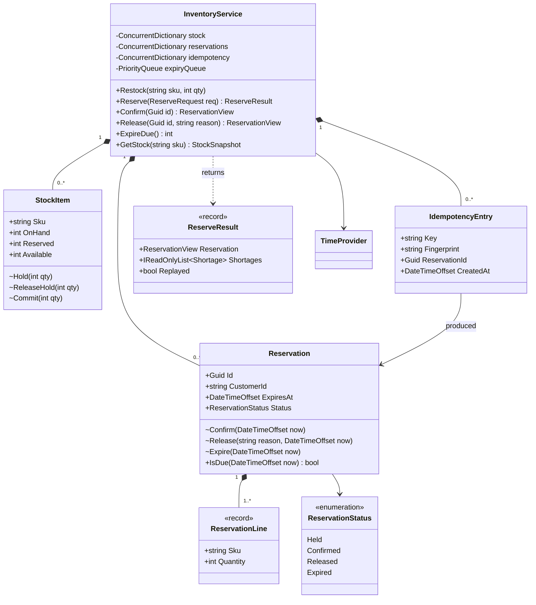
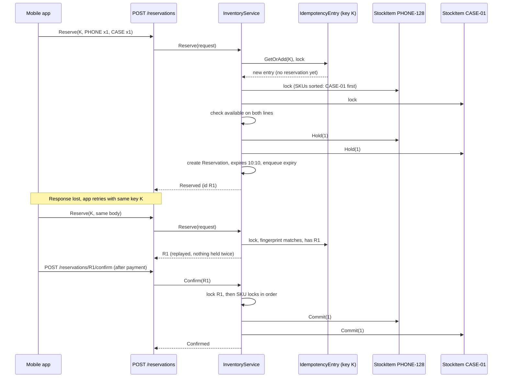
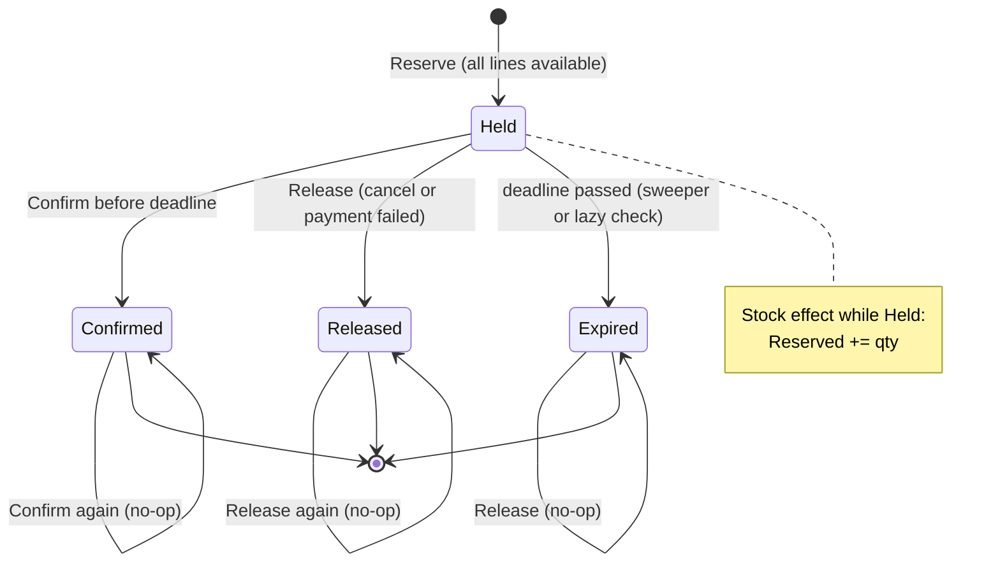

Every online shop has the same nightmare during a big sale: 5,000 people try to buy the last 200 units of a phone, payment takes 30 seconds to two minutes, some shoppers abandon checkout, and the network retries requests at random. If you take stock away only when payment succeeds, you sell units you do not have. If you take it away as soon as someone clicks "Buy", abandoned carts lock it up forever. The answer is a **reservation** (a hold): stock is set aside for a limited time while the customer pays. This case study designs that engine in C#. The system-level view (waiting rooms, hot-row sharding, queues in front of checkout) is the [flash sale HLD case](#/lesson/m17-flash-sale).

## Learning objectives

By the end of this case study you will be able to:

1. Write requirements for time-limited stock holds, including what "never oversell" means as a measurable invariant.
2. Model a reservation as a small state machine (Held, Confirmed, Released, Expired) whose illegal transitions cannot happen.
3. Place multi-item holds all-or-nothing, using per-item locks taken in a fixed order to avoid deadlock.
4. Expire abandoned holds efficiently with a priority queue and lazy expiry checks.
5. Make reserve, confirm and release safe to retry with idempotency keys and request fingerprints.
6. Resolve the race between "payment succeeded" and "hold expired".
7. Translate the in-memory design into PostgreSQL with conditional updates and unique constraints.

## Prerequisites

- [Object lifecycle and state management](#/lesson/m07-lifecycle-state): the reservation is a state machine.
- [Concurrency patterns](#/lesson/m13-concurrency-patterns) and [Deadlocks, optimistic and pessimistic locking](#/lesson/m09-locking).
- [Idempotency keys](#/lesson/m10-idempotency): the HTTP side of what we implement here.
- [Aggregates and aggregate roots](#/lesson/m08-aggregates): which object guards which invariant.

## Explain it like I'm a beginner

Imagine a sweet shop in Chandni Chowk during Diwali. There are 20 boxes of kaju katli left. You tell the shopkeeper, "Keep 2 boxes for me, I'm going to the ATM." He puts 2 boxes behind the counter with a slip: "Kept for Meera, until 4:10 pm."

Three things can happen next:

1. You come back by 4:10 and pay. The 2 boxes are now yours (**confirmed**).
2. You phone and say "never mind" (**released**). The boxes go back on the shelf.
3. 4:10 passes and you don't come (**expired**). The shopkeeper puts the boxes back so someone else can buy them.

While the boxes are behind the counter, they are not sold, but nobody else can take them either. The shelf count people see is "20 minus whatever is behind the counter" (**available stock**).

Two everyday problems show up:

- **Two customers, one box.** Two people ask for the last box at the same moment. The shopkeeper must hand it to exactly one of them. In software, that is **concurrency control**.
- **You ask twice.** You call to reserve, the line drops, you call again: "Keep 2 boxes for Meera." A good shopkeeper says "Already done, same slip." He does not keep 4 boxes. In software, that is **idempotency**: doing the same request twice has the same effect as doing it once.

## Requirements

### The scenario

An electronics retailer runs flash sales a few times a year. A typical sale: a popular phone, 2,000 units, about 50,000 shoppers in the first 10 minutes. Payment through UPI or cards takes between 20 seconds and 3 minutes. The mobile app retries any request that does not answer within 5 seconds. Last year, the old system oversold 312 units (they had to cancel orders and apologise) and also showed "sold out" while 400 units sat in abandoned carts.

### Functional requirements

| # | Requirement |
|---|---|
| F1 | **Reserve**: place a hold on one or more SKUs (stock keeping units) with quantities, for one customer. All lines succeed or none does. |
| F2 | A hold lasts a configurable time (default **10 minutes**). |
| F3 | **Confirm**: when payment succeeds, the held units are deducted from stock permanently. |
| F4 | **Release**: when the customer cancels or payment fails, the held units become available again. |
| F5 | **Expire**: holds that are neither confirmed nor released by their deadline are released automatically. |
| F6 | **Availability** of a SKU = on-hand minus active holds; shown on the product page. |
| F7 | **Idempotency**: a reserve request carries an `Idempotency-Key`. Repeating it returns the same reservation. Reusing the key with a *different* request is rejected. Confirm and release are naturally idempotent. |
| F8 | When stock is short, say which SKUs are short and how many are available. |
| F9 | Restock: add units to a SKU. |

### Non-functional requirements

| # | Requirement | Target |
|---|---|---|
| N1 | **No oversell** | For every SKU at every instant: `0 ≤ reserved ≤ onHand`. Under 1,000 concurrent reservations of 1 unit against 100 units, exactly 100 succeed. |
| N2 | No deadlock | Concurrent multi-SKU reservations in any order complete. |
| N3 | Latency | Reserve is in-memory or one short database transaction: p99 under 50 ms at the service (an estimate to validate with load tests). |
| N4 | Expiry accuracy | Expired holds are released within 5 seconds of their deadline; a confirm that arrives after the deadline is refused even if the sweeper has not run yet. |
| N5 | Idempotency window | Keys are remembered for 24 hours. |
| N6 | Testability | Time is injected (`TimeProvider`); no test sleeps. |

### Clarifying questions

- **What if payment succeeds after the hold expired?** It happens: UPI confirmations can arrive minutes late. Options: try to re-reserve the stock at confirm time; if that fails, refund automatically. We refuse a late confirm in the reservation engine and let the order workflow decide (see [Order processing](#/lesson/m18-order-processing)).
- **Per-customer limits?** Flash sales often cap at 2 per customer. We enforce a per-line maximum here; per-customer caps across reservations are an extension.
- **Multiple warehouses?** Not in phase 1; one stock pool per SKU. Multi-warehouse allocation is a separate design (which warehouse should serve this pincode?).
- **Should a failed reservation be remembered under its idempotency key?** We remember only successes. A retry after "out of stock" re-checks, because stock may have been released in the meantime. Remembering the failure would be equally defensible if the product prefers consistent answers.
- **Can holds be extended?** Not by default. Extension invites abuse (bots hold stock forever).
- **Where does the source of truth live?** In production, PostgreSQL. The in-memory engine here is the domain logic, and the "Alternative designs" section shows the SQL that enforces the same invariants across many servers.

## Identifying classes and responsibilities

| Class | Kind | Responsibility |
|---|---|---|
| `StockItem` | entity | One SKU's `OnHand` and `Reserved` counts and the invariant `0 ≤ Reserved ≤ OnHand`. Has its own lock. |
| `Reservation` | entity (state machine) | Lines, customer, deadline, status. Only legal transitions are possible. Has its own lock. |
| `ReservationStatus` | enum | Held, Confirmed, Released, Expired. |
| `ReservationLine` | value (record) | SKU and quantity. |
| `ReserveRequest` | record | Idempotency key, customer, lines. |
| `ReserveResult`, `Shortage`, `ReservationView`, `StockSnapshot` | records | Results returned to callers (Result pattern for expected failures). |
| `IdempotencyEntry` | class | Key, request fingerprint, the reservation it produced, and a lock so duplicate requests serialise. |
| `InventoryService` | class (Facade / application service) | Orchestrates reserve, confirm, release, expire; enforces lock ordering; owns the expiry queue. |
| `InventoryOptions` | options class | Hold duration, per-line maximum, idempotency retention. |
| `ReservationExpiryWorker` | `BackgroundService` | Calls `ExpireDue` and cleans idempotency entries on a timer. |
| Exceptions | classes | `ReservationNotFoundException`, `InvalidReservationStateException`, `IdempotencyConflictException`, `UnknownSkuException`. |

Notice what is **not** a class: there is no `Cart` here. The cart is a different concern (what the customer intends to buy). The reservation engine only knows SKUs, quantities and time.

Two kinds of failure are treated differently. "Not enough stock" is an *expected business outcome*, so `Reserve` returns a `ReserveResult` with shortages. "Confirm a reservation that has expired" or "reuse an idempotency key with a different body" are *caller errors*, so they throw domain exceptions that the HTTP layer maps to 409 and 422.

## Class diagram



How to read it: `InventoryService` is the only entry point and owns three collections: stock items, reservations and idempotency entries. `Reservation` owns its lines (composition: lines have no life outside their reservation). Mutating methods on `StockItem` and `Reservation` are marked `~` (internal): only the service calls them, and only while holding the right locks. That is the key structural decision: **the entities guard their own invariants** (a `StockItem` refuses to hold more than is available; a `Reservation` refuses to confirm unless it is Held), and **the service guards ordering and atomicity** (which locks, in which order, around which group of changes).

### Reserve, pay, confirm



Walk through it slowly. The first request creates an idempotency entry and locks it, so a duplicate request arriving 50 ms later waits instead of running in parallel. The service then locks both stock items **in sorted SKU order**, checks both lines, and only then holds both: all-or-nothing. When the response is lost and the app retries, the entry already points at reservation R1, so the service replays R1 instead of holding another phone. Confirm takes the reservation's lock first, then the stock locks (again sorted). Every operation that touches several objects follows one global lock order: *idempotency entry → reservation → stock items sorted by SKU*. Because everyone climbs the ladder in the same direction, two threads can never each hold a lock the other needs, which is the classic recipe for deadlock.

## Patterns and design decisions

### State pattern (lightweight)

`Reservation` has four states and a handful of transitions. A full State pattern (one class per state, see [State](#/lesson/m06-state)) would be overkill for four states with no state-specific data. We use an enum plus guard methods: each transition checks the current state and throws `InvalidReservationStateException` otherwise. If the reservation grew states with their own behaviour (say `PartiallyConfirmed` with per-line logic), switching to State classes would pay off.

### Result pattern for expected outcomes

Running out of stock during a flash sale is normal: thousands of requests will hit it. Throwing an exception for each is slow (exceptions capture stack traces) and muddles "expected" with "broken". `ReserveResult` carries either a reservation or a list of shortages. Exceptions remain for genuinely wrong calls. See [Options pattern and Result pattern](#/lesson/m06-options-result).

### Idempotency key plus fingerprint

The key alone is not enough. A buggy client might reuse the key `checkout-42` for a different cart. We store a **fingerprint** (a canonical string of customer plus sorted lines, hashed) with the key. Same key and same fingerprint: replay. Same key, different fingerprint: reject with `IdempotencyConflictException` (HTTP 422), because silently returning the old reservation would give the customer the wrong items.

Concurrent duplicates are the subtle part. Two identical requests can arrive within milliseconds (the app's retry fires while the first is still running). `GetOrAdd` makes both see the *same* entry, and the entry's lock makes the second wait until the first finishes, then replay its result.

### Per-SKU locks with a global order

A single global lock would be correct but would serialise every reservation in the shop. During a flash sale, most traffic is on one SKU anyway, but the other 10,000 SKUs should not wait behind it. Per-SKU locks let unrelated reservations proceed in parallel. The cost is deadlock risk for multi-SKU requests, which the sort order removes.

### Lazy expiry plus a sweeper

Two mechanisms, for two reasons:

- **Lazy check**: every `Confirm` checks `now >= ExpiresAt` itself. Correctness never depends on the sweeper being on time.
- **Sweeper**: a background worker releases due holds so that *availability* recovers promptly for other shoppers. It uses a `PriorityQueue<Guid, DateTimeOffset>` ordered by deadline, so each sweep pops only the due items: O(k log n) for k due holds, instead of scanning every reservation.

A popped entry might already be confirmed or released. That is fine: the sweeper re-checks the status under the reservation lock and skips it.

### Confirm vs expire race

The payment callback and the sweeper can act on the same reservation at the same moment. Both take the reservation's lock, so exactly one wins. If the sweeper wins, the confirm sees `Expired` and fails cleanly. If confirm wins, the sweeper sees `Confirmed` and skips. There is no state in which stock is both committed and released.

## State transitions



How to read it: a reservation is born *Held*, which is the only state with outgoing business transitions. The three exits each have a different effect on stock: **Confirmed** moves units from Reserved to sold (`OnHand -= qty`, `Reserved -= qty`); **Released** and **Expired** both return units (`Reserved -= qty`). All three are terminal. The self-loops are what make confirm and release idempotent: a payment provider that sends the same "success" webhook twice gets the same answer twice. What is *not* drawn is just as important: there is no arrow from Expired to Confirmed. A late payment cannot resurrect a hold; it must go through a new reservation or a refund. And Release of a Confirmed reservation is refused: returning sold goods is a different business process (returns), not a reservation concern.

## C# implementation

```text
Shop.Inventory/
  Program.cs
  Inventory/
    Model.cs
    Exceptions.cs
    InventoryService.cs
    ReservationExpiryWorker.cs
```

### Model: stock items and reservations

```csharp file=Inventory/Model.cs
namespace Shop.Inventory;

public enum ReservationStatus { Held, Confirmed, Released, Expired }

public sealed record ReservationLine(string Sku, int Quantity);

public sealed record StockSnapshot(string Sku, int OnHand, int Reserved, int Available);

/// <summary>One SKU's counts. Invariant: 0 &lt;= Reserved &lt;= OnHand. Mutated only with Gate held.</summary>
public sealed class StockItem(string sku)
{
    internal readonly Lock Gate = new();

    public string Sku { get; } = sku;
    public int OnHand { get; private set; }
    public int Reserved { get; private set; }
    public int Available => OnHand - Reserved;

    internal void Add(int qty)
    {
        ArgumentOutOfRangeException.ThrowIfNegativeOrZero(qty);
        OnHand = checked(OnHand + qty);
    }

    internal void Hold(int qty)
    {
        if (qty <= 0 || qty > Available) throw new InvalidOperationException($"Cannot hold {qty} of {Sku}; {Available} available.");
        Reserved += qty;
    }

    internal void ReleaseHold(int qty)
    {
        if (qty <= 0 || qty > Reserved) throw new InvalidOperationException($"Cannot release {qty} of {Sku}; {Reserved} reserved.");
        Reserved -= qty;
    }

    /// <summary>Held units become sold: they leave both Reserved and OnHand.</summary>
    internal void Commit(int qty)
    {
        ReleaseHold(qty);
        OnHand -= qty;
    }

    public StockSnapshot Snapshot() => new(Sku, OnHand, Reserved, Available);
}

public sealed class Reservation
{
    internal readonly Lock Gate = new();

    internal Reservation(Guid id, string customerId, IReadOnlyList<ReservationLine> lines, DateTimeOffset now, TimeSpan holdFor)
    {
        Id = id;
        CustomerId = customerId;
        Lines = lines;
        CreatedAt = now;
        ExpiresAt = now + holdFor;
    }

    public Guid Id { get; }
    public string CustomerId { get; }
    public IReadOnlyList<ReservationLine> Lines { get; }
    public DateTimeOffset CreatedAt { get; }
    public DateTimeOffset ExpiresAt { get; }
    public ReservationStatus Status { get; private set; } = ReservationStatus.Held;
    public DateTimeOffset? ClosedAt { get; private set; }
    public string? CloseReason { get; private set; }

    public bool IsDue(DateTimeOffset now) => Status == ReservationStatus.Held && now >= ExpiresAt;

    internal void Confirm(DateTimeOffset now)
    {
        EnsureHeld("confirm");
        if (now >= ExpiresAt) throw new InvalidReservationStateException(Id, ReservationStatus.Expired, "confirm");
        Close(ReservationStatus.Confirmed, "paid", now);
    }

    internal void Release(string reason, DateTimeOffset now)
    {
        EnsureHeld("release");
        Close(ReservationStatus.Released, reason, now);
    }

    internal void Expire(DateTimeOffset now)
    {
        EnsureHeld("expire");
        if (now < ExpiresAt) throw new InvalidOperationException($"Reservation {Id} is not due until {ExpiresAt:O}.");
        Close(ReservationStatus.Expired, "hold expired", now);
    }

    private void EnsureHeld(string action)
    {
        if (Status != ReservationStatus.Held) throw new InvalidReservationStateException(Id, Status, action);
    }

    private void Close(ReservationStatus to, string reason, DateTimeOffset now)
    {
        Status = to;
        CloseReason = reason;
        ClosedAt = now;
    }
}

public sealed record ReservationView(Guid Id, string CustomerId, ReservationStatus Status,
    IReadOnlyList<ReservationLine> Lines, DateTimeOffset ExpiresAt, string? CloseReason)
{
    public static ReservationView Of(Reservation r) => new(r.Id, r.CustomerId, r.Status, r.Lines, r.ExpiresAt, r.CloseReason);
}

public sealed record Shortage(string Sku, int Requested, int Available);

public sealed record ReserveRequest(string IdempotencyKey, string CustomerId, IReadOnlyList<ReservationLine> Lines);

public sealed record ReserveResult(ReservationView? Reservation, IReadOnlyList<Shortage> Shortages, bool Replayed)
{
    public bool Succeeded => Reservation is not null;
    public static ReserveResult Ok(Reservation r, bool replayed) => new(ReservationView.Of(r), [], replayed);
    public static ReserveResult Short(IReadOnlyList<Shortage> s) => new(null, s, false);
}

public sealed class InventoryOptions
{
    public TimeSpan HoldDuration { get; set; } = TimeSpan.FromMinutes(10);
    public int MaxQuantityPerLine { get; set; } = 10;
    public TimeSpan IdempotencyRetention { get; set; } = TimeSpan.FromHours(24);
}
```

### Exceptions

```csharp file=Inventory/Exceptions.cs
namespace Shop.Inventory;

public abstract class InventoryException(string message) : Exception(message);

public sealed class ReservationNotFoundException(Guid id) : InventoryException($"Reservation {id} was not found.");

public sealed class UnknownSkuException(string sku) : InventoryException($"SKU '{sku}' does not exist.");

public sealed class InvalidReservationStateException(Guid id, ReservationStatus status, string action)
    : InventoryException($"Cannot {action} reservation {id}: it is {status}.")
{
    public ReservationStatus Status { get; } = status;
}

public sealed class IdempotencyConflictException(string key)
    : InventoryException($"Idempotency key '{key}' was already used with a different request.");
```

### The service

```csharp file=Inventory/InventoryService.cs
using System.Collections.Concurrent;
using System.Security.Cryptography;
using System.Text;
using Microsoft.Extensions.Options;

namespace Shop.Inventory;

public sealed class InventoryService
{
    private sealed class IdempotencyEntry(string fingerprint, DateTimeOffset createdAt)
    {
        public readonly Lock Gate = new();
        public string Fingerprint { get; } = fingerprint;
        public DateTimeOffset CreatedAt { get; } = createdAt;
        public Guid? ReservationId { get; set; }
        public bool Retired { get; set; }
    }

    private readonly ConcurrentDictionary<string, StockItem> _stock = new(StringComparer.OrdinalIgnoreCase);
    private readonly ConcurrentDictionary<Guid, Reservation> _reservations = new();
    private readonly ConcurrentDictionary<string, IdempotencyEntry> _idempotency = new(StringComparer.Ordinal);
    private readonly PriorityQueue<Guid, DateTimeOffset> _expiryQueue = new();
    private readonly Lock _expiryGate = new();
    private readonly InventoryOptions _options;
    private readonly TimeProvider _time;

    public InventoryService(IOptions<InventoryOptions> options, TimeProvider time)
    {
        _options = options.Value;
        _time = time;
    }

    private DateTimeOffset Now => _time.GetUtcNow();

    // ---------------- Stock ----------------

    public StockSnapshot Restock(string sku, int quantity)
    {
        ArgumentException.ThrowIfNullOrWhiteSpace(sku);
        var item = _stock.GetOrAdd(sku.Trim(), s => new StockItem(s));
        lock (item.Gate)
        {
            item.Add(quantity);
            return item.Snapshot();
        }
    }

    public StockSnapshot GetStock(string sku)
    {
        var item = _stock.TryGetValue(sku, out var i) ? i : throw new UnknownSkuException(sku);
        lock (item.Gate) return item.Snapshot();
    }

    // ---------------- Reserve ----------------

    public ReserveResult Reserve(ReserveRequest request)
    {
        ArgumentNullException.ThrowIfNull(request);
        ArgumentException.ThrowIfNullOrWhiteSpace(request.IdempotencyKey);
        ArgumentException.ThrowIfNullOrWhiteSpace(request.CustomerId);
        var lines = Normalise(request.Lines);
        string fingerprint = Fingerprint(request.CustomerId, lines);

        while (true)
        {
            var entry = _idempotency.GetOrAdd(request.IdempotencyKey, static (_, a) => new IdempotencyEntry(a.fp, a.now), (fp: fingerprint, now: Now));
            lock (entry.Gate)                                    // duplicates with the same key wait here
            {
                if (entry.Retired) continue;                     // lost a race with cleanup; start again
                if (entry.Fingerprint != fingerprint) throw new IdempotencyConflictException(request.IdempotencyKey);
                if (entry.ReservationId is Guid existing)
                {
                    var previous = _reservations[existing];
                    lock (previous.Gate) return ReserveResult.Ok(previous, replayed: true);   // entry -> reservation: same global order
                }

                var result = TryHold(request.CustomerId, lines);
                if (result.Succeeded) entry.ReservationId = result.Reservation!.Id;
                return result;                                   // failures are not remembered: a retry re-checks stock
            }
        }
    }

    private ReserveResult TryHold(string customerId, IReadOnlyList<ReservationLine> lines)
    {
        // Unknown SKUs are reported as shortages with zero availability.
        var unknown = lines.Where(l => !_stock.ContainsKey(l.Sku)).Select(l => new Shortage(l.Sku, l.Quantity, 0)).ToList();
        if (unknown.Count > 0) return ReserveResult.Short(unknown);

        var items = lines.Select(l => _stock[l.Sku]).ToList();   // lines are already sorted by SKU
        EnterAll(items);
        try
        {
            var shortages = lines.Zip(items)
                .Where(p => p.Second.Available < p.First.Quantity)
                .Select(p => new Shortage(p.First.Sku, p.First.Quantity, p.Second.Available))
                .ToList();
            if (shortages.Count > 0) return ReserveResult.Short(shortages);   // nothing held: all-or-nothing

            foreach (var (line, item) in lines.Zip(items)) item.Hold(line.Quantity);

            var reservation = new Reservation(Guid.NewGuid(), customerId, lines, Now, _options.HoldDuration);
            _reservations[reservation.Id] = reservation;
            lock (_expiryGate) _expiryQueue.Enqueue(reservation.Id, reservation.ExpiresAt);
            return ReserveResult.Ok(reservation, replayed: false);
        }
        finally
        {
            ExitAll(items);
        }
    }

    // ---------------- Confirm / release / expire ----------------

    public ReservationView Confirm(Guid id)
    {
        var r = Find(id);
        lock (r.Gate)
        {
            if (r.Status == ReservationStatus.Confirmed) return ReservationView.Of(r);   // idempotent
            if (r.IsDue(Now)) CloseHeld(r, ReservationStatus.Expired, "hold expired");  // lazy expiry
            if (r.Status != ReservationStatus.Held) throw new InvalidReservationStateException(id, r.Status, "confirm");
            CloseHeld(r, ReservationStatus.Confirmed, "paid");
            return ReservationView.Of(r);
        }
    }

    public ReservationView Release(Guid id, string reason)
    {
        var r = Find(id);
        lock (r.Gate)
        {
            if (r.Status is ReservationStatus.Released or ReservationStatus.Expired) return ReservationView.Of(r);   // idempotent
            if (r.Status == ReservationStatus.Confirmed) throw new InvalidReservationStateException(id, r.Status, "release");
            CloseHeld(r, r.IsDue(Now) ? ReservationStatus.Expired : ReservationStatus.Released, reason);
            return ReservationView.Of(r);
        }
    }

    /// <summary>Releases every hold whose deadline has passed. Returns how many were expired.</summary>
    public int ExpireDue()
    {
        var now = Now;
        var due = new List<Guid>();
        lock (_expiryGate)
            while (_expiryQueue.TryPeek(out var id, out var at) && at <= now) due.Add(_expiryQueue.Dequeue());

        int expired = 0;
        foreach (var id in due)
        {
            if (!_reservations.TryGetValue(id, out var r)) continue;
            lock (r.Gate)
            {
                if (!r.IsDue(now)) continue;                     // already confirmed or released: skip
                CloseHeld(r, ReservationStatus.Expired, "hold expired");
                expired++;
            }
        }
        return expired;
    }

    /// <summary>Forgets idempotency keys older than the retention window.</summary>
    public int CleanupIdempotencyKeys()
    {
        var cutoff = Now - _options.IdempotencyRetention;
        int removed = 0;
        foreach (var (key, entry) in _idempotency)
        {
            lock (entry.Gate)
            {
                if (entry.CreatedAt > cutoff) continue;
                entry.Retired = true;
                if (_idempotency.TryRemove(new KeyValuePair<string, IdempotencyEntry>(key, entry))) removed++;
            }
        }
        return removed;
    }

    public ReservationView Get(Guid id)
    {
        var r = Find(id);
        lock (r.Gate) return ReservationView.Of(r);
    }

    // ---------------- Helpers ----------------

    /// <summary>Caller holds r.Gate. Applies the stock effect of leaving Held, under SKU locks in sorted order.</summary>
    private void CloseHeld(Reservation r, ReservationStatus to, string reason)
    {
        var items = r.Lines.Select(l => _stock[l.Sku]).ToList();
        EnterAll(items);
        try
        {
            var now = Now;
            switch (to)
            {
                case ReservationStatus.Confirmed:
                    r.Confirm(now);
                    foreach (var (line, item) in r.Lines.Zip(items)) item.Commit(line.Quantity);
                    break;
                case ReservationStatus.Released:
                    r.Release(reason, now);
                    foreach (var (line, item) in r.Lines.Zip(items)) item.ReleaseHold(line.Quantity);
                    break;
                case ReservationStatus.Expired:
                    r.Expire(now);
                    foreach (var (line, item) in r.Lines.Zip(items)) item.ReleaseHold(line.Quantity);
                    break;
                default:
                    throw new ArgumentOutOfRangeException(nameof(to));
            }
        }
        finally
        {
            ExitAll(items);
        }
    }

    private Reservation Find(Guid id) =>
        _reservations.TryGetValue(id, out var r) ? r : throw new ReservationNotFoundException(id);

    /// <summary>Merges duplicate SKUs, validates quantities and sorts by SKU: the global lock order.</summary>
    private IReadOnlyList<ReservationLine> Normalise(IReadOnlyList<ReservationLine>? lines)
    {
        if (lines is null || lines.Count == 0) throw new ArgumentException("At least one line is required.", nameof(lines));
        var merged = lines
            .GroupBy(l => l.Sku.Trim(), StringComparer.OrdinalIgnoreCase)
            .Select(g => new ReservationLine(g.Key.ToUpperInvariant(), g.Sum(l => l.Quantity)))
            .OrderBy(l => l.Sku, StringComparer.Ordinal)
            .ToList();
        foreach (var l in merged)
            if (l.Quantity <= 0 || l.Quantity > _options.MaxQuantityPerLine)
                throw new ArgumentOutOfRangeException(nameof(lines), $"Quantity for {l.Sku} must be between 1 and {_options.MaxQuantityPerLine}.");
        return merged;
    }

    private static string Fingerprint(string customerId, IReadOnlyList<ReservationLine> sortedLines)
    {
        var canonical = customerId + "|" + string.Join(';', sortedLines.Select(l => $"{l.Sku}:{l.Quantity}"));
        return Convert.ToHexString(SHA256.HashData(Encoding.UTF8.GetBytes(canonical)));
    }

    private static void EnterAll(List<StockItem> sortedItems)
    {
        foreach (var i in sortedItems) i.Gate.Enter();
    }

    private static void ExitAll(List<StockItem> sortedItems)
    {
        for (int k = sortedItems.Count - 1; k >= 0; k--) sortedItems[k].Gate.Exit();
    }
}
```

A few details that matter more than they look:

- **SKUs are upper-cased and sorted once**, in `Normalise`. Every later lock acquisition reuses that order. `Restock` registers SKUs under their trimmed name; the dictionary's case-insensitive comparer makes `phone-128` and `PHONE-128` the same item.
- **`EnterAll`/`ExitAll` exit in reverse order.** With `System.Threading.Lock` the order of exits does not cause deadlock, but reverse order is the conventional, easy-to-review shape.
- **`lock (_expiryGate)` is never held together with an SKU lock in the opposite order.** It is taken inside `TryHold` (after SKU locks), and alone in `ExpireDue`. No cycle, so no deadlock.
- **`Reservation.Confirm` re-checks the deadline itself.** Even if a future developer calls it without the lazy expiry check in the service, the entity refuses a late confirm.

### Expiry worker and HTTP endpoints

```csharp file=Inventory/ReservationExpiryWorker.cs
using Microsoft.Extensions.Hosting;
using Microsoft.Extensions.Logging;

namespace Shop.Inventory;

public sealed class ReservationExpiryWorker(InventoryService inventory, TimeProvider time, ILogger<ReservationExpiryWorker> log)
    : BackgroundService
{
    protected override async Task ExecuteAsync(CancellationToken stoppingToken)
    {
        using var timer = new PeriodicTimer(TimeSpan.FromSeconds(2), time);
        int ticks = 0;
        while (await timer.WaitForNextTickAsync(stoppingToken))
        {
            try
            {
                int n = inventory.ExpireDue();
                if (n > 0) log.LogInformation("Expired {Count} reservation holds", n);
                if (++ticks % 1800 == 0) inventory.CleanupIdempotencyKeys();   // about once an hour
            }
            catch (Exception ex)
            {
                log.LogError(ex, "Expiry sweep failed; will retry on the next tick");
            }
        }
    }
}
```

```csharp file=Program.cs
using Shop.Inventory;

var builder = WebApplication.CreateBuilder(args);
builder.Services.AddSingleton(TimeProvider.System);
builder.Services.Configure<InventoryOptions>(builder.Configuration.GetSection("Inventory"));
builder.Services.AddSingleton<InventoryService>();
builder.Services.AddHostedService<ReservationExpiryWorker>();
builder.Services.AddProblemDetails();

var app = builder.Build();

app.MapPost("/reservations", (ReserveBody body, HttpRequest http, InventoryService inv) =>
{
    var key = http.Headers["Idempotency-Key"].ToString();
    if (string.IsNullOrWhiteSpace(key))
        return Results.Problem("The Idempotency-Key header is required.", statusCode: StatusCodes.Status400BadRequest);
    try
    {
        var result = inv.Reserve(new ReserveRequest(key, body.CustomerId, body.Lines));
        if (!result.Succeeded) return Results.Conflict(new { error = "insufficient_stock", result.Shortages });
        return result.Replayed
            ? Results.Ok(result.Reservation)
            : Results.Created($"/reservations/{result.Reservation!.Id}", result.Reservation);
    }
    catch (IdempotencyConflictException ex)
    {
        return Results.Problem(ex.Message, statusCode: StatusCodes.Status422UnprocessableEntity);
    }
});

app.MapPost("/reservations/{id:guid}/confirm", (Guid id, InventoryService inv) => Handle(() => inv.Confirm(id)));
app.MapPost("/reservations/{id:guid}/release", (Guid id, InventoryService inv) => Handle(() => inv.Release(id, "customer cancelled")));
app.MapGet("/stock/{sku}", (string sku, InventoryService inv) => Handle(() => inv.GetStock(sku)));

app.Run();

static IResult Handle<T>(Func<T> action)
{
    try { return Results.Ok(action()); }
    catch (ReservationNotFoundException ex) { return Results.Problem(ex.Message, statusCode: StatusCodes.Status404NotFound); }
    catch (UnknownSkuException ex) { return Results.Problem(ex.Message, statusCode: StatusCodes.Status404NotFound); }
    catch (InvalidReservationStateException ex) { return Results.Problem(ex.Message, statusCode: StatusCodes.Status409Conflict); }
}

public sealed record ReserveBody(string CustomerId, IReadOnlyList<ReservationLine> Lines);
```

A replayed reservation returns `200 OK` while a new one returns `201 Created`. Some APIs return the original status code exactly; either is fine if documented. The important property is that the *body* (the reservation) is identical.

## Automated testing

Shared helpers: a settable clock and a factory.

```csharp
using Microsoft.Extensions.Options;
using Shop.Inventory;
using Xunit;

namespace Shop.Inventory.Tests;

public sealed class TestClock : TimeProvider
{
    private long _ticks = new DateTimeOffset(2026, 11, 1, 10, 0, 0, TimeSpan.Zero).UtcTicks;
    public override DateTimeOffset GetUtcNow() => new(Interlocked.Read(ref _ticks), TimeSpan.Zero);
    public void Advance(TimeSpan by) => Interlocked.Add(ref _ticks, by.Ticks);
}

public static class Inv
{
    public static InventoryService New(out TestClock clock, int phones = 100, int cases = 50)
    {
        clock = new TestClock();
        var svc = new InventoryService(Options.Create(new InventoryOptions()), clock);
        svc.Restock("PHONE-128", phones);
        svc.Restock("CASE-01", cases);
        return svc;
    }

    public static ReserveRequest Req(string key, string customer, params ReservationLine[] lines) => new(key, customer, lines);
    public static ReservationLine L(string sku, int qty) => new(sku, qty);
}
```

Core behaviour and the state machine:

```csharp
using Shop.Inventory;
using Xunit;
using static Shop.Inventory.Tests.Inv;

namespace Shop.Inventory.Tests;

public class ReservationLifecycleTests
{
    [Fact]
    public void Hold_reduces_available_but_not_on_hand()
    {
        var inv = New(out _);
        Assert.True(inv.Reserve(Req("k1", "meera", L("PHONE-128", 2))).Succeeded);
        Assert.Equal(new StockSnapshot("PHONE-128", 100, 2, 98), inv.GetStock("PHONE-128"));
    }

    [Fact]
    public void Multi_line_reservation_is_all_or_nothing()
    {
        var inv = New(out _, phones: 5, cases: 1);
        var r = inv.Reserve(Req("k1", "meera", L("PHONE-128", 1), L("CASE-01", 2)));
        Assert.False(r.Succeeded);
        Assert.Equal(new Shortage("CASE-01", 2, 1), Assert.Single(r.Shortages));
        Assert.Equal(5, inv.GetStock("PHONE-128").Available);              // the phone was not held either
    }

    [Fact]
    public void Confirm_commits_and_is_idempotent()
    {
        var inv = New(out _);
        var id = inv.Reserve(Req("k1", "meera", L("PHONE-128", 2))).Reservation!.Id;
        inv.Confirm(id);
        inv.Confirm(id);                                                    // duplicate webhook
        Assert.Equal(new StockSnapshot("PHONE-128", 98, 0, 98), inv.GetStock("PHONE-128"));
    }

    [Fact]
    public void Release_returns_stock_and_cannot_follow_confirm()
    {
        var inv = New(out _);
        var a = inv.Reserve(Req("k1", "meera", L("PHONE-128", 2))).Reservation!.Id;
        inv.Release(a, "payment failed");
        Assert.Equal(100, inv.GetStock("PHONE-128").Available);

        var b = inv.Reserve(Req("k2", "meera", L("PHONE-128", 1))).Reservation!.Id;
        inv.Confirm(b);
        Assert.Throws<InvalidReservationStateException>(() => inv.Release(b, "changed mind"));
    }

    [Fact]
    public void Sweeper_expires_due_holds_and_restores_availability()
    {
        var inv = New(out var clock);
        inv.Reserve(Req("k1", "meera", L("PHONE-128", 3)));
        clock.Advance(TimeSpan.FromMinutes(9));
        Assert.Equal(0, inv.ExpireDue());
        clock.Advance(TimeSpan.FromMinutes(1));
        Assert.Equal(1, inv.ExpireDue());
        Assert.Equal(100, inv.GetStock("PHONE-128").Available);
    }

    [Fact]
    public void Late_confirm_is_refused_even_before_the_sweeper_runs()
    {
        var inv = New(out var clock);
        var id = inv.Reserve(Req("k1", "meera", L("PHONE-128", 1))).Reservation!.Id;
        clock.Advance(TimeSpan.FromMinutes(10));
        var ex = Assert.Throws<InvalidReservationStateException>(() => inv.Confirm(id));
        Assert.Equal(ReservationStatus.Expired, ex.Status);
        Assert.Equal(100, inv.GetStock("PHONE-128").Available);
    }
}
```

Idempotency and concurrency:

```csharp
using Shop.Inventory;
using Xunit;
using static Shop.Inventory.Tests.Inv;

namespace Shop.Inventory.Tests;

public class ReservationConcurrencyTests
{
    [Fact]
    public void Same_key_same_body_replays()
    {
        var inv = New(out _);
        var first = inv.Reserve(Req("checkout-42", "meera", L("PHONE-128", 1)));
        var again = inv.Reserve(Req("checkout-42", "meera", L("phone-128", 1)));     // case differs: same request
        Assert.True(again.Replayed);
        Assert.Equal(first.Reservation!.Id, again.Reservation!.Id);
        Assert.Equal(99, inv.GetStock("PHONE-128").Available);
    }

    [Fact]
    public void Same_key_different_body_is_rejected() =>
        Assert.Throws<IdempotencyConflictException>(() =>
        {
            var inv = New(out _);
            inv.Reserve(Req("checkout-42", "meera", L("PHONE-128", 1)));
            inv.Reserve(Req("checkout-42", "meera", L("PHONE-128", 2)));
        });

    [Fact]
    public void Never_oversells_under_parallel_load()
    {
        var inv = New(out _, phones: 100);
        int ok = 0;
        Parallel.For(0, 1000, i =>
        {
            if (inv.Reserve(Req($"k{i}", $"c{i}", L("PHONE-128", 1))).Succeeded) Interlocked.Increment(ref ok);
        });
        Assert.Equal(100, ok);
        Assert.Equal(new StockSnapshot("PHONE-128", 100, 100, 0), inv.GetStock("PHONE-128"));
    }

    [Fact]
    public void Parallel_duplicates_with_one_key_hold_once()
    {
        var inv = New(out _);
        var ids = new System.Collections.Concurrent.ConcurrentBag<Guid>();
        Parallel.For(0, 50, _ => ids.Add(inv.Reserve(Req("double-tap", "meera", L("PHONE-128", 1))).Reservation!.Id));
        Assert.Single(ids.Distinct());
        Assert.Equal(99, inv.GetStock("PHONE-128").Available);
    }

    [Fact]
    public void Opposite_order_multi_sku_requests_do_not_deadlock()
    {
        var inv = New(out _, phones: 10_000, cases: 10_000);
        var work = Task.Run(() => Parallel.For(0, 2000, i =>
        {
            var lines = i % 2 == 0
                ? new[] { L("PHONE-128", 1), L("CASE-01", 1) }
                : new[] { L("CASE-01", 1), L("PHONE-128", 1) };
            inv.Reserve(new ReserveRequest($"k{i}", "c", lines));
        }));
        Assert.True(work.Wait(TimeSpan.FromSeconds(20)), "Reservations deadlocked");
        Assert.Equal(8000, inv.GetStock("CASE-01").Available);
    }

    [Fact]
    public void Confirm_racing_expiry_has_exactly_one_winner()
    {
        for (int round = 0; round < 200; round++)
        {
            var inv = New(out var clock, phones: 1);
            var id = inv.Reserve(Req("k", "meera", L("PHONE-128", 1))).Reservation!.Id;
            clock.Advance(TimeSpan.FromMinutes(10) - TimeSpan.FromTicks(1));
            var confirm = Task.Run(() => { try { inv.Confirm(id); } catch (InvalidReservationStateException) { } });
            var expire = Task.Run(() => { clock.Advance(TimeSpan.FromTicks(1)); inv.ExpireDue(); });
            Task.WaitAll(confirm, expire);
            var s = inv.GetStock("PHONE-128");
            Assert.Equal(0, s.Reserved);                                        // never left dangling
            Assert.True(s.OnHand == 0 || s.Available == 1, "stock must be either sold or fully returned");
        }
    }
}
```

What these tests prove:

- **The invariant, not just the happy path.** Every test ends by checking the stock snapshot. Most reservation bugs are counts drifting by one.
- **Concurrency tests check outcomes that must hold for every interleaving** ("exactly 100", "one distinct id", "Reserved is 0"). They cannot prove the absence of races, but they catch the common ones reliably, and run in well under a second.
- **The deadlock test has a timeout.** A deadlock does not fail a test; it hangs it. `Wait(TimeSpan)` turns a hang into a clear failure.

## Bad design vs good design

### Bad: check-then-act with no ownership

```csharp
public class StockController
{
    static Dictionary<string, int> stock = new();
    static List<(Guid Id, string Sku, int Qty, DateTime Expires)> holds = new();

    public Guid Reserve(string sku, int qty)
    {
        if (stock[sku] - holds.Where(h => h.Sku == sku).Sum(h => h.Qty) >= qty)   // check
        {
            var id = Guid.NewGuid();
            holds.Add((id, sku, qty, DateTime.Now.AddMinutes(10)));                // act
            return id;
        }
        throw new Exception("Out of stock");
    }

    public void Confirm(Guid id)
    {
        var h = holds.First(x => x.Id == id);
        stock[h.Sku] -= h.Qty;
        holds.Remove(h);
    }
}
```

What goes wrong in a flash sale:

1. **Check-then-act race.** Two requests both see "1 left", both add a hold: oversold. `List<T>` itself is not thread-safe either, so concurrent `Add` can corrupt it.
2. **Expiry never happens.** Nothing removes old holds, so the summing loop counts them forever ("sold out" with stock on the shelf). It is also O(holds) on every request.
3. **Late confirm accepted.** `Confirm` does not check the deadline or the state, so a payment arriving 20 minutes later deducts stock that may already be held by someone else: oversold again.
4. **Double confirm double-deducts?** Here the second call throws on `First`, which is a 500 error for a duplicate webhook. Either way, not idempotent.
5. **Retries create duplicate holds.** No idempotency key, so a retried request holds twice.
6. **Exceptions for expected outcomes.** "Out of stock" thrown as `Exception` is indistinguishable from a bug.
7. **One SKU per call.** A cart with a phone and a case cannot be reserved atomically; the client must undo manually if the second call fails.

### Good: the design above

| Concern | Bad | Good |
|---|---|---|
| Oversell | Check-then-act without locks | Check and hold under the SKU lock; invariant enforced in `StockItem` |
| Expiry | None | Priority-queue sweeper plus lazy check on confirm |
| State | Implicit (in list or not) | Explicit state machine with guarded transitions |
| Retries | Duplicate holds | Idempotency key plus fingerprint, concurrent duplicates serialised |
| Multi-item | One call per SKU | All-or-nothing, sorted lock order |
| Expected failures | Exceptions | `ReserveResult` with shortages |

### When is this too much?

A shop that sells 50 orders a day with plenty of stock rarely needs holds at all: decrement stock at payment, and on the rare collision, refund and apologise. Holds earn their complexity when stock is scarce relative to demand (sales, limited editions, event tickets) or when payment is slow.

## Alternative designs

### PostgreSQL as the source of truth

With several API servers, in-memory locks are not enough: each server has its own. Move the invariant into the database, where one conditional update both checks and acts atomically:

```sql
-- Hold 1 unit only if available: the WHERE clause is the "check", the UPDATE is the "act".
UPDATE stock
SET reserved = reserved + 1
WHERE sku = 'PHONE-128' AND on_hand - reserved >= 1
RETURNING on_hand, reserved;      -- zero rows returned means "not enough stock"

-- Idempotency: a unique constraint makes "claim this key" atomic across servers.
CREATE TABLE reservations (
  id uuid PRIMARY KEY,
  idempotency_key text NOT NULL UNIQUE,
  fingerprint text NOT NULL,
  customer_id text NOT NULL,
  status text NOT NULL CHECK (status IN ('held','confirmed','released','expired')),
  expires_at timestamptz NOT NULL
);
CREATE INDEX ON reservations (expires_at) WHERE status = 'held';   -- the sweeper's "priority queue"
```

Run the stock updates for all lines (in SKU order, to avoid deadlocks between transactions) and the reservation insert in **one transaction**. A unique-violation on `idempotency_key` means "duplicate": read the existing row and compare fingerprints. Confirm across servers is also one conditional statement: `UPDATE reservations SET status = 'confirmed' WHERE id = $1 AND status = 'held' AND expires_at > now()`; zero rows means it was already expired, released or confirmed, so read the row to decide between "replay" and "refuse". The sweeper picks a batch with `SELECT id FROM reservations WHERE status = 'held' AND expires_at <= now() ORDER BY expires_at LIMIT 500 FOR UPDATE SKIP LOCKED`, marks those rows `expired` and releases their stock in the same transaction; `SKIP LOCKED` lets several sweeper instances share the work without blocking each other or a confirm that is in flight. A `CHECK (reserved >= 0 AND reserved <= on_hand)` constraint on `stock` is the database's last line of defence for N1.

### Redis for hot SKUs

For extreme flash sales, a single hot row in PostgreSQL becomes a bottleneck: every transaction waits on that row lock. Some systems pre-load the sale stock into Redis and decrement with an atomic Lua script, then write reservations to the database asynchronously. Much higher throughput on one SKU; the price is a second source of truth that must be reconciled. Use it only when measurements show the row lock is the limit.

### Optimistic concurrency instead of locks

Give each stock row a `version`. Read, compute, then `UPDATE ... WHERE sku = $1 AND version = $2`. If zero rows changed, someone else won: re-read and retry. Excellent when contention is low (most SKUs most of the time); under a flash sale on one SKU, most attempts retry and waste work, which is why the conditional update above (no read-modify-write at all) is usually better for counters.

### Stock buckets

Split one SKU's 2,000 units into 20 buckets of 100, each its own row or lock, and let requests pick a random bucket (falling back to others when empty). It spreads contention like sharding a counter. Availability is the sum of buckets. More complex, so reserve it for proven hot spots.

### Event-sourced inventory

Record `StockReceived`, `StockHeld`, `HoldReleased`, `StockCommitted` events and derive counts by replaying them. You get a perfect audit trail and easy reconciliation with the warehouse system, at the cost of building projections and handling replays. See [Event sourcing fundamentals](#/lesson/m08-event-sourcing).

## Practical playground

Open the model in the LLD designer and try:

1. Add `Extend(TimeSpan)` to `Reservation`. Which new state transition appears, and what limit stops bots from holding stock forever?
2. Add a `PartiallyConfirmed` state (one line paid, one line backordered). Does the enum still suffice, or do you now want State classes?
3. Add a `Warehouse` class so stock is per (warehouse, SKU). What changes in the lock order?

:::playground type=lld title="Inventory reservation — reference model"
```json
{
  "classes": [
    { "id": "Svc", "name": "InventoryService", "kind": "class", "fields": ["-ConcurrentDictionary stock", "-ConcurrentDictionary reservations", "-ConcurrentDictionary idempotency", "-PriorityQueue expiryQueue"], "methods": ["+StockSnapshot Restock(string sku, int qty)", "+ReserveResult Reserve(ReserveRequest req)", "+ReservationView Confirm(Guid id)", "+ReservationView Release(Guid id, string reason)", "+int ExpireDue()", "+int CleanupIdempotencyKeys()"], "responsibility": "Facade: lock ordering, atomicity, idempotency, expiry" },
    { "id": "Stock", "name": "StockItem", "kind": "class", "fields": ["+string Sku", "+int OnHand", "+int Reserved", "+int Available"], "methods": ["~void Hold(int qty)", "~void ReleaseHold(int qty)", "~void Commit(int qty)"], "responsibility": "Invariant 0 <= Reserved <= OnHand" },
    { "id": "Res", "name": "Reservation", "kind": "class", "fields": ["+Guid Id", "+string CustomerId", "+DateTimeOffset ExpiresAt", "+ReservationStatus Status"], "methods": ["~void Confirm(DateTimeOffset now)", "~void Release(string reason, DateTimeOffset now)", "~void Expire(DateTimeOffset now)", "+bool IsDue(DateTimeOffset now)"], "responsibility": "State machine with guarded transitions" },
    { "id": "Line", "name": "ReservationLine", "kind": "record", "fields": ["+string Sku", "+int Quantity"], "methods": [] },
    { "id": "Status", "name": "ReservationStatus", "kind": "enum", "fields": ["Held", "Confirmed", "Released", "Expired"], "methods": [] },
    { "id": "Idem", "name": "IdempotencyEntry", "kind": "class", "fields": ["+string Fingerprint", "+Guid ReservationId", "+DateTimeOffset CreatedAt", "+bool Retired"], "methods": [], "responsibility": "Serialises duplicate requests; remembers the result" },
    { "id": "Req", "name": "ReserveRequest", "kind": "record", "fields": ["+string IdempotencyKey", "+string CustomerId", "+IReadOnlyList Lines"], "methods": [] },
    { "id": "Result", "name": "ReserveResult", "kind": "record", "fields": ["+ReservationView Reservation", "+IReadOnlyList Shortages", "+bool Replayed"], "methods": ["+bool Succeeded"] },
    { "id": "Short", "name": "Shortage", "kind": "record", "fields": ["+string Sku", "+int Requested", "+int Available"], "methods": [] },
    { "id": "Worker", "name": "ReservationExpiryWorker", "kind": "class", "fields": [], "methods": ["#Task ExecuteAsync(CancellationToken ct)"], "responsibility": "Calls ExpireDue every 2 seconds" },
    { "id": "Opts", "name": "InventoryOptions", "kind": "class", "fields": ["+TimeSpan HoldDuration", "+int MaxQuantityPerLine", "+TimeSpan IdempotencyRetention"], "methods": [] }
  ],
  "relations": [
    { "from": "Svc", "to": "Stock", "kind": "composition", "multiplicity": "0..*" },
    { "from": "Svc", "to": "Res", "kind": "composition", "multiplicity": "0..*" },
    { "from": "Svc", "to": "Idem", "kind": "composition", "multiplicity": "0..*" },
    { "from": "Res", "to": "Line", "kind": "composition", "multiplicity": "1..*" },
    { "from": "Res", "to": "Status", "kind": "association" },
    { "from": "Idem", "to": "Res", "kind": "association", "label": "produced" },
    { "from": "Svc", "to": "Req", "kind": "dependency" },
    { "from": "Svc", "to": "Result", "kind": "dependency", "label": "returns" },
    { "from": "Result", "to": "Short", "kind": "aggregation", "multiplicity": "0..*" },
    { "from": "Svc", "to": "Opts", "kind": "association" },
    { "from": "Worker", "to": "Svc", "kind": "dependency" }
  ]
}
```
:::

## Exercises

:::exercise id=m18-inventory-reservation-ex1 difficulty=beginner kind=code title="Reservation state machine"
Implement `Hold`, a reservation state machine with four states. Legal transitions succeed; repeating the same terminal action is a no-op; illegal transitions throw `InvalidOperationException`.
::requirements
- New holds are `Held` and expire at `createdAt + ttl`.
- `Confirm(now)`: Held to Confirmed if `now < ExpiresAt`; if `now >= ExpiresAt`, the hold becomes Expired and the call throws.
- `Release(now)`: Held to Released. On Released or Expired: no-op. On Confirmed: throws.
- `Expire(now)`: Held to Expired if due; returns true if it expired the hold, false otherwise (never throws).
- `Confirm` on an already Confirmed hold is a no-op.
::acceptance
- Confirm at 9 minutes works with a 10-minute TTL; at exactly 10 minutes it throws and the state is Expired.
- Release after Confirm throws; Release twice is fine.
- `Expire` before the deadline returns false and changes nothing.
::hint
Every method starts with a `switch` (or `if`) on the current status.
::hint
Decide each (state, action) pair explicitly; a 4 × 3 table on paper helps.
::hint
"Late confirm" is two steps: first expire, then throw. Do not leave the hold in Held after a late confirm.
::hint
```csharp
public void Confirm(DateTimeOffset now) {
    if (Status == HoldStatus.Confirmed) return;
    if (Status == HoldStatus.Held && now >= ExpiresAt) { Status = HoldStatus.Expired; }
    if (Status != HoldStatus.Held) throw new InvalidOperationException(...);
    Status = HoldStatus.Confirmed;
}
```
::starter
```csharp file=Hold.cs
using System;

public enum HoldStatus { Held, Confirmed, Released, Expired }

public sealed class Hold
{
    public Hold(DateTimeOffset createdAt, TimeSpan ttl)
    {
        ExpiresAt = createdAt + ttl;
    }

    public DateTimeOffset ExpiresAt { get; }
    public HoldStatus Status { get; private set; } = HoldStatus.Held;

    public void Confirm(DateTimeOffset now) => throw new NotImplementedException();
    public void Release(DateTimeOffset now) => throw new NotImplementedException();
    public bool Expire(DateTimeOffset now) => throw new NotImplementedException();
}
```
::tests
```csharp file=HoldTests.cs
using System;
using Xunit;

public class HoldTests
{
    private static readonly DateTimeOffset T0 = new(2026, 11, 1, 10, 0, 0, TimeSpan.Zero);
    private static Hold New() => new(T0, TimeSpan.FromMinutes(10));

    [Fact]
    public void Confirm_before_deadline()
    {
        var h = New();
        h.Confirm(T0.AddMinutes(9));
        Assert.Equal(HoldStatus.Confirmed, h.Status);
        h.Confirm(T0.AddMinutes(30));                       // idempotent, even later
        Assert.Equal(HoldStatus.Confirmed, h.Status);
    }

    [Fact]
    public void Confirm_at_deadline_expires_and_throws()
    {
        var h = New();
        Assert.Throws<InvalidOperationException>(() => h.Confirm(T0.AddMinutes(10)));
        Assert.Equal(HoldStatus.Expired, h.Status);
    }

    [Fact]
    public void Release_rules()
    {
        var h = New();
        h.Release(T0);
        h.Release(T0);
        Assert.Equal(HoldStatus.Released, h.Status);
        Assert.Throws<InvalidOperationException>(() => h.Confirm(T0));

        var c = New();
        c.Confirm(T0);
        Assert.Throws<InvalidOperationException>(() => c.Release(T0));
    }

    [Fact]
    public void Expire_only_when_due()
    {
        var h = New();
        Assert.False(h.Expire(T0.AddMinutes(5)));
        Assert.Equal(HoldStatus.Held, h.Status);
        Assert.True(h.Expire(T0.AddMinutes(10)));
        Assert.False(h.Expire(T0.AddMinutes(11)));
        h.Release(T0.AddMinutes(12));                       // no-op on Expired
        Assert.Equal(HoldStatus.Expired, h.Status);
    }

    [Fact]
    public void Expire_never_touches_confirmed()
    {
        var h = New();
        h.Confirm(T0);
        Assert.False(h.Expire(T0.AddHours(1)));
        Assert.Equal(HoldStatus.Confirmed, h.Status);
    }
}
```
::solution
```csharp file=Hold.cs
using System;

public enum HoldStatus { Held, Confirmed, Released, Expired }

public sealed class Hold
{
    public Hold(DateTimeOffset createdAt, TimeSpan ttl)
    {
        if (ttl <= TimeSpan.Zero) throw new ArgumentOutOfRangeException(nameof(ttl));
        ExpiresAt = createdAt + ttl;
    }

    public DateTimeOffset ExpiresAt { get; }
    public HoldStatus Status { get; private set; } = HoldStatus.Held;

    public void Confirm(DateTimeOffset now)
    {
        if (Status == HoldStatus.Confirmed) return;
        Expire(now);                                         // lazy expiry first
        if (Status != HoldStatus.Held)
            throw new InvalidOperationException($"Cannot confirm a hold that is {Status}.");
        Status = HoldStatus.Confirmed;
    }

    public void Release(DateTimeOffset now)
    {
        switch (Status)
        {
            case HoldStatus.Released or HoldStatus.Expired: return;
            case HoldStatus.Confirmed: throw new InvalidOperationException("A confirmed hold cannot be released.");
            default: Status = HoldStatus.Released; return;
        }
    }

    public bool Expire(DateTimeOffset now)
    {
        if (Status != HoldStatus.Held || now < ExpiresAt) return false;
        Status = HoldStatus.Expired;
        return true;
    }
}
```

Reusing `Expire` inside `Confirm` keeps the deadline rule in one place. Notice the deadline is *inclusive*: at exactly 10:10:00 the hold is gone. Pick one convention and test the boundary.
::mistakes
- Throwing on a repeated Confirm, which turns a duplicate payment webhook into an error.
- Throwing from `Expire`, which makes the sweeper fragile; it should simply skip holds that are not due.
- Leaving the state as Held after a late confirm, so the stock is never released.
::extensions
Add `Extend(TimeSpan by, DateTimeOffset now)` that allows one extension of at most 5 minutes, only while Held and not yet due.
:::

:::exercise id=m18-inventory-reservation-ex2 difficulty=beginner kind=code title="A stock ledger that cannot oversell"
Implement `StockLedger` for one SKU. It tracks `OnHand` and `Reserved` and must keep the invariant `0 <= Reserved <= OnHand` no matter which methods are called.
::requirements
- `TryHold(qty)`: returns false (and changes nothing) if `qty > Available`.
- `Release(qty)`: returns held units; throws if `qty` exceeds `Reserved`.
- `Commit(qty)`: turns held units into sold units (`Reserved -= qty`, `OnHand -= qty`); throws if `qty > Reserved`.
- `WriteOff(qty)`: removes damaged units from `OnHand`; throws if that would make `OnHand < Reserved` (you cannot write off units promised to customers).
- All quantities must be positive.
::acceptance
- OnHand 10: hold 7 succeeds, hold 4 fails, Available is 3.
- Commit 5 leaves OnHand 5, Reserved 2.
- WriteOff 4 then fails (5 − 4 = 1 < 2 reserved); WriteOff 3 succeeds.
::hint
Write the invariant as a private method and call it at the end of every mutation while developing.
::hint
Validate *before* mutating, so a rejected call leaves the ledger unchanged.
::hint
`WriteOff` is the subtle one: the limit is `OnHand - Reserved`, the same as `Available`.
::starter
```csharp file=StockLedger.cs
using System;

public sealed class StockLedger
{
    public StockLedger(int onHand) => OnHand = onHand;

    public int OnHand { get; private set; }
    public int Reserved { get; private set; }
    public int Available => OnHand - Reserved;

    public bool TryHold(int qty) => throw new NotImplementedException();
    public void Release(int qty) => throw new NotImplementedException();
    public void Commit(int qty) => throw new NotImplementedException();
    public void WriteOff(int qty) => throw new NotImplementedException();
}
```
::tests
```csharp file=StockLedgerTests.cs
using System;
using Xunit;

public class StockLedgerTests
{
    [Fact]
    public void Holds_up_to_available()
    {
        var s = new StockLedger(10);
        Assert.True(s.TryHold(7));
        Assert.False(s.TryHold(4));
        Assert.Equal(3, s.Available);
        Assert.Equal(7, s.Reserved);
    }

    [Fact]
    public void Commit_moves_reserved_to_sold()
    {
        var s = new StockLedger(10);
        s.TryHold(7);
        s.Commit(5);
        Assert.Equal(5, s.OnHand);
        Assert.Equal(2, s.Reserved);
    }

    [Fact]
    public void Write_off_cannot_eat_reserved_units()
    {
        var s = new StockLedger(10);
        s.TryHold(7);
        s.Commit(5);
        Assert.Throws<InvalidOperationException>(() => s.WriteOff(4));
        Assert.Equal(5, s.OnHand);
        s.WriteOff(3);
        Assert.Equal(2, s.OnHand);
        Assert.Equal(0, s.Available);
    }

    [Fact]
    public void Release_and_commit_are_bounded_by_reserved()
    {
        var s = new StockLedger(10);
        s.TryHold(2);
        Assert.Throws<InvalidOperationException>(() => s.Release(3));
        Assert.Throws<InvalidOperationException>(() => s.Commit(3));
        s.Release(2);
        Assert.Equal(10, s.Available);
    }

    [Fact]
    public void Quantities_must_be_positive()
    {
        var s = new StockLedger(10);
        Assert.Throws<ArgumentOutOfRangeException>(() => s.TryHold(0));
        Assert.Throws<ArgumentOutOfRangeException>(() => s.WriteOff(-1));
    }
}
```
::solution
```csharp file=StockLedger.cs
using System;

public sealed class StockLedger
{
    public StockLedger(int onHand)
    {
        ArgumentOutOfRangeException.ThrowIfNegative(onHand);
        OnHand = onHand;
    }

    public int OnHand { get; private set; }
    public int Reserved { get; private set; }
    public int Available => OnHand - Reserved;

    public bool TryHold(int qty)
    {
        ArgumentOutOfRangeException.ThrowIfNegativeOrZero(qty);
        if (qty > Available) return false;
        Reserved += qty;
        return true;
    }

    public void Release(int qty)
    {
        ArgumentOutOfRangeException.ThrowIfNegativeOrZero(qty);
        if (qty > Reserved) throw new InvalidOperationException($"Only {Reserved} units are reserved.");
        Reserved -= qty;
    }

    public void Commit(int qty)
    {
        ArgumentOutOfRangeException.ThrowIfNegativeOrZero(qty);
        if (qty > Reserved) throw new InvalidOperationException($"Only {Reserved} units are reserved.");
        Reserved -= qty;
        OnHand -= qty;
    }

    public void WriteOff(int qty)
    {
        ArgumentOutOfRangeException.ThrowIfNegativeOrZero(qty);
        if (qty > Available) throw new InvalidOperationException($"Only {Available} unreserved units can be written off.");
        OnHand -= qty;
    }
}
```

`TryHold` returns `bool` because "not enough stock" is an expected outcome; `Release` and `Commit` throw because calling them with too much means the *caller* has a bug.
::mistakes
- Letting `WriteOff` push `OnHand` below `Reserved`, so customers with valid holds cannot be fulfilled.
- Using `Available` (computed) as a stored field and forgetting to update it.
- Mutating first and validating after.
::extensions
In real warehouses, write-offs sometimes *must* happen (the units are smashed). Design what happens then: which holds get cancelled, and how are customers notified?
:::

:::exercise id=m18-inventory-reservation-ex3 difficulty=intermediate kind=code title="An idempotency cache that handles concurrent duplicates"
Build `IdempotencyCache<T>` with one method: `Execute(key, fingerprint, Func<T> action)`. The first call for a key runs the action and remembers the result; later calls with the same key and fingerprint return the remembered result without running the action again.
::requirements
- Same key, different fingerprint: throw `InvalidOperationException`.
- Concurrent calls with the same key: the action runs **once**; the others wait and get the same result.
- If the action throws, nothing is remembered: the exception propagates and a later call runs the action again.
- Different keys never block each other.
- Return an `(T Value, bool Replayed)` tuple.
::acceptance
- 50 parallel calls with one key run the action once and all receive the same value.
- A throwing action is retried on the next call.
- Reusing a key with a different fingerprint throws.
::hint
`ConcurrentDictionary.GetOrAdd` gives every caller the same *entry* for a key; the entry needs a lock.
::hint
Inside the entry's lock: check fingerprint, then "already has a value?", then run the action.
::hint
Keep a `bool HasValue` flag; do not use `default(T)` as "no value", because `default` might be a real result (0, false).
::hint
`Lazy<T>` with `ExecutionAndPublication` looks tempting, but it caches exceptions too. That breaks the "retry after failure" rule.
::starter
```csharp file=IdempotencyCache.cs
using System;
using System.Collections.Concurrent;
using System.Threading;

public sealed class IdempotencyCache<T>
{
    public (T Value, bool Replayed) Execute(string key, string fingerprint, Func<T> action) =>
        throw new NotImplementedException();
}
```
::tests
```csharp file=IdempotencyCacheTests.cs
using System;
using System.Collections.Concurrent;
using System.Linq;
using System.Threading;
using System.Threading.Tasks;
using Xunit;

public class IdempotencyCacheTests
{
    [Fact]
    public void Replays_result()
    {
        var c = new IdempotencyCache<int>();
        int runs = 0;
        var a = c.Execute("k", "f", () => ++runs * 10);
        var b = c.Execute("k", "f", () => ++runs * 10);
        Assert.Equal((10, false), a);
        Assert.Equal((10, true), b);
        Assert.Equal(1, runs);
    }

    [Fact]
    public void Different_fingerprint_throws()
    {
        var c = new IdempotencyCache<string>();
        c.Execute("k", "f1", () => "x");
        Assert.Throws<InvalidOperationException>(() => c.Execute("k", "f2", () => "y"));
    }

    [Fact]
    public void Concurrent_duplicates_run_once()
    {
        var c = new IdempotencyCache<Guid>();
        int runs = 0;
        var results = new ConcurrentBag<Guid>();
        Parallel.For(0, 50, _ => results.Add(c.Execute("k", "f", () =>
        {
            Interlocked.Increment(ref runs);
            Thread.Sleep(20);
            return Guid.NewGuid();
        }).Value));
        Assert.Equal(1, runs);
        Assert.Single(results.Distinct());
    }

    [Fact]
    public void Failures_are_not_cached()
    {
        var c = new IdempotencyCache<int>();
        Assert.Throws<TimeoutException>(() => c.Execute("k", "f", () => throw new TimeoutException()));
        Assert.Equal((7, false), c.Execute("k", "f", () => 7));
    }

    [Fact]
    public void Default_values_are_real_results()
    {
        var c = new IdempotencyCache<int>();
        int runs = 0;
        c.Execute("k", "f", () => { runs++; return 0; });
        Assert.True(c.Execute("k", "f", () => { runs++; return 0; }).Replayed);
        Assert.Equal(1, runs);
    }

    [Fact]
    public void Different_keys_do_not_block_each_other()
    {
        var c = new IdempotencyCache<int>();
        using var gate = new ManualResetEventSlim();
        var slow = Task.Run(() => c.Execute("slow", "f", () => { gate.Wait(TimeSpan.FromSeconds(5)); return 1; }));
        Thread.Sleep(50);
        Assert.Equal((2, false), c.Execute("fast", "f", () => 2));   // completes while "slow" is still running
        gate.Set();
        slow.Wait();
    }
}
```
::solution
```csharp file=IdempotencyCache.cs
using System;
using System.Collections.Concurrent;
using System.Threading;

public sealed class IdempotencyCache<T>
{
    private sealed class Entry(string fingerprint)
    {
        public readonly Lock Gate = new();
        public string Fingerprint { get; } = fingerprint;
        public bool HasValue;
        public T Value = default!;
    }

    private readonly ConcurrentDictionary<string, Entry> _entries = new(StringComparer.Ordinal);

    public (T Value, bool Replayed) Execute(string key, string fingerprint, Func<T> action)
    {
        ArgumentException.ThrowIfNullOrEmpty(key);
        var entry = _entries.GetOrAdd(key, static (_, fp) => new Entry(fp), fingerprint);
        lock (entry.Gate)
        {
            if (entry.Fingerprint != fingerprint)
                throw new InvalidOperationException($"Key '{key}' was used with a different request.");
            if (entry.HasValue) return (entry.Value, true);

            T value = action();          // if this throws, HasValue stays false: the next call retries
            entry.Value = value;
            entry.HasValue = true;
            return (value, false);
        }
    }
}
```

The per-entry lock is what turns "50 simultaneous duplicates" into "1 execution plus 49 replays". Note the fingerprint is fixed by whoever creates the entry first; a failed first attempt with a *wrong* fingerprint would pin it. Production stores often delete the entry when the first attempt fails, using the retire-and-retry technique from the main implementation.
::alternatives
In a database, the same behaviour comes from `INSERT ... ON CONFLICT (key) DO NOTHING` to claim the key, a `status` column (`in_progress`, `completed`), and the stored response. Concurrent duplicates that find `in_progress` either wait and poll, or return `409 Conflict` telling the client to retry shortly; the IETF draft allows the latter.
::mistakes
- Using a global lock: correct, but every key waits for every other.
- Caching exceptions (for example with `Lazy<T>`), so a transient timeout becomes permanent for that key.
- Checking "has value" outside the lock, then running the action: two threads both see "no value".
::extensions
Add a time-to-live per entry using `TimeProvider`, and a `Cleanup()` that removes expired entries without racing in-flight calls.
:::

:::exercise id=m18-inventory-reservation-ex4 difficulty=intermediate kind=sql ordered=true title="Availability from stock and active holds"
The product page needs live availability. Write a query that returns, for every SKU, `sku`, `on_hand`, `held` (units in reservations that are `held` **and** not yet past `expires_at`), and `available` (`on_hand - held`), ordered by `sku`. Use the fixed reference time `2026-11-01 10:00:00+00` instead of `now()`.
::setup
```sql
CREATE TABLE stock (sku text PRIMARY KEY, on_hand int NOT NULL CHECK (on_hand >= 0));
CREATE TABLE reservations (
  id int PRIMARY KEY,
  status text NOT NULL CHECK (status IN ('held','confirmed','released','expired')),
  expires_at timestamptz NOT NULL
);
CREATE TABLE reservation_lines (
  reservation_id int NOT NULL REFERENCES reservations(id),
  sku text NOT NULL REFERENCES stock(sku),
  qty int NOT NULL CHECK (qty > 0)
);
INSERT INTO stock VALUES ('CASE-01', 50), ('CHARGER-65W', 0), ('PHONE-128', 100);
INSERT INTO reservations VALUES
 (1, 'held',      '2026-11-01 10:05:00+00'),
 (2, 'held',      '2026-11-01 09:59:00+00'),
 (3, 'confirmed', '2026-11-01 10:08:00+00'),
 (4, 'held',      '2026-11-01 10:09:00+00'),
 (5, 'released',  '2026-11-01 10:07:00+00');
INSERT INTO reservation_lines VALUES
 (1, 'PHONE-128', 2), (1, 'CASE-01', 1),
 (2, 'PHONE-128', 5),
 (3, 'PHONE-128', 1),
 (4, 'PHONE-128', 1), (4, 'CASE-01', 3),
 (5, 'CASE-01', 4);
```
::check
```sql
SELECT s.sku,
       s.on_hand,
       COALESCE(SUM(l.qty) FILTER (WHERE r.status = 'held' AND r.expires_at > timestamptz '2026-11-01 10:00:00+00'), 0)::int AS held,
       (s.on_hand - COALESCE(SUM(l.qty) FILTER (WHERE r.status = 'held' AND r.expires_at > timestamptz '2026-11-01 10:00:00+00'), 0))::int AS available
FROM stock s
LEFT JOIN reservation_lines l ON l.sku = s.sku
LEFT JOIN reservations r ON r.id = l.reservation_id
GROUP BY s.sku, s.on_hand
ORDER BY s.sku;
```
::acceptance
- `CASE-01`: on_hand 50, held 4, available 46.
- `CHARGER-65W` appears with held 0 even though it has no reservation lines.
- `PHONE-128`: held 3 (reservations 1 and 4); reservation 2 is past its deadline and reservation 3 is confirmed, so neither counts.
::hint
Start from `stock` so SKUs without any reservations still appear.
::hint
Both joins must be `LEFT JOIN`, or SKUs with no lines disappear.
::hint
Put the "active hold" condition in the aggregate, not in `WHERE`: a `WHERE r.status = 'held'` would drop SKUs whose lines all belong to other statuses.
::hint
`SUM(l.qty) FILTER (WHERE ...)` sums only matching rows; wrap it in `COALESCE(..., 0)`.
::solution
```sql
SELECT s.sku,
       s.on_hand,
       COALESCE(SUM(l.qty) FILTER (WHERE r.status = 'held' AND r.expires_at > timestamptz '2026-11-01 10:00:00+00'), 0)::int AS held,
       (s.on_hand - COALESCE(SUM(l.qty) FILTER (WHERE r.status = 'held' AND r.expires_at > timestamptz '2026-11-01 10:00:00+00'), 0))::int AS available
FROM stock s
LEFT JOIN reservation_lines l ON l.sku = s.sku
LEFT JOIN reservations r ON r.id = l.reservation_id
GROUP BY s.sku, s.on_hand
ORDER BY s.sku;
```

This query treats a hold past its deadline as inactive even if the sweeper has not marked it `expired` yet: the same *lazy expiry* idea as the C# code. On a busy shop you would not compute this per page view; you would keep a `reserved` counter on the `stock` row (updated in the same transaction as each hold) and use this query as a nightly reconciliation check that the counter has not drifted.
::mistakes
- Inner joins, which drop `CHARGER-65W`.
- Counting `held` reservations past `expires_at`, which shows phantom shortages until the sweeper runs.
- Using `now()`, which makes results unrepeatable and the exercise uncheckable.
:::

:::exercise id=m18-inventory-reservation-ex5 difficulty=advanced kind=code title="Multi-SKU reserver with ordered locks and an expiry queue"
Build `MultiSkuReserver`: all-or-nothing holds across several SKUs, safe under concurrency, with expiry driven by a priority queue.
::requirements
- `AddStock(sku, qty)`, `Available(sku)`.
- `Guid? Reserve(IReadOnlyList<(string Sku, int Qty)> lines, TimeSpan ttl)`: returns null and holds nothing if any line is short. Duplicate SKUs in one request are merged.
- `bool Confirm(Guid id)`: true if the hold was active and not past its deadline; false otherwise (an expired hold is released at that moment).
- `int ExpireDue()`: releases all holds whose deadline has passed and returns how many.
- No global lock around stock: one lock per SKU, acquired in a consistent order.
::acceptance
- 1,000 parallel single-unit reservations on 100 units: exactly 100 succeed.
- 2,000 parallel two-SKU reservations in opposite orders finish (no deadlock) within a timeout.
- Expired holds are released by `ExpireDue` and confirmed holds are never released by it.
- A reservation with one short line holds nothing.
::hint
Sort the merged lines by SKU with `StringComparer.Ordinal`; that is your global lock order.
::hint
With `System.Threading.Lock`, use `Enter()` in a loop and `Exit()` in a `finally`, in reverse order.
::hint
Each hold needs its own small lock too, so `Confirm` and `ExpireDue` cannot both act on it. Rule: hold lock first, then SKU locks.
::hint
`PriorityQueue<Guid, DateTimeOffset>` is not thread-safe; guard it with its own lock and never take an SKU lock while holding it.
::hint
```csharp
lock (_queueGate) while (_queue.TryPeek(out var id, out var at) && at <= now) due.Add(_queue.Dequeue());
foreach (var id in due) { var h = _holds[id]; lock (h.Gate) { if (h.Active && now >= h.ExpiresAt) ReleaseStock(h); } }
```
::starter
```csharp file=MultiSkuReserver.cs
using System;
using System.Collections.Concurrent;
using System.Collections.Generic;
using System.Linq;
using System.Threading;

public sealed class MultiSkuReserver
{
    private readonly TimeProvider _time;

    public MultiSkuReserver(TimeProvider time) => _time = time;

    public void AddStock(string sku, int qty) => throw new NotImplementedException();
    public int Available(string sku) => throw new NotImplementedException();
    public Guid? Reserve(IReadOnlyList<(string Sku, int Qty)> lines, TimeSpan ttl) => throw new NotImplementedException();
    public bool Confirm(Guid id) => throw new NotImplementedException();
    public int ExpireDue() => throw new NotImplementedException();
}
```
::tests
```csharp file=MultiSkuReserverTests.cs
using System;
using System.Collections.Generic;
using System.Threading;
using System.Threading.Tasks;
using Xunit;

public sealed class SettableClock : TimeProvider
{
    private long _ticks = new DateTimeOffset(2026, 11, 1, 10, 0, 0, TimeSpan.Zero).UtcTicks;
    public override DateTimeOffset GetUtcNow() => new(Interlocked.Read(ref _ticks), TimeSpan.Zero);
    public void Advance(TimeSpan by) => Interlocked.Add(ref _ticks, by.Ticks);
}

public class MultiSkuReserverTests
{
    private static readonly TimeSpan Ten = TimeSpan.FromMinutes(10);

    private static MultiSkuReserver New(out SettableClock clock, int a = 100, int b = 100)
    {
        clock = new SettableClock();
        var r = new MultiSkuReserver(clock);
        r.AddStock("A", a);
        r.AddStock("B", b);
        return r;
    }

    [Fact]
    public void Exactly_available_units_are_reserved_in_parallel()
    {
        var r = New(out _);
        int ok = 0;
        Parallel.For(0, 1000, _ => { if (r.Reserve(new[] { ("A", 1) }, Ten) is not null) Interlocked.Increment(ref ok); });
        Assert.Equal(100, ok);
        Assert.Equal(0, r.Available("A"));
    }

    [Fact]
    public void Opposite_orders_do_not_deadlock()
    {
        var r = New(out _, 5000, 5000);
        var t = Task.Run(() => Parallel.For(0, 2000, i =>
            r.Reserve(i % 2 == 0 ? new[] { ("A", 1), ("B", 1) } : new[] { ("B", 1), ("A", 1) }, Ten)));
        Assert.True(t.Wait(TimeSpan.FromSeconds(20)), "deadlock");
        Assert.Equal(3000, r.Available("A"));
        Assert.Equal(3000, r.Available("B"));
    }

    [Fact]
    public void Short_line_holds_nothing()
    {
        var r = New(out _, a: 10, b: 1);
        Assert.Null(r.Reserve(new[] { ("A", 5), ("B", 2) }, Ten));
        Assert.Equal(10, r.Available("A"));
    }

    [Fact]
    public void Duplicate_skus_are_merged()
    {
        var r = New(out _, a: 3);
        Assert.Null(r.Reserve(new[] { ("A", 2), ("A", 2) }, Ten));
        Assert.NotNull(r.Reserve(new[] { ("A", 1), ("A", 2) }, Ten));
        Assert.Equal(0, r.Available("A"));
    }

    [Fact]
    public void Expiry_releases_only_due_unconfirmed_holds()
    {
        var r = New(out var clock);
        var paid = r.Reserve(new[] { ("A", 10) }, Ten)!.Value;
        r.Reserve(new[] { ("A", 20) }, Ten);
        r.Reserve(new[] { ("A", 30) }, TimeSpan.FromMinutes(30));
        Assert.True(r.Confirm(paid));
        clock.Advance(Ten);
        Assert.Equal(1, r.ExpireDue());
        Assert.Equal(60, r.Available("A"));          // 100 - 10 sold - 30 still held
        clock.Advance(TimeSpan.FromMinutes(20));
        Assert.Equal(1, r.ExpireDue());
        Assert.Equal(90, r.Available("A"));
    }

    [Fact]
    public void Late_confirm_fails_and_releases()
    {
        var r = New(out var clock);
        var id = r.Reserve(new[] { ("A", 4) }, Ten)!.Value;
        clock.Advance(Ten);
        Assert.False(r.Confirm(id));
        Assert.Equal(100, r.Available("A"));
        Assert.Equal(0, r.ExpireDue());              // already released; not counted twice
    }

    [Fact]
    public void Unknown_sku_cannot_be_reserved()
    {
        var r = New(out _);
        Assert.Null(r.Reserve(new[] { ("ZZZ", 1) }, Ten));
    }
}
```
::solution
```csharp file=MultiSkuReserver.cs
using System;
using System.Collections.Concurrent;
using System.Collections.Generic;
using System.Linq;
using System.Threading;

public sealed class MultiSkuReserver
{
    private sealed class Sku
    {
        public readonly Lock Gate = new();
        public int OnHand;
        public int Reserved;
    }

    private sealed class HoldRecord((string Sku, int Qty)[] lines, DateTimeOffset expiresAt)
    {
        public readonly Lock Gate = new();
        public (string Sku, int Qty)[] Lines { get; } = lines;
        public DateTimeOffset ExpiresAt { get; } = expiresAt;
        public bool Active = true;
    }

    private readonly ConcurrentDictionary<string, Sku> _skus = new(StringComparer.Ordinal);
    private readonly ConcurrentDictionary<Guid, HoldRecord> _holds = new();
    private readonly PriorityQueue<Guid, DateTimeOffset> _queue = new();
    private readonly Lock _queueGate = new();
    private readonly TimeProvider _time;

    public MultiSkuReserver(TimeProvider time) => _time = time;

    public void AddStock(string sku, int qty)
    {
        ArgumentOutOfRangeException.ThrowIfNegativeOrZero(qty);
        var s = _skus.GetOrAdd(sku, _ => new Sku());
        lock (s.Gate) s.OnHand += qty;
    }

    public int Available(string sku)
    {
        if (!_skus.TryGetValue(sku, out var s)) return 0;
        lock (s.Gate) return s.OnHand - s.Reserved;
    }

    public Guid? Reserve(IReadOnlyList<(string Sku, int Qty)> lines, TimeSpan ttl)
    {
        var merged = lines.GroupBy(l => l.Sku, StringComparer.Ordinal)
            .Select(g => (Sku: g.Key, Qty: g.Sum(x => x.Qty)))
            .OrderBy(l => l.Sku, StringComparer.Ordinal)
            .ToArray();
        if (merged.Length == 0 || merged.Any(l => l.Qty <= 0)) throw new ArgumentException("Invalid lines.", nameof(lines));
        if (merged.Any(l => !_skus.ContainsKey(l.Sku))) return null;

        var skus = merged.Select(l => _skus[l.Sku]).ToArray();
        foreach (var s in skus) s.Gate.Enter();
        try
        {
            for (int i = 0; i < skus.Length; i++)
                if (skus[i].OnHand - skus[i].Reserved < merged[i].Qty) return null;
            for (int i = 0; i < skus.Length; i++) skus[i].Reserved += merged[i].Qty;
        }
        finally
        {
            for (int i = skus.Length - 1; i >= 0; i--) skus[i].Gate.Exit();
        }

        var id = Guid.NewGuid();
        var hold = new HoldRecord(merged, _time.GetUtcNow() + ttl);
        _holds[id] = hold;
        lock (_queueGate) _queue.Enqueue(id, hold.ExpiresAt);
        return id;
    }

    public bool Confirm(Guid id)
    {
        if (!_holds.TryGetValue(id, out var h)) return false;
        lock (h.Gate)
        {
            if (!h.Active) return false;
            bool late = _time.GetUtcNow() >= h.ExpiresAt;
            ApplyToStock(h, commit: !late);
            h.Active = false;
            return !late;
        }
    }

    public int ExpireDue()
    {
        var now = _time.GetUtcNow();
        var due = new List<Guid>();
        lock (_queueGate)
            while (_queue.TryPeek(out var id, out var at) && at <= now) due.Add(_queue.Dequeue());

        int expired = 0;
        foreach (var id in due)
        {
            var h = _holds[id];
            lock (h.Gate)
            {
                if (!h.Active || now < h.ExpiresAt) continue;
                ApplyToStock(h, commit: false);
                h.Active = false;
                expired++;
            }
        }
        return expired;
    }

    /// <summary>Caller holds h.Gate. Locks SKUs in the stored (sorted) order.</summary>
    private void ApplyToStock(HoldRecord h, bool commit)
    {
        var skus = h.Lines.Select(l => _skus[l.Sku]).ToArray();
        foreach (var s in skus) s.Gate.Enter();
        try
        {
            for (int i = 0; i < skus.Length; i++)
            {
                skus[i].Reserved -= h.Lines[i].Qty;
                if (commit) skus[i].OnHand -= h.Lines[i].Qty;
            }
        }
        finally
        {
            for (int i = skus.Length - 1; i >= 0; i--) skus[i].Gate.Exit();
        }
    }
}
```

Note that the hold is published to `_holds` *after* the SKU locks are released, and the expiry queue lock is taken alone. Every path that takes several locks takes them in the order *hold → SKUs (sorted)*, and the queue lock is never combined with anything. That is the whole deadlock argument, and it fits in one sentence: write that sentence as a comment in real code.
::mistakes
- Locking SKUs in request order instead of sorted order: the opposite-order test hangs.
- Holding the queue lock while releasing stock, which creates a queue → SKU order that conflicts with nothing today but is one refactor away from a deadlock.
- Forgetting to merge duplicate SKUs, so `("A", 2), ("A", 2)` takes the same lock twice (with `Lock`, re-entry works, but the availability check is per line and lets 4 units through when only 3 exist).
::extensions
Add per-customer limits ("at most 2 units of a sale SKU per customer across all active holds") without introducing a global lock.
:::

## Interview questions

:::interview
::q beginner
Why do e-commerce systems reserve stock instead of decrementing it at payment?
::a
Payment takes time (seconds to minutes) and can fail. If stock is only decremented after payment, many customers can start paying for the same last units and some will be charged for goods that do not exist (oversell). If stock is decremented at "Buy now" with no expiry, abandoned checkouts lock it forever. A reservation is a middle ground: a time-limited hold that reduces *available* stock immediately, is turned into a sale on payment, and returns automatically if the deadline passes. The cost is extra state (holds, expiry) and the late-payment edge case.
::q beginner
What is an idempotency key and why does a reservation API need one?
::a
It is a unique id the client generates for one logical operation and sends with every attempt (for example in an `Idempotency-Key` header). The server remembers the result for that key; a retry with the same key returns the stored result instead of doing the work again. Mobile networks and timeouts make retries common, and without a key a retry would place a second hold. The server should also store a fingerprint of the request body and reject reuse of the key with a different body, and should handle two concurrent attempts with the same key so that only one does the work.
::q intermediate
How do you prevent deadlocks when one reservation locks several SKUs?
::a
Acquire locks in one global order, for example SKUs sorted by ordinal string comparison, and release them in reverse. If every thread climbs the same ladder, no thread can hold a lock another needs while waiting for one that the other holds, so the circular wait required for a deadlock cannot form. Extend the rule to every lock type: here, reservation lock before SKU locks, and the expiry-queue lock never combined with others. In PostgreSQL, the same principle applies: update stock rows in sorted SKU order inside the transaction. Add a timeout to deadlock tests so a hang becomes a failure.
::q intermediate
A payment succeeds 30 seconds after the hold expired. What should happen?
::a
The reservation engine must refuse the late confirm; otherwise it would commit units that may already be held by someone else. The order workflow then decides: attempt a fresh reservation for the same items; if stock is available, proceed; if not, refund automatically and tell the customer. To reduce how often this happens: set hold duration longer than the payment provider's typical completion time, extend the hold once when payment starts, and reconcile payment webhooks with order state. Log these cases: a rising rate signals that the hold duration is too short or the payment provider is slow.
::q advanced
Your PostgreSQL design works until a flash sale, when one SKU row becomes a hot spot. What are your options?
::a
First, make each transaction as short as possible: a single conditional `UPDATE stock SET reserved = reserved + n WHERE sku = $1 AND on_hand - reserved >= n` with no prior `SELECT`, and the reservation insert, with nothing else inside the transaction. If that is still limited by row-lock contention, split the SKU's stock into N buckets (rows) and pick one at random, falling back to others when it is empty; availability is the sum. Or put the sale stock in Redis and decrement atomically with a Lua script, writing reservations to PostgreSQL asynchronously and reconciling; this gives very high throughput but a second source of truth. Also shape demand: a virtual waiting room in front of checkout limits concurrent shoppers to what the system can serve. Measure before choosing; each option adds operational cost.
::q advanced
How would you test that the reservation engine never oversells?
::a
Unit tests for the invariant on every operation (`0 <= reserved <= onHand` after each call). Concurrency tests that run many parallel operations and assert outcomes that must hold for every interleaving: exactly N successes for N units, one reservation for 50 duplicate keys, no dangling reserved units when confirm races expiry, and a timeout-guarded opposite-order test for deadlocks. A deterministic clock to place operations right at deadlines. Property-based tests that generate random sequences of reserve, confirm, release, expire and restock, then check invariants and compare with a simple single-threaded model. In the database, a `CHECK` constraint as a last line of defence, plus a reconciliation query comparing counters with the sum of active holds.
:::

## Summary and revision

- A **reservation** is a time-limited hold: it lowers *available* stock now, becomes a sale on confirm, and returns on release or expiry.
- The invariant `0 <= Reserved <= OnHand` lives in `StockItem`; illegal state changes are impossible in `Reservation`.
- **All-or-nothing** multi-SKU holds: lock all SKUs in sorted order, check all lines, then hold all.
- **Global lock order** (idempotency entry, then reservation, then SKUs sorted) prevents deadlocks.
- **Expiry**: priority-queue sweeper for prompt availability, plus a lazy deadline check on confirm for correctness.
- **Idempotency**: key plus fingerprint; concurrent duplicates serialised on the entry; remember successes.
- Expected outcomes use a **Result**; caller mistakes throw domain exceptions.
- In production, PostgreSQL enforces the same rules with conditional updates, unique constraints and partial indexes.

**Terminology**: SKU, on-hand, reserved, available, hold, time to live, lazy expiry, sweeper, idempotency key, fingerprint, lock ordering, check-then-act race, conditional update, hot row.

:::flashcards
Q: What does available stock mean in a reservation system?
A: On-hand units minus units in active (unexpired, unconfirmed) holds.
Q: What are the four reservation states and which are terminal?
A: Held, Confirmed, Released, Expired; the last three are terminal.
Q: Why keep a lazy deadline check on Confirm if a sweeper already expires holds?
A: Correctness must not depend on the sweeper's timing; a late confirm is refused even before the sweeper runs.
Q: How do you avoid deadlock when locking several SKUs?
A: Always acquire the locks in one global order (for example sorted SKU), and never combine locks in a different order elsewhere.
Q: Why store a fingerprint with an idempotency key?
A: To detect reuse of the same key with a different request, which must be rejected instead of replaying the wrong result.
Q: Why not remember failed reservations under their idempotency key (in this design)?
A: Stock may be released later; a retry should re-check instead of repeating "out of stock".
Q: What single SQL statement atomically checks and holds stock?
A: UPDATE stock SET reserved = reserved + n WHERE sku = $1 AND on_hand - reserved >= n (zero rows means not enough stock).
Q: Why use a priority queue for expiry?
A: It returns only the due holds in deadline order, so each sweep costs O(k log n) instead of scanning every reservation.
:::

## Knowledge check

:::quiz pass=70
::q single
The phone has 1 unit left. Two shoppers' requests arrive at the same moment on one server. Both request threads run `if (available >= 1) { reserved++; }` against a shared in-memory dictionary without locks. What can happen?
- [ ] One request always waits for the other.
- [x] Both see available = 1 and both reserve, so the shop oversells by one unit.
- [ ] The dictionary throws, so nothing is reserved.
- [ ] The second request automatically gets "out of stock".
> This is the check-then-act race. The check and the update must be one atomic step: a lock around both, or a single conditional update in the database.
::q single
A reservation for PHONE and CASE succeeds for PHONE but CASE is short. What must the engine do?
- [ ] Keep the PHONE hold and tell the client to retry CASE.
- [x] Hold nothing and report the CASE shortage.
- [ ] Hold PHONE and backorder CASE silently.
- [ ] Throw a generic exception.
> F1 requires all-or-nothing. Checking every line before holding any (under all the locks) makes partial holds impossible.
::q single
The app sends `Reserve` with key `chk-77`, times out, and retries with the same key and body while the first request is still running. What should the server do?
- [ ] Run both and keep both holds.
- [ ] Reject the second as a conflict forever.
- [x] Make the second wait for the first and return the same reservation.
- [ ] Run both and release the older hold.
> Concurrent duplicates should serialise on the key. The second caller gets the first caller's result (or, in some APIs, a 409 asking it to retry shortly, after which it gets the stored result).
::q multi
Which measures make confirm and expiry safe when they race on the same reservation? (Select all that apply.)
- [x] Both take the reservation's lock before changing it.
- [x] The sweeper re-checks the status under the lock and skips holds that are no longer Held.
- [x] Confirm itself checks the deadline.
- [ ] Run the sweeper less often.
> Running the sweeper less often only makes the race rarer; locking and re-checking make it impossible.
::q single
Thread 1 reserves [CASE-01, PHONE-128]; thread 2 reserves [PHONE-128, CASE-01]. Each locks SKUs in request order. What can happen?
- [ ] Nothing bad; locks are re-entrant.
- [x] Deadlock: each thread holds one lock and waits for the other.
- [ ] Oversell.
- [ ] The second request gets a stale availability value.
> Sorting the SKUs before locking gives both threads the same order and removes the circular wait.
::q single
Which status code fits "the Idempotency-Key was already used with a different body"?
- [ ] 200 OK with the old result
- [ ] 404 Not Found
- [x] 422 Unprocessable Content (or 400), with a clear error
- [ ] 500 Internal Server Error
> The IETF draft suggests 422 for key reuse with a different payload. Returning the old result would give the client the wrong reservation.
::q single
During a flash sale on one SKU, PostgreSQL shows transactions queueing on one row lock. Which change most directly reduces the contention?
- [ ] Add a read replica.
- [ ] Increase the connection pool size.
- [x] Shorten the transaction to one conditional UPDATE, and if still needed split the SKU into several stock buckets.
- [ ] Switch to `SERIALIZABLE` isolation.
> Read replicas do not help writes, a bigger pool adds more waiters, and stricter isolation adds retries. Less time holding the row, or more rows to spread the load, addresses the bottleneck.
:::

## Completion criteria

You have finished this case study when you can:

- [ ] Score at least 70 % on the knowledge check.
- [ ] Complete exercises 1 and 2 with all tests passing.
- [ ] Complete exercise 5 and explain the lock-order rule in one sentence.
- [ ] Draw the reservation state diagram from memory, including which transitions are idempotent.
- [ ] Explain the late-payment edge case and how the order workflow should handle it.
