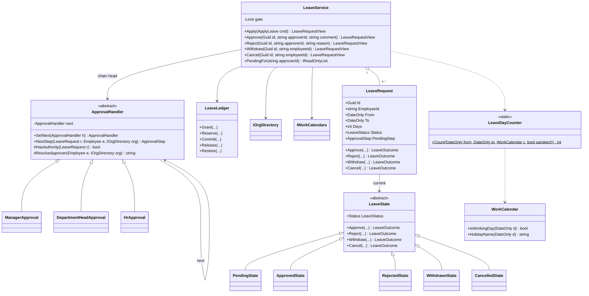
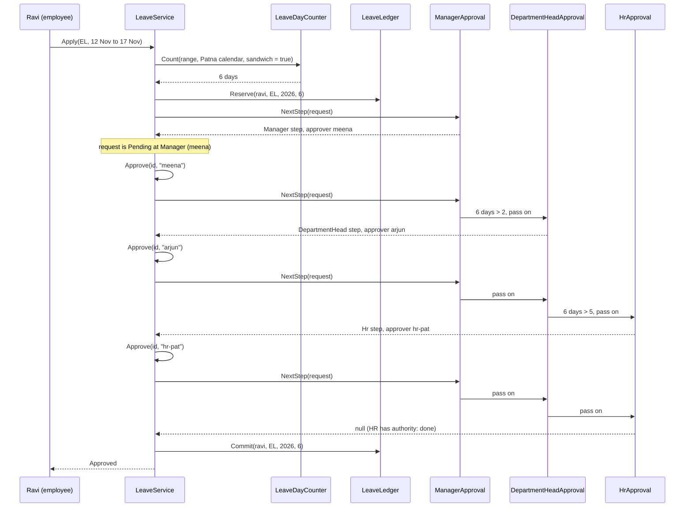
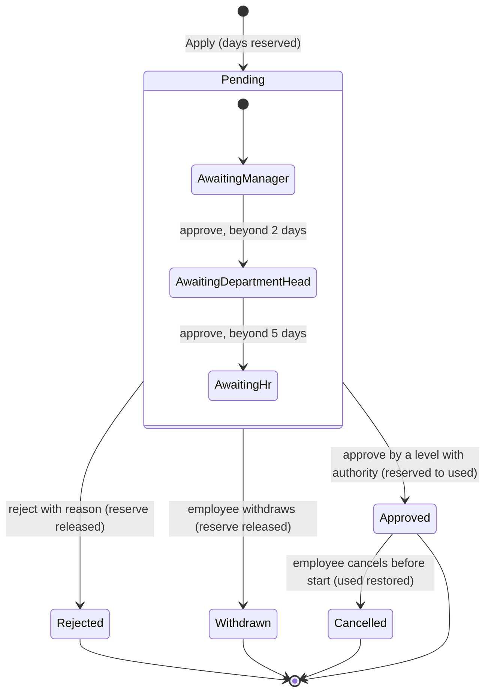
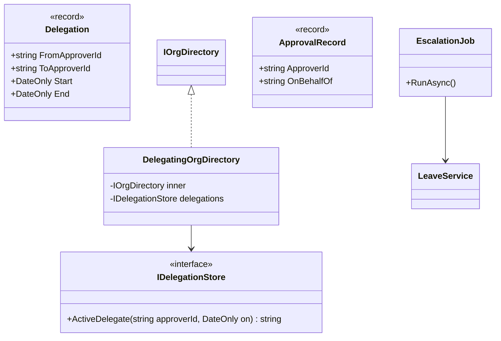

Almost every company builds a leave system at some point, and almost every first version gets the same things wrong: it counts calendar days instead of working days, forgets that site offices have different holidays from head office, lets an employee spend the same balance on two overlapping requests, and hard-codes "manager then HR" so deeply that the first policy change means a rewrite. This case study designs a leave and approval workflow that handles those cases cleanly, using two behavioural patterns that fit the problem almost perfectly: Chain of Responsibility for routing approvals and State for the request lifecycle.

## Learning objectives

By the end of this case study you will be able to:

1. Turn an HR policy document into functional rules, non-functional targets and clarifying questions.
2. Count leave days correctly across weekly offs, office-specific holidays and the "sandwich" rule.
3. Model balances with *reserved* and *used* amounts so pending requests cannot overspend.
4. Route a request through approvers by authority limit with a Chain of Responsibility, including self-approval and duplicate-approver cases.
5. Implement the request lifecycle with the State pattern so that illegal actions are rejected by design.
6. Test date logic deterministically with `DateOnly` and an injected `TimeProvider`.

## Prerequisites

- [Chain of Responsibility](#/lesson/m06-chain-of-responsibility) and [State](#/lesson/m06-state): the two patterns at the heart of this design.
- [Validation and business rules](#/lesson/m07-validation-rules): where each rule should live.
- [Designing for testability](#/lesson/m04-testability): injecting "today".

## Explain it like I'm a beginner

Picture a site engineer, Ravi, working on a highway project near Patna. He wants leave to attend a family wedding. He fills in a paper form and it travels:

1. To his **project manager**, Meena. She can sign off on short leave (up to 2 working days) herself.
2. If it is longer, Meena signs and passes it to the **department head**, Arjun, who can sign off on up to 5 days.
3. Anything longer also goes to **HR**, who can approve any length.

Each person either signs and passes it up, or rejects it, and the form stops there. Nobody needs to know the whole route in advance; each person only knows "can I finish this, or does it go to the next desk?" That is the **Chain of Responsibility**: a line of handlers, each deciding to handle a request or pass it on.

The form itself is always in exactly one condition: *waiting for approval*, *approved*, *rejected*, *withdrawn* or *cancelled*. What you can do with it depends on that condition: you can withdraw a form that is still waiting, but not one that was rejected; you can cancel an approved leave, but only before it starts. Making the form's condition decide what is allowed is the **State** pattern.

Two more everyday details matter:

- **Which days count?** At a site office that works six days a week, Saturday is a working day; at head office in Gurgaon it is not. A festival holiday in Bihar is a working day in Haryana. So "how many days is Thursday to Tuesday?" depends on *where* you work.
- **Is the leave available?** If Ravi has 12 days of casual leave and applies for 8, then applies for another 8 before the first is approved, the second must be refused. The first request has already "booked" 8 days.

## Requirements

### The scenario

An infrastructure consultancy has about 1,800 employees: a head office in Gurgaon and around 40 project offices across states, each with its own holiday list and work week. Leave is managed today by email and spreadsheets; balances are reconciled by HR every month and are often wrong. The new module will be part of the company's internal HR portal (ASP.NET Core, PostgreSQL).

### Functional requirements

| # | Requirement |
|---|---|
| F1 | Leave types with yearly entitlements: **Casual (CL)** 12 days, **Earned (EL)** 18 days, **Sick (SL)** 7 days. Values come from policy, not code. |
| F2 | Leave days are **working days** for the employee's office: weekly offs and office holidays are excluded. |
| F3 | **Sandwich rule** for EL: non-working days that fall *between* leave days in one request are counted as leave (Friday + Monday = 4 days). CL and SL do not apply the sandwich rule. |
| F4 | **Approval by authority**: manager approves up to 2 days; department head up to 5; HR any length. A longer request needs every level up to the one with enough authority. |
| F5 | Nobody approves their own leave. If one person holds two levels (manager *and* department head), their single approval counts for both. |
| F6 | Applying **reserves** the days; final approval moves them to **used**; rejection or withdrawal releases them; cancelling approved leave before it starts restores them. |
| F7 | An employee cannot have two pending or approved requests that overlap. |
| F8 | SL longer than 2 days requires a medical certificate. SL can be applied up to 7 days after the fact; other types cannot be backdated. |
| F9 | Approvers see the requests waiting for them. Rejection requires a reason. |
| F10 | A request cannot span two calendar years (balances are per year). |

### Non-functional requirements

| # | Requirement | Target |
|---|---|---|
| N1 | Correct balances | `Used + Reserved <= Entitled + CarriedForward` at all times, even when requests are approved concurrently. |
| N2 | Auditability | Every decision records who, what, when and why. |
| N3 | Changeability | Adding an approval level ("Project Director for leave over 10 days") changes configuration and one class, not the lifecycle code. |
| N4 | Testability | "Today" comes from `TimeProvider`; calendars and the org chart are interfaces. |
| N5 | Scale | About 1,800 employees and a few hundred requests a day (an estimate). Simplicity beats throughput here. |

### Clarifying questions

- **Half days?** Common for CL. Not in phase 1; it changes days from `int` to `decimal` everywhere, so decide early (extension task).
- **What if the manager changes while a request is pending?** We resolve the next approver *when the previous step completes*, using the org chart at that moment. The alternative, freezing the route at submission, is simpler to audit but sends requests to people who have left.
- **What if an approver is on leave?** Phase 2: delegation and escalation after 48 hours (Exercise 4).
- **Can approved leave be cancelled after it starts?** Not by cancelling; the employee returns early and the remaining days are *curtailed* (Exercise 5).
- **Carry forward and encashment?** Year-end jobs outside this module; the balance model has a `CarriedForward` field ready for it.
- **Leave spanning two years?** Rejected with a message to split it; per-year balances keep the maths simple.
- **Time zone?** All offices are in India (IST, no daylight saving), so "today" is computed in IST.

## Identifying classes and responsibilities

| Class | Kind | Responsibility |
|---|---|---|
| `LeaveType` | record | Code, entitlement, sandwich rule, certificate threshold, backdating limit. |
| `LeavePolicy` | static registry | The configured leave types. |
| `Employee` | record | Id, manager, department, office. |
| `IOrgDirectory` | interface | Look up employees, department heads, HR per office, HR head. |
| `WorkCalendar` | class | One office's weekly offs and holidays. |
| `IWorkCalendars` | interface | Finds the calendar for an office. |
| `LeaveDayCounter` | static class | Counts leave days in a date range for a calendar, with or without the sandwich rule. |
| `LeaveBalance`, `LeaveLedger` | classes | Entitled, carried forward, reserved and used per employee, type and year; enforce the balance invariant. |
| `ApprovalHandler` (abstract) and `ManagerApproval`, `DepartmentHeadApproval`, `HrApproval` | Chain of Responsibility | Each level resolves its approver and decides whether its authority is enough to finish. |
| `LeaveRequest` | class (State context) | Dates, days, approvals history, current pending step; delegates actions to its state. |
| `LeaveState` (abstract) and `PendingState`, `ApprovedState`, `RejectedState`, `WithdrawnState`, `CancelledState` | State | What each condition allows. |
| `LeaveService` | Facade / application service | Validates, applies balance effects, keeps requests, serialises changes. |
| Exceptions | classes | `LeaveRuleException`, `InsufficientLeaveBalanceException`, `InvalidLeaveTransitionException`, `NotAuthorizedException`, `LeaveRequestNotFoundException`, `NoEligibleApproverException`. |

Responsibilities are split along "reasons to change":

- **HR policy changes** (entitlements, sandwich rule) touch `LeavePolicy`.
- **Approval structure changes** touch the chain.
- **Lifecycle changes** (a new "on hold" state) touch the state classes.
- **Holiday lists** are data in `WorkCalendar`, loaded per office every year.

## Class diagram



How to read it: the left half is the **State** pattern. `LeaveRequest` is the context; it holds one `LeaveState` and forwards every action to it. Each state class overrides only the actions it allows; the base class rejects everything else. The right half is the **Chain of Responsibility**: three handlers linked by `next` (the self-arrow on `ApprovalHandler`). The service holds only the head of the chain. `LeaveLedger` and `LeaveDayCounter` are deliberately outside both patterns: balance maths and calendar maths are plain, well-tested code that the patterns *use*.

### Applying and approving a 6-day request



Notice how the chain is asked "what is the next step?" from the top **every time**. Each handler checks: "has my level been satisfied? If yes and my authority covers this request, we are done; if not, pass on." This makes the chain stateless: the request's approval history is the only memory. If HR policy inserts a new level tomorrow, requests already in flight simply pick it up at their next step.

## Patterns and design decisions

### Chain of Responsibility for routing

The chain answers one question: *given what has been approved so far, who must approve next, if anyone?* Each handler owns two decisions:

- `ResolveApprover`: who holds this level for this employee (their manager, their department head, the HR person for their office).
- `HasAuthority`: is this level's approval enough to finish (2 days, 5 days, unlimited)?

The base class owns the shared algorithm, including the awkward cases:

| Case | Example | Rule |
|---|---|---|
| Level already approved | Meena approved at Manager level | If authority suffices, finish; else pass on |
| Same person holds this level | Arjun is Meena's manager *and* the department head | His earlier approval satisfies this level too |
| Approver is the applicant | Arjun applies; the department head is Arjun | Skip this level without using its authority |
| No approver at this level | A department without a head | Skip; the next level must cover it |
| End of chain reached without authority | HR not configured | `NoEligibleApproverException` (a configuration bug, surfaced loudly) |

**Why a chain rather than a list of rules in one method?** Each level is a small class with one job, so adding "Project Director approves over 10 days" means writing one handler and linking it. The `if (days <= 2) ... else if (days <= 5) ...` alternative works for three levels; it becomes fragile once levels depend on department, leave type or location.

**Why not freeze the route at submission?** Resolving lazily handles people moving roles. The cost: an audit question like "who *would* have approved this?" requires replaying the chain. We store every decision with the approver's id, so "who *did*" is always answerable.

### State for the lifecycle

Five states, each with different allowed actions. With an enum and `switch` statements, every action method would repeat "if Pending ... else if Approved ... else throw". With State classes, each state answers only for itself, and the base class throws `InvalidLeaveTransitionException` for everything not overridden: **unlisted means forbidden**.

The state classes are **stateless**, so each is a single shared instance (`PendingState.Instance`). That is the Flyweight idea: 10,000 requests share five state objects. All per-request data (approvals, current step) lives in `LeaveRequest`.

### Reserved vs used balances

If balances changed only on final approval, two pending requests could each pass the "enough balance" check and together overspend. Reserving at submission closes that gap: `Available = Entitled + CarriedForward - Used - Reserved`. Each lifecycle outcome has exactly one ledger effect:

| Outcome | Ledger effect |
|---|---|
| Applied | `Reserved += days` (fails if not available) |
| Finally approved | `Reserved -= days; Used += days` |
| Rejected or withdrawn | `Reserved -= days` |
| Approved leave cancelled before start | `Used -= days` |

The state classes return an `LeaveOutcome`; the service maps it to the ledger effect. States decide *what happened*; the service decides *what it means for money-like data*. That keeps the state classes free of dependencies.

### Working days are calendar data, not code

`WorkCalendar` holds a set of weekly offs and a dictionary of holidays for one office. HR uploads holiday lists each year; nothing is compiled in. `LeaveDayCounter` is a pure function of (range, calendar, sandwich rule), so it is easy to test exhaustively.

### One lock for the whole service

Unlike the [inventory reservation](#/lesson/m18-inventory-reservation) engine, leave traffic is tiny: a few hundred changes a day. One `Lock` around each service operation makes overlap checks and balance updates trivially atomic. Per-employee locks would be correct too, but buy nothing measurable here. In PostgreSQL, the same guarantee comes from one transaction per operation with `SELECT ... FOR UPDATE` on the employee's balance row.

## State transitions



How to read it: *Pending* is a **composite state**: while pending, the request also knows which level it is waiting at. Those inner steps are produced by the chain, not hard-coded in the state machine, which is why the inner arrows depend on the number of days. A 1-day request leaves *Pending* straight from *AwaitingManager*. Every arrow out of *Pending* carries a balance effect, written in brackets. *Approved* has one exit, *Cancelled*, guarded by "before the start date"; after the leave has begun, cancelling is refused and the employee must curtail instead. *Rejected*, *Withdrawn* and *Cancelled* are terminal: a rejected request is never resurrected; the employee applies again, which creates a fresh audit trail.

## C# implementation

```text
Hrms.Api/
  Program.cs
  Leave/
    Calendar.cs
    Policy.cs
    Org.cs
    Ledger.cs
    Approvals.cs
    LeaveRequest.cs
    LeaveService.cs
```

### Calendars and day counting

```csharp file=Leave/Calendar.cs
namespace Hrms.Leave;

/// <summary>One office's working pattern: weekly offs plus dated holidays.</summary>
public sealed class WorkCalendar
{
    private readonly HashSet<DayOfWeek> _weeklyOffs;
    private readonly Dictionary<DateOnly, string> _holidays;

    public WorkCalendar(string officeCode, IEnumerable<DayOfWeek> weeklyOffs, IReadOnlyDictionary<DateOnly, string> holidays)
    {
        ArgumentException.ThrowIfNullOrWhiteSpace(officeCode);
        OfficeCode = officeCode;
        _weeklyOffs = [.. weeklyOffs];
        if (_weeklyOffs.Count >= 7) throw new ArgumentException("An office needs at least one working day a week.");
        _holidays = new Dictionary<DateOnly, string>(holidays);
    }

    public string OfficeCode { get; }

    public bool IsWorkingDay(DateOnly d) => !_weeklyOffs.Contains(d.DayOfWeek) && !_holidays.ContainsKey(d);

    public string? HolidayName(DateOnly d) => _holidays.TryGetValue(d, out var n) ? n : null;
}

public interface IWorkCalendars
{
    WorkCalendar For(string officeCode);
}

public sealed class InMemoryWorkCalendars(IEnumerable<WorkCalendar> calendars) : IWorkCalendars
{
    private readonly Dictionary<string, WorkCalendar> _byOffice = calendars.ToDictionary(c => c.OfficeCode, StringComparer.OrdinalIgnoreCase);

    public WorkCalendar For(string officeCode) =>
        _byOffice.TryGetValue(officeCode, out var c) ? c : throw new InvalidOperationException($"No calendar for office '{officeCode}'.");
}

public static class LeaveDayCounter
{
    /// <summary>Working days in [from, to]. With the sandwich rule, every day between the first and the last
    /// working day of the range counts, so weekends and holidays inside the leave are charged.</summary>
    public static int Count(DateOnly from, DateOnly to, WorkCalendar calendar, bool countSandwichedDays)
    {
        if (to < from) throw new ArgumentException("The end date is before the start date.");

        DateOnly? firstWorking = null, lastWorking = null;
        int working = 0;
        for (var d = from; d <= to; d = d.AddDays(1))
        {
            if (!calendar.IsWorkingDay(d)) continue;
            working++;
            firstWorking ??= d;
            lastWorking = d;
        }
        if (working == 0) return 0;
        return countSandwichedDays ? lastWorking!.Value.DayNumber - firstWorking!.Value.DayNumber + 1 : working;
    }
}
```

`DateOnly` is the right type here: leave is about calendar dates, not instants. Using `DateTime` invites time-of-day and time-zone bugs ("the leave ends at 00:00 on the 17th, so is the 17th included?"). `DayNumber` gives a simple integer for date arithmetic.

The sandwich rule only charges non-working days *between* working leave days. Leave from Saturday to Monday at a Monday-to-Friday office is 1 day, not 3: the leading weekend is not sandwiched by anything.

### Policy and organisation

```csharp file=Leave/Policy.cs
namespace Hrms.Leave;

public sealed record LeaveType(
    string Code,
    string Name,
    int AnnualEntitlement,
    bool CountsSandwichedDays,
    int? CertificateRequiredAfterDays = null,
    int MaxBackdatedDays = 0);

public static class LeavePolicy
{
    public static readonly LeaveType Casual = new("CL", "Casual leave", 12, CountsSandwichedDays: false);
    public static readonly LeaveType Earned = new("EL", "Earned leave", 18, CountsSandwichedDays: true);
    public static readonly LeaveType Sick = new("SL", "Sick leave", 7, CountsSandwichedDays: false, CertificateRequiredAfterDays: 2, MaxBackdatedDays: 7);

    private static readonly Dictionary<string, LeaveType> ByCode =
        new[] { Casual, Earned, Sick }.ToDictionary(t => t.Code, StringComparer.OrdinalIgnoreCase);

    public static IReadOnlyCollection<LeaveType> All => ByCode.Values;

    public static LeaveType Get(string code) =>
        ByCode.TryGetValue(code, out var t) ? t : throw new LeaveRuleException($"Unknown leave type '{code}'.");
}
```

```csharp file=Leave/Org.cs
namespace Hrms.Leave;

public sealed record Employee(string Id, string Name, string? ManagerId, string DepartmentId, string OfficeCode);

public interface IOrgDirectory
{
    Employee Get(string employeeId);
    string? DepartmentHead(string departmentId);
    string HrFor(string officeCode);
    string HrHead { get; }
}

public sealed class InMemoryOrgDirectory(
    IEnumerable<Employee> employees,
    IReadOnlyDictionary<string, string> departmentHeads,
    IReadOnlyDictionary<string, string> hrByOffice,
    string hrHead) : IOrgDirectory
{
    private readonly Dictionary<string, Employee> _employees = employees.ToDictionary(e => e.Id, StringComparer.OrdinalIgnoreCase);

    public string HrHead { get; } = hrHead;

    public Employee Get(string employeeId) =>
        _employees.TryGetValue(employeeId, out var e) ? e : throw new LeaveRuleException($"Unknown employee '{employeeId}'.");

    public string? DepartmentHead(string departmentId) => departmentHeads.TryGetValue(departmentId, out var h) ? h : null;

    public string HrFor(string officeCode) => hrByOffice.TryGetValue(officeCode, out var hr) ? hr : HrHead;
}
```

### Exceptions and the balance ledger

```csharp file=Leave/Ledger.cs
namespace Hrms.Leave;

public class LeaveRuleException(string message) : Exception(message);

public sealed class InsufficientLeaveBalanceException(string type, int requested, int available)
    : LeaveRuleException($"Not enough {type} balance: requested {requested}, available {available}.")
{
    public int Available { get; } = available;
}

public sealed class InvalidLeaveTransitionException(LeaveStatus status, string action)
    : InvalidOperationException($"Cannot {action} a leave request that is {status}.");

public sealed class NotAuthorizedException(string message) : Exception(message);

public sealed class LeaveRequestNotFoundException(Guid id) : Exception($"Leave request {id} was not found.");

public sealed class NoEligibleApproverException(string employeeId)
    : InvalidOperationException($"No eligible approver could be found for '{employeeId}'. Check the org configuration.");

public sealed class LeaveBalance(string employeeId, string typeCode, int year, int entitled, int carriedForward)
{
    public string EmployeeId { get; } = employeeId;
    public string TypeCode { get; } = typeCode;
    public int Year { get; } = year;
    public int Entitled { get; } = entitled;
    public int CarriedForward { get; } = carriedForward;
    public int Used { get; internal set; }
    public int Reserved { get; internal set; }
    public int Available => Entitled + CarriedForward - Used - Reserved;
}

public sealed record LeaveBalanceView(string EmployeeId, string Type, int Year, int Entitled, int CarriedForward, int Used, int Reserved, int Available);

/// <summary>Invariant: 0 &lt;= Used, 0 &lt;= Reserved, Used + Reserved &lt;= Entitled + CarriedForward.
/// Not thread-safe by itself: LeaveService serialises access.</summary>
public sealed class LeaveLedger
{
    private readonly Dictionary<(string Emp, string Type, int Year), LeaveBalance> _balances = [];

    public void Grant(string employeeId, string typeCode, int year, int entitled, int carriedForward = 0)
    {
        ArgumentOutOfRangeException.ThrowIfNegative(entitled);
        ArgumentOutOfRangeException.ThrowIfNegative(carriedForward);
        _balances[Key(employeeId, typeCode, year)] = new LeaveBalance(employeeId, typeCode.ToUpperInvariant(), year, entitled, carriedForward);
    }

    public LeaveBalanceView View(string employeeId, string typeCode, int year)
    {
        var b = Find(employeeId, typeCode, year);
        return b is null
            ? new LeaveBalanceView(employeeId, typeCode, year, 0, 0, 0, 0, 0)
            : new LeaveBalanceView(b.EmployeeId, b.TypeCode, b.Year, b.Entitled, b.CarriedForward, b.Used, b.Reserved, b.Available);
    }

    public void Reserve(string employeeId, string typeCode, int year, int days)
    {
        var b = Find(employeeId, typeCode, year);
        int available = b?.Available ?? 0;
        if (b is null || days > available) throw new InsufficientLeaveBalanceException(typeCode, days, available);
        b.Reserved += days;
    }

    public void Commit(string employeeId, string typeCode, int year, int days)
    {
        var b = Required(employeeId, typeCode, year);
        if (days > b.Reserved) throw new InvalidOperationException("Cannot commit more than is reserved.");
        b.Reserved -= days;
        b.Used += days;
    }

    public void Release(string employeeId, string typeCode, int year, int days)
    {
        var b = Required(employeeId, typeCode, year);
        if (days > b.Reserved) throw new InvalidOperationException("Cannot release more than is reserved.");
        b.Reserved -= days;
    }

    public void Restore(string employeeId, string typeCode, int year, int days)
    {
        var b = Required(employeeId, typeCode, year);
        if (days > b.Used) throw new InvalidOperationException("Cannot restore more than is used.");
        b.Used -= days;
    }

    private LeaveBalance? Find(string e, string t, int y) => _balances.TryGetValue(Key(e, t, y), out var b) ? b : null;

    private LeaveBalance Required(string e, string t, int y) =>
        Find(e, t, y) ?? throw new InvalidOperationException($"No {t} balance for {e} in {y}.");

    private static (string, string, int) Key(string e, string t, int y) => (e.ToLowerInvariant(), t.ToUpperInvariant(), y);
}
```

### The approval chain

```csharp file=Leave/Approvals.cs
namespace Hrms.Leave;

public enum ApprovalLevel { Manager, DepartmentHead, Hr }

public sealed record ApprovalStep(ApprovalLevel Level, string ApproverId);

public sealed record ApprovalRecord(ApprovalLevel Level, string ApproverId, bool Approved, string? Comment, DateTimeOffset At);

/// <summary>Chain of Responsibility. Each handler either finishes the routing (its level is satisfied and its
/// authority covers the request), asks for its own approval, or passes the request to the next handler.</summary>
public abstract class ApprovalHandler
{
    private ApprovalHandler? _next;

    public abstract ApprovalLevel Level { get; }

    /// <summary>Links the next handler and returns it, so chains read left to right: a.SetNext(b).SetNext(c).</summary>
    public ApprovalHandler SetNext(ApprovalHandler next)
    {
        _next = next;
        return next;
    }

    protected abstract bool HasAuthority(LeaveRequest request);
    protected abstract string? ResolveApprover(Employee applicant, IOrgDirectory org);

    /// <summary>The next approval needed, or null when the request is fully approved.</summary>
    public ApprovalStep? NextStep(LeaveRequest request, Employee applicant, IOrgDirectory org)
    {
        string? approver = ResolveApprover(applicant, org);
        bool satisfied = request.HasApprovalAt(Level) || (approver is not null && request.WasApprovedBy(approver));

        if (satisfied)
            return HasAuthority(request) ? null : PassOn(request, applicant, org);

        bool cannotAct = approver is null || string.Equals(approver, applicant.Id, StringComparison.OrdinalIgnoreCase);
        if (cannotAct)
            return PassOn(request, applicant, org);    // skipped levels lend no authority

        return new ApprovalStep(Level, approver!);
    }

    private ApprovalStep? PassOn(LeaveRequest request, Employee applicant, IOrgDirectory org) =>
        _next is not null ? _next.NextStep(request, applicant, org) : throw new NoEligibleApproverException(applicant.Id);
}

public sealed class ManagerApproval(int maxDays) : ApprovalHandler
{
    public override ApprovalLevel Level => ApprovalLevel.Manager;
    protected override bool HasAuthority(LeaveRequest r) => r.Days <= maxDays;
    protected override string? ResolveApprover(Employee a, IOrgDirectory org) => a.ManagerId;
}

public sealed class DepartmentHeadApproval(int maxDays) : ApprovalHandler
{
    public override ApprovalLevel Level => ApprovalLevel.DepartmentHead;
    protected override bool HasAuthority(LeaveRequest r) => r.Days <= maxDays;
    protected override string? ResolveApprover(Employee a, IOrgDirectory org) => org.DepartmentHead(a.DepartmentId);
}

public sealed class HrApproval : ApprovalHandler
{
    public override ApprovalLevel Level => ApprovalLevel.Hr;
    protected override bool HasAuthority(LeaveRequest r) => true;
    protected override string? ResolveApprover(Employee a, IOrgDirectory org)
    {
        var hr = org.HrFor(a.OfficeCode);
        return string.Equals(hr, a.Id, StringComparison.OrdinalIgnoreCase) ? org.HrHead : hr;   // HR's own leave goes to the HR head
    }
}

public static class ApprovalChains
{
    /// <summary>Manager up to 2 days, department head up to 5, HR beyond.</summary>
    public static ApprovalHandler Default()
    {
        var head = new ManagerApproval(maxDays: 2);
        head.SetNext(new DepartmentHeadApproval(maxDays: 5)).SetNext(new HrApproval());
        return head;
    }
}
```

The base class's `NextStep` is a Template Method inside a Chain of Responsibility: the routing algorithm is fixed, and each subclass supplies two small hooks. Adding a level is a new subclass plus one more `SetNext` call.

### The request and its states

```csharp file=Leave/LeaveRequest.cs
namespace Hrms.Leave;

public enum LeaveStatus { Pending, Approved, Rejected, Withdrawn, Cancelled }

/// <summary>What happened, so the service can apply the matching balance effect.</summary>
public enum LeaveOutcome { Escalated, Approved, Rejected, Withdrawn, Cancelled }

public sealed class LeaveRequest
{
    private readonly List<ApprovalRecord> _decisions = [];
    private LeaveState _state = PendingState.Instance;

    internal LeaveRequest(Guid id, string employeeId, LeaveType type, DateOnly from, DateOnly to, int days, string reason, DateTimeOffset submittedAt)
    {
        Id = id;
        EmployeeId = employeeId;
        Type = type;
        From = from;
        To = to;
        Days = days;
        Reason = reason;
        SubmittedAt = submittedAt;
    }

    public Guid Id { get; }
    public string EmployeeId { get; }
    public LeaveType Type { get; }
    public DateOnly From { get; }
    public DateOnly To { get; }
    public int Days { get; }
    public string Reason { get; }
    public DateTimeOffset SubmittedAt { get; }
    public LeaveStatus Status => _state.Status;
    public ApprovalStep? PendingStep { get; internal set; }
    public IReadOnlyList<ApprovalRecord> Decisions => _decisions;

    public bool HasApprovalAt(ApprovalLevel level) => _decisions.Any(d => d.Approved && d.Level == level);
    public bool WasApprovedBy(string approverId) =>
        _decisions.Any(d => d.Approved && string.Equals(d.ApproverId, approverId, StringComparison.OrdinalIgnoreCase));
    public bool Overlaps(DateOnly from, DateOnly to) => from <= To && to >= From;
    public bool IsActive => Status is LeaveStatus.Pending or LeaveStatus.Approved;

    // The context forwards every action to the current state.
    public LeaveOutcome Approve(string approverId, string? comment, DateTimeOffset now, Func<LeaveRequest, ApprovalStep?> nextStep) =>
        _state.Approve(this, approverId, comment, now, nextStep);
    public LeaveOutcome Reject(string approverId, string reason, DateTimeOffset now) => _state.Reject(this, approverId, reason, now);
    public LeaveOutcome Withdraw(string employeeId) => _state.Withdraw(this, employeeId);
    public LeaveOutcome Cancel(string employeeId, DateOnly today) => _state.Cancel(this, employeeId, today);

    internal void MoveTo(LeaveState state) => _state = state;
    internal void Record(ApprovalRecord decision) => _decisions.Add(decision);
}

/// <summary>State base: every action is forbidden unless a state overrides it.</summary>
public abstract class LeaveState
{
    public abstract LeaveStatus Status { get; }

    public virtual LeaveOutcome Approve(LeaveRequest r, string approverId, string? comment, DateTimeOffset now,
        Func<LeaveRequest, ApprovalStep?> nextStep) => throw Invalid("approve");
    public virtual LeaveOutcome Reject(LeaveRequest r, string approverId, string reason, DateTimeOffset now) => throw Invalid("reject");
    public virtual LeaveOutcome Withdraw(LeaveRequest r, string employeeId) => throw Invalid("withdraw");
    public virtual LeaveOutcome Cancel(LeaveRequest r, string employeeId, DateOnly today) => throw Invalid("cancel");

    protected InvalidLeaveTransitionException Invalid(string action) => new(Status, action);

    protected static void EnsureApplicant(LeaveRequest r, string employeeId)
    {
        if (!string.Equals(r.EmployeeId, employeeId, StringComparison.OrdinalIgnoreCase))
            throw new NotAuthorizedException("Only the applicant can do this.");
    }
}

public sealed class PendingState : LeaveState
{
    public static readonly PendingState Instance = new();
    private PendingState() { }
    public override LeaveStatus Status => LeaveStatus.Pending;

    public override LeaveOutcome Approve(LeaveRequest r, string approverId, string? comment, DateTimeOffset now,
        Func<LeaveRequest, ApprovalStep?> nextStep)
    {
        var step = EnsureCurrentApprover(r, approverId);
        r.Record(new ApprovalRecord(step.Level, approverId, true, comment, now));
        var next = nextStep(r);
        r.PendingStep = next;
        if (next is not null) return LeaveOutcome.Escalated;
        r.MoveTo(ApprovedState.Instance);
        return LeaveOutcome.Approved;
    }

    public override LeaveOutcome Reject(LeaveRequest r, string approverId, string reason, DateTimeOffset now)
    {
        if (string.IsNullOrWhiteSpace(reason)) throw new LeaveRuleException("A rejection needs a reason.");
        var step = EnsureCurrentApprover(r, approverId);
        r.Record(new ApprovalRecord(step.Level, approverId, false, reason, now));
        r.PendingStep = null;
        r.MoveTo(RejectedState.Instance);
        return LeaveOutcome.Rejected;
    }

    public override LeaveOutcome Withdraw(LeaveRequest r, string employeeId)
    {
        EnsureApplicant(r, employeeId);
        r.PendingStep = null;
        r.MoveTo(WithdrawnState.Instance);
        return LeaveOutcome.Withdrawn;
    }

    private static ApprovalStep EnsureCurrentApprover(LeaveRequest r, string approverId)
    {
        var step = r.PendingStep ?? throw new InvalidOperationException("Pending request without a pending step.");
        if (!string.Equals(step.ApproverId, approverId, StringComparison.OrdinalIgnoreCase))
            throw new NotAuthorizedException($"This request is waiting for {step.ApproverId} ({step.Level}).");
        return step;
    }
}

public sealed class ApprovedState : LeaveState
{
    public static readonly ApprovedState Instance = new();
    private ApprovedState() { }
    public override LeaveStatus Status => LeaveStatus.Approved;

    public override LeaveOutcome Cancel(LeaveRequest r, string employeeId, DateOnly today)
    {
        EnsureApplicant(r, employeeId);
        if (today >= r.From) throw new LeaveRuleException("Leave that has started cannot be cancelled; ask HR to curtail it.");
        r.MoveTo(CancelledState.Instance);
        return LeaveOutcome.Cancelled;
    }
}

public sealed class RejectedState : LeaveState
{
    public static readonly RejectedState Instance = new();
    private RejectedState() { }
    public override LeaveStatus Status => LeaveStatus.Rejected;
}

public sealed class WithdrawnState : LeaveState
{
    public static readonly WithdrawnState Instance = new();
    private WithdrawnState() { }
    public override LeaveStatus Status => LeaveStatus.Withdrawn;
}

public sealed class CancelledState : LeaveState
{
    public static readonly CancelledState Instance = new();
    private CancelledState() { }
    public override LeaveStatus Status => LeaveStatus.Cancelled;
}
```

Look at how short the terminal states are: three lines each, because "forbid everything" is inherited. Adding an `OnHold` state (HR freezes a request pending documents) would be one new class overriding `Approve` (to resume) and `Withdraw`, plus one new action on `PendingState`.

### The service

```csharp file=Leave/LeaveService.cs
namespace Hrms.Leave;

public sealed record ApplyLeave(string EmployeeId, string LeaveType, DateOnly From, DateOnly To, string Reason, bool HasMedicalCertificate = false);

public sealed record LeaveRequestView(Guid Id, string EmployeeId, string Type, DateOnly From, DateOnly To, int Days,
    LeaveStatus Status, ApprovalStep? PendingStep, IReadOnlyList<ApprovalRecord> Decisions)
{
    public static LeaveRequestView Of(LeaveRequest r) =>
        new(r.Id, r.EmployeeId, r.Type.Code, r.From, r.To, r.Days, r.Status, r.PendingStep, r.Decisions.ToList());
}

public sealed class LeaveService(IOrgDirectory org, IWorkCalendars calendars, LeaveLedger ledger, ApprovalHandler chain, TimeProvider time)
{
    private static readonly TimeSpan Ist = TimeSpan.FromHours(5.5);
    private readonly Lock _gate = new();
    private readonly Dictionary<Guid, LeaveRequest> _requests = [];

    private DateTimeOffset Now => time.GetUtcNow();
    private DateOnly Today => DateOnly.FromDateTime(Now.ToOffset(Ist).DateTime);

    public LeaveRequestView Apply(ApplyLeave cmd)
    {
        var employee = org.Get(cmd.EmployeeId);
        var type = LeavePolicy.Get(cmd.LeaveType);
        ValidateDates(cmd, type);
        if (string.IsNullOrWhiteSpace(cmd.Reason)) throw new LeaveRuleException("Please give a reason.");

        int days = LeaveDayCounter.Count(cmd.From, cmd.To, calendars.For(employee.OfficeCode), type.CountsSandwichedDays);
        if (days == 0) throw new LeaveRuleException("The selected dates are all holidays or weekly offs.");
        if (type.CertificateRequiredAfterDays is int limit && days > limit && !cmd.HasMedicalCertificate)
            throw new LeaveRuleException($"{type.Name} longer than {limit} days needs a medical certificate.");

        lock (_gate)
        {
            if (_requests.Values.Any(r => r.EmployeeId.Equals(employee.Id, StringComparison.OrdinalIgnoreCase) && r.IsActive && r.Overlaps(cmd.From, cmd.To)))
                throw new LeaveRuleException("These dates overlap another pending or approved leave request.");

            var request = new LeaveRequest(Guid.NewGuid(), employee.Id, type, cmd.From, cmd.To, days, cmd.Reason, Now);
            ledger.Reserve(employee.Id, type.Code, cmd.From.Year, days);      // throws if not enough balance
            request.PendingStep = chain.NextStep(request, employee, org);
            if (request.PendingStep is null)                                    // only if nobody needs to approve
            {
                request.MoveTo(ApprovedState.Instance);
                ledger.Commit(employee.Id, type.Code, cmd.From.Year, days);
            }
            _requests[request.Id] = request;
            return LeaveRequestView.Of(request);
        }
    }

    public LeaveRequestView Approve(Guid id, string approverId, string? comment = null) =>
        Act(id, r =>
        {
            var applicant = org.Get(r.EmployeeId);
            return r.Approve(approverId, comment, Now, req => chain.NextStep(req, applicant, org));
        });

    public LeaveRequestView Reject(Guid id, string approverId, string reason) => Act(id, r => r.Reject(approverId, reason, Now));

    public LeaveRequestView Withdraw(Guid id, string employeeId) => Act(id, r => r.Withdraw(employeeId));

    public LeaveRequestView Cancel(Guid id, string employeeId) => Act(id, r => r.Cancel(employeeId, Today));

    public IReadOnlyList<LeaveRequestView> PendingFor(string approverId)
    {
        lock (_gate)
            return _requests.Values
                .Where(r => r.Status == LeaveStatus.Pending && string.Equals(r.PendingStep?.ApproverId, approverId, StringComparison.OrdinalIgnoreCase))
                .OrderBy(r => r.SubmittedAt)
                .Select(LeaveRequestView.Of)
                .ToList();
    }

    public LeaveRequestView Get(Guid id)
    {
        lock (_gate) return LeaveRequestView.Of(Find(id));
    }

    public LeaveBalanceView Balance(string employeeId, string type, int year)
    {
        lock (_gate) return ledger.View(employeeId, type, year);
    }

    /// <summary>Runs a state action and applies the one ledger effect that matches its outcome, atomically.</summary>
    private LeaveRequestView Act(Guid id, Func<LeaveRequest, LeaveOutcome> action)
    {
        lock (_gate)
        {
            var r = Find(id);
            var outcome = action(r);
            int year = r.From.Year;
            switch (outcome)
            {
                case LeaveOutcome.Approved: ledger.Commit(r.EmployeeId, r.Type.Code, year, r.Days); break;
                case LeaveOutcome.Rejected:
                case LeaveOutcome.Withdrawn: ledger.Release(r.EmployeeId, r.Type.Code, year, r.Days); break;
                case LeaveOutcome.Cancelled: ledger.Restore(r.EmployeeId, r.Type.Code, year, r.Days); break;
                case LeaveOutcome.Escalated: break;
            }
            return LeaveRequestView.Of(r);
        }
    }

    private LeaveRequest Find(Guid id) => _requests.TryGetValue(id, out var r) ? r : throw new LeaveRequestNotFoundException(id);

    private void ValidateDates(ApplyLeave cmd, LeaveType type)
    {
        if (cmd.To < cmd.From) throw new LeaveRuleException("The end date is before the start date.");
        if (cmd.From.Year != cmd.To.Year) throw new LeaveRuleException("Leave cannot span two calendar years; please split it.");
        if (cmd.From < Today.AddDays(-type.MaxBackdatedDays))
            throw new LeaveRuleException(type.MaxBackdatedDays == 0
                ? $"{type.Name} cannot start in the past."
                : $"{type.Name} can be applied at most {type.MaxBackdatedDays} days after the fact.");
    }
}
```

### Composition root

```csharp file=Program.cs
using Hrms.Leave;

var builder = WebApplication.CreateBuilder(args);

// Sample data. Holiday names and dates are illustrative; real lists are uploaded by HR per office each year.
var org = new InMemoryOrgDirectory(
    [
        new Employee("ravi", "Ravi Kumar", "meena", "highways", "PAT"),
        new Employee("meena", "Meena Sharma", "arjun", "highways", "PAT"),
        new Employee("arjun", "Arjun Rao", "md", "highways", "GGN"),
        new Employee("md", "Managing Director", null, "management", "GGN"),
        new Employee("hr-pat", "HR Patna", "hr-head", "hr", "PAT"),
        new Employee("hr-head", "HR Head", "md", "hr", "GGN"),
    ],
    new Dictionary<string, string> { ["highways"] = "arjun", ["hr"] = "hr-head", ["management"] = "md" },
    new Dictionary<string, string> { ["PAT"] = "hr-pat", ["GGN"] = "hr-head" },
    hrHead: "hr-head");

var calendars = new InMemoryWorkCalendars(
[
    new WorkCalendar("PAT", [DayOfWeek.Sunday], new Dictionary<DateOnly, string> { [new DateOnly(2026, 11, 16)] = "Regional festival (sample)" }),
    new WorkCalendar("GGN", [DayOfWeek.Saturday, DayOfWeek.Sunday], new Dictionary<DateOnly, string> { [new DateOnly(2026, 11, 11)] = "Office holiday (sample)" }),
]);

var ledger = new LeaveLedger();
foreach (var id in new[] { "ravi", "meena", "arjun", "md", "hr-pat", "hr-head" })
    foreach (var t in LeavePolicy.All)
        ledger.Grant(id, t.Code, 2026, t.AnnualEntitlement);

builder.Services.AddSingleton(TimeProvider.System);
builder.Services.AddSingleton<IOrgDirectory>(org);
builder.Services.AddSingleton<IWorkCalendars>(calendars);
builder.Services.AddSingleton(ledger);
builder.Services.AddSingleton(ApprovalChains.Default());
builder.Services.AddSingleton<LeaveService>();

var app = builder.Build();

// DEMO ONLY: the caller's id comes from a header. Use real authentication and claims in production.
static string Caller(HttpContext http) =>
    http.Request.Headers["X-Employee"].ToString() is { Length: > 0 } id ? id : throw new NotAuthorizedException("Sign in first.");

app.MapPost("/leave", (ApplyBody b, HttpContext http, LeaveService svc) =>
    Run(() => svc.Apply(new ApplyLeave(Caller(http), b.Type, b.From, b.To, b.Reason, b.HasMedicalCertificate))));
app.MapPost("/leave/{id:guid}/approve", (Guid id, DecisionBody b, HttpContext http, LeaveService svc) => Run(() => svc.Approve(id, Caller(http), b.Comment)));
app.MapPost("/leave/{id:guid}/reject", (Guid id, DecisionBody b, HttpContext http, LeaveService svc) => Run(() => svc.Reject(id, Caller(http), b.Comment ?? "")));
app.MapPost("/leave/{id:guid}/withdraw", (Guid id, HttpContext http, LeaveService svc) => Run(() => svc.Withdraw(id, Caller(http))));
app.MapPost("/leave/{id:guid}/cancel", (Guid id, HttpContext http, LeaveService svc) => Run(() => svc.Cancel(id, Caller(http))));
app.MapGet("/approvals/pending", (HttpContext http, LeaveService svc) => Run(() => svc.PendingFor(Caller(http))));
app.MapGet("/balances/{type}/{year:int}", (string type, int year, HttpContext http, LeaveService svc) => Run(() => svc.Balance(Caller(http), type, year)));

app.Run();

static IResult Run<T>(Func<T> action)
{
    try { return Results.Ok(action()); }
    catch (NotAuthorizedException ex) { return Results.Problem(ex.Message, statusCode: StatusCodes.Status403Forbidden); }
    catch (LeaveRequestNotFoundException ex) { return Results.Problem(ex.Message, statusCode: StatusCodes.Status404NotFound); }
    catch (InvalidLeaveTransitionException ex) { return Results.Problem(ex.Message, statusCode: StatusCodes.Status409Conflict); }
    catch (LeaveRuleException ex) { return Results.Problem(ex.Message, statusCode: StatusCodes.Status422UnprocessableEntity); }
}

public sealed record ApplyBody(string Type, DateOnly From, DateOnly To, string Reason, bool HasMedicalCertificate = false);
public sealed record DecisionBody(string? Comment);
```

## Automated testing

A fixed "today" and a test world that mirrors the sample organisation:

```csharp
using Hrms.Leave;
using Xunit;

namespace Hrms.Leave.Tests;

public sealed class FixedClock(DateTimeOffset now) : TimeProvider
{
    public DateTimeOffset Now { get; set; } = now;
    public override DateTimeOffset GetUtcNow() => Now;
}

public static class TestWorld
{
    public static readonly WorkCalendar Patna = new("PAT", [DayOfWeek.Sunday],
        new Dictionary<DateOnly, string> { [new DateOnly(2026, 11, 16)] = "Regional festival (sample)" });

    public static readonly WorkCalendar Gurgaon = new("GGN", [DayOfWeek.Saturday, DayOfWeek.Sunday],
        new Dictionary<DateOnly, string> { [new DateOnly(2026, 11, 11)] = "Office holiday (sample)" });

    public static (LeaveService Svc, LeaveLedger Ledger, FixedClock Clock) New()
    {
        var org = new InMemoryOrgDirectory(
            [
                new Employee("ravi", "Ravi", "meena", "highways", "PAT"),
                new Employee("meena", "Meena", "arjun", "highways", "PAT"),
                new Employee("arjun", "Arjun", "md", "highways", "GGN"),
                new Employee("md", "MD", null, "management", "GGN"),
                new Employee("hr-pat", "HR Patna", "hr-head", "hr", "PAT"),
                new Employee("hr-head", "HR Head", "md", "hr", "GGN"),
            ],
            new Dictionary<string, string> { ["highways"] = "arjun", ["hr"] = "hr-head", ["management"] = "md" },
            new Dictionary<string, string> { ["PAT"] = "hr-pat", ["GGN"] = "hr-head" },
            "hr-head");
        var ledger = new LeaveLedger();
        foreach (var id in new[] { "ravi", "meena", "arjun", "md", "hr-pat", "hr-head" })
            foreach (var t in LeavePolicy.All) ledger.Grant(id, t.Code, 2026, t.AnnualEntitlement);
        // Monday 2 November 2026, 10:00 IST
        var clock = new FixedClock(new DateTimeOffset(2026, 11, 2, 10, 0, 0, TimeSpan.FromHours(5.5)));
        var svc = new LeaveService(org, new InMemoryWorkCalendars([Patna, Gurgaon]), ledger, ApprovalChains.Default(), clock);
        return (svc, ledger, clock);
    }

    public static DateOnly Nov(int day) => new(2026, 11, day);
}
```

Day counting, the part most likely to be wrong in production:

```csharp
using Hrms.Leave;
using Xunit;
using static Hrms.Leave.Tests.TestWorld;

namespace Hrms.Leave.Tests;

public class LeaveDayCounterTests
{
    [Theory]
    [InlineData(6, 9, false, 2)]    // Gurgaon: Fri + Mon, weekend excluded
    [InlineData(6, 9, true, 4)]     // sandwich: Sat and Sun between leave days count
    [InlineData(7, 9, true, 1)]     // leading weekend is not sandwiched
    [InlineData(10, 12, false, 2)]  // Wed 11 Nov is an office holiday
    [InlineData(10, 12, true, 3)]   // ... but sandwiched for EL
    [InlineData(7, 8, true, 0)]     // only weekend days
    public void Gurgaon_office(int from, int to, bool sandwich, int expected) =>
        Assert.Equal(expected, LeaveDayCounter.Count(Nov(from), Nov(to), Gurgaon, sandwich));

    [Fact]
    public void Site_office_works_saturdays_and_has_its_own_holiday()
    {
        // Thu 12 to Tue 17: Sun 15 off, Mon 16 regional holiday. Working: 12, 13, 14, 17.
        Assert.Equal(4, LeaveDayCounter.Count(Nov(12), Nov(17), Patna, false));
        Assert.Equal(6, LeaveDayCounter.Count(Nov(12), Nov(17), Patna, true));
        // Same dates, different offices: Tue 10 to Sat 14. Patna works Saturday and has no holiday on the 11th.
        Assert.Equal(5, LeaveDayCounter.Count(Nov(10), Nov(14), Patna, false));
        Assert.Equal(3, LeaveDayCounter.Count(Nov(10), Nov(14), Gurgaon, false));
    }
}
```

The approval chain and the lifecycle through the service:

```csharp
using Hrms.Leave;
using Xunit;
using static Hrms.Leave.Tests.TestWorld;

namespace Hrms.Leave.Tests;

public class LeaveWorkflowTests
{
    [Fact]
    public void Short_leave_needs_only_the_manager()
    {
        var (svc, ledger, _) = New();
        var r = svc.Apply(new ApplyLeave("ravi", "CL", Nov(9), Nov(10), "family function"));
        Assert.Equal(new ApprovalStep(ApprovalLevel.Manager, "meena"), r.PendingStep);
        Assert.Equal(2, ledger.View("ravi", "CL", 2026).Reserved);

        var done = svc.Approve(r.Id, "meena");
        Assert.Equal(LeaveStatus.Approved, done.Status);
        Assert.Equal(new LeaveBalanceView("ravi", "CL", 2026, 12, 0, 2, 0, 10), ledger.View("ravi", "CL", 2026));
    }

    [Fact]
    public void Six_day_earned_leave_goes_all_the_way_to_hr()
    {
        var (svc, _, _) = New();
        var r = svc.Apply(new ApplyLeave("ravi", "EL", Nov(12), Nov(17), "wedding"));
        Assert.Equal(6, r.Days);
        Assert.Equal("arjun", svc.Approve(r.Id, "meena").PendingStep!.ApproverId);
        Assert.Equal("hr-pat", svc.Approve(r.Id, "arjun").PendingStep!.ApproverId);
        Assert.Equal(LeaveStatus.Approved, svc.Approve(r.Id, "hr-pat").Status);
    }

    [Fact]
    public void One_person_holding_two_levels_approves_once()
    {
        var (svc, _, _) = New();
        // Meena's manager (arjun) is also the department head: 4 days needs head authority, one approval suffices.
        var r = svc.Apply(new ApplyLeave("meena", "CL", Nov(9), Nov(12), "travel"));
        Assert.Equal("arjun", r.PendingStep!.ApproverId);
        Assert.Equal(LeaveStatus.Approved, svc.Approve(r.Id, "arjun").Status);
    }

    [Fact]
    public void Nobody_approves_their_own_leave()
    {
        var (svc, _, _) = New();
        // Arjun heads the department; for 4 days the head level is skipped and HR (GGN) must approve.
        var r = svc.Apply(new ApplyLeave("arjun", "CL", Nov(2), Nov(5), "personal"));
        Assert.Equal("md", r.PendingStep!.ApproverId);
        Assert.Equal(new ApprovalStep(ApprovalLevel.Hr, "hr-head"), svc.Approve(r.Id, "md").PendingStep);
    }

    [Fact]
    public void Only_the_current_approver_can_act()
    {
        var (svc, _, _) = New();
        var r = svc.Apply(new ApplyLeave("ravi", "CL", Nov(9), Nov(10), "x"));
        Assert.Throws<NotAuthorizedException>(() => svc.Approve(r.Id, "arjun"));
        Assert.Throws<NotAuthorizedException>(() => svc.Approve(r.Id, "ravi"));
    }

    [Fact]
    public void Reject_releases_the_reserve_and_is_final()
    {
        var (svc, ledger, _) = New();
        var r = svc.Apply(new ApplyLeave("ravi", "CL", Nov(9), Nov(10), "x"));
        Assert.Throws<LeaveRuleException>(() => svc.Reject(r.Id, "meena", " "));
        svc.Reject(r.Id, "meena", "monsoon concreting window");
        Assert.Equal(12, ledger.View("ravi", "CL", 2026).Available);
        Assert.Throws<InvalidLeaveTransitionException>(() => svc.Approve(r.Id, "meena"));
    }

    [Fact]
    public void Pending_requests_cannot_overspend_or_overlap()
    {
        var (svc, _, _) = New();
        svc.Apply(new ApplyLeave("ravi", "SL", Nov(3), Nov(7), "fever", HasMedicalCertificate: true));    // 5 of 7
        Assert.Throws<InsufficientLeaveBalanceException>(() =>
            svc.Apply(new ApplyLeave("ravi", "SL", Nov(18), Nov(20), "again", HasMedicalCertificate: true)));
        Assert.Throws<LeaveRuleException>(() => svc.Apply(new ApplyLeave("ravi", "CL", Nov(6), Nov(6), "overlap")));
    }

    [Fact]
    public void Cancel_restores_before_start_but_not_after()
    {
        var (svc, ledger, clock) = New();
        var r = svc.Apply(new ApplyLeave("ravi", "CL", Nov(9), Nov(10), "x"));
        svc.Approve(r.Id, "meena");
        var r2 = svc.Apply(new ApplyLeave("ravi", "CL", Nov(19), Nov(20), "y"));
        svc.Approve(r2.Id, "meena");

        svc.Cancel(r.Id, "ravi");
        Assert.Equal(10, ledger.View("ravi", "CL", 2026).Available);

        clock.Now = clock.Now.AddDays(17);                       // 19 November: r2 has started
        Assert.Throws<LeaveRuleException>(() => svc.Cancel(r2.Id, "ravi"));
    }

    [Fact]
    public void Policy_rules_at_application()
    {
        var (svc, _, _) = New();
        Assert.Throws<LeaveRuleException>(() => svc.Apply(new ApplyLeave("ravi", "SL", Nov(3), Nov(6), "flu")));          // certificate
        Assert.Throws<LeaveRuleException>(() => svc.Apply(new ApplyLeave("ravi", "CL", Nov(1), Nov(1), "sunday")));        // past + holiday
        Assert.Throws<LeaveRuleException>(() => svc.Apply(new ApplyLeave("ravi", "EL", new DateOnly(2026, 12, 30), new DateOnly(2027, 1, 2), "new year")));
        var backdated = svc.Apply(new ApplyLeave("ravi", "SL", new DateOnly(2026, 10, 29), new DateOnly(2026, 10, 30), "was unwell"));
        Assert.Equal(2, backdated.Days);
    }
}
```

What to notice:

- **Theory rows document the calendar rules** better than prose does. When HR asks "what does the sandwich rule do with a leading weekend?", the answer is a test row.
- **Every workflow test checks the ledger**, not just the status. A status bug is visible in the UI; a balance bug silently compounds until year end.
- **The chain is tested through the service with a realistic org**, including the two awkward people: the manager who is also department head, and the department head applying for himself.

## Bad design vs good design

### Bad: one method that knows everything

```csharp
public void ApproveLeave(int requestId, int userId)
{
    var req = db.Leaves.Find(requestId);
    var days = (req.To - req.From).Days + 1;                          // calendar days!
    if (req.Status == "PendingManager" && userId == req.ManagerId)
        req.Status = days > 2 ? "PendingHOD" : "Approved";
    else if (req.Status == "PendingHOD" && userId == GetHod(req.EmpId))
        req.Status = days > 5 ? "PendingHR" : "Approved";
    else if (req.Status == "PendingHR" && IsHr(userId))
        req.Status = "Approved";
    if (req.Status == "Approved")
        db.Employees.Find(req.EmpId).LeaveBalance -= days;            // one balance for all types
    db.SaveChanges();
}
```

What goes wrong:

1. **Calendar days, not working days.** Friday to Monday is charged as 4 days for everyone, and office holidays are ignored.
2. **Approval levels are baked into status strings.** Adding a "Project Director" level means new statuses and edits in every branch.
3. **Balances change only at final approval.** Two pending requests can both pass the balance check and overspend.
4. **One balance for all leave types.** Sick leave and earned leave cannot have different rules.
5. **Silent no-ops.** A wrong approver calling this method changes nothing and gets no error, so the UI shows "approved" while nothing happened.
6. **Self-approval is possible.** If the employee *is* the HOD, they approve their own leave.
7. **Rejection, withdrawal and cancellation live elsewhere**, each re-implementing the status logic.

### Good: patterns where they earn their place

| Concern | Bad | Good |
|---|---|---|
| Day counting | `(To - From).Days + 1` | `LeaveDayCounter` with office calendars and the sandwich rule |
| Routing | Status strings per level | Chain of handlers with authority limits; levels added by linking a handler |
| Lifecycle | `if` on status strings | State classes; unlisted actions throw |
| Balances | One number, changed at approval | Per type and year; reserve on apply, commit on approval |
| Wrong approver | Silent no-op | `NotAuthorizedException` (403) |
| Self-approval | Possible | Chain skips the applicant's own level |

### When is this too much?

A 30-person company with one office, one approver (the founder) and no sandwich rule can use an enum, a working-day function and a single `Approve` method. Introduce the chain when there is more than one approval level, and the State classes when there are more than three or four states with different allowed actions.

## Alternative designs

### Rules engine or configuration-driven routing

Instead of handler classes, store routing rules as data: `(minDays, maxDays, leaveType, department) → levels`. A generic handler walks the configured levels. HR can change routing without a deployment. The cost is building and testing a small rules editor, and guarding against misconfiguration (a rule set with a gap that no level covers). A good next step once routing changes more than twice a year.

### Freeze the route at submission

Compute the full list of approvers when the request is submitted and store it. Simpler to audit ("this request will go to Meena, then Arjun"), and the UI can show the whole route up front. The downside: when someone leaves or changes role, in-flight requests point at the wrong person, so you need a "re-route pending requests" admin job.

### Enum plus transition table instead of State classes

As in [Order processing](#/lesson/m18-order-processing), a `(state, action) → state` dictionary is compact and easy to review. State classes are better here because each state's checks differ (who may act, date guards) and the terminal states are trivially safe. Both are reasonable; pick by where the logic varies.

### A BPMN workflow engine

Tools such as Camunda, Elsa Workflows (.NET) or a low-code platform model approvals as diagrams with timers, escalations and delegation built in. They shine when many workflows (leave, travel, purchase requests, timesheets) share the same patterns and business users want to edit them. They add an operational component and a new skill set. See [Workflow engines and feature flags](#/lesson/m16-workflow-engines).

### Database-first

Keep balances in PostgreSQL with a `CHECK (used + reserved <= entitled + carried_forward)` constraint, reserve with a conditional `UPDATE ... WHERE entitled + carried_forward - used - reserved >= $days`, and prevent overlaps with an exclusion constraint on a `daterange` column (`EXCLUDE USING gist (employee_id WITH =, period WITH &&) WHERE (status IN ('pending','approved'))`, which needs the `btree_gist` extension). The database then enforces N1 and F7 even if two app servers race.

## Practical playground

Open the reference model in the LLD designer and try:

1. Add a `ProjectDirectorApproval` handler for leave over 10 days. Where does it go in the chain, and what changes in `HrApproval`?
2. Add an `OnHoldState` (HR is waiting for documents). Which actions does it allow?
3. Add a `Delegation` class so an approver on leave can hand their queue to someone else. Which class consults it?

:::playground type=lld title="Leave workflow — reference model"
```json
{
  "classes": [
    { "id": "Svc", "name": "LeaveService", "kind": "class", "fields": ["-Lock gate", "-Dictionary requests"], "methods": ["+LeaveRequestView Apply(ApplyLeave cmd)", "+LeaveRequestView Approve(Guid id, string approverId, string comment)", "+LeaveRequestView Reject(Guid id, string approverId, string reason)", "+LeaveRequestView Withdraw(Guid id, string employeeId)", "+LeaveRequestView Cancel(Guid id, string employeeId)"], "responsibility": "Facade: validation, ledger effects, atomicity" },
    { "id": "Req", "name": "LeaveRequest", "kind": "class", "fields": ["+string EmployeeId", "+DateOnly From", "+DateOnly To", "+int Days", "+ApprovalStep PendingStep"], "methods": ["+LeaveOutcome Approve(...)", "+LeaveOutcome Reject(...)", "+LeaveOutcome Withdraw(string employeeId)", "+LeaveOutcome Cancel(string employeeId, DateOnly today)"], "responsibility": "State context; approval history" },
    { "id": "State", "name": "LeaveState", "kind": "abstract", "fields": [], "methods": ["+LeaveOutcome Approve(...)", "+LeaveOutcome Reject(...)", "+LeaveOutcome Withdraw(...)", "+LeaveOutcome Cancel(...)"], "responsibility": "Forbids every action unless overridden" },
    { "id": "Pending", "name": "PendingState", "kind": "class", "fields": [], "methods": ["+LeaveOutcome Approve(...)", "+LeaveOutcome Reject(...)", "+LeaveOutcome Withdraw(...)"] },
    { "id": "Approved", "name": "ApprovedState", "kind": "class", "fields": [], "methods": ["+LeaveOutcome Cancel(...)"] },
    { "id": "Rejected", "name": "RejectedState", "kind": "class", "fields": [], "methods": [] },
    { "id": "Withdrawn", "name": "WithdrawnState", "kind": "class", "fields": [], "methods": [] },
    { "id": "Cancelled", "name": "CancelledState", "kind": "class", "fields": [], "methods": [] },
    { "id": "Handler", "name": "ApprovalHandler", "kind": "abstract", "fields": ["-ApprovalHandler next"], "methods": ["+ApprovalHandler SetNext(ApprovalHandler h)", "+ApprovalStep NextStep(LeaveRequest r, Employee e, IOrgDirectory org)", "#bool HasAuthority(LeaveRequest r)", "#string ResolveApprover(Employee e, IOrgDirectory org)"], "responsibility": "Chain of Responsibility for routing" },
    { "id": "Mgr", "name": "ManagerApproval", "kind": "class", "fields": ["-int maxDays"], "methods": [] },
    { "id": "Hod", "name": "DepartmentHeadApproval", "kind": "class", "fields": ["-int maxDays"], "methods": [] },
    { "id": "Hr", "name": "HrApproval", "kind": "class", "fields": [], "methods": [] },
    { "id": "Ledger", "name": "LeaveLedger", "kind": "class", "fields": ["-Dictionary balances"], "methods": ["+void Reserve(string emp, string type, int year, int days)", "+void Commit(...)", "+void Release(...)", "+void Restore(...)"], "responsibility": "Balance invariant per employee, type and year" },
    { "id": "Cal", "name": "WorkCalendar", "kind": "class", "fields": ["-HashSet weeklyOffs", "-Dictionary holidays"], "methods": ["+bool IsWorkingDay(DateOnly d)"], "responsibility": "One office's working pattern" },
    { "id": "Counter", "name": "LeaveDayCounter", "kind": "class", "fields": [], "methods": ["+int Count(DateOnly from, DateOnly to, WorkCalendar c, bool sandwich)"] },
    { "id": "Type", "name": "LeaveType", "kind": "record", "fields": ["+string Code", "+int AnnualEntitlement", "+bool CountsSandwichedDays", "+int CertificateRequiredAfterDays"], "methods": [] },
    { "id": "Org", "name": "IOrgDirectory", "kind": "interface", "fields": [], "methods": ["+Employee Get(string id)", "+string DepartmentHead(string deptId)", "+string HrFor(string office)"] }
  ],
  "relations": [
    { "from": "Svc", "to": "Req", "kind": "aggregation", "multiplicity": "0..*" },
    { "from": "Svc", "to": "Handler", "kind": "association", "label": "chain head" },
    { "from": "Svc", "to": "Ledger", "kind": "association" },
    { "from": "Svc", "to": "Org", "kind": "association" },
    { "from": "Svc", "to": "Counter", "kind": "dependency" },
    { "from": "Counter", "to": "Cal", "kind": "dependency" },
    { "from": "Req", "to": "State", "kind": "association", "label": "current" },
    { "from": "Req", "to": "Type", "kind": "association" },
    { "from": "Pending", "to": "State", "kind": "inherits" },
    { "from": "Approved", "to": "State", "kind": "inherits" },
    { "from": "Rejected", "to": "State", "kind": "inherits" },
    { "from": "Withdrawn", "to": "State", "kind": "inherits" },
    { "from": "Cancelled", "to": "State", "kind": "inherits" },
    { "from": "Mgr", "to": "Handler", "kind": "inherits" },
    { "from": "Hod", "to": "Handler", "kind": "inherits" },
    { "from": "Hr", "to": "Handler", "kind": "inherits" },
    { "from": "Handler", "to": "Handler", "kind": "association", "label": "next" },
    { "from": "Handler", "to": "Org", "kind": "dependency" }
  ]
}
```
:::

## Exercises

:::exercise id=m18-leave-workflow-ex1 difficulty=beginner kind=code title="Count working days with the sandwich rule"
Implement `WorkingDays.Count`. Given a date range, the office's weekly offs and holidays, and whether the sandwich rule applies, return the number of leave days.
::requirements
- Without the sandwich rule: count dates in `[from, to]` that are neither weekly offs nor holidays.
- With the sandwich rule: count every date from the **first** working day to the **last** working day in the range, inclusive. Leading and trailing non-working days are not counted.
- If there are no working days, return 0. If `to < from`, throw `ArgumentException`.
::acceptance
- Sat/Sun off: Fri 6 Nov to Mon 9 Nov 2026 is 2 days, or 4 with the sandwich rule.
- Sat 7 to Mon 9 with the sandwich rule is 1 day.
- A holiday on Wed 11 Nov: Tue 10 to Thu 12 is 2 days, or 3 with the sandwich rule.
- A range of only weekend days is 0.
::hint
Loop from `from` to `to` with `d = d.AddDays(1)`; `DateOnly` supports `<=`.
::hint
A day is a working day if `!weeklyOffs.Contains(d.DayOfWeek) && !holidays.Contains(d)`.
::hint
For the sandwich rule, remember the first and last working day you saw; the answer is the number of days between them, inclusive.
::hint
`last.DayNumber - first.DayNumber + 1` gives an inclusive day count.
::starter
```csharp file=WorkingDays.cs
using System;
using System.Collections.Generic;

public static class WorkingDays
{
    public static int Count(DateOnly from, DateOnly to, ISet<DayOfWeek> weeklyOffs, ISet<DateOnly> holidays, bool sandwich) =>
        throw new NotImplementedException();
}
```
::tests
```csharp file=WorkingDaysTests.cs
using System;
using System.Collections.Generic;
using Xunit;

public class WorkingDaysTests
{
    private static readonly HashSet<DayOfWeek> Weekend = new() { DayOfWeek.Saturday, DayOfWeek.Sunday };
    private static readonly HashSet<DateOnly> Holidays = new() { new DateOnly(2026, 11, 11) };
    private static DateOnly Nov(int d) => new(2026, 11, d);

    [Theory]
    [InlineData(6, 9, false, 2)]
    [InlineData(6, 9, true, 4)]
    [InlineData(7, 9, true, 1)]
    [InlineData(10, 12, false, 2)]
    [InlineData(10, 12, true, 3)]
    [InlineData(7, 8, true, 0)]
    [InlineData(2, 2, false, 1)]
    [InlineData(2, 13, true, 12)]
    public void Counts(int from, int to, bool sandwich, int expected) =>
        Assert.Equal(expected, WorkingDays.Count(Nov(from), Nov(to), Weekend, Holidays, sandwich));

    [Fact]
    public void Six_day_week_counts_saturday()
    {
        var sundayOnly = new HashSet<DayOfWeek> { DayOfWeek.Sunday };
        Assert.Equal(3, WorkingDays.Count(Nov(6), Nov(9), sundayOnly, new HashSet<DateOnly>(), false));
    }

    [Fact]
    public void Reversed_range_throws() =>
        Assert.Throws<ArgumentException>(() => WorkingDays.Count(Nov(9), Nov(6), Weekend, Holidays, false));
}
```
::solution
```csharp file=WorkingDays.cs
using System;
using System.Collections.Generic;

public static class WorkingDays
{
    public static int Count(DateOnly from, DateOnly to, ISet<DayOfWeek> weeklyOffs, ISet<DateOnly> holidays, bool sandwich)
    {
        if (to < from) throw new ArgumentException("The end date is before the start date.");

        DateOnly? first = null, last = null;
        int working = 0;
        for (var d = from; d <= to; d = d.AddDays(1))
        {
            if (weeklyOffs.Contains(d.DayOfWeek) || holidays.Contains(d)) continue;
            working++;
            first ??= d;
            last = d;
        }
        if (working == 0) return 0;
        return sandwich ? last!.Value.DayNumber - first!.Value.DayNumber + 1 : working;
    }
}
```

The loop is O(days in range), which is at most a few dozen for leave. Clarity wins over cleverness here; a formula-based count of weekends is easy to get wrong at the edges and harder to extend with holidays.
::mistakes
- `(to - from).Days + 1`: that is calendar days, and `DateOnly` subtraction does not even compile (use `DayNumber`).
- Counting leading or trailing weekends under the sandwich rule.
- Using `DateTime` and getting off-by-one errors from time-of-day components.
::extensions
Support half days: `fromHalf` (first day starts after lunch) and `toHalf` (last day ends at lunch), returning a `decimal`.
:::

:::exercise id=m18-leave-workflow-ex2 difficulty=beginner kind=code title="A leave account with reserve, commit, release and restore"
Implement `LeaveAccount`, the balance for one employee, one leave type and one year.
::requirements
- `Available = Entitled + CarriedForward - Used - Reserved`.
- `Reserve(days)`: throws `InvalidOperationException` if `days > Available`; otherwise `Reserved += days`.
- `Commit(days)`: `Reserved -= days; Used += days`; throws if `days > Reserved`.
- `Release(days)`: `Reserved -= days`; throws if `days > Reserved`.
- `Restore(days)`: `Used -= days`; throws if `days > Used`.
- Every method rejects `days <= 0` with `ArgumentOutOfRangeException`. Failed calls change nothing.
::acceptance
- Entitled 12, carried 3: reserve 10 succeeds, reserve 6 fails, available is 5.
- Commit 10 then restore 4: used 6, available 9.
- Release more than reserved throws and leaves numbers unchanged.
::hint
Validate first, mutate second, in every method.
::hint
`Available` should be computed, not stored.
::hint
Write one test per method for the failure path; that is where balance bugs hide.
::starter
```csharp file=LeaveAccount.cs
using System;

public sealed class LeaveAccount
{
    public LeaveAccount(int entitled, int carriedForward = 0)
    {
        Entitled = entitled;
        CarriedForward = carriedForward;
    }

    public int Entitled { get; }
    public int CarriedForward { get; }
    public int Used { get; private set; }
    public int Reserved { get; private set; }
    public int Available => throw new NotImplementedException();

    public void Reserve(int days) => throw new NotImplementedException();
    public void Commit(int days) => throw new NotImplementedException();
    public void Release(int days) => throw new NotImplementedException();
    public void Restore(int days) => throw new NotImplementedException();
}
```
::tests
```csharp file=LeaveAccountTests.cs
using System;
using Xunit;

public class LeaveAccountTests
{
    [Fact]
    public void Reserve_respects_available()
    {
        var a = new LeaveAccount(12, 3);
        a.Reserve(10);
        Assert.Throws<InvalidOperationException>(() => a.Reserve(6));
        Assert.Equal(5, a.Available);
        Assert.Equal(10, a.Reserved);
    }

    [Fact]
    public void Commit_then_restore()
    {
        var a = new LeaveAccount(12, 3);
        a.Reserve(10);
        a.Commit(10);
        a.Restore(4);
        Assert.Equal(6, a.Used);
        Assert.Equal(0, a.Reserved);
        Assert.Equal(9, a.Available);
    }

    [Fact]
    public void Release_bounded_by_reserved()
    {
        var a = new LeaveAccount(12);
        a.Reserve(2);
        Assert.Throws<InvalidOperationException>(() => a.Release(3));
        Assert.Equal(2, a.Reserved);
        a.Release(2);
        Assert.Equal(12, a.Available);
    }

    [Fact]
    public void Commit_and_restore_bounds()
    {
        var a = new LeaveAccount(12);
        Assert.Throws<InvalidOperationException>(() => a.Commit(1));
        Assert.Throws<InvalidOperationException>(() => a.Restore(1));
    }

    [Fact]
    public void Non_positive_days_rejected()
    {
        var a = new LeaveAccount(12);
        Assert.Throws<ArgumentOutOfRangeException>(() => a.Reserve(0));
        Assert.Throws<ArgumentOutOfRangeException>(() => a.Release(-2));
    }
}
```
::solution
```csharp file=LeaveAccount.cs
using System;

public sealed class LeaveAccount
{
    public LeaveAccount(int entitled, int carriedForward = 0)
    {
        ArgumentOutOfRangeException.ThrowIfNegative(entitled);
        ArgumentOutOfRangeException.ThrowIfNegative(carriedForward);
        Entitled = entitled;
        CarriedForward = carriedForward;
    }

    public int Entitled { get; }
    public int CarriedForward { get; }
    public int Used { get; private set; }
    public int Reserved { get; private set; }
    public int Available => Entitled + CarriedForward - Used - Reserved;

    public void Reserve(int days)
    {
        ArgumentOutOfRangeException.ThrowIfNegativeOrZero(days);
        if (days > Available) throw new InvalidOperationException($"Only {Available} days are available.");
        Reserved += days;
    }

    public void Commit(int days)
    {
        ArgumentOutOfRangeException.ThrowIfNegativeOrZero(days);
        if (days > Reserved) throw new InvalidOperationException($"Only {Reserved} days are reserved.");
        Reserved -= days;
        Used += days;
    }

    public void Release(int days)
    {
        ArgumentOutOfRangeException.ThrowIfNegativeOrZero(days);
        if (days > Reserved) throw new InvalidOperationException($"Only {Reserved} days are reserved.");
        Reserved -= days;
    }

    public void Restore(int days)
    {
        ArgumentOutOfRangeException.ThrowIfNegativeOrZero(days);
        if (days > Used) throw new InvalidOperationException($"Only {Used} days are used.");
        Used -= days;
    }
}
```

Four tiny methods, each with one guard and one or two assignments. Their value is that every lifecycle outcome in the workflow maps to exactly one of them, so a code reviewer can check balance correctness by reading a four-row table.
::mistakes
- Deducting from `Entitled` instead of tracking `Used`, which loses the information HR needs for reports.
- Forgetting `CarriedForward` in `Available`.
::extensions
Add `Curtail(int days)` for approved leave that ends early, and decide whether it should share code with `Restore`.
:::

:::exercise id=m18-leave-workflow-ex3 difficulty=intermediate kind=code title="Build the approval chain"
Implement a Chain of Responsibility that computes the **full approval route** for a leave request: the ordered list of approver ids who must sign.
::requirements
- `ApprovalLevel` is an abstract handler with `SetNext`, an authority limit in days (`int.MaxValue` for unlimited), and a resolver `Func<Applicant, string?>`.
- `Route(applicant, days)` walks the chain: each level resolves its approver; if the approver is null or is the applicant, the level is **skipped** (it does not count towards authority); if the approver is already in the route, the level counts as approved but the approver is not added twice; otherwise the approver is added. The walk stops after the first counted level whose limit covers `days`.
- If the walk runs out of levels before a level with enough authority counts, throw `InvalidOperationException`.
::acceptance
- Ravi, 1 day: `[meena]`. 4 days: `[meena, arjun]`. 7 days: `[meena, arjun, hr]`.
- Meena (manager arjun, head arjun), 4 days: `[arjun]`.
- Arjun (head arjun), 4 days: `[md, hr]`.
- A chain with no unlimited level and a 30-day request throws.
::hint
Each handler needs: its limit, its resolver, and a `_next` link.
::hint
Pass a `List<string>` down the chain as you go, and return it when a level with enough authority has counted.
::hint
Distinguish three cases per level: *skip* (null or self), *already in route* (counts, no add), *new approver* (counts, add).
::hint
```csharp
var approver = _resolve(a);
bool counts = approver is not null && approver != a.Id;
if (counts && !route.Contains(approver!)) route.Add(approver!);
if (counts && days <= _limit) return route;
return _next is null ? throw ... : _next.Walk(a, days, route);
```
::starter
```csharp file=ApprovalChain.cs
using System;
using System.Collections.Generic;

public sealed record Applicant(string Id, string? ManagerId, string? DepartmentHeadId, string HrId);

public class ApprovalLevel
{
    public ApprovalLevel(string name, int maxDays, Func<Applicant, string?> resolve)
    {
        Name = name;
        MaxDays = maxDays;
        Resolve = resolve;
    }

    public string Name { get; }
    public int MaxDays { get; }
    public Func<Applicant, string?> Resolve { get; }

    public ApprovalLevel SetNext(ApprovalLevel next) => throw new NotImplementedException();

    public IReadOnlyList<string> Route(Applicant applicant, int days) => throw new NotImplementedException();
}
```
::tests
```csharp file=ApprovalChainTests.cs
using System;
using Xunit;

public class ApprovalChainTests
{
    private static ApprovalLevel Chain()
    {
        var manager = new ApprovalLevel("Manager", 2, a => a.ManagerId);
        manager.SetNext(new ApprovalLevel("Head", 5, a => a.DepartmentHeadId))
               .SetNext(new ApprovalLevel("HR", int.MaxValue, a => a.HrId));
        return manager;
    }

    private static readonly Applicant Ravi = new("ravi", "meena", "arjun", "hr");
    private static readonly Applicant Meena = new("meena", "arjun", "arjun", "hr");
    private static readonly Applicant Arjun = new("arjun", "md", "arjun", "hr");

    [Theory]
    [InlineData(1, "meena")]
    [InlineData(2, "meena")]
    [InlineData(4, "meena,arjun")]
    [InlineData(7, "meena,arjun,hr")]
    public void Routes_by_authority(int days, string expected) =>
        Assert.Equal(expected, string.Join(",", Chain().Route(Ravi, days)));

    [Fact]
    public void Same_person_at_two_levels_signs_once() =>
        Assert.Equal("arjun", string.Join(",", Chain().Route(Meena, 4)));

    [Fact]
    public void Own_level_is_skipped_and_lends_no_authority() =>
        Assert.Equal("md,hr", string.Join(",", Chain().Route(Arjun, 4)));

    [Fact]
    public void Missing_manager_is_skipped()
    {
        var founder = new Applicant("founder", null, "founder", "hr");
        Assert.Equal("hr", string.Join(",", Chain().Route(founder, 1)));
    }

    [Fact]
    public void Chain_without_enough_authority_throws()
    {
        var shortChain = new ApprovalLevel("Manager", 2, a => a.ManagerId);
        shortChain.SetNext(new ApprovalLevel("Head", 5, a => a.DepartmentHeadId));
        Assert.Throws<InvalidOperationException>(() => shortChain.Route(Ravi, 30));
    }
}
```
::solution
```csharp file=ApprovalChain.cs
using System;
using System.Collections.Generic;

public sealed record Applicant(string Id, string? ManagerId, string? DepartmentHeadId, string HrId);

public class ApprovalLevel
{
    private ApprovalLevel? _next;

    public ApprovalLevel(string name, int maxDays, Func<Applicant, string?> resolve)
    {
        Name = name;
        MaxDays = maxDays;
        Resolve = resolve;
    }

    public string Name { get; }
    public int MaxDays { get; }
    public Func<Applicant, string?> Resolve { get; }

    public ApprovalLevel SetNext(ApprovalLevel next)
    {
        _next = next;
        return next;
    }

    public IReadOnlyList<string> Route(Applicant applicant, int days)
    {
        ArgumentOutOfRangeException.ThrowIfNegativeOrZero(days);
        return Walk(applicant, days, new List<string>());
    }

    private List<string> Walk(Applicant a, int days, List<string> route)
    {
        string? approver = Resolve(a);
        bool counts = approver is not null && !string.Equals(approver, a.Id, StringComparison.OrdinalIgnoreCase);

        if (counts && !route.Contains(approver!)) route.Add(approver!);
        if (counts && days <= MaxDays) return route;

        return _next is not null
            ? _next.Walk(a, days, route)
            : throw new InvalidOperationException($"No level in the chain can approve {days} days for {a.Id}.");
    }
}
```

The handler never looks at the whole chain; it decides for itself and either stops or delegates. That is the essence of Chain of Responsibility, and why inserting a new level between two others needs no change to them.
::alternatives
Computing the whole route up front (this exercise) is what you would show in the UI ("your request will go to Meena, then Arjun"). The main implementation instead asks the chain for the *next* step after each approval, which copes with org changes mid-flight. Many systems do both: show the predicted route, but resolve each step lazily.
::mistakes
- Letting a skipped level (self or missing) count towards authority, which lets a department head approve their own 5-day leave by being skipped.
- Adding the same person twice when they hold two levels.
- Building the chain in a loop that links each handler to itself.
::extensions
Make the authority depend on leave type as well as days (for example, any SL longer than 3 days goes to HR), without adding `if (type == ...)` to existing handlers.
:::

:::exercise id=m18-leave-workflow-ex4 difficulty=intermediate kind=design title="Delegation and escalation"
Approvers go on leave too. Design two features: (1) **delegation**: an approver can delegate their approvals to a colleague for a date range; (2) **escalation**: a request waiting more than 48 working hours at one step automatically moves to the next level, and the original approver is notified.

Describe the new classes, which existing classes change, and how you keep an audit trail that shows *who actually approved on whose behalf*.
::acceptance
- A class diagram showing where delegation is looked up and where escalation is triggered.
- A clear rule for chained delegation (A delegates to B, B delegates to C).
- Escalation uses working hours from the office calendar, not wall-clock hours.
- The audit record distinguishes "approved by B on behalf of A".
::hint
Delegation changes *who resolves as approver*; that is a concern of the chain (or a decorator around the org directory), not of the State classes.
::hint
Escalation needs a timer: a background job that finds stuck steps. Which state transition does it trigger, if any?
::hint
For the audit trail, extend `ApprovalRecord` with an `OnBehalfOf` field.
::solution


- **Delegation**: a `DelegatingOrgDirectory` decorator wraps the real directory. When the chain resolves an approver, the decorator substitutes the active delegate. Chains of delegation are followed up to 3 hops with a visited set (A→B→C), and a delegation back to the applicant is ignored (the applicant cannot approve their own leave by receiving a delegation). The pending step stores both the delegate and the original approver.
- **Approving on behalf**: `PendingState.Approve` accepts either the step's approver or its `OnBehalfOf` original (who may come back early); the `ApprovalRecord` stores `ApproverId` (who clicked) and `OnBehalfOf` (whose authority was used).
- **Escalation**: an `EscalationJob` (a `BackgroundService`) runs hourly, finds Pending requests whose current step started more than 48 working hours ago (computed with the applicant's office `WorkCalendar`, counting 8 working hours a day), and calls a new service method `Escalate(id)`. In the request, this records an `Escalated` decision for the stuck level and asks the chain for the next step **as if that level had not counted**. No new top-level state is needed; it is a move within *Pending*. The original approver and the new one are notified.
- **Changes to existing code**: `ApprovalStep` gains `OnBehalfOf`; `ApprovalRecord` gains `OnBehalfOf` and a `Kind` (Approved, Rejected, Escalated); `PendingState` gains an `Escalate` action. The chain is unchanged because delegation sits in the directory decorator.
::mistakes
- Putting delegation checks inside every handler, which duplicates logic and forgets new handlers.
- Escalating on wall-clock hours, so a request submitted on Friday evening escalates on Sunday.
- Losing the original approver's identity in the audit trail.
:::

:::exercise id=m18-leave-workflow-ex5 difficulty=advanced kind=code title="State classes with cancellation and curtailment"
Implement `LeaveApplication` using the **State pattern**: one class per state. Each state allows only its own actions; everything else throws `InvalidOperationException`. Balance effects are applied to an `Account` (provided).
::requirements
- Created with an employee id, dates, a day count, an ordered list of approver ids (the route), and an `Account`. Construction reserves the days.
- `Approve(approverId)`: only the current approver in the route; after the last approver the application is Approved and the days are committed.
- `Reject(approverId, reason)`: current approver only, reason required; releases the reservation.
- `Withdraw(employeeId)`: applicant only, while pending; releases.
- `Cancel(employeeId, today)`: applicant only, Approved and `today < From`; restores all days.
- `Curtail(employeeId, newTo, today, countDays)`: applicant only, Approved and leave has started (`today >= From`); requires `From <= newTo < To` and `newTo >= today.AddDays(-1)` (you cannot un-take days already taken). Restores `countDays(newTo + 1 day, To)` days and sets `To = newTo`, `Days -= restored`. Status stays Approved.
- Wrong person: `UnauthorizedAccessException`.
::acceptance
- A two-approver route needs both approvals in order; the second approver cannot go first.
- Cancel before the start restores the account; cancel after the start throws.
- On the third day of a 5-day leave, curtailing so that it ends before yesterday is refused (those days were already taken); ending it today returns the remaining days.
- Every action on Rejected, Withdrawn or Cancelled throws.
::hint
Give `LeaveApplication` a private `IState _state` and forward each public method to it.
::hint
States can be stateless if the per-request data (route index, dates) lives in the application. Make them singletons.
::hint
The base state should throw for every action; each concrete state overrides only what it allows.
::hint
Expose `internal` setters (or methods) on `LeaveApplication` for the states to use: `MoveTo`, `NextApprover`, `SetTo`.
::hint
```csharp
abstract class StateBase {
  public virtual void Approve(LeaveApplication a, string who) => throw new InvalidOperationException($"Cannot approve when {Status}");
  ...
}
```
::starter
```csharp file=LeaveApplication.cs
using System;
using System.Collections.Generic;

public sealed class Account
{
    public Account(int entitled) => Entitled = entitled;
    public int Entitled { get; }
    public int Reserved { get; private set; }
    public int Used { get; private set; }
    public int Available => Entitled - Reserved - Used;
    public void Reserve(int d) { if (d > Available) throw new InvalidOperationException("Insufficient balance"); Reserved += d; }
    public void Commit(int d) { Reserved -= d; Used += d; }
    public void Release(int d) => Reserved -= d;
    public void Restore(int d) => Used -= d;
}

public enum ApplicationStatus { Pending, Approved, Rejected, Withdrawn, Cancelled }

public sealed class LeaveApplication
{
    public LeaveApplication(string employeeId, DateOnly from, DateOnly to, int days, IReadOnlyList<string> route, Account account)
    {
        throw new NotImplementedException();
    }

    public string EmployeeId => throw new NotImplementedException();
    public DateOnly From => throw new NotImplementedException();
    public DateOnly To => throw new NotImplementedException();
    public int Days => throw new NotImplementedException();
    public ApplicationStatus Status => throw new NotImplementedException();
    public string? CurrentApprover => throw new NotImplementedException();

    public void Approve(string approverId) => throw new NotImplementedException();
    public void Reject(string approverId, string reason) => throw new NotImplementedException();
    public void Withdraw(string employeeId) => throw new NotImplementedException();
    public void Cancel(string employeeId, DateOnly today) => throw new NotImplementedException();
    public int Curtail(string employeeId, DateOnly newTo, DateOnly today, Func<DateOnly, DateOnly, int> countDays) =>
        throw new NotImplementedException();
}
```
::tests
```csharp file=LeaveApplicationTests.cs
using System;
using Xunit;

public class LeaveApplicationTests
{
    private static DateOnly Nov(int d) => new(2026, 11, d);
    private static int CalendarDays(DateOnly a, DateOnly b) => b.DayNumber - a.DayNumber + 1;

    private static (LeaveApplication App, Account Acc) New(params string[] route)
    {
        var acc = new Account(12);
        return (new LeaveApplication("ravi", Nov(9), Nov(13), 5, route, acc), acc);
    }

    [Fact]
    public void Construction_reserves()
    {
        var (_, acc) = New("meena");
        Assert.Equal(5, acc.Reserved);
    }

    [Fact]
    public void Approvals_follow_the_route()
    {
        var (app, acc) = New("meena", "arjun");
        Assert.Throws<UnauthorizedAccessException>(() => app.Approve("arjun"));
        app.Approve("meena");
        Assert.Equal("arjun", app.CurrentApprover);
        Assert.Equal(ApplicationStatus.Pending, app.Status);
        app.Approve("arjun");
        Assert.Equal(ApplicationStatus.Approved, app.Status);
        Assert.Null(app.CurrentApprover);
        Assert.Equal(5, acc.Used);
        Assert.Equal(0, acc.Reserved);
    }

    [Fact]
    public void Reject_needs_reason_and_releases()
    {
        var (app, acc) = New("meena");
        Assert.Throws<ArgumentException>(() => app.Reject("meena", ""));
        app.Reject("meena", "site audit that week");
        Assert.Equal(ApplicationStatus.Rejected, app.Status);
        Assert.Equal(12, acc.Available);
        Assert.Throws<InvalidOperationException>(() => app.Approve("meena"));
        Assert.Throws<InvalidOperationException>(() => app.Withdraw("ravi"));
    }

    [Fact]
    public void Withdraw_only_by_applicant_while_pending()
    {
        var (app, acc) = New("meena");
        Assert.Throws<UnauthorizedAccessException>(() => app.Withdraw("meena"));
        app.Withdraw("ravi");
        Assert.Equal(ApplicationStatus.Withdrawn, app.Status);
        Assert.Equal(0, acc.Reserved);
        Assert.Throws<InvalidOperationException>(() => app.Cancel("ravi", Nov(1)));
    }

    [Fact]
    public void Cancel_before_start_only()
    {
        var (app, acc) = New("meena");
        app.Approve("meena");
        Assert.Throws<InvalidOperationException>(() => app.Cancel("ravi", Nov(9)));
        app.Cancel("ravi", Nov(8));
        Assert.Equal(ApplicationStatus.Cancelled, app.Status);
        Assert.Equal(12, acc.Available);
        Assert.Throws<InvalidOperationException>(() => app.Curtail("ravi", Nov(10), Nov(10), CalendarDays));
    }

    [Fact]
    public void Curtail_returns_remaining_days()
    {
        var (app, acc) = New("meena");
        app.Approve("meena");
        Assert.Throws<InvalidOperationException>(() => app.Curtail("ravi", Nov(12), Nov(8), CalendarDays));  // not started
        Assert.Throws<InvalidOperationException>(() => app.Curtail("ravi", Nov(9), Nov(11), CalendarDays));  // would un-take 10 Nov
        int restored = app.Curtail("ravi", Nov(11), Nov(11), CalendarDays);                                  // back at work on 12 Nov
        Assert.Equal(2, restored);
        Assert.Equal(Nov(11), app.To);
        Assert.Equal(3, app.Days);
        Assert.Equal(3, acc.Used);
        Assert.Equal(ApplicationStatus.Approved, app.Status);
    }

    [Fact]
    public void Curtail_rejects_bad_end_dates()
    {
        var (app, _) = New("meena");
        app.Approve("meena");
        Assert.Throws<InvalidOperationException>(() => app.Curtail("ravi", Nov(13), Nov(10), CalendarDays));  // not shorter
        Assert.Throws<InvalidOperationException>(() => app.Curtail("ravi", Nov(8), Nov(10), CalendarDays));   // before start
        Assert.Throws<UnauthorizedAccessException>(() => app.Curtail("meena", Nov(11), Nov(10), CalendarDays));
    }
}
```
::solution
```csharp file=LeaveApplication.cs
using System;
using System.Collections.Generic;

public sealed class Account
{
    public Account(int entitled) => Entitled = entitled;
    public int Entitled { get; }
    public int Reserved { get; private set; }
    public int Used { get; private set; }
    public int Available => Entitled - Reserved - Used;
    public void Reserve(int d) { if (d > Available) throw new InvalidOperationException("Insufficient balance"); Reserved += d; }
    public void Commit(int d) { Reserved -= d; Used += d; }
    public void Release(int d) => Reserved -= d;
    public void Restore(int d) => Used -= d;
}

public enum ApplicationStatus { Pending, Approved, Rejected, Withdrawn, Cancelled }

public sealed class LeaveApplication
{
    private readonly IReadOnlyList<string> _route;
    private int _step;
    private ApplicationState _state = PendingApplication.Instance;

    public LeaveApplication(string employeeId, DateOnly from, DateOnly to, int days, IReadOnlyList<string> route, Account account)
    {
        if (to < from) throw new ArgumentException("End before start.");
        if (route.Count == 0) throw new ArgumentException("At least one approver is required.");
        ArgumentOutOfRangeException.ThrowIfNegativeOrZero(days);
        EmployeeId = employeeId;
        From = from;
        To = to;
        Days = days;
        _route = route;
        Account = account;
        account.Reserve(days);
    }

    public string EmployeeId { get; }
    public DateOnly From { get; }
    public DateOnly To { get; private set; }
    public int Days { get; private set; }
    public ApplicationStatus Status => _state.Status;
    public string? CurrentApprover => Status == ApplicationStatus.Pending ? _route[_step] : null;
    internal Account Account { get; }

    public void Approve(string approverId) => _state.Approve(this, approverId);
    public void Reject(string approverId, string reason) => _state.Reject(this, approverId, reason);
    public void Withdraw(string employeeId) => _state.Withdraw(this, employeeId);
    public void Cancel(string employeeId, DateOnly today) => _state.Cancel(this, employeeId, today);
    public int Curtail(string employeeId, DateOnly newTo, DateOnly today, Func<DateOnly, DateOnly, int> countDays) =>
        _state.Curtail(this, employeeId, newTo, today, countDays);

    internal void MoveTo(ApplicationState s) => _state = s;
    internal bool IsLastStep => _step == _route.Count - 1;
    internal void AdvanceStep() => _step++;
    internal void Shorten(DateOnly newTo, int restored) { To = newTo; Days -= restored; }
}

internal abstract class ApplicationState
{
    public abstract ApplicationStatus Status { get; }

    public virtual void Approve(LeaveApplication a, string who) => throw Invalid("approve");
    public virtual void Reject(LeaveApplication a, string who, string reason) => throw Invalid("reject");
    public virtual void Withdraw(LeaveApplication a, string who) => throw Invalid("withdraw");
    public virtual void Cancel(LeaveApplication a, string who, DateOnly today) => throw Invalid("cancel");
    public virtual int Curtail(LeaveApplication a, string who, DateOnly newTo, DateOnly today, Func<DateOnly, DateOnly, int> count) =>
        throw Invalid("curtail");

    protected InvalidOperationException Invalid(string action) => new($"Cannot {action} an application that is {Status}.");

    protected static void MustBe(string expected, string actual)
    {
        if (!string.Equals(expected, actual, StringComparison.OrdinalIgnoreCase))
            throw new UnauthorizedAccessException($"Only {expected} can do this.");
    }
}

internal sealed class PendingApplication : ApplicationState
{
    public static readonly PendingApplication Instance = new();
    public override ApplicationStatus Status => ApplicationStatus.Pending;

    public override void Approve(LeaveApplication a, string who)
    {
        MustBe(a.CurrentApprover!, who);
        if (!a.IsLastStep) { a.AdvanceStep(); return; }
        a.Account.Commit(a.Days);
        a.MoveTo(ApprovedApplication.Instance);
    }

    public override void Reject(LeaveApplication a, string who, string reason)
    {
        if (string.IsNullOrWhiteSpace(reason)) throw new ArgumentException("A reason is required.", nameof(reason));
        MustBe(a.CurrentApprover!, who);
        a.Account.Release(a.Days);
        a.MoveTo(TerminalApplication.Rejected);
    }

    public override void Withdraw(LeaveApplication a, string who)
    {
        MustBe(a.EmployeeId, who);
        a.Account.Release(a.Days);
        a.MoveTo(TerminalApplication.Withdrawn);
    }
}

internal sealed class ApprovedApplication : ApplicationState
{
    public static readonly ApprovedApplication Instance = new();
    public override ApplicationStatus Status => ApplicationStatus.Approved;

    public override void Cancel(LeaveApplication a, string who, DateOnly today)
    {
        MustBe(a.EmployeeId, who);
        if (today >= a.From) throw new InvalidOperationException("Leave has started; curtail it instead.");
        a.Account.Restore(a.Days);
        a.MoveTo(TerminalApplication.Cancelled);
    }

    public override int Curtail(LeaveApplication a, string who, DateOnly newTo, DateOnly today, Func<DateOnly, DateOnly, int> count)
    {
        MustBe(a.EmployeeId, who);
        if (today < a.From) throw new InvalidOperationException("Leave has not started; cancel or re-apply instead.");
        if (newTo < a.From || newTo >= a.To) throw new InvalidOperationException("The new end date must be within the leave and earlier than the current end.");
        if (newTo < today.AddDays(-1)) throw new InvalidOperationException("Days already taken cannot be returned.");
        int restored = count(newTo.AddDays(1), a.To);
        a.Account.Restore(restored);
        a.Shorten(newTo, restored);
        return restored;
    }
}

internal sealed class TerminalApplication : ApplicationState
{
    public static readonly TerminalApplication Rejected = new(ApplicationStatus.Rejected);
    public static readonly TerminalApplication Withdrawn = new(ApplicationStatus.Withdrawn);
    public static readonly TerminalApplication Cancelled = new(ApplicationStatus.Cancelled);

    private TerminalApplication(ApplicationStatus status) => Status = status;
    public override ApplicationStatus Status { get; }
}
```

The three terminal states share one class with a status parameter, because they behave identically (they forbid everything). That is a legitimate simplification of the pattern: create separate classes only when behaviour differs. `Curtail` is the most interesting method: its guards encode three distinct business rules, and each guard has its own test.
::alternatives
Pass the balance effect out as a return value (as the main implementation does with `LeaveOutcome`) instead of giving states access to the `Account`. That keeps states free of dependencies and lets a service apply effects in one transaction with the state change.
::mistakes
- Checking `Status` with `if` inside `LeaveApplication` methods, which defeats the pattern.
- Allowing curtailment to a date before today, which hands back days the employee has already taken.
- Forgetting to update `Days` after curtailment, so a later cancellation (if allowed) restores the wrong amount.
::extensions
Add an `OnHold` state that HR can put a pending request into (waiting for documents) and resume from, keeping the current approver.
:::

## Interview questions

:::interview
::q beginner
How would you count the number of leave days between two dates?
::a
Not with `to - from + 1`. Leave is charged in *working days* for the employee's office: exclude the weekly offs (which differ between a five-day head office and a six-day site office) and the office's holidays (which differ by state). Use `DateOnly`, loop over the range, and count days for which `calendar.IsWorkingDay(d)` is true. Then apply policy rules such as the sandwich rule, where non-working days between two leave days in the same request are also charged. Keep the counter a pure function of (range, calendar, rule) so it can be tested with a table of cases.
::q beginner
What is the Chain of Responsibility pattern and why does it suit approvals?
::a
It passes a request along a chain of handlers; each one either handles it or passes it to the next. Approvals map naturally: the manager can approve short leave; longer leave goes on to the department head; longer still to HR. Each handler knows only its own rule (who the approver is, and its authority limit), so adding or reordering levels means changing the chain's wiring, not every handler. It also keeps the routing logic out of the request's lifecycle code.
::q intermediate
Why reserve leave balance on application instead of deducting it on approval?
::a
Because pending requests compete for the same balance. If deduction happens only on approval, an employee with 12 days can submit two 8-day requests; both pass the "is there enough?" check, and approving both overspends. Reserving at submission makes the second request fail immediately. The model needs four operations with clear meanings: reserve on apply, commit on final approval, release on rejection or withdrawal, restore on cancellation. Available = entitled + carried forward − used − reserved, and the invariant used + reserved ≤ entitled + carried forward must hold at all times.
::q intermediate
Your manager is also your department head. You apply for 4 days. How many approvals do you need, and how does the design handle it?
::a
One. The manager level approves; since 4 days exceeds the manager's 2-day authority, the chain moves to the department-head level, which resolves to the same person. Because that person has already approved this request, the level is considered satisfied, and its 5-day authority covers 4 days, so the request is complete. The opposite case matters too: if *you* are the department head, that level resolves to you and is skipped entirely, without lending its authority, so the request must go on to HR. Self-approval is impossible by construction.
::q advanced
How would you ensure two concurrent approvals or applications cannot overspend a balance or create overlapping leave across several app servers?
::a
In-process locks are not enough across servers, so push the invariants into PostgreSQL. Reserve with a conditional update: `UPDATE leave_balances SET reserved = reserved + $days WHERE employee_id = $1 AND type = $2 AND year = $3 AND entitled + carried_forward - used - reserved >= $days`; zero rows means insufficient balance. Add a `CHECK (used >= 0 AND reserved >= 0 AND used + reserved <= entitled + carried_forward)`. Prevent overlaps with an exclusion constraint on a `daterange` (with the `btree_gist` extension) filtered to pending and approved statuses. Do the state change and the balance change in one transaction, and protect the request row with optimistic concurrency (a version column) so two approvers acting on the same step cannot both succeed.
::q advanced
HR wants to change approval rules several times a year without deployments. How would you evolve the design?
::a
Move from coded handlers to data-driven routing: a table of rules (leave type, department, office, min and max days) mapping to ordered approval levels, each level with a resolver type (manager, department head, role in office, named person) and an authority limit. A generic handler walks the configured levels using the same algorithm (skip self, dedupe the same person, stop at sufficient authority). Version the rule set and store the version on each request, so in-flight requests remain explainable. Validate rule sets on save (no gaps, an unlimited final level, no cycles). Keep a test harness where HR can enter sample employees and see the computed route before publishing. If many other workflows need the same flexibility, consider a workflow engine instead of growing your own.
:::

## Summary and revision

- **Working days** depend on the office: weekly offs and holidays are calendar data; the **sandwich rule** charges non-working days between leave days.
- **Balances** per employee, type and year with **reserved** and **used**; four operations map one-to-one onto lifecycle outcomes.
- **Chain of Responsibility** routes by authority: each level resolves its approver and decides whether to finish or pass on; skipped levels lend no authority; one person at two levels signs once.
- **State classes**: the base forbids everything; each state overrides only what it allows; stateless states are shared singletons (Flyweight).
- **States report outcomes; the service applies balance effects** in the same lock or transaction.
- `DateOnly` for dates, `TimeProvider` for "today", IST for Indian offices.

**Terminology**: working day, weekly off, sandwich rule, entitlement, carry forward, reserved, used, available, authority limit, approver resolution, delegation, escalation, curtailment, composite state.

:::flashcards
Q: What does the sandwich rule do?
A: Counts non-working days that fall between leave days in one request as leave (Friday + Monday = 4 days); leading and trailing off days are not counted.
Q: Why use DateOnly instead of DateTime for leave dates?
A: Leave is about calendar dates; DateOnly removes time-of-day and time-zone off-by-one errors.
Q: What are the four balance operations and when does each happen?
A: Reserve on apply, Commit on final approval, Release on reject or withdraw, Restore on cancelling approved leave.
Q: In the approval chain, what does a skipped level (self or missing approver) contribute?
A: Nothing: it lends no authority, so the request must continue to a level that can approve it.
Q: How does the chain handle one person holding two approval levels?
A: Their earlier approval satisfies the later level too, so they sign once.
Q: Why can State classes for leave be singletons?
A: They are stateless; all per-request data lives in the LeaveRequest context (Flyweight).
Q: Why do state methods return an outcome rather than changing balances themselves?
A: So the service can apply the balance effect atomically with the state change, and states stay free of dependencies.
Q: Why can't approved leave be cancelled after it starts?
A: Some days are already taken; the correct operation is curtailment, which returns only the untaken days.
:::

## Knowledge check

:::quiz pass=70
::q single
An EL request runs from Friday to Monday at a Monday-to-Friday office. EL applies the sandwich rule. How many days are charged?
- [ ] 2
- [ ] 3
- [x] 4
- [ ] 1
> Saturday and Sunday fall between two leave days in the same request, so they are charged. Without the sandwich rule (for CL), it would be 2.
::q single
The same EL request is made from Saturday to Monday. How many days are charged?
- [x] 1
- [ ] 2
- [ ] 3
- [ ] 0
> The weekend is at the start of the range, not between two leave days, so only Monday counts.
::q single
Ravi has 12 CL days. He applies for 8 (pending), then for another 8 before the first is decided. With reservation on apply, what happens to the second request?
- [ ] It is accepted and both are sent to the manager.
- [x] It is refused: only 4 days are available after the first reservation.
- [ ] It is accepted but marked "loss of pay".
- [ ] The first request is cancelled automatically.
> Reserving at submission is exactly what prevents pending requests from overspending together.
::q single
Arjun is the department head and applies for 4 days. His manager is the MD. Which route is correct?
- [ ] Arjun approves his own request as department head.
- [ ] MD only, because MD is senior to the department head.
- [x] MD at manager level, then HR, because the department-head level is skipped and lends no authority.
- [ ] HR only.
> The manager level (MD) has 2-day authority, so the request continues. The head level resolves to Arjun himself and is skipped. HR has the authority to finish.
::q multi
Which statements about the State pattern implementation are true? (Select all that apply.)
- [x] The base state throws for every action, so unlisted actions are forbidden by default.
- [x] Terminal states need almost no code.
- [ ] Each request must create its own state objects.
- [x] Adding an OnHold state means adding a class and one new action on PendingState.
> State objects here are stateless and shared. Per-request data lives in the context.
::q single
Meena (not the current approver) calls Approve on a request waiting for Arjun. What should happen?
- [ ] Nothing; the call is ignored.
- [ ] Meena's approval is recorded for later.
- [x] It fails with a not-authorised error (HTTP 403), and the request is unchanged.
- [ ] The request moves to the next level.
> A silent no-op makes the UI lie. Rejecting the call explicitly is safer and easier to debug.
::q single
HR changes Ravi's manager from Meena to Kavita while his 6-day request is waiting for the department head. With lazy approver resolution, what happens?
- [ ] The request is sent back to Kavita for a fresh manager approval.
- [x] The manager level stays satisfied by Meena's recorded approval; the next steps are resolved with the current org chart.
- [ ] The request is rejected automatically.
- [ ] Meena's approval is deleted.
> The level is satisfied by its recorded approval. Only *future* steps are resolved against the new org chart, which is the point of resolving lazily.
:::

## Completion criteria

You have finished this case study when you can:

- [ ] Score at least 70 % on the knowledge check.
- [ ] Complete exercises 1 and 2 with all tests passing.
- [ ] Complete exercise 3 and explain why a skipped level must not lend authority.
- [ ] Draw the class diagram from memory, separating the Chain of Responsibility half from the State half.
- [ ] Explain the four balance operations and which lifecycle outcome triggers each.
