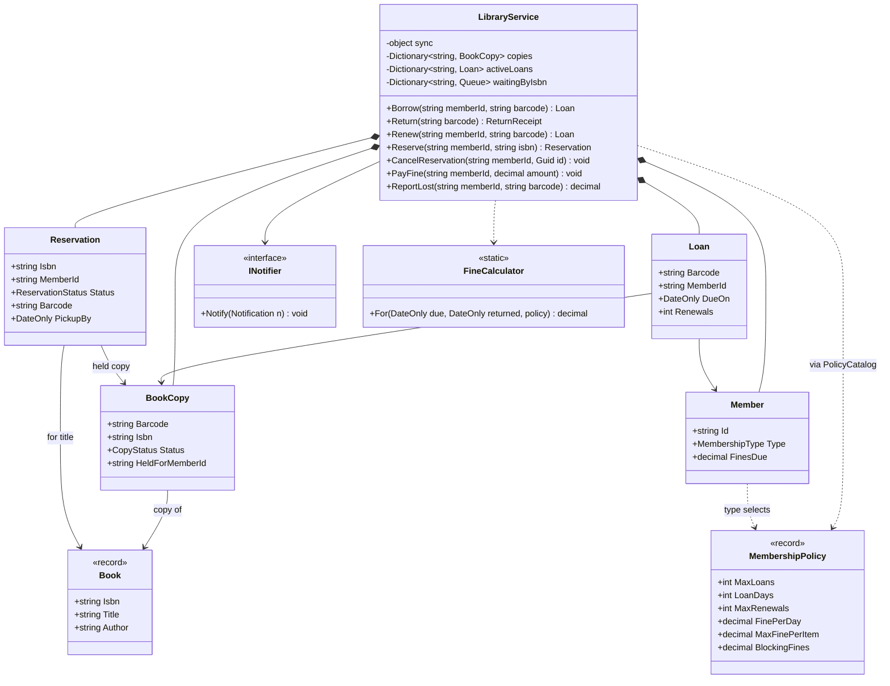
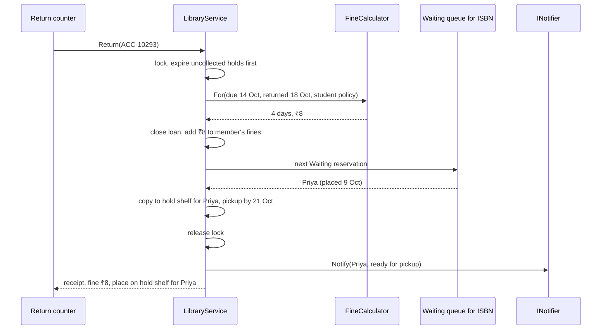
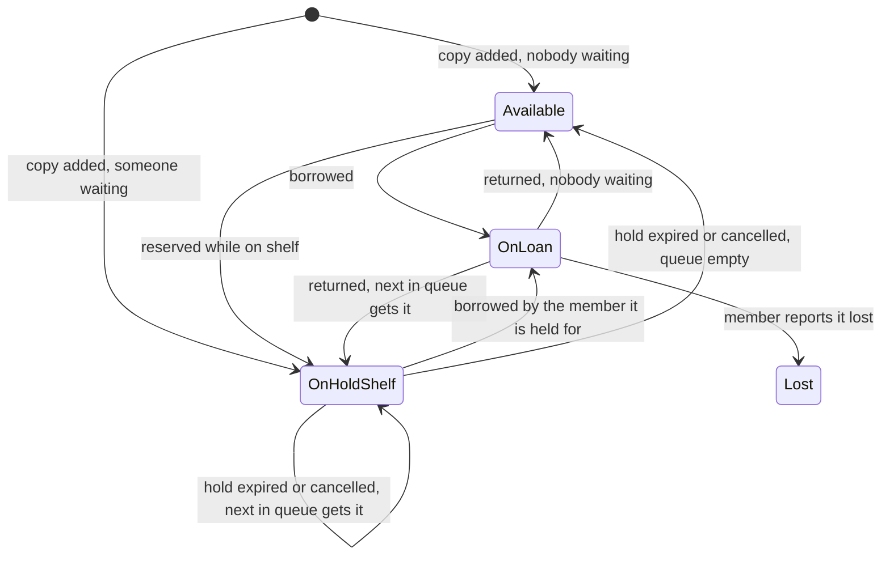
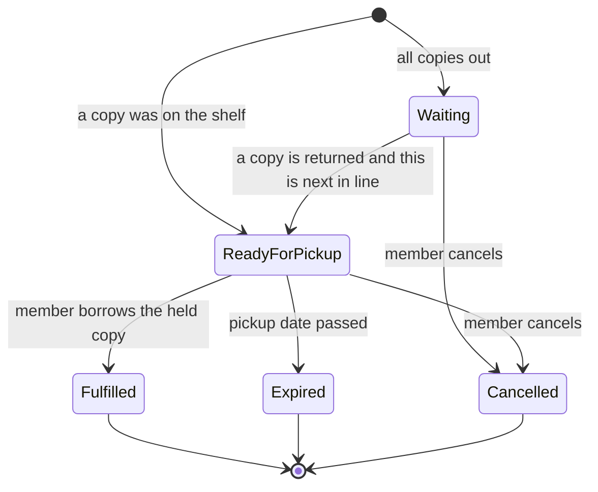
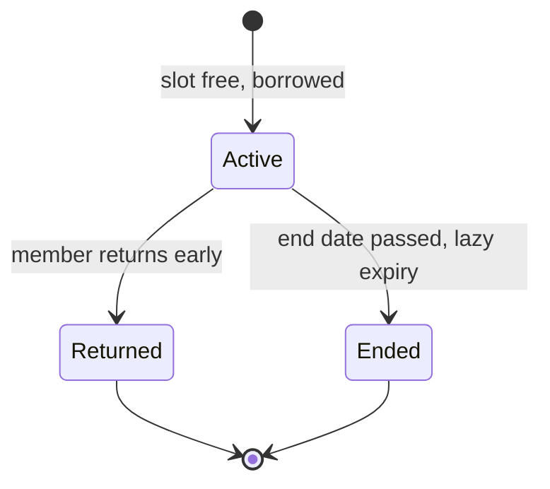
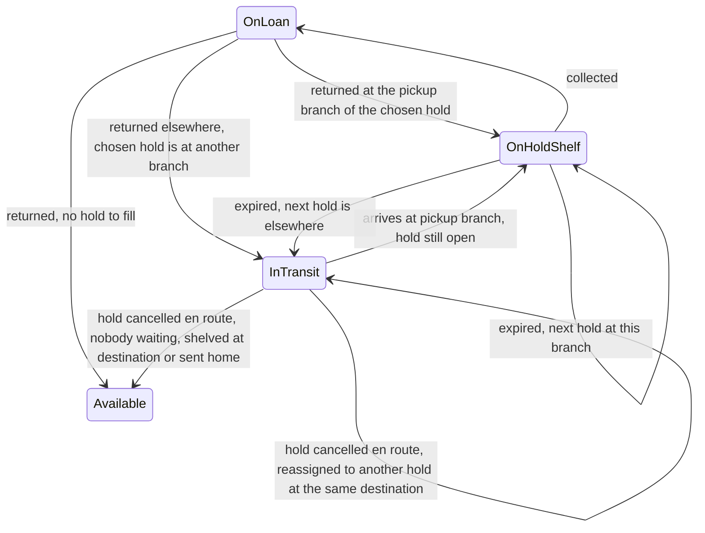

The library system is the friendliest LLD case study, because everyone has borrowed a book. That familiarity hides real modelling decisions. Is a "book" the title or the physical copy? Who decides that a student may borrow 4 books but a professor 10? What happens to a returned book when three people are waiting for it? And when the last copy of a popular exam guide is at the counter, can two librarians check it out to two students at once?

## Learning objectives

By the end of this case study you will be able to:

1. Separate a *title* (`Book`, identified by ISBN) from a *physical item* (`BookCopy`, identified by barcode), and explain why it matters.
2. Model membership rules as **policy objects** (data) rather than one subclass per member type.
3. Design a first-come-first-served reservation queue with pickup deadlines and expiry.
4. Draw and implement the lifecycles of a copy and a reservation.
5. Calculate overdue fines correctly with dates in the library's time zone.
6. Make borrowing, returning and reserving safe when several counters and an online portal act at once.
7. Choose between exceptions and result objects for rule violations, and justify it.

## Prerequisites

- [Identifying classes and responsibilities](#/lesson/m07-classes-responsibilities).
- [Identifying entities, value objects and services](#/lesson/m07-entities-values-services): copies and members are entities; policies are values.
- [Error handling and domain exceptions](#/lesson/m07-domain-exceptions): we use a domain exception with a rule code.

## Explain it like I'm a beginner

Imagine your college library. The catalogue lists *"Introduction to Algorithms"* once, but the shelves hold five physical copies, each with its own barcode sticker. When you borrow, the librarian scans *a copy*, not the title. That's the first idea: the **title** and the **copy** are different things.

Next, rules depend on who you are. A first-year student can take 4 books for 14 days. A professor can take 10 for 30 days. Those rules are like a printed card on the counter: "Student: 4 books, 14 days, ₹2 per late day." In software we store that card as a small piece of data called a **policy**, rather than writing different code for students and professors.

Then there's the waiting list. All five copies are out, and you want one. You "place a hold" and join a queue. When someone returns a copy, the librarian doesn't put it back on the shelf. It goes onto the **hold shelf** with your name on it, and you get a message: "Your book is ready, collect it within 3 days." If you don't come, the copy goes to the next person in the queue.

Finally, late returns earn a **fine**: so many rupees per day late, with a maximum.

The tricky part is timing. Two librarians at two counters, plus students reserving online, all touch the same copies at the same time. If both counters scan the last copy at the same moment, only one student must get it. The fix is a rule that only one counter can update the library's records at a time, like a single register that is passed from hand to hand. In code, that's a **lock**.

## Requirements

### Clarifying questions

| Question | Assumed answer | Why it matters |
|---|---|---|
| One branch or many? | One branch for now. Multi-branch holds are Exercise 5. | Many branches add transfers between buildings. |
| Member types? | Student, Faculty, Public, each with its own limits, loan period, renewals and fine rate. | Rules become data (policies). |
| Can you reserve a book that's on the shelf? | Yes: it is pulled to the hold shelf for you immediately. | Reserve has two outcomes. |
| Reservation order? | First come, first served, per title (any copy will do). | A queue per ISBN, not per copy. |
| Pickup window? | 3 days. Uncollected holds expire and go to the next person. | Needs expiry handling. |
| Renewals? | Allowed up to the policy limit, only if the loan isn't overdue and nobody is waiting for the title. | Renewal checks the queue. |
| Fines? | Per day late, capped per item. Charged on return. Paid at the counter. | Fine calculation and member balance. |
| When is a member blocked? | When unpaid fines reach the policy threshold, or they have any overdue loan. | Borrow eligibility rules. |
| Lost books? | Member reports it; a replacement charge equal to the per-item cap is added. | A copy state. |
| Who uses the system? | Librarians at counters, a self-checkout kiosk, and an online portal for reservations. | Concurrent access. |
| Time zone? | The library runs on Indian Standard Time (UTC+05:30, no daylight saving). | "Due on 18 October" must mean the local date. |

### Functional requirements

1. Borrow a copy: check the member may borrow, check the copy is available (or on hold for this member), create a loan with a due date.
2. Return a copy: close the loan, charge any fine, and either put the copy back on the shelf or onto the hold shelf for the next person waiting.
3. Renew a loan within the rules.
4. Reserve a title: put an available copy on hold immediately, or join the queue.
5. Cancel a reservation; a cancelled ready hold passes its copy to the next person.
6. Expire uncollected holds after the pickup window.
7. Pay fines; report a lost copy.
8. Notify members when a hold is ready or has expired.

### Non-functional requirements

- **Consistency**: a copy is on loan to at most one member, on hold for at most one member, and a reservation queue never skips someone.
- **Concurrency**: several counters and the portal act at once without double-lending.
- **Correct dates**: due dates and fines use the library's local date, and are testable without waiting days.
- **Clarity of refusals**: a librarian sees *why* a borrow was refused (limit, fines, overdue, reserved for someone else).
- **Scale**: a branch has tens of thousands of copies and a few thousand active loans (an estimate for a mid-sized college library). An in-memory model is fine for the LLD; persistence is discussed in the alternatives.

## Identifying classes and responsibilities

Nouns: library, book, title, ISBN, author, copy, barcode, member, membership type, loan, due date, renewal, reservation, hold shelf, queue, fine, notification, counter, kiosk. Verbs: borrow, return, renew, reserve, cancel, expire, pay, report lost, notify.

| Class | Kind | Responsibility |
|---|---|---|
| `Book` | value (record) | A title: ISBN, title, author. No lifecycle. |
| `BookCopy` | entity | A physical item with a barcode and a status; guards its own transitions. |
| `Member` | entity | Identity, membership type, fines owed. |
| `MembershipPolicy` | value (record) | The rule card for one membership type. |
| `PolicyCatalog` | service | Looks up the policy for a membership type. |
| `Loan` | entity | Who has which copy, since when, until when, renewals. |
| `Reservation` | entity | A member's place in the queue for a title, then a hold on a specific copy. |
| `FineCalculator` | pure function | Days late times rate, capped. |
| `LibraryService` | application service (Facade) | Coordinates all operations under one lock, enforces the rules that span several entities. |
| `INotifier` | port | Sends "your hold is ready" messages (SMS, email, app push). |
| `LibraryRuleException` | domain exception | Carries a `LibraryRule` code saying exactly which rule was broken. |

Two decisions deserve a sentence each:

- **Reservations are per title, holds are per copy.** You want *a* copy of the book, not copy number 3. But once a copy is set aside for you, the reservation records which one, so nobody else can borrow it.
- **Rules that involve several entities live in the service.** "Can this member borrow?" needs the member, the member's other loans and the policy. No single entity has all of that, so `LibraryService` checks it. Rules about one entity's own state ("a copy on loan can't be put on hold") live in that entity.

## Class diagram



How to read it: `LibraryService` owns the working collections and is the only way in. A `BookCopy` points to its `Book` by ISBN. A `Loan` connects one member to one copy. A `Reservation` points to a *title* while waiting and gains a *copy* (barcode) once a hold is placed. `Member` doesn't hold its policy; its membership type selects one from the catalogue, so changing "students can now borrow 5" is a configuration change, not a code change. The notifier is a port, so SMS or email providers can be swapped.

What happens when a copy comes back while people are waiting:



The returned copy goes straight to the next person in the queue. It never becomes "available" in between, which is what stops a walk-in student from grabbing it off the returns trolley. Notifications are collected while the lock is held and sent after it is released, so a slow SMS gateway can't hold up the counter.

## Patterns and design decisions

### Title versus copy

Most bugs in naive library designs come from merging these. If `Book` had a `Status`, five copies would need five `Book` objects with duplicated titles, or one `Book` with a `CopiesAvailable` counter, which can't tell you *which* copy is overdue or damaged. Splitting them gives each concept one job: `Book` describes, `BookCopy` circulates.

### Policy objects instead of member subclasses

A tempting design is `StudentMember : Member`, `FacultyMember : Member`, each overriding `MaxLoans`. It breaks down quickly: a student becomes a research scholar mid-year (you can't change an object's class), the library introduces a "senior citizen" type (new subclass, redeploy), and the rules are scattered across classes. A `MembershipPolicy` record per type, looked up from a `PolicyCatalog`, keeps the rules as data that can be loaded from configuration or a database. If one member type ever needs genuinely *different logic*, not just different numbers, that is the moment for a [Strategy](#/lesson/m06-strategy).

### Lifecycles as guarded methods, not the State pattern

A copy has four states and a reservation has five, but each transition is a one-line change guarded by a check. So we use an enum plus methods like `PutOnHold(memberId)` that throw if called from the wrong state. That's enough to make illegal transitions impossible without the ceremony of a class per state. Compare the [ATM](#/lesson/m18-atm), where each state accepts different inputs and does real work, and the State pattern earns its place.

### Exceptions with rule codes for refusals

Borrowing is a command from a librarian or a kiosk. When it is refused, the caller needs to know *which* rule, to show a clear message ("You have ₹120 in unpaid fines"). We throw `LibraryRuleException` with a `LibraryRule` enum. Why an exception here, when the [parking lot](#/lesson/m18-parking-lot) returned a result object for "lot full"? Because a refusal here aborts the whole command and must never be ignored by accident. With a result object, a caller can forget to check it and print a due date for a loan that doesn't exist. Both approaches are defensible; what matters is being consistent within a codebase. The API layer maps rule codes to HTTP 409 or 404.

### One lock in the service, and an invariant that makes it simple

The service guards everything with one `lock`. That is enough because every operation is short and in-memory. It also lets us keep a strong **invariant**: *a copy is Available only if nobody is waiting for its title.* Every operation that frees a copy (return, cancel, hold expiry, adding a new copy) immediately offers it to the queue. Because of that invariant, `Borrow` never has to ask "is someone waiting for this?"; the copy's status already answers it.

### Lazy expiry

Uncollected holds must expire after 3 days. We could run a timer, but we don't need one for correctness: every command starts by expiring holds whose pickup date has passed. A nightly job can call the same method so notifications go out even on quiet days. This "expire on read" approach is the same one used in the [vending machine](#/lesson/m18-vending-machine) reservations.

### Dates in the library's time zone

"Due 18 October" is a local calendar date. We store due dates as `DateOnly`, and compute "today" by converting the UTC clock to the library's offset (UTC+05:30 for IST, which has no daylight saving). For a zone with daylight saving you'd use `TimeZoneInfo`. Mixing UTC dates with local dates is a classic fine-calculation bug: a book returned at 1:00 a.m. IST would count as returned the previous day in UTC.

## State transitions

The copy:



How to read it: a copy is only ever Available when nobody is waiting, which is why every arrow out of OnLoan or OnHoldShelf checks the queue. The self-loop on OnHoldShelf is the hand-over from one waiting member to the next when a hold expires or is cancelled. Only the member it's held for can move it from OnHoldShelf to OnLoan. Lost is terminal in this design; a found book would be re-added as a copy.

The reservation:



A reservation either waits in the queue or is placed on hold straight away. It ends in exactly one of three ways: fulfilled, expired or cancelled. "Open" means Waiting or ReadyForPickup, and a member can have at most one open reservation per title.

## C# implementation

```text
Library.Api/
  Program.cs
  Domain/Catalog.cs
  Domain/Members.cs
  Domain/Circulation.cs
  LibraryService.cs
```

```csharp file=Domain/Catalog.cs
namespace Library.Domain;

public sealed record Book(string Isbn, string Title, string Author);

public enum CopyStatus { Available, OnLoan, OnHoldShelf, Lost }

public sealed class BookCopy
{
    public BookCopy(string barcode, string isbn)
    {
        ArgumentException.ThrowIfNullOrWhiteSpace(barcode);
        ArgumentException.ThrowIfNullOrWhiteSpace(isbn);
        Barcode = barcode;
        Isbn = isbn;
    }

    public string Barcode { get; }
    public string Isbn { get; }
    public CopyStatus Status { get; private set; } = CopyStatus.Available;
    public string? HeldForMemberId { get; private set; }

    internal void CheckOut(string memberId)
    {
        var allowed = Status == CopyStatus.Available
                      || (Status == CopyStatus.OnHoldShelf && HeldForMemberId == memberId);
        if (!allowed) throw new InvalidOperationException($"Copy {Barcode} can't be checked out while {Status}.");
        Status = CopyStatus.OnLoan;
        HeldForMemberId = null;
    }

    internal void CheckIn()
    {
        if (Status != CopyStatus.OnLoan) throw new InvalidOperationException($"Copy {Barcode} is not on loan.");
        Status = CopyStatus.Available;
    }

    internal void PutOnHold(string memberId)
    {
        if (Status != CopyStatus.Available) throw new InvalidOperationException($"Copy {Barcode} is not available to hold.");
        Status = CopyStatus.OnHoldShelf;
        HeldForMemberId = memberId;
    }

    internal void ReleaseHold()
    {
        if (Status != CopyStatus.OnHoldShelf) throw new InvalidOperationException($"Copy {Barcode} is not on the hold shelf.");
        Status = CopyStatus.Available;
        HeldForMemberId = null;
    }

    internal void MarkLost()
    {
        if (Status != CopyStatus.OnLoan) throw new InvalidOperationException($"Only a copy on loan can be reported lost.");
        Status = CopyStatus.Lost;
    }
}
```

```csharp file=Domain/Members.cs
namespace Library.Domain;

public enum MembershipType { Student, Faculty, Public }

/// <summary>The "rule card" for one membership type. Data, not code, so it can come from configuration.</summary>
public sealed record MembershipPolicy(int MaxLoans, int LoanDays, int MaxRenewals,
    decimal FinePerDay, decimal MaxFinePerItem, decimal BlockingFines);

public sealed class PolicyCatalog(IReadOnlyDictionary<MembershipType, MembershipPolicy> policies)
{
    /// <summary>Example rules for a college library. Real values come from the library's regulations.</summary>
    public static PolicyCatalog Default() => new(new Dictionary<MembershipType, MembershipPolicy>
    {
        [MembershipType.Student] = new(MaxLoans: 4, LoanDays: 14, MaxRenewals: 1, FinePerDay: 2m, MaxFinePerItem: 200m, BlockingFines: 100m),
        [MembershipType.Faculty] = new(MaxLoans: 10, LoanDays: 30, MaxRenewals: 2, FinePerDay: 1m, MaxFinePerItem: 200m, BlockingFines: 500m),
        [MembershipType.Public] = new(MaxLoans: 3, LoanDays: 14, MaxRenewals: 1, FinePerDay: 5m, MaxFinePerItem: 300m, BlockingFines: 100m),
    });

    public MembershipPolicy For(MembershipType type) =>
        policies.TryGetValue(type, out var p) ? p : throw new InvalidOperationException($"No policy for {type}.");
}

public sealed class Member(string id, string name, MembershipType type)
{
    public string Id { get; } = id;
    public string Name { get; } = name;
    public MembershipType Type { get; } = type;
    public decimal FinesDue { get; private set; }

    internal void AddFine(decimal amount)
    {
        ArgumentOutOfRangeException.ThrowIfNegativeOrZero(amount);
        FinesDue += amount;
    }

    internal void PayFine(decimal amount)
    {
        if (amount <= 0 || amount > FinesDue)
            throw new LibraryRuleException(LibraryRule.InvalidAmount, $"Payment must be between ₹1 and ₹{FinesDue}.");
        FinesDue -= amount;
    }
}

public enum LibraryRule
{
    NotFound, LoanLimitReached, HasOverdueLoans, FinesDue, CopyNotAvailable, ReservedForAnotherMember,
    RenewalLimitReached, OverdueCannotRenew, OthersWaiting, AlreadyReserved, AlreadyBorrowed, InvalidAmount,
}

public sealed class LibraryRuleException(LibraryRule rule, string message) : Exception(message)
{
    public LibraryRule Rule { get; } = rule;
}
```

```csharp file=Domain/Circulation.cs
namespace Library.Domain;

public sealed class Loan
{
    internal Loan(string barcode, string isbn, string memberId, DateOnly borrowedOn, DateOnly dueOn)
    {
        Barcode = barcode; Isbn = isbn; MemberId = memberId; BorrowedOn = borrowedOn; DueOn = dueOn;
    }

    public Guid Id { get; } = Guid.NewGuid();
    public string Barcode { get; }
    public string Isbn { get; }
    public string MemberId { get; }
    public DateOnly BorrowedOn { get; }
    public DateOnly DueOn { get; private set; }
    public DateOnly? ReturnedOn { get; private set; }
    public int Renewals { get; private set; }
    public bool IsOverdue(DateOnly today) => ReturnedOn is null && DueOn < today;

    internal void Renew(DateOnly newDue)
    {
        if (newDue <= DueOn) throw new InvalidOperationException("A renewal must extend the due date.");
        DueOn = newDue;
        Renewals++;
    }

    internal void Close(DateOnly on)
    {
        if (ReturnedOn is not null) throw new InvalidOperationException("Loan already closed.");
        ReturnedOn = on;
    }
}

public enum ReservationStatus { Waiting, ReadyForPickup, Fulfilled, Expired, Cancelled }

public sealed class Reservation
{
    internal Reservation(string isbn, string memberId, DateTimeOffset placedAt)
    {
        Isbn = isbn; MemberId = memberId; PlacedAt = placedAt;
    }

    public Guid Id { get; } = Guid.NewGuid();
    public string Isbn { get; }
    public string MemberId { get; }
    public DateTimeOffset PlacedAt { get; }
    public ReservationStatus Status { get; private set; } = ReservationStatus.Waiting;
    public string? Barcode { get; private set; }
    public DateOnly? PickupBy { get; private set; }
    public bool IsOpen => Status is ReservationStatus.Waiting or ReservationStatus.ReadyForPickup;

    internal void MarkReady(string barcode, DateOnly pickupBy)
    {
        Require(ReservationStatus.Waiting);
        Barcode = barcode;
        PickupBy = pickupBy;
        Status = ReservationStatus.ReadyForPickup;
    }

    internal void Fulfil() { Require(ReservationStatus.ReadyForPickup); Status = ReservationStatus.Fulfilled; }
    internal void Expire() { Require(ReservationStatus.ReadyForPickup); Status = ReservationStatus.Expired; }

    internal void Cancel()
    {
        if (!IsOpen) throw new InvalidOperationException($"Reservation {Id} is already {Status}.");
        Status = ReservationStatus.Cancelled;
    }

    private void Require(ReservationStatus expected)
    {
        if (Status != expected) throw new InvalidOperationException($"Reservation {Id} is {Status}, expected {expected}.");
    }
}

public static class FineCalculator
{
    /// <summary>Whole local days after the due date, times the daily rate, capped per item.</summary>
    public static (int DaysLate, decimal Fine) For(DateOnly dueOn, DateOnly returnedOn, MembershipPolicy policy)
    {
        var daysLate = Math.Max(0, returnedOn.DayNumber - dueOn.DayNumber);
        return (daysLate, Math.Min(daysLate * policy.FinePerDay, policy.MaxFinePerItem));
    }
}

public sealed record ReturnReceipt(string Barcode, string MemberId, int DaysLate, decimal Fine, string? NowHeldForMemberId);

public sealed record Notification(string MemberId, string Message);

public interface INotifier
{
    void Notify(Notification notification);
}

public sealed class LibraryOptions
{
    /// <summary>IST is UTC+05:30 with no daylight saving. Use TimeZoneInfo for zones that have DST.</summary>
    public TimeSpan LocalOffset { get; init; } = new(5, 30, 0);
    public int PickupDays { get; init; } = 3;
}
```

```csharp file=LibraryService.cs
using Library.Domain;

namespace Library;

/// <summary>
/// Facade for counters, kiosks and the portal. One lock guards all state, which keeps this invariant easy:
/// a copy is Available only if nobody is waiting for its title. Notifications are sent after the lock is released.
/// </summary>
public sealed class LibraryService(PolicyCatalog policies, INotifier notifier, TimeProvider clock, LibraryOptions options)
{
    private readonly object _sync = new();
    private readonly Dictionary<string, Book> _books = new();
    private readonly Dictionary<string, BookCopy> _copies = new();
    private readonly Dictionary<string, Member> _members = new();
    private readonly Dictionary<string, Loan> _activeLoans = new();          // by barcode
    private readonly Dictionary<Guid, Reservation> _reservations = new();
    private readonly Dictionary<string, Queue<Reservation>> _waiting = new(); // by ISBN, first come first served

    public DateOnly Today => DateOnly.FromDateTime(clock.GetUtcNow().ToOffset(options.LocalOffset).DateTime);

    public void AddBook(Book book) { lock (_sync) _books.Add(book.Isbn, book); }

    public void RegisterMember(Member member) { lock (_sync) _members.Add(member.Id, member); }

    public void AddCopy(string barcode, string isbn)
    {
        var outbox = new List<Notification>();
        lock (_sync)
        {
            if (!_books.ContainsKey(isbn)) throw Rule(LibraryRule.NotFound, $"No title with ISBN {isbn}.");
            var copy = new BookCopy(barcode, isbn);
            _copies.Add(barcode, copy);
            OfferToQueue(copy, Today, outbox);                 // a new copy may satisfy someone waiting
        }
        Send(outbox);
    }

    public Loan Borrow(string memberId, string barcode)
    {
        var outbox = new List<Notification>();
        Loan loan;
        lock (_sync)
        {
            var today = Today;
            ExpireUncollectedHolds(today, outbox);
            var member = GetMember(memberId);
            var copy = GetCopy(barcode);
            var policy = policies.For(member.Type);
            EnsureMayBorrow(member, policy, today);

            if (copy.Status == CopyStatus.OnHoldShelf && copy.HeldForMemberId != memberId)
                throw Rule(LibraryRule.ReservedForAnotherMember, $"Copy {barcode} is on hold for another member.");
            if (copy.Status is not (CopyStatus.Available or CopyStatus.OnHoldShelf))
                throw Rule(LibraryRule.CopyNotAvailable, $"Copy {barcode} is {copy.Status}.");

            if (copy.Status == CopyStatus.OnHoldShelf)
                _reservations.Values.Single(r => r.Status == ReservationStatus.ReadyForPickup && r.Barcode == barcode).Fulfil();

            copy.CheckOut(memberId);
            loan = new Loan(copy.Barcode, copy.Isbn, memberId, today, today.AddDays(policy.LoanDays));
            _activeLoans.Add(barcode, loan);
        }
        Send(outbox);
        return loan;
    }

    public ReturnReceipt Return(string barcode)
    {
        var outbox = new List<Notification>();
        ReturnReceipt receipt;
        lock (_sync)
        {
            var today = Today;
            ExpireUncollectedHolds(today, outbox);
            if (!_activeLoans.Remove(barcode, out var loan)) throw Rule(LibraryRule.NotFound, $"Copy {barcode} is not on loan.");

            var member = _members[loan.MemberId];
            var (daysLate, fine) = FineCalculator.For(loan.DueOn, today, policies.For(member.Type));
            loan.Close(today);
            if (fine > 0) member.AddFine(fine);

            var copy = _copies[barcode];
            copy.CheckIn();
            var heldFor = OfferToQueue(copy, today, outbox);
            receipt = new ReturnReceipt(barcode, member.Id, daysLate, fine, heldFor);
        }
        Send(outbox);
        return receipt;
    }

    public Loan Renew(string memberId, string barcode)
    {
        lock (_sync)
        {
            var today = Today;
            if (!_activeLoans.TryGetValue(barcode, out var loan) || loan.MemberId != memberId)
                throw Rule(LibraryRule.NotFound, $"{memberId} has no loan for copy {barcode}.");
            var policy = policies.For(GetMember(memberId).Type);
            if (loan.IsOverdue(today)) throw Rule(LibraryRule.OverdueCannotRenew, "Overdue loans can't be renewed; please return the book.");
            if (loan.Renewals >= policy.MaxRenewals) throw Rule(LibraryRule.RenewalLimitReached, $"Already renewed {loan.Renewals} time(s).");
            if (HasWaiting(loan.Isbn)) throw Rule(LibraryRule.OthersWaiting, "Other members are waiting for this title.");
            loan.Renew(today.AddDays(policy.LoanDays));
            return loan;
        }
    }

    public Reservation Reserve(string memberId, string isbn)
    {
        var outbox = new List<Notification>();
        Reservation reservation;
        lock (_sync)
        {
            var today = Today;
            ExpireUncollectedHolds(today, outbox);
            GetMember(memberId);
            if (!_books.ContainsKey(isbn)) throw Rule(LibraryRule.NotFound, $"No title with ISBN {isbn}.");
            if (_reservations.Values.Any(r => r.IsOpen && r.MemberId == memberId && r.Isbn == isbn))
                throw Rule(LibraryRule.AlreadyReserved, "You already have an open reservation for this title.");
            if (_activeLoans.Values.Any(l => l.MemberId == memberId && l.Isbn == isbn))
                throw Rule(LibraryRule.AlreadyBorrowed, "You already have this title on loan.");

            reservation = new Reservation(isbn, memberId, clock.GetUtcNow());
            _reservations.Add(reservation.Id, reservation);

            var onShelf = _copies.Values.Where(c => c.Isbn == isbn && c.Status == CopyStatus.Available)
                                        .OrderBy(c => c.Barcode, StringComparer.Ordinal).FirstOrDefault();
            if (onShelf is not null) PlaceHold(reservation, onShelf, today, outbox);
            else QueueFor(isbn).Enqueue(reservation);
        }
        Send(outbox);
        return reservation;
    }

    public void CancelReservation(string memberId, Guid reservationId)
    {
        var outbox = new List<Notification>();
        lock (_sync)
        {
            if (!_reservations.TryGetValue(reservationId, out var r) || r.MemberId != memberId)
                throw Rule(LibraryRule.NotFound, "Reservation not found.");
            var wasReady = r.Status == ReservationStatus.ReadyForPickup;
            r.Cancel();                                       // a Waiting entry is skipped lazily by the queue
            if (wasReady)
            {
                var copy = _copies[r.Barcode!];
                copy.ReleaseHold();
                OfferToQueue(copy, Today, outbox);
            }
        }
        Send(outbox);
    }

    public void PayFine(string memberId, decimal amount)
    {
        lock (_sync) GetMember(memberId).PayFine(amount);
    }

    /// <summary>Closes the loan and charges the per-item cap as a replacement charge.</summary>
    public decimal ReportLost(string memberId, string barcode)
    {
        lock (_sync)
        {
            if (!_activeLoans.TryGetValue(barcode, out var loan) || loan.MemberId != memberId)
                throw Rule(LibraryRule.NotFound, $"{memberId} has no loan for copy {barcode}.");
            var member = GetMember(memberId);
            var charge = policies.For(member.Type).MaxFinePerItem;
            _activeLoans.Remove(barcode);
            loan.Close(Today);
            _copies[barcode].MarkLost();
            member.AddFine(charge);
            return charge;
        }
    }

    /// <summary>Also called by a nightly job so expiry messages go out on quiet days.</summary>
    public int ExpireHolds()
    {
        var outbox = new List<Notification>();
        int expired;
        lock (_sync) expired = ExpireUncollectedHolds(Today, outbox);
        Send(outbox);
        return expired;
    }

    public CopyStatus StatusOf(string barcode) { lock (_sync) return GetCopy(barcode).Status; }
    public decimal FinesOf(string memberId) { lock (_sync) return GetMember(memberId).FinesDue; }
    public int ActiveLoanCount(string memberId) { lock (_sync) return _activeLoans.Values.Count(l => l.MemberId == memberId); }

    // ---- rules that span several entities ----

    private void EnsureMayBorrow(Member member, MembershipPolicy policy, DateOnly today)
    {
        if (member.FinesDue >= policy.BlockingFines)
            throw Rule(LibraryRule.FinesDue, $"Unpaid fines of ₹{member.FinesDue} must be paid first.");
        var loans = _activeLoans.Values.Where(l => l.MemberId == member.Id).ToList();
        if (loans.Any(l => l.IsOverdue(today)))
            throw Rule(LibraryRule.HasOverdueLoans, "Please return overdue books first.");
        if (loans.Count >= policy.MaxLoans)
            throw Rule(LibraryRule.LoanLimitReached, $"Limit of {policy.MaxLoans} books reached.");
    }

    /// <summary>Keeps the invariant: a freed copy goes to the next waiting member, else back to the shelf.</summary>
    private string? OfferToQueue(BookCopy copy, DateOnly today, List<Notification> outbox)
    {
        if (copy.Status != CopyStatus.Available || !_waiting.TryGetValue(copy.Isbn, out var queue)) return null;
        while (queue.TryDequeue(out var next))
        {
            if (next.Status != ReservationStatus.Waiting) continue;   // cancelled while waiting
            PlaceHold(next, copy, today, outbox);
            return next.MemberId;
        }
        return null;
    }

    private void PlaceHold(Reservation reservation, BookCopy copy, DateOnly today, List<Notification> outbox)
    {
        var pickupBy = today.AddDays(options.PickupDays);
        reservation.MarkReady(copy.Barcode, pickupBy);
        copy.PutOnHold(reservation.MemberId);
        outbox.Add(new Notification(reservation.MemberId,
            $"'{_books[copy.Isbn].Title}' is ready for pickup until {pickupBy:dd MMM yyyy}."));
    }

    private int ExpireUncollectedHolds(DateOnly today, List<Notification> outbox)
    {
        var due = _reservations.Values
            .Where(r => r.Status == ReservationStatus.ReadyForPickup && r.PickupBy < today)
            .OrderBy(r => r.PickupBy).ToList();
        foreach (var r in due)
        {
            r.Expire();
            var copy = _copies[r.Barcode!];
            copy.ReleaseHold();
            outbox.Add(new Notification(r.MemberId, $"Your hold on '{_books[r.Isbn].Title}' has expired."));
            OfferToQueue(copy, today, outbox);
        }
        return due.Count;
    }

    private bool HasWaiting(string isbn) =>
        _waiting.TryGetValue(isbn, out var q) && q.Any(r => r.Status == ReservationStatus.Waiting);

    private Queue<Reservation> QueueFor(string isbn) =>
        _waiting.TryGetValue(isbn, out var q) ? q : _waiting[isbn] = new Queue<Reservation>();

    private Member GetMember(string id) =>
        _members.TryGetValue(id, out var m) ? m : throw Rule(LibraryRule.NotFound, $"No member {id}.");

    private BookCopy GetCopy(string barcode) =>
        _copies.TryGetValue(barcode, out var c) ? c : throw Rule(LibraryRule.NotFound, $"No copy {barcode}.");

    private static LibraryRuleException Rule(LibraryRule rule, string message) => new(rule, message);

    private void Send(List<Notification> outbox)
    {
        foreach (var n in outbox) notifier.Notify(n);   // outside the lock: a slow SMS gateway can't block counters
    }
}
```

```csharp file=Program.cs
using Library;
using Library.Domain;

var builder = WebApplication.CreateBuilder(args);

builder.Services.AddSingleton(PolicyCatalog.Default());
builder.Services.AddSingleton<INotifier, LoggingNotifier>();
builder.Services.AddSingleton(TimeProvider.System);
builder.Services.AddSingleton(new LibraryOptions());
builder.Services.AddSingleton<LibraryService>();

var app = builder.Build();

var library = app.Services.GetRequiredService<LibraryService>();
library.AddBook(new Book("978-0262046305", "Introduction to Algorithms", "Cormen, Leiserson, Rivest, Stein"));
library.AddCopy("ACC-10293", "978-0262046305");
library.AddCopy("ACC-10294", "978-0262046305");
library.RegisterMember(new Member("S-2024-117", "Priya Nair", MembershipType.Student));

app.MapPost("/loans", (BorrowRequest r, LibraryService lib) => Run(() => Results.Ok(lib.Borrow(r.MemberId, r.Barcode))));
app.MapPost("/returns/{barcode}", (string barcode, LibraryService lib) => Run(() => Results.Ok(lib.Return(barcode))));
app.MapPost("/loans/{barcode}/renew", (string barcode, MemberRequest r, LibraryService lib) => Run(() => Results.Ok(lib.Renew(r.MemberId, barcode))));
app.MapPost("/reservations", (ReserveRequest r, LibraryService lib) => Run(() => Results.Ok(lib.Reserve(r.MemberId, r.Isbn))));
app.MapDelete("/reservations/{id:guid}", (Guid id, string memberId, LibraryService lib) =>
    Run(() => { lib.CancelReservation(memberId, id); return Results.NoContent(); }));
app.MapGet("/members/{id}/fines", (string id, LibraryService lib) => Run(() => Results.Ok(new { fines = lib.FinesOf(id) })));

app.Run();

static IResult Run(Func<IResult> action)
{
    try { return action(); }
    catch (LibraryRuleException ex)
    {
        var status = ex.Rule == LibraryRule.NotFound ? StatusCodes.Status404NotFound : StatusCodes.Status409Conflict;
        return Results.Problem(ex.Message, statusCode: status, extensions: new Dictionary<string, object?> { ["rule"] = ex.Rule.ToString() });
    }
}

public sealed record BorrowRequest(string MemberId, string Barcode);
public sealed record MemberRequest(string MemberId);
public sealed record ReserveRequest(string MemberId, string Isbn);

public sealed class LoggingNotifier(ILogger<LoggingNotifier> log) : INotifier
{
    public void Notify(Notification n) => log.LogInformation("To {Member}: {Message}", n.MemberId, n.Message);
}
```

Design notes:

- **Every path that frees a copy calls `OfferToQueue`.** Return, cancelling a ready hold, hold expiry and adding a copy. That single helper is what keeps the "Available means nobody waiting" invariant true.
- **Cancelled waiting reservations are removed lazily.** `Queue<T>` can't remove from the middle cheaply, so a cancelled entry stays in the queue and is skipped when it reaches the front. Simple, and correct because the status is checked.
- **The API returns a `rule` code in the problem details.** The kiosk UI can show a friendly, translated message per rule, for example in Hindi or Marathi, without parsing English text.
- **`Loan` and `Reservation` objects are returned to callers.** That's a simplification for the LLD. In a real API you'd map them to DTOs so callers can't observe later changes made under the lock.

## Automated testing

```csharp
using Library;
using Library.Domain;
using Xunit;

public sealed class LibraryClock(DateTimeOffset start) : TimeProvider
{
    private DateTimeOffset _now = start;
    public override DateTimeOffset GetUtcNow() => _now;
    public void AdvanceDays(int days) => _now = _now.AddDays(days);
}

public sealed class FakeNotifier : INotifier
{
    public List<Notification> Sent { get; } = new();
    public void Notify(Notification n) { lock (Sent) Sent.Add(n); }
}

public class LibraryServiceTests
{
    private const string Isbn = "978-0262046305";
    // 06:30 UTC on 1 Oct 2026 is 12:00 IST.
    private readonly LibraryClock _clock = new(new DateTimeOffset(2026, 10, 1, 6, 30, 0, TimeSpan.Zero));
    private readonly FakeNotifier _notifier = new();
    private readonly LibraryService _lib;

    public LibraryServiceTests()
    {
        _lib = new LibraryService(PolicyCatalog.Default(), _notifier, _clock, new LibraryOptions());
        _lib.AddBook(new Book(Isbn, "Introduction to Algorithms", "CLRS"));
        _lib.AddCopy("C1", Isbn);
        foreach (var id in new[] { "S1", "S2", "S3" }) _lib.RegisterMember(new Member(id, id, MembershipType.Student));
    }

    [Fact]
    public void Borrow_sets_due_date_from_policy()
    {
        var loan = _lib.Borrow("S1", "C1");
        Assert.Equal(new DateOnly(2026, 10, 15), loan.DueOn);   // student: 14 days
        Assert.Equal(CopyStatus.OnLoan, _lib.StatusOf("C1"));
    }

    [Fact]
    public void Late_return_charges_per_day()
    {
        _lib.Borrow("S1", "C1");
        _clock.AdvanceDays(18);                                 // 4 days late
        var receipt = _lib.Return("C1");
        Assert.Equal(4, receipt.DaysLate);
        Assert.Equal(8m, receipt.Fine);
        Assert.Equal(8m, _lib.FinesOf("S1"));
    }

    [Fact]
    public void Fines_above_threshold_block_borrowing()
    {
        _lib.Borrow("S1", "C1");
        _clock.AdvanceDays(14 + 60);                            // 60 days late: ₹120, under the ₹200 cap
        _lib.Return("C1");
        var ex = Assert.Throws<LibraryRuleException>(() => _lib.Borrow("S1", "C1"));
        Assert.Equal(LibraryRule.FinesDue, ex.Rule);
        _lib.PayFine("S1", 120m);
        _lib.Borrow("S1", "C1");
    }

    [Fact]
    public void Returned_copy_goes_to_first_in_queue_not_back_to_shelf()
    {
        _lib.Borrow("S1", "C1");
        _lib.Reserve("S2", Isbn);
        _lib.Reserve("S3", Isbn);
        var receipt = _lib.Return("C1");
        Assert.Equal("S2", receipt.NowHeldForMemberId);
        Assert.Equal(CopyStatus.OnHoldShelf, _lib.StatusOf("C1"));
        Assert.Equal(LibraryRule.ReservedForAnotherMember, Assert.Throws<LibraryRuleException>(() => _lib.Borrow("S3", "C1")).Rule);
        _lib.Borrow("S2", "C1");
        Assert.Contains(_notifier.Sent, n => n.MemberId == "S2" && n.Message.Contains("ready for pickup"));
    }

    [Fact]
    public void Uncollected_hold_expires_and_passes_to_next()
    {
        _lib.Borrow("S1", "C1");
        _lib.Reserve("S2", Isbn);
        _lib.Reserve("S3", Isbn);
        _lib.Return("C1");                                      // held for S2 until 4 Oct
        _clock.AdvanceDays(4);                                  // 5 Oct
        Assert.Equal(1, _lib.ExpireHolds());
        _lib.Borrow("S3", "C1");
    }

    [Fact]
    public void Renewal_refused_when_others_are_waiting()
    {
        _lib.Borrow("S1", "C1");
        _lib.Reserve("S2", Isbn);
        Assert.Equal(LibraryRule.OthersWaiting, Assert.Throws<LibraryRuleException>(() => _lib.Renew("S1", "C1")).Rule);
    }

    [Fact]
    public void Reserving_a_book_on_the_shelf_holds_it_immediately()
    {
        var r = _lib.Reserve("S1", Isbn);
        Assert.Equal(ReservationStatus.ReadyForPickup, r.Status);
        Assert.Equal(CopyStatus.OnHoldShelf, _lib.StatusOf("C1"));
    }

    [Fact]
    public void Cancelled_waiting_reservation_is_skipped()
    {
        _lib.Borrow("S1", "C1");
        var r2 = _lib.Reserve("S2", Isbn);
        _lib.Reserve("S3", Isbn);
        _lib.CancelReservation("S2", r2.Id);
        Assert.Equal("S3", _lib.Return("C1").NowHeldForMemberId);
    }

    [Fact]
    public void Return_after_midnight_IST_counts_as_the_local_date()
    {
        _lib.Borrow("S1", "C1");                                // due 15 Oct (IST)
        // 15 Oct 19:00 UTC is 16 Oct 00:30 IST: one day late, although the UTC date is still 15 Oct.
        var clock = new LibraryClock(new DateTimeOffset(2026, 10, 15, 19, 0, 0, TimeSpan.Zero));
        var lib = new LibraryService(PolicyCatalog.Default(), _notifier, clock, new LibraryOptions());
        Assert.Equal(new DateOnly(2026, 10, 16), lib.Today);
    }
}

public class LibraryConcurrencyTests
{
    [Fact]
    public void Two_counters_cannot_lend_the_last_copy_twice()
    {
        var lib = new LibraryService(PolicyCatalog.Default(), new FakeNotifier(), TimeProvider.System, new LibraryOptions());
        lib.AddBook(new Book("X", "Exam guide", "A"));
        lib.AddCopy("LAST", "X");
        for (var i = 0; i < 50; i++) lib.RegisterMember(new Member($"M{i}", $"M{i}", MembershipType.Student));

        var ok = 0; var refused = 0;
        Parallel.For(0, 50, new ParallelOptions { MaxDegreeOfParallelism = 16 }, i =>
        {
            try { lib.Borrow($"M{i}", "LAST"); Interlocked.Increment(ref ok); }
            catch (LibraryRuleException) { Interlocked.Increment(ref refused); }
        });
        Assert.Equal(1, ok);
        Assert.Equal(49, refused);
    }

    [Fact]
    public void Concurrent_reservations_form_one_queue_and_one_hold()
    {
        var notifier = new FakeNotifier();
        var lib = new LibraryService(PolicyCatalog.Default(), notifier, TimeProvider.System, new LibraryOptions());
        lib.AddBook(new Book("X", "Exam guide", "A"));
        lib.AddCopy("C", "X");
        lib.RegisterMember(new Member("BORROWER", "B", MembershipType.Faculty));
        lib.Borrow("BORROWER", "C");
        for (var i = 0; i < 30; i++) lib.RegisterMember(new Member($"M{i}", $"M{i}", MembershipType.Student));

        Parallel.For(0, 30, i => lib.Reserve($"M{i}", "X"));
        var receipt = lib.Return("C");

        Assert.NotNull(receipt.NowHeldForMemberId);
        Assert.Single(notifier.Sent, n => n.Message.Contains("ready for pickup"));
    }
}
```

What these tests show:

- **Dates are controlled.** `LibraryClock` moves time forward by whole days, so "4 days late" is exact. The midnight test proves the local-date rule: 00:30 IST on 16 October is still 15 October in UTC, and a UTC-based calculation would miss a day of fine.
- **Queue behaviour is tested through the public API**: who gets the copy, whether others are blocked, and whether the right person is notified. No peeking at private queues.
- **The concurrency tests** race 50 borrowers for one copy (exactly one succeeds) and 30 reservations followed by a return (exactly one hold, one "ready" message). Without the lock, two threads could both see `Available` and both create loans.
- **Rule codes** make refusals precise: tests assert `LibraryRule.OthersWaiting`, not a message string that someone might reword.

## Bad design vs good design

**Bad**: one `Book` class doing everything.

```csharp
public class Book
{
    public string Title, Isbn;
    public int CopiesAvailable;                    // which copy is overdue? nobody knows
    public List<string> Borrowers = new();
    public List<string> WaitingList = new();

    public void Borrow(string memberId, bool isFaculty)
    {
        if (CopiesAvailable == 0) throw new Exception("No copies");
        if (Borrowers.Count(b => b == memberId) >= (isFaculty ? 10 : 4)) throw new Exception("Limit"); // rules hard-coded
        CopiesAvailable--;                         // a waiting member is jumped by this walk-in
        Borrowers.Add(memberId);
    }

    public decimal Return(string memberId, DateTime borrowedAt)
    {
        CopiesAvailable++;
        Borrowers.Remove(memberId);
        var days = (DateTime.Now - borrowedAt).Days - 14;   // local server time, student period assumed for everyone
        return days > 0 ? days * 2 : 0;
    }
}
```

What goes wrong:

- **Title and copy merged**: a counter can't tell you which physical copy a member has, so a damaged or lost copy can't be traced.
- **Queue jumping**: a returned book increments `CopiesAvailable`, and the next walk-in takes it ahead of everyone on `WaitingList`.
- **Rules hard-coded** with a `bool isFaculty` parameter; a third membership type means editing this method and every caller.
- **`DateTime.Now`** uses the server's time zone and can't be tested; the 14-day period is assumed for everyone.
- **`throw new Exception("Limit")`**: callers can't distinguish rules without parsing strings.
- **No thread safety**: `CopiesAvailable--` and `List.Add` race when two counters act at once.

**Good**: copies are separate entities with guarded states, rules are policy data, the returned copy goes straight to the queue, dates are local and injected, refusals carry rule codes, and one lock guards the shared state.

**Is it over-built for a tiny library?** A 300-book community reading room with one volunteer and no reservations could use a spreadsheet. The value of this design appears as soon as there are reservations, more than one counter, or fines that people dispute.

## Alternative designs

1. **Per-title locks instead of one lock.** A `ConcurrentDictionary<string, object>` of locks keyed by ISBN lets operations on different titles run in parallel. Correct only if every operation touches one title. `Borrow` also reads the member's other loans (limit check), so two borrows of different titles by the same member could both pass the limit. You'd need a member lock too, always taken in a fixed order (member, then title) to avoid deadlocks. For a branch library, the single lock is simpler and plenty fast.
2. **Database as the source of truth.** With PostgreSQL, the counters' race becomes a conditional update: `UPDATE copy SET status = 'OnLoan', version = version + 1 WHERE barcode = $1 AND status = 'Available' AND version = $2`, where zero rows means someone else got it (optimistic concurrency, Exercise 4). A unique partial index `ON loan (barcode) WHERE returned_on IS NULL` guarantees one open loan per copy. The member's limit check needs `SELECT ... FOR UPDATE` on the member row, so two counters serving the same member serialise. See [Deadlocks, optimistic and pessimistic locking](#/lesson/m09-locking).
3. **Domain events for notifications.** Instead of an outbox list, entities raise events (`HoldPlaced`, `HoldExpired`) that a dispatcher publishes after the operation. Same effect, more decoupled, and the natural path to the [Observer](#/lesson/m06-observer) pattern or a message queue once notifications go to several channels.
4. **Strategy for fine calculation.** If the library introduces fines that differ in *logic*, not just rates (no fines during exam weeks, a grace period for faculty, higher rates for reference books), make `IFinePolicy` a strategy selected by member type and item type. Until then, a policy record is simpler.
5. **Queue per copy instead of per title.** Rarely right: a member doesn't care which copy they get, and per-copy queues make waits longer when copies return at different times. Use it only for unique items, such as a single rare manuscript.

## Practical playground

Open the reference model. Try adding `Branch` (each copy belongs to a branch, and holds can be collected at a chosen branch) and an `InTransit` copy state. Which classes gain fields, and which relations change? Then try modelling `StudentMember` and `FacultyMember` as subclasses and notice how many places `MembershipPolicy` was quietly saving you.

:::playground type=lld title="Library management reference model"
```json
{
  "classes": [
    { "id": "Svc", "name": "LibraryService", "kind": "class",
      "fields": ["-object _sync", "-Dictionary~string, BookCopy~ _copies", "-Dictionary~string, Loan~ _activeLoans", "-Dictionary~string, Queue~ _waiting"],
      "methods": ["+Loan Borrow(string memberId, string barcode)", "+ReturnReceipt Return(string barcode)", "+Loan Renew(string memberId, string barcode)", "+Reservation Reserve(string memberId, string isbn)", "+void CancelReservation(string memberId, Guid id)", "+void PayFine(string memberId, decimal amount)", "+int ExpireHolds()"],
      "responsibility": "Facade; enforces cross-entity rules under one lock; keeps the queue invariant" },
    { "id": "Book", "name": "Book", "kind": "record", "fields": ["+string Isbn", "+string Title", "+string Author"], "methods": [] },
    { "id": "Copy", "name": "BookCopy", "kind": "class",
      "fields": ["+string Barcode", "+string Isbn", "+CopyStatus Status", "+string? HeldForMemberId"],
      "methods": ["~void CheckOut(string memberId)", "~void CheckIn()", "~void PutOnHold(string memberId)", "~void ReleaseHold()", "~void MarkLost()"],
      "responsibility": "Guards its own status transitions" },
    { "id": "Member", "name": "Member", "kind": "class", "fields": ["+string Id", "+MembershipType Type", "+decimal FinesDue"],
      "methods": ["~void AddFine(decimal amount)", "~void PayFine(decimal amount)"] },
    { "id": "Policy", "name": "MembershipPolicy", "kind": "record",
      "fields": ["+int MaxLoans", "+int LoanDays", "+int MaxRenewals", "+decimal FinePerDay", "+decimal MaxFinePerItem", "+decimal BlockingFines"], "methods": [] },
    { "id": "Catalog", "name": "PolicyCatalog", "kind": "class", "fields": ["-IReadOnlyDictionary policies"], "methods": ["+MembershipPolicy For(MembershipType type)"] },
    { "id": "Loan", "name": "Loan", "kind": "class",
      "fields": ["+string Barcode", "+string MemberId", "+DateOnly BorrowedOn", "+DateOnly DueOn", "+DateOnly? ReturnedOn", "+int Renewals"],
      "methods": ["+bool IsOverdue(DateOnly today)", "~void Renew(DateOnly newDue)", "~void Close(DateOnly on)"] },
    { "id": "Res", "name": "Reservation", "kind": "class",
      "fields": ["+string Isbn", "+string MemberId", "+ReservationStatus Status", "+string? Barcode", "+DateOnly? PickupBy"],
      "methods": ["~void MarkReady(string barcode, DateOnly pickupBy)", "~void Fulfil()", "~void Expire()", "~void Cancel()"] },
    { "id": "Fine", "name": "FineCalculator", "kind": "class", "fields": [], "methods": ["+static (int, decimal) For(DateOnly due, DateOnly returned, MembershipPolicy p)"] },
    { "id": "Notifier", "name": "INotifier", "kind": "interface", "fields": [], "methods": ["void Notify(Notification n)"] },
    { "id": "Err", "name": "LibraryRuleException", "kind": "class", "fields": ["+LibraryRule Rule"], "methods": [] },
    { "id": "CopyStatus", "name": "CopyStatus", "kind": "enum", "fields": ["Available", "OnLoan", "OnHoldShelf", "Lost"], "methods": [] },
    { "id": "ResStatus", "name": "ReservationStatus", "kind": "enum", "fields": ["Waiting", "ReadyForPickup", "Fulfilled", "Expired", "Cancelled"], "methods": [] }
  ],
  "relations": [
    { "from": "Svc", "to": "Copy", "kind": "composition", "multiplicity": "0..*" },
    { "from": "Svc", "to": "Member", "kind": "composition", "multiplicity": "0..*" },
    { "from": "Svc", "to": "Loan", "kind": "composition", "multiplicity": "0..*" },
    { "from": "Svc", "to": "Res", "kind": "composition", "multiplicity": "0..*" },
    { "from": "Svc", "to": "Catalog", "kind": "dependency" },
    { "from": "Svc", "to": "Notifier", "kind": "dependency" },
    { "from": "Svc", "to": "Fine", "kind": "dependency" },
    { "from": "Svc", "to": "Err", "kind": "dependency", "label": "throws" },
    { "from": "Catalog", "to": "Policy", "kind": "aggregation", "multiplicity": "1..*" },
    { "from": "Copy", "to": "Book", "kind": "association", "label": "copy of" },
    { "from": "Loan", "to": "Copy", "kind": "association" },
    { "from": "Loan", "to": "Member", "kind": "association" },
    { "from": "Res", "to": "Book", "kind": "association", "label": "for title" },
    { "from": "Res", "to": "Copy", "kind": "association", "label": "held copy" },
    { "from": "Copy", "to": "CopyStatus", "kind": "association" },
    { "from": "Res", "to": "ResStatus", "kind": "association" }
  ]
}
```
:::

## Exercises

:::exercise id=m18-library-ex1 difficulty=beginner kind=code title="Fines that skip closed days"
The library is closed on Sundays and declared holidays, and members aren't fined for days the library was closed. Implement `OverdueFine.Calculate`.
::requirements
- Count each day *after* the due date up to and including the return date.
- Skip Sundays and any date in `holidays`.
- Multiply by `perDay` and cap at `cap`.
- Returning on or before the due date costs nothing.
::acceptance
- Due Monday 12 Oct 2026, returned Monday 19 Oct 2026, ₹2/day: 6 chargeable days (Sunday 18 Oct skipped), ₹12.
- Due 19 Oct, returned 21 Oct, with 20 Oct a holiday: 1 day, ₹2.
- Due 1 Jan 2026, returned 1 Jun 2026, cap ₹200: ₹200.
- Returned early: ₹0.
::hint
Loop from the day after the due date to the return date, one `DateOnly` at a time.
::hint
`date.DayOfWeek == DayOfWeek.Sunday` and `holidays.Contains(date)` decide whether a day counts.
::hint
`for (var d = due.AddDays(1); d <= returned; d = d.AddDays(1)) { ... }`
::hint
Apply the cap once at the end: `Math.Min(days * perDay, cap)`.
::starter
```csharp file=OverdueFine.cs
using System;
using System.Collections.Generic;

public static class OverdueFine
{
    public static (int ChargeableDays, decimal Fine) Calculate(DateOnly due, DateOnly returned, decimal perDay, decimal cap,
        IReadOnlySet<DateOnly> holidays) => throw new NotImplementedException();
}
```
::tests
```csharp file=OverdueFineTests.cs
using System;
using System.Collections.Generic;
using Xunit;

public class OverdueFineTests
{
    private static readonly HashSet<DateOnly> None = new();

    [Fact]
    public void Sunday_is_not_charged()
    {
        var (days, fine) = OverdueFine.Calculate(new DateOnly(2026, 10, 12), new DateOnly(2026, 10, 19), 2m, 200m, None);
        Assert.Equal(6, days);
        Assert.Equal(12m, fine);
    }

    [Fact]
    public void Holiday_is_not_charged()
    {
        var holidays = new HashSet<DateOnly> { new(2026, 10, 20) };
        var (days, fine) = OverdueFine.Calculate(new DateOnly(2026, 10, 19), new DateOnly(2026, 10, 21), 2m, 200m, holidays);
        Assert.Equal(1, days);
        Assert.Equal(2m, fine);
    }

    [Fact]
    public void Fine_is_capped() =>
        Assert.Equal(200m, OverdueFine.Calculate(new DateOnly(2026, 1, 1), new DateOnly(2026, 6, 1), 2m, 200m, None).Fine);

    [Fact]
    public void Early_return_is_free() =>
        Assert.Equal(0m, OverdueFine.Calculate(new DateOnly(2026, 10, 15), new DateOnly(2026, 10, 10), 2m, 200m, None).Fine);

    [Fact]
    public void On_the_due_date_is_free() =>
        Assert.Equal(0, OverdueFine.Calculate(new DateOnly(2026, 10, 15), new DateOnly(2026, 10, 15), 2m, 200m, None).ChargeableDays);
}
```
::solution
```csharp file=OverdueFine.cs
using System;
using System.Collections.Generic;

public static class OverdueFine
{
    public static (int ChargeableDays, decimal Fine) Calculate(DateOnly due, DateOnly returned, decimal perDay, decimal cap,
        IReadOnlySet<DateOnly> holidays)
    {
        var days = 0;
        for (var d = due.AddDays(1); d <= returned; d = d.AddDays(1))
            if (d.DayOfWeek != DayOfWeek.Sunday && !holidays.Contains(d)) days++;
        return (days, Math.Min(days * perDay, cap));
    }
}
```

A loop over days is clear and fast enough: even a year-overdue book is 365 iterations. If the due date itself falls on a closed day, many libraries move the due date to the next open day *when lending*, which is a separate rule in `Borrow`, not in the fine calculation.
::mistakes
- Starting the loop at the due date, which charges for the due day itself.
- Using `DateTime` and `TotalDays`, which picks up time-of-day and time-zone errors.
- Applying the cap per day instead of once.
::extensions
Move the holiday calendar into an `ILibraryCalendar` service so the same rules decide due dates and fines, and test that a book due on a Sunday becomes due on Monday.
:::

:::exercise id=m18-library-ex2 difficulty=beginner kind=design title="Add e-books with licence limits"
The library buys e-book licences: each licence allows a fixed number of simultaneous loans (for example 3), loans last 14 days and end automatically, and there are no fines. Members can join a waiting list when all licence slots are in use. Describe the class changes and draw the state diagram for an e-book loan.
::acceptance
- You say whether an e-book licence is a `BookCopy`, a new class, or a status, and justify it.
- The waiting list reuses the existing reservation queue where possible.
- Automatic expiry is explained without a timer per loan.
- Fines and "lost" handling are clearly not applied to e-books.
::hint
What's the e-book equivalent of a physical copy? Is it one licence with 3 slots, or 3 interchangeable items?
::hint
Expiry is the same problem as uncollected holds. What did we do there?
::hint
Think about which methods on `LibraryService` would branch on "physical or digital", and whether a small interface could avoid that.
::solution
**Model**: add `EBookLicence` (`LicenceId`, `Isbn`, `ConcurrentSlots`, `ValidUntil`) rather than pretending a licence is a physical copy. Its "status" is a count: `ActiveLoans < ConcurrentSlots` means available. An `EBookLoan` records `LicenceId`, `MemberId`, `StartsOn`, `EndsOn`.



**Shared parts**: reservations are per title already, so the same queue works. When a slot frees (early return or lazy expiry), `OfferToQueue` gives the slot to the next member. For e-books, "ready for pickup" can skip the hold shelf and lend immediately, with a notification "your e-book has been added to your account".

**Avoiding branching**: introduce a small `ILendable` concept with `CanLend()`, `Lend(member, today)` and `Release()`, implemented by `BookCopy` and `EBookLicence`. The service's borrow and queue code work against `ILendable`; physical-only logic (hold shelf, lost, fines) stays in the physical path.

**Expiry**: no timer per loan. Every command expires e-book loans whose `EndsOn < today`, and the nightly job does the same so slots free up even on quiet days. Expiry never charges a fine.

**Loan limits**: decide with the librarian whether e-books count towards `MaxLoans`. Many libraries keep separate limits; add `MaxEBookLoans` to `MembershipPolicy` if so.
::mistakes
- Creating 3 fake `BookCopy` objects per licence with made-up barcodes, which breaks the "physical item" meaning and confuses stock reports.
- Charging fines on e-books because the return path is shared.
- A `Timer` per e-book loan, which doesn't survive restarts.
:::

:::exercise id=m18-library-ex3 difficulty=intermediate kind=code title="A hold queue with pickup deadlines"
Implement `HoldQueue` for one title on its own, without the rest of the library. Members join a first-come-first-served line. When a copy is offered, the first waiting member gets a hold on it until a pickup deadline. Uncollected holds expire and the copy passes to the next member.
::requirements
- `Join(memberId)` returns false if the member is already waiting or holding.
- `Leave(memberId)` removes a waiting member, or releases their hold and passes the copy on. Returns false if they weren't in the queue.
- `OfferCopy(barcode, today)` gives the copy to the next waiting member (hold until `today + pickupDays`) and returns their id, or null.
- `Collect(memberId, barcode)` returns true and removes the hold if that member holds that copy.
- `Expire(today)` expires holds whose deadline is before `today`, passes each copy on, and returns the barcodes that ended up with nobody.
- `Position(memberId)` is 1-based for waiting members and 0 otherwise.
::acceptance
- Join A, B, C; offer copy 1: A holds it; B is now position 1.
- A doesn't collect; after the deadline passes, `Expire` gives copy 1 to B.
- C leaves while waiting; a later offer skips C.
- A holder who leaves passes the copy straight to the next member.
::hint
Two collections: a waiting line (ordered) and current holds (by member or by barcode).
::hint
A `LinkedList<string>` lets you remove a member from the middle of the line; a `List<string>` is fine too at this size.
::hint
Store holds as `Dictionary<string, (string Barcode, DateOnly PickupBy)>` keyed by member id.
::hint
Write a private `GiveToNext(barcode, today)` used by `OfferCopy`, `Leave` and `Expire`, so the hand-over logic exists once.
::starter
```csharp file=HoldQueue.cs
using System;
using System.Collections.Generic;
using System.Linq;

public sealed class HoldQueue(int pickupDays)
{
    public bool Join(string memberId) => throw new NotImplementedException();
    public bool Leave(string memberId, DateOnly today) => throw new NotImplementedException();
    public string? OfferCopy(string barcode, DateOnly today) => throw new NotImplementedException();
    public bool Collect(string memberId, string barcode) => throw new NotImplementedException();
    public IReadOnlyList<string> Expire(DateOnly today) => throw new NotImplementedException();
    public int Position(string memberId) => throw new NotImplementedException();
    public string? HolderOf(string barcode) => throw new NotImplementedException();
}
```
::tests
```csharp file=HoldQueueTests.cs
using System;
using Xunit;

public class HoldQueueTests
{
    private static readonly DateOnly D1 = new(2026, 10, 1);

    private static HoldQueue Abc()
    {
        var q = new HoldQueue(pickupDays: 3);
        q.Join("A"); q.Join("B"); q.Join("C");
        return q;
    }

    [Fact]
    public void First_waiting_member_gets_the_copy()
    {
        var q = Abc();
        Assert.Equal("A", q.OfferCopy("C1", D1));
        Assert.Equal("A", q.HolderOf("C1"));
        Assert.Equal(1, q.Position("B"));
        Assert.Equal(0, q.Position("A"));
    }

    [Fact]
    public void Duplicate_join_is_refused()
    {
        var q = Abc();
        Assert.False(q.Join("B"));
        q.OfferCopy("C1", D1);
        Assert.False(q.Join("A"));
    }

    [Fact]
    public void Expired_hold_passes_to_next()
    {
        var q = Abc();
        q.OfferCopy("C1", D1);                          // A until 4 Oct
        Assert.Empty(q.Expire(new DateOnly(2026, 10, 4)));
        Assert.Equal("A", q.HolderOf("C1"));
        Assert.Empty(q.Expire(new DateOnly(2026, 10, 5)));
        Assert.Equal("B", q.HolderOf("C1"));
    }

    [Fact]
    public void Expiry_with_nobody_left_frees_the_copy()
    {
        var q = new HoldQueue(3);
        q.Join("A");
        q.OfferCopy("C1", D1);
        Assert.Equal(new[] { "C1" }, q.Expire(new DateOnly(2026, 10, 10)));
        Assert.Null(q.HolderOf("C1"));
    }

    [Fact]
    public void Waiting_member_who_leaves_is_skipped()
    {
        var q = Abc();
        Assert.True(q.Leave("A", D1));
        Assert.Equal("B", q.OfferCopy("C1", D1));
    }

    [Fact]
    public void Holder_who_leaves_passes_copy_on()
    {
        var q = Abc();
        q.OfferCopy("C1", D1);
        Assert.True(q.Leave("A", D1));
        Assert.Equal("B", q.HolderOf("C1"));
    }

    [Fact]
    public void Collect_removes_the_hold()
    {
        var q = Abc();
        q.OfferCopy("C1", D1);
        Assert.False(q.Collect("B", "C1"));
        Assert.True(q.Collect("A", "C1"));
        Assert.Null(q.HolderOf("C1"));
        Assert.False(q.Leave("A", D1));
    }

    [Fact]
    public void Offer_with_empty_line_returns_null() => Assert.Null(new HoldQueue(3).OfferCopy("C1", D1));
}
```
::solution
```csharp file=HoldQueue.cs
using System;
using System.Collections.Generic;
using System.Linq;

public sealed class HoldQueue(int pickupDays)
{
    private readonly LinkedList<string> _waiting = new();
    private readonly Dictionary<string, (string Barcode, DateOnly PickupBy)> _holds = new();

    public bool Join(string memberId)
    {
        if (_waiting.Contains(memberId) || _holds.ContainsKey(memberId)) return false;
        _waiting.AddLast(memberId);
        return true;
    }

    public bool Leave(string memberId, DateOnly today)
    {
        if (_waiting.Remove(memberId)) return true;
        if (!_holds.Remove(memberId, out var hold)) return false;
        GiveToNext(hold.Barcode, today);
        return true;
    }

    public string? OfferCopy(string barcode, DateOnly today) => GiveToNext(barcode, today);

    public bool Collect(string memberId, string barcode)
    {
        if (!_holds.TryGetValue(memberId, out var hold) || hold.Barcode != barcode) return false;
        _holds.Remove(memberId);
        return true;
    }

    public IReadOnlyList<string> Expire(DateOnly today)
    {
        var freed = new List<string>();
        foreach (var (member, hold) in _holds.Where(h => h.Value.PickupBy < today).ToList())
        {
            _holds.Remove(member);
            if (GiveToNext(hold.Barcode, today) is null) freed.Add(hold.Barcode);
        }
        return freed;
    }

    public int Position(string memberId)
    {
        var i = 1;
        foreach (var m in _waiting) { if (m == memberId) return i; i++; }
        return 0;
    }

    public string? HolderOf(string barcode) =>
        _holds.FirstOrDefault(h => h.Value.Barcode == barcode).Key;

    private string? GiveToNext(string barcode, DateOnly today)
    {
        if (_waiting.First is not { } first) return null;
        _waiting.RemoveFirst();
        _holds[first.Value] = (barcode, today.AddDays(pickupDays));
        return first.Value;
    }
}
```

`GiveToNext` is the one place a copy changes hands, the same role `OfferToQueue` plays in the main service. Note that a hold whose deadline is 4 October is still valid *on* 4 October; it expires when `today` is 5 October.
::alternatives
Keep a single list of entries with a status (Waiting, Holding) instead of two collections. Fewer structures, but every operation filters by status. Two collections make the common questions ("who's next?", "who holds C1?") direct.
::mistakes
- Expiring a hold on its deadline day instead of after it.
- Putting a member who leaves their hold back at the end of the line.
- Forgetting that a member who already holds a copy shouldn't be able to join again.
::extensions
Add priority for faculty: faculty members join ahead of students but behind other faculty. Write the test first, then decide whether this belongs in `HoldQueue` or in a separate ordering policy.
:::

:::exercise id=m18-library-ex4 difficulty=intermediate kind=code title="Optimistic concurrency at the checkout counter"
In the database version of the system, each copy row has a `Version` number. A checkout reads the row, checks it's available, then updates it *only if the version hasn't changed* (like `UPDATE ... WHERE barcode = $1 AND version = $2`). Implement the conditional update in `CopyTable` and the retrying `CheckoutService`.
::requirements
- `CopyTable.TryUpdate(updated, expectedVersion)` succeeds only if the stored row's version equals `expectedVersion`, and stores the row with `Version = expectedVersion + 1`.
- `CheckoutService.Checkout` returns `Success`, `NotAvailable` (row isn't Available when read), or `Conflict` (gave up after `maxAttempts` version conflicts).
- `Return` sets the row back to Available with no borrower, using the same conditional update.
::acceptance
- A stale version update returns false and leaves the row unchanged.
- 50 parallel checkouts of one copy: exactly 1 `Success`, 49 `NotAvailable`.
- Each successful update increments the version by exactly 1.
::hint
`ConcurrentDictionary.TryUpdate(key, newValue, comparisonValue)` replaces the value only if the current one equals `comparisonValue`.
::hint
Records compare by value, so read the current row, check its version, and pass that exact row as the comparison value.
::hint
In `Checkout`: loop up to `maxAttempts`; read; if not Available return NotAvailable; try the update with the version you read; on false, loop and re-read.
::hint
```csharp
var row = table.Read(barcode);
if (row.Status != "Available") return CheckoutOutcome.NotAvailable;
if (table.TryUpdate(row with { Status = "OnLoan", Borrower = memberId }, row.Version)) return CheckoutOutcome.Success;
```
::starter
```csharp file=CopyTable.cs
using System;
using System.Collections.Concurrent;

public sealed record CopyRow(string Barcode, string Status, string? Borrower, long Version);

/// <summary>Simulates a database table with a version column for optimistic concurrency.</summary>
public sealed class CopyTable
{
    private readonly ConcurrentDictionary<string, CopyRow> _rows = new();

    public void Insert(CopyRow row) => _rows[row.Barcode] = row;
    public CopyRow Read(string barcode) => _rows[barcode];

    /// <summary>Like UPDATE ... SET ..., version = version + 1 WHERE barcode = @b AND version = @expected.</summary>
    public bool TryUpdate(CopyRow updated, long expectedVersion) => throw new NotImplementedException();
}

public enum CheckoutOutcome { Success, NotAvailable, Conflict }

public sealed class CheckoutService(CopyTable table, int maxAttempts = 5)
{
    public CheckoutOutcome Checkout(string barcode, string memberId) => throw new NotImplementedException();
    public bool Return(string barcode) => throw new NotImplementedException();
}
```
::tests
```csharp file=CopyTableTests.cs
using System.Collections.Concurrent;
using System.Linq;
using System.Threading.Tasks;
using Xunit;

public class OptimisticCheckoutTests
{
    private static CopyTable Table()
    {
        var t = new CopyTable();
        t.Insert(new CopyRow("C1", "Available", null, 1));
        return t;
    }

    [Fact]
    public void Stale_version_is_rejected()
    {
        var t = Table();
        Assert.True(t.TryUpdate(new CopyRow("C1", "OnLoan", "M1", 0), expectedVersion: 1));
        Assert.False(t.TryUpdate(new CopyRow("C1", "OnLoan", "M2", 0), expectedVersion: 1));
        Assert.Equal("M1", t.Read("C1").Borrower);
        Assert.Equal(2, t.Read("C1").Version);
    }

    [Fact]
    public void Checkout_then_second_is_not_available()
    {
        var svc = new CheckoutService(Table());
        Assert.Equal(CheckoutOutcome.Success, svc.Checkout("C1", "M1"));
        Assert.Equal(CheckoutOutcome.NotAvailable, svc.Checkout("C1", "M2"));
    }

    [Fact]
    public void Return_makes_it_available_again()
    {
        var t = Table();
        var svc = new CheckoutService(t);
        svc.Checkout("C1", "M1");
        Assert.True(svc.Return("C1"));
        Assert.Equal("Available", t.Read("C1").Status);
        Assert.Null(t.Read("C1").Borrower);
        Assert.Equal(3, t.Read("C1").Version);
    }

    [Fact]
    public void Parallel_checkouts_have_one_winner()
    {
        var t = Table();
        var svc = new CheckoutService(t);
        var outcomes = new ConcurrentBag<CheckoutOutcome>();
        Parallel.For(0, 50, new ParallelOptions { MaxDegreeOfParallelism = 16 }, i => outcomes.Add(svc.Checkout("C1", $"M{i}")));
        Assert.Equal(1, outcomes.Count(o => o == CheckoutOutcome.Success));
        Assert.Equal(49, outcomes.Count(o => o == CheckoutOutcome.NotAvailable));
        Assert.Equal(2, t.Read("C1").Version);
    }
}
```
::solution
```csharp file=CopyTable.cs
using System;
using System.Collections.Concurrent;

public sealed record CopyRow(string Barcode, string Status, string? Borrower, long Version);

public sealed class CopyTable
{
    private readonly ConcurrentDictionary<string, CopyRow> _rows = new();

    public void Insert(CopyRow row) => _rows[row.Barcode] = row;
    public CopyRow Read(string barcode) => _rows[barcode];

    public bool TryUpdate(CopyRow updated, long expectedVersion)
    {
        if (!_rows.TryGetValue(updated.Barcode, out var current) || current.Version != expectedVersion) return false;
        // Atomic compare-and-swap on the whole row: fails if anyone replaced it since we read 'current'.
        return _rows.TryUpdate(updated.Barcode, updated with { Version = expectedVersion + 1 }, current);
    }
}

public enum CheckoutOutcome { Success, NotAvailable, Conflict }

public sealed class CheckoutService(CopyTable table, int maxAttempts = 5)
{
    public CheckoutOutcome Checkout(string barcode, string memberId)
    {
        for (var attempt = 0; attempt < maxAttempts; attempt++)
        {
            var row = table.Read(barcode);
            if (row.Status != "Available") return CheckoutOutcome.NotAvailable;
            if (table.TryUpdate(row with { Status = "OnLoan", Borrower = memberId }, row.Version)) return CheckoutOutcome.Success;
            // Someone changed the row between our read and our write: re-read and decide again.
        }
        return CheckoutOutcome.Conflict;
    }

    public bool Return(string barcode)
    {
        for (var attempt = 0; attempt < maxAttempts; attempt++)
        {
            var row = table.Read(barcode);
            if (row.Status != "OnLoan") return false;
            if (table.TryUpdate(row with { Status = "Available", Borrower = null }, row.Version)) return true;
        }
        return false;
    }
}
```

The losers' first update fails because the winner bumped the version. They re-read, see `OnLoan`, and return `NotAvailable`, which is the honest answer. `Conflict` only appears if the row keeps changing under you, which in a library is rare.

In PostgreSQL the same idea is `UPDATE copy SET status = 'OnLoan', borrower = $3, version = version + 1 WHERE barcode = $1 AND version = $2`, checking that one row was affected. Optimistic concurrency fits when conflicts are rare (most copies aren't contested); pessimistic locking (`SELECT ... FOR UPDATE`) fits when they're common, because retries waste work.
::alternatives
PostgreSQL's hidden `xmin` system column can serve as the version without adding a column, and EF Core supports it as a concurrency token in the Npgsql provider. A dedicated `version` column is more portable and easier to read in queries.
::mistakes
- Checking the version and then calling the indexer `_rows[key] = updated`: check-then-act, so two threads both pass the check.
- Retrying forever on conflict instead of re-reading and re-deciding.
- Not incrementing the version, so a later stale write still matches.
:::

:::exercise id=m18-library-ex5 difficulty=advanced kind=design title="Holds across a network of branches"
The city library has 12 branches. A member can reserve any title and choose a pickup branch. When a copy is returned at any branch, the system decides whether it should fill a hold elsewhere and be sent in the inter-branch van (which runs once a day), or stay local. Design the changes: new states, new classes, the rule that chooses which copy fills which hold, and how fairness and concurrency are kept.
::acceptance
- Updated copy state diagram with InTransit, including what happens if the hold is cancelled while the copy is in the van.
- A class for the allocation rule, with at least two candidate strategies and their trade-offs.
- A clear statement of which operations must be atomic and how (lock, transaction, or constraint).
- Fairness: what stops a member at a busy branch from always losing to members at the branch where copies are returned.
::hint
A copy now has a *home* branch and a *current* branch. A hold has a *pickup* branch.
::hint
Which is better for the member: the oldest reservation anywhere, or the one at the branch where the copy already is? What does each cost?
::hint
Think of allocation as a strategy: `IHoldAllocationStrategy.Choose(copy, returnedAt, waitingReservations)`.
::hint
The decision "this copy fills that hold" must be atomic with marking the copy and the reservation; in PostgreSQL that's one transaction with `FOR UPDATE` on both rows, or a conditional update on the reservation.
::solution
**States**



**New classes and fields**

- `Branch` (`Id`, `Name`, van schedule).
- `BookCopy` gains `HomeBranchId`, `CurrentBranchId`, `InTransitTo`.
- `Reservation` gains `PickupBranchId` and `AllocatedAt`.
- `Transfer` (`Barcode`, `From`, `To`, `ReservationId`, `DispatchedOn`, `ArrivedOn`) to track the van and spot lost transfers.
- `IHoldAllocationStrategy.Choose(BookCopy copy, BranchId returnedAt, IReadOnlyList<Reservation> waiting) → Reservation?`

**Allocation strategies**

1. *Strict FIFO*: the oldest reservation anywhere wins. Fairest, but copies spend more days in vans; a popular title could be in transit more than on shelves.
2. *Local first*: a waiting reservation with pickup at the return branch wins, otherwise the oldest elsewhere. Faster for most members, but a member at a branch where copies are rarely returned can wait forever: a fairness problem.
3. *Local first with an age cap* (recommended): local first, unless any reservation elsewhere is older than N days (say 7), in which case the oldest wins. Bounded unfairness, few transfers.

Because it's a strategy, the library can run option 3 and switch per title type, for example strict FIFO for rare items.

**Atomicity**: allocation must atomically (a) pick the reservation, (b) mark it allocated to this copy, and (c) set the copy to `OnHoldShelf` or `InTransit`. In PostgreSQL, run it in one transaction: lock the copy row (`SELECT ... FOR UPDATE`), pick the reservation with `FOR UPDATE SKIP LOCKED` so two returns of different copies at different branches don't grab the same reservation, update both, insert the `Transfer`. A partial unique index `ON reservation (barcode) WHERE status IN ('ReadyForPickup','InTransit')` ensures one open allocation per copy.

**Cancellation en route**: the copy keeps travelling (the van has left). On arrival, run allocation again for the destination branch; if nobody is waiting, shelve it there or send it home, according to a "floating collection" policy decided with the librarians.

**Pickup deadline** starts when the copy *arrives* at the pickup branch, not when it was allocated, otherwise van delays eat into the member's 3 days.
::mistakes
- Starting the pickup clock at allocation time.
- Allocating per branch without a global view, so two branches each send a copy for the same reservation.
- Local-first with no age cap, which starves members at quiet branches.
:::

## Interview questions

:::interview
::q beginner
Why separate `Book` and `BookCopy`?
::a
A `Book` is a title (ISBN, title, author). A `BookCopy` is one physical item with its own barcode and status. Loans, holds, damage and loss happen to copies, while reservations and the catalogue are about titles. Merging them forces either duplicated titles or a counter like `CopiesAvailable`, which can't tell you who has which copy or which one is overdue.
::q beginner
How do you handle different rules for students and faculty?
::a
With a `MembershipPolicy` record per membership type: max loans, loan days, renewals, fine per day, fine cap and blocking threshold. A `PolicyCatalog` looks it up by type. The rules are data, so adding "senior citizen" or changing limits is configuration, not new subclasses. If one type ever needs different *logic*, not just different numbers, I'd introduce a strategy for that piece.
::q intermediate
A book is returned while three people are waiting. Walk me through what happens.
::a
Under the service's lock: the loan is closed and any fine is added to the borrower's account. The copy is checked in, and `OfferToQueue` immediately dequeues the first waiting reservation (skipping any that were cancelled), marks it ready with a pickup deadline of 3 days, and puts the copy on the hold shelf for that member. The copy never becomes Available, so a walk-in can't take it. A notification is queued and sent after the lock is released. If the member doesn't collect it by the deadline, expiry moves the copy to the next person.
::q intermediate
How do you calculate fines correctly across time zones?
::a
Fines are about local calendar days. I store due dates as `DateOnly` and compute "today" from an injected `TimeProvider` converted to the library's zone, UTC+05:30 for IST. Days late is `returned.DayNumber − due.DayNumber`, never negative, times the rate, capped. Using UTC dates would undercharge for returns between midnight and 05:30 IST. If the library is closed on some days, a calendar service decides which days count. Tests use a fake clock to check boundaries, such as returning at 00:30 IST on the day after the due date.
::q advanced
Two librarians scan the last copy of a book for two students at the same moment. How do you guarantee only one loan?
::a
In the in-memory design, every operation runs under one lock, so the second borrow sees the copy as OnLoan and is refused with `CopyNotAvailable`. With a database and several app servers, the lock moves to the database: either optimistic concurrency (`UPDATE copy SET status = 'OnLoan', version = version + 1 WHERE barcode = $1 AND status = 'Available' AND version = $2`, and zero rows affected means you lost) or pessimistic `SELECT ... FOR UPDATE` on the copy row. A partial unique index on open loans per barcode is the final safety net. The member's loan-limit check also needs care: lock the member row so two counters serving the same member can't both pass the limit.
::q advanced
How would you design reservations so they stay fair and don't leak copies when members don't show up?
::a
One FIFO queue per title, with holds per copy and a pickup deadline. The invariant "a copy is Available only if nobody is waiting" is enforced by routing every copy-freeing event (return, cancel, expiry, new copy) through one `OfferToQueue` method. No-shows are handled by lazy expiry at the start of every command plus a nightly job, so no timers are needed and expiry survives restarts. Members can hold at most one open reservation per title, and can't reserve something they already have on loan. For multi-branch libraries, allocation becomes a strategy (strict FIFO versus local-first with an age cap), and the pickup clock starts when the copy arrives at the pickup branch.
:::

## Summary and revision

- Separate the title (`Book`) from the physical item (`BookCopy`); loans and holds are about copies, reservations about titles.
- Membership rules are policy records looked up by type, not subclasses.
- Entities guard their own transitions with simple methods; cross-entity rules (limits, fines, queue) live in the service.
- One invariant simplifies everything: a copy is Available only if nobody is waiting. Every copy-freeing path goes through one `OfferToQueue` method.
- Fines use local `DateOnly` dates from an injected clock; uncollected holds expire lazily.
- One lock guards the in-memory model; with a database, use conditional updates, row locks and partial unique indexes.
- Refusals throw a domain exception with a rule code, which the API maps to HTTP status codes.

**Terminology**: title vs copy, policy object, invariant, hold shelf, FIFO queue, lazy expiry, optimistic concurrency, version column, partial unique index.

:::flashcards
Q: Book vs BookCopy?
A: Book is a title (ISBN). BookCopy is one physical item with a barcode and status; loans and holds apply to copies.
Q: Why policy records instead of StudentMember and FacultyMember subclasses?
A: Rules become data that can change without code; members can change type; adding a type doesn't need a new class.
Q: What invariant keeps the reservation queue fair?
A: A copy is Available only if nobody is waiting for its title; every freed copy is offered to the queue first.
Q: Why compute "today" in the library's time zone?
A: Due dates are local calendar dates; a UTC date undercharges returns made after local midnight but before UTC midnight.
Q: How are uncollected holds expired without timers?
A: Lazily: every command first expires holds whose pickup date has passed; a nightly job calls the same method.
Q: Why are notifications sent after the lock is released?
A: So a slow or failing SMS or email provider can't block counters or deadlock the service.
Q: What does optimistic concurrency look like for a copy row?
A: UPDATE ... SET status, version = version + 1 WHERE barcode = $1 AND version = $2; zero rows means someone else changed it.
Q: Why can't a member renew when others are waiting?
A: Renewal would extend their hold on a contested title and delay everyone in the queue.
:::

## Knowledge check

:::quiz pass=70
::q single
All copies of a title are on loan, and Priya and Arjun reserved it in that order. Arjun walks up to the returns counter just as a copy is returned. Who gets it?
- [ ] Arjun, because he's physically present.
- [x] Priya: the copy goes straight to the hold shelf for the first person in the queue.
- [ ] Whoever's barcode is scanned first.
- [ ] Nobody until the nightly job runs.
> The returned copy never becomes Available while someone is waiting, so walk-ins can't jump the queue.
::q single
Where should the rule "a student may have at most 4 books" live?
- [ ] In a `StudentMember` subclass.
- [x] In the student `MembershipPolicy`, checked by the service when borrowing.
- [ ] In `BookCopy.CheckOut`.
- [ ] In the HTTP endpoint.
> The limit is data (a policy) and the check needs the member's other loans, which only the service sees.
::q single
A book due on 15 October is returned at 00:30 IST on 16 October. The fine is ₹2 a day. What should be charged?
- [ ] ₹0, because it's still 15 October in UTC.
- [x] ₹2, because it's one local day late.
- [ ] ₹1, for half a day.
- [ ] ₹4.
> Due dates are local calendar dates. Converting "now" to IST gives 16 October, one day late.
::q multi
Which events must offer the freed copy to the reservation queue? (Select all that apply.)
- [x] A copy is returned.
- [x] A ready hold expires uncollected.
- [x] A member cancels a ready hold.
- [ ] A member pays a fine.
- [x] A new copy of the title is added.
> Anything that frees a copy goes through OfferToQueue. Paying a fine doesn't change any copy.
::q single
A member asks to renew a loan, and another member is waiting for the title. What does the service do?
- [ ] Renews it; renewals don't affect others.
- [x] Refuses with `OthersWaiting`.
- [ ] Renews it and moves the waiting member to the back.
- [ ] Cancels the other member's reservation.
> Renewing would extend a contested loan, so it's refused while someone is waiting.
::q single
In the database version, two app servers check out the same copy at once using `UPDATE ... WHERE barcode = $1 AND version = $2`. Both read version 7. What happens?
- [ ] Both succeed and the version becomes 9.
- [x] One update affects 1 row and the version becomes 8; the other affects 0 rows and must re-read.
- [ ] PostgreSQL throws a deadlock error for both.
- [ ] The second overwrites the first.
> The first update changes the version, so the second's `WHERE version = 7` matches nothing. That is optimistic concurrency.
::q single
Why are "ready for pickup" notifications sent outside the lock?
- [ ] Notifications can't be sent from inside a lock in C#.
- [x] A slow or failing notification provider would otherwise block every counter.
- [ ] To make the notification arrive faster.
- [ ] Because notifications are not important.
> Keep critical sections short and free of external calls; collect side effects and run them afterwards.
:::

## Completion criteria

You have finished this case study when you can:

- [ ] Explain the title versus copy distinction and where each concept is used.
- [ ] Draw the copy and reservation state diagrams from memory.
- [ ] Explain the "Available means nobody waiting" invariant and every path that maintains it.
- [ ] Complete exercises 1, 3 and 4 with all tests passing.
- [ ] Explain how the concurrency approach changes when the system moves to PostgreSQL.
- [ ] Score at least 70 % on the knowledge check.
