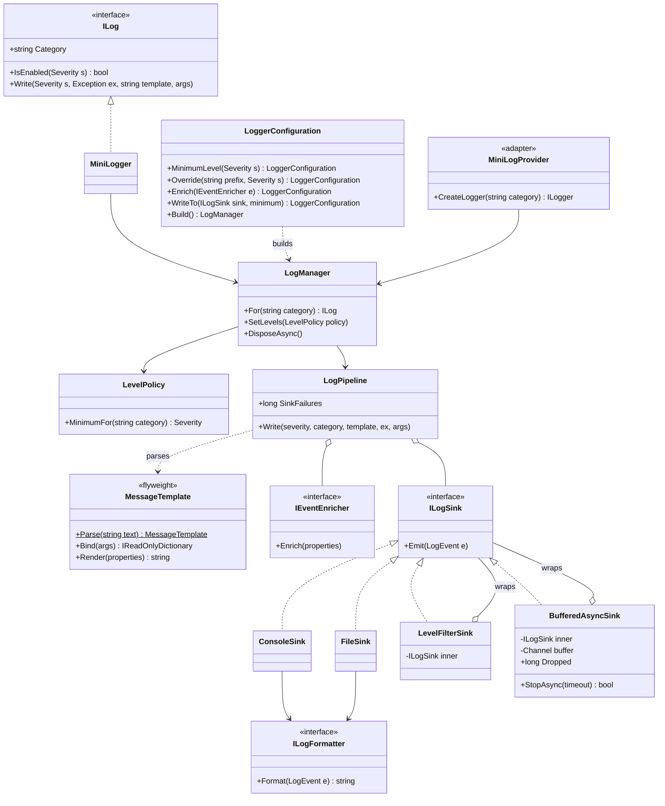
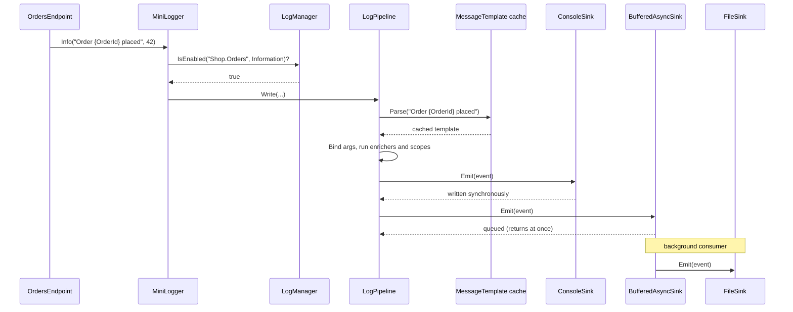
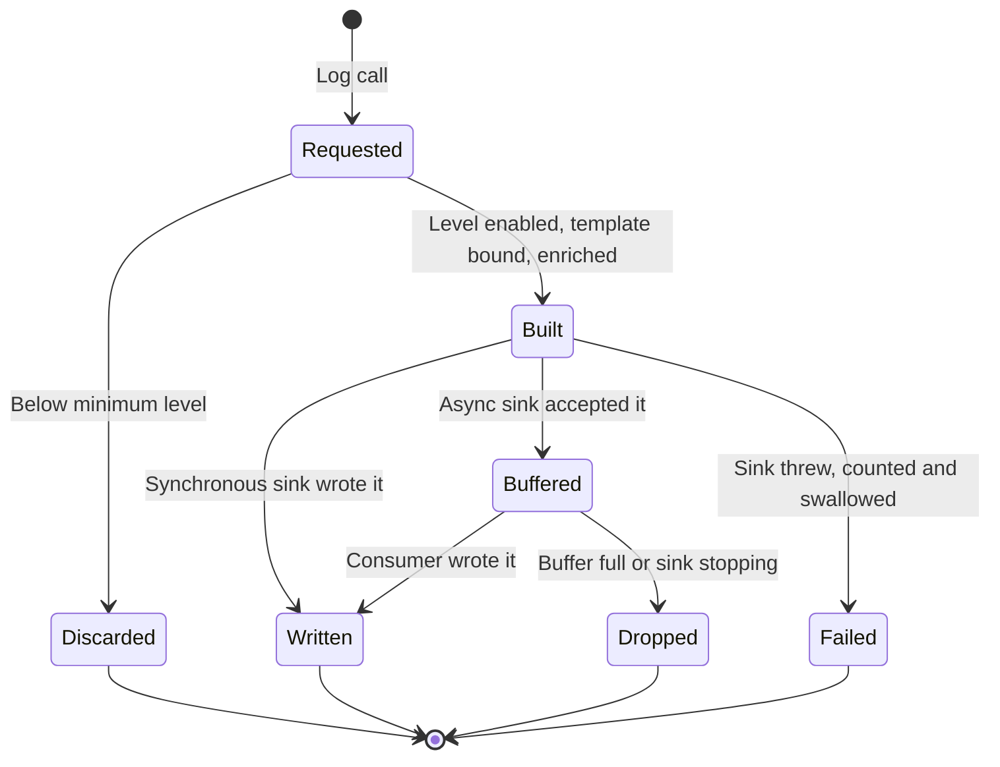
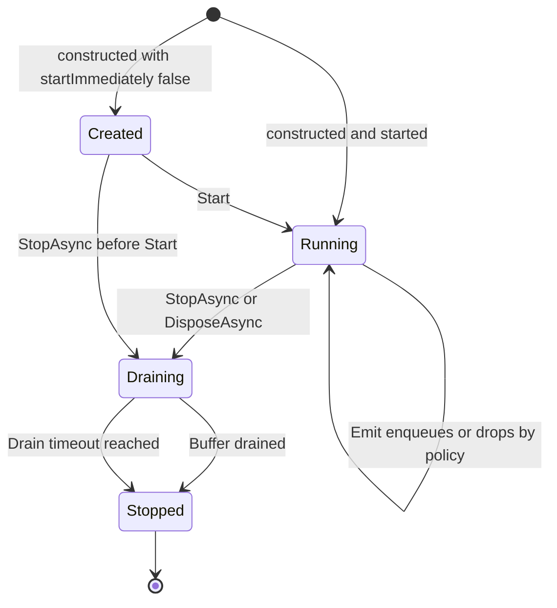

At 2:14 am the order API in a Hyderabad data centre slows down. The on-call engineer opens the logs and finds three problems at once: half the lines say `Order placed` with no order id, the interesting lines are buried under 40,000 `Microsoft.AspNetCore.Routing` debug messages a minute, and the logs stop entirely at 2:13 because the disk filled up and the app started waiting on every log write.

A good logging framework prevents all three. It keeps **structured properties** (not just text), lets you **turn categories up or down** independently, and makes sure that logging can **never take the application down** — not when a sink is slow, not when it throws, not when the disk is full.

This case study designs such a framework from scratch: a small, real library you could use in a console app or plug under ASP.NET Core's `ILogger`. In production you'd normally use `Microsoft.Extensions.Logging` with an established provider (and OpenTelemetry for export); building one yourself is how you learn why those libraries look the way they do.

## Learning objectives

By the end of this case study you will be able to:

1. Write functional and non-functional requirements for a logging library, with the clarifying questions that shape it (sync vs async, drop vs block, structured vs text).
2. Separate the responsibilities of logger, level policy, message template, enricher, pipeline, sink and formatter.
3. Implement **message templates** that render text *and* keep named properties, with a parse cache (Flyweight).
4. Compose behaviour with **Decorators** (level filter, buffered async sink) and configure everything with a **Builder**.
5. Build a bounded asynchronous sink with explicit **drop policies** and a clean shutdown (drain) lifecycle.
6. Bridge ASP.NET Core's `ILogger` to your framework with an **Adapter** (`ILoggerProvider`).

## Prerequisites

- [Logging and observability](#/lesson/m03-logging): how `ILogger` is used in ASP.NET Core.
- [Decorator](#/lesson/m06-decorator): sinks wrap sinks.
- [Builder](#/lesson/m06-builder): the configuration API.
- [Adapter](#/lesson/m06-adapter): the bridge from `Microsoft.Extensions.Logging`.

## Explain it like I'm a beginner

Think of a ship's logbook, but on a big ship with many departments.

- Every department (engine room, kitchen, bridge) writes entries. A department is a **category**, such as `Shop.Orders` or `Microsoft.AspNetCore.Routing`.
- Every entry has an **importance**: trivia, normal, warning, emergency. These are **severity levels** (Trace, Debug, Information, Warning, Error, Fatal).
- The captain sets a rule: "only write warnings and above from the kitchen, but everything from the engine room tonight." That's a **minimum level with per-category overrides**.
- Instead of free-form sentences, entries are written on a **form with blanks**: "Order ____ placed by ____". The blanks are filled with values (`42`, `asha`), and the form keeps the values separately, so later you can search "all entries where Order = 42". That's a **message template** with **properties**.
- Some details go on every page automatically: ship name, date, the current voyage number. Those are **enrichers** and **scopes**.
- Copies of each entry go to several places: the logbook on the bridge (**console**), a filing cabinet (**file**), and a radio message to headquarters (**network**). Each destination is a **sink**, and each can use a different layout, plain or JSON (a **formatter**).
- The radio operator is slow. So entries for the radio go into an **in-tray** first, and the operator sends them when they can. If the tray overflows during a storm, the rule says which entries to throw away (**drop policy**) — because stopping the whole ship to wait for the radio would be far worse.

## Requirements

### Functional requirements

1. Log events with a timestamp (UTC), severity, category, message template, named properties and an optional exception.
2. **Minimum level** globally, with **overrides by category prefix**: `Microsoft` → Warning, `Microsoft.Hosting.Lifetime` → Information. The longest matching prefix wins.
3. **Change levels at runtime** without restarting (for example, turn on Debug for `Shop.Payments` for 10 minutes during an incident).
4. **Message templates:** `"Order {OrderId} placed for {Amount:F2}"` renders text and captures `OrderId` and `Amount` as properties. `{{` and `}}` are literal braces.
5. **Enrichers** add properties to every event (app name, machine name, environment). **Scopes** add properties to every event inside a block of code (`OrderId` for one request).
6. **Sinks:** console, file and in-memory (for tests), each with its own minimum level and formatter (plain text or JSON lines).
7. **Asynchronous buffering** for slow sinks with a bounded buffer and a configurable policy when full: drop the incoming event, drop the oldest event, or block the caller.
8. **Flush on shutdown:** drain buffered events within a time limit.
9. **Integrate with ASP.NET Core** so framework and application `ILogger<T>` calls go through our pipeline.

### Non-functional requirements

- **Logging must never crash or hang the application.** Exceptions in sinks, enrichers or formatters are caught and counted.
- **Cheap when disabled.** A `Debug` call with Debug turned off should cost a level check and nothing else (an estimate: tens of nanoseconds, no parsing, no allocation beyond the call's arguments).
- **Bounded memory.** Buffers have a fixed capacity; the template cache has a size limit.
- **Thread-safe.** Many request threads log concurrently.
- **Observable itself.** Counters for dropped events and sink failures.
- **Deterministic tests.** Time is injected through `TimeProvider`.

### Clarifying questions to ask

| Question | Our assumption |
|---|---|
| Replace `Microsoft.Extensions.Logging` or sit under it? | Sit under it, via an `ILoggerProvider` adapter, and offer our own API too. |
| Text or structured? | Structured: properties are kept as values, and JSON output preserves them. |
| Is losing some log events acceptable? | Yes for Debug/Information under overload; the policy is explicit and counted. Audit logs are a different system. |
| Who ships logs off the machine? | Out of scope; a file or console sink is collected by an agent, or an HTTP sink is added later. |
| Sampling? | Not in the core; can be a sink decorator. |
| Do we need log rotation? | Mentioned as an extension; the file sink is basic. |
| Sensitive data (PII)? | A redacting enricher is an extension; never log card numbers, OTPs or passwords at all. |

## Identifying classes and responsibilities

**Nouns:** event, severity, category, template, property, exception, level, override, policy, enricher, scope, sink, formatter, buffer, drop, flush, provider, adapter, configuration.
**Verbs:** write, check level, parse, bind, render, enrich, emit, format, buffer, drop, drain, configure, bridge.

| Class | Kind | Responsibility |
|---|---|---|
| `Severity` | enum | Importance, ordered Trace < … < Fatal. |
| `LogEvent` | record | One immutable event: time, severity, category, template, properties, exception. |
| `MessageTemplate` | flyweight | Parsed template (tokens and property names); binds args and renders text. Parsed once, shared. |
| `LevelPolicy` | value object | Minimum level per category (longest-prefix override). Replaced, never mutated. |
| `ILog` / `MiniLogger` | API | What application code calls; checks the level first. |
| `IEventEnricher` (`PropertyEnricher`, `ScopeEnricher`) | strategy | Adds properties to every event. |
| `LogContext` | ambient scope | Async-local stack of scope properties. |
| `LogPipeline` | domain service | Builds the event and fans it out to sinks, isolating failures. |
| `ILogSink` | strategy | A destination for events. |
| `ConsoleSink`, `FileSink`, `InMemorySink` | sinks | Concrete destinations. |
| `LevelFilterSink`, `BufferedAsyncSink` | decorators | Add per-sink filtering and asynchronous buffering to any sink. |
| `ILogFormatter` (`PlainTextFormatter`, `JsonFormatter`) | strategy | Turns an event into text. |
| `LoggerConfiguration` | builder | Fluent setup; produces a `LogManager`. |
| `LogManager` | facade | Creates loggers, owns the level policy and the sinks' lifetime. |
| `MiniLogProvider` | adapter | Plugs into `Microsoft.Extensions.Logging`. |

## Class diagram



How to read it. **Left to right is the path of an event.** Application code calls `ILog`; the logger asks the `LogManager`'s `LevelPolicy` whether the level is enabled; if so, the `LogPipeline` parses the template (cached), binds the arguments, runs enrichers, and hands the finished `LogEvent` to every sink. Sinks that need a text layout delegate to a formatter.

**The decorators are the interesting part.** `LevelFilterSink` and `BufferedAsyncSink` *are* sinks (they implement `ILogSink`) and *have* a sink (they wrap one). So you can stack them: `new LevelFilterSink(new BufferedAsyncSink(new FileSink(...)), Warning)` means "only warnings and above, buffered, to a file". No sink class has to know about levels or threads.

### One log call, end to end



The request thread pays for the console write (fast) and an in-memory enqueue (very fast). The slow file write happens on a background task. If the file system stalls, the buffer fills, and the drop policy decides what happens next — the request thread never waits (unless you chose `Block`).

## Patterns and design decisions

### 1. Level check first, everything else later

The cheapest work is work you don't do. `MiniLogger.Write` checks `IsEnabled` before parsing, binding or allocating an event. The level policy caches its answer per category, so the check is a dictionary lookup and a comparison. For hot paths, callers can also guard with `if (log.IsEnabled(Severity.Debug))` to avoid building expensive arguments. `Microsoft.Extensions.Logging` goes further with the `[LoggerMessage]` source generator, which removes the `params object[]` allocation; that's the right tool in production code.

### 2. Flyweight: parsed templates are shared

A template string such as `"Order {OrderId} placed"` is parsed once into tokens and cached. Every event with that template shares the same `MessageTemplate` object. That saves parsing time and gives you something powerful for free: **all events from the same line of code share one template text**, so a log search can group by template ("how many times did *this* message happen?").

:::callout type=warning title="Never log with string interpolation"
`log.Info($"Order {id} placed")` creates a *different* template string for every order. You lose the `OrderId` property, defeat the cache, and grow it without bound. Our cache stops adding entries after 1,000 templates for exactly this reason.
:::

### 3. Strategy: sinks, formatters and enrichers

Each of these is a one-method interface with several implementations, picked at configuration time. The pipeline doesn't know whether it's writing to a console or a file, or whether the format is text or JSON.

### 4. Decorator: per-sink filtering and buffering

Instead of giving every sink a `MinimumLevel` property and a background thread, those concerns are decorators. That keeps each concrete sink tiny (the console sink is five lines) and lets you combine features freely. The same idea appears in the [Decorator lesson](#/lesson/m06-decorator) and in ASP.NET Core's middleware.

### 5. Composite-style fan-out with failure isolation

The pipeline holds a list of sinks and writes to each one inside its own `try/catch`. A broken sink increments `SinkFailures`; the others still get the event. This is the single most important robustness rule in the framework.

### 6. Builder for configuration

`new LoggerConfiguration().MinimumLevel(...).Override(...).Enrich(...).WriteTo(...).Build()` reads like a sentence and produces an immutable `LogManager`. The builder validates as it goes and hides construction order (for example, wrapping a sink in `LevelFilterSink` when you pass a minimum).

### 7. Copy-on-write level policy

`LevelPolicy` is immutable. Changing levels at runtime means building a new policy and swapping a single reference (`volatile` field). Readers never see a half-updated policy and need no locks. In ASP.NET Core you'd feed this from `IOptionsMonitor` so a configuration change swaps the policy automatically.

### 8. Adapter to `Microsoft.Extensions.Logging`

ASP.NET Core and most libraries log through `ILogger`. `MiniLogProvider` implements `ILoggerProvider`, and its loggers translate `LogLevel` to `Severity` and the structured state (which includes the original template under the key `{OriginalFormat}`) into our template and properties. The rest of the application doesn't change.

## State transitions

Two lifecycles matter: the journey of one event, and the lifecycle of the buffered sink.

### A log event's journey



An event can end in four ways, and only one of them (Written) means a human will see it. Discarded is intentional and free. Dropped and Failed are **counted**, so you can alert on "we dropped 12,000 events in the last minute" instead of discovering the gap during an incident. An event goes through these states independently for each sink: it may be Written to the console and Dropped from the file buffer.

### The buffered sink's lifecycle



During **Draining**, new events are refused (counted as dropped) and the consumer writes out what's already in the buffer. The drain has a time limit (5 seconds by default) because shutdown must finish: in Kubernetes, a pod that doesn't stop within its grace period is killed anyway. `StopAsync` returns `false` if the timeout was hit, so the host can log one last warning to the console. The `Created` state exists so tests can fill a buffer deterministically before any consumer runs.

## C# implementation

```text
MiniLog/
  Core/Events.cs
  Core/MessageTemplate.cs
  Core/Levels.cs
  Core/Context.cs
  Sinks/Formatters.cs
  Sinks/Sinks.cs
  Sinks/BufferedAsyncSink.cs
  Core/Pipeline.cs
  Integration/MiniLogProvider.cs
Shop.Api/Program.cs
```

### Events and severity

```csharp file=Core/Events.cs
namespace MiniLog;

public enum Severity { Trace = 0, Debug = 1, Information = 2, Warning = 3, Error = 4, Fatal = 5 }

public sealed record LogEvent(
    DateTimeOffset Timestamp,
    Severity Severity,
    string Category,
    MessageTemplate Template,
    IReadOnlyDictionary<string, object?> Properties,
    Exception? Exception)
{
    public string RenderMessage() => Template.Render(Properties);
}

/// <summary>A destination for events. Implementations must be thread-safe; they may throw (the pipeline isolates failures).</summary>
public interface ILogSink
{
    void Emit(LogEvent logEvent);
}

public interface ILogFormatter
{
    string Format(LogEvent logEvent);
}

public interface IEventEnricher
{
    /// <summary>Adds properties. Convention: use TryAdd, so properties from the message itself win.</summary>
    void Enrich(IDictionary<string, object?> properties);
}
```

### Message templates (Flyweight)

```csharp file=Core/MessageTemplate.cs
using System.Collections.Concurrent;
using System.Globalization;
using System.Text;

namespace MiniLog;

public readonly record struct TemplateToken(string? Text, string? Name, string? Format)
{
    public bool IsProperty => Name is not null;
}

/// <summary>A parsed message template such as "Order {OrderId} for {Amount:F2}". Instances are cached and shared.</summary>
public sealed class MessageTemplate
{
    public const int MaxCachedTemplates = 1000;
    private static readonly ConcurrentDictionary<string, MessageTemplate> Cache = new(StringComparer.Ordinal);

    private MessageTemplate(string text, IReadOnlyList<TemplateToken> tokens)
    {
        Text = text;
        Tokens = tokens;
        PropertyNames = tokens.Where(t => t.IsProperty).Select(t => t.Name!).Distinct().ToList();
    }

    public string Text { get; }
    public IReadOnlyList<TemplateToken> Tokens { get; }
    public IReadOnlyList<string> PropertyNames { get; }

    public static MessageTemplate Parse(string text)
    {
        ArgumentNullException.ThrowIfNull(text);
        if (Cache.TryGetValue(text, out var cached)) return cached;
        var parsed = new MessageTemplate(text, Tokenize(text));
        // Bounded: interpolated strings would otherwise grow the cache forever.
        return Cache.Count < MaxCachedTemplates ? Cache.GetOrAdd(text, parsed) : parsed;
    }

    /// <summary>Positional binding: the n-th distinct property name receives args[n]. Missing args leave the property unset.</summary>
    public IReadOnlyDictionary<string, object?> Bind(object?[]? args)
    {
        var result = new Dictionary<string, object?>(StringComparer.Ordinal);
        if (args is null) return result;
        for (var i = 0; i < PropertyNames.Count && i < args.Length; i++) result[PropertyNames[i]] = args[i];
        return result;
    }

    public string Render(IReadOnlyDictionary<string, object?> properties, IFormatProvider? provider = null)
    {
        provider ??= CultureInfo.InvariantCulture;
        var sb = new StringBuilder(Text.Length + 32);
        foreach (var token in Tokens)
        {
            if (!token.IsProperty) { sb.Append(token.Text); continue; }
            if (!properties.TryGetValue(token.Name!, out var value)) { sb.Append('{').Append(token.Name).Append('}'); continue; }
            sb.Append(value switch
            {
                null => "null",
                IFormattable f => f.ToString(token.Format, provider),
                _ => value.ToString(),
            });
        }
        return sb.ToString();
    }

    private static List<TemplateToken> Tokenize(string text)
    {
        var tokens = new List<TemplateToken>();
        var literal = new StringBuilder();
        for (var i = 0; i < text.Length; i++)
        {
            var c = text[i];
            if (c == '{' && i + 1 < text.Length && text[i + 1] == '{') { literal.Append('{'); i++; continue; }
            if (c == '}' && i + 1 < text.Length && text[i + 1] == '}') { literal.Append('}'); i++; continue; }
            if (c == '{')
            {
                var close = text.IndexOf('}', i + 1);
                var hole = close < 0 ? null : text[(i + 1)..close];
                var colon = hole?.IndexOf(':') ?? -1;
                var name = colon >= 0 ? hole![..colon] : hole;
                if (name is { Length: > 0 } && name.All(ch => char.IsLetterOrDigit(ch) || ch == '_'))
                {
                    if (literal.Length > 0) { tokens.Add(new TemplateToken(literal.ToString(), null, null)); literal.Clear(); }
                    tokens.Add(new TemplateToken(null, name, colon >= 0 ? hole![(colon + 1)..] : null));
                    i = close;
                    continue;
                }
            }
            literal.Append(c);                                     // anything that isn't a valid hole is plain text
        }
        if (literal.Length > 0) tokens.Add(new TemplateToken(literal.ToString(), null, null));
        return tokens;
    }
}
```

Rendering with `CultureInfo.InvariantCulture` by default means `{Amount:F2}` always prints `1499.50`, whatever the server's locale. Logs are read by machines and by engineers around the world; they shouldn't change format when a server's culture changes.

### Levels

```csharp file=Core/Levels.cs
using System.Collections.Concurrent;

namespace MiniLog;

/// <summary>Immutable minimum-level rules: a default plus overrides by category prefix. The longest matching prefix wins.</summary>
public sealed class LevelPolicy
{
    private readonly Dictionary<string, Severity> _overrides;
    private readonly ConcurrentDictionary<string, Severity> _cache = new(StringComparer.Ordinal);

    public LevelPolicy(Severity defaultMinimum, IReadOnlyDictionary<string, Severity>? overrides = null)
    {
        DefaultMinimum = defaultMinimum;
        _overrides = new Dictionary<string, Severity>(overrides ?? new Dictionary<string, Severity>(), StringComparer.Ordinal);
    }

    public Severity DefaultMinimum { get; }
    public IReadOnlyDictionary<string, Severity> Overrides => _overrides;

    public Severity MinimumFor(string category) => _cache.GetOrAdd(category, c =>
    {
        var best = _overrides.Where(o => Matches(c, o.Key)).OrderByDescending(o => o.Key.Length).Select(o => (Severity?)o.Value).FirstOrDefault();
        return best ?? DefaultMinimum;
    });

    public bool IsEnabled(string category, Severity severity) => severity >= MinimumFor(category);

    public LevelPolicy WithDefault(Severity minimum) => new(minimum, _overrides);

    public LevelPolicy WithOverride(string prefix, Severity minimum)
    {
        var copy = new Dictionary<string, Severity>(_overrides, StringComparer.Ordinal) { [prefix] = minimum };
        return new LevelPolicy(DefaultMinimum, copy);
    }

    /// <summary>"Microsoft" matches "Microsoft" and "Microsoft.AspNetCore", but not "MicrosoftGraph".</summary>
    private static bool Matches(string category, string prefix) =>
        category.Equals(prefix, StringComparison.Ordinal) || category.StartsWith(prefix + ".", StringComparison.Ordinal);
}
```

### Ambient scopes and enrichers

```csharp file=Core/Context.cs
namespace MiniLog;

/// <summary>Async-local stack of scope properties, so every event inside a request carries e.g. its OrderId.</summary>
public static class LogContext
{
    private sealed record Frame(IReadOnlyDictionary<string, object?> Properties, Frame? Parent);

    private static readonly AsyncLocal<Frame?> Current = new();

    public static IDisposable Push(string name, object? value) => Push(new Dictionary<string, object?> { [name] = value });

    public static IDisposable Push(IReadOnlyDictionary<string, object?> properties)
    {
        var previous = Current.Value;
        Current.Value = new Frame(properties, previous);
        return new Pop(previous);
    }

    /// <summary>Innermost scope first, so inner values win when names repeat.</summary>
    public static IEnumerable<KeyValuePair<string, object?>> CurrentProperties()
    {
        for (var f = Current.Value; f is not null; f = f.Parent)
            foreach (var kv in f.Properties) yield return kv;
    }

    private sealed class Pop(Frame? previous) : IDisposable
    {
        private bool _done;
        public void Dispose()
        {
            if (_done) return;
            _done = true;
            Current.Value = previous;
        }
    }
}

public sealed class ScopeEnricher : IEventEnricher
{
    public void Enrich(IDictionary<string, object?> properties)
    {
        foreach (var (key, value) in LogContext.CurrentProperties()) properties.TryAdd(key, value);
    }
}

public sealed class PropertyEnricher(string name, object? value) : IEventEnricher
{
    public void Enrich(IDictionary<string, object?> properties) => properties.TryAdd(name, value);
}
```

`AsyncLocal<T>` flows with `async/await`, so a scope pushed at the start of a request is visible in every `await`ed method of that request but not in other requests running on the same thread pool threads. Precedence follows one rule: **whoever adds a property first wins**, because every step uses `TryAdd`. Message properties are bound before any enricher runs, and enrichers run in registration order. Register `ScopeEnricher` first and you get the natural order: message beats scope, scope beats global enrichers.

### Formatters and simple sinks

```csharp file=Sinks/Formatters.cs
using System.Text;
using System.Text.Json;

namespace MiniLog;

public sealed class PlainTextFormatter : ILogFormatter
{
    private static readonly string[] Abbreviations = ["TRC", "DBG", "INF", "WRN", "ERR", "FTL"];

    public string Format(LogEvent e)
    {
        var line = $"{e.Timestamp.UtcDateTime:yyyy-MM-ddTHH:mm:ss.fffZ} {Abbreviations[(int)e.Severity]} [{e.Category}] {e.RenderMessage()}";
        return e.Exception is null ? line : line + Environment.NewLine + e.Exception;
    }
}

/// <summary>One JSON object per line ("JSON lines"), keeping every property as a typed value.</summary>
public sealed class JsonFormatter : ILogFormatter
{
    public string Format(LogEvent e)
    {
        using var stream = new MemoryStream();
        using (var w = new Utf8JsonWriter(stream))
        {
            w.WriteStartObject();
            w.WriteString("ts", e.Timestamp.UtcDateTime);
            w.WriteString("level", e.Severity.ToString());
            w.WriteString("category", e.Category);
            w.WriteString("template", e.Template.Text);
            w.WriteString("message", e.RenderMessage());
            w.WriteStartObject("props");
            foreach (var (key, value) in e.Properties)
            {
                w.WritePropertyName(key);
                WriteValue(w, value);
            }
            w.WriteEndObject();
            if (e.Exception is not null) w.WriteString("exception", e.Exception.ToString());
            w.WriteEndObject();
        }
        return Encoding.UTF8.GetString(stream.ToArray());
    }

    private static void WriteValue(Utf8JsonWriter w, object? value)
    {
        switch (value)
        {
            case null: w.WriteNullValue(); break;
            case string s: w.WriteStringValue(s); break;
            case bool b: w.WriteBooleanValue(b); break;
            case int or long or short or byte: w.WriteNumberValue(Convert.ToInt64(value)); break;
            case decimal m: w.WriteNumberValue(m); break;
            case double d: w.WriteNumberValue(d); break;
            case Guid or DateTime or DateTimeOffset or Enum: w.WriteStringValue(value.ToString()); break;
            default: w.WriteStringValue(value.ToString()); break;   // never serialise arbitrary object graphs from a logger
        }
    }
}
```

```csharp file=Sinks/Sinks.cs
using System.Collections.Concurrent;

namespace MiniLog;

public sealed class ConsoleSink(ILogFormatter formatter, TextWriter? writer = null) : ILogSink
{
    private readonly TextWriter _writer = writer ?? Console.Out;
    private readonly Lock _gate = new();

    public void Emit(LogEvent logEvent)
    {
        var text = formatter.Format(logEvent);                    // format outside the lock
        lock (_gate) _writer.WriteLine(text);
    }
}

public sealed class FileSink : ILogSink, IDisposable
{
    private readonly ILogFormatter _formatter;
    private readonly StreamWriter _writer;
    private readonly Lock _gate = new();

    public FileSink(string path, ILogFormatter formatter)
    {
        _formatter = formatter;
        var directory = Path.GetDirectoryName(Path.GetFullPath(path));
        if (directory is not null) Directory.CreateDirectory(directory);
        _writer = new StreamWriter(new FileStream(path, FileMode.Append, FileAccess.Write, FileShare.Read)) { AutoFlush = false };
    }

    public void Emit(LogEvent logEvent)
    {
        var text = _formatter.Format(logEvent);
        lock (_gate)
        {
            _writer.WriteLine(text);
            if (logEvent.Severity >= Severity.Error) _writer.Flush();   // don't lose the line that explains a crash
        }
    }

    public void Dispose()
    {
        lock (_gate) _writer.Dispose();
    }
}

public sealed class InMemorySink : ILogSink
{
    private readonly ConcurrentQueue<LogEvent> _events = new();
    public IReadOnlyList<LogEvent> Events => _events.ToArray();
    public void Emit(LogEvent logEvent) => _events.Enqueue(logEvent);
}

/// <summary>Decorator: passes on only events at or above a minimum, e.g. "errors only" for an alerting sink.</summary>
public sealed class LevelFilterSink(ILogSink inner, Severity minimum) : ILogSink, IAsyncDisposable
{
    public ILogSink Inner => inner;

    public void Emit(LogEvent logEvent)
    {
        if (logEvent.Severity >= minimum) inner.Emit(logEvent);
    }

    public async ValueTask DisposeAsync()
    {
        if (inner is IAsyncDisposable a) await a.DisposeAsync();
        else (inner as IDisposable)?.Dispose();
    }
}
```

### The buffered asynchronous sink

```csharp file=Sinks/BufferedAsyncSink.cs
using System.Threading.Channels;

namespace MiniLog;

public enum DropPolicy
{
    /// <summary>Keep what's buffered; lose the new event. Keeps the oldest context.</summary>
    DropIncoming,
    /// <summary>Evict the oldest buffered event to make room. Keeps the most recent context.</summary>
    DropOldest,
    /// <summary>Make the caller wait for space. Never loses events, but a stalled sink stalls the app.</summary>
    Block,
}

public enum SinkState { Created, Running, Draining, Stopped }

/// <summary>Decorator that moves a slow sink's work to a background task, through a bounded buffer.</summary>
public sealed class BufferedAsyncSink : ILogSink, IAsyncDisposable
{
    private readonly ILogSink _inner;
    private readonly DropPolicy _policy;
    private readonly Channel<LogEvent> _buffer;
    private Task? _consumer;
    private int _state;
    private long _dropped;
    private long _written;
    private long _failed;

    public BufferedAsyncSink(ILogSink inner, int capacity = 10_000, DropPolicy policy = DropPolicy.DropOldest, bool startImmediately = true)
    {
        ArgumentNullException.ThrowIfNull(inner);
        ArgumentOutOfRangeException.ThrowIfNegativeOrZero(capacity);
        _inner = inner;
        _policy = policy;
        var options = new BoundedChannelOptions(capacity)
        {
            SingleReader = true,
            SingleWriter = false,
            FullMode = policy switch
            {
                DropPolicy.DropIncoming => BoundedChannelFullMode.DropWrite,
                DropPolicy.DropOldest => BoundedChannelFullMode.DropOldest,
                _ => BoundedChannelFullMode.Wait,
            },
        };
        _buffer = Channel.CreateBounded<LogEvent>(options, _ => Interlocked.Increment(ref _dropped));
        if (startImmediately) Start();
    }

    public SinkState State => (SinkState)Volatile.Read(ref _state);
    public long Dropped => Interlocked.Read(ref _dropped);
    public long Written => Interlocked.Read(ref _written);
    public long Failed => Interlocked.Read(ref _failed);

    public void Start()
    {
        if (Interlocked.CompareExchange(ref _state, (int)SinkState.Running, (int)SinkState.Created) == (int)SinkState.Created)
            _consumer = Task.Run(ConsumeAsync);
    }

    public void Emit(LogEvent logEvent)
    {
        if (State is SinkState.Draining or SinkState.Stopped) { Interlocked.Increment(ref _dropped); return; }
        if (_buffer.Writer.TryWrite(logEvent)) return;              // drop modes always succeed here (the callback counts drops)
        if (_policy != DropPolicy.Block) { Interlocked.Increment(ref _dropped); return; }   // buffer already completed
        try { _buffer.Writer.WriteAsync(logEvent).AsTask().GetAwaiter().GetResult(); }
        catch (ChannelClosedException) { Interlocked.Increment(ref _dropped); }
    }

    /// <summary>Stops accepting events and drains the buffer. Returns false if the timeout was reached first.</summary>
    public async Task<bool> StopAsync(TimeSpan timeout)
    {
        Start();                                                    // drain even if nobody started us
        if (Interlocked.CompareExchange(ref _state, (int)SinkState.Draining, (int)SinkState.Running) != (int)SinkState.Running)
            return State == SinkState.Stopped;
        _buffer.Writer.TryComplete();
        var finished = await Task.WhenAny(_consumer!, Task.Delay(timeout)) == _consumer;
        Volatile.Write(ref _state, (int)SinkState.Stopped);
        if (finished)
        {
            if (_inner is IAsyncDisposable a) await a.DisposeAsync();
            else (_inner as IDisposable)?.Dispose();
        }
        return finished;
    }

    public async ValueTask DisposeAsync() => await StopAsync(TimeSpan.FromSeconds(5));

    private async Task ConsumeAsync()
    {
        await foreach (var logEvent in _buffer.Reader.ReadAllAsync())
        {
            try { _inner.Emit(logEvent); Interlocked.Increment(ref _written); }
            catch { Interlocked.Increment(ref _failed); }           // a failing inner sink must not kill the consumer
        }
    }
}
```

`Channel.CreateBounded` with an `itemDropped` callback gives us drop counting for free in both drop modes. `SingleReader = true` lets the channel use a faster internal implementation, which is safe because only our one consumer task reads.

### Pipeline, loggers, manager and builder

```csharp file=Core/Pipeline.cs
namespace MiniLog;

public interface ILog
{
    string Category { get; }
    bool IsEnabled(Severity severity);
    void Write(Severity severity, Exception? exception, string template, params object?[] args);
}

public static class LogExtensions
{
    public static void Debug(this ILog log, string template, params object?[] args) => log.Write(Severity.Debug, null, template, args);
    public static void Info(this ILog log, string template, params object?[] args) => log.Write(Severity.Information, null, template, args);
    public static void Warn(this ILog log, string template, params object?[] args) => log.Write(Severity.Warning, null, template, args);
    public static void Error(this ILog log, Exception? exception, string template, params object?[] args) => log.Write(Severity.Error, exception, template, args);
}

/// <summary>Builds events and fans them out. Every enricher and sink call is isolated: logging never throws into the app.</summary>
public sealed class LogPipeline(IReadOnlyList<IEventEnricher> enrichers, IReadOnlyList<ILogSink> sinks, TimeProvider clock)
{
    private long _sinkFailures;
    private long _enricherFailures;

    public IReadOnlyList<ILogSink> Sinks => sinks;
    public long SinkFailures => Interlocked.Read(ref _sinkFailures);
    public long EnricherFailures => Interlocked.Read(ref _enricherFailures);

    public void Write(Severity severity, string category, string template, Exception? exception, object?[]? args)
    {
        LogEvent logEvent;
        try
        {
            var parsed = MessageTemplate.Parse(template);
            var properties = new Dictionary<string, object?>(parsed.Bind(args), StringComparer.Ordinal);
            foreach (var enricher in enrichers)
            {
                try { enricher.Enrich(properties); }
                catch { Interlocked.Increment(ref _enricherFailures); }
            }
            logEvent = new LogEvent(clock.GetUtcNow(), severity, category, parsed, properties, exception);
        }
        catch
        {
            Interlocked.Increment(ref _enricherFailures);
            return;
        }

        foreach (var sink in sinks)
        {
            try { sink.Emit(logEvent); }
            catch { Interlocked.Increment(ref _sinkFailures); }
        }
    }
}

public sealed class MiniLogger(string category, LogManager manager) : ILog
{
    public string Category => category;
    public bool IsEnabled(Severity severity) => manager.IsEnabled(category, severity);

    public void Write(Severity severity, Exception? exception, string template, params object?[] args)
    {
        if (!IsEnabled(severity)) return;                           // the fast path: nothing else happens
        manager.Pipeline.Write(severity, category, template, exception, args);
    }
}

public sealed class LogManager : IAsyncDisposable
{
    private readonly System.Collections.Concurrent.ConcurrentDictionary<string, MiniLogger> _loggers = new(StringComparer.Ordinal);
    private volatile LevelPolicy _levels;

    public LogManager(LevelPolicy levels, LogPipeline pipeline)
    {
        _levels = levels;
        Pipeline = pipeline;
    }

    public LogPipeline Pipeline { get; }
    public LevelPolicy Levels => _levels;

    public ILog For(string category) => _loggers.GetOrAdd(category, c => new MiniLogger(c, this));
    public ILog For<T>() => For(typeof(T).FullName ?? typeof(T).Name);

    public bool IsEnabled(string category, Severity severity) => _levels.IsEnabled(category, severity);

    /// <summary>Swaps the whole policy atomically (copy-on-write); in-flight calls see either the old or the new one.</summary>
    public void SetLevels(LevelPolicy levels) => _levels = levels ?? throw new ArgumentNullException(nameof(levels));

    public async ValueTask DisposeAsync()
    {
        foreach (var sink in Pipeline.Sinks)
        {
            try
            {
                if (sink is IAsyncDisposable a) await a.DisposeAsync();
                else (sink as IDisposable)?.Dispose();
            }
            catch { /* shutting down: nothing useful to do */ }
        }
    }
}

public sealed class LoggerConfiguration
{
    private Severity _minimum = Severity.Information;
    private readonly Dictionary<string, Severity> _overrides = new(StringComparer.Ordinal);
    private readonly List<IEventEnricher> _enrichers = [];
    private readonly List<ILogSink> _sinks = [];
    private TimeProvider _clock = TimeProvider.System;

    public LoggerConfiguration MinimumLevel(Severity minimum) { _minimum = minimum; return this; }

    public LoggerConfiguration Override(string categoryPrefix, Severity minimum)
    {
        ArgumentException.ThrowIfNullOrWhiteSpace(categoryPrefix);
        _overrides[categoryPrefix] = minimum;
        return this;
    }

    public LoggerConfiguration Enrich(IEventEnricher enricher) { _enrichers.Add(enricher); return this; }
    public LoggerConfiguration EnrichWithProperty(string name, object? value) => Enrich(new PropertyEnricher(name, value));

    public LoggerConfiguration WriteTo(ILogSink sink, Severity? minimum = null)
    {
        ArgumentNullException.ThrowIfNull(sink);
        _sinks.Add(minimum is null ? sink : new LevelFilterSink(sink, minimum.Value));
        return this;
    }

    public LoggerConfiguration UseClock(TimeProvider clock) { _clock = clock; return this; }

    public LogManager Build()
    {
        if (_sinks.Count == 0) throw new InvalidOperationException("Configure at least one sink with WriteTo(...).");
        return new LogManager(new LevelPolicy(_minimum, _overrides), new LogPipeline(_enrichers.ToList(), _sinks.ToList(), _clock));
    }
}
```

### Adapter for `Microsoft.Extensions.Logging`

```csharp file=Integration/MiniLogProvider.cs
using Microsoft.Extensions.Logging;

namespace MiniLog;

/// <summary>Lets ASP.NET Core and libraries that use ILogger write through MiniLog.</summary>
public sealed class MiniLogProvider(LogManager manager) : ILoggerProvider
{
    public ILogger CreateLogger(string categoryName) => new Adapter(manager.For(categoryName));
    public void Dispose() { }

    private sealed class Adapter(ILog log) : ILogger
    {
        private const string OriginalFormat = "{OriginalFormat}";

        public bool IsEnabled(LogLevel logLevel) => logLevel != LogLevel.None && log.IsEnabled(Map(logLevel));

        public IDisposable? BeginScope<TState>(TState state) where TState : notnull
        {
            var properties = new Dictionary<string, object?>(StringComparer.Ordinal);
            if (state is IEnumerable<KeyValuePair<string, object?>> pairs)
            {
                foreach (var (key, value) in pairs) if (key != OriginalFormat) properties[key] = value;
            }
            else properties["Scope"] = state.ToString();
            return LogContext.Push(properties);
        }

        public void Log<TState>(LogLevel logLevel, EventId eventId, TState state, Exception? exception, Func<TState, Exception?, string> formatter)
        {
            if (!IsEnabled(logLevel)) return;
            if (state is IReadOnlyList<KeyValuePair<string, object?>> pairs && pairs.Count > 0 && pairs[^1].Key == OriginalFormat && pairs[^1].Value is string template)
            {
                // Structured call such as logger.LogInformation("Order {OrderId} placed", id): keep the template and values.
                var args = new object?[pairs.Count - 1];
                for (var i = 0; i < args.Length; i++) args[i] = pairs[i].Value;
                log.Write(Map(logLevel), exception, template, args);
            }
            else log.Write(Map(logLevel), exception, "{Message}", formatter(state, exception));
        }

        private static Severity Map(LogLevel level) => level switch
        {
            LogLevel.Trace => Severity.Trace,
            LogLevel.Debug => Severity.Debug,
            LogLevel.Information => Severity.Information,
            LogLevel.Warning => Severity.Warning,
            LogLevel.Error => Severity.Error,
            _ => Severity.Fatal,                                    // Critical
        };
    }
}
```

`Microsoft.Extensions.Logging` passes structured state as a list of key/value pairs with the original template as the last entry, under the key `{OriginalFormat}`. The adapter relies on that convention and falls back to the pre-formatted message for anything else.

```csharp file=Program.cs
using MiniLog;

await using var logs = new LoggerConfiguration()
    .MinimumLevel(Severity.Information)
    .Override("Microsoft", Severity.Warning)
    .Override("Microsoft.Hosting.Lifetime", Severity.Information)
    .Enrich(new ScopeEnricher())                          // first: scope values beat global ones
    .EnrichWithProperty("App", "shop-api")
    .EnrichWithProperty("Machine", Environment.MachineName)
    .WriteTo(new ConsoleSink(new PlainTextFormatter()))
    .WriteTo(new BufferedAsyncSink(new FileSink("logs/shop-api.jsonl", new JsonFormatter()), capacity: 10_000, DropPolicy.DropOldest))
    .Build();

var builder = WebApplication.CreateBuilder(args);
builder.Logging.ClearProviders();
builder.Logging.SetMinimumLevel(LogLevel.Trace);          // MiniLog's LevelPolicy decides; don't filter twice
builder.Logging.AddProvider(new MiniLogProvider(logs));
builder.Services.AddSingleton(logs);

var app = builder.Build();

app.MapGet("/orders/{id:int}", (int id, ILogger<Program> logger) =>
{
    using (logger.BeginScope(new Dictionary<string, object?> { ["OrderId"] = id }))
    {
        logger.LogInformation("Fetching order {OrderId} for {User}", id, "asha");
        return Results.Ok(new { id });
    }
});

// Incident switch: raise or lower verbosity for one category without restarting.
app.MapPost("/admin/log-levels/{category}/{level}", (string category, Severity level, LogManager manager) =>
{
    manager.SetLevels(manager.Levels.WithOverride(category, level));
    return Results.NoContent();
});

app.Run();
```

`await using` makes sure the buffered file sink drains when the app shuts down. Protect the admin endpoint with authorisation in a real deployment: anyone who can set `Trace` everywhere can fill your disk.

## Automated testing

Logging code is notoriously under-tested, and its bugs show up only during incidents. We test templates, levels, the pipeline's failure isolation, the JSON shape, the ASP.NET Core adapter and the buffered sink's drop accounting.

### Templates and levels

```csharp
using MiniLog;
using Xunit;

public class TemplateAndLevelTests
{
    [Fact]
    public void Binds_properties_and_renders_with_invariant_formatting()
    {
        var t = MessageTemplate.Parse("Order {OrderId} paid {Amount:F2} by {User}");
        var props = t.Bind([42, 1499.5m, "asha"]);
        Assert.Equal(42, props["OrderId"]);
        Assert.Equal("Order 42 paid 1499.50 by asha", t.Render(props));
    }

    [Fact]
    public void Escapes_missing_values_and_invalid_holes()
    {
        var t = MessageTemplate.Parse("{{literal}} {Name} {not valid} {Missing}");
        Assert.Equal("{literal} Priya {not valid} {Missing}", t.Render(t.Bind(["Priya"])));
        Assert.Equal(new[] { "Name", "Missing" }, t.PropertyNames.ToArray());
    }

    [Fact]
    public void Parsed_templates_are_shared() =>
        Assert.Same(MessageTemplate.Parse("Cached {X}"), MessageTemplate.Parse("Cached {X}"));

    [Fact]
    public void Longest_prefix_override_wins()
    {
        var policy = new LevelPolicy(Severity.Information, new Dictionary<string, Severity>
        {
            ["Microsoft"] = Severity.Warning,
            ["Microsoft.Hosting.Lifetime"] = Severity.Information,
        });
        Assert.False(policy.IsEnabled("Microsoft.AspNetCore.Routing", Severity.Information));
        Assert.True(policy.IsEnabled("Microsoft.Hosting.Lifetime", Severity.Information));
        Assert.True(policy.IsEnabled("MicrosoftGraph.Client", Severity.Information));   // not a dotted child of "Microsoft"
        Assert.False(policy.IsEnabled("Shop.Orders", Severity.Debug));
    }
}
```

### Pipeline, JSON and the ASP.NET Core adapter

```csharp
using System.Text.Json;
using Microsoft.Extensions.Logging;
using MiniLog;
using Xunit;

public class PipelineTests
{
    private sealed class ThrowingSink : ILogSink
    {
        public void Emit(LogEvent logEvent) => throw new IOException("disk full");
    }

    private sealed class FixedClock(DateTimeOffset now) : TimeProvider
    {
        public override DateTimeOffset GetUtcNow() => now;
    }

    [Fact]
    public void Failing_sink_is_isolated_and_counted()
    {
        var memory = new InMemorySink();
        var logs = new LoggerConfiguration().WriteTo(new ThrowingSink()).WriteTo(memory).Build();
        logs.For("Shop.Orders").Info("Order {OrderId} placed", 42);          // must not throw
        Assert.Single(memory.Events);
        Assert.Equal(1, logs.Pipeline.SinkFailures);
    }

    [Fact]
    public void Message_beats_scope_beats_global_enricher()
    {
        var memory = new InMemorySink();
        var logs = new LoggerConfiguration().Enrich(new ScopeEnricher())          // scope first, so it beats global values
            .EnrichWithProperty("User", "global").EnrichWithProperty("App", "shop").WriteTo(memory).Build();
        using (LogContext.Push("User", "scope"))
        using (LogContext.Push("RequestId", "r-1"))
        {
            logs.For("X").Info("Hello");
            logs.For("X").Info("Hello {User}", "message");
        }
        var events = memory.Events;
        Assert.Equal("shop", events[0].Properties["App"]);
        Assert.Equal("r-1", events[0].Properties["RequestId"]);
        Assert.Equal("scope", events[0].Properties["User"]);
        Assert.Equal("message", events[1].Properties["User"]);
    }

    [Fact]
    public void Runtime_level_change_takes_effect_immediately()
    {
        var memory = new InMemorySink();
        var logs = new LoggerConfiguration().WriteTo(memory).Build();
        var log = logs.For("Shop.Payments");
        log.Debug("hidden");
        logs.SetLevels(logs.Levels.WithOverride("Shop.Payments", Severity.Debug));
        log.Debug("visible");
        Assert.Equal("visible", Assert.Single(memory.Events).RenderMessage());
    }

    [Fact]
    public void Json_lines_keep_typed_properties()
    {
        var e = new LogEvent(new DateTimeOffset(2026, 10, 20, 2, 14, 0, TimeSpan.Zero), Severity.Warning, "Shop.Orders",
            MessageTemplate.Parse("Slow order {OrderId} took {Ms}"), new Dictionary<string, object?> { ["OrderId"] = 42, ["Ms"] = 1834.5 }, null);
        using var doc = JsonDocument.Parse(new JsonFormatter().Format(e));
        Assert.Equal("Warning", doc.RootElement.GetProperty("level").GetString());
        Assert.Equal(42, doc.RootElement.GetProperty("props").GetProperty("OrderId").GetInt32());
        Assert.Equal("Slow order {OrderId} took {Ms}", doc.RootElement.GetProperty("template").GetString());
    }

    [Fact]
    public void Microsoft_ILogger_calls_keep_template_and_properties()
    {
        var memory = new InMemorySink();
        var logs = new LoggerConfiguration().Override("Microsoft", Severity.Warning).WriteTo(memory).Build();
        using var provider = new MiniLogProvider(logs);
        provider.CreateLogger("Shop.Orders").LogInformation("Order {OrderId} placed by {User}", 42, "asha");
        provider.CreateLogger("Microsoft.AspNetCore.Routing").LogInformation("noise");
        var e = Assert.Single(memory.Events);
        Assert.Equal("Order {OrderId} placed by {User}", e.Template.Text);
        Assert.Equal("asha", e.Properties["User"]);
    }
}
```

### Buffered sink: drop policies and lifecycle

```csharp
using MiniLog;
using Xunit;

public class BufferedAsyncSinkTests
{
    private static LogEvent E(int n) => new(DateTimeOffset.UnixEpoch, Severity.Information, "T",
        MessageTemplate.Parse("n={N}"), new Dictionary<string, object?> { ["N"] = n }, null);

    [Fact]
    public async Task Drop_oldest_keeps_the_most_recent_events()
    {
        var inner = new InMemorySink();
        var sink = new BufferedAsyncSink(inner, capacity: 3, DropPolicy.DropOldest, startImmediately: false);
        for (var i = 1; i <= 10; i++) sink.Emit(E(i));
        Assert.Equal(7, sink.Dropped);
        Assert.True(await sink.StopAsync(TimeSpan.FromSeconds(5)));
        Assert.Equal(new object?[] { 8, 9, 10 }, inner.Events.Select(e => e.Properties["N"]).ToArray());
        Assert.Equal(SinkState.Stopped, sink.State);
    }

    [Fact]
    public async Task Drop_incoming_keeps_the_first_events()
    {
        var inner = new InMemorySink();
        var sink = new BufferedAsyncSink(inner, capacity: 3, DropPolicy.DropIncoming, startImmediately: false);
        for (var i = 1; i <= 10; i++) sink.Emit(E(i));
        await sink.StopAsync(TimeSpan.FromSeconds(5));
        Assert.Equal(new object?[] { 1, 2, 3 }, inner.Events.Select(e => e.Properties["N"]).ToArray());
        Assert.Equal(7, sink.Dropped);
    }

    [Fact]
    public async Task Events_after_stop_are_counted_not_written()
    {
        var inner = new InMemorySink();
        var sink = new BufferedAsyncSink(inner, capacity: 10);
        sink.Emit(E(1));
        await sink.StopAsync(TimeSpan.FromSeconds(5));
        sink.Emit(E(2));
        Assert.Single(inner.Events);
        Assert.Equal(1, sink.Dropped);
    }
}
```

Add one more test in a real suite: an inner sink that blocks on a `ManualResetEventSlim`, to prove that `StopAsync` returns `false` after its timeout instead of hanging shutdown.

## Bad design vs good design

### Bad: a static logger with string concatenation and a synchronous file write

```csharp
public static class Log
{
    public static string Level = "INFO";
    public static void Write(string level, string message)
    {
        if (Level == "WARN" && level == "INFO") return;              // ad-hoc level logic
        File.AppendAllText("C:\\logs\\app.log",
            DateTime.Now + " " + level + " " + message + Environment.NewLine);
    }
}

// usage
Log.Write("INFO", "Order " + order.Id + " placed by " + user.Email + " card " + card.Number);
```

What goes wrong:

1. **Blocks every request on disk I/O.** `File.AppendAllText` opens, writes and closes the file on each call. Under load, threads queue on the file lock; when the disk is full, every request throws.
2. **Exceptions escape.** A full disk or a locked file turns into a 500 for the user.
3. **No structure.** "Order 42 placed by ..." is text; you can't filter by `OrderId` without regex.
4. **Levels as strings with hand-written comparisons.** Only one combination is handled.
5. **No categories.** You can't quiet `Microsoft.*` without quieting your own code.
6. **Local time without offset.** Logs from servers in different time zones can't be ordered.
7. **Sensitive data.** A card number and an email address are now in a plain-text file. That's a compliance incident, not a style issue.
8. **Static global state.** Tests can't capture or assert on log output.

### Good: the design above

- Level check first, with per-category overrides and runtime changes.
- Structured templates; JSON output keeps typed properties.
- Sinks are isolated; slow ones are buffered with an explicit drop policy and counters.
- UTC timestamps from an injected clock.
- Everything is an instance created by a builder, so tests use an `InMemorySink`.
- Never log secrets: no card numbers, OTPs, passwords or tokens, whatever the framework.

### When is less enough?

For a small console tool or a script, `Console.WriteLine` or `ILogger` with the built-in console provider is plenty. For a production ASP.NET Core service, use `Microsoft.Extensions.Logging` with an established provider and OpenTelemetry export rather than maintaining your own framework. Build your own only to learn, or when you have unusual constraints (embedded devices, strict dependency rules) and are prepared to maintain it.

## Alternative designs

### 1. Use `Microsoft.Extensions.Logging` directly with a custom provider

Instead of a full framework, write only an `ILoggerProvider` and an `ILogger` for your special sink. Filtering, categories and scopes come from the built-in infrastructure (`AddFilter`, `appsettings.json` `Logging` section). **Better for** most teams: less code, standard configuration. Our `MiniLogProvider` shows the shape.

### 2. Lock-free ring buffer instead of `Channel<T>`

A fixed-size array with atomic indices can be faster than a channel and allocation-free. **Better when** you log hundreds of thousands of events per second per process. **Cost:** subtle concurrency code. `Channel<T>` is well-tested and fast enough for typical services.

### 3. Batching sinks

Network sinks should send **batches** (for example, up to 1,000 events or every 2 seconds, whichever comes first), with retry and a cap on retained batches. That's another decorator: `BatchingSink(inner: IBatchSink, maxBatch, period)`. It complements `BufferedAsyncSink` rather than replacing it.

### 4. Out-of-process shipping

Write JSON lines to stdout or a local file, and let an agent (a node-level log collector in Kubernetes, for example) ship them. **Better when** you run many services: the application stays simple, and the agent handles retries, buffering to disk and back-pressure. Our console and file sinks with JSON output are exactly what such agents expect.

### 5. OpenTelemetry logs

Emit logs through the OpenTelemetry SDK so they share trace and span ids with your traces and go to any OTLP-compatible backend. **Better when** you already use OpenTelemetry for traces and metrics. See [logs, metrics, traces and OpenTelemetry](#/lesson/m14-observability).

## Practical playground

The reference model is below. In the designer, try adding a `RedactingEnricher` that masks properties named `Email` or `Phone`, and a `SamplingSink` decorator that keeps 1 in 10 Debug events.

:::playground type=lld title="Logging framework reference model"
```json
{
  "classes": [
    { "id": "Severity", "name": "Severity", "kind": "enum", "fields": ["Trace", "Debug", "Information", "Warning", "Error", "Fatal"], "methods": [] },
    { "id": "LogEvent", "name": "LogEvent", "kind": "record",
      "fields": ["+DateTimeOffset Timestamp", "+Severity Severity", "+string Category", "+MessageTemplate Template", "+IReadOnlyDictionary<string, object?> Properties", "+Exception? Exception"],
      "methods": ["+string RenderMessage()"], "responsibility": "One immutable structured event" },
    { "id": "MessageTemplate", "name": "MessageTemplate", "kind": "class",
      "fields": ["+string Text", "+IReadOnlyList<TemplateToken> Tokens", "+IReadOnlyList<string> PropertyNames", "-static ConcurrentDictionary cache"],
      "methods": ["+static MessageTemplate Parse(string text)", "+IReadOnlyDictionary<string, object?> Bind(object?[] args)", "+string Render(IReadOnlyDictionary<string, object?> props)"],
      "responsibility": "Flyweight: parsed once, shared; binds and renders" },
    { "id": "LevelPolicy", "name": "LevelPolicy", "kind": "class",
      "fields": ["+Severity DefaultMinimum", "-Dictionary<string, Severity> _overrides"],
      "methods": ["+Severity MinimumFor(string category)", "+bool IsEnabled(string category, Severity s)", "+LevelPolicy WithOverride(string prefix, Severity s)"],
      "responsibility": "Immutable min-level rules, longest prefix wins" },
    { "id": "ILog", "name": "ILog", "kind": "interface",
      "fields": [], "methods": ["string Category", "bool IsEnabled(Severity s)", "void Write(Severity s, Exception? ex, string template, object?[] args)"],
      "responsibility": "Application-facing API" },
    { "id": "MiniLogger", "name": "MiniLogger", "kind": "class", "fields": ["-string category"], "methods": ["+void Write(...)"], "responsibility": "Level check first, then pipeline" },
    { "id": "LogManager", "name": "LogManager", "kind": "class",
      "fields": ["-volatile LevelPolicy _levels", "+LogPipeline Pipeline"],
      "methods": ["+ILog For(string category)", "+void SetLevels(LevelPolicy policy)", "+ValueTask DisposeAsync()"],
      "responsibility": "Facade: loggers, levels, sink lifetime" },
    { "id": "LoggerConfiguration", "name": "LoggerConfiguration", "kind": "class",
      "fields": [], "methods": ["+LoggerConfiguration MinimumLevel(Severity s)", "+LoggerConfiguration Override(string prefix, Severity s)", "+LoggerConfiguration Enrich(IEventEnricher e)", "+LoggerConfiguration WriteTo(ILogSink sink, Severity? min)", "+LogManager Build()"],
      "responsibility": "Builder" },
    { "id": "LogPipeline", "name": "LogPipeline", "kind": "class",
      "fields": ["-IReadOnlyList<IEventEnricher> enrichers", "-IReadOnlyList<ILogSink> sinks", "+long SinkFailures"],
      "methods": ["+void Write(Severity s, string category, string template, Exception? ex, object?[] args)"],
      "responsibility": "Build event, enrich, fan out with isolation" },
    { "id": "IEventEnricher", "name": "IEventEnricher", "kind": "interface", "fields": [], "methods": ["void Enrich(IDictionary<string, object?> props)"] },
    { "id": "ScopeEnricher", "name": "ScopeEnricher", "kind": "class", "fields": [], "methods": ["+void Enrich(...)"], "responsibility": "Copies LogContext scope properties" },
    { "id": "ILogSink", "name": "ILogSink", "kind": "interface", "fields": [], "methods": ["void Emit(LogEvent e)"], "responsibility": "Destination" },
    { "id": "ConsoleSink", "name": "ConsoleSink", "kind": "class", "fields": ["-ILogFormatter formatter"], "methods": ["+void Emit(LogEvent e)"] },
    { "id": "FileSink", "name": "FileSink", "kind": "class", "fields": ["-ILogFormatter formatter", "-StreamWriter writer"], "methods": ["+void Emit(LogEvent e)"] },
    { "id": "LevelFilterSink", "name": "LevelFilterSink", "kind": "class", "fields": ["-ILogSink inner", "-Severity minimum"], "methods": ["+void Emit(LogEvent e)"], "responsibility": "Decorator: per-sink level" },
    { "id": "BufferedAsyncSink", "name": "BufferedAsyncSink", "kind": "class",
      "fields": ["-ILogSink inner", "-Channel<LogEvent> buffer", "+long Dropped", "+SinkState State"],
      "methods": ["+void Emit(LogEvent e)", "+Task<bool> StopAsync(TimeSpan timeout)"], "responsibility": "Decorator: bounded async buffer with drop policy" },
    { "id": "ILogFormatter", "name": "ILogFormatter", "kind": "interface", "fields": [], "methods": ["string Format(LogEvent e)"] },
    { "id": "JsonFormatter", "name": "JsonFormatter", "kind": "class", "fields": [], "methods": ["+string Format(LogEvent e)"] },
    { "id": "MiniLogProvider", "name": "MiniLogProvider", "kind": "class", "fields": ["-LogManager manager"], "methods": ["+ILogger CreateLogger(string category)"], "responsibility": "Adapter for Microsoft.Extensions.Logging" }
  ],
  "relations": [
    { "from": "MiniLogger", "to": "ILog", "kind": "implements" },
    { "from": "MiniLogger", "to": "LogManager", "kind": "association" },
    { "from": "LoggerConfiguration", "to": "LogManager", "kind": "dependency", "label": "builds" },
    { "from": "LogManager", "to": "LevelPolicy", "kind": "association" },
    { "from": "LogManager", "to": "LogPipeline", "kind": "composition" },
    { "from": "LogPipeline", "to": "IEventEnricher", "kind": "aggregation", "multiplicity": "0..*" },
    { "from": "LogPipeline", "to": "ILogSink", "kind": "aggregation", "multiplicity": "1..*" },
    { "from": "LogPipeline", "to": "MessageTemplate", "kind": "dependency", "label": "parses" },
    { "from": "LogPipeline", "to": "LogEvent", "kind": "dependency", "label": "creates" },
    { "from": "ScopeEnricher", "to": "IEventEnricher", "kind": "implements" },
    { "from": "ConsoleSink", "to": "ILogSink", "kind": "implements" },
    { "from": "FileSink", "to": "ILogSink", "kind": "implements" },
    { "from": "LevelFilterSink", "to": "ILogSink", "kind": "implements" },
    { "from": "BufferedAsyncSink", "to": "ILogSink", "kind": "implements" },
    { "from": "LevelFilterSink", "to": "ILogSink", "kind": "aggregation", "label": "wraps" },
    { "from": "BufferedAsyncSink", "to": "ILogSink", "kind": "aggregation", "label": "wraps" },
    { "from": "ConsoleSink", "to": "ILogFormatter", "kind": "association" },
    { "from": "FileSink", "to": "ILogFormatter", "kind": "association" },
    { "from": "JsonFormatter", "to": "ILogFormatter", "kind": "implements" },
    { "from": "LogEvent", "to": "MessageTemplate", "kind": "association" },
    { "from": "LogEvent", "to": "Severity", "kind": "association" },
    { "from": "MiniLogProvider", "to": "LogManager", "kind": "association" }
  ]
}
```
:::

## Exercises

:::exercise id=m18-logging-framework-ex1 difficulty=beginner kind=code title="Per-category minimum levels"
Implement `LevelRules.MinimumFor` and `IsEnabled`: a default minimum level plus overrides by category prefix, where the longest matching prefix wins.
::requirements
- A prefix matches a category if they're equal, or the category starts with the prefix followed by a dot.
- `"Microsoft"` must **not** match `"MicrosoftGraph"`.
- Matching is case-sensitive (categories are type names).
- If no override matches, use the default.
::acceptance
- Default Information; `Microsoft` → Warning; `Microsoft.Hosting.Lifetime` → Information.
- `Microsoft.AspNetCore.Routing` → Warning; `Microsoft.Hosting.Lifetime` → Information.
- `MicrosoftGraph.Client` → Information (default).
- `IsEnabled("Shop.Orders", Debug)` is false; `IsEnabled("Shop.Orders", Error)` is true.
::hint
"Longest prefix wins" means: among all matching overrides, pick the one with the longest key.
::hint
Write a small `Matches(category, prefix)` helper first and test the `MicrosoftGraph` case.
::hint
`category == prefix || category.StartsWith(prefix + ".")` is the whole matching rule.
::hint
```csharp
var best = _overrides.Where(o => Matches(category, o.Key)).OrderByDescending(o => o.Key.Length).FirstOrDefault();
```
::starter
```csharp file=LevelRules.cs
using System;
using System.Collections.Generic;
using System.Linq;

public enum Severity { Trace, Debug, Information, Warning, Error, Fatal }

public sealed class LevelRules(Severity defaultMinimum, IReadOnlyDictionary<string, Severity> overrides)
{
    public Severity MinimumFor(string category) => throw new NotImplementedException();
    public bool IsEnabled(string category, Severity severity) => throw new NotImplementedException();
}
```
::tests
```csharp file=LevelRulesTests.cs
using System.Collections.Generic;
using Xunit;

public class LevelRulesTests
{
    private static readonly LevelRules Rules = new(Severity.Information, new Dictionary<string, Severity>
    {
        ["Microsoft"] = Severity.Warning,
        ["Microsoft.Hosting.Lifetime"] = Severity.Information,
        ["Shop.Payments"] = Severity.Debug,
    });

    [Fact] public void Child_category_uses_parent_override() => Assert.Equal(Severity.Warning, Rules.MinimumFor("Microsoft.AspNetCore.Routing"));
    [Fact] public void Longest_prefix_wins() => Assert.Equal(Severity.Information, Rules.MinimumFor("Microsoft.Hosting.Lifetime"));
    [Fact] public void Exact_match_counts() => Assert.Equal(Severity.Warning, Rules.MinimumFor("Microsoft"));
    [Fact] public void Not_a_dotted_child() => Assert.Equal(Severity.Information, Rules.MinimumFor("MicrosoftGraph.Client"));
    [Fact] public void Case_sensitive() => Assert.Equal(Severity.Information, Rules.MinimumFor("microsoft.AspNetCore"));
    [Fact] public void Default_applies() => Assert.False(Rules.IsEnabled("Shop.Orders", Severity.Debug));
    [Fact] public void Higher_levels_pass() => Assert.True(Rules.IsEnabled("Shop.Orders", Severity.Error));
    [Fact] public void Override_can_lower_the_bar() => Assert.True(Rules.IsEnabled("Shop.Payments.Refunds", Severity.Debug));
}
```
::solution
```csharp file=LevelRules.cs
using System;
using System.Collections.Generic;
using System.Linq;

public enum Severity { Trace, Debug, Information, Warning, Error, Fatal }

public sealed class LevelRules(Severity defaultMinimum, IReadOnlyDictionary<string, Severity> overrides)
{
    public Severity MinimumFor(string category)
    {
        var best = overrides
            .Where(o => Matches(category, o.Key))
            .OrderByDescending(o => o.Key.Length)
            .Select(o => (Severity?)o.Value)
            .FirstOrDefault();
        return best ?? defaultMinimum;
    }

    public bool IsEnabled(string category, Severity severity) => severity >= MinimumFor(category);

    private static bool Matches(string category, string prefix) =>
        category.Equals(prefix, StringComparison.Ordinal) || category.StartsWith(prefix + ".", StringComparison.Ordinal);
}
```
The `(Severity?)` cast is what lets `FirstOrDefault` say "nothing matched" (null) instead of returning `Trace`, which is the enum's default value (0) and would silently enable everything. In the framework version we also cache the answer per category, because this method runs on every log call.
::mistakes
- `category.StartsWith(prefix)` without the dot, which makes `Microsoft` swallow `MicrosoftGraph`.
- Returning the first match instead of the longest.
- `FirstOrDefault()` on non-nullable `Severity`, returning `Trace` when nothing matches.
::extensions
Add a cache with `ConcurrentDictionary<string, Severity>`, and a test proving that a new `LevelRules` instance (copy-on-write) doesn't reuse the old cache.
:::

:::exercise id=m18-logging-framework-ex2 difficulty=beginner kind=design title="Add an HTTP sink to a log collector"
Operations wants logs sent directly to a central log collector over HTTP (JSON array per request). The collector sometimes returns 503 for a few minutes. Design the sink so the app is never slowed down and the collector isn't overwhelmed after it recovers.
::acceptance
- Shows which existing classes are reused and which new classes are added.
- Specifies batching rules (size and time), retry rules and what happens when retries are exhausted.
- Explains how the design protects the application thread.
- Names the counters you would expose.
::hint
Which decorator already protects the caller from slow sinks?
::hint
HTTP per event is expensive. What should the unit of sending be?
::hint
Exponential backoff with jitter, and a maximum number of batches kept in memory.
::solution
**Reuse** `BufferedAsyncSink` (caller protection and drop policy) and `JsonFormatter` (event → JSON).

**Add**

- `IBatchSink { Task SendAsync(IReadOnlyList<LogEvent> batch, CancellationToken ct); }`.
- `HttpBatchSink : IBatchSink` posts a JSON array using a typed `HttpClient` from `IHttpClientFactory`, with a 10-second timeout. It throws a `TransientSinkException` on 429, 5xx and timeouts, and a permanent one on 400 or 413 (bad payload: split or drop the batch).
- `BatchingSink : ILogSink, IAsyncDisposable` collects events and flushes when it has **500 events or 2 seconds** have passed, whichever comes first. It retries a failed batch with exponential backoff and jitter (1 s, 2 s, 4 s ... up to 60 s). It keeps at most **20 pending batches**; beyond that it drops the oldest batch and counts it.

**Composition:** `new BufferedAsyncSink(new BatchingSink(new HttpBatchSink(...)), capacity: 20_000, DropPolicy.DropOldest)`.

**Application protection:** the request thread only enqueues into the bounded buffer. All HTTP happens on the background consumer. During an outage, the buffer and the pending-batch cap bound memory: roughly 20,000 events + 20 × 500 events, an estimated few tens of MB depending on event size.

**Recovery:** jittered backoff spreads retries from many app instances, so the collector isn't hit by a synchronised burst when it comes back.

**Counters:** events dropped (buffer), batches dropped (cap), batches sent, batch failures by status code, current pending batches, last success timestamp. Expose them as metrics, and also write a warning to the *console* sink when drops start, since the HTTP sink can't report its own outage.
::alternatives
Write JSON lines to a local file and let a node agent ship them. It survives app restarts (events on disk) and moves retry logic out of the app. Usually the better choice in Kubernetes.
::mistakes
- One HTTP request per log event.
- Retrying forever with unbounded memory.
- Logging the sink's own failures through the same pipeline, which can loop.
:::

:::exercise id=m18-logging-framework-ex3 difficulty=intermediate kind=code title="Message template parser and renderer"
Implement `Template.Parse`, `Bind` and `Render` for structured message templates.
::requirements
- Holes look like `{Name}` or `{Name:format}`; names are letters, digits and underscores.
- `{{` and `}}` are literal braces.
- Anything that isn't a valid hole (`{not valid}`, an unclosed `{`) is literal text.
- `PropertyNames` lists distinct names in order of first appearance.
- `Bind(args)` gives the n-th distinct name the n-th argument; extra args are ignored; missing args leave names unbound.
- `Render` formats `IFormattable` values with the hole's format and invariant culture, prints `null` for null, and leaves unbound holes as `{Name}`.
::acceptance
- `"Paid {Amount:F2} for {Item}"` with `(1499.5m, "tea")` renders `"Paid 1499.50 for tea"`.
- `"{{x}} {A}"` with `(1)` renders `"{x} 1"`.
- `"{A} and {A}"` has one property name and renders the value twice.
- `"open { brace"` renders unchanged.
- `"{Missing}"` with no args renders `"{Missing}"`.
::hint
Walk the string once, character by character, building a list of tokens: literal text or a property (name plus optional format).
::hint
Check for `{{` and `}}` before checking for a single `{`.
::hint
For a `{`, find the next `}`; split the inside on the first `:`. If the name part isn't a valid identifier, treat the `{` as a literal character and move on.
::hint
Render with a `StringBuilder`: append literals, and for properties use `value is IFormattable f ? f.ToString(format, CultureInfo.InvariantCulture) : value.ToString()`.
::starter
```csharp file=Template.cs
using System;
using System.Collections.Generic;
using System.Globalization;
using System.Linq;
using System.Text;

public readonly record struct Token(string? Text, string? Name, string? Format);

public sealed class Template
{
    private Template(IReadOnlyList<Token> tokens) { Tokens = tokens; }
    public IReadOnlyList<Token> Tokens { get; }
    public IReadOnlyList<string> PropertyNames => throw new NotImplementedException();

    public static Template Parse(string text) => throw new NotImplementedException();
    public IReadOnlyDictionary<string, object?> Bind(params object?[] args) => throw new NotImplementedException();
    public string Render(IReadOnlyDictionary<string, object?> properties) => throw new NotImplementedException();
}
```
::tests
```csharp file=TemplateTests.cs
using System.Linq;
using Xunit;

public class TemplateTests
{
    private static string R(string text, params object?[] args) { var t = Template.Parse(text); return t.Render(t.Bind(args)); }

    [Fact] public void Formats_with_invariant_culture() => Assert.Equal("Paid 1499.50 for tea", R("Paid {Amount:F2} for {Item}", 1499.5m, "tea"));
    [Fact] public void Escaped_braces() => Assert.Equal("{x} 1", R("{{x}} {A}", 1));
    [Fact] public void Closing_escape() => Assert.Equal("a }} b".Replace("}}", "}"), R("a }} b"));
    [Fact] public void Repeated_name_binds_once()
    {
        var t = Template.Parse("{A} and {A}");
        Assert.Equal(new[] { "A" }, t.PropertyNames.ToArray());
        Assert.Equal("7 and 7", t.Render(t.Bind(7)));
    }
    [Fact] public void Unclosed_brace_is_literal() => Assert.Equal("open { brace", R("open { brace"));
    [Fact] public void Invalid_hole_is_literal() => Assert.Equal("{not valid} 5", R("{not valid} {N}", 5));
    [Fact] public void Missing_value_keeps_hole() => Assert.Equal("{Missing}", R("{Missing}"));
    [Fact] public void Null_value_prints_null() => Assert.Equal("user=null", R("user={User}", new object?[] { null }));
    [Fact] public void Extra_args_ignored() => Assert.Equal("1", R("{A}", 1, 2, 3));
    [Fact] public void Names_in_first_appearance_order() =>
        Assert.Equal(new[] { "B", "A" }, Template.Parse("{B} {A} {B}").PropertyNames.ToArray());
}
```
::solution
```csharp file=Template.cs
using System;
using System.Collections.Generic;
using System.Globalization;
using System.Linq;
using System.Text;

public readonly record struct Token(string? Text, string? Name, string? Format);

public sealed class Template
{
    private Template(IReadOnlyList<Token> tokens)
    {
        Tokens = tokens;
        _names = tokens.Where(t => t.Name is not null).Select(t => t.Name!).Distinct().ToList();
    }

    private readonly IReadOnlyList<string> _names;
    public IReadOnlyList<Token> Tokens { get; }
    public IReadOnlyList<string> PropertyNames => _names;

    public static Template Parse(string text)
    {
        var tokens = new List<Token>();
        var literal = new StringBuilder();
        void FlushLiteral() { if (literal.Length > 0) { tokens.Add(new Token(literal.ToString(), null, null)); literal.Clear(); } }

        for (var i = 0; i < text.Length; i++)
        {
            var c = text[i];
            if (c == '{' && i + 1 < text.Length && text[i + 1] == '{') { literal.Append('{'); i++; continue; }
            if (c == '}' && i + 1 < text.Length && text[i + 1] == '}') { literal.Append('}'); i++; continue; }
            if (c == '{')
            {
                var close = text.IndexOf('}', i + 1);
                if (close > i)
                {
                    var inside = text[(i + 1)..close];
                    var colon = inside.IndexOf(':');
                    var name = colon >= 0 ? inside[..colon] : inside;
                    if (name.Length > 0 && name.All(ch => char.IsLetterOrDigit(ch) || ch == '_'))
                    {
                        FlushLiteral();
                        tokens.Add(new Token(null, name, colon >= 0 ? inside[(colon + 1)..] : null));
                        i = close;
                        continue;
                    }
                }
            }
            literal.Append(c);
        }
        FlushLiteral();
        return new Template(tokens);
    }

    public IReadOnlyDictionary<string, object?> Bind(params object?[] args)
    {
        var result = new Dictionary<string, object?>();
        for (var i = 0; i < _names.Count && i < args.Length; i++) result[_names[i]] = args[i];
        return result;
    }

    public string Render(IReadOnlyDictionary<string, object?> properties)
    {
        var sb = new StringBuilder();
        foreach (var t in Tokens)
        {
            if (t.Name is null) { sb.Append(t.Text); continue; }
            if (!properties.TryGetValue(t.Name, out var value)) { sb.Append('{').Append(t.Name).Append('}'); continue; }
            sb.Append(value switch
            {
                null => "null",
                IFormattable f => f.ToString(t.Format, CultureInfo.InvariantCulture),
                _ => value.ToString(),
            });
        }
        return sb.ToString();
    }
}
```
Parsing into tokens once is what makes the Flyweight cache worthwhile: rendering is then a simple loop with no string searching. Treating invalid holes as literal text, instead of throwing, follows the framework's first rule: a typo in a log message must never crash a request.
::mistakes
- Throwing on malformed templates.
- Binding by hole position instead of distinct name, so `"{A} and {A}"` needs two arguments.
- Using the current culture, so `1499.50` becomes `1499,50` on some servers.
:::

:::exercise id=m18-logging-framework-ex4 difficulty=intermediate kind=written title="The disk is slow: drop, block or sample?"
During a traffic spike, the file sink can write about 5,000 events per second, but the app produces 20,000 per second for 3 minutes (mostly Information, a few hundred Errors). Compare `DropIncoming`, `DropOldest`, `Block` and level-aware sampling. Recommend a configuration and explain what the on-call engineer will and won't be able to see afterwards.
::acceptance
- Computes how many events are lost in the spike under a drop policy, and how fast a 10,000-event buffer fills.
- Explains the latency impact of `Block` on requests.
- Explains the difference between keeping the oldest and the newest events for debugging.
- Recommends protecting Error/Fatal events, and how.
- Mentions counters and an alert.
::hint
Excess rate × duration gives the number of events that can't be written.
::hint
With Block, each request thread waits until the sink frees a slot. What does that do to request latency and thread-pool usage?
::hint
Which events do you most need after an incident: the ones that started it, or the ones just before you looked?
::solution
**Numbers.** Excess is 20,000 − 5,000 = 15,000 events per second. A 10,000-event buffer fills in under a second (10,000 ÷ 15,000 ≈ 0.67 s). Over 3 minutes, about 15,000 × 180 = 2.7 million events can't be written, whatever the policy (the disk simply can't keep up). The policy decides *which* ones are lost and *who pays*.

**Block.** Nothing is lost, but every logging call waits for the disk. Request latency rises to the sink's pace, thread-pool threads pile up, and the service can collapse: logging becomes the outage. Only acceptable for low-volume, must-not-lose logs (and even then, prefer a separate audit system).

**DropIncoming.** Keeps the events from the start of the spike, then drops new ones. Good for "how did it start?"; bad for "what is happening now?".

**DropOldest.** Keeps a moving window of the most recent ~10,000 events. Good for "what happened just before it broke?"; the beginning of the spike is lost.

**Level-aware sampling.** Before buffering, keep all Warning and above, and sample Information at, say, 20 % (4,000/s) and Debug at 0 % during overload. That brings the input close to what the disk can handle, so far fewer events are lost at random.

**Recommendation.**

- Two sinks: an **errors sink** (`LevelFilterSink(Warning)` → `BufferedAsyncSink(capacity 5,000, DropIncoming)` → its own file), and a **general sink** (`BufferedAsyncSink(capacity 10,000, DropOldest)` with a sampling decorator for Information under pressure). Errors are low-volume, so their buffer almost never fills, and keeping the first errors of an incident is most useful.
- Export `Dropped` per sink as a metric and alert when it is above zero for more than a minute. Write a single console warning when dropping starts.
- **Afterwards the engineer will see** every error, a sampled view of normal traffic, and exact drop counts. **They won't see** every Information line. That's an honest, documented trade-off rather than a silent gap.
- Long-term fix: ship logs off-box (stdout to an agent) so a single disk isn't the bottleneck.
::mistakes
- Choosing Block "to be safe" and turning a logging problem into an outage.
- Dropping silently with no counter.
- Treating all levels equally under overload.
:::

:::exercise id=m18-logging-framework-ex5 difficulty=advanced kind=code title="A bounded buffer that never drops errors"
Implement `PriorityLogBuffer`: a bounded, thread-safe buffer for log events with this rule — when it's full, **Error and Fatal events are never dropped while lower-severity events can be evicted instead**.
::requirements
- `TryAdd(LogEvent e)` returns true if the event is now in the buffer.
- When there's room, always accept.
- When full and the incoming event is below Error: drop the incoming event (count it).
- When full and the incoming event is Error or Fatal: evict the **oldest event below Error** and accept the new one. If every buffered event is Error or Fatal, drop the oldest error instead (count it).
- `DrainTo(Action<LogEvent>)` hands over all buffered events in arrival order and empties the buffer, returning the count.
- `Dropped` counts every event lost, whichever one it was.
- Thread-safe for concurrent `TryAdd` calls.
::acceptance
- Capacity 3 with I1, I2, I3, then E4 → buffer is I2, I3, E4; Dropped = 1.
- Capacity 2 with E1, E2, then I3 → I3 rejected; buffer E1, E2.
- Capacity 2 with E1, E2, then E3 → buffer E2, E3; Dropped = 1.
- 8 threads adding 1,000 events each into capacity 100: buffered + dropped = 8,000.
- `DrainTo` preserves arrival order.
::hint
A `LinkedList<LogEvent>` keeps arrival order and lets you remove a node from the middle in O(1) once you've found it.
::hint
Finding "the oldest event below Error" is a walk from the head of the list. With a buffer of a few thousand entries, that's fine; mention how you'd make it O(1) (a second list just for low-severity nodes).
::hint
Put the whole body of `TryAdd` and `DrainTo` under one lock. Don't call the drain callback while holding the lock: copy the events out first.
::hint
```csharp
if (_items.Count < capacity) { _items.AddLast(e); return true; }
if (e.Severity < Severity.Error) { _dropped++; return false; }
var victim = FirstBelowError() ?? _items.First!;
_items.Remove(victim); _dropped++; _items.AddLast(e); return true;
```
::starter
```csharp file=PriorityLogBuffer.cs
using System;
using System.Collections.Generic;
using System.Threading;

public enum Severity { Trace, Debug, Information, Warning, Error, Fatal }

public sealed record LogEvent(Severity Severity, string Message);

public sealed class PriorityLogBuffer(int capacity)
{
    public long Dropped => throw new NotImplementedException();
    public int Count => throw new NotImplementedException();

    public bool TryAdd(LogEvent e) => throw new NotImplementedException();

    public int DrainTo(Action<LogEvent> write) => throw new NotImplementedException();
}
```
::tests
```csharp file=PriorityLogBufferTests.cs
using System.Collections.Generic;
using System.Linq;
using System.Threading.Tasks;
using Xunit;

public class PriorityLogBufferTests
{
    private static LogEvent I(string m) => new(Severity.Information, m);
    private static LogEvent E(string m) => new(Severity.Error, m);

    private static List<string> Drain(PriorityLogBuffer b)
    {
        var list = new List<string>();
        b.DrainTo(e => list.Add(e.Message));
        return list;
    }

    [Fact]
    public void Error_evicts_oldest_low_severity_event()
    {
        var b = new PriorityLogBuffer(3);
        b.TryAdd(I("I1")); b.TryAdd(I("I2")); b.TryAdd(I("I3"));
        Assert.True(b.TryAdd(E("E4")));
        Assert.Equal(1, b.Dropped);
        Assert.Equal(new[] { "I2", "I3", "E4" }, Drain(b).ToArray());
    }

    [Fact]
    public void Evicts_low_severity_even_behind_errors()
    {
        var b = new PriorityLogBuffer(3);
        b.TryAdd(E("E1")); b.TryAdd(I("I2")); b.TryAdd(E("E3"));
        b.TryAdd(E("E4"));
        Assert.Equal(new[] { "E1", "E3", "E4" }, Drain(b).ToArray());
    }

    [Fact]
    public void Low_severity_is_rejected_when_full()
    {
        var b = new PriorityLogBuffer(2);
        b.TryAdd(E("E1")); b.TryAdd(E("E2"));
        Assert.False(b.TryAdd(I("I3")));
        Assert.Equal(new[] { "E1", "E2" }, Drain(b).ToArray());
    }

    [Fact]
    public void All_errors_drops_oldest_error()
    {
        var b = new PriorityLogBuffer(2);
        b.TryAdd(E("E1")); b.TryAdd(E("E2"));
        Assert.True(b.TryAdd(E("E3")));
        Assert.Equal(1, b.Dropped);
        Assert.Equal(new[] { "E2", "E3" }, Drain(b).ToArray());
    }

    [Fact]
    public void Drain_empties_and_counts()
    {
        var b = new PriorityLogBuffer(5);
        b.TryAdd(I("a")); b.TryAdd(I("b"));
        Assert.Equal(2, b.DrainTo(_ => { }));
        Assert.Equal(0, b.Count);
    }

    [Fact]
    public void Concurrent_adds_never_lose_track()
    {
        var b = new PriorityLogBuffer(100);
        Parallel.For(0, 8, t =>
        {
            for (var i = 0; i < 1000; i++) b.TryAdd(i % 50 == 0 ? E($"e{t}-{i}") : I($"i{t}-{i}"));
        });
        Assert.Equal(8000, b.Count + b.Dropped);
    }
}
```
::solution
```csharp file=PriorityLogBuffer.cs
using System;
using System.Collections.Generic;
using System.Threading;

public enum Severity { Trace, Debug, Information, Warning, Error, Fatal }

public sealed record LogEvent(Severity Severity, string Message);

public sealed class PriorityLogBuffer(int capacity)
{
    private readonly LinkedList<LogEvent> _items = new();
    private readonly Lock _gate = new();
    private long _dropped;

    public long Dropped { get { lock (_gate) return _dropped; } }
    public int Count { get { lock (_gate) return _items.Count; } }

    public bool TryAdd(LogEvent e)
    {
        lock (_gate)
        {
            if (_items.Count < capacity) { _items.AddLast(e); return true; }
            if (e.Severity < Severity.Error) { _dropped++; return false; }

            var victim = FirstBelowError() ?? _items.First!;
            _items.Remove(victim);
            _dropped++;
            _items.AddLast(e);
            return true;
        }
    }

    public int DrainTo(Action<LogEvent> write)
    {
        LogEvent[] batch;
        lock (_gate)
        {
            batch = new LogEvent[_items.Count];
            _items.CopyTo(batch, 0);
            _items.Clear();
        }
        foreach (var e in batch) write(e);                    // outside the lock: a slow writer can't block producers
        return batch.Length;
    }

    private LinkedListNode<LogEvent>? FirstBelowError()
    {
        for (var node = _items.First; node is not null; node = node.Next)
            if (node.Value.Severity < Severity.Error) return node;
        return null;
    }
}
```
This is a *priority-aware* drop policy: it degrades gracefully by giving up the cheapest information first. The linear scan costs O(n) only when the buffer is full **and** an error arrives, which is rare by definition. To make it O(1), keep a second linked list (or queue of nodes) containing only the low-severity entries.

Draining outside the lock matters as much as the policy. If `write` ran inside the lock, a slow disk would block every producer, and you would have rebuilt the `Block` policy by accident.
::mistakes
- Dropping the incoming error when full — the exact thing this buffer exists to prevent.
- Forgetting to count the evicted event in `Dropped`.
- Calling the drain callback while holding the lock.
- Using `Queue<T>`, which can't remove from the middle without rebuilding.
::extensions
Combine this buffer with a background consumer and the `SinkState` lifecycle from the main implementation, and add an O(1) eviction index.
:::

## Interview questions

:::interview
::q beginner
What is structured logging, and why is it better than string concatenation?
::a
Structured logging keeps the message template and its values separately: `"Order {OrderId} placed"` plus `OrderId = 42`. Sinks can render text for humans and also store properties as fields (for example, as JSON). You can then query "all events where OrderId = 42" or count events per template, which is impossible with free text without fragile regexes. String concatenation or interpolation also creates a new template string per call, defeating caching and grouping.
::q beginner
How do per-category minimum levels work?
::a
Each logger has a category, usually the full type name (`Shop.Orders.OrderService`). The policy has a default minimum plus overrides by prefix, such as `Microsoft` → Warning. For a category, the longest matching prefix (equal, or followed by a dot) decides the minimum. That lets you silence noisy framework categories while keeping your own code at Information, or turn on Debug for one area during an incident.
::q intermediate
Why should a logging framework never throw, and how do you guarantee it?
::a
Logging is a side concern; a full disk or a broken network sink must not fail a payment. Every enricher and sink call is wrapped in its own try/catch, failures are counted (and surfaced as metrics or one console warning), and other sinks still receive the event. Template parsing tolerates malformed templates by treating them as text. Asynchronous sinks catch exceptions in the consumer loop, so one bad event can't kill the background task.
::q intermediate
How do you make logging cheap when a level is disabled?
::a
Check the level before doing any work: no parsing, binding, enrichment or allocation of the event. Cache the per-category minimum so the check is a dictionary lookup and a comparison. Avoid string interpolation in calls, since the string is built before the call. In hot paths, guard expensive arguments with `IsEnabled`. In `Microsoft.Extensions.Logging`, use the `[LoggerMessage]` source generator, which produces strongly typed methods that skip the `params object[]` allocation.
::q advanced
Design the behaviour of an asynchronous sink when its destination is slower than the event rate.
::a
Put a bounded buffer (for example, `Channel<T>` with a fixed capacity) between producers and a single consumer. When full, apply an explicit policy: drop the incoming event (keeps the start of an incident), drop the oldest (keeps the most recent context), or block (lossless but couples app latency to the sink, so only for low-volume, critical streams). Better still, make drops priority-aware: protect Warning and above and sample or drop Debug and Information first. Count drops and alert on them. On shutdown, stop accepting, drain with a timeout, and report if the timeout was hit. Long term, move shipping out of process.
::q advanced
How would you integrate your framework with ASP.NET Core without changing application code?
::a
Implement `ILoggerProvider` whose `CreateLogger(category)` returns an `ILogger` adapter over your logger for that category. Map `LogLevel` to your severity. For structured calls, `Microsoft.Extensions.Logging` passes state as `IReadOnlyList<KeyValuePair<string, object?>>` with the original template under `{OriginalFormat}`; extract it so templates and properties survive. Implement `BeginScope` by pushing the scope's key/value pairs onto your async-local scope stack. Register with `builder.Logging.ClearProviders().AddProvider(...)`, and let one place own level filtering (set the built-in minimum to Trace if your policy decides). Dispose the framework at shutdown so buffers drain.
:::

## Summary and revision

**Key takeaways**

- **Check the level first**: per-category, longest-prefix overrides, cached, swappable at runtime with copy-on-write.
- **Message templates** render text *and* keep properties. Parse once and share (Flyweight); never log with interpolated strings.
- **Enrichers and scopes** add context with a clear precedence: message beats scope beats global.
- **Sinks and formatters are strategies; filtering and buffering are decorators**; configuration is a **builder**; ASP.NET Core integration is an **adapter**.
- **Logging must never break the app**: isolate every sink, count failures, and bound every buffer.
- **Bounded async sinks need an explicit drop policy** and a drain-with-timeout shutdown. Protect errors; count and alert on drops.

**Terminology:** severity, category, minimum level, override, message template, property, flyweight, enricher, scope, AsyncLocal, sink, formatter, decorator, bounded channel, drop policy, backpressure, drain, JSON lines, logging provider.

:::flashcards
Q: Why does "Microsoft" not match the category "MicrosoftGraph.Client"?
A: A prefix matches only if the category equals it or continues with a dot, so dotted namespaces are respected.
Q: What does the Flyweight pattern give a logging framework?
A: Each template string is parsed once and the parsed object is shared by every event using it, saving work and enabling grouping by template.
Q: Why is `log.Info($"Order {id}")` a mistake?
A: It builds a new template string each time, losing the OrderId property, defeating the parse cache and growing it without bound.
Q: Message, scope, or global enricher: which property wins?
A: The message's own property, then the innermost scope, then global enrichers (each step uses TryAdd).
Q: What are the three drop policies for a full buffer?
A: Drop incoming (keep the oldest), drop oldest (keep the newest), or block the caller (lossless but couples latency to the sink).
Q: What happens during the Draining state of the buffered sink?
A: New events are refused and counted as dropped; buffered events are written until the buffer is empty or the timeout is reached.
Q: How does MiniLogProvider recover the template from an ILogger call?
A: Microsoft.Extensions.Logging passes the original template under the key "{OriginalFormat}" in the structured state list.
Q: Why is LevelPolicy immutable?
A: So a runtime change is a single atomic reference swap; readers never see a half-updated policy and need no locks.
:::

## Knowledge check

:::quiz pass=70
::q single
Overrides are `Microsoft` → Warning and `Microsoft.EntityFrameworkCore.Database.Command` → Information. What is the minimum for `Microsoft.EntityFrameworkCore.Database.Command`?
- [ ] Warning, because `Microsoft` was listed first.
- [x] Information, because the longest matching prefix wins.
- [ ] The global default.
- [ ] Both apply, so the stricter one wins.
> Longest prefix wins, so specific categories can be made more (or less) verbose than their parents.
::q single
The file sink throws `IOException: disk full` on every write. What should a user calling `POST /orders` experience?
- [x] A normal response; the failure is counted and other sinks still receive events.
- [ ] A 500 error, so someone notices the disk.
- [ ] A slower response while the logger retries.
- [ ] The application should shut down to protect data.
> Logging must never break the application. Surface the failure through counters, metrics and alerts instead.
::q single
A developer writes `log.Info($"Paid {amount} for order {id}")`. Which problem does this cause?
- [ ] It doesn't compile.
- [ ] It logs at the wrong level.
- [x] Each call has a unique template string, so properties are lost and the template cache can't help.
- [ ] It's slower only when Information is disabled.
> Use `log.Info("Paid {Amount} for order {OrderId}", amount, id)` so the template is constant and values become properties.
::q multi
A buffered sink's destination is slower than the event rate. Which statements are true? (Select all that apply.)
- [x] With DropOldest, the most recent events are kept.
- [x] With Block, request latency can rise to the sink's pace.
- [ ] With DropIncoming, no events are lost.
- [x] Drop counts should be exported and alerted on.
> Every policy except Block loses events when input outpaces output; Block moves the cost to the application.
::q single
Inside `using (LogContext.Push("OrderId", 42))`, an `await` continues on a different thread-pool thread. Does the next log event still carry OrderId?
- [ ] No, scopes are thread-local.
- [x] Yes, `AsyncLocal<T>` flows with the async execution context.
- [ ] Only if the scope is pushed again.
- [ ] Only in ASP.NET Core, not in console apps.
> AsyncLocal follows the logical flow of async code, which is exactly what request-scoped properties need.
::q single
Why does `BufferedAsyncSink.StopAsync` take a timeout?
- [ ] To make tests run faster.
- [x] Shutdown must finish; an inner sink that hangs must not keep the process alive forever.
- [ ] Channels require a timeout to complete.
- [ ] To retry failed events.
> Hosts and orchestrators have shutdown grace periods. Drain as much as possible, then stop and report.
::q single
Which pattern lets you write `new LevelFilterSink(new BufferedAsyncSink(new FileSink(...)), Severity.Warning)`?
- [ ] Singleton.
- [ ] Abstract Factory.
- [x] Decorator.
- [ ] Observer.
> Each wrapper implements `ILogSink` and holds another `ILogSink`, adding one behaviour.
:::

## Completion criteria

You have finished this case study when you can:

- [ ] Score at least 70 % on the knowledge check.
- [ ] Complete exercises 1 and 3; both downloaded projects pass `dotnet test`.
- [ ] Complete exercise 5 and explain why draining happens outside the lock.
- [ ] Draw the buffered sink's lifecycle and say what happens to an event in each state.
- [ ] Explain the three drop policies and recommend one for a given workload, with numbers.
