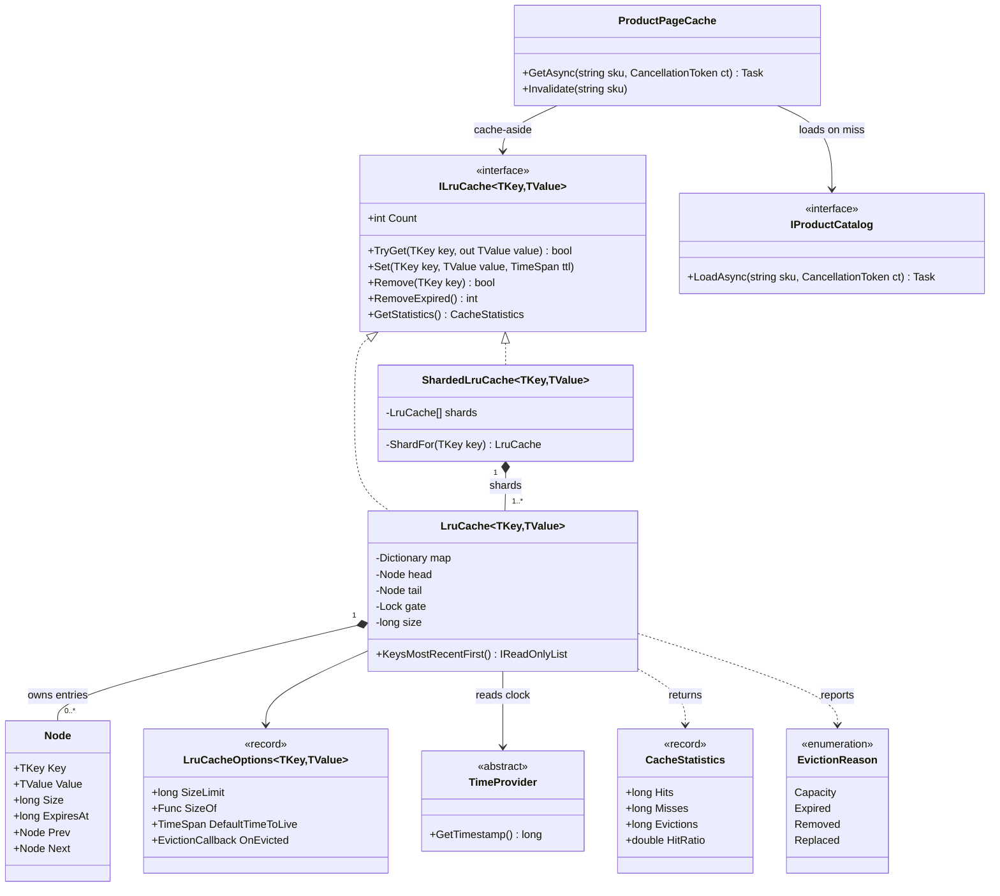
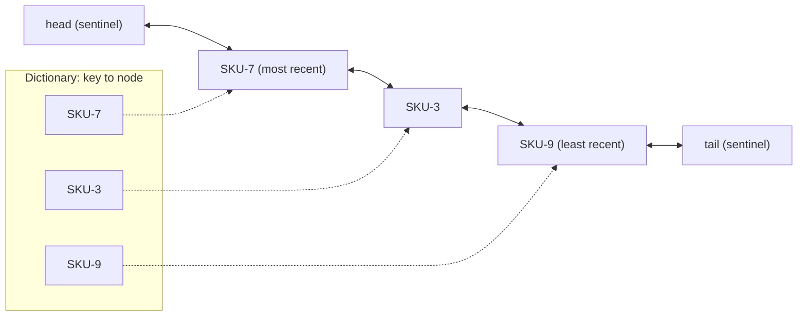
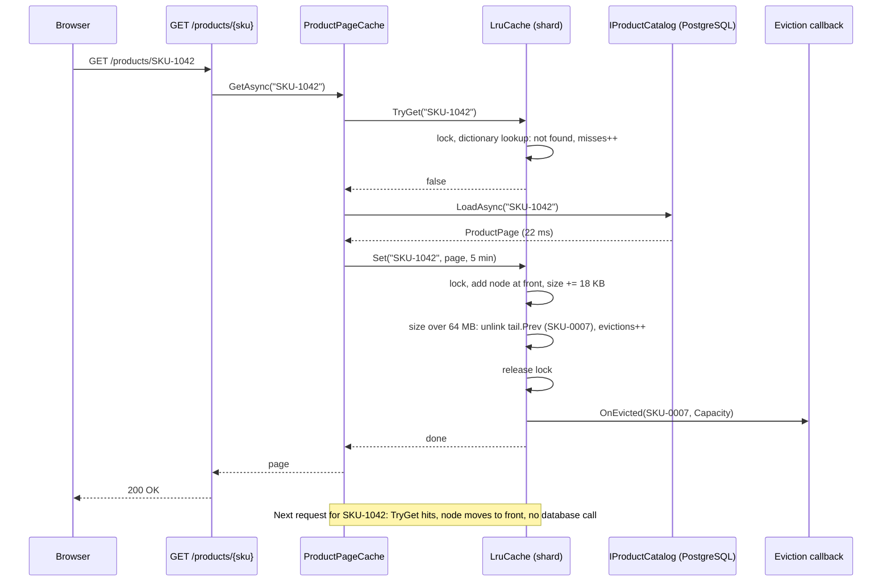
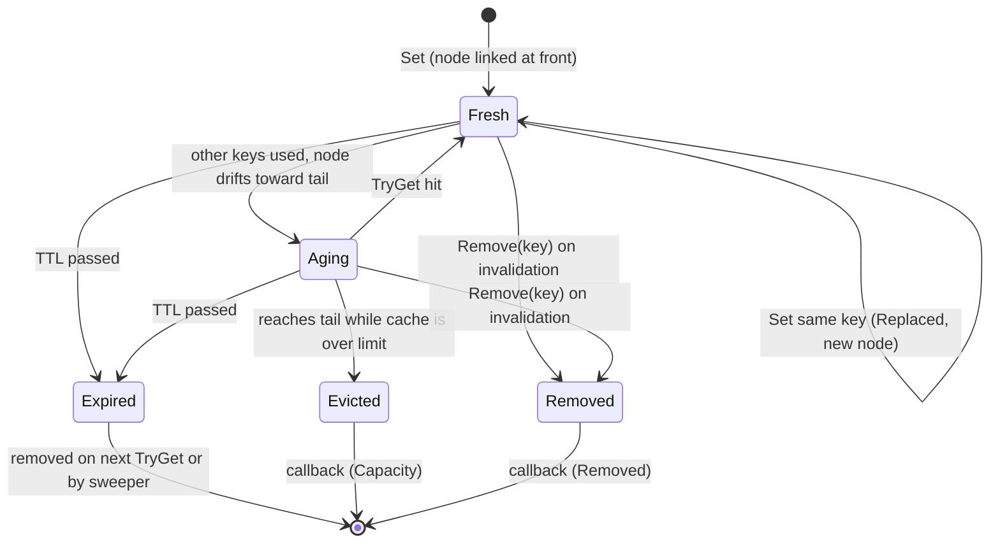
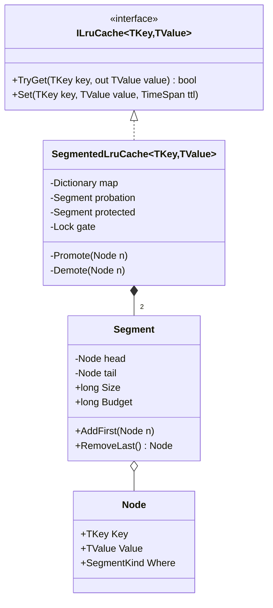

An LRU cache is the most popular whiteboard design question, and a structure you use daily: your music app's "recently played" row, your browser's cache, the product pages an online store keeps in memory. When the cache is full, throw out the item nobody has touched for longest. Doing that in constant time, across threads, with expiry and a memory limit, is the real exercise. We go from the classic interview answer to a version you could ship in ASP.NET Core.

## Learning objectives

By the end of this case study you will be able to:

1. Turn "add a cache" into requirements: capacity, O(1) get and put, eviction callback, optional TTL, metrics.
2. Explain why a list alone or a dictionary alone cannot give O(1) LRU, and why combining them can.
3. Implement an LRU cache in C# with a `Dictionary` and a doubly linked list with sentinel nodes, and compare it with `LinkedList<T>`.
4. Choose a thread-safety strategy (one lock, shards, approximate LRU) and explain why `ReaderWriterLockSlim` does not help.
5. Add TTL with an injected `TimeProvider`, limit memory by size, and publish hit-ratio metrics.
6. Decide when `IMemoryCache`, `HybridCache`, Redis, LFU or segmented LRU is the better choice.

## Prerequisites

- [Collections, generics and common data structures](#/lesson/m01-collections-generics): `Dictionary<TKey,TValue>` and linked lists.
- [Big O notation](#/lesson/m01-big-o): what O(1) and O(n) mean in practice.
- [Why caching works](#/lesson/m12-why-caching): locality and hit ratio.
- [Concurrency patterns](#/lesson/m13-concurrency-patterns): locks and the read–write lock.
- [Designing for testability](#/lesson/m04-testability): injecting the clock.

## Explain it like I'm a beginner

Think of the "recently played" row in a music app. It shows your last 10 songs. When you play a song, it jumps to the front. When you play an 11th new song, the song at the far end (the one you played longest ago) falls off. A song you play again does not appear twice; it just moves back to the front.

That row is a **least-recently-used cache** (LRU cache): the item thrown out is the one whose last use is oldest.

Now picture an online store. Building a product page takes about 20 ms (an estimate), and most shoppers look at the same few hundred products: today's phone launch, the cricket jersey, the best-selling pressure cooker. If each server keeps recent pages in memory, most requests are answered in microseconds; when memory is full, it drops the page nobody has looked at for longest. Popular pages keep getting touched, so they stay.

Two things must be fast: **finding** a page by product code, and **reordering** ("move this to the front", "drop the oldest"). A dictionary is great at finding; a list is great at order. The trick is to use both together.

## Requirements

### The scenario

You work on the catalogue service of an online store: 6 instances of an ASP.NET Core API. Each product page (title, price, images, an HTML fragment) is assembled from PostgreSQL and two other services and costs 15–30 ms (an estimate from your traces). At sale time the catalogue database struggles first. The team wants an in-process cache of product pages on each instance, plus a smaller one for user profile summaries.

### Functional requirements

| # | Requirement |
|---|---|
| F1 | `TryGet(key)` returns the cached value and marks it most recently used. |
| F2 | `Set(key, value)` inserts or replaces a value and marks it most recently used. |
| F3 | When over its limit, the cache evicts **least recently used** entries until it fits. |
| F4 | The limit is an **entry count** (profiles: 100,000) or an **estimated size in bytes** (pages: 64 MB per instance), via a size function. |
| F5 | Optional **time-to-live** (TTL): a price shown must not be more than 5 minutes old. |
| F6 | An **eviction callback** reports every removal with a reason: capacity, expired, removed, replaced. |
| F7 | `Remove(key)` for explicit invalidation (a seller changes a price). |
| F8 | **Statistics**: hits, misses, evictions, expirations, count and size. |

### Non-functional requirements

| # | Requirement | Target |
|---|---|---|
| N1 | Complexity | `TryGet`, `Set`, `Remove` are O(1) on average. |
| N2 | Thread safety | Many request threads share one instance; no corruption, never over the limit after an operation. |
| N3 | Contention | At a few thousand requests per second, the cache is not the bottleneck. |
| N4 | Testability | TTL behaviour is testable without `Thread.Sleep`. |
| N5 | Callback safety | A slow or failing callback cannot block other threads or corrupt the cache. |
| N6 | Observability | Hit ratio is visible on a dashboard per instance. |

### Clarifying questions (ask these before designing)

- **Per instance or shared?** With 6 instances, an invalidation must reach all 6 (or you accept up to 5 minutes of staleness). Shared Redis is a different design ([Multi-level caching](#/lesson/m16-multi-level-caching)).
- **What is "full"?** For variable-size values, limit by size, not count.
- **Absolute or sliding expiry?** For prices, absolute: a popular page with sliding expiry never refreshes.
- **What must never be cached?** Flash-sale stock counts, wallet balances, anything personalised in a shared cache.
- **What happens on a miss?** The caller loads and stores (cache-aside). If 500 requests miss the same key at once, do we want 500 loads? (No; see stampedes below.)

## Identifying classes and responsibilities

Nouns and verbs from the requirements: *entry*, *key*, *value*, *recency order*, *evict*, *expire*, *size*, *callback*, *statistics*, *shard*, *clock*.

| Class | Kind | Responsibility |
|---|---|---|
| `ILruCache<TKey,TValue>` | interface | The contract callers depend on: `TryGet`, `Set`, `Remove`, `RemoveExpired`, `GetStatistics`. |
| `LruCache<TKey,TValue>` | class | The core: dictionary + doubly linked list, size accounting, TTL, one lock. |
| `Node` (private, nested) | class | One entry: key, value, size, expiry timestamp, previous and next pointers. |
| `LruCacheOptions<TKey,TValue>` | record | Validated settings: size limit, size function, default TTL, eviction callback, key comparer. |
| `EvictionReason` | enum | Why an entry left: `Capacity`, `Expired`, `Removed`, `Replaced`. |
| `CacheStatistics` | record struct | Immutable snapshot of counters, with a computed `HitRatio`. |
| `ShardedLruCache<TKey,TValue>` | class | Splits keys across N independent `LruCache` shards to reduce lock contention. |
| `TimeProvider` | BCL abstract class | The clock, injected so tests control time. |
| `ProductPageCache` | class | Cache-aside wrapper for product pages: try the cache, load on miss, store with TTL. |
| `ProductCacheMetrics` | class | Publishes hits, misses, evictions and size with `System.Diagnostics.Metrics`. |
| `ExpiredEntrySweeper` | `BackgroundService` | Removes expired entries every minute so they do not occupy memory until touched. |

Two deliberate separations: **data structure vs domain** (`LruCache` knows nothing about products, so it is reusable for profiles or exchange rates), and **cache vs loader** (the cache never calls the database, so it stays fast, testable and free of I/O under its lock).

## Class diagram



How to read it: callers depend only on `ILruCache<TKey,TValue>`. `LruCache` is the real data structure and *owns* its `Node` objects (composition): nodes never escape it. `ShardedLruCache` owns several `LruCache` shards and forwards each call to the shard chosen by the key's hash. `LruCache` reads settings from `LruCacheOptions` and time from an injected `TimeProvider`, returns `CacheStatistics` snapshots and reports an `EvictionReason` to the callback. `ProductPageCache` is the only class that knows about products; it reaches the cache and the catalogue through interfaces, so both can be faked in tests.

### What the data structure looks like in memory



The dictionary maps each key straight to its node (dotted arrows), so finding `SKU-3` never walks the list. The list keeps recency order: the node after `head` is the most recently used, the node before `tail` is the next victim. Each node knows both neighbours, so it can be unlinked in O(1). The **sentinel** nodes `head` and `tail` hold no data; they exist so that "insert at front" and "remove last" never check for an empty list or a null neighbour.

### One request, step by step



The interesting part is the order inside `Set`: take the lock, link the new node at the front, add its size, evict from the tail until the total fits, and **release the lock before calling the eviction callback**. A slow logger running under the lock would stall every request thread on this shard (N5). The callback receives entries that are already fully removed, so the cache is consistent whatever it does. The cache never calls the catalogue; loading is the caller's job.

## Patterns and design decisions

### Why a list alone or a dictionary alone fails

Try the obvious designs first; that is what an interviewer wants to see.

| Design | `TryGet` | `Set` with eviction | Problem |
|---|---|---|---|
| `List<T>` in recency order | O(n) search, O(n) shift to move to front | O(n) to remove from the front | Millions of element moves per second at sale traffic. |
| `Dictionary<K, (V, lastUsed)>` | O(1) | O(n) scan for the oldest timestamp | Every eviction scans the whole cache. |
| `PriorityQueue` by last-used time | O(log n), and .NET's `PriorityQueue` cannot update an item's priority | O(log n) | Slower and awkward. |
| **Dictionary + doubly linked list** | O(1) | O(1) | Two structures to keep in sync. |

The **dictionary finds** the node and the **doubly linked list orders** the nodes. Because the dictionary stores a reference to the node, "move to front" is a few pointer assignments, not a search. The list must be *doubly* linked: removing a node from the middle needs its previous neighbour, and a singly linked list would have to walk from the head to find it.

### Own node class vs `LinkedList<T>`

.NET's `LinkedList<T>` is doubly linked, and its nodes can be stored in the dictionary:

```csharp
private readonly Dictionary<string, LinkedListNode<(string Key, ProductPage Page)>> _map = new();
private readonly LinkedList<(string Key, ProductPage Page)> _order = new();   // First = most recent

void Touch(LinkedListNode<(string Key, ProductPage Page)> node)
{
    _order.Remove(node);      // O(1) because we pass the node, not the value
    _order.AddFirst(node);    // re-uses the node, no allocation
}
```

Both are fine. `LinkedList<T>` is tested and short but needs a tuple to keep the key beside the value. A hand-written node holds key, value, size and expiry in one object, with sentinels; interviewers expect you to write it. Classic bug: `_order.Remove(value)` instead of `Remove(node)`, an O(n) search.

### Thread safety: every read is a write

`TryGet` moves the node to the front, changing four pointers. So a `ReaderWriterLockSlim` gives nothing: `TryGet` needs the write lock too. "Optimise" it to the read lock and two readers moving nodes at once corrupt the list. `ConcurrentDictionary` alone does not help: the list must change atomically with it.

| Option | How | Cost |
|---|---|---|
| **One lock** | `lock (_gate)` with .NET 9+'s `System.Threading.Lock` | Correct and simple; each operation holds it for well under a microsecond (an estimate; measure it). |
| **Lock striping (shards)** | N independent LRUs; the key's hash picks one | Contention drops roughly N times. LRU becomes per shard, and each shard gets 1/N of the budget. |
| **Approximate LRU** | `ConcurrentDictionary` plus a last-access timestamp; evict the oldest of a few randomly sampled entries | Lock-free reads, inexact eviction. Redis's `allkeys-lru` works this way (`maxmemory-samples`). |
| **Buffered reads** | Record reads in a lock-free buffer, replay them under the lock in batches | Used by high-performance caches such as Caffeine (JVM). Only if profiling demands it. |

We implement one lock in `LruCache` and striping in `ShardedLruCache` (16 shards × 4 MB; evicting the 50,013th rather than the 50,000th most recent page makes no visible difference). Keep the lock cheap: **no I/O or callbacks under it**, and **compute sizes before taking it**.

### Size accounting instead of entry count

Profiles are all about 1 KB, so a count limit works. Pages vary from 4 KB to 400 KB, so "50,000 entries" could mean 200 MB or 20 GB. The cache takes a `SizeOf(key, value)` function and a `SizeLimit` in the same units (default `SizeOf = 1` makes it a count). Sizes are *estimates* (`2 × characters + overhead`); 20 % off is fine, forgetting the HTML is not. A value larger than the whole limit is rejected.

### TTL with an injected clock

Each node stores `ExpiresAt = now + ttl` from `TimeProvider.GetTimestamp()`, a monotonic clock that never jumps backwards (`DateTime.UtcNow` can, when the wall clock is corrected). Expired entries are removed **lazily on read** (a miss, so nobody sees stale data) and **periodically** by a sweeper, because an expired entry nobody reads still holds memory. The sweep is O(n) under one shard's lock at a time. TTL is absolute from the last `Set`; reads do not extend it.

### Eviction callback as an observer

The callback is a small [Observer](#/lesson/m06-observer): the cache announces "this entry left, for this reason". Uses: metrics, debug logs, disposing values that hold resources. The cache catches and counts callback exceptions, so a buggy listener cannot break caching.

### Cache-aside and the stampede

`ProductPageCache.GetAsync` is [cache-aside](#/lesson/m12-cache-patterns): try the cache, load on a miss, store. Its weakness is the **stampede**: a hot page expires and 300 concurrent requests all hit the database. Fixes: TTL jitter so hot keys do not expire together, coalescing concurrent loads per key, or `HybridCache`, which coalesces for you. See [Cache stampede, penetration and hot keys](#/lesson/m12-cache-failures).

## State transitions

### The list across a sequence of operations

Capacity 3, entry-count limit. Read "front → back" as "most recent → least recent".

| Step | Operation | List after (front → back) | Result |
|---|---|---|---|
| 1 | `Set(A)` | A | |
| 2 | `Set(B)` | B, A | |
| 3 | `Set(C)` | C, B, A | full |
| 4 | `TryGet(A)` | A, C, B | hit; A moves to front |
| 5 | `Set(D)` | D, A, C | evicts **B** (it was at the back) |
| 6 | `TryGet(B)` | D, A, C | miss; order unchanged |
| 7 | `TryGet(C)` | C, D, A | hit |
| 8 | `Set(E)` | E, C, D | evicts **A** |
| 9 | `Set(C, new value)` | C, E, D | replace; no eviction, old value reported as `Replaced` |

Two details people get wrong in interviews: a miss (step 6) changes nothing, and updating an existing key (step 9) evicts nobody.

### The lifecycle of one entry



How to read it: an entry starts *fresh* at the front, and every hit pulls it back there. While other keys are used it drifts towards the tail (*aging*) until, as the last node of an over-full cache, it is *evicted*. Independently, time can make it *expired*: invisible to readers at once, physically removed on the next read or by the sweeper. An explicit `Remove` (a seller edits a price) takes it out at any point. Every exit ends in exactly one callback with a reason, which keeps the eviction metrics trustworthy.

## C# implementation

Project layout:

```text
Catalog.Api/
  Program.cs
  Caching/
    CacheContracts.cs        ILruCache, EvictionReason, CacheStatistics, LruCacheOptions
    LruCache.cs              dictionary + doubly linked list + TTL + size
    ShardedLruCache.cs       lock striping
    ExpiredEntrySweeper.cs   BackgroundService
  Products/
    ProductPageCache.cs      cache-aside
    ProductCacheMetrics.cs   System.Diagnostics.Metrics
Catalog.Tests/
  Caching/LruCacheTests.cs
```

### Contracts and options

```csharp file=Caching/CacheContracts.cs
using System.Diagnostics.CodeAnalysis;

namespace Shop.Caching;

public enum EvictionReason { Capacity, Expired, Removed, Replaced }

public delegate void EvictionCallback<in TKey, in TValue>(TKey key, TValue value, EvictionReason reason);

/// <summary>Immutable snapshot of cache counters.</summary>
public readonly record struct CacheStatistics(
    long Hits, long Misses, long Evictions, long Expirations, long CallbackFailures, int Count, long Size)
{
    public double HitRatio => Hits + Misses == 0 ? 0 : (double)Hits / (Hits + Misses);

    public static CacheStatistics operator +(CacheStatistics a, CacheStatistics b) => new(
        a.Hits + b.Hits, a.Misses + b.Misses, a.Evictions + b.Evictions, a.Expirations + b.Expirations,
        a.CallbackFailures + b.CallbackFailures, a.Count + b.Count, a.Size + b.Size);
}

public interface ILruCache<TKey, TValue> where TKey : notnull
{
    int Count { get; }

    /// <summary>Returns the value and marks it most recently used. Expired entries are misses.</summary>
    bool TryGet(TKey key, [MaybeNullWhen(false)] out TValue value);

    /// <summary>Inserts or replaces, then evicts least recently used entries until the cache fits.</summary>
    void Set(TKey key, TValue value, TimeSpan? timeToLive = null);

    bool Remove(TKey key);

    /// <summary>Physically removes expired entries. Returns how many were removed.</summary>
    int RemoveExpired();

    CacheStatistics GetStatistics();
}

public sealed record LruCacheOptions<TKey, TValue> where TKey : notnull
{
    /// <summary>Maximum total size. With the default SizeOf (1 per entry) this is an entry count.</summary>
    public required long SizeLimit { get; init; }

    /// <summary>Estimated size of one entry, in the same units as SizeLimit. Must be positive.</summary>
    public Func<TKey, TValue, long> SizeOf { get; init; } = static (_, _) => 1;

    /// <summary>Applied when Set is called without a TTL. Null means entries never expire.</summary>
    public TimeSpan? DefaultTimeToLive { get; init; }

    /// <summary>Called after the lock is released, once per removed entry.</summary>
    public EvictionCallback<TKey, TValue>? OnEvicted { get; init; }

    public IEqualityComparer<TKey>? Comparer { get; init; }
}
```

### The core: dictionary plus doubly linked list

```csharp file=Caching/LruCache.cs
using System.Diagnostics.CodeAnalysis;

namespace Shop.Caching;

/// <summary>
/// Classic LRU cache. A Dictionary finds nodes in O(1); a doubly linked list with sentinels keeps
/// recency order and unlinks in O(1). One lock guards both, because even TryGet moves a node.
/// </summary>
public sealed class LruCache<TKey, TValue> : ILruCache<TKey, TValue> where TKey : notnull
{
    private sealed class Node(TKey key, TValue value, long size, long expiresAt)
    {
        public readonly TKey Key = key;
        public readonly TValue Value = value;
        public readonly long Size = size;
        public readonly long ExpiresAt = expiresAt;   // TimeProvider timestamp; long.MaxValue = never
        public Node? Prev;
        public Node? Next;
    }

    private readonly Dictionary<TKey, Node> _map;
    private readonly Node _head;   // sentinel: _head.Next is the most recently used entry
    private readonly Node _tail;   // sentinel: _tail.Prev is the least recently used entry
    private readonly Lock _gate = new();
    private readonly LruCacheOptions<TKey, TValue> _options;
    private readonly TimeProvider _time;
    private long _size, _hits, _misses, _evictions, _expirations, _callbackFailures;

    public LruCache(LruCacheOptions<TKey, TValue> options, TimeProvider time)
    {
        ArgumentNullException.ThrowIfNull(options);
        ArgumentNullException.ThrowIfNull(time);
        ArgumentOutOfRangeException.ThrowIfNegativeOrZero(options.SizeLimit);
        if (options.DefaultTimeToLive is { } ttl) ArgumentOutOfRangeException.ThrowIfLessThanOrEqual(ttl, TimeSpan.Zero);

        _options = options;
        _time = time;
        _map = new Dictionary<TKey, Node>(options.Comparer);
        _head = new Node(default!, default!, 0, long.MaxValue);
        _tail = new Node(default!, default!, 0, long.MaxValue);
        _head.Next = _tail;
        _tail.Prev = _head;
    }

    public long SizeLimit => _options.SizeLimit;

    public int Count { get { lock (_gate) return _map.Count; } }

    public bool TryGet(TKey key, [MaybeNullWhen(false)] out TValue value)
    {
        Node? expired = null;
        lock (_gate)
        {
            if (_map.TryGetValue(key, out var node))
            {
                if (node.ExpiresAt > _time.GetTimestamp())
                {
                    MoveToFront(node);
                    _hits++;
                    value = node.Value;
                    return true;
                }
                Detach(node);            // lazy expiry: an expired entry is a miss and leaves now
                _expirations++;
                expired = node;
            }
            _misses++;
        }
        if (expired is not null) Notify(expired, EvictionReason.Expired);
        value = default;
        return false;
    }

    public void Set(TKey key, TValue value, TimeSpan? timeToLive = null)
    {
        long size = _options.SizeOf(key, value);        // outside the lock: may be slow
        if (size <= 0 || size > _options.SizeLimit)
            throw new ArgumentOutOfRangeException(nameof(value), $"Entry size {size} must be between 1 and {_options.SizeLimit}.");
        var ttl = timeToLive ?? _options.DefaultTimeToLive;
        if (ttl is { } t) ArgumentOutOfRangeException.ThrowIfLessThanOrEqual(t, TimeSpan.Zero, nameof(timeToLive));

        List<(Node Node, EvictionReason Reason)>? removed = null;
        lock (_gate)
        {
            long now = _time.GetTimestamp();
            if (_map.TryGetValue(key, out var old))
            {
                Detach(old);
                (removed ??= []).Add((old, EvictionReason.Replaced));
            }

            var node = new Node(key, value, size, ExpiryFor(now, ttl));
            _map.Add(key, node);
            AddFirst(node);
            _size += size;

            // The new node is at the front and fits on its own, so this loop never evicts it.
            while (_size > _options.SizeLimit)
            {
                var victim = _tail.Prev!;
                Detach(victim);
                _evictions++;
                (removed ??= []).Add((victim, EvictionReason.Capacity));
            }
        }
        if (removed is not null)
            foreach (var (n, reason) in removed) Notify(n, reason);
    }

    public bool Remove(TKey key)
    {
        Node? node;
        lock (_gate)
        {
            if (!_map.TryGetValue(key, out node)) return false;
            Detach(node);
        }
        Notify(node, EvictionReason.Removed);
        return true;
    }

    public int RemoveExpired()
    {
        List<Node>? expired = null;
        lock (_gate)
        {
            long now = _time.GetTimestamp();
            for (var n = _tail.Prev!; n != _head;)
            {
                var previous = n.Prev!;
                if (n.ExpiresAt <= now)
                {
                    Detach(n);
                    _expirations++;
                    (expired ??= []).Add(n);
                }
                n = previous;
            }
        }
        if (expired is null) return 0;
        foreach (var n in expired) Notify(n, EvictionReason.Expired);
        return expired.Count;
    }

    public CacheStatistics GetStatistics()
    {
        lock (_gate)
            return new(_hits, _misses, _evictions, _expirations, Interlocked.Read(ref _callbackFailures), _map.Count, _size);
    }

    /// <summary>Snapshot of keys from most to least recently used. For tests and debugging.</summary>
    public IReadOnlyList<TKey> KeysMostRecentFirst()
    {
        lock (_gate)
        {
            var keys = new List<TKey>(_map.Count);
            for (var n = _head.Next!; n != _tail; n = n.Next!) keys.Add(n.Key);
            return keys;
        }
    }

    // ---- list and dictionary maintenance: callers must hold _gate ----

    private void AddFirst(Node n)
    {
        n.Prev = _head;
        n.Next = _head.Next;
        _head.Next!.Prev = n;
        _head.Next = n;
    }

    private static void Unlink(Node n)
    {
        n.Prev!.Next = n.Next;
        n.Next!.Prev = n.Prev;
        n.Prev = n.Next = null;
    }

    private void MoveToFront(Node n)
    {
        if (ReferenceEquals(_head.Next, n)) return;   // already most recent: skip four writes
        Unlink(n);
        AddFirst(n);
    }

    private void Detach(Node n)
    {
        Unlink(n);
        _map.Remove(n.Key);
        _size -= n.Size;
    }

    private long ExpiryFor(long now, TimeSpan? ttl)
    {
        if (ttl is not { } t) return long.MaxValue;
        double units = t.TotalSeconds * _time.TimestampFrequency;
        return units >= long.MaxValue - now ? long.MaxValue : now + (long)units;
    }

    private void Notify(Node n, EvictionReason reason)
    {
        var callback = _options.OnEvicted;
        if (callback is null) return;
        try { callback(n.Key, n.Value, reason); }
        catch (Exception) { Interlocked.Increment(ref _callbackFailures); }   // a bad listener must not break the cache
    }
}
```

Points worth noticing:

- **Sentinels**: `AddFirst` and `Unlink` contain no `if`. Nullable head and tail pointers would need four special cases.
- **Every removal goes through `Detach`**, which updates list, dictionary and size together: three pieces of state, one place that changes them.
- **Replace allocates a new node**, so the old value reaches the callback as `Replaced` and can be disposed safely.
- **A hit allocates nothing.** A `Set` allocates one node, plus a small list only when something leaves.

### Lock striping

```csharp file=Caching/ShardedLruCache.cs
using System.Diagnostics.CodeAnalysis;

namespace Shop.Caching;

/// <summary>
/// N independent LRU shards; the key's hash picks the shard. Contention drops roughly N times.
/// Trade-off: eviction is LRU within a shard, not across the whole cache, and each shard gets 1/N of the size.
/// </summary>
public sealed class ShardedLruCache<TKey, TValue> : ILruCache<TKey, TValue> where TKey : notnull
{
    private readonly LruCache<TKey, TValue>[] _shards;
    private readonly IEqualityComparer<TKey> _comparer;

    public ShardedLruCache(int shardCount, LruCacheOptions<TKey, TValue> options, TimeProvider time)
    {
        ArgumentOutOfRangeException.ThrowIfNegativeOrZero(shardCount);
        ArgumentNullException.ThrowIfNull(options);
        ArgumentOutOfRangeException.ThrowIfLessThan(options.SizeLimit, (long)shardCount);

        _comparer = options.Comparer ?? EqualityComparer<TKey>.Default;
        var perShard = options with { SizeLimit = options.SizeLimit / shardCount };
        _shards = new LruCache<TKey, TValue>[shardCount];
        for (int i = 0; i < shardCount; i++) _shards[i] = new LruCache<TKey, TValue>(perShard, time);
    }

    public int Count => _shards.Sum(s => s.Count);

    public bool TryGet(TKey key, [MaybeNullWhen(false)] out TValue value) => ShardFor(key).TryGet(key, out value);

    public void Set(TKey key, TValue value, TimeSpan? timeToLive = null) => ShardFor(key).Set(key, value, timeToLive);

    public bool Remove(TKey key) => ShardFor(key).Remove(key);

    public int RemoveExpired() => _shards.Sum(s => s.RemoveExpired());   // one shard locked at a time

    public CacheStatistics GetStatistics()
    {
        var total = default(CacheStatistics);
        foreach (var s in _shards) total += s.GetStatistics();
        return total;
    }

    private LruCache<TKey, TValue> ShardFor(TKey key) =>
        _shards[(int)((uint)_comparer.GetHashCode(key) % (uint)_shards.Length)];
}
```

The cast to `uint` before `%` matters: `GetHashCode` can be negative. `string.GetHashCode()` is randomised per process, which is fine in-process (and resists hash flooding), but never persist a shard number.

### Background expiry sweep

```csharp file=Caching/ExpiredEntrySweeper.cs
using Microsoft.Extensions.Hosting;
using Microsoft.Extensions.Logging;
using Shop.Products;

namespace Shop.Caching;

/// <summary>Removes expired product pages every minute so unread entries do not hold memory until touched.</summary>
public sealed class ExpiredEntrySweeper(ILruCache<string, ProductPage> cache, TimeProvider time, ILogger<ExpiredEntrySweeper> log)
    : BackgroundService
{
    public static readonly TimeSpan Interval = TimeSpan.FromMinutes(1);

    protected override async Task ExecuteAsync(CancellationToken stoppingToken)
    {
        using var timer = new PeriodicTimer(Interval, time);
        while (await timer.WaitForNextTickAsync(stoppingToken))
        {
            try
            {
                int removed = cache.RemoveExpired();
                if (removed > 0) log.LogDebug("Swept {Count} expired product pages", removed);
            }
            catch (Exception ex)
            {
                log.LogError(ex, "Product page sweep failed");
            }
        }
    }
}
```

### Cache-aside for product pages, and metrics

```csharp file=Products/ProductPageCache.cs
using Shop.Caching;

namespace Shop.Products;

public sealed record ProductPage(string Sku, string Title, decimal PriceInRupees, string Html)
{
    /// <summary>Rough estimate in bytes: UTF-16 strings plus a fixed object overhead. An estimate, not a measurement.</summary>
    public static long EstimateBytes(string sku, ProductPage page) =>
        128 + 2L * (sku.Length + page.Sku.Length + page.Title.Length + page.Html.Length);
}

public interface IProductCatalog
{
    Task<ProductPage?> LoadAsync(string sku, CancellationToken ct);
}

/// <summary>Cache-aside: try the cache, load on a miss, store with a jittered TTL.</summary>
public sealed class ProductPageCache(ILruCache<string, ProductPage> cache, IProductCatalog catalog)
{
    public static readonly TimeSpan BaseTimeToLive = TimeSpan.FromMinutes(5);

    public async Task<ProductPage?> GetAsync(string sku, CancellationToken ct)
    {
        if (cache.TryGet(sku, out var page)) return page;

        page = await catalog.LoadAsync(sku, ct);
        if (page is not null)
        {
            // Up to 30 s of jitter so pages cached together do not all expire in the same second.
            var jitter = TimeSpan.FromSeconds(Random.Shared.Next(0, 30));
            cache.Set(sku, page, BaseTimeToLive - jitter);
        }
        return page;   // a missing product is not cached here; see "negative caching" in the exercises
    }

    /// <summary>Called when a seller edits the product. Only clears this instance; see "Alternative designs".</summary>
    public void Invalidate(string sku) => cache.Remove(sku);
}

/// <summary>Stand-in for the real PostgreSQL-backed catalogue.</summary>
public sealed class InMemoryProductCatalog : IProductCatalog
{
    private readonly Dictionary<string, ProductPage> _pages = new(StringComparer.OrdinalIgnoreCase)
    {
        ["SKU-1042"] = new("SKU-1042", "Pressure cooker 5 L", 2499m, "<section>Pressure cooker 5 L ...</section>"),
        ["SKU-2001"] = new("SKU-2001", "Cricket jersey (home)", 1799m, "<section>Cricket jersey ...</section>"),
    };

    public async Task<ProductPage?> LoadAsync(string sku, CancellationToken ct)
    {
        await Task.Delay(20, ct);   // simulated database latency
        return _pages.GetValueOrDefault(sku);
    }
}
```

```csharp file=Products/ProductCacheMetrics.cs
using System.Diagnostics.Metrics;
using Shop.Caching;

namespace Shop.Products;

/// <summary>
/// Publishes raw counters. Compute hit ratio in the dashboard as rate(hits) / (rate(hits) + rate(misses)),
/// which gives a ratio over the last few minutes instead of since process start.
/// </summary>
public sealed class ProductCacheMetrics
{
    public const string MeterName = "Shop.ProductCache";

    public ProductCacheMetrics(IMeterFactory meterFactory, ILruCache<string, ProductPage> cache)
    {
        var meter = meterFactory.Create(MeterName);
        meter.CreateObservableCounter<long>("shop.product_cache.hits", () => cache.GetStatistics().Hits, unit: "{hit}");
        meter.CreateObservableCounter<long>("shop.product_cache.misses", () => cache.GetStatistics().Misses, unit: "{miss}");
        meter.CreateObservableCounter<long>("shop.product_cache.evictions", () => cache.GetStatistics().Evictions, unit: "{entry}");
        meter.CreateObservableUpDownCounter<long>("shop.product_cache.size", () => cache.GetStatistics().Size, unit: "By");
        meter.CreateObservableUpDownCounter<int>("shop.product_cache.entries", () => cache.GetStatistics().Count, unit: "{entry}");
    }
}
```

Why raw counters, not a "hit ratio" gauge? After a week of 95 % hits, an hour of 40 % barely moves a lifetime ratio. Counters let the dashboard compute the ratio over any window.

### Composition root

```csharp file=Program.cs
using Shop.Caching;
using Shop.Products;

var builder = WebApplication.CreateBuilder(args);

builder.Services.AddSingleton(TimeProvider.System);
// The cache holds state for the life of the process: it MUST be a singleton.
builder.Services.AddSingleton<ILruCache<string, ProductPage>>(sp => new ShardedLruCache<string, ProductPage>(
    16,
    new LruCacheOptions<string, ProductPage>
    {
        SizeLimit = 64L * 1024 * 1024,                      // about 64 MB per instance (estimated bytes)
        SizeOf = ProductPage.EstimateBytes,
        DefaultTimeToLive = ProductPageCache.BaseTimeToLive,
        Comparer = StringComparer.OrdinalIgnoreCase,
    },
    sp.GetRequiredService<TimeProvider>()));
builder.Services.AddSingleton<IProductCatalog, InMemoryProductCatalog>();
builder.Services.AddSingleton<ProductPageCache>();
builder.Services.AddSingleton<ProductCacheMetrics>();
builder.Services.AddHostedService<ExpiredEntrySweeper>();

var app = builder.Build();
app.Services.GetRequiredService<ProductCacheMetrics>();     // create the instruments at startup

app.MapGet("/products/{sku}", async (string sku, ProductPageCache pages, CancellationToken ct) =>
    await pages.GetAsync(sku, ct) is { } page ? Results.Ok(page) : Results.NotFound());

app.MapPost("/admin/products/{sku}/invalidate", (string sku, ProductPageCache pages) =>
{
    pages.Invalidate(sku);
    return Results.NoContent();
});

app.MapGet("/admin/cache/stats", (ILruCache<string, ProductPage> cache) =>
{
    var s = cache.GetStatistics();
    return Results.Ok(new { s.Hits, s.Misses, s.HitRatio, s.Evictions, s.Expirations, s.Count, s.Size });
});

app.Run();
```

The `/admin` endpoints would need authorisation in a real system; they are left open here to keep the example short.

## Automated testing

Two behaviours to pin down: **ordering** (which entry is evicted) and **time** (when it expires). Time needs a fake clock; here is a tiny one (the `Microsoft.Extensions.TimeProvider.Testing` package ships `FakeTimeProvider`).

```csharp
using Xunit;

namespace Shop.Tests;

public sealed class ManualTimeProvider : TimeProvider
{
    private long _ticks;
    public override long TimestampFrequency => TimeSpan.TicksPerSecond;
    public override long GetTimestamp() => Interlocked.Read(ref _ticks);
    public void Advance(TimeSpan by) => Interlocked.Add(ref _ticks, by.Ticks);
}
```

```csharp
using Shop.Caching;
using Xunit;

namespace Shop.Tests;

public class LruCacheTests
{
    private static (LruCache<string, int> Cache, ManualTimeProvider Clock, List<string> Log) Create(
        long limit, TimeSpan? ttl = null)
    {
        var clock = new ManualTimeProvider();
        var log = new List<string>();
        var cache = new LruCache<string, int>(new LruCacheOptions<string, int>
        {
            SizeLimit = limit,
            DefaultTimeToLive = ttl,
            OnEvicted = (k, _, reason) => log.Add($"{k}:{reason}"),
        }, clock);
        return (cache, clock, log);
    }

    [Fact]
    public void Follows_the_worked_example()
    {
        var (c, _, log) = Create(3);
        c.Set("A", 1); c.Set("B", 2); c.Set("C", 3);
        Assert.True(c.TryGet("A", out _));
        c.Set("D", 4);
        Assert.Equal(new[] { "D", "A", "C" }, c.KeysMostRecentFirst().ToArray());
        Assert.Equal(new[] { "B:Capacity" }, log.ToArray());
    }

    [Fact]
    public void Replacing_a_key_does_not_evict_others()
    {
        var (c, _, log) = Create(2);
        c.Set("A", 1); c.Set("B", 2);
        c.Set("A", 10);
        Assert.Equal(2, c.Count);
        Assert.True(c.TryGet("A", out var a));
        Assert.Equal(10, a);
        Assert.Equal(new[] { "A:Replaced" }, log.ToArray());
    }

    [Fact]
    public void Expired_entries_are_misses_and_leave_immediately()
    {
        var (c, clock, log) = Create(10, TimeSpan.FromMinutes(5));
        c.Set("A", 1);
        clock.Advance(TimeSpan.FromMinutes(5));
        Assert.False(c.TryGet("A", out _));
        Assert.Equal(0, c.Count);
        Assert.Equal(new[] { "A:Expired" }, log.ToArray());
    }

    [Fact]
    public void Size_limit_evicts_until_it_fits()
    {
        var clock = new ManualTimeProvider();
        var c = new LruCache<string, string>(new LruCacheOptions<string, string>
        {
            SizeLimit = 10, SizeOf = static (_, v) => v.Length,
        }, clock);
        c.Set("a", "1234"); c.Set("b", "1234");          // size 8
        c.Set("c", "123456");                           // size 14 > 10: evict a (8 -> 10)
        Assert.Equal(new[] { "c", "b" }, c.KeysMostRecentFirst().ToArray());
        Assert.Throws<ArgumentOutOfRangeException>(() => c.Set("huge", new string('x', 11)));
    }

    [Fact]
    public void A_throwing_callback_does_not_break_the_cache()
    {
        var c = new LruCache<string, int>(new LruCacheOptions<string, int>
        {
            SizeLimit = 1, OnEvicted = (_, _, _) => throw new InvalidOperationException("listener bug"),
        }, new ManualTimeProvider());
        c.Set("A", 1);
        c.Set("B", 2);
        Assert.True(c.TryGet("B", out _));
        Assert.Equal(1, c.GetStatistics().CallbackFailures);
    }

    [Fact]
    public void Never_exceeds_the_limit_under_parallel_load()
    {
        var (c, _, _) = Create(100);
        Parallel.For(0, 50_000, i =>
        {
            c.Set("k" + (i % 500), i);
            c.TryGet("k" + (i % 250), out _);
        });
        Assert.Equal(100, c.Count);
        Assert.Equal(100, c.KeysMostRecentFirst().Count);    // the list and the dictionary agree
    }
}
```

What these tests protect: the worked example from "State transitions" as code; replace-vs-evict (the most common interview bug); the exact TTL boundary with no sleeping; "evict until it fits" for sizes; and, under parallel load, the invariant that the dictionary and the list agree. Remove the lock and the last test fails on most runs, often with an exception from the corrupted list or dictionary. For `ProductPageCache`, a fake `IProductCatalog` that counts calls shows one load, then zero, then one again after `Invalidate`.

## Bad design vs good design

### Bad: the "it works on my machine" cache

```csharp
public static class PageCache
{
    private static readonly Dictionary<string, (ProductPage Page, DateTime LastUsed)> _items = new();
    private const int Max = 50_000;

    public static ProductPage? Get(string sku)
    {
        if (!_items.TryGetValue(sku, out var e)) return null;
        _items[sku] = (e.Page, DateTime.Now);
        return e.Page;
    }

    public static void Put(string sku, ProductPage page)
    {
        if (_items.Count >= Max)
        {
            var oldest = _items.OrderBy(x => x.Value.LastUsed).First().Key;   // sorts 50,000 items
            _items.Remove(oldest);
        }
        _items[sku] = (page, DateTime.Now);
    }
}
```

What is wrong, concretely:

1. **O(n log n) eviction.** Every insert into a full cache sorts 50,000 entries, on the request path.
2. **Not thread-safe.** Concurrent `Dictionary` writes corrupt it, and even `Get` writes.
3. **Count, not size.** Memory use is anyone's guess.
4. **No expiry.** A price change is invisible until the entry happens to be evicted, possibly never.
5. **`DateTime.Now`.** Jumps with daylight saving and clock corrections; tests need sleeps.
6. **Static.** Cannot be faked, configured twice, or swapped for `HybridCache`.
7. **No metrics.** Nobody knows whether it helps.

### Good: the design above

O(1) operations via dictionary + doubly linked list; one lock per shard with no I/O or callbacks under it; a size-based limit; TTL on a monotonic, injectable clock; an interface registered as a singleton, with counters exported.

### Is the full design worth it?

Often not. `IMemoryCache` (with `SizeLimit`) or `HybridCache` already gives most apps expiry, size limits and eviction. Write your own when you need exact LRU, eviction reasons, control the framework lacks, or no dependencies inside a library. And in interviews, where it is the expected answer.

## Alternative designs

### `IMemoryCache` and `HybridCache`

`MemoryCache` (`Microsoft.Extensions.Caching.Memory`) is not a strict LRU. With `SizeLimit` set, every entry must declare a `Size`; if adding an entry would exceed the limit, it is not added and a background **compaction** runs, removing expired items first, then by priority (lowest first), then least recently used, then by earliest expiration. It supports absolute and sliding expiration and post-eviction callbacks: a good default for "cache this for 5 minutes".

`HybridCache` (`Microsoft.Extensions.Caching.Hybrid`, .NET 9+) layers memory over an optional distributed cache such as Redis and coalesces concurrent loads per key, solving the stampede. For these product pages, many teams would ship it with a Redis L2. See [Caching in ASP.NET Core](#/lesson/m03-caching).

### LFU (least frequently used)

Evicts the entry with the fewest accesses, so evergreen items survive one-off reads. But last week's hit keeps a high count (needs decay), and new items may be evicted before they prove themselves. Redis offers `allkeys-lfu` with a decaying counter.

### Segmented LRU (SLRU)

A small **probation** segment for new entries and a large **protected** segment for entries hit at least twice. A one-time scan (a nightly job, a crawler) only churns probation, so the hot set survives. This *scan resistance* fixes plain LRU's biggest weakness (exercise 4).

### Approximate LRU

No list: sample K random entries on eviction and drop the oldest (see the thread-safety table). Lock-free reads, two fewer pointers per entry, inexact eviction.

### Distributed and two-level caches

A shared Redis cache gives every instance the same view, survives deployments and makes invalidation one `DEL`, at the cost of a network hop (around a millisecond in-region, an estimate) and a dependency. The common production shape is a small in-process LRU (L1, seconds) in front of Redis (L2, minutes), with invalidation messages to all instances ([Multi-level caching](#/lesson/m16-multi-level-caching)).

### When not to cache

If the query is already fast, or the data changes on every request (flash-sale stock, wallet balances), a cache adds staleness and bugs for little gain. Fix the query or index first.

## Practical playground

The program replays the worked example, printing the list after each step, then simulates skewed traffic to show the hit ratio for three cache sizes. Try: (1) change the skew from 80/10 to 50/50 and compare; (2) add a "nightly scan" of products 1 to 5,000 and measure again; (3) replace `LinkedList<T>` with your own nodes and sentinels.

:::playground type=csharp title="LRU cache: trace and hit ratio"
```csharp file=Program.cs
using System;
using System.Collections.Generic;

public sealed class TinyLru<TKey, TValue> where TKey : notnull
{
    private readonly int _capacity;
    private readonly Dictionary<TKey, LinkedListNode<KeyValuePair<TKey, TValue>>> _map = new();
    private readonly LinkedList<KeyValuePair<TKey, TValue>> _order = new();   // First = most recent

    public TinyLru(int capacity) => _capacity = capacity;

    public long Hits { get; private set; }
    public long Misses { get; private set; }

    public bool TryGet(TKey key, out TValue value)
    {
        if (_map.TryGetValue(key, out var node))
        {
            _order.Remove(node);
            _order.AddFirst(node);
            Hits++;
            value = node.Value.Value;
            return true;
        }
        Misses++;
        value = default!;
        return false;
    }

    public string Set(TKey key, TValue value)
    {
        string note = "";
        if (_map.TryGetValue(key, out var existing))
        {
            _order.Remove(existing);
            _map.Remove(key);
            note = " (replaced)";
        }
        else if (_map.Count == _capacity)
        {
            var lru = _order.Last!;
            _order.RemoveLast();
            _map.Remove(lru.Value.Key);
            note = $" (evicted {lru.Value.Key})";
        }
        _map[key] = _order.AddFirst(new KeyValuePair<TKey, TValue>(key, value));
        return note;
    }

    public string Describe() => string.Join(", ", EnumerateKeys());

    private IEnumerable<TKey> EnumerateKeys()
    {
        foreach (var kv in _order) yield return kv.Key;
    }
}

public static class Program
{
    public static void Main()
    {
        Console.WriteLine("Worked example, capacity 3 (front = most recent)");
        var cache = new TinyLru<string, int>(3);
        Step(cache, "Set A", c => c.Set("A", 1));
        Step(cache, "Set B", c => c.Set("B", 2));
        Step(cache, "Set C", c => c.Set("C", 3));
        Step(cache, "Get A", c => c.TryGet("A", out _) ? " hit" : " miss");
        Step(cache, "Set D", c => c.Set("D", 4));
        Step(cache, "Get B", c => c.TryGet("B", out _) ? " hit" : " miss");
        Step(cache, "Get C", c => c.TryGet("C", out _) ? " hit" : " miss");
        Step(cache, "Set E", c => c.Set("E", 5));
        Step(cache, "Set C", c => c.Set("C", 30));

        Console.WriteLine();
        Console.WriteLine("Simulated product traffic: 10,000 products, 200,000 requests, skewed popularity");
        foreach (int capacity in new[] { 100, 1_000, 3_000 })
        {
            var pages = new TinyLru<int, string>(capacity);
            var rng = new Random(42);
            for (int i = 0; i < 200_000; i++)
            {
                // 80 % of requests go to the 1,000 most popular products.
                int sku = rng.NextDouble() < 0.8 ? rng.Next(0, 1_000) : rng.Next(1_000, 10_000);
                if (!pages.TryGet(sku, out _)) pages.Set(sku, "page-" + sku);
            }
            double ratio = (double)pages.Hits / (pages.Hits + pages.Misses);
            Console.WriteLine($"capacity {capacity,5}: hit ratio {ratio:P1}");
        }
    }

    private static void Step(TinyLru<string, int> cache, string label, Func<TinyLru<string, int>, string> action)
    {
        string note = action(cache);
        Console.WriteLine($"{label,-6}{note,-16} -> [{cache.Describe()}]");
    }
}
```
:::

## Exercises

:::exercise id=m18-lru-cache-ex1 difficulty=beginner kind=code title="LRU cache with Get and Put"
Implement the classic LRU cache for a music app's "recently played" row: fixed capacity, O(1) `TryGet` and `Put`, and eviction of the least recently used key when a new key arrives at a full cache.
::requirements
- A hit returns the value and makes the key most recent; a miss changes nothing.
- `Put` of a new key into a full cache evicts the least recently used key; `Put` of an existing key replaces the value, makes it most recent and evicts nothing.
- `KeysMostRecentFirst()` lists keys from most to least recent. Capacity must be at least 1.
::acceptance
- Capacity 2: put a, b, c; a is gone.
- Capacity 2: put a, b; get a; put c; b is gone.
- Capacity 3: put a, b, c; get a; order is a, c, b.
- 100,000 puts into a capacity-1,000 cache keep exactly the last 1,000 keys.
::hint
One structure finds a key in O(1); another keeps order and removes from either end in O(1).
::hint
A `Dictionary<TKey, Node>` finds the node; a doubly linked list (`Prev`, `Next`) keeps the order.
::hint
Two permanent sentinels, `head` and `tail`: most recent is `head.Next`, least recent is `tail.Prev`. No null checks needed.
::hint
```text
TryGet: if map has key -> unlink(node), addFirst(node), return value
Put:    if map has key -> update value, move to front, return
        if count == capacity -> victim = tail.Prev; unlink(victim); map.Remove(victim.Key)
        node = new Node(key, value); map[key] = node; addFirst(node)
```
::hint
```csharp
private void Unlink(Node n) { n.Prev!.Next = n.Next; n.Next!.Prev = n.Prev; }
private void AddFirst(Node n) { n.Prev = _head; n.Next = _head.Next; _head.Next!.Prev = n; _head.Next = n; }
```
::starter
```csharp file=SimpleLruCache.cs
using System;
using System.Collections.Generic;

public sealed class SimpleLruCache<TKey, TValue> where TKey : notnull
{
    public SimpleLruCache(int capacity)
    {
        throw new NotImplementedException();
    }

    public int Count => throw new NotImplementedException();

    public bool TryGet(TKey key, out TValue value) => throw new NotImplementedException();

    public void Put(TKey key, TValue value) => throw new NotImplementedException();

    public IReadOnlyList<TKey> KeysMostRecentFirst() => throw new NotImplementedException();
}
```
::tests
```csharp file=SimpleLruCacheTests.cs
using System;
using Xunit;

public class SimpleLruCacheTests
{
    private static string Order(SimpleLruCache<string, int> c) => string.Join(",", c.KeysMostRecentFirst());

    [Fact]
    public void Evicts_least_recently_used_when_full()
    {
        var c = new SimpleLruCache<string, int>(2);
        c.Put("a", 1); c.Put("b", 2); c.Put("c", 3);
        Assert.False(c.TryGet("a", out _));
        Assert.True(c.TryGet("b", out var b));
        Assert.Equal(2, b);
        Assert.Equal(2, c.Count);
    }

    [Fact]
    public void Get_refreshes_recency()
    {
        var c = new SimpleLruCache<string, int>(2);
        c.Put("a", 1); c.Put("b", 2);
        Assert.True(c.TryGet("a", out _));
        c.Put("c", 3);
        Assert.True(c.TryGet("a", out _));
        Assert.False(c.TryGet("b", out _));
    }

    [Fact]
    public void Updating_an_existing_key_does_not_evict()
    {
        var c = new SimpleLruCache<string, int>(2);
        c.Put("a", 1); c.Put("b", 2);
        c.Put("a", 10);
        Assert.Equal(2, c.Count);
        Assert.Equal("a,b", Order(c));
        Assert.True(c.TryGet("a", out var a));
        Assert.Equal(10, a);
    }

    [Fact]
    public void Keys_are_listed_most_recent_first()
    {
        var c = new SimpleLruCache<string, int>(3);
        c.Put("a", 1); c.Put("b", 2); c.Put("c", 3);
        c.TryGet("a", out _);
        Assert.Equal("a,c,b", Order(c));
    }

    [Fact]
    public void A_miss_changes_nothing()
    {
        var c = new SimpleLruCache<string, int>(2);
        c.Put("a", 1); c.Put("b", 2);
        Assert.False(c.TryGet("zzz", out _));
        Assert.Equal("b,a", Order(c));
        Assert.Equal(2, c.Count);
    }

    [Fact]
    public void Capacity_must_be_positive() =>
        Assert.Throws<ArgumentOutOfRangeException>(() => new SimpleLruCache<string, int>(0));

    [Fact]
    public void Handles_many_operations()
    {
        var c = new SimpleLruCache<int, int>(1_000);
        for (int i = 0; i < 100_000; i++) c.Put(i, i);
        Assert.Equal(1_000, c.Count);
        Assert.True(c.TryGet(99_000, out _));
        Assert.True(c.TryGet(99_999, out _));
        Assert.False(c.TryGet(98_999, out _));
    }
}
```
::solution
A dictionary from key to node, plus a doubly linked list with two sentinels. Every operation is a dictionary lookup plus a few pointer changes.

```csharp file=SimpleLruCache.cs
using System;
using System.Collections.Generic;

public sealed class SimpleLruCache<TKey, TValue> where TKey : notnull
{
    private sealed class Node
    {
        public TKey Key = default!;
        public TValue Value = default!;
        public Node? Prev;
        public Node? Next;
    }

    private readonly int _capacity;
    private readonly Dictionary<TKey, Node> _map = new();
    private readonly Node _head = new();   // sentinel: _head.Next is most recent
    private readonly Node _tail = new();   // sentinel: _tail.Prev is least recent

    public SimpleLruCache(int capacity)
    {
        ArgumentOutOfRangeException.ThrowIfNegativeOrZero(capacity);
        _capacity = capacity;
        _head.Next = _tail;
        _tail.Prev = _head;
    }

    public int Count => _map.Count;

    public bool TryGet(TKey key, out TValue value)
    {
        if (_map.TryGetValue(key, out var node))
        {
            MoveToFront(node);
            value = node.Value;
            return true;
        }
        value = default!;
        return false;
    }

    public void Put(TKey key, TValue value)
    {
        if (_map.TryGetValue(key, out var node))
        {
            node.Value = value;
            MoveToFront(node);
            return;
        }
        if (_map.Count == _capacity)
        {
            var victim = _tail.Prev!;
            Unlink(victim);
            _map.Remove(victim.Key);
        }
        node = new Node { Key = key, Value = value };
        _map[key] = node;
        AddFirst(node);
    }

    public IReadOnlyList<TKey> KeysMostRecentFirst()
    {
        var keys = new List<TKey>(_map.Count);
        for (var n = _head.Next!; n != _tail; n = n.Next!) keys.Add(n.Key);
        return keys;
    }

    private void AddFirst(Node n)
    {
        n.Prev = _head;
        n.Next = _head.Next;
        _head.Next!.Prev = n;
        _head.Next = n;
    }

    private static void Unlink(Node n)
    {
        n.Prev!.Next = n.Next;
        n.Next!.Prev = n.Prev;
        n.Prev = n.Next = null;
    }

    private void MoveToFront(Node n)
    {
        if (ReferenceEquals(_head.Next, n)) return;
        Unlink(n);
        AddFirst(n);
    }
}
```

The node stores the key because eviction starts from the list and must also remove the dictionary entry.
::alternatives
`LinkedList<KeyValuePair<TKey,TValue>>` with `LinkedListNode` references in the dictionary: shorter and equally O(1), if you always call `Remove(node)`, never `Remove(value)`.
::mistakes
- Not storing the key in the node.
- Evicting on `Put` of an existing key.
- Changing order, or inserting a placeholder, on a miss.
::extensions
Add `Remove(key)` and an eviction callback.
:::

:::exercise id=m18-lru-cache-ex2 difficulty=beginner kind=written title="Size the product page cache"
The store has 2 million products. About 1 % of products receive about 70 % of page views, and pages average 20 KB in memory (an estimate). Each of 6 API instances has 2 GB of memory and uses about 900 MB at peak. Prices can change during sales.

Write a half-page note: how big should each instance's cache be, how would you limit it, what TTL would you choose, and how will you know it is working?
::acceptance
- Shows the arithmetic for the hot set and the whole catalogue.
- Chooses a size limit (not just an entry count) with headroom.
- Chooses and justifies a TTL.
- Names the metrics to watch and what "good" looks like.
- Mentions at least one risk (cold start, stampede, stale prices across instances).
::hint
Start with the hot set: 1 % of 2 million products, times 20 KB.
::hint
Would the whole catalogue fit in 2 GB?
::hint
Leave headroom: a process near its memory limit suffers long GC pauses or out-of-memory restarts.
::hint
Watch the hit ratio over the last 5 minutes and the eviction rate, not a lifetime average.
::solution
**Arithmetic.** Hot set = 1 % × 2,000,000 = 20,000 pages × 20 KB ≈ 400 MB. The whole catalogue ≈ 40 GB: it does not fit and is not needed.

**Size.** About 1.1 GB is free at peak. Start with a **256 MB** limit measured by a size function (pages vary), watch the hit ratio, and grow towards 400 MB only if it improves, keeping at least 600 MB of headroom.

**TTL.** Absolute, 5 minutes, with up to 30 seconds of jitter, plus explicit invalidation on price edits. Checkout always re-reads the price from the database. Invalidation clears only the instance that receives it; the other 5 rely on the TTL unless you broadcast invalidations (for example, Redis pub/sub).

**Metrics.** Hits and misses as counters with the ratio computed over 5 minutes, evictions per second, size in bytes, and database queries per second for product pages. "Good": hit ratio around 70 % or better and a visible drop in database load. High evictions with a low hit ratio means the cache is too small or the TTL too short.

**Risks.** After a deployment every instance is cold, so roll out gradually. A hot page expiring causes a stampede; coalesce loads or use `HybridCache`. Never cache flash-sale stock counts.
::mistakes
- Sizing by entry count without considering page size.
- A sliding TTL for prices: popular pages never refresh.
- Watching the lifetime hit ratio, which hides sudden drops.
:::

:::exercise id=m18-lru-cache-ex3 difficulty=intermediate kind=code title="Add TTL with an injectable clock"
User profile summaries are cached for 5 minutes. Add an absolute TTL to an LRU cache: an entry expires `timeToLive` after it was last **written**, regardless of reads. Use an injected `TimeProvider` so tests never sleep.
::requirements
- An entry whose age is at least the TTL is a miss and is removed. Reads do not extend the TTL; `Set` does.
- `RemoveExpired()` removes all expired entries and returns the count. LRU capacity eviction still works.
- A TTL of zero or less throws `ArgumentOutOfRangeException`.
::acceptance
- Set at t=0 with TTL 5 min: hit at 4 min 59 s, miss at 5 min, and `Count` drops to 0.
- Set at t=0, read at 4 min, read again at 5 min: the second read is a miss.
- Set at t=0, set again at 4 min, read at 8 min: hit.
- Set a at 0, set b at 3 min, `RemoveExpired()` at 5 min returns 1 and b remains.
::hint
Store the time each entry was written, as a `TimeProvider` timestamp (`GetTimestamp()`).
::hint
"Expired" is `time.GetElapsedTime(writtenAt, now) >= ttl`. Use the same helper everywhere.
::hint
On an expired hit, remove the entry from both the list and the dictionary before returning false.
::hint
`RemoveExpired` can walk the whole list. Collect the expired nodes first, or save `next` before unlinking, so you do not lose your place.
::hint
```csharp
private bool IsExpired(Entry e, long now) => _time.GetElapsedTime(e.WrittenAt, now) >= _ttl;
```
::starter
```csharp file=ExpiringLruCache.cs
using System;
using System.Collections.Generic;

public sealed class ExpiringLruCache<TKey, TValue> where TKey : notnull
{
    public ExpiringLruCache(int capacity, TimeSpan timeToLive, TimeProvider time)
    {
        throw new NotImplementedException();
    }

    public int Count => throw new NotImplementedException();

    public bool TryGet(TKey key, out TValue value) => throw new NotImplementedException();

    public void Set(TKey key, TValue value) => throw new NotImplementedException();

    public int RemoveExpired() => throw new NotImplementedException();
}
```
::tests
```csharp file=ExpiringLruCacheTests.cs
using System;
using System.Threading;
using Xunit;

public sealed class ManualClock : TimeProvider
{
    private long _ticks;
    public override long TimestampFrequency => TimeSpan.TicksPerSecond;
    public override long GetTimestamp() => Interlocked.Read(ref _ticks);
    public void Advance(TimeSpan by) => Interlocked.Add(ref _ticks, by.Ticks);
}

public class ExpiringLruCacheTests
{
    private static readonly TimeSpan Five = TimeSpan.FromMinutes(5);

    [Fact]
    public void Expires_exactly_at_the_ttl()
    {
        var clock = new ManualClock();
        var c = new ExpiringLruCache<string, string>(10, Five, clock);
        c.Set("u1", "Asha");
        clock.Advance(TimeSpan.FromSeconds(299));
        Assert.True(c.TryGet("u1", out var v));
        Assert.Equal("Asha", v);
        clock.Advance(TimeSpan.FromSeconds(1));
        Assert.False(c.TryGet("u1", out _));
        Assert.Equal(0, c.Count);
    }

    [Fact]
    public void Reading_does_not_extend_the_ttl()
    {
        var clock = new ManualClock();
        var c = new ExpiringLruCache<string, string>(10, Five, clock);
        c.Set("u1", "Asha");
        clock.Advance(TimeSpan.FromMinutes(4));
        Assert.True(c.TryGet("u1", out _));
        clock.Advance(TimeSpan.FromMinutes(1));
        Assert.False(c.TryGet("u1", out _));
    }

    [Fact]
    public void Writing_again_extends_the_ttl()
    {
        var clock = new ManualClock();
        var c = new ExpiringLruCache<string, string>(10, Five, clock);
        c.Set("u1", "Asha");
        clock.Advance(TimeSpan.FromMinutes(4));
        c.Set("u1", "Asha K");
        clock.Advance(TimeSpan.FromMinutes(4));
        Assert.True(c.TryGet("u1", out var v));
        Assert.Equal("Asha K", v);
    }

    [Fact]
    public void RemoveExpired_removes_only_expired_entries()
    {
        var clock = new ManualClock();
        var c = new ExpiringLruCache<string, string>(10, Five, clock);
        c.Set("a", "1");
        clock.Advance(TimeSpan.FromMinutes(3));
        c.Set("b", "2");
        clock.Advance(TimeSpan.FromMinutes(2));
        Assert.Equal(1, c.RemoveExpired());
        Assert.Equal(1, c.Count);
        Assert.True(c.TryGet("b", out _));
    }

    [Fact]
    public void Capacity_eviction_still_uses_recency()
    {
        var clock = new ManualClock();
        var c = new ExpiringLruCache<string, string>(2, Five, clock);
        c.Set("a", "1"); c.Set("b", "2");
        c.TryGet("a", out _);
        c.Set("c", "3");
        Assert.False(c.TryGet("b", out _));
        Assert.True(c.TryGet("a", out _));
        Assert.True(c.TryGet("c", out _));
    }

    [Fact]
    public void Ttl_must_be_positive() =>
        Assert.Throws<ArgumentOutOfRangeException>(() => new ExpiringLruCache<string, string>(10, TimeSpan.Zero, new ManualClock()));
}
```
::solution
This version uses `LinkedList<Entry>` to show the BCL alternative. Each entry remembers when it was written.

```csharp file=ExpiringLruCache.cs
using System;
using System.Collections.Generic;

public sealed class ExpiringLruCache<TKey, TValue> where TKey : notnull
{
    private sealed record Entry(TKey Key, TValue Value, long WrittenAt);

    private readonly int _capacity;
    private readonly TimeSpan _ttl;
    private readonly TimeProvider _time;
    private readonly Dictionary<TKey, LinkedListNode<Entry>> _map = new();
    private readonly LinkedList<Entry> _order = new();   // First = most recently used

    public ExpiringLruCache(int capacity, TimeSpan timeToLive, TimeProvider time)
    {
        ArgumentOutOfRangeException.ThrowIfNegativeOrZero(capacity);
        ArgumentOutOfRangeException.ThrowIfLessThanOrEqual(timeToLive, TimeSpan.Zero);
        _capacity = capacity;
        _ttl = timeToLive;
        _time = time ?? throw new ArgumentNullException(nameof(time));
    }

    public int Count => _map.Count;

    public bool TryGet(TKey key, out TValue value)
    {
        if (_map.TryGetValue(key, out var node))
        {
            if (!IsExpired(node.Value, _time.GetTimestamp()))
            {
                _order.Remove(node);
                _order.AddFirst(node);
                value = node.Value.Value;
                return true;
            }
            RemoveNode(node);   // lazy expiry
        }
        value = default!;
        return false;
    }

    public void Set(TKey key, TValue value)
    {
        if (_map.TryGetValue(key, out var existing)) RemoveNode(existing);
        else if (_map.Count == _capacity) RemoveNode(_order.Last!);
        _map[key] = _order.AddFirst(new Entry(key, value, _time.GetTimestamp()));
    }

    public int RemoveExpired()
    {
        long now = _time.GetTimestamp();
        int removed = 0;
        var node = _order.First;
        while (node is not null)
        {
            var next = node.Next;           // save before unlinking
            if (IsExpired(node.Value, now)) { RemoveNode(node); removed++; }
            node = next;
        }
        return removed;
    }

    private bool IsExpired(Entry e, long now) => _time.GetElapsedTime(e.WrittenAt, now) >= _ttl;

    private void RemoveNode(LinkedListNode<Entry> node)
    {
        _order.Remove(node);
        _map.Remove(node.Value.Key);
    }
}
```

`Set` on an existing key replaces the node, refreshing both recency and `WrittenAt`. On a full cache the victim is `_order.Last`, expired or not; preferring expired victims needs a second ordering by expiry.
::alternatives
Store `ExpiresAt` when TTLs differ per entry. With one shared TTL, a list ordered by write time lets `RemoveExpired` stop at the first unexpired entry.
::mistakes
- `DateTime.UtcNow`: tests must sleep, and the clock can jump.
- `>` instead of `>=`, so entries live one tick too long.
- Resetting the timestamp on read (that is sliding TTL).
- Reading `node.Next` after removing the node (it is null).
::extensions
Add per-entry TTL and a sliding option, and a test showing a hot sliding entry never refreshes.
:::

:::exercise id=m18-lru-cache-ex4 difficulty=intermediate kind=design title="Make the cache scan-resistant"
Every night at 02:00 a recommendations job reads all 2 million product pages once through the API. In the morning the hit ratio starts at 15 % instead of 75 %, and the database is busy until about 10:00. Design a cache that keeps the daytime hot set through the scan. Draw the class diagram and give the rules for admission, promotion and eviction.
::acceptance
- Explains why plain LRU fails here.
- Proposes segmented LRU (or an equivalent admission policy) with concrete segment sizes.
- Defines promotion and where a demoted entry goes.
- Keeps the `ILruCache` interface so callers do not change.
- Mentions a simpler non-design fix.
::hint
In plain LRU, an entry used once and an entry used 500 times look the same right after their last use.
::hint
What if a new entry had to "prove itself" with a second hit before it could push out an established one?
::hint
Two LRU lists: a small probation list for new entries and a big protected list for entries hit at least twice. Evict from probation first.
::hint
When protected is full, its LRU entry moves back to probation (a second chance) instead of being dropped.
::solution
**Why LRU fails.** The scan makes each of 2 million pages the most recent in turn, so by morning the cache holds the last pages scanned and none of the hot set.

**Segmented LRU** with **probation 20 %** and **protected 80 %** of the budget:

- A new entry goes to the front of probation.
- A hit in probation **promotes** the entry to the front of protected; a hit in protected moves it to the front.
- If protected is over budget, its LRU entry is **demoted** to the front of probation.
- When the cache is over budget, evict from the back of probation; touch protected only if probation is empty.

Scanned pages are never hit twice, so they only churn probation.



`Node.Where` tells a hit whether to promote or just move to the front. Everything stays O(1).

**Simpler fix first.** Let the job bypass the cache (call the catalogue directly, or send a header that `ProductPageCache` honours by reading without storing). Scan resistance still protects you from the scans you do not know about, such as crawlers.
::alternatives
TinyLFU-style admission: a compact frequency sketch admits a new entry only if it is estimated to be more popular than the victim. Often better hit ratios, more complex.
::mistakes
- A probation segment so small (1 %) that new popular products never get their second hit.
- Evicting from protected first, which defeats the purpose.
:::

:::exercise id=m18-lru-cache-ex5 difficulty=advanced kind=code title="Thread-safe sharded LRU with callbacks outside the lock"
Build a thread-safe LRU cache for user profile summaries, split into shards that each have their own lock and share of the capacity. Report evictions through a callback invoked **after** the shard's lock is released, and count hits and misses.
::requirements
- Constructor `(int capacity, int shardCount, Action<TKey,TValue>? onEvicted = null)`; each shard gets `capacity / shardCount`, the remainder spread over the first shards; `shardCount` is between 1 and `capacity`.
- A key always maps to the same shard. LRU rules apply per shard; updating a key evicts nothing and does not call back.
- `Hits`, `Misses` and `Count` are correct after parallel use.
::acceptance
- Capacity 100, 4 shards: after 40,000 parallel puts of distinct int keys, `Count` is 100 and the callback has been called 39,900 times.
- 100,000 parallel mixed reads and writes over 50 hot keys leave exactly those 50 keys, each holding a value that belongs to it.
- A callback that calls `TryGet` on the evicted key from **another thread** completes within 2 seconds (no deadlock).
- 3 hits and 2 misses are counted as 3 and 2.
::hint
Each shard is a small, single-threaded LRU (dictionary + linked list) plus a `Lock`. All the thread safety is "take the shard's lock".
::hint
Shard index: `(int)((uint)EqualityComparer<TKey>.Default.GetHashCode(key) % (uint)shards.Length)`.
::hint
In `Put`, remember the evicted entry in a local variable inside the lock, and call the callback after the `lock` block ends.
::hint
`Hits` and `Misses` are shared by all shards: update them with `Interlocked.Increment` and read them with `Interlocked.Read`.
::hint
```csharp
KeyValuePair<TKey, TValue>? evicted = null;
lock (s.Gate)
{
    // ... update or insert; if over capacity: evicted = s.Order.Last!.Value; remove it
}
if (evicted is { } e) _onEvicted?.Invoke(e.Key, e.Value);
```
::starter
```csharp file=ConcurrentLruCache.cs
using System;
using System.Collections.Generic;
using System.Threading;

public sealed class ConcurrentLruCache<TKey, TValue> where TKey : notnull
{
    public ConcurrentLruCache(int capacity, int shardCount, Action<TKey, TValue>? onEvicted = null)
    {
        throw new NotImplementedException();
    }

    public long Hits => throw new NotImplementedException();

    public long Misses => throw new NotImplementedException();

    public int Count => throw new NotImplementedException();

    public bool TryGet(TKey key, out TValue value) => throw new NotImplementedException();

    public void Put(TKey key, TValue value) => throw new NotImplementedException();
}
```
::tests
```csharp file=ConcurrentLruCacheTests.cs
using System;
using System.Threading;
using System.Threading.Tasks;
using Xunit;

public class ConcurrentLruCacheTests
{
    [Fact]
    public void Parallel_distinct_puts_respect_capacity_and_report_every_eviction()
    {
        long evicted = 0;
        var c = new ConcurrentLruCache<int, int>(100, 4, (_, _) => Interlocked.Increment(ref evicted));
        Parallel.For(0, 40_000, i => c.Put(i, i));
        Assert.Equal(100, c.Count);
        Assert.Equal(39_900L, Interlocked.Read(ref evicted));
    }

    [Fact]
    public void Mixed_parallel_traffic_keeps_entries_consistent()
    {
        var c = new ConcurrentLruCache<int, int>(100, 4);
        Parallel.For(0, 100_000, i =>
        {
            if (i % 3 == 0) c.Put(i % 50, i);
            else c.TryGet(i % 50, out _);
        });
        Assert.Equal(50, c.Count);
        for (int k = 0; k < 50; k++)
        {
            Assert.True(c.TryGet(k, out var v));
            Assert.Equal(k, v % 50);
        }
    }

    [Fact]
    public void Eviction_callback_runs_outside_the_lock()
    {
        ConcurrentLruCache<string, int>? cache = null;
        bool otherThreadGotIn = false;
        cache = new ConcurrentLruCache<string, int>(1, 1, (key, _) =>
        {
            var probe = Task.Run(() => cache!.TryGet(key, out _));
            otherThreadGotIn = probe.Wait(TimeSpan.FromSeconds(2));
        });
        cache.Put("a", 1);
        cache.Put("b", 2);
        Assert.True(otherThreadGotIn, "another thread could not enter the shard while the callback ran");
    }

    [Fact]
    public void Updating_a_key_does_not_evict_or_call_back()
    {
        int calls = 0;
        var c = new ConcurrentLruCache<string, int>(2, 1, (_, _) => calls++);
        c.Put("a", 1); c.Put("b", 2); c.Put("a", 3);
        Assert.Equal(0, calls);
        Assert.Equal(2, c.Count);
        Assert.True(c.TryGet("a", out var a));
        Assert.Equal(3, a);
    }

    [Fact]
    public void Counts_hits_and_misses()
    {
        var c = new ConcurrentLruCache<string, int>(10, 2);
        c.Put("a", 1); c.Put("b", 2);
        c.TryGet("a", out _); c.TryGet("b", out _); c.TryGet("a", out _);
        c.TryGet("x", out _); c.TryGet("y", out _);
        Assert.Equal(3L, c.Hits);
        Assert.Equal(2L, c.Misses);
    }

    [Fact]
    public void Shard_count_cannot_exceed_capacity() =>
        Assert.Throws<ArgumentOutOfRangeException>(() => new ConcurrentLruCache<int, int>(2, 3));
}
```
::solution
Each shard is a single-threaded LRU guarded by its own `Lock`. Shared counters use `Interlocked`. The callback is invoked after the lock block, so another thread can enter the shard while it runs.

```csharp file=ConcurrentLruCache.cs
using System;
using System.Collections.Generic;
using System.Threading;

public sealed class ConcurrentLruCache<TKey, TValue> where TKey : notnull
{
    private sealed class Shard(int capacity)
    {
        public readonly Lock Gate = new();
        public readonly int Capacity = capacity;
        public readonly Dictionary<TKey, LinkedListNode<KeyValuePair<TKey, TValue>>> Map = new();
        public readonly LinkedList<KeyValuePair<TKey, TValue>> Order = new();   // First = most recent
    }

    private readonly Shard[] _shards;
    private readonly Action<TKey, TValue>? _onEvicted;
    private long _hits, _misses;

    public ConcurrentLruCache(int capacity, int shardCount, Action<TKey, TValue>? onEvicted = null)
    {
        ArgumentOutOfRangeException.ThrowIfNegativeOrZero(capacity);
        ArgumentOutOfRangeException.ThrowIfNegativeOrZero(shardCount);
        ArgumentOutOfRangeException.ThrowIfGreaterThan(shardCount, capacity);
        _onEvicted = onEvicted;
        _shards = new Shard[shardCount];
        for (int i = 0; i < shardCount; i++)
            _shards[i] = new Shard(capacity / shardCount + (i < capacity % shardCount ? 1 : 0));
    }

    public long Hits => Interlocked.Read(ref _hits);

    public long Misses => Interlocked.Read(ref _misses);

    public int Count
    {
        get
        {
            int total = 0;
            foreach (var s in _shards) lock (s.Gate) total += s.Map.Count;
            return total;
        }
    }

    public bool TryGet(TKey key, out TValue value)
    {
        var s = ShardFor(key);
        lock (s.Gate)
        {
            if (s.Map.TryGetValue(key, out var node))
            {
                s.Order.Remove(node);
                s.Order.AddFirst(node);
                value = node.Value.Value;
                Interlocked.Increment(ref _hits);
                return true;
            }
        }
        Interlocked.Increment(ref _misses);
        value = default!;
        return false;
    }

    public void Put(TKey key, TValue value)
    {
        var s = ShardFor(key);
        KeyValuePair<TKey, TValue>? evicted = null;
        lock (s.Gate)
        {
            if (s.Map.TryGetValue(key, out var existing))
            {
                existing.Value = new KeyValuePair<TKey, TValue>(key, value);
                s.Order.Remove(existing);
                s.Order.AddFirst(existing);
                return;
            }
            if (s.Map.Count >= s.Capacity)
            {
                var victim = s.Order.Last!;
                s.Order.RemoveLast();
                s.Map.Remove(victim.Value.Key);
                evicted = victim.Value;
            }
            s.Map[key] = s.Order.AddFirst(new KeyValuePair<TKey, TValue>(key, value));
        }
        if (evicted is { } e) _onEvicted?.Invoke(e.Key, e.Value);   // lock already released
    }

    private Shard ShardFor(TKey key) =>
        _shards[(int)((uint)EqualityComparer<TKey>.Default.GetHashCode(key) % (uint)_shards.Length)];
}
```

The first test is deterministic because `int.GetHashCode()` returns the value itself: keys spread exactly 10,000 per shard, every shard fills its 25 slots, and every later insert evicts one entry. String keys spread unevenly, but the total never exceeds 100.
::alternatives
One `Lock` for the whole cache is simpler and exact; prefer it until a profiler shows contention. Approximate LRU on `ConcurrentDictionary` makes reads lock-free.
::mistakes
- Invoking the callback inside the lock: slow callbacks block the shard, and waiting on another thread deadlocks.
- A read lock in `TryGet`: reads move nodes.
- `Math.Abs(hash) % n`: `Math.Abs(int.MinValue)` throws. Cast to `uint`.
- `_hits++` without `Interlocked` across shards.
::extensions
Add `Remove` and TTL, then benchmark 1 vs 16 shards with BenchmarkDotNet and record what you measured.
:::

## Interview questions

:::interview
::q beginner
Design a data structure with O(1) get and put that evicts the least recently used item when full.
::a
A hash map from key to node, plus a doubly linked list in recency order (head side most recent). **Get**: look up the node; if found, unlink it, insert it at the head, return the value. **Put**: if the key exists, update the value and move it to the head. Otherwise, if full, remove the tail node and delete its key from the map (so the node must store its key), then insert a new node at the head and add it to the map. Sentinel head and tail nodes remove null checks. Every step is O(1) on average.
::q beginner
Why not just a dictionary with a "last used" timestamp per entry?
::a
Lookup and update are O(1), but eviction must find the oldest timestamp, an O(n) scan per eviction. With 50,000 entries and hundreds of evictions per second, that is millions of comparisons per second on the request path. The linked list makes both "move to most recent" and "find least recent" O(1).
::q intermediate
How do you make an LRU cache thread-safe? Would a ReaderWriterLockSlim help?
::a
Start with one lock around each operation, held only for pointer work (no I/O, no callbacks). A reader–writer lock does not help, because every get moves a node and therefore writes; a read-locked get would let two readers corrupt the list. If the lock becomes a bottleneck, shard: N LRUs chosen by key hash, each with its own lock, trading exact global LRU and an undivided budget for less contention. Beyond that, approximate LRU (sampled eviction, like Redis) or buffered reads make reads lock-free.
::q intermediate
How would you add a TTL, and how would you test it?
::a
Store an expiry timestamp per node from an injected `TimeProvider` (`GetTimestamp` is monotonic). On get, if `now >= expiresAt`, remove the node and report a miss. A background service calls `RemoveExpired()` so unread expired entries do not hold memory. Choose absolute or sliding explicitly (absolute for prices). Test with a fake `TimeProvider` advanced by hand: hit at TTL minus one second, miss at exactly TTL, no sleeping.
::q advanced
Your product cache's hit ratio drops from 75 % to 15 % every morning. What could cause it, and how do you fix it?
::a
Measure first: hit ratio over 5-minute windows, evictions, size, and the traffic before the drop. Likely causes: (1) a **scan** (nightly job, crawler) flushing the hot set; let the job bypass the cache and use segmented LRU or TinyLFU admission. (2) **Morning deployments** leaving instances cold; warm from a top-products list. (3) **Synchronised expiry**; add TTL jitter. (4) A working set larger than the cache.
::q advanced
Compare your LRU with IMemoryCache, HybridCache and Redis for a service on 6 instances.
::a
**Own LRU**: exact LRU, full control (eviction reasons, size accounting), no dependency; you own the bugs and every instance has its own copy. **IMemoryCache**: in-process, size limits, absolute and sliding expiry, priorities, callbacks; eviction by background compaction, not strict LRU. **HybridCache**: in-memory L1 plus optional distributed L2, load coalescing (stampede protection), serialisation; a strong default for new code. **Redis**: shared by all instances, one invalidation point, survives deployments, approximate LRU or LFU eviction; costs a network hop and a dependency. I would usually ship HybridCache with Redis and keep a hand-written LRU for specialised in-process needs.
:::

## Summary and revision

- **Dictionary + doubly linked list** gives O(1) lookup and reordering; nodes store their key; sentinels remove null checks.
- **Every read is a write**: one lock, then shards or approximate LRU; never I/O or callbacks under the lock.
- **Limit by estimated size**; **TTL** on a monotonic, injectable `TimeProvider`, expired lazily and by sweep.
- **Export counters** and compute hit ratio over a window.
- **Alternatives**: `IMemoryCache`, `HybridCache`, Redis, LFU, segmented LRU.

**Terminology**: LRU, LFU, SLRU, sentinel, hit ratio, absolute vs sliding TTL, lock striping, approximate LRU, stampede, scan resistance.

:::flashcards
Q: Which two data structures give an LRU cache O(1) get and put?
A: A hash map (key to node) for lookup and a doubly linked list for recency order and O(1) unlinking.
Q: Why must each list node store its key?
A: Eviction starts at the list's tail and must also remove that entry from the dictionary.
Q: Why is the list doubly linked?
A: Unlinking a node from the middle in O(1) needs its previous neighbour.
Q: What are sentinel nodes for?
A: Permanent dummy head and tail nodes, so insert and unlink never handle null neighbours or an empty list.
Q: Why doesn't ReaderWriterLockSlim help an LRU cache?
A: Every get moves a node, so reads mutate the list and need exclusive access anyway.
Q: What is lock striping in a cache?
A: N independent shards chosen by key hash, each with its own lock; less contention, LRU per shard.
Q: Absolute vs sliding TTL?
A: Absolute expires a fixed time after writing; sliding, after the last read. Hot entries with sliding TTL may never refresh.
Q: Why run the eviction callback outside the lock?
A: A slow or re-entrant callback would block or deadlock every thread using that cache or shard.
Q: What problem does segmented LRU solve?
A: Scan pollution: a one-time scan only churns probation, so the protected hot set survives.
:::

## Knowledge check

:::quiz pass=70
::q single
A music app keeps the last 3 songs in an LRU "recently played" list. The user plays A, B, C, then A again, then D. What is in the list, most recent first?
- [ ] D, C, B
- [x] D, A, C
- [ ] D, A, B
- [ ] A, D, C
> After A, B, C the order is C, B, A. Replaying A gives A, C, B. Playing D evicts the least recent, B: D, A, C.
::q single
A teammate's cache runs `OrderBy(x => x.Value.LastUsed).First()` on every insert into a full `Dictionary`. Under sale traffic the CPU is pegged. Why?
- [ ] `DateTime` comparisons are slow.
- [x] Each eviction sorts every entry, O(n log n) per insert, on the request path.
- [ ] Dictionaries are slow for string keys.
- [ ] The garbage collector cannot free tuples.
> A doubly linked list in recency order makes finding the least recent entry O(1).
::q single
Someone changes `TryGet` to take only the read lock of a `ReaderWriterLockSlim`, keeping the write lock for `Set`. What happens under load?
- [ ] Reads get faster with no downside.
- [ ] Reads deadlock with writes.
- [x] Concurrent reads move nodes at the same time and corrupt the linked list.
- [ ] Nothing, because Dictionary reads are thread-safe.
> Every LRU hit writes four pointers. "Readers" that write need exclusive access.
::q single
Product pages use a 5-minute **sliding** TTL. A seller changes a best-selling phone's price, but the invalidation call fails on two of six instances. What do users on those two see?
- [ ] The new price within 5 minutes.
- [x] Possibly the old price indefinitely, because constant reads keep extending the TTL.
- [ ] An error page.
- [ ] The new price immediately.
> Sliding expiry resets on every read, so a hot page may never expire. Use absolute TTL for data that must refresh.
::q multi
Which of these belong inside the cache's lock? (Select all that apply.)
- [x] Unlinking the node and removing it from the dictionary.
- [x] Updating the running total size.
- [ ] Calling the eviction callback that writes a log line.
- [ ] Loading the missing product from PostgreSQL.
> Only the in-memory changes that must happen together. Callbacks and I/O run outside so they cannot block every request.
::q single
With 16 shards and a 64 MB total budget, a 6 MB product page can no longer be cached. Why?
- [ ] Sharding disables size accounting.
- [x] Each shard has 4 MB, and an entry bigger than its shard's limit is rejected.
- [ ] Hash collisions send it to two shards.
- [ ] The TTL is too short.
> Sharding splits the budget. Keep very large values elsewhere or use fewer shards.
::q single
The lifetime hit ratio is 94 %, but database load doubled in the last hour. Best next step?
- [ ] Trust the 94 % and look elsewhere.
- [x] Look at hits and misses as rates over the last few minutes.
- [ ] Double the TTL immediately.
- [ ] Restart the instances to reset the counters.
> A week of good hits drowns an hour of bad ones. Compute the ratio over a window.
::q single
A nightly job reads all 2 million products once through the cached API, and the hot set is gone by morning. Which design change fixes this most directly?
- [ ] A longer TTL.
- [ ] More shards.
- [x] A scan-resistant policy such as segmented LRU.
- [ ] A sliding TTL.
> Plain LRU treats a page read once like a page read 500 times. Letting the job bypass the cache also helps.
:::

## Completion criteria

You have finished this case study when you can:

- [ ] Score at least 70 % on the knowledge check.
- [ ] Write the dictionary + doubly linked list LRU from memory in under 20 minutes, with sentinels, and pass exercise 1's tests.
- [ ] Complete exercise 3 (TTL) and explain why the tests need no `Thread.Sleep`.
- [ ] Complete exercise 5 and explain why the eviction callback must run outside the lock.
- [ ] Explain to a teammate when you would use `IMemoryCache` or `HybridCache` instead of this design, and when segmented LRU or LFU beats plain LRU.
