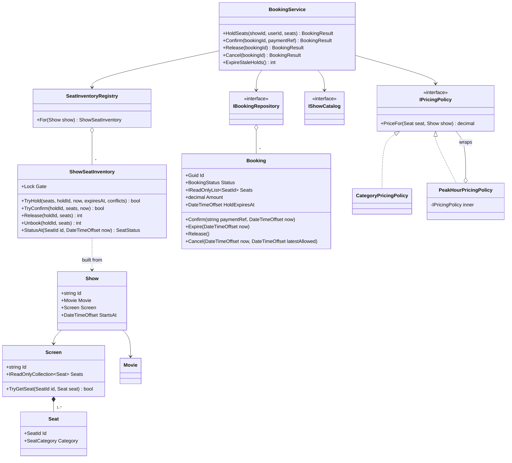
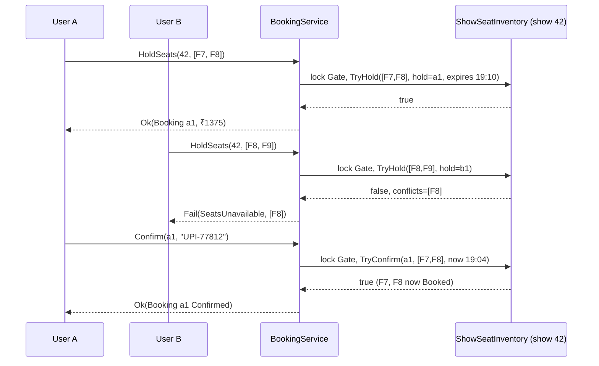
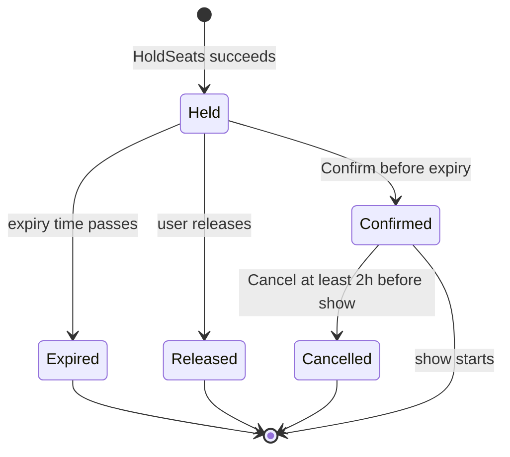
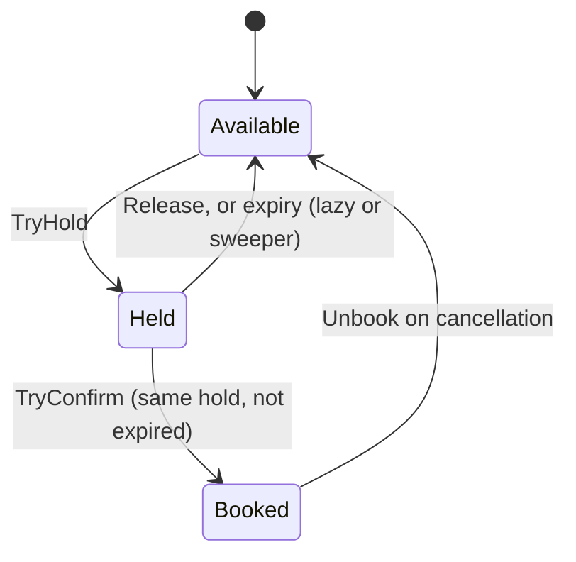

Movie ticket booking is a favourite interview problem because it looks like simple CRUD (create, read, update, delete) and is not. The hard part is not storing a booking. It is what happens in the 10 minutes between "I picked seats F7 and F8" and "my payment went through", and what happens when two people pick F7 in the same millisecond.

## Learning objectives

By the end of this case study you will be able to:

1. Turn a fuzzy brief ("build BookMyShow-style seat booking") into functional requirements, non-functional requirements and clarifying questions.
2. Identify the classes for shows, seats, holds, bookings and pricing, and give each one a single job.
3. Model a booking's lifecycle (Held → Confirmed → Cancelled, or Held → Expired) as a guarded state machine.
4. Make seat holds **all-or-nothing** and safe under concurrent requests, and explain why the lock is per show.
5. Use Strategy and Decorator for pricing rules that change every quarter.
6. Test time-based behaviour (hold expiry) with a fake clock instead of `Thread.Sleep`.
7. Explain what changes when the same design runs on six API servers backed by PostgreSQL.

## Prerequisites

- [Identifying classes and responsibilities](#/lesson/m07-classes-responsibilities): we use the nouns-and-verbs technique.
- [Encapsulation and invariant protection](#/lesson/m07-encapsulation-invariants): the `Booking` class refuses illegal state changes.
- [Strategy](#/lesson/m06-strategy) and [State](#/lesson/m06-state): both show up here, in lightweight forms.
- Helpful but optional: [Deadlocks, optimistic and pessimistic locking](#/lesson/m09-locking) for the scale-out discussion, and the HLD version of this problem, [Movie ticket booking system](#/lesson/m17-movie-booking).

## Explain it like I'm a beginner

Think of a cinema box office in Pune before apps existed. You walk up and say "two seats in row F, please". The clerk has a paper seat chart. She puts a pencil cross on F7 and F8 and says "pay within ten minutes or I'll rub them out". While you count your cash, a second customer asks for F7. The clerk sees the pencil cross and says "taken, how about F9?". You pay, and she turns the pencil crosses into ink.

That story contains the whole design:

- The **seat chart for one show** is the single place that decides who owns a seat. In code this is the *seat inventory*.
- The **pencil cross** is a temporary reservation that runs out (a *hold* with an *expiry time*).
- The **ink** is a confirmed booking.
- The clerk serves **one customer at a time at this chart**. Customers at a different show's chart don't wait for you. In code this is a *lock per show*.
- "**Rub them out after ten minutes**" is a background job that cleans up expired holds. Even if the clerk forgets, a smudged pencil cross older than ten minutes counts as empty. That's *lazy expiry*.

If you remember the clerk, the chart, the pencil and the ink, the rest of this lesson is details.

## Requirements

### Functional requirements

1. A cinema has screens. Each screen has seats with a row letter, a number and a category: Classic, Prime or Recliner.
2. A show is one movie on one screen at one start time.
3. A user can see which seats are available for a show.
4. A user can **hold** 1–10 seats for a show. The hold lasts 10 minutes. The hold is **all-or-nothing**: if any requested seat is unavailable, nothing is held, and the user is told which seats clashed.
5. A user can **confirm** a hold by supplying a payment reference before it expires. Confirmation turns held seats into booked seats.
6. A user can **release** a hold early (they pressed "back").
7. Holds that are not confirmed in time **expire**, and their seats become available again.
8. A confirmed booking can be **cancelled** up to 2 hours before the show starts. The seats return to the pool.
9. The price is calculated per seat from its category, with a peak-time uplift for evening and weekend shows. The price is fixed at hold time, so it doesn't change while the user is paying.

### Non-functional requirements

- **Correctness under concurrency (the top priority).** One seat can never be sold twice. If 50 people click F7 at the same instant, exactly one gets it.
- **Latency.** Hold and confirm should take well under 100 ms inside the service (an estimate for an in-memory implementation; the database adds its own time).
- **Throughput.** A blockbuster's opening weekend means thousands of holds per minute across a city, but each *show* has only 150–400 seats. Contention is high per show and low across shows. This one fact drives the locking design.
- **Testability.** Expiry depends on time, so the clock must be injectable.
- **Extensibility.** Pricing rules (student discounts, bank offers, dynamic pricing) change often and must not touch booking logic.

### Clarifying questions to ask in an interview

Asking these, and stating your assumption for each, is half the score.

| Question | Assumption in this lesson |
|---|---|
| Single process or many servers? | Start in-process; scale-out is an exercise. |
| How long is a hold? Configurable? | 10 minutes, configurable. |
| Can one user hold seats in several shows at once? | Yes, no limit here (a real product would cap it). |
| What if payment succeeds after the hold expired? | Booking fails with `HoldExpired`; the payment is refunded by the payment module. |
| Is the price locked at hold time or at payment? | At hold time. |
| Must we stop a lone empty seat between two booked ones (orphan seats)? | Not in v1; it's a good extension. |
| Are there seat types with different rules (wheelchair, couple seats)? | Only categories for price. |
| Cancellation fee? | Out of scope; we only enforce the 2-hour cutoff. |

## Identifying classes and responsibilities

Underline the nouns in the requirements: *cinema, screen, seat, row, category, show, movie, user, hold, booking, payment reference, price*. Then the verbs: *see availability, hold, confirm, release, expire, cancel, calculate price*.

Not every noun becomes a class. *Cinema* holds screens but has no behaviour we need yet, so we leave it out. *User* is just an id string here, because authentication belongs to another module. *Payment* is a reference string handed to us by the payment module.

| Class | Kind | Responsibility (one sentence) |
|---|---|---|
| `SeatId` | value object (record struct) | Identifies a seat like `F7`; parses and prints it. |
| `Seat` | value object (record) | A seat's id plus its category. |
| `Screen` | entity | Knows which seats physically exist. |
| `Movie`, `Show` | entity / record | What plays where and when. |
| `ShowSeatInventory` | domain object | **The referee** for one show: tracks each seat as Available, Held (by whom, until when) or Booked. |
| `SeatInventoryRegistry` | infrastructure | Hands out one inventory per show, creating it on first use. |
| `Booking` | entity | One user's reservation and its lifecycle; refuses illegal transitions. |
| `IPricingPolicy` and implementations | strategy | Prices one seat for one show. |
| `IShowCatalog`, `IBookingRepository` | repositories | Find shows; store and find bookings. |
| `BookingService` | application service (facade) | Runs each use case — hold, confirm, release, cancel, expire — under the right lock. |
| `HoldSweeper` | background service | Every 30 seconds, asks the service to expire stale holds. |

Two responsibilities are deliberately split. **Seat ownership** lives in `ShowSeatInventory`. **The booking's story** (who, how much, paid or not) lives in `Booking`. They are separate because they change for different reasons. A new seat layout rule changes the inventory. A new refund rule changes the booking. They are kept consistent by doing every change to both inside one per-show lock, just as a database transaction would.

:::callout type=mistake title="The God Booking"
A common first draft has a `Booking` class that also stores the seat map, calls the payment gateway and sends the confirmation SMS. That class changes for every feature request and can't be tested without a network. Keep `Booking` about the booking.
:::

## Class diagram



How to read it, from the bottom up:

- A `Screen` **owns** its seats (filled diamond, composition). Delete the screen and its seats go too.
- `ShowSeatInventory` is built from a `Show` and tracks the live status of that show's seats. The `SeatInventoryRegistry` keeps one inventory per show (hollow diamond, aggregation).
- `BookingService` sits in the middle and depends only on interfaces and the registry. It is the only class the API layer calls. That makes it a facade: one simple front door over several cooperating objects.
- `PeakHourPricingPolicy` both *implements* `IPricingPolicy` and *wraps* another `IPricingPolicy`. That double arrow is the Decorator shape.

Notice what is **not** connected. `Booking` has no reference to `ShowSeatInventory`, and the inventory has no reference to `Booking`. They share only the booking id, which doubles as the hold id. That keeps both classes small and testable on their own.

## Patterns and design decisions

### Decision 1 — one referee per show, guarded by one lock

Correctness hinges on a single question: *who decides whether seat F7 is free?* If two objects can each answer, they will eventually disagree. So `ShowSeatInventory` is the only source of truth for seat ownership, and every change goes through it.

Next, how coarse should the lock be? There are three options:

| Lock scope | Behaviour | Verdict |
|---|---|---|
| One global lock | Every hold in the city waits for every other hold. | Simple, but a bottleneck. A Friday evening queue forms for no reason. |
| **One lock per show** | Holds for the same show queue up. Different shows run in parallel. | **Chosen.** It matches the real contention pattern. |
| One lock per seat | Maximum parallelism. | All-or-nothing holds must take several locks, which risks deadlock unless you always lock in seat order. Complex for little gain on a 300-seat show. |

A rough estimate: a hold takes microseconds under the lock in memory. Even 200 people hammering one show's "Book" button within a second wait a tiny fraction of that second in total. The per-show lock is not the bottleneck; the network and database are.

We use `System.Threading.Lock` (new in .NET 9). It works with the `lock` statement like a plain `object` did, but it is a dedicated type, which makes intent clearer and is slightly cheaper.

### Decision 2 — lazy expiry plus a sweeper

A hold that has passed its expiry time is treated as **free at the moment someone asks**, even if no cleanup job has run yet. That is *lazy expiry*. A background `HoldSweeper` also runs every 30 seconds to move stale bookings to `Expired` and tidy up. The sweeper is housekeeping, not correctness. If it crashes for an hour, no seat stays blocked. Only the booking records lag behind.

This double approach is common for anything with a timeout: cache entries, login sessions, distributed locks.

### Decision 3 — Booking as a guarded state machine (State pattern, light version)

`Booking` exposes verbs (`Confirm`, `Expire`, `Release`, `Cancel`) instead of a public `Status` setter. Each verb checks the current state and throws `InvalidBookingTransitionException` if the move is illegal. We use an enum plus guard clauses, not one class per state. With five states and four verbs the transition table fits in your head, and the full [State](#/lesson/m06-state) pattern would add five classes without making anything clearer. The rule of thumb: switch to state classes when each state has *a lot of different behaviour*, not just a different allowed-transitions list.

### Decision 4 — pricing as Strategy plus Decorator

Pricing changes on a marketing calendar. Booking logic changes on an engineering one. So pricing sits behind `IPricingPolicy` (Strategy). The base strategy maps category to rupees (Classic ₹220, Prime ₹320, Recliner ₹550). Peak-time uplift is a **decorator**: it wraps any policy and multiplies its result by 1.25 for shows starting 18:00–22:59 or on weekends. A bank offer next quarter becomes another decorator, and the booking service doesn't change.

### Decision 5 — errors as results for expected outcomes, exceptions for bugs

"Seat taken" is not exceptional; it happens hundreds of times an hour. So `BookingService` returns a `BookingResult` with a `BookingError` code and the list of clashing seats. By contrast, calling `Confirm` on a cancelled booking means the caller has a bug, so the entity throws. This split keeps the happy path fast and the API honest.

### Decision 6 — inject the clock

Every time comparison uses `TimeProvider`. Tests use a manual clock that they move forward by 10 minutes in one line. No `Thread.Sleep`, and no flaky tests that fail at midnight.

### The hold-and-confirm flow



User B's request fails as a whole, so F9 is **not** left half-held. User B gets the exact clashing seat back, and the app can say "F8 was just taken" instead of a generic error. Both requests went through the same per-show `Gate`, so they could not interleave halfway through.

## State transitions

Two state machines matter: the **seat** within a show, and the **booking**.



Read it as "which verbs are legal in which state". `Confirmed` can only be reached from `Held`. `Expired`, `Released` and `Cancelled` are terminal: nothing leaves them. Every arrow corresponds to exactly one method on `Booking`, and every missing arrow is an `InvalidBookingTransitionException`. For example, there's no arrow from `Expired` to `Confirmed`. That is how we refuse a late payment.



The seat machine is simpler, with one subtle point. `Held → Available` on expiry can happen **without anyone calling a method**: the inventory just treats an expired hold as available when the next `TryHold` arrives. The sweeper later makes it explicit. A test must cover this "expired but not yet swept" window, because that is where double-booking bugs hide.

## C# implementation

Project layout. The domain has no ASP.NET dependencies. Only the sweeper and DI registration touch the hosting libraries.

```text
Cinema.Ticketing/
  Domain/Show.cs              SeatId, Seat, Screen, Movie, Show
  Domain/Booking.cs           Booking, BookingStatus, exception
  Inventory/ShowSeatInventory.cs
  Inventory/SeatInventoryRegistry.cs
  Pricing/PricingPolicies.cs
  Persistence/InMemoryStores.cs
  Application/BookingService.cs
  Application/HoldSweeper.cs
  Application/ServiceCollectionExtensions.cs
  Program.cs
```

```csharp file=Domain/Show.cs
using System.Diagnostics.CodeAnalysis;

namespace Cinema.Ticketing.Domain;

public enum SeatCategory { Classic, Prime, Recliner }

/// <summary>A seat label such as "F7". A value object: two SeatIds with the same row and number are equal.</summary>
public readonly record struct SeatId(char Row, int Number)
{
    public static SeatId Parse(string text)
    {
        ArgumentException.ThrowIfNullOrWhiteSpace(text);
        var row = char.ToUpperInvariant(text[0]);
        if (row is < 'A' or > 'Z' || !int.TryParse(text.AsSpan(1), out var number) || number < 1)
            throw new FormatException($"'{text}' is not a seat label like 'F7'.");
        return new SeatId(row, number);
    }

    public override string ToString() => $"{Row}{Number}";
}

public sealed record Seat(SeatId Id, SeatCategory Category);

public sealed class Screen
{
    private readonly Dictionary<SeatId, Seat> _seats;

    public Screen(string id, string name, IEnumerable<Seat> seats)
    {
        ArgumentException.ThrowIfNullOrWhiteSpace(id);
        Id = id;
        Name = name;
        _seats = seats.ToDictionary(s => s.Id);   // throws on duplicate seat labels — a data bug
        if (_seats.Count == 0) throw new ArgumentException("A screen needs at least one seat.", nameof(seats));
    }

    public string Id { get; }
    public string Name { get; }
    public IReadOnlyCollection<Seat> Seats => _seats.Values;

    public bool TryGetSeat(SeatId id, [MaybeNullWhen(false)] out Seat seat) => _seats.TryGetValue(id, out seat);
}

public sealed record Movie(string Id, string Title, int DurationMinutes);

/// <summary>One movie on one screen at one time. StartsAt carries the cinema's local offset (e.g. +05:30).</summary>
public sealed record Show(string Id, Movie Movie, Screen Screen, DateTimeOffset StartsAt);
```

```csharp file=Domain/Booking.cs
namespace Cinema.Ticketing.Domain;

public enum BookingStatus { Held, Confirmed, Expired, Released, Cancelled }

public sealed class InvalidBookingTransitionException(Guid bookingId, BookingStatus from, string action)
    : InvalidOperationException($"Cannot {action} booking {bookingId} while it is {from}.")
{
    public BookingStatus From { get; } = from;
}

/// <summary>
/// One user's reservation. The status can only change through the verbs below, each of which
/// checks that the transition is legal. Not thread-safe on its own: BookingService calls it
/// while holding the show's inventory lock.
/// </summary>
public sealed class Booking
{
    public Booking(Guid id, string showId, string userId, IReadOnlyList<SeatId> seats, decimal amount, DateTimeOffset holdExpiresAt)
    {
        ArgumentException.ThrowIfNullOrWhiteSpace(showId);
        ArgumentException.ThrowIfNullOrWhiteSpace(userId);
        if (seats.Count == 0) throw new ArgumentException("A booking needs at least one seat.", nameof(seats));
        ArgumentOutOfRangeException.ThrowIfNegative(amount);
        Id = id;
        ShowId = showId;
        UserId = userId;
        Seats = seats.ToArray();
        Amount = amount;
        HoldExpiresAt = holdExpiresAt;
    }

    public Guid Id { get; }
    public string ShowId { get; }
    public string UserId { get; }
    public IReadOnlyList<SeatId> Seats { get; }
    public decimal Amount { get; }
    public DateTimeOffset HoldExpiresAt { get; }
    public BookingStatus Status { get; private set; } = BookingStatus.Held;
    public string? PaymentReference { get; private set; }
    public DateTimeOffset? ConfirmedAt { get; private set; }
    public DateTimeOffset? CancelledAt { get; private set; }

    public bool IsHoldExpired(DateTimeOffset now) => Status == BookingStatus.Held && now >= HoldExpiresAt;

    public void Confirm(string paymentReference, DateTimeOffset now)
    {
        ArgumentException.ThrowIfNullOrWhiteSpace(paymentReference);
        if (Status == BookingStatus.Confirmed && PaymentReference == paymentReference) return; // idempotent retry
        if (Status != BookingStatus.Held) throw new InvalidBookingTransitionException(Id, Status, "confirm");
        if (now >= HoldExpiresAt) throw new InvalidBookingTransitionException(Id, Status, "confirm an expired hold for");
        Status = BookingStatus.Confirmed;
        PaymentReference = paymentReference;
        ConfirmedAt = now;
    }

    public void Expire(DateTimeOffset now)
    {
        if (Status == BookingStatus.Expired) return;
        if (Status != BookingStatus.Held) throw new InvalidBookingTransitionException(Id, Status, "expire");
        if (now < HoldExpiresAt) throw new InvalidBookingTransitionException(Id, Status, "expire (deadline not reached)");
        Status = BookingStatus.Expired;
    }

    public void Release()
    {
        if (Status == BookingStatus.Released) return;
        if (Status != BookingStatus.Held) throw new InvalidBookingTransitionException(Id, Status, "release");
        Status = BookingStatus.Released;
    }

    public void Cancel(DateTimeOffset now, DateTimeOffset latestAllowed)
    {
        if (Status != BookingStatus.Confirmed) throw new InvalidBookingTransitionException(Id, Status, "cancel");
        if (now > latestAllowed) throw new InvalidBookingTransitionException(Id, Status, "cancel (cutoff passed)");
        Status = BookingStatus.Cancelled;
        CancelledAt = now;
    }
}
```

```csharp file=Inventory/ShowSeatInventory.cs
using System.Diagnostics;
using Cinema.Ticketing.Domain;

namespace Cinema.Ticketing.Inventory;

public enum SeatStatus { Available, Held, Booked }

/// <summary>
/// The referee for one show's seats. Callers must hold <see cref="Gate"/> for the whole use case,
/// the in-memory equivalent of a transaction that locks the show's row.
/// </summary>
public sealed class ShowSeatInventory
{
    private readonly record struct Slot(SeatStatus Status, Guid HoldId, DateTimeOffset ExpiresAt)
    {
        public static readonly Slot Free = new(SeatStatus.Available, Guid.Empty, DateTimeOffset.MinValue);
        public bool IsFreeAt(DateTimeOffset now) =>
            Status == SeatStatus.Available || (Status == SeatStatus.Held && ExpiresAt <= now); // lazy expiry
    }

    private readonly Dictionary<SeatId, Slot> _slots;

    public ShowSeatInventory(Show show)
    {
        ArgumentNullException.ThrowIfNull(show);
        ShowId = show.Id;
        _slots = show.Screen.Seats.ToDictionary(s => s.Id, _ => Slot.Free);
    }

    public string ShowId { get; }

    /// <summary>One lock per show: holds for the same show queue, different shows run in parallel.</summary>
    public Lock Gate { get; } = new();

    /// <summary>All-or-nothing: either every seat becomes Held by holdId, or nothing changes.</summary>
    public bool TryHold(IReadOnlyCollection<SeatId> seats, Guid holdId, DateTimeOffset now, DateTimeOffset expiresAt,
                        out IReadOnlyList<SeatId> conflicts)
    {
        Debug.Assert(Gate.IsHeldByCurrentThread, "Take Gate before calling the inventory.");
        var taken = seats.Where(id => !_slots.TryGetValue(id, out var slot) || !slot.IsFreeAt(now)).ToList();
        if (taken.Count > 0) { conflicts = taken; return false; }
        foreach (var id in seats) _slots[id] = new Slot(SeatStatus.Held, holdId, expiresAt);
        conflicts = [];
        return true;
    }

    /// <summary>Turns a live hold into a booking. Idempotent: seats already booked by this hold count as success.</summary>
    public bool TryConfirm(Guid holdId, IReadOnlyCollection<SeatId> seats, DateTimeOffset now)
    {
        Debug.Assert(Gate.IsHeldByCurrentThread, "Take Gate before calling the inventory.");
        foreach (var id in seats)
        {
            var s = _slots[id];
            var ours = s.HoldId == holdId && (s.Status == SeatStatus.Booked || (s.Status == SeatStatus.Held && s.ExpiresAt > now));
            if (!ours) return false;
        }
        foreach (var id in seats) _slots[id] = _slots[id] with { Status = SeatStatus.Booked };
        return true;
    }

    /// <summary>Frees seats still held by this hold (some may already have been re-held by others after expiry).</summary>
    public int Release(Guid holdId, IReadOnlyCollection<SeatId> seats) =>
        Reset(holdId, seats, SeatStatus.Held);

    /// <summary>Frees seats booked by this booking (cancellation).</summary>
    public int Unbook(Guid holdId, IReadOnlyCollection<SeatId> seats) =>
        Reset(holdId, seats, SeatStatus.Booked);

    public SeatStatus StatusAt(SeatId id, DateTimeOffset now)
    {
        var s = _slots[id];
        return s.IsFreeAt(now) ? SeatStatus.Available : s.Status;
    }

    public IReadOnlyList<SeatId> AvailableAt(DateTimeOffset now) =>
        _slots.Where(kv => kv.Value.IsFreeAt(now)).Select(kv => kv.Key)
              .OrderBy(id => id.Row).ThenBy(id => id.Number).ToList();

    private int Reset(Guid holdId, IReadOnlyCollection<SeatId> seats, SeatStatus expected)
    {
        Debug.Assert(Gate.IsHeldByCurrentThread, "Take Gate before calling the inventory.");
        var changed = 0;
        foreach (var id in seats)
        {
            if (_slots.TryGetValue(id, out var s) && s.HoldId == holdId && s.Status == expected)
            {
                _slots[id] = Slot.Free;
                changed++;
            }
        }
        return changed;
    }
}
```

```csharp file=Inventory/SeatInventoryRegistry.cs
using System.Collections.Concurrent;
using Cinema.Ticketing.Domain;

namespace Cinema.Ticketing.Inventory;

/// <summary>One inventory per show, created on first use. Lazy&lt;T&gt; guarantees the factory runs once
/// even when two threads ask for the same show at the same time.</summary>
public sealed class SeatInventoryRegistry
{
    private readonly ConcurrentDictionary<string, Lazy<ShowSeatInventory>> _byShow = new();

    public ShowSeatInventory For(Show show) =>
        _byShow.GetOrAdd(show.Id, _ => new Lazy<ShowSeatInventory>(() => new ShowSeatInventory(show))).Value;
}
```

```csharp file=Pricing/PricingPolicies.cs
using Cinema.Ticketing.Domain;

namespace Cinema.Ticketing.Pricing;

/// <summary>Strategy: how much one seat costs for one show.</summary>
public interface IPricingPolicy
{
    decimal PriceFor(Seat seat, Show show);
}

public sealed class CategoryPricingPolicy : IPricingPolicy
{
    private readonly IReadOnlyDictionary<SeatCategory, decimal> _prices;

    public CategoryPricingPolicy(IReadOnlyDictionary<SeatCategory, decimal> prices)
    {
        foreach (var c in Enum.GetValues<SeatCategory>())
            if (!prices.ContainsKey(c)) throw new ArgumentException($"No price for category {c}.", nameof(prices));
        _prices = prices;
    }

    public static CategoryPricingPolicy Default { get; } = new(new Dictionary<SeatCategory, decimal>
    {
        [SeatCategory.Classic] = 220m,
        [SeatCategory.Prime] = 320m,
        [SeatCategory.Recliner] = 550m,
    });

    public decimal PriceFor(Seat seat, Show show) => _prices[seat.Category];
}

/// <summary>Decorator: adds an uplift for evening (18:00–22:59 local) and weekend shows.</summary>
public sealed class PeakHourPricingPolicy(IPricingPolicy inner, decimal multiplier = 1.25m) : IPricingPolicy
{
    public decimal PriceFor(Seat seat, Show show)
    {
        var basePrice = inner.PriceFor(seat, show);
        var local = show.StartsAt;  // already in the cinema's offset
        var isPeak = local.Hour is >= 18 and < 23
                     || local.DayOfWeek is DayOfWeek.Saturday or DayOfWeek.Sunday;
        return isPeak ? Math.Round(basePrice * multiplier, 0, MidpointRounding.AwayFromZero) : basePrice;
    }
}
```

```csharp file=Persistence/InMemoryStores.cs
using System.Collections.Concurrent;
using Cinema.Ticketing.Domain;

namespace Cinema.Ticketing.Persistence;

public interface IShowCatalog
{
    Show? Find(string showId);
}

public interface IBookingRepository
{
    void Add(Booking booking);
    Booking? Find(Guid id);
    IReadOnlyList<Booking> FindHeld();
}

public sealed class InMemoryShowCatalog(IEnumerable<Show> shows) : IShowCatalog
{
    private readonly Dictionary<string, Show> _shows = shows.ToDictionary(s => s.Id);
    public Show? Find(string showId) => _shows.GetValueOrDefault(showId);
}

public sealed class InMemoryBookingRepository : IBookingRepository
{
    private readonly ConcurrentDictionary<Guid, Booking> _bookings = new();

    public void Add(Booking booking)
    {
        if (!_bookings.TryAdd(booking.Id, booking))
            throw new InvalidOperationException($"Booking {booking.Id} already exists.");
    }

    public Booking? Find(Guid id) => _bookings.GetValueOrDefault(id);

    public IReadOnlyList<Booking> FindHeld() =>
        _bookings.Values.Where(b => b.Status == BookingStatus.Held).ToList();
}
```

```csharp file=Application/BookingService.cs
using Cinema.Ticketing.Domain;
using Cinema.Ticketing.Inventory;
using Cinema.Ticketing.Persistence;
using Cinema.Ticketing.Pricing;
using Microsoft.Extensions.Options;

namespace Cinema.Ticketing.Application;

public sealed class BookingOptions
{
    public TimeSpan HoldDuration { get; set; } = TimeSpan.FromMinutes(10);
    public int MaxSeatsPerBooking { get; set; } = 10;
    public TimeSpan CancellationCutoff { get; set; } = TimeSpan.FromHours(2);
}

public enum BookingError
{
    None, ShowNotFound, ShowAlreadyStarted, NoSeatsRequested, TooManySeats, UnknownSeat,
    SeatsUnavailable, BookingNotFound, HoldExpired, InvalidState, TooLateToCancel,
}

public sealed record BookingResult(BookingError Error, Booking? Booking, IReadOnlyList<SeatId> Conflicts)
{
    public bool IsSuccess => Error == BookingError.None;
    public static BookingResult Ok(Booking booking) => new(BookingError.None, booking, []);
    public static BookingResult Fail(BookingError error, IReadOnlyList<SeatId>? conflicts = null) => new(error, null, conflicts ?? []);
}

/// <summary>
/// Facade for the booking use cases. Every use case runs under the show's Gate,
/// so seat changes and booking transitions happen together or not at all.
/// </summary>
public sealed class BookingService(
    IShowCatalog shows,
    SeatInventoryRegistry inventories,
    IBookingRepository bookings,
    IPricingPolicy pricing,
    IOptions<BookingOptions> options,
    TimeProvider clock)
{
    private readonly BookingOptions _o = options.Value;

    public BookingResult HoldSeats(string showId, string userId, IReadOnlyCollection<SeatId> seatIds)
    {
        var show = shows.Find(showId);
        if (show is null) return BookingResult.Fail(BookingError.ShowNotFound);

        var requested = seatIds.Distinct().ToList();
        if (requested.Count == 0) return BookingResult.Fail(BookingError.NoSeatsRequested);
        if (requested.Count > _o.MaxSeatsPerBooking) return BookingResult.Fail(BookingError.TooManySeats);

        var seats = new List<Seat>(requested.Count);
        foreach (var id in requested)
        {
            if (!show.Screen.TryGetSeat(id, out var seat)) return BookingResult.Fail(BookingError.UnknownSeat, [id]);
            seats.Add(seat);
        }

        var amount = seats.Sum(s => pricing.PriceFor(s, show));   // price locked at hold time
        var inventory = inventories.For(show);
        lock (inventory.Gate)
        {
            var now = clock.GetUtcNow();
            if (now >= show.StartsAt) return BookingResult.Fail(BookingError.ShowAlreadyStarted);

            var bookingId = Guid.CreateVersion7(now);
            var expiresAt = now + _o.HoldDuration;
            if (!inventory.TryHold(requested, bookingId, now, expiresAt, out var conflicts))
                return BookingResult.Fail(BookingError.SeatsUnavailable, conflicts);

            var booking = new Booking(bookingId, show.Id, userId, requested, amount, expiresAt);
            bookings.Add(booking);
            return BookingResult.Ok(booking);
        }
    }

    public BookingResult Confirm(Guid bookingId, string paymentReference) =>
        WithBooking(bookingId, (booking, show, inventory, now) =>
        {
            if (booking.Status == BookingStatus.Confirmed && booking.PaymentReference == paymentReference)
                return BookingResult.Ok(booking);                       // payment callback retried
            if (booking.Status != BookingStatus.Held) return BookingResult.Fail(BookingError.InvalidState);
            if (booking.IsHoldExpired(now))
            {
                ExpireUnderLock(booking, inventory, now);
                return BookingResult.Fail(BookingError.HoldExpired);
            }
            if (!inventory.TryConfirm(booking.Id, booking.Seats, now))
                return BookingResult.Fail(BookingError.InvalidState);    // should be impossible under the lock
            booking.Confirm(paymentReference, now);
            return BookingResult.Ok(booking);
        });

    public BookingResult Release(Guid bookingId) =>
        WithBooking(bookingId, (booking, show, inventory, now) =>
        {
            if (booking.Status != BookingStatus.Held) return BookingResult.Fail(BookingError.InvalidState);
            inventory.Release(booking.Id, booking.Seats);
            booking.Release();
            return BookingResult.Ok(booking);
        });

    public BookingResult Cancel(Guid bookingId) =>
        WithBooking(bookingId, (booking, show, inventory, now) =>
        {
            if (booking.Status != BookingStatus.Confirmed) return BookingResult.Fail(BookingError.InvalidState);
            var latest = show.StartsAt - _o.CancellationCutoff;
            if (now > latest) return BookingResult.Fail(BookingError.TooLateToCancel);
            inventory.Unbook(booking.Id, booking.Seats);
            booking.Cancel(now, latest);
            return BookingResult.Ok(booking);
        });

    /// <summary>Housekeeping for the sweeper. Correctness does not depend on it (lazy expiry).</summary>
    public int ExpireStaleHolds()
    {
        var expired = 0;
        foreach (var candidate in bookings.FindHeld())
        {
            var result = WithBooking(candidate.Id, (booking, show, inventory, now) =>
            {
                if (!booking.IsHoldExpired(now)) return BookingResult.Fail(BookingError.InvalidState);
                ExpireUnderLock(booking, inventory, now);
                return BookingResult.Ok(booking);
            });
            if (result.IsSuccess) expired++;
        }
        return expired;
    }

    public IReadOnlyList<SeatId> AvailableSeats(string showId)
    {
        var show = shows.Find(showId) ?? throw new KeyNotFoundException($"Show {showId} not found.");
        var inventory = inventories.For(show);
        lock (inventory.Gate) return inventory.AvailableAt(clock.GetUtcNow());
    }

    private static void ExpireUnderLock(Booking booking, ShowSeatInventory inventory, DateTimeOffset now)
    {
        inventory.Release(booking.Id, booking.Seats);
        booking.Expire(now);
    }

    private BookingResult WithBooking(Guid bookingId, Func<Booking, Show, ShowSeatInventory, DateTimeOffset, BookingResult> action)
    {
        var booking = bookings.Find(bookingId);
        if (booking is null) return BookingResult.Fail(BookingError.BookingNotFound);
        var show = shows.Find(booking.ShowId);
        if (show is null) return BookingResult.Fail(BookingError.ShowNotFound);
        var inventory = inventories.For(show);
        lock (inventory.Gate) return action(booking, show, inventory, clock.GetUtcNow());
    }
}
```

```csharp file=Application/HoldSweeper.cs
using Microsoft.Extensions.Hosting;
using Microsoft.Extensions.Logging;

namespace Cinema.Ticketing.Application;

/// <summary>Every 30 s, moves stale holds to Expired. If this stops, seats are still freed by lazy expiry.</summary>
public sealed class HoldSweeper(BookingService bookings, TimeProvider clock, ILogger<HoldSweeper> logger) : BackgroundService
{
    protected override async Task ExecuteAsync(CancellationToken stoppingToken)
    {
        using var timer = new PeriodicTimer(TimeSpan.FromSeconds(30), clock);
        while (await timer.WaitForNextTickAsync(stoppingToken))
        {
            try
            {
                var count = bookings.ExpireStaleHolds();
                if (count > 0) logger.LogInformation("Expired {Count} stale seat holds", count);
            }
            catch (Exception ex)
            {
                // Never let one bad booking kill the loop.
                logger.LogError(ex, "Hold sweep failed; will retry on next tick");
            }
        }
    }
}
```

```csharp file=Application/ServiceCollectionExtensions.cs
using Cinema.Ticketing.Inventory;
using Cinema.Ticketing.Persistence;
using Cinema.Ticketing.Pricing;
using Microsoft.Extensions.DependencyInjection;
using Microsoft.Extensions.DependencyInjection.Extensions;

namespace Cinema.Ticketing.Application;

public static class ServiceCollectionExtensions
{
    /// <summary>Registers the booking module. The caller registers an IShowCatalog.</summary>
    public static IServiceCollection AddCinemaBooking(this IServiceCollection services, Action<BookingOptions>? configure = null)
    {
        services.AddOptions<BookingOptions>().Configure(o => configure?.Invoke(o));
        services.TryAddSingleton(TimeProvider.System);
        services.AddSingleton<SeatInventoryRegistry>();
        services.AddSingleton<IBookingRepository, InMemoryBookingRepository>();
        services.AddSingleton<IPricingPolicy>(_ => new PeakHourPricingPolicy(CategoryPricingPolicy.Default));
        services.AddSingleton<BookingService>();
        services.AddHostedService<HoldSweeper>();
        return services;
    }
}
```

```csharp file=Program.cs
using Cinema.Ticketing.Application;
using Cinema.Ticketing.Domain;
using Cinema.Ticketing.Persistence;
using Microsoft.Extensions.DependencyInjection;

namespace Cinema.Ticketing;

public static class Program
{
    public static void Main()
    {
        var seats = new List<Seat>();
        foreach (var row in "ABCDE") for (var n = 1; n <= 12; n++) seats.Add(new Seat(new SeatId(row, n), SeatCategory.Classic));
        for (var n = 1; n <= 8; n++) seats.Add(new Seat(new SeatId('F', n), SeatCategory.Recliner));
        var screen = new Screen("PUN-AUDI-3", "Audi 3", seats);
        var show = new Show("show-42", new Movie("m-1", "Monsoon Express", 148), screen,
                            new DateTimeOffset(2026, 11, 14, 19, 15, 0, TimeSpan.FromHours(5.5)));

        var services = new ServiceCollection()
            .AddLogging()
            .AddSingleton<IShowCatalog>(new InMemoryShowCatalog([show]))
            .AddCinemaBooking(o => o.HoldDuration = TimeSpan.FromMinutes(10));
        using var provider = services.BuildServiceProvider();
        var booking = provider.GetRequiredService<BookingService>();

        var a = booking.HoldSeats("show-42", "user-a", [SeatId.Parse("F7"), SeatId.Parse("F8")]);
        var b = booking.HoldSeats("show-42", "user-b", [SeatId.Parse("F8"), SeatId.Parse("F6")]);
        Console.WriteLine($"A: {a.Error}, amount {a.Booking?.Amount}");
        Console.WriteLine($"B: {b.Error}, conflicts {string.Join(",", b.Conflicts)}");
        Console.WriteLine($"A confirm: {booking.Confirm(a.Booking!.Id, "UPI-77812").Error}");
    }
}
```

A few details worth calling out:

- **The price is computed outside the lock.** Pricing is pure and might one day call a slow offers service. Keeping slow work out of the critical section keeps the per-show queue short.
- **`Guid.CreateVersion7(now)`** (.NET 9+) produces time-ordered ids. They sort by creation time and index well in PostgreSQL if you persist them later.
- **`Debug.Assert(Gate.IsHeldByCurrentThread)`** documents and checks the locking contract in debug builds. It catches the "someone called `TryHold` without the lock" bug during tests.
- **`HoldSweeper` catches all exceptions.** An unhandled exception in `ExecuteAsync` stops the background service (and by default, since .NET 6, the whole host). One corrupt record shouldn't stop all housekeeping.

## Automated testing

The tests below use a hand-written manual clock. The pattern is worth memorising, because every system with timeouts needs it.

```csharp
using Cinema.Ticketing.Application;
using Cinema.Ticketing.Domain;
using Cinema.Ticketing.Inventory;
using Cinema.Ticketing.Persistence;
using Cinema.Ticketing.Pricing;
using Microsoft.Extensions.Options;
using Xunit;

namespace Cinema.Ticketing.Tests;

public sealed class ManualClock(DateTimeOffset start) : TimeProvider
{
    private DateTimeOffset _now = start;
    public override DateTimeOffset GetUtcNow() => _now;
    public void Advance(TimeSpan by) => _now += by;
}

public sealed class BookingServiceTests
{
    private static readonly TimeSpan Ist = TimeSpan.FromHours(5.5);
    private readonly ManualClock _clock = new(new DateTimeOffset(2026, 11, 14, 17, 0, 0, Ist));
    private readonly BookingService _svc;

    public BookingServiceTests()
    {
        var seats = Enumerable.Range(1, 10).Select(n => new Seat(new SeatId('A', n), SeatCategory.Classic))
            .Concat(Enumerable.Range(1, 4).Select(n => new Seat(new SeatId('F', n), SeatCategory.Recliner)));
        var show = new Show("s1", new Movie("m1", "Test", 120), new Screen("sc1", "Audi 1", seats),
                            new DateTimeOffset(2026, 11, 14, 21, 0, 0, Ist));
        _svc = new BookingService(new InMemoryShowCatalog([show]), new SeatInventoryRegistry(),
            new InMemoryBookingRepository(), new PeakHourPricingPolicy(CategoryPricingPolicy.Default),
            Options.Create(new BookingOptions()), _clock);
    }

    private static SeatId[] S(params string[] ids) => ids.Select(SeatId.Parse).ToArray();

    [Fact]
    public void Hold_then_confirm_books_the_seats()
    {
        var hold = _svc.HoldSeats("s1", "u1", S("A1", "A2"));
        Assert.True(hold.IsSuccess);
        Assert.Equal(550m, hold.Booking!.Amount);              // 2 × 220 × 1.25 (21:00 is peak)

        var confirmed = _svc.Confirm(hold.Booking.Id, "UPI-1");
        Assert.Equal(BookingStatus.Confirmed, confirmed.Booking!.Status);
        Assert.DoesNotContain(SeatId.Parse("A1"), _svc.AvailableSeats("s1"));
    }

    [Fact]
    public void Hold_is_all_or_nothing_and_reports_conflicts()
    {
        _svc.HoldSeats("s1", "u1", S("A2"));
        var second = _svc.HoldSeats("s1", "u2", S("A2", "A3"));
        Assert.Equal(BookingError.SeatsUnavailable, second.Error);
        Assert.Equal(S("A2"), second.Conflicts.ToArray());
        Assert.Contains(SeatId.Parse("A3"), _svc.AvailableSeats("s1"));   // A3 not left half-held
    }

    [Fact]
    public void Expired_hold_frees_seats_even_before_the_sweeper_runs()
    {
        var first = _svc.HoldSeats("s1", "u1", S("F1"));
        _clock.Advance(TimeSpan.FromMinutes(10));
        var second = _svc.HoldSeats("s1", "u2", S("F1"));
        Assert.True(second.IsSuccess);
        Assert.Equal(BookingError.HoldExpired, _svc.Confirm(first.Booking!.Id, "UPI-late").Error);
        Assert.Equal(BookingStatus.Expired, first.Booking.Status);
    }

    [Fact]
    public void Sweeper_expires_stale_holds_once()
    {
        _svc.HoldSeats("s1", "u1", S("A5"));
        _clock.Advance(TimeSpan.FromMinutes(11));
        Assert.Equal(1, _svc.ExpireStaleHolds());
        Assert.Equal(0, _svc.ExpireStaleHolds());
    }

    [Fact]
    public void Confirm_is_idempotent_for_the_same_payment()
    {
        var hold = _svc.HoldSeats("s1", "u1", S("A6"));
        Assert.True(_svc.Confirm(hold.Booking!.Id, "UPI-9").IsSuccess);
        Assert.True(_svc.Confirm(hold.Booking.Id, "UPI-9").IsSuccess);
        Assert.Equal(BookingError.InvalidState, _svc.Confirm(hold.Booking.Id, "UPI-other").Error);
    }

    [Fact]
    public void Cannot_cancel_inside_two_hours_of_the_show()
    {
        var hold = _svc.HoldSeats("s1", "u1", S("A7"));
        _svc.Confirm(hold.Booking!.Id, "UPI-3");
        _clock.Advance(TimeSpan.FromHours(2.5));                  // now 19:30, show 21:00
        Assert.Equal(BookingError.TooLateToCancel, _svc.Cancel(hold.Booking.Id).Error);
    }

    [Fact]
    public void Fifty_concurrent_holds_on_one_seat_produce_exactly_one_winner()
    {
        var results = new BookingResult[50];
        Parallel.For(0, 50, i => results[i] = _svc.HoldSeats("s1", $"u{i}", S("A9")));
        Assert.Equal(1, results.Count(r => r.IsSuccess));
        Assert.Equal(49, results.Count(r => r.Error == BookingError.SeatsUnavailable));
    }

    [Fact]
    public void Illegal_transition_throws()
    {
        var b = new Booking(Guid.NewGuid(), "s1", "u1", S("A1"), 220m, _clock.GetUtcNow().AddMinutes(10));
        b.Release();
        Assert.Throws<InvalidBookingTransitionException>(() => b.Confirm("UPI-1", _clock.GetUtcNow()));
    }
}
```

What the suite covers, and why each test exists:

- **Happy path** with a checked amount, so a pricing regression is caught here too.
- **All-or-nothing**, the requirement most often broken by "loop and hold each seat" code.
- **Lazy expiry**, the "expired but not swept" window.
- **Idempotent confirm**, because payment providers retry their webhooks.
- **Concurrency.** `Parallel.For` with 50 callers on one seat. Without the lock, this test fails some of the time. Run it a few hundred times in CI (a loop inside the test is fine) to make an intermittent failure show up.
- **Entity guard**, which proves the state machine refuses an illegal arrow.

Concurrency tests can only prove the *presence* of a race when they fail. They can never prove its absence. The real protection is the design: one gate per show, and every use case inside it. The test is a smoke alarm.

## Bad design vs good design

**Bad: check-then-act without a lock**

```csharp
public bool Book(string showId, string seat, string user)
{
    if (_db.IsSeatFree(showId, seat))          // 1. check
    {
        _db.MarkSeatBooked(showId, seat, user); // 2. act — another request may have booked it in between
        return true;
    }
    return false;
}
```

Problems:

1. **A race between check and act.** Two requests both see "free" and both book. This is the classic double-sell.
2. **One seat at a time**, so booking F7+F8 can half-succeed.
3. **No hold**, so the seat is "booked" before payment, and abandoned carts block seats forever.
4. **No clock abstraction**, so nothing about expiry can be tested.

**Good**: the design above. A single referee per show, an atomic all-or-nothing `TryHold`, holds with expiry, lazy expiry plus a sweeper, an injected clock, and a guarded booking state machine.

**Another bad design**: a `static Dictionary<string, bool[]> Seats` shared across the app, with `lock (typeof(BookingController))`. It is correct, but there is one lock for the whole city and the state can't be tested in isolation. Static mutable state also leaks between tests.

**Is the good design overkill?** For a single-screen community hall that sells 50 tickets a week, a database unique constraint on `(show_id, seat_code)` and no holds at all would be enough: the second buyer just gets an error. The hold machinery earns its keep when payment takes minutes and demand spikes.

## Alternative designs

| Alternative | How it works | When it is better | Cost |
|---|---|---|---|
| **Database as referee** | `seat_lock` table, primary key `(show_id, seat_code)`. Hold = `INSERT ... ON CONFLICT DO UPDATE ... WHERE expires_at <= now()`. | Several API servers (any real deployment). | Each hold is a DB round-trip; you must handle serialization errors and retries. |
| **Redis holds** | `SET seat:42:F7 a1 NX PX 600000` per seat, or a Lua script for multiple seats. | Very high hold traffic with a short TTL; Redis expiry does the sweeping. | Redis becomes part of correctness, so plan for failover and fencing. The confirmed booking must still go to the durable DB. |
| **Optimistic concurrency** | Each show row has a version; read the seat map, modify it, write it back `WHERE version = @v`, retry on conflict. | Low contention per show. | Under a blockbuster rush, most writers retry, which wastes work. |
| **Actor per show** | One actor (or a `Channel<T>` consumer) per show processes commands one by one. | Very high contention on single shows. | More moving parts. You need to route all requests for a show to one node. |
| **Full State pattern for Booking** | `HeldState`, `ConfirmedState`… classes. | When each state gains a lot of distinct behaviour (refund rules, notifications). | More classes for little benefit at five states. |

The per-show lock in this lesson is the in-memory version of "database as referee". Swap `ShowSeatInventory` for an `ISeatLockStore` backed by PostgreSQL and the rest of the design stays the same. That is exercise 5.

## Practical playground

The class model below is the reference design. Open it in the LLD designer. Try deleting the relation between `BookingService` and `SeatInventoryRegistry` and ask yourself: who would decide seat ownership now?

:::playground type=lld title="Movie booking reference model"
```json
{
  "classes": [
    { "id": "SeatId", "name": "SeatId", "kind": "record", "fields": ["+char Row", "+int Number"], "methods": ["+SeatId Parse(string text)"], "responsibility": "Value object for a seat label like F7" },
    { "id": "Seat", "name": "Seat", "kind": "record", "fields": ["+SeatId Id", "+SeatCategory Category"], "methods": [], "responsibility": "A physical seat and its price category" },
    { "id": "SeatCategory", "name": "SeatCategory", "kind": "enum", "fields": ["Classic", "Prime", "Recliner"], "methods": [] },
    { "id": "Screen", "name": "Screen", "kind": "class", "fields": ["+string Id", "-Dictionary seats"], "methods": ["+bool TryGetSeat(SeatId id, out Seat seat)"], "responsibility": "Knows which seats exist" },
    { "id": "Show", "name": "Show", "kind": "record", "fields": ["+string Id", "+Movie Movie", "+Screen Screen", "+DateTimeOffset StartsAt"], "methods": [], "responsibility": "One movie on one screen at one time" },
    { "id": "Movie", "name": "Movie", "kind": "record", "fields": ["+string Id", "+string Title", "+int DurationMinutes"], "methods": [] },
    { "id": "Inventory", "name": "ShowSeatInventory", "kind": "class", "fields": ["+Lock Gate", "-Dictionary slots"], "methods": ["+bool TryHold(seats, holdId, now, expiresAt, out conflicts)", "+bool TryConfirm(holdId, seats, now)", "+int Release(holdId, seats)", "+int Unbook(holdId, seats)"], "responsibility": "Single referee for seat ownership in one show" },
    { "id": "Registry", "name": "SeatInventoryRegistry", "kind": "class", "fields": ["-ConcurrentDictionary byShow"], "methods": ["+ShowSeatInventory For(Show show)"], "responsibility": "One inventory per show, created lazily" },
    { "id": "BookingStatus", "name": "BookingStatus", "kind": "enum", "fields": ["Held", "Confirmed", "Expired", "Released", "Cancelled"], "methods": [] },
    { "id": "Booking", "name": "Booking", "kind": "class", "fields": ["+Guid Id", "+BookingStatus Status", "+IReadOnlyList Seats", "+decimal Amount", "+DateTimeOffset HoldExpiresAt"], "methods": ["+void Confirm(string paymentRef, DateTimeOffset now)", "+void Expire(DateTimeOffset now)", "+void Release()", "+void Cancel(DateTimeOffset now, DateTimeOffset latest)"], "responsibility": "A reservation and its guarded lifecycle" },
    { "id": "IPricingPolicy", "name": "IPricingPolicy", "kind": "interface", "fields": [], "methods": ["decimal PriceFor(Seat seat, Show show)"] },
    { "id": "CategoryPricing", "name": "CategoryPricingPolicy", "kind": "class", "fields": ["-IReadOnlyDictionary prices"], "methods": ["+decimal PriceFor(Seat seat, Show show)"], "responsibility": "Base price by category" },
    { "id": "PeakPricing", "name": "PeakHourPricingPolicy", "kind": "class", "fields": ["-IPricingPolicy inner", "-decimal multiplier"], "methods": ["+decimal PriceFor(Seat seat, Show show)"], "responsibility": "Decorator adding evening and weekend uplift" },
    { "id": "IBookingRepository", "name": "IBookingRepository", "kind": "interface", "fields": [], "methods": ["void Add(Booking b)", "Booking? Find(Guid id)", "IReadOnlyList FindHeld()"] },
    { "id": "IShowCatalog", "name": "IShowCatalog", "kind": "interface", "fields": [], "methods": ["Show? Find(string showId)"] },
    { "id": "BookingService", "name": "BookingService", "kind": "class", "fields": ["-BookingOptions options", "-TimeProvider clock"], "methods": ["+BookingResult HoldSeats(showId, userId, seats)", "+BookingResult Confirm(bookingId, paymentRef)", "+BookingResult Release(bookingId)", "+BookingResult Cancel(bookingId)", "+int ExpireStaleHolds()"], "responsibility": "Facade running each use case under the show's lock" },
    { "id": "HoldSweeper", "name": "HoldSweeper", "kind": "class", "fields": [], "methods": ["#Task ExecuteAsync(CancellationToken ct)"], "responsibility": "Background housekeeping of expired holds" }
  ],
  "relations": [
    { "from": "Seat", "to": "SeatId", "kind": "composition" },
    { "from": "Seat", "to": "SeatCategory", "kind": "association" },
    { "from": "Screen", "to": "Seat", "kind": "composition", "multiplicity": "1..*" },
    { "from": "Show", "to": "Screen", "kind": "association" },
    { "from": "Show", "to": "Movie", "kind": "association" },
    { "from": "Inventory", "to": "Show", "kind": "dependency", "label": "built from" },
    { "from": "Registry", "to": "Inventory", "kind": "aggregation", "multiplicity": "*" },
    { "from": "Booking", "to": "BookingStatus", "kind": "association" },
    { "from": "CategoryPricing", "to": "IPricingPolicy", "kind": "implements" },
    { "from": "PeakPricing", "to": "IPricingPolicy", "kind": "implements" },
    { "from": "PeakPricing", "to": "IPricingPolicy", "kind": "aggregation", "label": "wraps" },
    { "from": "IBookingRepository", "to": "Booking", "kind": "aggregation", "multiplicity": "*" },
    { "from": "BookingService", "to": "IShowCatalog", "kind": "dependency" },
    { "from": "BookingService", "to": "IBookingRepository", "kind": "dependency" },
    { "from": "BookingService", "to": "Registry", "kind": "dependency" },
    { "from": "BookingService", "to": "IPricingPolicy", "kind": "dependency" },
    { "from": "HoldSweeper", "to": "BookingService", "kind": "dependency" }
  ]
}
```
:::

## Exercises

:::exercise id=m18-movie-ticket-ex1 difficulty=beginner kind=code title="Guard the booking lifecycle"
Implement the four transition methods on `Booking` so that only the arrows in the state diagram are allowed. Illegal moves throw `InvalidBookingTransitionException`.
::requirements
- `Confirm(paymentRef, now)`: only from `Held` and only while `now < HoldExpiresAt`. Repeating it with the same reference is a no-op.
- `Expire(now)`: only from `Held` once `now >= HoldExpiresAt`. Calling it on an already expired booking is a no-op.
- `Release()`: only from `Held`.
- `Cancel(now, latestAllowed)`: only from `Confirmed` and only while `now <= latestAllowed`.
::acceptance
- A held booking confirmed before expiry becomes `Confirmed` and stores the payment reference.
- Confirming after expiry throws.
- Releasing a confirmed booking throws.
- Cancelling after the cutoff throws; cancelling before it succeeds.
- `Expire` twice does not throw.
::hint
Start each method by asking: "Which status am I allowed to come from?" Everything else is a throw.
::hint
Handle the idempotent cases (same payment reference, already expired) first, before the guard that throws.
::hint
Order inside `Confirm`: no-op check → status guard → expiry guard → assign fields.
::hint
```csharp
if (Status == BookingStatus.Confirmed && PaymentReference == paymentReference) return;
if (Status != BookingStatus.Held) throw new InvalidBookingTransitionException(Status, "confirm");
```
::starter
```csharp file=Booking.cs
using System;

public enum BookingStatus { Held, Confirmed, Expired, Released, Cancelled }

public sealed class InvalidBookingTransitionException(BookingStatus from, string action)
    : InvalidOperationException($"Cannot {action} a booking that is {from}.")
{
    public BookingStatus From { get; } = from;
}

public sealed class Booking(Guid id, DateTimeOffset holdExpiresAt)
{
    public Guid Id { get; } = id;
    public DateTimeOffset HoldExpiresAt { get; } = holdExpiresAt;
    public BookingStatus Status { get; private set; } = BookingStatus.Held;
    public string? PaymentReference { get; private set; }

    public void Confirm(string paymentReference, DateTimeOffset now) => throw new NotImplementedException();
    public void Expire(DateTimeOffset now) => throw new NotImplementedException();
    public void Release() => throw new NotImplementedException();
    public void Cancel(DateTimeOffset now, DateTimeOffset latestAllowed) => throw new NotImplementedException();
}
```
::tests
```csharp file=BookingTests.cs
using System;
using Xunit;

public class BookingTests
{
    private static readonly DateTimeOffset T0 = new(2026, 11, 14, 18, 0, 0, TimeSpan.FromHours(5.5));
    private static Booking NewBooking() => new(Guid.NewGuid(), T0.AddMinutes(10));

    [Fact] public void Confirm_before_expiry()
    {
        var b = NewBooking();
        b.Confirm("UPI-1", T0.AddMinutes(9));
        Assert.Equal(BookingStatus.Confirmed, b.Status);
        Assert.Equal("UPI-1", b.PaymentReference);
    }

    [Fact] public void Confirm_twice_same_reference_is_noop()
    {
        var b = NewBooking();
        b.Confirm("UPI-1", T0);
        b.Confirm("UPI-1", T0.AddMinutes(1));
        Assert.Equal(BookingStatus.Confirmed, b.Status);
    }

    [Fact] public void Confirm_after_expiry_throws() =>
        Assert.Throws<InvalidBookingTransitionException>(() => NewBooking().Confirm("UPI-1", T0.AddMinutes(10)));

    [Fact] public void Release_confirmed_throws()
    {
        var b = NewBooking();
        b.Confirm("UPI-1", T0);
        Assert.Throws<InvalidBookingTransitionException>(() => b.Release());
    }

    [Fact] public void Expire_twice_is_noop()
    {
        var b = NewBooking();
        b.Expire(T0.AddMinutes(10));
        b.Expire(T0.AddMinutes(11));
        Assert.Equal(BookingStatus.Expired, b.Status);
    }

    [Fact] public void Expire_too_early_throws() =>
        Assert.Throws<InvalidBookingTransitionException>(() => NewBooking().Expire(T0.AddMinutes(5)));

    [Fact] public void Cancel_respects_cutoff()
    {
        var ok = NewBooking(); ok.Confirm("A", T0); ok.Cancel(T0.AddHours(1), T0.AddHours(2));
        Assert.Equal(BookingStatus.Cancelled, ok.Status);
        var late = NewBooking(); late.Confirm("B", T0);
        Assert.Throws<InvalidBookingTransitionException>(() => late.Cancel(T0.AddHours(3), T0.AddHours(2)));
    }

    [Fact] public void Cancel_held_throws() =>
        Assert.Throws<InvalidBookingTransitionException>(() => NewBooking().Cancel(T0, T0.AddHours(2)));
}
```
::solution
Each verb guards its source state, handles its idempotent case first, then assigns.

```csharp file=Booking.cs
using System;

public enum BookingStatus { Held, Confirmed, Expired, Released, Cancelled }

public sealed class InvalidBookingTransitionException(BookingStatus from, string action)
    : InvalidOperationException($"Cannot {action} a booking that is {from}.")
{
    public BookingStatus From { get; } = from;
}

public sealed class Booking(Guid id, DateTimeOffset holdExpiresAt)
{
    public Guid Id { get; } = id;
    public DateTimeOffset HoldExpiresAt { get; } = holdExpiresAt;
    public BookingStatus Status { get; private set; } = BookingStatus.Held;
    public string? PaymentReference { get; private set; }

    public void Confirm(string paymentReference, DateTimeOffset now)
    {
        ArgumentException.ThrowIfNullOrWhiteSpace(paymentReference);
        if (Status == BookingStatus.Confirmed && PaymentReference == paymentReference) return;
        if (Status != BookingStatus.Held) throw new InvalidBookingTransitionException(Status, "confirm");
        if (now >= HoldExpiresAt) throw new InvalidBookingTransitionException(Status, "confirm an expired hold of");
        Status = BookingStatus.Confirmed;
        PaymentReference = paymentReference;
    }

    public void Expire(DateTimeOffset now)
    {
        if (Status == BookingStatus.Expired) return;
        if (Status != BookingStatus.Held || now < HoldExpiresAt) throw new InvalidBookingTransitionException(Status, "expire");
        Status = BookingStatus.Expired;
    }

    public void Release()
    {
        if (Status != BookingStatus.Held) throw new InvalidBookingTransitionException(Status, "release");
        Status = BookingStatus.Released;
    }

    public void Cancel(DateTimeOffset now, DateTimeOffset latestAllowed)
    {
        if (Status != BookingStatus.Confirmed || now > latestAllowed) throw new InvalidBookingTransitionException(Status, "cancel");
        Status = BookingStatus.Cancelled;
    }
}
```

The entity knows nothing about seats or locks. It only protects its own story, so it is tested with plain timestamps.
::mistakes
- Making `Status` publicly settable "for the repository". Map persistence through a constructor or a private setter instead.
- Using `>` instead of `>=` for expiry. At exactly 10:00 the hold must be dead, or two users can both own the seat at the boundary.
- Throwing on a repeated confirm with the same payment reference. Payment webhooks are retried, so this must be a no-op.
::extensions
Add a `NoShow` terminal state reachable from `Confirmed` once the show has started. Update the state diagram first.
:::

:::exercise id=m18-movie-ticket-ex2 difficulty=beginner kind=code title="Peak-hour pricing decorator"
Implement `PeakHourPricingPolicy` as a decorator over any `IPricingPolicy`. Shows that start between 18:00 and 22:59 local time, or on a Saturday or Sunday, cost 25 % more, rounded to whole rupees.
::acceptance
- A ₹220 Classic seat at 19:00 on a Wednesday costs ₹275.
- The same seat at 14:00 on a Wednesday costs ₹220.
- The same seat at 10:00 on a Sunday costs ₹275.
- 23:00 is not peak. 18:00 is.
- The decorator works with any inner policy (tests use a fake).
::hint
A decorator holds an instance of the interface it implements, calls it, then adjusts the result.
::hint
Use `show.StartsAt.Hour` and `show.StartsAt.DayOfWeek`. `StartsAt` is already in the cinema's local offset.
::hint
`local.Hour is >= 18 and < 23` reads exactly like the requirement.
::hint
`Math.Round(price * 1.25m, 0, MidpointRounding.AwayFromZero)` — ₹320 × 1.25 = ₹400, and ₹215 × 1.25 = ₹268.75, which rounds to ₹269.
::starter
```csharp file=Pricing.cs
using System;

public enum SeatCategory { Classic, Prime, Recliner }
public sealed record Seat(string Label, SeatCategory Category);
public sealed record Show(string Id, DateTimeOffset StartsAt);

public interface IPricingPolicy { decimal PriceFor(Seat seat, Show show); }

public sealed class PeakHourPricingPolicy(IPricingPolicy inner, decimal multiplier = 1.25m) : IPricingPolicy
{
    public decimal PriceFor(Seat seat, Show show) => throw new NotImplementedException();
}
```
::tests
```csharp file=PricingTests.cs
using System;
using Xunit;

public class PricingTests
{
    private sealed class Flat(decimal price) : IPricingPolicy { public decimal PriceFor(Seat s, Show sh) => price; }
    private static readonly TimeSpan Ist = TimeSpan.FromHours(5.5);
    private static Show At(int day, int hour) => new("s", new DateTimeOffset(2026, 11, day, hour, 0, 0, Ist)); // 11 Nov 2026 is a Wednesday
    private static readonly Seat Classic = new("A1", SeatCategory.Classic);

    [Fact] public void Evening_weekday_is_peak() => Assert.Equal(275m, new PeakHourPricingPolicy(new Flat(220m)).PriceFor(Classic, At(11, 19)));
    [Fact] public void Afternoon_weekday_is_not_peak() => Assert.Equal(220m, new PeakHourPricingPolicy(new Flat(220m)).PriceFor(Classic, At(11, 14)));
    [Fact] public void Sunday_morning_is_peak() => Assert.Equal(275m, new PeakHourPricingPolicy(new Flat(220m)).PriceFor(Classic, At(15, 10)));
    [Fact] public void Boundaries() 
    {
        var p = new PeakHourPricingPolicy(new Flat(220m));
        Assert.Equal(275m, p.PriceFor(Classic, At(11, 18)));
        Assert.Equal(220m, p.PriceFor(Classic, At(11, 23)));
    }
    [Fact] public void Rounds_to_whole_rupees() => Assert.Equal(269m, new PeakHourPricingPolicy(new Flat(215m)).PriceFor(Classic, At(11, 20)));
}
```
::solution
```csharp file=Pricing.cs
using System;

public enum SeatCategory { Classic, Prime, Recliner }
public sealed record Seat(string Label, SeatCategory Category);
public sealed record Show(string Id, DateTimeOffset StartsAt);

public interface IPricingPolicy { decimal PriceFor(Seat seat, Show show); }

public sealed class PeakHourPricingPolicy(IPricingPolicy inner, decimal multiplier = 1.25m) : IPricingPolicy
{
    public decimal PriceFor(Seat seat, Show show)
    {
        var basePrice = inner.PriceFor(seat, show);
        var local = show.StartsAt;
        var isPeak = local.Hour is >= 18 and < 23
                     || local.DayOfWeek is DayOfWeek.Saturday or DayOfWeek.Sunday;
        return isPeak ? Math.Round(basePrice * multiplier, 0, MidpointRounding.AwayFromZero) : basePrice;
    }
}
```

The decorator never looks at seat categories. That stays the inner policy's job, so the two rules can change independently.
::mistakes
- Using `show.StartsAt.UtcDateTime.Hour`. A 19:00 IST show is 13:30 UTC, so it would be priced as off-peak.
- Using `double` for money, which brings rounding surprises.
- Copying the category price table into the decorator instead of calling `inner`.
::extensions
Add a `StudentDiscountPolicy` decorator (−₹50, never below ₹100) and decide in which order to stack the two decorators. Does the order change the price?
:::

:::exercise id=m18-movie-ticket-ex3 difficulty=intermediate kind=code title="Thread-safe, all-or-nothing seat holds"
Implement `SeatHoldTable`, a self-contained version of the inventory that does its own locking. It must hold several seats atomically, treat expired holds as free, and stay correct under heavy parallel use.
::requirements
- `TryHold(seats, holdId, now, ttl)` returns `true` and holds every seat, or returns `false` and changes nothing.
- A seat whose hold expired (`expiresAt <= now`) counts as free.
- `Release(holdId)` frees every seat still held by that id and returns how many seats it freed.
- `IsHeld(seat, now)` reports whether a live hold exists.
::acceptance
- Holding A1+A2 then A2+A3 fails, and A3 is still free.
- After the TTL passes, another hold id can take the seat.
- 100 parallel `TryHold` calls for the same seat produce exactly one success.
- `Release` returns the number of seats freed.
::hint
Every public method must read and write under the same lock, or the check and the write can interleave.
::hint
Do two passes inside the lock: first check every seat, then (only if all are free) write every seat.
::hint
Store `Dictionary<string, (Guid HoldId, DateTimeOffset ExpiresAt)>`. A missing key means free; an expired value means free.
::hint
```csharp
lock (_gate)
{
    if (seats.Any(s => _holds.TryGetValue(s, out var h) && h.ExpiresAt > now)) return false;
    foreach (var s in seats) _holds[s] = (holdId, now + ttl);
    return true;
}
```
::starter
```csharp file=SeatHoldTable.cs
using System;
using System.Collections.Generic;
using System.Linq;
using System.Threading;

public sealed class SeatHoldTable
{
    private readonly Lock _gate = new();
    private readonly Dictionary<string, (Guid HoldId, DateTimeOffset ExpiresAt)> _holds = new();

    public bool TryHold(IReadOnlyCollection<string> seats, Guid holdId, DateTimeOffset now, TimeSpan ttl) => throw new NotImplementedException();
    public int Release(Guid holdId) => throw new NotImplementedException();
    public bool IsHeld(string seat, DateTimeOffset now) => throw new NotImplementedException();
}
```
::tests
```csharp file=SeatHoldTableTests.cs
using System;
using System.Linq;
using System.Threading.Tasks;
using Xunit;

public class SeatHoldTableTests
{
    private static readonly DateTimeOffset T0 = new(2026, 11, 14, 18, 0, 0, TimeSpan.Zero);
    private static readonly TimeSpan Ten = TimeSpan.FromMinutes(10);

    [Fact] public void All_or_nothing()
    {
        var t = new SeatHoldTable();
        Assert.True(t.TryHold(new[] { "A1", "A2" }, Guid.NewGuid(), T0, Ten));
        Assert.False(t.TryHold(new[] { "A2", "A3" }, Guid.NewGuid(), T0, Ten));
        Assert.False(t.IsHeld("A3", T0));
    }

    [Fact] public void Expired_hold_is_free()
    {
        var t = new SeatHoldTable();
        t.TryHold(new[] { "F1" }, Guid.NewGuid(), T0, Ten);
        Assert.True(t.IsHeld("F1", T0.AddMinutes(9)));
        Assert.False(t.IsHeld("F1", T0.AddMinutes(10)));
        Assert.True(t.TryHold(new[] { "F1" }, Guid.NewGuid(), T0.AddMinutes(10), Ten));
    }

    [Fact] public void Release_counts_seats()
    {
        var t = new SeatHoldTable();
        var id = Guid.NewGuid();
        t.TryHold(new[] { "B1", "B2", "B3" }, id, T0, Ten);
        Assert.Equal(3, t.Release(id));
        Assert.Equal(0, t.Release(id));
        Assert.False(t.IsHeld("B2", T0));
    }

    [Fact] public void Hundred_parallel_holds_one_winner()
    {
        for (var round = 0; round < 20; round++)
        {
            var t = new SeatHoldTable();
            var wins = 0;
            Parallel.For(0, 100, _ => { if (t.TryHold(new[] { "C5", "C6" }, Guid.NewGuid(), T0, Ten)) Interlocked.Increment(ref wins); });
            Assert.Equal(1, wins);
        }
    }
}
```
::solution
```csharp file=SeatHoldTable.cs
using System;
using System.Collections.Generic;
using System.Linq;
using System.Threading;

public sealed class SeatHoldTable
{
    private readonly Lock _gate = new();
    private readonly Dictionary<string, (Guid HoldId, DateTimeOffset ExpiresAt)> _holds = new();

    public bool TryHold(IReadOnlyCollection<string> seats, Guid holdId, DateTimeOffset now, TimeSpan ttl)
    {
        lock (_gate)
        {
            // Pass 1: check everything. Pass 2: write everything. Never interleave the two.
            if (seats.Any(s => IsLive(s, now))) return false;
            var expiresAt = now + ttl;
            foreach (var s in seats) _holds[s] = (holdId, expiresAt);
            return true;
        }
    }

    public int Release(Guid holdId)
    {
        lock (_gate)
        {
            var mine = _holds.Where(kv => kv.Value.HoldId == holdId).Select(kv => kv.Key).ToList();
            foreach (var s in mine) _holds.Remove(s);
            return mine.Count;
        }
    }

    public bool IsHeld(string seat, DateTimeOffset now)
    {
        lock (_gate) return IsLive(seat, now);
    }

    private bool IsLive(string seat, DateTimeOffset now) =>
        _holds.TryGetValue(seat, out var h) && h.ExpiresAt > now;
}
```

`IsHeld` also takes the lock. `Dictionary<TKey,TValue>` is not safe to read while another thread writes, so even "just reading" needs the gate (or a `ConcurrentDictionary`, which still wouldn't make the multi-seat check atomic).
::mistakes
- Using `ConcurrentDictionary.TryAdd` per seat. Each seat is atomic, but the *set* is not, so A1 succeeds, A2 fails, and A1 is left half-held.
- Checking under the lock, releasing it, then writing under a second lock: the classic check-then-act race.
- Releasing seats that someone else re-held after your hold expired. Always compare the hold id.
::extensions
Replace the single lock with one `Lock` per seat, taken in sorted seat order. Measure with BenchmarkDotNet whether it helps for a 300-seat show, and explain your numbers.
:::

:::exercise id=m18-movie-ticket-ex4 difficulty=intermediate kind=sql ordered=true title="Which seats can I still pick?"
In the database version, seat state lives in `seat_lock`: one row per seat that is held or booked. A held row whose `expires_at` has passed counts as free (lazy expiry). Write a query that returns `seat_code` and `category` for every seat of show 101 that is available at `2026-11-14 19:05:00+05:30`, ordered by `seat_code`.
::setup
```sql
CREATE TABLE show_seat (
  show_id   int  NOT NULL,
  seat_code text NOT NULL,
  category  text NOT NULL,
  PRIMARY KEY (show_id, seat_code)
);
CREATE TABLE seat_lock (
  show_id    int         NOT NULL,
  seat_code  text        NOT NULL,
  booking_id int         NOT NULL,
  status     text        NOT NULL CHECK (status IN ('HELD', 'BOOKED')),
  expires_at timestamptz,
  PRIMARY KEY (show_id, seat_code),
  FOREIGN KEY (show_id, seat_code) REFERENCES show_seat (show_id, seat_code)
);
INSERT INTO show_seat VALUES
  (101,'A1','CLASSIC'),(101,'A2','CLASSIC'),(101,'A3','CLASSIC'),(101,'A4','CLASSIC'),
  (101,'F1','RECLINER'),(101,'F2','RECLINER'),(101,'F3','RECLINER'),
  (102,'A1','CLASSIC'),(102,'A2','CLASSIC');
INSERT INTO seat_lock VALUES
  (101,'A1',1,'BOOKED',NULL),
  (101,'A2',2,'HELD','2026-11-14 19:10:00+05:30'),
  (101,'A3',3,'HELD','2026-11-14 19:00:00+05:30'),
  (101,'F1',4,'HELD','2026-11-14 19:05:00+05:30'),
  (102,'A2',5,'BOOKED',NULL);
```
::check
```sql
SELECT s.seat_code, s.category
FROM show_seat s
LEFT JOIN seat_lock l ON l.show_id = s.show_id AND l.seat_code = s.seat_code
WHERE s.show_id = 101
  AND (l.seat_code IS NULL
       OR (l.status = 'HELD' AND l.expires_at <= TIMESTAMPTZ '2026-11-14 19:05:00+05:30'))
ORDER BY s.seat_code;
```
::acceptance
- Returns A3, A4, F1, F2, F3 in that order.
- A1 (booked) and A2 (live hold) are excluded.
- F1, whose hold expires exactly at 19:05, is included, matching the `<=` rule in the C# code.
- Show 102's rows don't leak into the result.
::hint
Start from all seats of the show, then remove the ones that are locked. Which join keeps seats that have no lock row?
::hint
A `LEFT JOIN` to `seat_lock` gives `NULL` lock columns for seats that were never locked.
::hint
A seat is available if there's no lock row, **or** the lock is `HELD` and already expired.
::hint
Put the show filter on `show_seat` and join on both `show_id` and `seat_code`. Joining on `seat_code` alone mixes up shows.
::solution
```sql
SELECT s.seat_code, s.category
FROM show_seat s
LEFT JOIN seat_lock l ON l.show_id = s.show_id AND l.seat_code = s.seat_code
WHERE s.show_id = 101
  AND (l.seat_code IS NULL
       OR (l.status = 'HELD' AND l.expires_at <= TIMESTAMPTZ '2026-11-14 19:05:00+05:30'))
ORDER BY s.seat_code;
```
In production, replace the literal with `now()` and add an index on `seat_lock (show_id)` (the primary key already covers it as its leading column). `NOT EXISTS` is an equally good formulation.
::mistakes
- Joining on `seat_code` only, so show 102's booked A2 hides show 101's A2.
- Writing `l.status <> 'BOOKED'` and forgetting the expiry check, which shows live holds as free.
- Using `<` for expiry, which disagrees with the application code at the exact boundary.
::extensions
Write the hold statement itself: an `INSERT ... ON CONFLICT (show_id, seat_code) DO UPDATE ... WHERE seat_lock.status = 'HELD' AND seat_lock.expires_at <= now()` that only overwrites expired holds. How do you detect that only some seats were taken?
:::

:::exercise id=m18-movie-ticket-ex5 difficulty=advanced kind=design title="Run on six API servers"
The cinema chain now runs six instances of the booking API behind a load balancer. The in-process `Lock` no longer protects anything, because two instances each have their own. Redesign the seat-hold part so the guarantees still hold: no double-selling, all-or-nothing, expiry, and idempotent confirm.
::acceptance
- Introduce an abstraction that hides where seat locks live, so `BookingService` barely changes.
- Give a PostgreSQL implementation with exact SQL for hold and confirm, and say which isolation level and constraints it relies on.
- Explain how all-or-nothing is achieved across several seats.
- Explain what happens if an instance crashes mid-hold, and if the payment webhook arrives twice on different instances.
- Name at least one trade-off of using Redis instead.
::hint
What did the `Gate` give us? Find a database feature that gives the same "one writer at a time, all or nothing" property.
::hint
A primary key on `(show_id, seat_code)` in a `seat_lock` table makes double-holding a constraint violation instead of a race.
::hint
Do the multi-seat hold in one transaction. Insert or conditionally update every seat, then compare the affected row count with the number of seats requested. If they differ, roll back.
::hint
Define `ISeatLockStore` with `TryHoldAsync`, `TryConfirmAsync`, `ReleaseAsync`. Keep the in-memory version for unit tests and add `PostgresSeatLockStore` for production.
::hint
Confirm: `UPDATE seat_lock SET status='BOOKED' WHERE booking_id=@id AND status='HELD' AND expires_at > now()`, then check the row count equals the seat count, inside the same transaction that updates the booking row.
::solution
**Abstraction**

```csharp
public interface ISeatLockStore
{
    Task<HoldOutcome> TryHoldAsync(string showId, IReadOnlyCollection<SeatId> seats, Guid bookingId, TimeSpan ttl, CancellationToken ct);
    Task<bool> TryConfirmAsync(Guid bookingId, int seatCount, CancellationToken ct);
    Task<int> ReleaseAsync(Guid bookingId, CancellationToken ct);
}
public sealed record HoldOutcome(bool Success, IReadOnlyList<SeatId> Conflicts);
```

`BookingService` calls the store instead of taking `inventory.Gate`. The database transaction replaces the lock.

**Hold (one transaction, READ COMMITTED is enough):**

```sql
INSERT INTO seat_lock (show_id, seat_code, booking_id, status, expires_at)
SELECT @show, unnest(@seats::text[]), @booking, 'HELD', now() + @ttl
ON CONFLICT (show_id, seat_code) DO UPDATE
   SET booking_id = EXCLUDED.booking_id, status = 'HELD', expires_at = EXCLUDED.expires_at
 WHERE seat_lock.status = 'HELD' AND seat_lock.expires_at <= now();
-- affected rows must equal array_length(@seats). If not: ROLLBACK, then SELECT the conflicting seats for the error message.
```

Why this is safe: the primary key serialises writers on each seat row. `ON CONFLICT ... DO UPDATE ... WHERE` only takes over expired holds. Two concurrent transactions touching the same seat block on that row lock. The second one re-checks the `WHERE` after the first commits and finds the hold live. All-or-nothing comes from comparing row counts and rolling back. Two transactions locking overlapping seat sets in different orders can deadlock; sort `@seats` before inserting so every transaction locks in the same order. PostgreSQL detects any remaining deadlocks and aborts one transaction, which you retry.

**Confirm:** in one transaction, `UPDATE seat_lock SET status='BOOKED', expires_at=NULL WHERE booking_id=@id AND status='HELD' AND expires_at > now()` must affect exactly `seatCount` rows. Then update `booking SET status='CONFIRMED', payment_ref=@ref WHERE id=@id AND status='HELD'`. A duplicate webhook on another instance finds `status='CONFIRMED'` with the same reference and returns success, which makes it idempotent. A unique index on `booking(payment_ref)` stops one payment confirming two bookings.

**Crash mid-hold:** the transaction never commits, so nothing is held. If an instance dies after committing a hold, the hold simply expires, because lazy expiry is in the SQL itself. The sweeper becomes a scheduled job, run once using a PostgreSQL advisory lock (`pg_try_advisory_lock`) so six instances don't all sweep at once.

**Clock:** use the database's `now()`, not each server's clock, so six machines with slightly different clocks agree on expiry.

**Redis alternative:** `SET seat:{show}:{seat} {booking} NX PX 600000` per seat, or a Lua script for atomic multi-seat holds. It is faster and expires on its own. But Redis is now part of correctness. A failover can lose recent writes, so the confirm step must still check against PostgreSQL, ideally with a fencing token, such as a booking version that only goes up.
::alternatives
Route every request for a show to the same instance (consistent hashing on `showId`) and keep the in-memory lock. It is fast, but rebalancing and instance failure need careful handling, and the database still needs a unique constraint as a safety net.
::mistakes
- Using `SELECT ... FOR UPDATE` on seat rows that don't exist yet. You can't lock a row that isn't there; rely on the primary key and `ON CONFLICT`.
- Using SERIALIZABLE without retry logic. Serialization failures are expected and must be retried.
- Trusting the app server's clock for expiry across machines.
:::

## Interview questions

:::interview
::q beginner
Why do we need a "hold" at all? Why not book the seat when the user clicks it?
::a
Payment takes time (UPI apps, OTPs, bank pages), often a few minutes. Without a hold you either sell the seat before payment, so abandoned carts block seats forever, or you let two people pay for the same seat and refund one, which is a terrible experience. A hold with an expiry gives the user a fair, time-boxed claim and gets the seat back automatically if they walk away.
::q beginner
Which class decides whether a seat is free, and why only one?
::a
`ShowSeatInventory`, one instance per show. If two components could each answer "is F7 free?", their answers could diverge under concurrency and you'd double-sell. One referee, changed only under one lock (or one database row lock), makes the check and the update a single atomic step.
::q intermediate
Why lock per show instead of globally or per seat?
::a
Contention follows shows: hundreds of people compete for one show's 300 seats, while different shows never compete. A global lock makes unrelated shows wait for each other. Per-seat locks allow more parallelism, but multi-seat all-or-nothing holds then need several locks taken in a consistent order to avoid deadlock, which adds complexity for almost no gain at this size. Per show matches the real contention and keeps all-or-nothing trivial.
::q intermediate
How do you test hold expiry without waiting 10 minutes?
::a
Inject `TimeProvider` everywhere time is read. In tests, pass a manual clock subclass whose `GetUtcNow()` returns a field you can move with `Advance(TimeSpan.FromMinutes(10))`. The test then runs in milliseconds and is deterministic. Also test the boundary (exactly 10:00), and the window where the hold has expired but the sweeper hasn't run yet.
::q advanced
A payment succeeds 30 seconds after the hold expired, and someone else has already taken the seat. What should the system do, and where does that logic live?
::a
The booking can't be confirmed: `Confirm` returns `HoldExpired`, and the entity refuses the `Expired → Confirmed` arrow. The payment module, not the booking module, then issues an automatic refund, ideally through an outbox event such as `BookingConfirmationFailed`, so the refund survives crashes. To reduce how often this happens, you can show a countdown, stop accepting payment initiation in the last 60 seconds of a hold, or extend the hold once when payment has started (a "payment in progress" state with a short grace period). Each option is a product trade-off between fairness to the next customer and fewer refunds.
::q advanced
How does your design change when the API runs on multiple servers?
::a
The in-process `Lock` only protects one process. The referee has to move to shared storage. With PostgreSQL: a `seat_lock` table with primary key `(show_id, seat_code)`, holds done as `INSERT ... ON CONFLICT DO UPDATE WHERE expired` in one transaction, all-or-nothing by checking affected rows and rolling back, seats locked in sorted order to avoid deadlocks, and expiry using the database's `now()`. Confirm is a conditional update checked by row count, with the booking row updated in the same transaction. Behind an `ISeatLockStore` interface the domain and most of `BookingService` stay unchanged, and the in-memory store stays for unit tests.
:::

## Summary and revision

**Key takeaways**

- The hard part of ticket booking is the hold window and concurrency, not CRUD.
- One referee per show (`ShowSeatInventory`), changed only under one lock, makes all-or-nothing holds simple and correct.
- Lazy expiry gives correctness. The sweeper is only housekeeping.
- `Booking` is a guarded state machine. Every legal arrow is a method, and every other arrow throws.
- Expected failures (seat taken, hold expired) are results. Programmer errors are exceptions.
- Pricing is a Strategy with Decorators layered on top, so marketing changes don't touch booking code.
- Inject `TimeProvider`. Never sleep in tests.
- On many servers, the database (primary key + conditional upsert + row counts) becomes the referee, behind the same abstraction.

**Terminology**: seat hold, lazy expiry, sweeper, critical section, check-then-act race, all-or-nothing (atomicity), idempotent confirm, decorator, facade, guarded transition.

:::flashcards
Q: What is a check-then-act race?
A: Two requests both check "seat free" before either writes, so both write. Fix: make check and write one atomic step under a lock or a database constraint.
Q: Why is the hold all-or-nothing?
A: A user booking F7+F8 wants both or neither. A partial hold leaves seats blocked and confuses the user.
Q: What is lazy expiry?
A: Treating an expired hold as free whenever someone next asks, without waiting for a cleanup job. The sweeper then only does housekeeping.
Q: Why lock per show?
A: Contention is within a show, never across shows. Per show keeps unrelated shows parallel and all-or-nothing simple.
Q: Why must Confirm be idempotent?
A: Payment providers retry webhooks. A repeated confirm with the same payment reference must succeed without side effects.
Q: Where is the price locked, and why?
A: At hold time, so the amount can't change while the user is paying.
Q: What replaces the in-process lock on multiple servers?
A: A database row lock via the primary key on (show_id, seat_code), with conditional upserts, row-count checks and one transaction per use case.
Q: How do you test a 10-minute expiry quickly?
A: Inject TimeProvider and use a manual clock in tests that you Advance by 10 minutes.
:::

## Knowledge check

:::quiz pass=70
::q single
Two users request seats {F7, F8} and {F8, F9} at the same instant. With the design in this lesson, what can happen?
- [ ] Both succeed; F8 is double-held.
- [ ] User 2 gets F9 only.
- [x] Exactly one succeeds; the other fails with F8 listed as the conflict and holds nothing.
- [ ] Both fail.
> Both requests go through the show's single gate, so they run one after another. `TryHold` is all-or-nothing, so the loser holds no seats and gets the exact conflict back.
::q single
The `HoldSweeper` crashed an hour ago and nobody noticed. What is the impact?
- [ ] Expired seats stay blocked until it restarts.
- [x] Seats are still freed by lazy expiry; only booking records stay in `Held` status longer than they should.
- [ ] Confirmed bookings are lost.
- [ ] The system double-sells seats.
> Correctness never depends on the sweeper. `IsFreeAt(now)` treats expired holds as free. Booking status is cosmetic until swept, and `Confirm` still refuses it because the entity checks expiry.
::q single
A teammate replaces the per-show `Lock` with a `ConcurrentDictionary<SeatId, Guid>` and uses `TryAdd` for each seat. What breaks?
- [ ] Nothing; `ConcurrentDictionary` is thread-safe.
- [x] Multi-seat holds are no longer all-or-nothing; one seat can be added while another fails.
- [ ] Reads become slower.
- [ ] It no longer compiles.
> Each `TryAdd` is atomic on its own, but the set of seats is not. You'd need compensating removals, which race with other requests.
::q multi
Which of these belong in `Booking` (the entity)? (Select all that apply.)
- [x] Refusing to confirm an expired hold.
- [x] Refusing to cancel after the cutoff.
- [ ] Calling the payment gateway.
- [ ] Sending the confirmation SMS.
- [x] Remembering the payment reference.
> The entity protects its own state and invariants. Side effects such as payment calls and notifications belong to application services or event handlers.
::q single
Why does `BookingService.HoldSeats` return `BookingResult` instead of throwing `SeatUnavailableException`?
- [ ] Exceptions don't work inside `lock`.
- [x] Seat clashes are an expected, frequent outcome that the caller must handle, not a programming error.
- [ ] Records are faster than classes.
- [ ] To avoid logging.
> Use results for expected business outcomes, and exceptions for bugs and broken invariants. It also makes the API contract explicit.
::q single
The peak-hour rule is evaluated with `show.StartsAt.UtcDateTime.Hour`. A 19:30 IST show is…
- [ ] Correctly priced as peak.
- [x] Priced as off-peak, because 19:30 IST is 14:00 UTC.
- [ ] Rejected.
- [ ] Priced twice.
> Business-hour rules use the cinema's local time. Store `StartsAt` with its offset and read `.Hour` from that.
::q single
On six API servers with PostgreSQL, what makes a multi-seat hold all-or-nothing?
- [ ] An in-process `Lock` on each server.
- [ ] Retrying until it works.
- [x] One transaction that writes all seat rows, compares the affected row count with the requested count, and rolls back on mismatch.
- [ ] Holding seats one request at a time from the browser.
> The transaction is the atomic unit. The primary key prevents double holds, and the row-count check detects partial success so you can roll back.
:::

## Completion criteria

You have finished this case study when you can:

- [ ] Score at least 70 % on the knowledge check.
- [ ] Pass the tests for exercises 1, 2 and 3 in your downloaded project.
- [ ] Draw the booking state diagram from memory and name the method behind every arrow.
- [ ] Explain in two minutes why the lock is per show, and what replaces it on multiple servers.
- [ ] Complete exercise 4 or 5 and compare your answer with the model solution.
