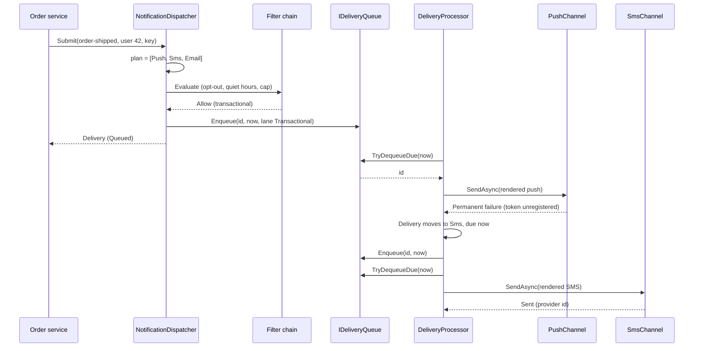
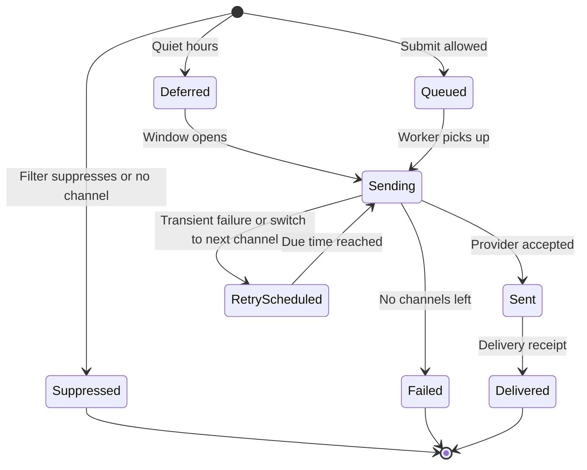

At 9:58 pm, a shopping app sends three things almost at once: an OTP for a customer logging in from Jaipur, an "Order shipped" update for a customer in Chennai, and a Diwali sale message to 400,000 subscribers. The OTP must arrive in seconds. The order update should try push first and fall back to SMS if the phone has no app installed. The sale message must **not** buzz phones at 10 pm — it should wait until 9 am local time — and nobody who opted out should get it at all.

The class that makes these decisions is a **notification dispatcher**. This case study designs it at the object level: which classes decide *whether*, *when*, *where* and *how* to send, and how retries and fallbacks work. The fleet-scale version (fan-out to millions, provider capacity, multi-region) is the [notification platform HLD case](#/lesson/m17-notification-platform).

## Learning objectives

By the end of this case study you will be able to:

1. Write requirements for a dispatcher that separates OTP, transactional and marketing messages, and ask the clarifying questions that change the design.
2. Model channels (SMS, email, push, WhatsApp) as interchangeable strategies behind one interface, with a per-category **channel plan** for fallback.
3. Build a **filter chain** (opt-out, quiet hours, frequency cap) where each rule can allow, suppress or defer a message.
4. Implement a delivery **state machine** with retries using exponential backoff and jitter, fallback to the next channel, and a final dead-letter state.
5. Prevent priority inversion with **separate queue lanes**, so a marketing blast can't delay an OTP.
6. Explain idempotency and at-least-once delivery for notifications, and where duplicates can still happen.

## Prerequisites

- [Strategy](#/lesson/m06-strategy): each channel is a strategy.
- [Chain of Responsibility](#/lesson/m06-chain-of-responsibility): the filters form a chain.
- [Timeouts, retries and backoff with jitter](#/lesson/m10-timeouts-retries): the retry maths.
- [Background services](#/lesson/m03-background-services): the worker that drains the queue.

## Explain it like I'm a beginner

Think of the post room in a big office building.

1. **A request arrives:** "Tell Priya her parcel has shipped." It doesn't say *how*.
2. **The rules desk** checks a few things in order. Has Priya said "no promotional mail"? Is it the middle of the night where she lives, and is this message the kind that can wait? Has she already received three sale letters today? Each check can say *go ahead*, *throw it away*, or *hold it until morning*. This line of checks is a **chain**: each clerk handles one rule and passes the letter on.
3. **The routing card** for each kind of message lists the ways to reach someone, in order. For a parcel update: try the **app notification** first, then **SMS**, then **email**. That card is the **channel plan**.
4. **The couriers** each know one way of delivering: the SMS courier, the email courier, the push courier. They all accept the same kind of envelope. That shared shape is the **Strategy** pattern (and each courier hides a different company's quirks, which is **Adapter**).
5. **When a courier fails**, it matters *how*. "Phone number doesn't exist" means try the next way on the card now. "Network busy" means try the same courier again in a little while, waiting a bit longer each time, with a small random wobble so that 10,000 retries don't all fire in the same second (**backoff with jitter**).
6. **Urgent letters have their own tray.** OTPs go in the red tray, which the couriers always empty first, even if the grey tray has 400,000 sale letters in it (**priority lanes**).

## Requirements

### Functional requirements

1. Accept a notification request: user id, category (`Otp`, `Transactional`, `Marketing`), template id, template data, and an idempotency key. Optionally, a preferred channel order.
2. Look up the user's reachable addresses (phone, email, push token), time zone, marketing consent and muted channels.
3. Build a **channel plan** from the category's default order, keeping only channels the user can be reached on, the template supports, and the user hasn't muted (OTP ignores mutes).
4. Run **filters** in order:
   - **Opt-out:** marketing needs explicit consent.
   - **Quiet hours:** marketing between 21:00 and 09:00 user-local time is deferred to 09:00. OTP and transactional messages are never deferred.
   - **Frequency cap:** at most 3 marketing messages per user per rolling 24 hours; extras are suppressed.
5. Render the template per channel with `{{placeholder}}` syntax; missing data is an error at submit time, not at send time.
6. Send through the current channel. On a **permanent** failure (invalid number, unregistered device), move to the next channel at once. On a **transient** failure (timeout, provider 5xx), retry the same channel up to 3 times with exponential backoff and jitter, then move to the next channel.
7. When no channels are left, mark the delivery **Failed** (dead letter) with the attempt history.
8. Accept delivery receipts from providers to mark a sent message as **Delivered**.

### Non-functional requirements

- **Priority:** OTPs are sent within seconds even during a marketing blast.
- **Idempotency:** the same idempotency key never produces a second delivery.
- **Bounded retries:** no message is retried forever; total attempts are capped.
- **Respect for users:** consent and quiet hours are enforced in one place and can't be bypassed by a caller.
- **Observability:** every attempt (channel, outcome, error) is recorded.
- **Testability:** time comes from `TimeProvider` and randomness from an injected `Random`, so retries and quiet hours are testable without waiting.

### Clarifying questions to ask

| Question | Our assumption |
|---|---|
| Do we build the SMS/email providers? | No. We call providers through adapters. |
| Is this one service or a platform? | One in-process dispatcher with a durable-queue upgrade path. |
| Whose local time for quiet hours? | The user's stored UTC offset (India: +05:30). |
| Can OTPs fall back to another channel? | Yes, SMS then WhatsApp, but never email (too slow to be useful). |
| What counts as "sent"? | The provider accepted the message. "Delivered" needs a receipt. |
| What delivery guarantee? | At-least-once to the provider, de-duplicated by idempotency key on our side. |
| Are templates localised? | Out of scope here; one language per template id. |

## Identifying classes and responsibilities

**Nouns:** request, user, address, category, channel, plan, template, placeholder, filter, consent, quiet hours, frequency cap, delivery, attempt, retry, backoff, jitter, queue, lane, provider, receipt, dead letter.
**Verbs:** submit, plan, filter, defer, suppress, render, enqueue, dequeue, send, retry, fall back, fail, mark delivered.

| Class | Kind | Responsibility |
|---|---|---|
| `NotificationRequest` | record | What the caller wants to say, to whom, and of what kind. |
| `UserProfile` | record | Addresses, time zone offset, consent, muted channels. |
| `Template`, `TemplateRenderer` | record + static service | Per-channel text and `{{placeholder}}` substitution. |
| `ChannelPlanner` | static service | Ordered list of usable channels for this request. |
| `IDispatchFilter` (3 implementations) | chain links | Allow, suppress or defer one request. |
| `FilterDecision` | value object | The verdict of a filter. |
| `Delivery` | aggregate | One notification's journey through channels and retries; owns its status. |
| `RetryPolicy` | strategy | Attempts per channel and the backoff delay. |
| `INotificationChannel` | strategy / adapter port | Sends one rendered message on one channel. |
| `IDeliveryQueue` | queue | Due-time ordered lanes by priority. |
| `NotificationDispatcher` | application service | Submit: idempotency, planning, filters, enqueue. |
| `DeliveryProcessor` | application service | Drains due deliveries, renders, sends, records results. |
| `DispatchWorker` | background service | Calls the processor every second. |

Splitting **submit** (dispatcher) from **send** (processor) is the central decision. Submitting is fast and synchronous: the caller learns at once whether the request was accepted, suppressed or deferred. Sending is slow and failure-prone, so it happens in the background with retries.

## Class diagram

```mermaid
classDiagram
    class NotificationDispatcher {
        +Submit(NotificationRequest request) Delivery
    }
    class DeliveryProcessor {
        +ProcessDueAsync(int maxBatch) int
    }
    class IDispatchFilter {
        <<interface>>
        +Evaluate(request, user, now) FilterDecision
    }
    class OptOutFilter
    class QuietHoursFilter
    class FrequencyCapFilter
    class ChannelPlanner {
        <<static>>
        +Plan(category, user, template, preferred) IReadOnlyList~Channel~
    }
    class Delivery {
        +DeliveryStatus Status
        +IReadOnlyList~Channel~ Plan
        +Channel CurrentChannel
        +DateTimeOffset NextAttemptAt
        +StartSending(now)
        +RecordResult(SendResult result, now, RetryPolicy policy)
        +Suppress(reason)
        +Defer(until, reason)
    }
    class RetryPolicy {
        +int MaxAttemptsPerChannel
        +DelayFor(int failedAttempts) TimeSpan
    }
    class INotificationChannel {
        <<interface>>
        +Channel Channel
        +SendAsync(RenderedMessage message) SendResult
    }
    class SmsChannel
    class EmailChannel
    class PushChannel
    class IDeliveryQueue {
        <<interface>>
        +Enqueue(Guid id, DateTimeOffset dueAt, int lane)
        +TryDequeueDue(DateTimeOffset now, Guid id) bool
    }
    class TemplateRenderer {
        <<static>>
        +Render(string template, data) string
    }
    NotificationDispatcher --> "0..*" IDispatchFilter : runs in order
    IDispatchFilter <|.. OptOutFilter
    IDispatchFilter <|.. QuietHoursFilter
    IDispatchFilter <|.. FrequencyCapFilter
    NotificationDispatcher ..> ChannelPlanner
    NotificationDispatcher ..> Delivery : creates
    NotificationDispatcher --> IDeliveryQueue
    DeliveryProcessor --> IDeliveryQueue
    DeliveryProcessor --> "1..*" INotificationChannel
    DeliveryProcessor --> RetryPolicy
    DeliveryProcessor ..> TemplateRenderer
    DeliveryProcessor ..> Delivery : advances
    INotificationChannel <|.. SmsChannel
    INotificationChannel <|.. EmailChannel
    INotificationChannel <|.. PushChannel
```



How to read it. The **top half** decides *whether and when*: the dispatcher plans channels and runs the filter chain, then puts the delivery on a queue. The **bottom half** decides *how*: the processor takes due deliveries, renders them, and calls a channel. Both halves meet at `Delivery`, which is the only class that changes delivery status. Neither the filters nor the channels know about each other.

### Submit, send, fall back



The diagram shows a fallback in action. The push token is dead (the user uninstalled the app), which is a *permanent* failure, so the delivery moves to the next channel immediately instead of retrying a token that will never work. The caller got its answer ("Queued") long before any provider was called.

## Patterns and design decisions

### 1. Strategy and Adapter: one interface per channel

`INotificationChannel` has one method: `SendAsync(RenderedMessage)`. Each implementation wraps one provider's SDK and translates its errors into three outcomes: `Sent`, `TransientFailure`, `PermanentFailure`. That three-way split drives everything downstream, exactly as *Unavailable* versus *Unknown* drove failover in the [payment gateway case](#/lesson/m18-payment-gateway). Examples:

| Provider signal | Outcome | Why |
|---|---|---|
| HTTP 202 Accepted with a message id | Sent | Provider has taken responsibility |
| HTTP 429, 503, timeout | Transient | Try again later |
| "Invalid phone number", "unregistered device token", hard email bounce | Permanent | Retrying can never succeed |

### 2. Chain of Responsibility: filters

Each filter answers one question and returns `Allow`, `Suppress(reason)` or `Defer(until, reason)`. The dispatcher runs them in order and stops at the first non-Allow. New rules ("no marketing on national mourning days", "no SMS to numbers on the do-not-disturb registry") are new links, not edits to existing ones. Order matters: put the **cheap, decisive** rules first (opt-out) and **stateful** rules last (frequency cap records a send, so it should only count messages that passed every other rule).

### 3. Channel plan instead of "if push fails then SMS" code

The fallback order is **data** (`Otp → [Sms, WhatsApp]`), filtered per user and template. The delivery just walks its plan. Changing "transactional: push, SMS, email" to "push, WhatsApp, SMS" is a configuration change.

### 4. State machine on `Delivery`

The delivery owns status, current channel index, attempts on the current channel and next attempt time. `RecordResult` is the single place where retry-versus-fallback-versus-fail is decided. The processor just enqueues again if the delivery says `RetryScheduled`.

### 5. Exponential backoff with jitter

Delay after the *n*-th failure is `cap = min(maxDelay, base × 2^(n−1))`, then a random value between `cap/2` and `cap` ("equal jitter"). With a 2-second base: about 1–2 s, 2–4 s, 4–8 s. The randomness spreads out retries, so a provider outage that ends at 10:00:00 isn't greeted by every delayed message at 10:00:00.000. Full jitter (0 to cap) spreads load even more but can retry almost instantly; equal jitter guarantees a minimum wait. See [AWS's analysis](https://aws.amazon.com/blogs/architecture/exponential-backoff-and-jitter/) for the comparison.

### 6. Priority lanes (avoid priority inversion)

A single due-time-ordered queue has a nasty failure mode: 400,000 marketing messages become due at 09:00:00 (when quiet hours end); an OTP due at 09:00:03 waits behind all of them. So the queue has **one lane per category**, and `TryDequeueDue` always checks the OTP lane first, then transactional, then marketing. Within a lane, earliest due wins. This is the [priority queue messaging pattern](#/lesson/m12-messaging-patterns) in miniature. At scale, the lanes become separate broker queues with their own worker pools, so a slow marketing provider can't even share threads with OTPs.

### 7. Idempotency and "at-least-once"

`Submit` returns the existing delivery for a repeated idempotency key, so a caller's retry never creates a second notification. But a crash *after* the SMS provider accepted a message and *before* we recorded `Sent` will cause a resend after restart. That is the unavoidable cost of at-least-once delivery; to narrow the window, pass a stable per-attempt reference to providers that support de-duplication, and record the attempt before calling out.

## State transitions



How to read it:

- **Three ways in.** The filter chain decides the starting state: Queued (go), Deferred (wait for a time), or Suppressed (never send). Suppressed is final and records a reason such as `marketing-not-consented`, which is what support needs when a user asks "why didn't I get the offer?".
- **RetryScheduled covers two cases.** "Same channel, later" after a transient failure, and "next channel, now" after a permanent failure or exhausted retries. In both cases the processor re-enqueues at `NextAttemptAt`.
- **Failed is the dead-letter state.** It keeps every attempt, so an operator can see "push: unregistered; SMS: 3 × timeout; email: hard bounce".
- **Sent versus Delivered.** Sent means a provider accepted it. Delivered needs a receipt, and some channels never send one (many email setups only report bounces). Don't build business logic that waits for Delivered unless the channel guarantees receipts.

## C# implementation

```text
Notifications.Api/
  Program.cs
  Domain/Model.cs
  Domain/Templates.cs
  Domain/Filters.cs
  Domain/Delivery.cs
  Application/Dispatcher.cs
  Application/Processor.cs
  Infrastructure/InMemory.cs
  Infrastructure/Channels.cs
```

### Model and templates

```csharp file=Domain/Model.cs
namespace Notifications;

public enum Channel { Push, Sms, Email, WhatsApp }

/// <summary>Ordered by urgency: the enum value is also the queue lane (0 = most urgent).</summary>
public enum Category { Otp = 0, Transactional = 1, Marketing = 2 }

public sealed record NotificationRequest(
    string IdempotencyKey,
    string UserId,
    Category Category,
    string TemplateId,
    IReadOnlyDictionary<string, string> Data,
    IReadOnlyList<Channel>? PreferredChannels = null);

public sealed record UserProfile(
    string UserId,
    string? Phone,
    string? Email,
    string? PushToken,
    TimeSpan UtcOffset,
    bool MarketingOptIn,
    IReadOnlySet<Channel> MutedChannels)
{
    public string? AddressFor(Channel channel) => channel switch
    {
        Channel.Sms or Channel.WhatsApp => Phone,
        Channel.Email => Email,
        Channel.Push => PushToken,
        _ => null,
    };
}

public sealed record RenderedMessage(Guid DeliveryId, Channel Channel, string To, string? Subject, string Body);

public enum SendOutcome { Sent, TransientFailure, PermanentFailure }

public sealed record SendResult(SendOutcome Outcome, string? ProviderMessageId = null, string? Error = null)
{
    public static SendResult Ok(string providerMessageId) => new(SendOutcome.Sent, providerMessageId);
    public static SendResult Transient(string error) => new(SendOutcome.TransientFailure, null, error);
    public static SendResult Permanent(string error) => new(SendOutcome.PermanentFailure, null, error);
}

/// <summary>One way of reaching a user. Implementations adapt one provider and must classify failures correctly.</summary>
public interface INotificationChannel
{
    Channel Channel { get; }
    Task<SendResult> SendAsync(RenderedMessage message, CancellationToken ct);
}

public interface IUserDirectory
{
    UserProfile? Find(string userId);
}

public static class ChannelPlanner
{
    private static readonly Dictionary<Category, Channel[]> Defaults = new()
    {
        [Category.Otp] = [Channel.Sms, Channel.WhatsApp],
        [Category.Transactional] = [Channel.Push, Channel.Sms, Channel.Email],
        [Category.Marketing] = [Channel.Email, Channel.Push],
    };

    /// <summary>Usable channels in order: supported by the template, reachable, and not muted (OTPs ignore mutes).</summary>
    public static IReadOnlyList<Channel> Plan(Category category, UserProfile user, Template template, IReadOnlyList<Channel>? preferred = null) =>
        (preferred ?? Defaults[category])
            .Where(template.Bodies.ContainsKey)
            .Where(c => user.AddressFor(c) is not null)
            .Where(c => category == Category.Otp || !user.MutedChannels.Contains(c))
            .Distinct()
            .ToList();
}
```

```csharp file=Domain/Templates.cs
using System.Text.RegularExpressions;

namespace Notifications;

public sealed record Template(string Id, IReadOnlyDictionary<Channel, string> Bodies, string? EmailSubject = null);

public interface ITemplateStore
{
    Template? Find(string templateId);
}

public sealed class TemplateException(string message) : Exception(message);

public static partial class TemplateRenderer
{
    [GeneratedRegex(@"\{\{\s*([A-Za-z0-9_]+)\s*\}\}")]
    private static partial Regex Placeholder();

    public static IReadOnlyList<string> PlaceholdersIn(string template) =>
        Placeholder().Matches(template).Select(m => m.Groups[1].Value).Distinct().ToList();

    /// <summary>Replaces {{name}} with data["name"]. Every placeholder must have a value.</summary>
    public static string Render(string template, IReadOnlyDictionary<string, string> data)
    {
        var missing = PlaceholdersIn(template).Where(p => !data.ContainsKey(p)).ToList();
        if (missing.Count > 0) throw new TemplateException($"Missing template data: {string.Join(", ", missing)}.");
        return Placeholder().Replace(template, m => data[m.Groups[1].Value]);
    }
}
```

`[GeneratedRegex]` makes the compiler generate the regex code at build time: no runtime parsing and no reflection.

### Filters (the chain links)

```csharp file=Domain/Filters.cs
namespace Notifications;

public enum DecisionKind { Allow, Suppress, Defer }

public sealed record FilterDecision(DecisionKind Kind, string? Reason = null, DateTimeOffset? Until = null)
{
    public static readonly FilterDecision Allowed = new(DecisionKind.Allow);
    public static FilterDecision SuppressBecause(string reason) => new(DecisionKind.Suppress, reason);
    public static FilterDecision DeferUntil(DateTimeOffset until, string reason) => new(DecisionKind.Defer, reason, until);
}

public interface IDispatchFilter
{
    FilterDecision Evaluate(NotificationRequest request, UserProfile user, DateTimeOffset now);
}

public sealed class OptOutFilter : IDispatchFilter
{
    public FilterDecision Evaluate(NotificationRequest request, UserProfile user, DateTimeOffset now) =>
        request.Category == Category.Marketing && !user.MarketingOptIn
            ? FilterDecision.SuppressBecause("marketing-not-consented")
            : FilterDecision.Allowed;
}

/// <summary>Defers marketing inside the user's local quiet window (default 21:00–09:00). Never touches OTP or transactional.</summary>
public sealed class QuietHoursFilter(TimeOnly start, TimeOnly end) : IDispatchFilter
{
    public QuietHoursFilter() : this(new TimeOnly(21, 0), new TimeOnly(9, 0)) { }

    public FilterDecision Evaluate(NotificationRequest request, UserProfile user, DateTimeOffset now)
    {
        if (request.Category != Category.Marketing) return FilterDecision.Allowed;
        var windowEnd = QuietWindowEnd(now, user.UtcOffset);
        return windowEnd is null ? FilterDecision.Allowed : FilterDecision.DeferUntil(windowEnd.Value, "quiet-hours");
    }

    /// <summary>If <paramref name="now"/> is inside the quiet window, the moment it ends; otherwise null.</summary>
    public DateTimeOffset? QuietWindowEnd(DateTimeOffset now, TimeSpan offset)
    {
        var local = now.ToOffset(offset);
        var time = TimeOnly.FromDateTime(local.DateTime);
        var date = DateOnly.FromDateTime(local.DateTime);
        var wraps = start > end;                                     // e.g. 21:00 -> 09:00 crosses midnight
        var inside = wraps ? time >= start || time < end : time >= start && time < end;
        if (!inside) return null;
        var endDate = wraps && time >= start ? date.AddDays(1) : date;
        return new DateTimeOffset(endDate.ToDateTime(end), offset);
    }
}

/// <summary>At most N marketing messages per user in any rolling 24 hours. Put it last: it counts what it allows.</summary>
public sealed class FrequencyCapFilter(int maxPerDay = 3) : IDispatchFilter
{
    private readonly Dictionary<string, Queue<DateTimeOffset>> _sent = new();
    private readonly Lock _gate = new();

    public FilterDecision Evaluate(NotificationRequest request, UserProfile user, DateTimeOffset now)
    {
        if (request.Category != Category.Marketing) return FilterDecision.Allowed;
        lock (_gate)
        {
            if (!_sent.TryGetValue(user.UserId, out var times)) _sent[user.UserId] = times = new Queue<DateTimeOffset>();
            while (times.Count > 0 && times.Peek() <= now.AddHours(-24)) times.Dequeue();
            if (times.Count >= maxPerDay) return FilterDecision.SuppressBecause("frequency-cap");
            times.Enqueue(now);
            return FilterDecision.Allowed;
        }
    }
}
```

### Delivery and retry policy

```csharp file=Domain/Delivery.cs
namespace Notifications;

public enum DeliveryStatus { Queued, Deferred, Sending, Sent, RetryScheduled, Delivered, Suppressed, Failed }

public sealed record DeliveryAttempt(Channel Channel, DateTimeOffset At, SendOutcome Outcome, string? Error);

public sealed class InvalidDeliveryTransitionException(DeliveryStatus from, string action)
    : InvalidOperationException($"Cannot {action} a delivery that is {from}.");

/// <summary>Exponential backoff with "equal jitter": a random delay between half the cap and the cap.</summary>
public sealed class RetryPolicy(int maxAttemptsPerChannel, TimeSpan baseDelay, TimeSpan maxDelay, Random random)
{
    public static RetryPolicy Default => new(3, TimeSpan.FromSeconds(2), TimeSpan.FromMinutes(1), Random.Shared);

    public int MaxAttemptsPerChannel => maxAttemptsPerChannel;

    public TimeSpan DelayFor(int failedAttempts)
    {
        ArgumentOutOfRangeException.ThrowIfLessThan(failedAttempts, 1);
        var capMs = Math.Min(maxDelay.TotalMilliseconds, baseDelay.TotalMilliseconds * Math.Pow(2, failedAttempts - 1));
        return TimeSpan.FromMilliseconds(capMs / 2 + random.NextDouble() * capMs / 2);
    }
}

public sealed class Delivery
{
    private readonly List<DeliveryAttempt> _attempts = [];

    public Delivery(Guid id, NotificationRequest request, IReadOnlyList<Channel> plan, DateTimeOffset createdAt)
    {
        Id = id;
        Request = request;
        Plan = plan;
        CreatedAt = createdAt;
        NextAttemptAt = createdAt;
    }

    public Guid Id { get; }
    public NotificationRequest Request { get; }
    public IReadOnlyList<Channel> Plan { get; }
    public DateTimeOffset CreatedAt { get; }
    public DeliveryStatus Status { get; private set; } = DeliveryStatus.Queued;
    public int ChannelIndex { get; private set; }
    public int AttemptsOnChannel { get; private set; }
    public DateTimeOffset NextAttemptAt { get; private set; }
    public string? Reason { get; private set; }
    public string? ProviderMessageId { get; private set; }
    public IReadOnlyList<DeliveryAttempt> Attempts => _attempts;
    public Channel CurrentChannel => Plan[ChannelIndex];
    public int Lane => (int)Request.Category;
    public bool IsFinal => Status is DeliveryStatus.Sent or DeliveryStatus.Delivered or DeliveryStatus.Suppressed or DeliveryStatus.Failed;

    public void Suppress(string reason)
    {
        Require(DeliveryStatus.Queued, "suppress");
        Reason = reason;
        Status = DeliveryStatus.Suppressed;
    }

    public void Defer(DateTimeOffset until, string reason)
    {
        Require(DeliveryStatus.Queued, "defer");
        Reason = reason;
        NextAttemptAt = until;
        Status = DeliveryStatus.Deferred;
    }

    public void StartSending(DateTimeOffset now)
    {
        if (Status is not (DeliveryStatus.Queued or DeliveryStatus.Deferred or DeliveryStatus.RetryScheduled))
            throw new InvalidDeliveryTransitionException(Status, "send");
        if (now < NextAttemptAt) throw new InvalidOperationException("This delivery is not due yet.");
        Status = DeliveryStatus.Sending;
    }

    /// <summary>The single place that decides: done, retry this channel later, move to the next channel, or give up.</summary>
    public void RecordResult(SendResult result, DateTimeOffset now, RetryPolicy policy)
    {
        Require(DeliveryStatus.Sending, "record a result for");
        _attempts.Add(new DeliveryAttempt(CurrentChannel, now, result.Outcome, result.Error));

        if (result.Outcome == SendOutcome.Sent)
        {
            ProviderMessageId = result.ProviderMessageId;
            Status = DeliveryStatus.Sent;
            return;
        }

        AttemptsOnChannel++;
        if (result.Outcome == SendOutcome.TransientFailure && AttemptsOnChannel < policy.MaxAttemptsPerChannel)
        {
            NextAttemptAt = now + policy.DelayFor(AttemptsOnChannel);
            Status = DeliveryStatus.RetryScheduled;
            return;
        }

        ChannelIndex++;
        AttemptsOnChannel = 0;
        if (ChannelIndex >= Plan.Count)
        {
            ChannelIndex = Plan.Count - 1;                         // keep CurrentChannel valid for diagnostics
            Reason = "all-channels-failed";
            Status = DeliveryStatus.Failed;
            return;
        }
        NextAttemptAt = now;                                       // fall back immediately
        Status = DeliveryStatus.RetryScheduled;
    }

    public void MarkDelivered()
    {
        Require(DeliveryStatus.Sent, "mark delivered");
        Status = DeliveryStatus.Delivered;
    }

    private void Require(DeliveryStatus expected, string action)
    {
        if (Status != expected) throw new InvalidDeliveryTransitionException(Status, action);
    }
}
```

### Dispatcher (submit side)

```csharp file=Application/Dispatcher.cs
using Microsoft.Extensions.Logging;

namespace Notifications;

public interface IDeliveryStore
{
    Delivery? Get(Guid id);
    Delivery? FindByKey(string idempotencyKey);
    /// <summary>Stores the delivery unless its idempotency key is already taken; returns the stored one.</summary>
    Delivery AddOnce(Delivery delivery);
}

/// <summary>Due-time ordered lanes. Lower lane numbers are always served first.</summary>
public interface IDeliveryQueue
{
    void Enqueue(Guid deliveryId, DateTimeOffset dueAt, int lane);
    bool TryDequeueDue(DateTimeOffset now, out Guid deliveryId);
    int Count { get; }
}

public sealed class NotificationDispatcher(
    IUserDirectory users,
    ITemplateStore templates,
    IEnumerable<IDispatchFilter> filters,
    IDeliveryStore store,
    IDeliveryQueue queue,
    TimeProvider clock,
    ILogger<NotificationDispatcher> logger)
{
    private readonly IReadOnlyList<IDispatchFilter> _filters = filters.ToList();

    public Delivery Submit(NotificationRequest request)
    {
        ArgumentNullException.ThrowIfNull(request);
        ArgumentException.ThrowIfNullOrWhiteSpace(request.IdempotencyKey);
        if (store.FindByKey(request.IdempotencyKey) is { } existing) return existing;

        var user = users.Find(request.UserId) ?? throw new KeyNotFoundException($"Unknown user {request.UserId}.");
        var template = templates.Find(request.TemplateId) ?? throw new KeyNotFoundException($"Unknown template {request.TemplateId}.");
        var plan = ChannelPlanner.Plan(request.Category, user, template, request.PreferredChannels);
        foreach (var channel in plan) TemplateRenderer.Render(template.Bodies[channel], request.Data);   // fail fast on missing data

        var now = clock.GetUtcNow();
        var delivery = new Delivery(Guid.NewGuid(), request, plan, now);
        var decision = plan.Count == 0
            ? FilterDecision.SuppressBecause("no-reachable-channel")
            : _filters.Select(f => f.Evaluate(request, user, now)).FirstOrDefault(d => d.Kind != DecisionKind.Allow) ?? FilterDecision.Allowed;

        switch (decision.Kind)
        {
            case DecisionKind.Suppress: delivery.Suppress(decision.Reason!); break;
            case DecisionKind.Defer: delivery.Defer(decision.Until!.Value, decision.Reason!); break;
        }

        var stored = store.AddOnce(delivery);
        if (!ReferenceEquals(stored, delivery)) return stored;                   // lost a race with an identical retry
        if (!delivery.IsFinal) queue.Enqueue(delivery.Id, delivery.NextAttemptAt, delivery.Lane);
        logger.LogInformation("Notification {Id} for {User} ({Category}): {Status} {Reason}",
            delivery.Id, request.UserId, request.Category, delivery.Status, delivery.Reason);
        return delivery;
    }
}
```

`Select(...).FirstOrDefault(...)` is lazy, so the chain stops at the first filter that doesn't allow. Filters after it never run, which is why the stateful frequency cap goes last.

### Processor (send side) and worker

```csharp file=Application/Processor.cs
using Microsoft.Extensions.Hosting;
using Microsoft.Extensions.Logging;

namespace Notifications;

public sealed class DeliveryProcessor(
    IDeliveryStore store,
    IDeliveryQueue queue,
    IUserDirectory users,
    ITemplateStore templates,
    IEnumerable<INotificationChannel> channels,
    RetryPolicy retry,
    TimeProvider clock,
    ILogger<DeliveryProcessor> logger)
{
    private readonly Dictionary<Channel, INotificationChannel> _channels = channels.ToDictionary(c => c.Channel);

    /// <summary>Sends up to <paramref name="maxBatch"/> due deliveries. Returns how many attempts were made.</summary>
    public async Task<int> ProcessDueAsync(int maxBatch = 100, CancellationToken ct = default)
    {
        var attempts = 0;
        while (attempts < maxBatch && queue.TryDequeueDue(clock.GetUtcNow(), out var id))
        {
            var delivery = store.Get(id);
            if (delivery is null || delivery.IsFinal) continue;

            var now = clock.GetUtcNow();
            delivery.StartSending(now);
            var result = await SendOnceAsync(delivery, ct);
            delivery.RecordResult(result, now, retry);
            attempts++;

            if (delivery.Status == DeliveryStatus.RetryScheduled) queue.Enqueue(delivery.Id, delivery.NextAttemptAt, delivery.Lane);
            if (delivery.Status == DeliveryStatus.Failed)
                logger.LogWarning("Notification {Id} dead-lettered after {Count} attempts", delivery.Id, delivery.Attempts.Count);
        }
        return attempts;
    }

    private async Task<SendResult> SendOnceAsync(Delivery delivery, CancellationToken ct)
    {
        var channel = delivery.CurrentChannel;
        if (!_channels.TryGetValue(channel, out var sender)) return SendResult.Permanent($"No sender configured for {channel}.");
        var user = users.Find(delivery.Request.UserId);
        var address = user?.AddressFor(channel);
        if (address is null) return SendResult.Permanent($"User has no {channel} address any more.");
        var template = templates.Find(delivery.Request.TemplateId)!;

        var message = new RenderedMessage(delivery.Id, channel, address,
            channel == Channel.Email ? template.EmailSubject : null,
            TemplateRenderer.Render(template.Bodies[channel], delivery.Request.Data));
        try { return await sender.SendAsync(message, ct); }
        catch (Exception ex) when (ex is not OperationCanceledException)
        {
            logger.LogError(ex, "{Channel} sender threw for {Id}", channel, delivery.Id);
            return SendResult.Transient(ex.Message);                              // unknown errors are retried, within limits
        }
    }
}

public sealed class DispatchWorker(DeliveryProcessor processor, ILogger<DispatchWorker> logger) : BackgroundService
{
    protected override async Task ExecuteAsync(CancellationToken stoppingToken)
    {
        using var timer = new PeriodicTimer(TimeSpan.FromSeconds(1));
        while (await timer.WaitForNextTickAsync(stoppingToken))
        {
            try { await processor.ProcessDueAsync(500, stoppingToken); }
            catch (Exception ex) when (ex is not OperationCanceledException) { logger.LogError(ex, "Dispatch loop failed; continuing"); }
        }
    }
}
```

### In-memory infrastructure, channels and wiring

```csharp file=Infrastructure/InMemory.cs
namespace Notifications;

public sealed class InMemoryDeliveryQueue : IDeliveryQueue
{
    private readonly SortedDictionary<int, PriorityQueue<Guid, DateTimeOffset>> _lanes = new();
    private readonly Lock _gate = new();

    public int Count { get { lock (_gate) return _lanes.Values.Sum(l => l.Count); } }

    public void Enqueue(Guid deliveryId, DateTimeOffset dueAt, int lane)
    {
        lock (_gate)
        {
            if (!_lanes.TryGetValue(lane, out var q)) _lanes[lane] = q = new PriorityQueue<Guid, DateTimeOffset>();
            q.Enqueue(deliveryId, dueAt);
        }
    }

    public bool TryDequeueDue(DateTimeOffset now, out Guid deliveryId)
    {
        lock (_gate)
        {
            foreach (var lane in _lanes.Values)                     // SortedDictionary: lane 0 (OTP) first
                if (lane.TryPeek(out var id, out var dueAt) && dueAt <= now)
                {
                    lane.Dequeue();
                    deliveryId = id;
                    return true;
                }
            deliveryId = default;
            return false;
        }
    }
}

public sealed class InMemoryDeliveryStore : IDeliveryStore
{
    private readonly Dictionary<Guid, Delivery> _byId = new();
    private readonly Dictionary<string, Delivery> _byKey = new();
    private readonly Lock _gate = new();

    public Delivery? Get(Guid id) { lock (_gate) return _byId.GetValueOrDefault(id); }
    public Delivery? FindByKey(string idempotencyKey) { lock (_gate) return _byKey.GetValueOrDefault(idempotencyKey); }

    public Delivery AddOnce(Delivery delivery)
    {
        lock (_gate)
        {
            if (_byKey.TryGetValue(delivery.Request.IdempotencyKey, out var existing)) return existing;
            _byId[delivery.Id] = delivery;
            _byKey[delivery.Request.IdempotencyKey] = delivery;
            return delivery;
        }
    }
}

public sealed class InMemoryUserDirectory(IEnumerable<UserProfile> profiles) : IUserDirectory
{
    private readonly Dictionary<string, UserProfile> _users = profiles.ToDictionary(p => p.UserId);
    public UserProfile? Find(string userId) => _users.GetValueOrDefault(userId);
}

public sealed class InMemoryTemplateStore(IEnumerable<Template> templates) : ITemplateStore
{
    private readonly Dictionary<string, Template> _templates = templates.ToDictionary(t => t.Id);
    public Template? Find(string templateId) => _templates.GetValueOrDefault(templateId);
}
```

```csharp file=Infrastructure/Channels.cs
using Microsoft.Extensions.Logging;

namespace Notifications;

/// <summary>Stand-ins for provider adapters. A real one calls the provider's API and maps its errors to the three outcomes.</summary>
public abstract class LoggingChannel(ILogger logger) : INotificationChannel
{
    public abstract Channel Channel { get; }

    public Task<SendResult> SendAsync(RenderedMessage message, CancellationToken ct)
    {
        logger.LogInformation("[{Channel}] to {To}: {Body}", Channel, message.To, message.Body);
        return Task.FromResult(SendResult.Ok($"{Channel.ToString().ToLowerInvariant()}-{Guid.NewGuid():N}"));
    }
}

public sealed class SmsChannel(ILogger<SmsChannel> logger) : LoggingChannel(logger) { public override Channel Channel => Channel.Sms; }
public sealed class EmailChannel(ILogger<EmailChannel> logger) : LoggingChannel(logger) { public override Channel Channel => Channel.Email; }
public sealed class PushChannel(ILogger<PushChannel> logger) : LoggingChannel(logger) { public override Channel Channel => Channel.Push; }
```

```csharp file=Program.cs
using Notifications;

var builder = WebApplication.CreateBuilder(args);

var ist = TimeSpan.FromHours(5.5);
builder.Services.AddSingleton<IUserDirectory>(new InMemoryUserDirectory(
[
    new UserProfile("u-42", "+919800000042", "priya@example.com", "push-token-42", ist, MarketingOptIn: true, new HashSet<Channel>()),
    new UserProfile("u-7", "+919800000007", null, null, ist, MarketingOptIn: false, new HashSet<Channel>()),
]));
builder.Services.AddSingleton<ITemplateStore>(new InMemoryTemplateStore(
[
    new Template("otp", new Dictionary<Channel, string>
    {
        [Channel.Sms] = "{{code}} is your {{app}} login code. It expires in 10 minutes. Never share it.",
        [Channel.WhatsApp] = "Your {{app}} login code is {{code}}.",
    }),
    new Template("order-shipped", new Dictionary<Channel, string>
    {
        [Channel.Push] = "Order {{orderId}} has shipped!",
        [Channel.Sms] = "Your order {{orderId}} has shipped. Track: {{link}}",
        [Channel.Email] = "Hi {{name}}, your order {{orderId}} is on its way. Track it here: {{link}}",
    }, EmailSubject: "Your order has shipped"),
]));

builder.Services.AddSingleton(TimeProvider.System);
builder.Services.AddSingleton(RetryPolicy.Default);
// Filter order matters: cheap, decisive rules first; the stateful cap last.
builder.Services.AddSingleton<IDispatchFilter, OptOutFilter>();
builder.Services.AddSingleton<IDispatchFilter>(new QuietHoursFilter());
builder.Services.AddSingleton<IDispatchFilter>(new FrequencyCapFilter(maxPerDay: 3));
builder.Services.AddSingleton<INotificationChannel, SmsChannel>();
builder.Services.AddSingleton<INotificationChannel, EmailChannel>();
builder.Services.AddSingleton<INotificationChannel, PushChannel>();
builder.Services.AddSingleton<IDeliveryStore, InMemoryDeliveryStore>();
builder.Services.AddSingleton<IDeliveryQueue, InMemoryDeliveryQueue>();
builder.Services.AddSingleton<NotificationDispatcher>();
builder.Services.AddSingleton<DeliveryProcessor>();
builder.Services.AddHostedService<DispatchWorker>();

var app = builder.Build();

app.MapPost("/notifications", (NotificationRequest request, NotificationDispatcher dispatcher) =>
{
    try
    {
        var d = dispatcher.Submit(request);
        return Results.Accepted($"/notifications/{d.Id}", new { d.Id, Status = d.Status.ToString(), d.Reason, d.NextAttemptAt });
    }
    catch (KeyNotFoundException ex) { return Results.Problem(ex.Message, statusCode: StatusCodes.Status404NotFound); }
    catch (TemplateException ex) { return Results.Problem(ex.Message, statusCode: StatusCodes.Status400BadRequest); }
});

app.MapGet("/notifications/{id:guid}", (Guid id, IDeliveryStore store) =>
    store.Get(id) is { } d ? Results.Ok(new { d.Id, Status = d.Status.ToString(), d.Reason, d.Attempts }) : Results.NotFound());

app.Run();
```

The endpoint returns **202 Accepted**: the request is valid and queued, but not yet done. The `Location` header points to a status resource the caller can poll.

## Automated testing

The two halves are tested separately. Filter tests are pure functions of (request, user, time). Processor tests use scripted fake channels and a manual clock, so a three-retry scenario runs in milliseconds.

### Templates and quiet hours

```csharp
using Notifications;
using Xunit;

public class TemplateAndQuietHoursTests
{
    private static readonly TimeSpan Ist = TimeSpan.FromHours(5.5);
    private static readonly UserProfile Priya = new("u1", "+91", "p@x.in", "tok", Ist, true, new HashSet<Channel>());
    private static NotificationRequest Req(Category c) => new("k", "u1", c, "t", new Dictionary<string, string>());

    [Fact]
    public void Renders_and_reports_every_missing_placeholder()
    {
        var data = new Dictionary<string, string> { ["code"] = "482913" };
        Assert.Equal("482913 is your code", TemplateRenderer.Render("{{ code }} is your code", data));
        var ex = Assert.Throws<TemplateException>(() => TemplateRenderer.Render("{{code}} for {{app}} by {{name}}", data));
        Assert.Contains("app, name", ex.Message);
    }

    [Fact]
    public void Marketing_at_10_30_pm_waits_until_9_am_next_day()
    {
        var decision = new QuietHoursFilter().Evaluate(Req(Category.Marketing), Priya, new DateTimeOffset(2026, 10, 20, 22, 30, 0, Ist));
        Assert.Equal(DecisionKind.Defer, decision.Kind);
        Assert.Equal(new DateTimeOffset(2026, 10, 21, 9, 0, 0, Ist), decision.Until);
    }

    [Fact]
    public void Marketing_just_before_9_am_waits_until_9_am_same_day()
    {
        var decision = new QuietHoursFilter().Evaluate(Req(Category.Marketing), Priya, new DateTimeOffset(2026, 10, 21, 8, 59, 0, Ist));
        Assert.Equal(new DateTimeOffset(2026, 10, 21, 9, 0, 0, Ist), decision.Until);
    }

    [Fact]
    public void Otp_and_daytime_marketing_are_allowed()
    {
        var filter = new QuietHoursFilter();
        Assert.Equal(DecisionKind.Allow, filter.Evaluate(Req(Category.Otp), Priya, new DateTimeOffset(2026, 10, 20, 23, 0, 0, Ist)).Kind);
        Assert.Equal(DecisionKind.Allow, filter.Evaluate(Req(Category.Marketing), Priya, new DateTimeOffset(2026, 10, 21, 9, 0, 0, Ist)).Kind);
    }

    [Fact]
    public void Utc_input_is_converted_to_user_time()
    {
        // 16:00 UTC = 21:30 IST, inside quiet hours.
        var decision = new QuietHoursFilter().Evaluate(Req(Category.Marketing), Priya, new DateTimeOffset(2026, 10, 20, 16, 0, 0, TimeSpan.Zero));
        Assert.Equal(DecisionKind.Defer, decision.Kind);
    }
}
```

### Dispatcher and processor end to end

```csharp
using Microsoft.Extensions.Logging.Abstractions;
using Notifications;
using Xunit;

public class DispatchFlowTests
{
    private sealed class ManualTimeProvider(DateTimeOffset start) : TimeProvider
    {
        public DateTimeOffset Now { get; set; } = start;
        public override DateTimeOffset GetUtcNow() => Now;
    }

    private sealed class ScriptedChannel(Channel channel, params SendOutcome[] outcomes) : INotificationChannel
    {
        private readonly Queue<SendOutcome> _outcomes = new(outcomes);
        public List<RenderedMessage> Sent { get; } = [];
        public Channel Channel => channel;
        public Task<SendResult> SendAsync(RenderedMessage message, CancellationToken ct)
        {
            Sent.Add(message);
            var o = _outcomes.Count > 0 ? _outcomes.Dequeue() : SendOutcome.Sent;
            return Task.FromResult(new SendResult(o, o == SendOutcome.Sent ? "pm-1" : null, o == SendOutcome.Sent ? null : "boom"));
        }
    }

    private static readonly TimeSpan Ist = TimeSpan.FromHours(5.5);
    private static readonly DateTimeOffset Noon = new(2026, 10, 20, 12, 0, 0, Ist);

    private static (NotificationDispatcher D, DeliveryProcessor P, ManualTimeProvider Clock) Build(params INotificationChannel[] channels)
    {
        var clock = new ManualTimeProvider(Noon);
        var users = new InMemoryUserDirectory(
        [
            new UserProfile("u1", "+919800000001", "a@x.in", "tok-1", Ist, MarketingOptIn: true, new HashSet<Channel>()),
            new UserProfile("u2", "+919800000002", "b@x.in", null, Ist, MarketingOptIn: false, new HashSet<Channel>()),
        ]);
        var templates = new InMemoryTemplateStore(
        [
            new Template("shipped", new Dictionary<Channel, string> { [Channel.Push] = "Order {{id}} shipped", [Channel.Sms] = "Order {{id}} shipped", [Channel.Email] = "Order {{id}} shipped" }),
            new Template("otp", new Dictionary<Channel, string> { [Channel.Sms] = "{{code}} is your code" }),
            new Template("sale", new Dictionary<Channel, string> { [Channel.Email] = "Sale!" }),
        ]);
        var store = new InMemoryDeliveryStore();
        var queue = new InMemoryDeliveryQueue();
        var dispatcher = new NotificationDispatcher(users, templates, [new OptOutFilter(), new QuietHoursFilter(), new FrequencyCapFilter()],
            store, queue, clock, NullLogger<NotificationDispatcher>.Instance);
        var retry = new RetryPolicy(3, TimeSpan.FromSeconds(2), TimeSpan.FromMinutes(1), new Random(7));
        var processor = new DeliveryProcessor(store, queue, users, templates, channels, retry, clock, NullLogger<DeliveryProcessor>.Instance);
        return (dispatcher, processor, clock);
    }

    private static NotificationRequest Shipped(string key, string user = "u1") =>
        new(key, user, Category.Transactional, "shipped", new Dictionary<string, string> { ["id"] = "A-17" });

    [Fact]
    public async Task Permanent_push_failure_falls_back_to_sms_at_once()
    {
        var push = new ScriptedChannel(Channel.Push, SendOutcome.PermanentFailure);
        var sms = new ScriptedChannel(Channel.Sms);
        var (d, p, _) = Build(push, sms, new ScriptedChannel(Channel.Email));
        var delivery = d.Submit(Shipped("k1"));
        await p.ProcessDueAsync();
        Assert.Equal(DeliveryStatus.Sent, delivery.Status);
        Assert.Equal(Channel.Sms, delivery.CurrentChannel);
        Assert.Equal("Order A-17 shipped", Assert.Single(sms.Sent).Body);
    }

    [Fact]
    public async Task Transient_failures_back_off_then_fall_back_then_dead_letter()
    {
        var t = SendOutcome.TransientFailure;
        var (d, p, clock) = Build(new ScriptedChannel(Channel.Sms, t, t, t));
        var delivery = d.Submit(new NotificationRequest("k2", "u1", Category.Otp, "otp", new Dictionary<string, string> { ["code"] = "123456" }));

        await p.ProcessDueAsync();
        Assert.Equal(DeliveryStatus.RetryScheduled, delivery.Status);
        Assert.InRange(delivery.NextAttemptAt - Noon, TimeSpan.FromSeconds(1), TimeSpan.FromSeconds(2));   // equal jitter on a 2 s cap

        clock.Now = Noon.AddMinutes(1); await p.ProcessDueAsync();
        clock.Now = Noon.AddMinutes(2); await p.ProcessDueAsync();
        Assert.Equal(DeliveryStatus.Failed, delivery.Status);                      // OTP plan here is SMS only (template has no WhatsApp)
        Assert.Equal(3, delivery.Attempts.Count);
    }

    [Fact]
    public async Task Otp_lane_is_served_before_a_marketing_backlog()
    {
        var email = new ScriptedChannel(Channel.Email);
        var sms = new ScriptedChannel(Channel.Sms);
        var (d, p, _) = Build(email, sms);
        for (var i = 0; i < 3; i++)                                     // the frequency cap admits 3 per user per day
            d.Submit(new NotificationRequest($"m{i}", "u1", Category.Marketing, "sale", new Dictionary<string, string>()));
        var otp = d.Submit(new NotificationRequest("otp-1", "u1", Category.Otp, "otp", new Dictionary<string, string> { ["code"] = "9" }));
        await p.ProcessDueAsync(maxBatch: 1);
        Assert.Equal(DeliveryStatus.Sent, otp.Status);
    }

    [Fact]
    public void Same_key_returns_same_delivery_and_marketing_needs_consent()
    {
        var (d, _, _) = Build(new ScriptedChannel(Channel.Push));
        Assert.Same(d.Submit(Shipped("k3")), d.Submit(Shipped("k3")));
        var sale = d.Submit(new NotificationRequest("k4", "u2", Category.Marketing, "sale", new Dictionary<string, string>()));
        Assert.Equal(DeliveryStatus.Suppressed, sale.Status);
        Assert.Equal("marketing-not-consented", sale.Reason);
    }

    [Fact]
    public void Frequency_cap_suppresses_the_fourth_marketing_message()
    {
        var (d, _, _) = Build();
        var results = Enumerable.Range(0, 4)
            .Select(i => d.Submit(new NotificationRequest($"s{i}", "u1", Category.Marketing, "sale", new Dictionary<string, string>())).Status)
            .ToList();
        Assert.Equal(new[] { DeliveryStatus.Queued, DeliveryStatus.Queued, DeliveryStatus.Queued, DeliveryStatus.Suppressed }, results.ToArray());
    }
}
```

Worth adding in a real project: a property-style test that runs random outcome sequences and asserts that total attempts never exceed `plan.Count × MaxAttemptsPerChannel`, and a test that 10,000 deferred deliveries released at 09:00 don't delay an OTP submitted at 09:00:01.

## Bad design vs good design

### Bad: one `NotificationService.Send` that does everything inline

```csharp
public async Task Send(string userId, string type, string text)
{
    var user = await _db.Users.FindAsync(userId);
    for (int i = 0; i < 5; i++)                               // retry everything 5 times
    {
        try
        {
            if (type == "otp" || type == "order") await _sms.SendAsync(user.Phone, text);
            else if (DateTime.Now.Hour >= 9 && DateTime.Now.Hour < 21) await _email.SendAsync(user.Email, text);
            return;
        }
        catch { await Task.Delay(1000); }                     // fixed delay, blocks the HTTP request
    }
}
```

What goes wrong:

1. **Server time for quiet hours.** On a UTC server, `DateTime.Now.Hour` is 5½ hours behind IST: marketing goes out at 2:30 am in India. And quiet-hour marketing is silently dropped instead of deferred.
2. **No consent check.** Opted-out users get marketing, which is a legal problem in many countries.
3. **Retries everything the same way.** An invalid phone number is retried 5 times; a dead push token never falls back to SMS.
4. **Fixed delay, no jitter, inside the request.** The caller waits up to 5 seconds, and every failing request retries in lockstep, hammering a recovering provider.
5. **No idempotency.** The order service's retry sends a second "order shipped" SMS.
6. **No record.** Nobody can answer "did we send it, on which channel, and why did it fail?".
7. **One queue for everything** (implicitly, the thread pool): a marketing blast can starve OTPs.

### Good: the design above

- Submit is fast and returns 202; sending happens in the background.
- Consent, quiet hours (in user time) and frequency caps live in a filter chain.
- Failures are classified; transient ones back off with jitter, permanent ones fall back at once.
- Priority lanes keep OTPs fast.
- Every delivery has a status, a reason and an attempt history.

### When is the simple version enough?

An internal tool that emails 20 admins a nightly report doesn't need lanes, filters or fallbacks. Send it from a `BackgroundService` with a basic retry and log the result. Add the dispatcher's pieces as real needs appear: consent and quiet hours as soon as you send marketing; fallbacks when a single channel's reach isn't enough; lanes when one category can flood the others.

## Alternative designs

### 1. Durable queue instead of in-memory lanes

Replace `IDeliveryQueue` with one broker queue per lane (RabbitMQ queues, Azure Service Bus queues, or SQS), using delayed delivery or scheduled messages for retries and deferrals. **Better for** anything beyond a demo: deliveries survive restarts and scale across instances. **Cost:** a broker to run; the delivery state still needs a database row, and the [outbox pattern](#/lesson/m12-outbox) to enqueue reliably.

### 2. Per-channel workers instead of one processor

Each channel gets its own queue and worker pool sized to its provider's rate limit (for example, SMS 100/s, email 500/s). **Better when** providers have very different throughput and you want an email outage to have zero effect on SMS. The delivery state machine stays the same; fallback becomes "publish to the next channel's queue".

### 3. Database polling (a "jobs table")

Store deliveries with `next_attempt_at` in PostgreSQL and have workers claim due rows with `SELECT ... FOR UPDATE SKIP LOCKED LIMIT 100`. **Better when** volumes are moderate (thousands per minute, not millions) and you want one less system. The lane priority becomes an `ORDER BY lane, next_attempt_at`.

### 4. Buy, don't build

Notification SaaS products handle templates, preferences, channels and receipts. **Better when** notifications aren't your core product. **Cost:** per-message pricing, data residency questions, and you still need idempotency and consent in your own system of record.

### 5. Filters as a rules engine

If product managers want to add rules weekly, store rule definitions as data and interpret them. **Cost:** testing moves from code to data review. Start with code filters; move to data only when change frequency demands it.

## Practical playground

Below is the reference class model. In the designer, try adding a `WhatsAppChannel` and a `DoNotDisturbRegistryFilter` that suppresses promotional SMS to numbers on a national do-not-disturb list.

:::playground type=lld title="Notification dispatcher reference model"
```json
{
  "classes": [
    { "id": "NotificationRequest", "name": "NotificationRequest", "kind": "record",
      "fields": ["+string IdempotencyKey", "+string UserId", "+Category Category", "+string TemplateId", "+IReadOnlyDictionary<string,string> Data"],
      "methods": [], "responsibility": "What to say, to whom, and of what kind" },
    { "id": "UserProfile", "name": "UserProfile", "kind": "record",
      "fields": ["+string? Phone", "+string? Email", "+string? PushToken", "+TimeSpan UtcOffset", "+bool MarketingOptIn", "+IReadOnlySet<Channel> MutedChannels"],
      "methods": ["+string? AddressFor(Channel channel)"], "responsibility": "Reachability, time zone and consent" },
    { "id": "Category", "name": "Category", "kind": "enum", "fields": ["Otp", "Transactional", "Marketing"], "methods": [] },
    { "id": "Channel", "name": "Channel", "kind": "enum", "fields": ["Push", "Sms", "Email", "WhatsApp"], "methods": [] },
    { "id": "ChannelPlanner", "name": "ChannelPlanner", "kind": "class",
      "fields": ["-Dictionary<Category, Channel[]> Defaults"], "methods": ["+static IReadOnlyList<Channel> Plan(Category c, UserProfile u, Template t, IReadOnlyList<Channel>? preferred)"],
      "responsibility": "Ordered, usable channels for a request" },
    { "id": "IDispatchFilter", "name": "IDispatchFilter", "kind": "interface",
      "fields": [], "methods": ["FilterDecision Evaluate(NotificationRequest r, UserProfile u, DateTimeOffset now)"],
      "responsibility": "Chain link: allow, suppress or defer" },
    { "id": "OptOutFilter", "name": "OptOutFilter", "kind": "class", "fields": [], "methods": ["+FilterDecision Evaluate(...)"] },
    { "id": "QuietHoursFilter", "name": "QuietHoursFilter", "kind": "class", "fields": ["-TimeOnly start", "-TimeOnly end"], "methods": ["+FilterDecision Evaluate(...)", "+DateTimeOffset? QuietWindowEnd(DateTimeOffset now, TimeSpan offset)"] },
    { "id": "FrequencyCapFilter", "name": "FrequencyCapFilter", "kind": "class", "fields": ["-int maxPerDay"], "methods": ["+FilterDecision Evaluate(...)"] },
    { "id": "Delivery", "name": "Delivery", "kind": "class",
      "fields": ["+DeliveryStatus Status", "+IReadOnlyList<Channel> Plan", "+int ChannelIndex", "+int AttemptsOnChannel", "+DateTimeOffset NextAttemptAt", "+string? Reason"],
      "methods": ["+void Suppress(string reason)", "+void Defer(DateTimeOffset until, string reason)", "+void StartSending(DateTimeOffset now)", "+void RecordResult(SendResult result, DateTimeOffset now, RetryPolicy policy)", "+void MarkDelivered()"],
      "responsibility": "One notification's journey; decides retry vs fallback vs fail" },
    { "id": "RetryPolicy", "name": "RetryPolicy", "kind": "class",
      "fields": ["-int maxAttemptsPerChannel", "-TimeSpan baseDelay", "-TimeSpan maxDelay"], "methods": ["+TimeSpan DelayFor(int failedAttempts)"],
      "responsibility": "Exponential backoff with equal jitter" },
    { "id": "INotificationChannel", "name": "INotificationChannel", "kind": "interface",
      "fields": [], "methods": ["Channel Channel", "Task<SendResult> SendAsync(RenderedMessage message, CancellationToken ct)"],
      "responsibility": "Strategy/adapter for one provider" },
    { "id": "SmsChannel", "name": "SmsChannel", "kind": "class", "fields": [], "methods": ["+Task<SendResult> SendAsync(...)"] },
    { "id": "PushChannel", "name": "PushChannel", "kind": "class", "fields": [], "methods": ["+Task<SendResult> SendAsync(...)"] },
    { "id": "IDeliveryQueue", "name": "IDeliveryQueue", "kind": "interface",
      "fields": [], "methods": ["void Enqueue(Guid id, DateTimeOffset dueAt, int lane)", "bool TryDequeueDue(DateTimeOffset now, out Guid id)"],
      "responsibility": "Priority lanes ordered by due time" },
    { "id": "NotificationDispatcher", "name": "NotificationDispatcher", "kind": "class",
      "fields": [], "methods": ["+Delivery Submit(NotificationRequest request)"], "responsibility": "Idempotency, planning, filters, enqueue" },
    { "id": "DeliveryProcessor", "name": "DeliveryProcessor", "kind": "class",
      "fields": [], "methods": ["+Task<int> ProcessDueAsync(int maxBatch, CancellationToken ct)"], "responsibility": "Render, send, record, re-enqueue" },
    { "id": "TemplateRenderer", "name": "TemplateRenderer", "kind": "class",
      "fields": [], "methods": ["+static string Render(string template, IReadOnlyDictionary<string,string> data)"], "responsibility": "{{placeholder}} substitution" }
  ],
  "relations": [
    { "from": "NotificationDispatcher", "to": "IDispatchFilter", "kind": "aggregation", "multiplicity": "0..*", "label": "runs in order" },
    { "from": "OptOutFilter", "to": "IDispatchFilter", "kind": "implements" },
    { "from": "QuietHoursFilter", "to": "IDispatchFilter", "kind": "implements" },
    { "from": "FrequencyCapFilter", "to": "IDispatchFilter", "kind": "implements" },
    { "from": "NotificationDispatcher", "to": "ChannelPlanner", "kind": "dependency" },
    { "from": "NotificationDispatcher", "to": "Delivery", "kind": "dependency", "label": "creates" },
    { "from": "NotificationDispatcher", "to": "IDeliveryQueue", "kind": "association" },
    { "from": "DeliveryProcessor", "to": "IDeliveryQueue", "kind": "association" },
    { "from": "DeliveryProcessor", "to": "INotificationChannel", "kind": "aggregation", "multiplicity": "1..*" },
    { "from": "DeliveryProcessor", "to": "RetryPolicy", "kind": "association" },
    { "from": "DeliveryProcessor", "to": "TemplateRenderer", "kind": "dependency" },
    { "from": "SmsChannel", "to": "INotificationChannel", "kind": "implements" },
    { "from": "PushChannel", "to": "INotificationChannel", "kind": "implements" },
    { "from": "Delivery", "to": "NotificationRequest", "kind": "composition" },
    { "from": "Delivery", "to": "RetryPolicy", "kind": "dependency", "label": "asks for delay" },
    { "from": "NotificationRequest", "to": "Category", "kind": "association" },
    { "from": "Delivery", "to": "Channel", "kind": "association", "multiplicity": "1..*" },
    { "from": "IDispatchFilter", "to": "UserProfile", "kind": "dependency" }
  ]
}
```
:::

## Exercises

:::exercise id=m18-notification-dispatcher-ex1 difficulty=beginner kind=code title="Template renderer"
Implement `TemplateRenderer.Render` for `{{placeholder}}` templates.
::requirements
- Placeholders are letters, digits and underscores, with optional spaces inside the braces: `{{ name }}`.
- Every placeholder must have a value; otherwise throw `TemplateException` listing **all** missing names, comma-separated, in order of first appearance.
- Values are inserted as-is (no recursive rendering: a value containing `{{x}}` stays literal).
- Text without placeholders is returned unchanged.
::acceptance
- `"Hi {{name}}"` with name = Priya gives `"Hi Priya"`.
- `"{{ code }} / {{code}}"` with code = 42 gives `"42 / 42"`.
- `"{{a}} {{b}} {{a}} {{c}}"` with only `b` gives an error message containing `"a, c"`.
- A value of `"{{evil}}"` appears literally in the output.
::hint
A regular expression can find every placeholder and capture its name.
::hint
Find all names first, check which are missing, and throw before replacing anything.
::hint
`Regex.Replace(input, pattern, match => ...)` with a match evaluator replaces each match exactly once, so inserted values are never scanned again.
::hint
```csharp
var re = new Regex(@"\{\{\s*([A-Za-z0-9_]+)\s*\}\}");
var names = re.Matches(t).Select(m => m.Groups[1].Value).Distinct().ToList();
```
::starter
```csharp file=TemplateRenderer.cs
using System;
using System.Collections.Generic;
using System.Linq;
using System.Text.RegularExpressions;

public sealed class TemplateException(string message) : Exception(message);

public static class TemplateRenderer
{
    public static string Render(string template, IReadOnlyDictionary<string, string> data) =>
        throw new NotImplementedException();
}
```
::tests
```csharp file=TemplateRendererTests.cs
using System.Collections.Generic;
using Xunit;

public class TemplateRendererTests
{
    private static Dictionary<string, string> D(params (string K, string V)[] kv)
    {
        var d = new Dictionary<string, string>();
        foreach (var (k, v) in kv) d[k] = v;
        return d;
    }

    [Fact] public void Simple() => Assert.Equal("Hi Priya", TemplateRenderer.Render("Hi {{name}}", D(("name", "Priya"))));
    [Fact] public void Spaces_and_repeats() => Assert.Equal("42 / 42", TemplateRenderer.Render("{{ code }} / {{code}}", D(("code", "42"))));
    [Fact] public void No_placeholders() => Assert.Equal("Plain text", TemplateRenderer.Render("Plain text", D()));
    [Fact] public void Lists_all_missing_in_order()
    {
        var ex = Assert.Throws<TemplateException>(() => TemplateRenderer.Render("{{a}} {{b}} {{a}} {{c}}", D(("b", "x"))));
        Assert.Contains("a, c", ex.Message);
    }
    [Fact] public void Values_are_not_re_rendered() =>
        Assert.Equal("Hello {{evil}}", TemplateRenderer.Render("Hello {{name}}", D(("name", "{{evil}}"), ("evil", "boom"))));
}
```
::solution
```csharp file=TemplateRenderer.cs
using System;
using System.Collections.Generic;
using System.Linq;
using System.Text.RegularExpressions;

public sealed class TemplateException(string message) : Exception(message);

public static class TemplateRenderer
{
    private static readonly Regex Placeholder = new(@"\{\{\s*([A-Za-z0-9_]+)\s*\}\}", RegexOptions.Compiled);

    public static string Render(string template, IReadOnlyDictionary<string, string> data)
    {
        var missing = Placeholder.Matches(template)
            .Select(m => m.Groups[1].Value)
            .Distinct()
            .Where(name => !data.ContainsKey(name))
            .ToList();
        if (missing.Count > 0) throw new TemplateException($"Missing template data: {string.Join(", ", missing)}.");
        return Placeholder.Replace(template, m => data[m.Groups[1].Value]);
    }
}
```
Validating before replacing means the caller gets one complete error ("missing a, c") instead of fixing one name at a time. The match evaluator never re-scans its own output, which prevents template injection through user-supplied values such as a customer's name.
::mistakes
- Using `string.Replace` in a loop over the dictionary: values containing `{{...}}` get rendered on the next iteration.
- Reporting only the first missing placeholder.
- Silently replacing missing values with an empty string, which sends "Your OTP is " to a real customer.
::extensions
Add simple escaping per channel: HTML-encode values for email bodies, but not for SMS.
:::

:::exercise id=m18-notification-dispatcher-ex2 difficulty=beginner kind=design title="Add WhatsApp with pre-approved templates"
Product wants WhatsApp as a channel. Assume the messaging provider only allows business-initiated messages that use **pre-approved templates** with numbered parameters (`{{1}}`, `{{2}}`), and charges per message by category. Describe the design changes.
::acceptance
- Lists new and changed classes.
- Explains how our named placeholders map to the provider's numbered parameters, and where that mapping lives.
- Explains what happens when a template isn't approved for WhatsApp.
- Says where the per-category cost should influence the design (if anywhere).
::hint
Which class is the only one that should know about numbered parameters?
::hint
The channel planner already skips channels a template doesn't support. How can "not approved" use the same mechanism?
::hint
Think of `Template` gaining per-channel metadata, not just per-channel text.
::solution
**Changes**

- `Channel.WhatsApp` already exists; add `WhatsAppChannel : INotificationChannel`, an adapter over the provider's API.
- `Template` gets per-channel metadata: for WhatsApp, the provider template name and an ordered parameter list, for example `otp_v2: [code, app]`. Our template keeps named placeholders; the adapter maps names to positions (`{{1}} = code`, `{{2}} = app`) using that list. Only the adapter knows about numbered parameters.
- `RenderedMessage` gains an optional `ProviderTemplate` field (name plus ordered values), so the processor passes data rather than a pre-rendered body for WhatsApp.
- If a template has no approved WhatsApp entry, `ChannelPlanner` skips WhatsApp, exactly as it skips any channel without a body. No new `if` in the dispatcher.
- Provider rejections such as "template paused" or "recipient not on WhatsApp" are **permanent** failures, so the delivery falls back to the next channel immediately.
- Cost: keep it out of the delivery logic. If cost matters, encode it in the **channel plan** per category (for example, marketing plans exclude WhatsApp), which is a configuration decision.
::alternatives
Render WhatsApp text ourselves and send as free-form messages. Many platforms only allow that inside a recent customer-initiated conversation window, so it suits replies, not business-initiated alerts.
::mistakes
- Spreading `{{1}}`/`{{2}}` handling into templates used by other channels.
- Treating "template not approved" as transient and retrying for hours.
:::

:::exercise id=m18-notification-dispatcher-ex3 difficulty=intermediate kind=code title="Quiet-hours window calculation"
Implement `QuietHours.WindowEnd(now, userOffset)`: if `now` falls inside the user's local quiet window, return the instant it ends; otherwise return `null`. The window may or may not cross midnight.
::requirements
- Window is `[start, end)`: start included, end excluded.
- Works for windows that cross midnight (21:00–09:00) and that don't (13:00–15:00 for a "lunch hours" rule).
- `now` can be in any offset; the user's local time decides.
- The returned instant uses the user's offset.
::acceptance
- 21:00–09:00, IST user, 22:30 IST on 20 Oct → 09:00 IST on 21 Oct.
- Same window, 08:59 IST on 21 Oct → 09:00 IST on 21 Oct.
- Same window, 09:00 IST → null; 21:00 IST → 09:00 next day.
- 13:00–15:00 window, 14:00 → 15:00 same day; 15:00 → null.
- 16:00 UTC is 21:30 IST → inside the window.
::hint
Convert `now` to the user's offset first, then work only with the local date and time of day.
::hint
A window "wraps" when `start > end`. Then "inside" means `time >= start || time < end`.
::hint
If it wraps and the local time is after `start` (evening), the window ends *tomorrow*; if it's before `end` (early morning), it ends *today*.
::hint
`new DateTimeOffset(date.ToDateTime(end), offset)` builds the ending instant.
::starter
```csharp file=QuietHours.cs
using System;

public sealed class QuietHours(TimeOnly start, TimeOnly end)
{
    public DateTimeOffset? WindowEnd(DateTimeOffset now, TimeSpan userOffset) => throw new NotImplementedException();
}
```
::tests
```csharp file=QuietHoursTests.cs
using System;
using Xunit;

public class QuietHoursTests
{
    private static readonly TimeSpan Ist = TimeSpan.FromHours(5.5);
    private static readonly QuietHours Night = new(new TimeOnly(21, 0), new TimeOnly(9, 0));
    private static DateTimeOffset At(int day, int h, int m) => new(2026, 10, day, h, m, 0, Ist);

    [Fact] public void Late_evening_ends_next_morning() => Assert.Equal(At(21, 9, 0), Night.WindowEnd(At(20, 22, 30), Ist));
    [Fact] public void Early_morning_ends_same_day() => Assert.Equal(At(21, 9, 0), Night.WindowEnd(At(21, 8, 59), Ist));
    [Fact] public void End_is_exclusive() => Assert.Null(Night.WindowEnd(At(21, 9, 0), Ist));
    [Fact] public void Start_is_inclusive() => Assert.Equal(At(21, 9, 0), Night.WindowEnd(At(20, 21, 0), Ist));
    [Fact] public void Daytime_is_outside() => Assert.Null(Night.WindowEnd(At(20, 14, 0), Ist));
    [Fact] public void Utc_input_uses_user_time() =>
        Assert.Equal(At(21, 9, 0), Night.WindowEnd(new DateTimeOffset(2026, 10, 20, 16, 0, 0, TimeSpan.Zero), Ist));

    [Fact]
    public void Non_wrapping_window()
    {
        var lunch = new QuietHours(new TimeOnly(13, 0), new TimeOnly(15, 0));
        Assert.Equal(At(20, 15, 0), lunch.WindowEnd(At(20, 14, 0), Ist));
        Assert.Null(lunch.WindowEnd(At(20, 15, 0), Ist));
        Assert.Null(lunch.WindowEnd(At(20, 12, 59), Ist));
    }

    [Fact] public void Result_uses_user_offset() => Assert.Equal(Ist, Night.WindowEnd(At(20, 23, 0), Ist)!.Value.Offset);
}
```
::solution
```csharp file=QuietHours.cs
using System;

public sealed class QuietHours(TimeOnly start, TimeOnly end)
{
    public DateTimeOffset? WindowEnd(DateTimeOffset now, TimeSpan userOffset)
    {
        var local = now.ToOffset(userOffset);
        var time = TimeOnly.FromDateTime(local.DateTime);
        var date = DateOnly.FromDateTime(local.DateTime);

        var wraps = start > end;
        var inside = wraps ? time >= start || time < end : time >= start && time < end;
        if (!inside) return null;

        var endDate = wraps && time >= start ? date.AddDays(1) : date;
        return new DateTimeOffset(endDate.ToDateTime(end), userOffset);
    }
}
```
Everything after the first line works in the user's local clock, so the server's time zone can't leak in. The `wraps` flag handles both window shapes with one formula.
::mistakes
- Comparing hours only (`hour >= 21 || hour < 9`), which breaks for 21:30–08:45 windows.
- Using the server's `DateTime.Now`.
- Returning the end in UTC but building it from local fields, which shifts it by the offset.
::extensions
Support named IANA time zones (with daylight saving) using `TimeZoneInfo`, and add a test for the night when clocks go forward.
:::

:::exercise id=m18-notification-dispatcher-ex4 difficulty=intermediate kind=written title="Why did the customer get the same SMS twice?"
A customer complains: "I got 'Your order has shipped' twice, 40 seconds apart." Logs show one `Submit` call, two SMS provider calls, and a worker restart between them. Explain exactly how this happened in our design, whether it can be fully prevented, and what you would change.
::acceptance
- Identifies the window between "provider accepted" and "we recorded Sent".
- Explains why at-least-once delivery makes this possible, and why at-most-once would be worse for OTPs and order updates.
- Proposes at least two mitigations, including provider-side de-duplication with a stable reference.
- States the residual risk honestly.
::hint
Trace a delivery through `ProcessDueAsync`. Where is the state saved, and where is the provider called?
::hint
If the process dies after the provider call but before the status is saved, what does the queue look like after restart?
::hint
Some providers accept a client reference and ignore repeats within a window.
::solution
**What happened.** The processor dequeued the delivery, called the SMS provider, and the provider accepted the message. Before the processor recorded `Sent` durably (or acknowledged the queue message, in a broker-based version), the worker restarted. On restart the delivery still looked unsent (`Queued`/`RetryScheduled`, or the broker redelivered the unacknowledged message), so it was sent again. Forty seconds is roughly a restart plus one queue poll.

**Can it be fully prevented?** Not without giving something up. Exactly-once delivery across our database and an external SMS provider isn't achievable in general, because there's no shared transaction. We chose **at-least-once**: it may duplicate but never loses a message. **At-most-once** (mark Sent *before* calling) would lose the message whenever the call failed after marking, which is unacceptable for OTPs and order updates.

**Mitigations.**

1. **Stable provider reference.** Send `{deliveryId}:{channel}:{attempt}` as the provider's client reference / idempotency key. Providers that de-duplicate by reference then drop the second send.
2. **Record the attempt before calling.** Write "attempt N started" durably first. After a crash, an attempt with no recorded outcome can be checked with the provider's status API (if one exists) before re-sending.
3. **Smaller window.** Save the result immediately after the call, before any other work; acknowledge the broker message only after saving.
4. **Content-level de-duplication for low-value messages.** For marketing, skip if an identical template was sent to the same user in the last 10 minutes.

**Residual risk.** With a provider that offers no de-duplication or status lookup, a crash in the window still causes a duplicate. We accept that and monitor its rate (an estimate of under one per many thousand messages is typical when restarts are rare, but measure your own).
::mistakes
- Claiming "exactly-once" because there's an idempotency key on `Submit`. That key prevents duplicate *requests*, not duplicate *provider calls*.
- Switching to at-most-once to "fix" duplicates and silently losing OTPs.
:::

:::exercise id=m18-notification-dispatcher-ex5 difficulty=advanced kind=code title="Retry, fallback and dead-letter state machine"
Implement `Delivery.RecordResult` and `Backoff.DelayFor` so that deliveries retry, fall back and fail exactly as specified.
::requirements
- `Backoff.DelayFor(n)` for the n-th consecutive failure on a channel: `cap = min(max, base × 2^(n−1))`, delay = `cap/2 + jitter() × cap/2`, where `jitter()` returns a value in [0, 1).
- `Sent` → status `Sent`.
- `Transient`: count the failure on this channel. If failures on this channel < `MaxAttemptsPerChannel`, schedule a retry on the same channel at `now + DelayFor(failures)`.
- `Permanent`, or transient with retries exhausted: move to the next channel, reset its failure count, schedule it at `now` (immediately).
- No channels left → status `Failed`; `CurrentChannel` stays the last channel.
- Every call appends an attempt record.
::acceptance
- With base 2 s, max 60 s and jitter always 0: delays are 1 s, 2 s, 4 s; with jitter just under 1: just under 2 s, 4 s, 8 s.
- Large n is capped (with max 60 s, n = 10 gives a delay between 30 s and 60 s).
- Plan [Push, Sms]: Push permanent → Sms at `now`, `AttemptsOnChannel` = 0.
- Plan [Sms]: transient × 3 → `Failed` with 3 attempts.
- Plan [Sms, Email]: transient, transient, sent → `Sent` on Sms with 3 attempts.
::hint
Write `DelayFor` first and test it alone; it's pure maths.
::hint
There are only three branches after recording the attempt: success, "retry same channel", "advance channel". Advancing has a sub-branch for "no channels left".
::hint
Increment the failure counter *before* comparing it with the maximum. Three attempts means failures 1 and 2 retry; failure 3 advances.
::hint
```csharp
Failures++;
if (transient && Failures < policy.MaxAttemptsPerChannel) { NextAttemptAt = now + policy.DelayFor(Failures); Status = Retry; return; }
ChannelIndex++; Failures = 0; ...
```
::starter
```csharp file=Delivery.cs
using System;
using System.Collections.Generic;

public enum Channel { Push, Sms, Email }
public enum Outcome { Sent, Transient, Permanent }
public enum Status { Sending, RetryScheduled, Sent, Failed }

public sealed record Attempt(Channel Channel, Outcome Outcome, DateTimeOffset At);

public sealed class Backoff(int maxAttemptsPerChannel, TimeSpan baseDelay, TimeSpan maxDelay, Func<double> jitter)
{
    public int MaxAttemptsPerChannel => maxAttemptsPerChannel;
    public TimeSpan DelayFor(int failures) => throw new NotImplementedException();
}

public sealed class Delivery(IReadOnlyList<Channel> plan)
{
    private readonly List<Attempt> _attempts = new();
    public IReadOnlyList<Channel> Plan { get; } = plan;
    public Status Status { get; private set; } = Status.Sending;
    public int ChannelIndex { get; private set; }
    public int AttemptsOnChannel { get; private set; }
    public DateTimeOffset NextAttemptAt { get; private set; }
    public IReadOnlyList<Attempt> Attempts => _attempts;
    public Channel CurrentChannel => Plan[ChannelIndex];

    /// <summary>Test helper: the worker calls this when it picks the delivery up again.</summary>
    public void Resume() { if (Status == Status.RetryScheduled) Status = Status.Sending; }

    public void RecordResult(Outcome outcome, DateTimeOffset now, Backoff policy) => throw new NotImplementedException();
}
```
::tests
```csharp file=DeliveryTests.cs
using System;
using Xunit;

public class DeliveryTests
{
    private static readonly DateTimeOffset T0 = new(2026, 10, 20, 12, 0, 0, TimeSpan.Zero);
    private static Backoff Policy(double jitter = 0) => new(3, TimeSpan.FromSeconds(2), TimeSpan.FromSeconds(60), () => jitter);

    [Fact]
    public void Delays_grow_and_respect_jitter_bounds()
    {
        Assert.Equal(TimeSpan.FromSeconds(1), Policy(0).DelayFor(1));
        Assert.Equal(TimeSpan.FromSeconds(2), Policy(0).DelayFor(2));
        Assert.Equal(TimeSpan.FromSeconds(4), Policy(0).DelayFor(3));
        Assert.InRange(Policy(0.999).DelayFor(3), TimeSpan.FromSeconds(7.9), TimeSpan.FromSeconds(8));
    }

    [Fact]
    public void Delay_is_capped() =>
        Assert.InRange(Policy(0.5).DelayFor(10), TimeSpan.FromSeconds(30), TimeSpan.FromSeconds(60));

    [Fact]
    public void Permanent_failure_falls_back_immediately()
    {
        var d = new Delivery(new[] { Channel.Push, Channel.Sms });
        d.RecordResult(Outcome.Permanent, T0, Policy());
        Assert.Equal(Status.RetryScheduled, d.Status);
        Assert.Equal(Channel.Sms, d.CurrentChannel);
        Assert.Equal(0, d.AttemptsOnChannel);
        Assert.Equal(T0, d.NextAttemptAt);
    }

    [Fact]
    public void Transient_retries_same_channel_with_backoff()
    {
        var d = new Delivery(new[] { Channel.Sms, Channel.Email });
        d.RecordResult(Outcome.Transient, T0, Policy());
        Assert.Equal(Channel.Sms, d.CurrentChannel);
        Assert.Equal(T0.AddSeconds(1), d.NextAttemptAt);
        d.Resume();
        d.RecordResult(Outcome.Transient, T0.AddSeconds(1), Policy());
        Assert.Equal(T0.AddSeconds(3), d.NextAttemptAt);
        d.Resume();
        d.RecordResult(Outcome.Sent, T0.AddSeconds(3), Policy());
        Assert.Equal(Status.Sent, d.Status);
        Assert.Equal(3, d.Attempts.Count);
    }

    [Fact]
    public void Exhausted_single_channel_fails()
    {
        var d = new Delivery(new[] { Channel.Sms });
        for (var i = 0; i < 3; i++) { d.RecordResult(Outcome.Transient, T0, Policy()); d.Resume(); }
        Assert.Equal(Status.Failed, d.Status);
        Assert.Equal(Channel.Sms, d.CurrentChannel);
        Assert.Equal(3, d.Attempts.Count);
    }

    [Fact]
    public void Exhausted_retries_move_to_next_channel()
    {
        var d = new Delivery(new[] { Channel.Sms, Channel.Email });
        for (var i = 0; i < 3; i++) { d.RecordResult(Outcome.Transient, T0, Policy()); d.Resume(); }
        Assert.Equal(Channel.Email, d.CurrentChannel);
        Assert.Equal(Status.Sending, d.Status);
    }
}
```
::solution
```csharp file=Delivery.cs
using System;
using System.Collections.Generic;

public enum Channel { Push, Sms, Email }
public enum Outcome { Sent, Transient, Permanent }
public enum Status { Sending, RetryScheduled, Sent, Failed }

public sealed record Attempt(Channel Channel, Outcome Outcome, DateTimeOffset At);

public sealed class Backoff(int maxAttemptsPerChannel, TimeSpan baseDelay, TimeSpan maxDelay, Func<double> jitter)
{
    public int MaxAttemptsPerChannel => maxAttemptsPerChannel;

    public TimeSpan DelayFor(int failures)
    {
        if (failures < 1) throw new ArgumentOutOfRangeException(nameof(failures));
        var capMs = Math.Min(maxDelay.TotalMilliseconds, baseDelay.TotalMilliseconds * Math.Pow(2, failures - 1));
        return TimeSpan.FromMilliseconds(capMs / 2 + jitter() * capMs / 2);
    }
}

public sealed class Delivery(IReadOnlyList<Channel> plan)
{
    private readonly List<Attempt> _attempts = new();
    public IReadOnlyList<Channel> Plan { get; } = plan;
    public Status Status { get; private set; } = Status.Sending;
    public int ChannelIndex { get; private set; }
    public int AttemptsOnChannel { get; private set; }
    public DateTimeOffset NextAttemptAt { get; private set; }
    public IReadOnlyList<Attempt> Attempts => _attempts;
    public Channel CurrentChannel => Plan[ChannelIndex];

    public void Resume() { if (Status == Status.RetryScheduled) Status = Status.Sending; }

    public void RecordResult(Outcome outcome, DateTimeOffset now, Backoff policy)
    {
        if (Status != Status.Sending) throw new InvalidOperationException($"Cannot record a result while {Status}.");
        _attempts.Add(new Attempt(CurrentChannel, outcome, now));

        if (outcome == Outcome.Sent) { Status = Status.Sent; return; }

        AttemptsOnChannel++;
        if (outcome == Outcome.Transient && AttemptsOnChannel < policy.MaxAttemptsPerChannel)
        {
            NextAttemptAt = now + policy.DelayFor(AttemptsOnChannel);
            Status = Status.RetryScheduled;
            return;
        }

        if (ChannelIndex + 1 >= Plan.Count) { Status = Status.Failed; return; }
        ChannelIndex++;
        AttemptsOnChannel = 0;
        NextAttemptAt = now;
        Status = Status.RetryScheduled;
    }
}
```
All the retry and fallback policy fits in one method with three exits, which makes it easy to review against the requirements. Injecting `jitter` as a `Func<double>` keeps the randomness at the edge: tests pass a constant, production passes `Random.Shared.NextDouble`.

The total number of attempts is bounded by `Plan.Count × MaxAttemptsPerChannel` (here at most 6 for two channels), so no delivery can loop forever. That bound is worth stating in your design document; it is also the worst-case cost per notification.
::mistakes
- Comparing before incrementing, which gives 4 attempts instead of 3.
- Forgetting to reset `AttemptsOnChannel` when moving channels, so the new channel gets fewer tries.
- Letting `ChannelIndex` run past the end, so `CurrentChannel` throws when an operator inspects a failed delivery.
- Using full jitter with a zero minimum and then being surprised that "retry later" sometimes happens immediately.
:::

## Interview questions

:::interview
::q beginner
Why separate OTP, transactional and marketing notifications?
::a
They have different rules. OTPs are urgent and security-critical: send immediately, ignore quiet hours and channel mutes, and use fast channels only. Transactional messages (order shipped) are expected but can tolerate seconds of delay and fall back across channels. Marketing needs consent, respects quiet hours and frequency caps, and must never delay the others. The category drives the channel plan, the filters and the queue lane.
::q beginner
What is the difference between a transient and a permanent failure, and why does it matter?
::a
Transient failures (timeouts, 429, 503) might succeed if you try again later, so you retry the same channel with backoff. Permanent failures (invalid number, unregistered push token, hard email bounce) will never succeed, so you move to the next channel immediately. Treating permanent as transient wastes retries and delays the fallback; treating transient as permanent gives up on a working channel too early.
::q intermediate
How do you stop a marketing campaign from delaying OTPs?
::a
Use separate queue lanes (or separate broker queues) per category, and always serve the most urgent lane first. With one due-time-ordered queue, 400,000 marketing messages released at 09:00 would sit in front of an OTP submitted at 09:00:03. At scale, give each lane its own worker pool and provider rate budget, so even thread-pool or provider saturation in marketing can't touch OTPs.
::q intermediate
Why add jitter to exponential backoff?
::a
Without jitter, every message that failed during a provider outage retries at exactly the same offsets (2 s, 4 s, 8 s). When the provider recovers, it receives synchronised bursts that can knock it over again. Jitter spreads retries randomly within each interval. Full jitter (0 to cap) spreads the most; equal jitter (cap/2 to cap) keeps a minimum wait. Always cap the maximum delay and the total attempts.
::q advanced
Where do duplicates come from in this design, and how do you minimise them?
::a
Duplicate *requests* are handled by the idempotency key on `Submit`. Duplicate *sends* come from at-least-once processing: a crash after the provider accepted a message but before we stored `Sent` causes a resend on recovery. Minimise with a stable per-attempt reference that providers can de-duplicate on, recording the attempt before the call, saving the outcome immediately after, and acknowledging broker messages only after saving. The residual risk with providers that can't de-duplicate is accepted and monitored.
::q advanced
How would you scale this dispatcher to 50 million notifications a day?
::a
50 million per day averages about 580 per second, with peaks several times higher during campaigns (an estimate; measure your own). Move the queue to a broker with one queue per lane (and per channel for independent rate limits), keep delivery state in a database partitioned by delivery id, and run stateless processor instances that compete for messages. Use the outbox pattern so `Submit` writes the delivery and its queue message atomically. Enforce per-provider rate limits with a token bucket shared across instances. Deferred marketing should be released gradually (for example, spread over 30 minutes after 09:00), not all at once. Keep the same `Delivery.RecordResult` logic; only the infrastructure changes.
:::

## Summary and revision

**Key takeaways**

- Split **submit** (fast, synchronous decision) from **send** (slow, retried, in the background).
- Channels are **strategies/adapters** that classify failures as *sent*, *transient* or *permanent*.
- A **channel plan** per category gives ordered fallback as data; the planner removes unreachable, unsupported and muted channels.
- A **filter chain** enforces consent, quiet hours (in user time) and frequency caps, each returning allow, suppress or defer.
- `Delivery.RecordResult` is the one place that decides retry, fallback or dead letter, with **exponential backoff plus jitter** and a hard cap on attempts.
- **Priority lanes** prevent marketing backlogs from delaying OTPs.
- Delivery is **at-least-once**; idempotency keys stop duplicate requests, and stable provider references reduce duplicate sends.

**Terminology:** channel plan, fallback, filter chain, suppress, defer, quiet hours, frequency cap, transient vs permanent failure, exponential backoff, jitter, priority lane, priority inversion, dead letter, at-least-once, delivery receipt.

:::flashcards
Q: What three outcomes should every channel adapter return?
A: Sent, TransientFailure (retry later) and PermanentFailure (move to the next channel now).
Q: What does the quiet-hours filter do with a marketing message at 22:30 user time?
A: Defers it to 09:00 user time the next day; OTP and transactional messages are not affected.
Q: Why is the frequency cap filter placed last in the chain?
A: It records each message it allows, so it should only count messages that passed every other rule.
Q: What is priority inversion in a notification queue?
A: An urgent message (OTP) waiting behind a backlog of less urgent ones (marketing). Separate lanes prevent it.
Q: What is "equal jitter"?
A: A random delay between half the backoff cap and the full cap, guaranteeing a minimum wait while spreading retries.
Q: What is the maximum number of attempts for a delivery?
A: Number of channels in the plan × MaxAttemptsPerChannel.
Q: Why does Submit return 202 Accepted?
A: The request is valid and queued, but sending happens later in the background.
Q: What is the difference between Sent and Delivered?
A: Sent: a provider accepted the message. Delivered: a receipt confirmed it reached the device or inbox.
:::

## Knowledge check

:::quiz pass=70
::q single
A push notification fails with "device token not registered". What should happen next?
- [ ] Retry push in 2, 4 and 8 seconds.
- [x] Move to the next channel in the plan immediately.
- [ ] Mark the delivery Failed.
- [ ] Ask the user to reinstall the app.
> An unregistered token is a permanent failure; retrying can't help, so fall back at once.
::q single
A marketing message is submitted at 23:15 IST for an opted-in user. The server runs in UTC. What does the dispatcher do?
- [ ] Sends it immediately because it's 17:45 on the server.
- [x] Defers it to 09:00 IST the next morning.
- [ ] Suppresses it permanently.
- [ ] Sends it by SMS instead of email.
> Quiet hours are evaluated in the user's local time, and marketing is deferred, not dropped.
::q single
400,000 deferred marketing messages become due at 09:00. An OTP is submitted at 09:00:02. With our queue, when is the OTP sent?
- [ ] After all marketing messages.
- [x] On the next processor pass, because the OTP lane is always served first.
- [ ] Only if a marketing send fails.
- [ ] At 09:30, after the campaign window.
> Separate lanes, checked in priority order, prevent priority inversion.
::q multi
Which belong in the filter chain rather than in a channel adapter? (Select all that apply.)
- [x] Marketing consent.
- [x] Quiet hours.
- [ ] Mapping an HTTP 503 from the SMS provider to a transient failure.
- [x] A daily frequency cap.
> Filters decide *whether* and *when* to send, for any channel. Adapters decide *how* to talk to one provider.
::q single
SMS fails with a timeout three times (max 3 per channel). The plan is [Sms, WhatsApp]. What happens?
- [ ] The delivery is Failed.
- [ ] SMS is retried forever with a growing delay.
- [x] The delivery moves to WhatsApp and tries it immediately.
- [ ] The delivery waits for a manual retry.
> After exhausting transient retries on one channel, the delivery falls back to the next. Failed happens only when no channels are left.
::q single
The order service retries `POST /notifications` with the same idempotency key after a network error. What does the dispatcher do?
- [ ] Sends a second notification.
- [x] Returns the existing delivery without creating a new one.
- [ ] Returns 409 Conflict.
- [ ] Suppresses both.
> The key maps to one delivery. Duplicate requests are absorbed at submit time.
::q single
Why does `RetryPolicy` take a `Random` (or jitter function) as a dependency?
- [ ] Because `Random` is slow to create.
- [x] So tests can make delays deterministic while production uses real randomness.
- [ ] Because jitter must be identical on every server.
- [ ] It's required by `PriorityQueue`.
> Injecting randomness, like injecting time, keeps the policy testable.
:::

## Completion criteria

You have finished this case study when you can:

- [ ] Score at least 70 % on the knowledge check.
- [ ] Complete exercises 1 and 3; both downloaded projects pass `dotnet test`.
- [ ] Complete exercise 5 and state the maximum number of attempts for a given plan.
- [ ] Draw the delivery state diagram and explain the two meanings of RetryScheduled.
- [ ] Explain priority inversion and how lanes fix it, using numbers.
