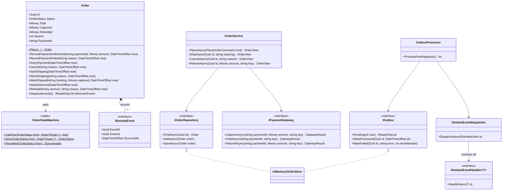
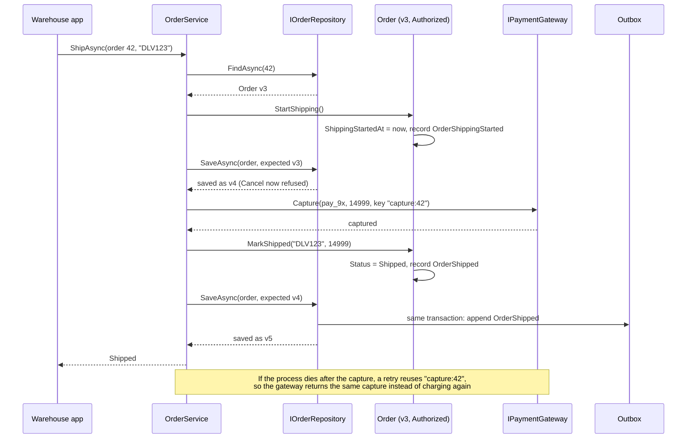
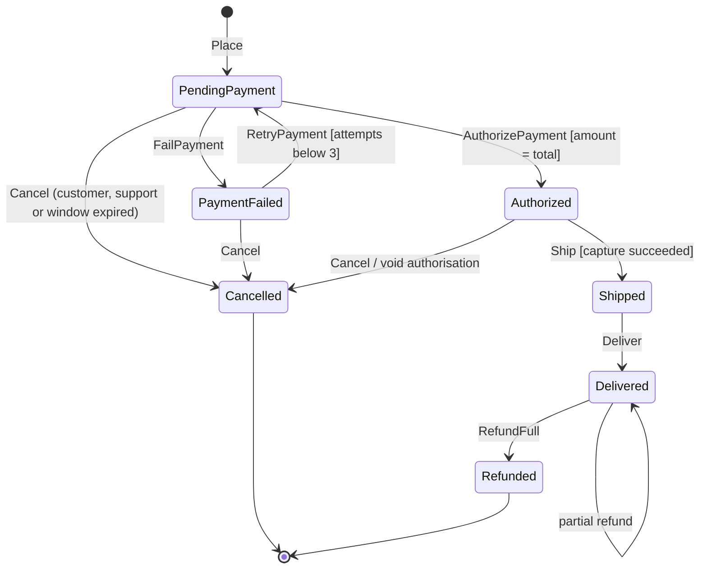
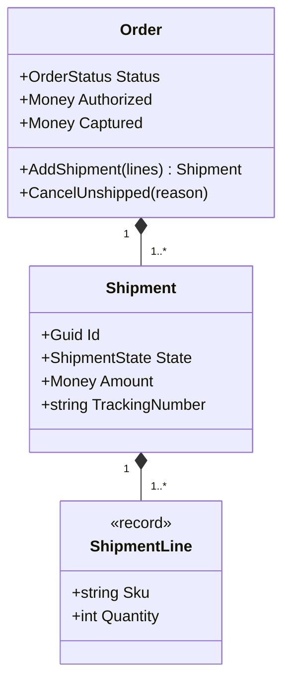

An order looks simple on a whiteboard: the customer pays, you ship, done. In production it is a long-running process that spans minutes to weeks, talks to a payment gateway, an inventory service and a courier, and must survive duplicate webhooks, crashes between two steps, and two people clicking "cancel" and "ship" at the same moment. This case study designs the order core of an online store so that every one of those situations has a defined, tested outcome.

## Learning objectives

By the end of this case study you will be able to:

1. Capture an order lifecycle as functional requirements plus a transition table that is the single source of truth.
2. Model the order as an aggregate that protects its invariants and raises domain events for everything that happened.
3. Use authorise-then-capture payments correctly, with idempotency keys so retries never charge twice.
4. Handle concurrent updates with optimistic concurrency (a version number) and a reload-and-retry loop.
5. Trigger side effects (release stock, void payments, notify customers) reliably with a transactional outbox and idempotent handlers.
6. Decide between a table-driven state machine, State classes, and a workflow engine.

## Prerequisites

- [State](#/lesson/m06-state): this lesson uses a table-driven variant and compares it with State classes.
- [Aggregates](#/lesson/m08-aggregates) and [Domain events](#/lesson/m08-domain-events).
- [Transactional outbox](#/lesson/m12-outbox) and [Idempotency keys](#/lesson/m10-idempotency).
- Helpful: [Inventory reservation](#/lesson/m18-inventory-reservation), which provides the stock hold that an order confirms or releases.

## Explain it like I'm a beginner

Think of ordering a custom-made almirah from a furniture shop in Jaipur.

1. You place the order and the shop writes it in the register: **placed, waiting for payment**.
2. You hand over your card. The shop does not take the money yet; it asks the bank to **block** ₹14,999 on your card (an *authorisation*). The bank says "OK, blocked".
3. When the almirah is ready and loaded on the truck, the shop **takes** the blocked money (a *capture*). If you cancel before that, the shop simply **unblocks** it (a *void*). No refund paperwork, no fees.
4. The truck delivers. If a door is scratched, the shop gives back part of the money (a *partial refund*).

Each step changes the order's **state**, and some steps are not allowed from some states: you cannot cancel after the truck has left (you have to return it instead), and the shop cannot deliver an order nobody paid for. Writing those rules as a table ("from this state, this action leads to that state") is a **state machine**.

Every time something important happens, the shop clerk also shouts it across the shop: "Order 42 paid!", "Order 42 cancelled!". The storekeeper hears "cancelled" and puts the reserved wood back; the accountant hears it and unblocks the card. The clerk does not need to know who is listening. Those shouts are **domain events**.

Finally, the clerk writes each shout in the register on the same line as the state change, so even if the storekeeper was at lunch, he can read the register later and catch up. That register-of-shouts is the **outbox**.

## Requirements

### The scenario

A direct-to-consumer brand sells air purifiers and water purifiers (₹6,000 to ₹25,000) through its own website and app: about 3,000 orders a day, 10 times that during festival sales. Payments go through a payment gateway (a provider such as Razorpay or Stripe) using cards, UPI and net banking. The warehouse ships through two couriers. Stock is held by the [inventory reservation](#/lesson/m18-inventory-reservation) service for 10 minutes while the customer pays. This lesson is about getting one order right; what changes when the same order core has to absorb 100 times the traffic (read replicas, partitioned outbox relays, queues in front of the gateway) is covered in [Scaling journey](#/lesson/m17-scaling-journey), and the sale-day stampede on a few hot SKUs in [Flash sale](#/lesson/m17-flash-sale).

### Functional requirements

| # | Requirement |
|---|---|
| F1 | **Place** an order from a stock reservation: customer, lines (SKU, quantity, unit price), total. The customer has 10 minutes to pay (matching the stock hold). |
| F2 | **Payment authorised** (gateway webhook): the amount must equal the order total; the order moves to Authorized and the stock hold is confirmed. Duplicate webhooks are harmless. |
| F3 | **Payment failed**: the order moves to PaymentFailed; the customer may retry up to 3 attempts within the original 10 minutes. |
| F4 | **Cancel**: allowed before shipping. If a payment was authorised, it is voided. The stock hold is released. |
| F5 | **Ship**: capture the payment first; only if the capture succeeds does the order become Shipped with a tracking number. The customer is notified. |
| F6 | **Deliver**: courier confirmation moves the order to Delivered. |
| F7 | **Refund** after delivery, full or partial, never more than was captured. A full refund moves the order to Refunded. |
| F8 | **Payment window expiry**: unpaid orders are cancelled automatically when the 10 minutes pass. |
| F9 | A payment authorised *after* the order was cancelled (late UPI confirmation) must be voided automatically. |

### Non-functional requirements

| # | Requirement | Target |
|---|---|---|
| N1 | **No double charge** | Retried capture or refund calls produce exactly one money movement (idempotency keys on every gateway call). |
| N2 | **No lost side effects** | If the process crashes after saving a state change, the related side effects still happen (at-least-once via the outbox). |
| N3 | **No lost updates** | Two concurrent changes to one order never silently overwrite each other (optimistic concurrency). |
| N4 | **Auditability** | Every state change is recorded as an event with time and data. |
| N5 | **Latency** | State changes are one short database transaction; gateway calls are the only slow step (typically hundreds of milliseconds, an estimate). |
| N6 | **Testability** | Gateway, inventory and clock are interfaces; the state machine is testable without any infrastructure. |

### Clarifying questions

- **Authorise and capture, or charge immediately?** Card authorisations can be held for several days (the exact limit depends on card network and gateway). Capturing at shipment means a cancellation costs nothing. Some UPI flows capture immediately; then "cancel" means "refund". We design for authorise-then-capture and note the difference.
- **Partial shipments?** Not in phase 1; one shipment per order (Exercise 4 designs splitting).
- **Who can cancel?** Customer before shipping, support at any time before shipping, the system on payment expiry.
- **Refund after shipping but before delivery?** No; the courier must return the parcel first. Refunds happen only after Delivered.
- **What if capture fails at shipping time** (authorisation expired, card blocked)? The order stays Authorized, the warehouse does not ship, and support is alerted. The parcel is not handed to the courier until capture succeeds.
- **Exactly-once side effects?** Not achievable across systems; we provide at-least-once delivery and make every handler idempotent.

## Identifying classes and responsibilities

| Class | Kind | Responsibility |
|---|---|---|
| `Money` | value object | Amount plus currency; arithmetic only within one currency; never negative. |
| `OrderLine` | record | SKU, quantity, unit price, line total. |
| `OrderStatus`, `OrderTrigger` | enums | The states and the actions that move between them. |
| `OrderStateMachine` | static class | The transition table: the only place that says which (state, trigger) pairs are legal. |
| `Order` | aggregate root | Holds state and money totals, enforces business rules, records domain events. |
| `IDomainEvent` and `OrderPlaced`, `OrderPaymentAuthorized`, ... | records | Facts that happened, named in the past tense. |
| `IOrderRepository` | interface | Load and save orders with a version check. |
| `IOutbox` | interface | Pending events saved in the same transaction as the order. |
| `InMemoryOrderStore` | class | In-memory implementation of both, with a lock standing in for a database transaction. |
| `IPaymentGateway` | interface | Capture, void, refund with idempotency keys. |
| `OrderService` | application service | Use cases: load, call gateway when needed, apply the change, save, retry on version conflicts. |
| `IDomainEventHandler<T>`, `DomainEventDispatcher` | interface + class | Find and run the handlers for an event (Observer). |
| `OutboxProcessor` | class | Reads pending events, dispatches them, marks them processed or failed. |
| Handlers | classes | `ConfirmReservationOnAuthorized`, `ReleaseReservationOnCancelled`, `VoidPaymentOnCancelled`, `VoidLatePayment`, `NotifyCustomerOnShipped`. |

The most important split is between **deciding** and **doing**:

- `Order` *decides*: "is this transition legal, and what happened as a result?" It never calls the network.
- `OrderService` and the handlers *do*: they call the gateway, inventory and notifications.

Keeping the aggregate free of I/O makes it fast to test and impossible to leave half-updated because a network call failed in the middle of a method.

## Class diagram



How to read it: `Order` sits at the centre and depends on nothing except the static transition table. It *records* events (composition: they live in the order until saved). `OrderService` is the only class that touches both the repository and the gateway. `InMemoryOrderStore` implements both `IOrderRepository` and `IOutbox` on purpose: saving the order and saving its events must be one atomic step, so in a real system both live in the same database and are written in the same transaction. The right-hand side is the asynchronous half: `OutboxProcessor` reads pending events and the dispatcher fans each one out to every registered handler (the Observer pattern, with the DI container doing the subscription).

### Shipping: capture first, then change state



Read it with failures in mind, because that is where the design earns its keep. There are three steps: **claim, capture, record**. The money movement (capture) happens *before* the status changes to Shipped, because shipping without payment is the worse failure. But a capture is a check-then-act across two systems: we checked "Authorized" at v3, and between the capture and the save a support agent could cancel the order. Without the claim, the cancel would save first, the ship's save would fail the version check, the reload would show Cancelled, and the customer would be charged for a cancelled order (and the void handler can't void a captured payment). The claim closes that window: it is saved *before* any money moves, so a concurrent cancel either saves first (and `StartShipping` then fails, before any capture) or finds the claim and is refused.

If the process crashes between "captured" and "saved", the order is still Authorized and claimed while the money is captured. The warehouse app retries; `StartShipping` sees the existing claim and does nothing, and the service sends the **same idempotency key** `capture:42`, so the gateway answers "already captured" and the order is then saved as Shipped. No double charge, no lost shipment. If the capture *times out*, the claim stays: we don't know whether money moved, so the order must not be cancelled until a retry (or an operator checking the gateway) settles it. Alert on orders that stay claimed for more than a few minutes. The `OrderShipped` event is appended to the outbox in the same transaction as the state change, so the customer notification cannot be lost either.

## Patterns and design decisions

### A transition table as the single source of truth

`OrderStateMachine` is a dictionary from `(state, trigger)` to the next state. Nine entries describe the whole lifecycle. Benefits:

- **One place to read and review.** A product manager can check the table against the requirements line by line.
- **Generated documentation.** A test can print the table as Mermaid and compare it with the diagram in the docs, so they never drift.
- **Uniform errors.** Every illegal move throws the same `InvalidOrderTransitionException`, which the API maps to 409.

The table says only *whether* a move is legal. Business rules that depend on data, such as "amount must equal total" or "at most 3 payment attempts", live in the `Order` methods as **guards**. That split keeps the table simple.

**Why not State classes?** [The State lesson](#/lesson/m06-state) puts each state's behaviour in its own class. That shines when states have very different behaviour and data. Here most behaviour is shared (record a timestamp, raise an event) and the differences are which moves are allowed, which a table expresses more compactly. Both are valid; choose by where the variation is.

### Aggregate plus domain events

The `Order` aggregate guarantees its own consistency: you cannot get `Captured > Total` or `Refunded > Captured` through any sequence of method calls. Each successful method records a **domain event**, a past-tense fact such as `OrderCancelled`. Events are how the order says what happened *without knowing who cares*. Adding an SMS on shipment means adding one handler, not editing `Order`. That is the Observer pattern applied at the domain level.

Events carry the data handlers need (`PaymentIdToVoid`, `ReservationId`, `CustomerId`), so handlers do not need to load the order again. That makes them faster and avoids reading a newer state than the one the event describes.

### Transactional outbox

The classic bug: save the order, then publish the event. If the process dies between the two, the event is lost: the order is cancelled but the stock is never released. Publishing first is worse: the event may go out for a change that is then rolled back.

The outbox fixes it by writing events **into the same transaction** as the state change. A background processor reads unprocessed events and dispatches them. If dispatch fails or the process crashes, the event is still there and is retried. The trade-off is **at-least-once delivery**: a handler can run twice (it succeeded, then the process crashed before marking the event processed). So every handler must be idempotent, which we get cheaply by passing idempotency keys to the gateway and using naturally idempotent operations (releasing an already released reservation is a no-op).

### Optimistic concurrency

The warehouse ships order 42 at the same moment support cancels it. Both load version 3. Whoever saves first wins and the version becomes 4; the other's save finds version 4 instead of 3 and fails with `ConcurrencyException`. `OrderService` then **reloads and re-applies** the command. If the ship's claim won, the reloaded order is claimed (or already Shipped) and the cancel fails with a clear "shipping has started". If the cancel won, the ship's claim fails on the reloaded Cancelled order before any money moves. Without the version check, the second save would silently overwrite the first: an order that is both shipped and cancelled, with stock released for a parcel that left the building.

Pessimistic locking (`SELECT ... FOR UPDATE`) also works but holds a database lock while the service calls the gateway, which can take seconds. Optimistic concurrency holds nothing during the slow call.

### Idempotency at every boundary

| Boundary | Duplicate source | Protection |
|---|---|---|
| Gateway webhook to us | Gateway retries webhooks | `RecordPaymentAuthorized` ignores a repeat with the same payment id |
| Us to gateway | Our retries after timeouts or crashes | Deterministic idempotency keys: `capture:{orderId}`, `void:{orderId}` |
| Outbox to handlers | At-least-once dispatch | Handlers use idempotent operations and keys |
| Client to us (refund) | Support clicks twice | Client-supplied refund key |

## State transitions



How to read it: labels follow the UML style "trigger [guard] / effect". The table in code has exactly these nine arrows (the partial-refund self-loop is a guarded rule inside `Refund`, not a table entry). Some things to notice:

- **Cancel is allowed from three states but not after Shipped.** Once a parcel is with the courier, undoing it is a *return*, a separate process with its own steps (pickup, inspection, refund). From Authorized, Cancel also has a guard: it is refused while a shipping claim is held, because the payment may already be captured.
- **The effect of Cancel depends on where you came from.** From Authorized it must void the authorisation; from PendingPayment there is nothing to void. The `OrderCancelled` event carries `PaymentIdToVoid` only in the first case.
- **Ship has a guard that is checked outside the aggregate**: the capture must have succeeded. The service performs the capture and passes the captured amount; the order checks it equals the total.
- **Out-of-order webhooks.** Gateways don't promise ordering. A `payment.failed` for an earlier attempt that arrives after `payment.authorized` hits Authorized + FailPayment, which the table rejects. The webhook endpoint should log it and still answer 2xx, otherwise the gateway keeps redelivering a message that can never apply.
- **Late payments** (F9) do not appear as a transition because the order does not change state: a `Cancelled` order that receives an authorisation records a `LatePaymentReceived` event and stays Cancelled, and a handler voids the payment.

## C# implementation

```text
Shop.Orders/
  Program.cs
  Orders/
    Money.cs
    Events.cs
    OrderStateMachine.cs
    Order.cs
    Persistence.cs
    Payments.cs
    OrderService.cs
    EventHandling.cs
    Handlers.cs
    Infrastructure.cs
```

### Money

```csharp file=Orders/Money.cs
namespace Shop.Orders;

/// <summary>Non-negative amount in one currency. Arithmetic across currencies is a bug, so it throws.</summary>
public readonly record struct Money
{
    public Money(decimal amount, string currency)
    {
        ArgumentOutOfRangeException.ThrowIfNegative(amount);
        if (string.IsNullOrWhiteSpace(currency) || currency.Length != 3)
            throw new ArgumentException("Currency must be an ISO 4217 code such as INR.", nameof(currency));
        Amount = decimal.Round(amount, 2, MidpointRounding.ToEven);
        Currency = currency.ToUpperInvariant();
    }

    public decimal Amount { get; }
    public string Currency { get; }

    public static Money Inr(decimal amount) => new(amount, "INR");
    public static Money Zero(string currency) => new(0m, currency);

    public static Money operator +(Money a, Money b) => new(a.Amount + b.Amount, Same(a, b));

    public static Money operator -(Money a, Money b)
    {
        var c = Same(a, b);
        if (b.Amount > a.Amount) throw new InvalidOperationException($"{a} - {b} would be negative.");
        return new(a.Amount - b.Amount, c);
    }

    public static bool operator >(Money a, Money b) => a.Amount > b.Amount && Same(a, b) is not null;
    public static bool operator <(Money a, Money b) => a.Amount < b.Amount && Same(a, b) is not null;
    public static bool operator >=(Money a, Money b) => a.Amount >= b.Amount && Same(a, b) is not null;
    public static bool operator <=(Money a, Money b) => a.Amount <= b.Amount && Same(a, b) is not null;

    public Money Times(int quantity) => new(Amount * quantity, Currency);

    private static string Same(Money a, Money b) =>
        a.Currency == b.Currency ? a.Currency : throw new InvalidOperationException($"Currency mismatch: {a.Currency} vs {b.Currency}.");

    public override string ToString() => string.Create(System.Globalization.CultureInfo.InvariantCulture, $"{Currency} {Amount:0.00}");
}
```

### Domain events

```csharp file=Orders/Events.cs
namespace Shop.Orders;

public interface IDomainEvent
{
    Guid EventId { get; }
    Guid OrderId { get; }
    DateTimeOffset OccurredAt { get; }
}

public abstract record OrderEvent(Guid OrderId, DateTimeOffset OccurredAt) : IDomainEvent
{
    public Guid EventId { get; init; } = Guid.NewGuid();
}

public sealed record OrderPlaced(Guid OrderId, DateTimeOffset OccurredAt, string CustomerId, Money Total, Guid ReservationId)
    : OrderEvent(OrderId, OccurredAt);

public sealed record OrderPaymentAuthorized(Guid OrderId, DateTimeOffset OccurredAt, string PaymentId, Money Amount, Guid ReservationId)
    : OrderEvent(OrderId, OccurredAt);

public sealed record OrderPaymentFailed(Guid OrderId, DateTimeOffset OccurredAt, int Attempt, string Reason)
    : OrderEvent(OrderId, OccurredAt);

public sealed record OrderCancelled(Guid OrderId, DateTimeOffset OccurredAt, string Reason, string? PaymentIdToVoid, Guid ReservationId)
    : OrderEvent(OrderId, OccurredAt);

public sealed record LatePaymentReceived(Guid OrderId, DateTimeOffset OccurredAt, string PaymentId)
    : OrderEvent(OrderId, OccurredAt);

/// <summary>The warehouse has claimed the order for shipping; a capture may be in flight, so Cancel is refused.</summary>
public sealed record OrderShippingStarted(Guid OrderId, DateTimeOffset OccurredAt) : OrderEvent(OrderId, OccurredAt);

public sealed record OrderShippingAborted(Guid OrderId, DateTimeOffset OccurredAt, string Reason) : OrderEvent(OrderId, OccurredAt);

public sealed record OrderShipped(Guid OrderId, DateTimeOffset OccurredAt, string CustomerId, string TrackingNumber, Money Captured)
    : OrderEvent(OrderId, OccurredAt);

public sealed record OrderDelivered(Guid OrderId, DateTimeOffset OccurredAt) : OrderEvent(OrderId, OccurredAt);

public sealed record OrderRefunded(Guid OrderId, DateTimeOffset OccurredAt, Money Amount, bool IsFull, string Reason)
    : OrderEvent(OrderId, OccurredAt);
```

### The transition table

```csharp file=Orders/OrderStateMachine.cs
namespace Shop.Orders;

public enum OrderStatus { PendingPayment, PaymentFailed, Authorized, Shipped, Delivered, Cancelled, Refunded }

public enum OrderTrigger { AuthorizePayment, FailPayment, RetryPayment, Cancel, Ship, Deliver, RefundFull }

public sealed class InvalidOrderTransitionException(OrderStatus from, OrderTrigger trigger)
    : InvalidOperationException($"Cannot {trigger} an order that is {from}.")
{
    public OrderStatus From { get; } = from;
    public OrderTrigger Trigger { get; } = trigger;
}

/// <summary>The single source of truth for legal moves. Data-dependent rules (guards) live in Order.</summary>
public static class OrderStateMachine
{
    private static readonly Dictionary<(OrderStatus From, OrderTrigger Trigger), OrderStatus> Table = new()
    {
        [(OrderStatus.PendingPayment, OrderTrigger.AuthorizePayment)] = OrderStatus.Authorized,
        [(OrderStatus.PendingPayment, OrderTrigger.FailPayment)] = OrderStatus.PaymentFailed,
        [(OrderStatus.PendingPayment, OrderTrigger.Cancel)] = OrderStatus.Cancelled,
        [(OrderStatus.PaymentFailed, OrderTrigger.RetryPayment)] = OrderStatus.PendingPayment,
        [(OrderStatus.PaymentFailed, OrderTrigger.Cancel)] = OrderStatus.Cancelled,
        [(OrderStatus.Authorized, OrderTrigger.Cancel)] = OrderStatus.Cancelled,
        [(OrderStatus.Authorized, OrderTrigger.Ship)] = OrderStatus.Shipped,
        [(OrderStatus.Shipped, OrderTrigger.Deliver)] = OrderStatus.Delivered,
        [(OrderStatus.Delivered, OrderTrigger.RefundFull)] = OrderStatus.Refunded,
    };

    public static IReadOnlyDictionary<(OrderStatus From, OrderTrigger Trigger), OrderStatus> Transitions => Table;

    public static bool CanFire(OrderStatus from, OrderTrigger trigger) => Table.ContainsKey((from, trigger));

    public static OrderStatus Next(OrderStatus from, OrderTrigger trigger) =>
        Table.TryGetValue((from, trigger), out var to) ? to : throw new InvalidOrderTransitionException(from, trigger);

    public static IEnumerable<OrderTrigger> Permitted(OrderStatus from) =>
        Table.Keys.Where(k => k.From == from).Select(k => k.Trigger);

    public static bool IsTerminal(OrderStatus s) => !Permitted(s).Any();

    /// <summary>Renders the table as a Mermaid state diagram, so docs can be generated and checked in tests.</summary>
    public static string ToMermaid() =>
        "stateDiagram-v2\n" + string.Join('\n', Table.Select(t => $"    {t.Key.From} --> {t.Value} : {t.Key.Trigger}"));
}
```

### The aggregate

```csharp file=Orders/Order.cs
namespace Shop.Orders;

public sealed record OrderLine(string Sku, int Quantity, Money UnitPrice)
{
    public Money LineTotal => UnitPrice.Times(Quantity);
}

public sealed class OrderRuleViolationException(string message) : InvalidOperationException(message);

public sealed class Order
{
    public const int MaxPaymentAttempts = 3;
    private List<IDomainEvent> _events = [];

    private Order() { }

    public Guid Id { get; private set; }
    public string CustomerId { get; private set; } = "";
    public IReadOnlyList<OrderLine> Lines { get; private set; } = [];
    public Money Total { get; private set; }
    public Guid ReservationId { get; private set; }
    public OrderStatus Status { get; private set; }
    public int Version { get; internal set; }
    public int FailedPaymentAttempts { get; private set; }
    public DateTimeOffset PlacedAt { get; private set; }
    public DateTimeOffset PaymentDueBy { get; private set; }
    public DateTimeOffset UpdatedAt { get; private set; }
    public string? PaymentId { get; private set; }
    public Money Captured { get; private set; }
    public Money Refunded { get; private set; }
    public string? TrackingNumber { get; private set; }
    public string? CancelReason { get; private set; }
    /// <summary>Set while a capture may be in flight. Cancel is refused until the order ships or shipping is aborted.</summary>
    public DateTimeOffset? ShippingStartedAt { get; private set; }

    public int PendingEventCount => _events.Count;

    public static Order Place(Guid id, string customerId, IReadOnlyList<OrderLine> lines, Guid reservationId,
        DateTimeOffset now, TimeSpan paymentWindow)
    {
        ArgumentException.ThrowIfNullOrWhiteSpace(customerId);
        if (lines is null || lines.Count == 0) throw new OrderRuleViolationException("An order needs at least one line.");
        if (lines.Any(l => l.Quantity <= 0)) throw new OrderRuleViolationException("Quantities must be positive.");
        var currency = lines[0].UnitPrice.Currency;
        var total = lines.Aggregate(Money.Zero(currency), (sum, l) => sum + l.LineTotal);   // throws on mixed currencies
        if (total.Amount == 0) throw new OrderRuleViolationException("Order total must be positive.");

        var o = new Order
        {
            Id = id, CustomerId = customerId, Lines = lines.ToList(), Total = total, ReservationId = reservationId,
            Status = OrderStatus.PendingPayment, PlacedAt = now, UpdatedAt = now, PaymentDueBy = now + paymentWindow,
            Captured = Money.Zero(currency), Refunded = Money.Zero(currency),
        };
        o.Raise(new OrderPlaced(id, now, customerId, total, reservationId));
        return o;
    }

    public void RecordPaymentAuthorized(string paymentId, Money amount, DateTimeOffset now)
    {
        ArgumentException.ThrowIfNullOrWhiteSpace(paymentId);
        if (PaymentId == paymentId) return;                                   // duplicate webhook
        if (Status == OrderStatus.Cancelled)
        {
            Raise(new LatePaymentReceived(Id, now, paymentId));               // F9: void it, stay cancelled
            return;
        }
        if (amount != Total) throw new OrderRuleViolationException($"Authorised {amount} but the order total is {Total}.");
        Move(OrderTrigger.AuthorizePayment, now);
        PaymentId = paymentId;
        Raise(new OrderPaymentAuthorized(Id, now, paymentId, amount, ReservationId));
    }

    public void RecordPaymentFailed(string reason, DateTimeOffset now)
    {
        if (Status == OrderStatus.PaymentFailed) return;                      // duplicate webhook
        Move(OrderTrigger.FailPayment, now);
        FailedPaymentAttempts++;
        Raise(new OrderPaymentFailed(Id, now, FailedPaymentAttempts, reason));
    }

    public void RetryPayment(DateTimeOffset now)
    {
        if (FailedPaymentAttempts >= MaxPaymentAttempts)
            throw new OrderRuleViolationException($"Only {MaxPaymentAttempts} payment attempts are allowed.");
        if (now >= PaymentDueBy) throw new OrderRuleViolationException("The payment window has closed.");
        Move(OrderTrigger.RetryPayment, now);                                 // the window does NOT restart: the stock hold won't either
    }

    public void Cancel(string reason, DateTimeOffset now)
    {
        if (Status == OrderStatus.Cancelled) return;                          // idempotent
        if (ShippingStartedAt is not null)
            throw new OrderRuleViolationException("Shipping has started and the payment may already be captured; cancel is not possible.");
        bool hadAuthorisation = Status == OrderStatus.Authorized;
        Move(OrderTrigger.Cancel, now);
        CancelReason = reason;
        Raise(new OrderCancelled(Id, now, reason, hadAuthorisation ? PaymentId : null, ReservationId));
    }

    /// <summary>Claims the order for shipping before any money moves. Saved on its own, so a concurrent
    /// cancel either wins before the capture or is refused after it.</summary>
    public void StartShipping(DateTimeOffset now)
    {
        if (!OrderStateMachine.CanFire(Status, OrderTrigger.Ship)) throw new InvalidOrderTransitionException(Status, OrderTrigger.Ship);
        if (ShippingStartedAt is not null) return;                            // already claimed: a retry after a crash
        ShippingStartedAt = now;
        UpdatedAt = now;
        Raise(new OrderShippingStarted(Id, now));
    }

    /// <summary>Releases the claim when the capture definitely failed, so the order can be cancelled again.</summary>
    public void AbortShipping(string reason, DateTimeOffset now)
    {
        if (Status != OrderStatus.Authorized || ShippingStartedAt is null) return;
        ShippingStartedAt = null;
        UpdatedAt = now;
        Raise(new OrderShippingAborted(Id, now, reason));
    }

    public void MarkShipped(string trackingNumber, Money captured, DateTimeOffset now)
    {
        ArgumentException.ThrowIfNullOrWhiteSpace(trackingNumber);
        if (Status == OrderStatus.Shipped && TrackingNumber == trackingNumber) return;
        if (captured != Total) throw new OrderRuleViolationException($"Captured {captured} but the order total is {Total}.");
        Move(OrderTrigger.Ship, now);
        Captured = captured;
        TrackingNumber = trackingNumber;
        Raise(new OrderShipped(Id, now, CustomerId, trackingNumber, captured));
    }

    public void MarkDelivered(DateTimeOffset now)
    {
        if (Status == OrderStatus.Delivered) return;
        Move(OrderTrigger.Deliver, now);
        Raise(new OrderDelivered(Id, now));
    }

    public void Refund(Money amount, string reason, DateTimeOffset now)
    {
        if (Status != OrderStatus.Delivered) throw new InvalidOrderTransitionException(Status, OrderTrigger.RefundFull);
        if (amount.Amount <= 0) throw new OrderRuleViolationException("Refund must be positive.");
        if (Refunded + amount > Captured)
            throw new OrderRuleViolationException($"Cannot refund {amount}: only {Captured - Refunded} is refundable.");

        Refunded += amount;
        bool full = Refunded == Captured;
        if (full) Move(OrderTrigger.RefundFull, now);
        else UpdatedAt = now;
        Raise(new OrderRefunded(Id, now, amount, full, reason));
    }

    public bool IsPaymentOverdue(DateTimeOffset now) =>
        Status is OrderStatus.PendingPayment or OrderStatus.PaymentFailed && now >= PaymentDueBy;

    public IReadOnlyList<IDomainEvent> DequeueEvents()
    {
        var events = _events.ToList();
        _events.Clear();
        return events;
    }

    /// <summary>Copy used by the in-memory store to mimic loading a fresh row from a database.</summary>
    internal Order Snapshot()
    {
        var copy = (Order)MemberwiseClone();
        copy._events = [];
        return copy;
    }

    private void Move(OrderTrigger trigger, DateTimeOffset now)
    {
        Status = OrderStateMachine.Next(Status, trigger);
        UpdatedAt = now;
    }

    private void Raise(IDomainEvent e) => _events.Add(e);
}
```

Every public method has the same shape: **idempotency check**, **guards**, **move** (via the table), **update data**, **raise event**. Because the table throws before any field changes, a rejected call leaves the order exactly as it was.

### Persistence: repository plus outbox in one "transaction"

```csharp file=Orders/Persistence.cs
namespace Shop.Orders;

public sealed class ConcurrencyException(Guid id, int expected, int actual)
    : Exception($"Order {id} was modified concurrently (expected v{expected}, found v{actual}).");

public sealed class OrderNotFoundException(Guid id) : Exception($"Order {id} was not found.");

public interface IOrderRepository
{
    Task<Order?> FindAsync(Guid id, CancellationToken ct);
    Task AddAsync(Order order, CancellationToken ct);
    /// <summary>Saves if the stored version equals order.Version, then increments it. Events go to the outbox atomically.</summary>
    Task SaveAsync(Order order, CancellationToken ct);
    Task<IReadOnlyList<Guid>> FindOverdueAsync(DateTimeOffset now, CancellationToken ct);
}

public sealed class OutboxMessage(IDomainEvent e, DateTimeOffset createdAt)
{
    public Guid Id { get; } = e.EventId;
    public IDomainEvent Event { get; } = e;
    public DateTimeOffset CreatedAt { get; } = createdAt;
    public int Attempts { get; internal set; }
    public DateTimeOffset? ProcessedAt { get; internal set; }
    public string? LastError { get; internal set; }
    public bool DeadLettered { get; internal set; }
}

public interface IOutbox
{
    IReadOnlyList<OutboxMessage> Pending(int max);
    void MarkProcessed(Guid id, DateTimeOffset at);
    void MarkFailed(Guid id, string error, int maxAttempts);
    IReadOnlyList<OutboxMessage> DeadLetters();
}

/// <summary>In-memory stand-in for a database. The lock plays the role of a transaction:
/// the order row and its outbox rows are written together or not at all.</summary>
public sealed class InMemoryOrderStore(TimeProvider time) : IOrderRepository, IOutbox
{
    private readonly Lock _gate = new();
    private readonly Dictionary<Guid, Order> _orders = [];
    private readonly List<OutboxMessage> _outbox = [];

    public Task<Order?> FindAsync(Guid id, CancellationToken ct)
    {
        lock (_gate) return Task.FromResult(_orders.TryGetValue(id, out var o) ? o.Snapshot() : null);
    }

    public Task AddAsync(Order order, CancellationToken ct)
    {
        lock (_gate)
        {
            if (_orders.ContainsKey(order.Id)) throw new InvalidOperationException($"Order {order.Id} already exists.");
            var events = order.DequeueEvents();
            order.Version = 1;
            _orders[order.Id] = order.Snapshot();
            Append(events);
        }
        return Task.CompletedTask;
    }

    public Task SaveAsync(Order order, CancellationToken ct)
    {
        lock (_gate)
        {
            var stored = _orders.TryGetValue(order.Id, out var s) ? s : throw new OrderNotFoundException(order.Id);
            if (stored.Version != order.Version) throw new ConcurrencyException(order.Id, order.Version, stored.Version);
            var events = order.DequeueEvents();
            order.Version++;
            _orders[order.Id] = order.Snapshot();
            Append(events);
        }
        return Task.CompletedTask;
    }

    public Task<IReadOnlyList<Guid>> FindOverdueAsync(DateTimeOffset now, CancellationToken ct)
    {
        lock (_gate)
            return Task.FromResult<IReadOnlyList<Guid>>(_orders.Values.Where(o => o.IsPaymentOverdue(now)).Select(o => o.Id).ToList());
    }

    public IReadOnlyList<OutboxMessage> Pending(int max)
    {
        lock (_gate) return _outbox.Where(m => m.ProcessedAt is null && !m.DeadLettered).Take(max).ToList();
    }

    public void MarkProcessed(Guid id, DateTimeOffset at)
    {
        lock (_gate) _outbox.First(m => m.Id == id).ProcessedAt = at;
    }

    public void MarkFailed(Guid id, string error, int maxAttempts)
    {
        lock (_gate)
        {
            var m = _outbox.First(x => x.Id == id);
            m.Attempts++;
            m.LastError = error;
            if (m.Attempts >= maxAttempts) m.DeadLettered = true;
        }
    }

    public IReadOnlyList<OutboxMessage> DeadLetters()
    {
        lock (_gate) return _outbox.Where(m => m.DeadLettered).ToList();
    }

    private void Append(IEnumerable<IDomainEvent> events)
    {
        foreach (var e in events) _outbox.Add(new OutboxMessage(e, time.GetUtcNow()));
    }
}
```

In PostgreSQL the same `SaveAsync` is one transaction: `UPDATE orders SET ..., version = version + 1 WHERE id = $1 AND version = $2` (zero rows updated means a concurrency conflict), followed by `INSERT INTO outbox (...)` for each event, then `COMMIT`.

### Payments port

```csharp file=Orders/Payments.cs
namespace Shop.Orders;

public sealed record GatewayResult(bool Succeeded, string? Reference, string? Error)
{
    public static GatewayResult Ok(string reference) => new(true, reference, null);
    public static GatewayResult Fail(string error) => new(false, null, error);
}

/// <summary>Every call takes an idempotency key: the same key always yields the same single money movement.</summary>
public interface IPaymentGateway
{
    Task<GatewayResult> CaptureAsync(string paymentId, Money amount, string idempotencyKey, CancellationToken ct);
    Task<GatewayResult> VoidAsync(string paymentId, string idempotencyKey, CancellationToken ct);
    Task<GatewayResult> RefundAsync(string paymentId, Money amount, string idempotencyKey, CancellationToken ct);
}

public sealed class PaymentGatewayException(string operation, string? error)
    : Exception($"Payment {operation} failed: {error ?? "unknown error"}.");
```

The real adapter for a specific provider lives behind this interface; see [Payment gateway abstraction](#/lesson/m18-payment-gateway).

### Application service

```csharp file=Orders/OrderService.cs
using Microsoft.Extensions.Logging;

namespace Shop.Orders;

public sealed record PlaceOrderCommand(string CustomerId, Guid ReservationId, IReadOnlyList<OrderLine> Lines);

public sealed record OrderView(Guid Id, OrderStatus Status, Money Total, Money Captured, Money Refunded,
    string? TrackingNumber, int Version, IReadOnlyList<OrderTrigger> AllowedActions)
{
    public static OrderView Of(Order o) =>
        new(o.Id, o.Status, o.Total, o.Captured, o.Refunded, o.TrackingNumber, o.Version, OrderStateMachine.Permitted(o.Status).ToList());
}

public sealed class OrderService(IOrderRepository orders, IPaymentGateway gateway, TimeProvider time, ILogger<OrderService> log)
{
    public static readonly TimeSpan PaymentWindow = TimeSpan.FromMinutes(10);
    private const int MaxConcurrencyRetries = 3;

    private DateTimeOffset Now => time.GetUtcNow();

    public async Task<OrderView> PlaceAsync(PlaceOrderCommand cmd, CancellationToken ct = default)
    {
        var order = Order.Place(Guid.NewGuid(), cmd.CustomerId, cmd.Lines, cmd.ReservationId, Now, PaymentWindow);
        await orders.AddAsync(order, ct);
        return OrderView.Of(order);
    }

    public Task<OrderView> PaymentAuthorizedAsync(Guid id, string paymentId, Money amount, CancellationToken ct = default) =>
        MutateAsync(id, o => { o.RecordPaymentAuthorized(paymentId, amount, Now); return Task.CompletedTask; }, ct);

    public Task<OrderView> PaymentFailedAsync(Guid id, string reason, CancellationToken ct = default) =>
        MutateAsync(id, o => { o.RecordPaymentFailed(reason, Now); return Task.CompletedTask; }, ct);

    public Task<OrderView> RetryPaymentAsync(Guid id, CancellationToken ct = default) =>
        MutateAsync(id, o => { o.RetryPayment(Now); return Task.CompletedTask; }, ct);

    public Task<OrderView> CancelAsync(Guid id, string reason, CancellationToken ct = default) =>
        MutateAsync(id, o => { o.Cancel(reason, Now); return Task.CompletedTask; }, ct);

    public Task<OrderView> DeliverAsync(Guid id, CancellationToken ct = default) =>
        MutateAsync(id, o => { o.MarkDelivered(Now); return Task.CompletedTask; }, ct);

    /// <summary>Claim, capture, record. The claim is saved before money moves, so a concurrent cancel can't
    /// slip in between "captured" and "saved". A retry reuses the same capture key, so money moves once.</summary>
    public async Task<OrderView> ShipAsync(Guid id, string trackingNumber, CancellationToken ct = default)
    {
        // 1. Claim. If a cancel saved first, StartShipping throws here, before any capture.
        var claimed = await MutateAsync(id, o =>
        {
            if (o.Status == OrderStatus.Shipped && o.TrackingNumber == trackingNumber) return Task.CompletedTask;
            o.StartShipping(Now);
            return Task.CompletedTask;
        }, ct);
        if (claimed.Status == OrderStatus.Shipped) return claimed;           // retried after success

        // 2. Capture, with no lock or transaction held. From here on, Cancel is refused.
        var order = await orders.FindAsync(id, ct) ?? throw new OrderNotFoundException(id);
        var result = await gateway.CaptureAsync(order.PaymentId!, order.Total, $"capture:{id}", ct);
        if (!result.Succeeded)
        {
            // A definite "no" from the gateway: release the claim so the order can be cancelled or shipped later.
            // A timeout (exception) leaves the claim in place: we don't know whether money moved.
            log.LogWarning("Capture failed for order {OrderId}: {Error}", id, result.Error);
            await MutateAsync(id, o => { o.AbortShipping(result.Error ?? "capture failed", Now); return Task.CompletedTask; }, ct);
            throw new PaymentGatewayException("capture", result.Error);
        }

        // 3. Record. Only Ship can still move this order, so a version conflict here is just retried.
        return await MutateAsync(id, o => { o.MarkShipped(trackingNumber, o.Total, Now); return Task.CompletedTask; }, ct);
    }

    /// <summary>The caller supplies the refund key (for example from the support ticket), so a double click refunds once.</summary>
    public Task<OrderView> RefundAsync(Guid id, Money amount, string reason, string refundKey, CancellationToken ct = default) =>
        MutateAsync(id, async o =>
        {
            if (o.Status != OrderStatus.Delivered) throw new InvalidOrderTransitionException(o.Status, OrderTrigger.RefundFull);
            if (o.Refunded + amount > o.Captured) throw new OrderRuleViolationException("Refund exceeds the captured amount.");
            var result = await gateway.RefundAsync(o.PaymentId!, amount, $"refund:{o.Id}:{refundKey}", ct);
            if (!result.Succeeded) throw new PaymentGatewayException("refund", result.Error);
            o.Refund(amount, reason, Now);
        }, ct);

    public async Task<int> CancelOverduePaymentsAsync(CancellationToken ct = default)
    {
        int n = 0;
        foreach (var id in await orders.FindOverdueAsync(Now, ct))
        {
            try
            {
                await MutateAsync(id, o =>
                {
                    if (o.IsPaymentOverdue(Now)) o.Cancel("payment window expired", Now);
                    return Task.CompletedTask;
                }, ct);
                n++;
            }
            catch (InvalidOrderTransitionException) { /* paid in the meantime: fine */ }
        }
        return n;
    }

    public async Task<OrderView> GetAsync(Guid id, CancellationToken ct = default) =>
        OrderView.Of(await orders.FindAsync(id, ct) ?? throw new OrderNotFoundException(id));

    /// <summary>Load, apply, save; on a version conflict reload and re-apply (the command is re-evaluated
    /// against the newer state, so a cancel that lost to a ship now fails with a clear transition error).</summary>
    private async Task<OrderView> MutateAsync(Guid id, Func<Order, Task> change, CancellationToken ct)
    {
        for (int attempt = 1; ; attempt++)
        {
            var order = await orders.FindAsync(id, ct) ?? throw new OrderNotFoundException(id);
            await change(order);
            if (order.PendingEventCount == 0) return OrderView.Of(order);     // idempotent no-op: nothing to save
            try
            {
                await orders.SaveAsync(order, ct);
                return OrderView.Of(order);
            }
            catch (ConcurrencyException ex) when (attempt < MaxConcurrencyRetries)
            {
                log.LogInformation(ex, "Retrying order {OrderId} after a concurrent update", id);
            }
        }
    }
}
```

### Event dispatch, outbox processing and handlers

```csharp file=Orders/EventHandling.cs
using Microsoft.Extensions.DependencyInjection;
using Microsoft.Extensions.Hosting;
using Microsoft.Extensions.Logging;

namespace Shop.Orders;

public interface IDomainEventHandler<in TEvent> where TEvent : IDomainEvent
{
    Task HandleAsync(TEvent e, CancellationToken ct);
}

public interface IDomainEventDispatcher
{
    Task DispatchAsync(IDomainEvent e, CancellationToken ct);
}

/// <summary>Observer via DI: every registered IDomainEventHandler&lt;T&gt; for the event's runtime type runs.</summary>
public sealed class DomainEventDispatcher(IServiceScopeFactory scopes) : IDomainEventDispatcher
{
    public async Task DispatchAsync(IDomainEvent e, CancellationToken ct)
    {
        using var scope = scopes.CreateScope();
        var handlerType = typeof(IDomainEventHandler<>).MakeGenericType(e.GetType());
        var method = handlerType.GetMethod(nameof(IDomainEventHandler<IDomainEvent>.HandleAsync))!;
        foreach (var handler in scope.ServiceProvider.GetServices(handlerType))
            await (Task)method.Invoke(handler, [e, ct])!;
    }
}

/// <summary>At-least-once delivery: an event is retried until every handler succeeds, so handlers must be idempotent.</summary>
public sealed class OutboxProcessor(IOutbox outbox, IDomainEventDispatcher dispatcher, TimeProvider time, ILogger<OutboxProcessor> log)
{
    public const int MaxAttempts = 5;

    public async Task<int> ProcessPendingAsync(CancellationToken ct = default)
    {
        int processed = 0;
        foreach (var m in outbox.Pending(100))
        {
            try
            {
                await dispatcher.DispatchAsync(m.Event, ct);
                outbox.MarkProcessed(m.Id, time.GetUtcNow());
                processed++;
            }
            catch (Exception ex) when (ex is not OperationCanceledException)
            {
                var root = ex is System.Reflection.TargetInvocationException { InnerException: { } inner } ? inner : ex;
                log.LogWarning(root, "Handling {EventType} {EventId} failed (attempt {Attempt})", m.Event.GetType().Name, m.Id, m.Attempts + 1);
                outbox.MarkFailed(m.Id, root.Message, MaxAttempts);
            }
        }
        return processed;
    }
}

public sealed class OrderBackgroundWorker(OutboxProcessor outbox, IServiceScopeFactory scopes, TimeProvider time) : BackgroundService
{
    protected override async Task ExecuteAsync(CancellationToken stoppingToken)
    {
        using var timer = new PeriodicTimer(TimeSpan.FromSeconds(1), time);
        while (await timer.WaitForNextTickAsync(stoppingToken))
        {
            await outbox.ProcessPendingAsync(stoppingToken);
            using var scope = scopes.CreateScope();
            await scope.ServiceProvider.GetRequiredService<OrderService>().CancelOverduePaymentsAsync(stoppingToken);
        }
    }
}
```

```csharp file=Orders/Handlers.cs
namespace Shop.Orders;

public interface IInventoryClient
{
    Task ConfirmAsync(Guid reservationId, CancellationToken ct);   // idempotent on the inventory side
    Task ReleaseAsync(Guid reservationId, CancellationToken ct);   // idempotent on the inventory side
}

public interface ICustomerNotifier
{
    Task NotifyAsync(string customerId, string message, string dedupeKey, CancellationToken ct);
}

public sealed class ConfirmReservationOnAuthorized(IInventoryClient inventory) : IDomainEventHandler<OrderPaymentAuthorized>
{
    public Task HandleAsync(OrderPaymentAuthorized e, CancellationToken ct) => inventory.ConfirmAsync(e.ReservationId, ct);
}

public sealed class ReleaseReservationOnCancelled(IInventoryClient inventory) : IDomainEventHandler<OrderCancelled>
{
    public Task HandleAsync(OrderCancelled e, CancellationToken ct) => inventory.ReleaseAsync(e.ReservationId, ct);
}

public sealed class VoidPaymentOnCancelled(IPaymentGateway gateway) : IDomainEventHandler<OrderCancelled>
{
    public async Task HandleAsync(OrderCancelled e, CancellationToken ct)
    {
        if (e.PaymentIdToVoid is null) return;
        var r = await gateway.VoidAsync(e.PaymentIdToVoid, $"void:{e.OrderId}", ct);
        if (!r.Succeeded) throw new PaymentGatewayException("void", r.Error);       // outbox will retry
    }
}

public sealed class VoidLatePayment(IPaymentGateway gateway) : IDomainEventHandler<LatePaymentReceived>
{
    public async Task HandleAsync(LatePaymentReceived e, CancellationToken ct)
    {
        var r = await gateway.VoidAsync(e.PaymentId, $"void-late:{e.PaymentId}", ct);
        if (!r.Succeeded) throw new PaymentGatewayException("void", r.Error);
    }
}

public sealed class NotifyCustomerOnShipped(ICustomerNotifier notifier) : IDomainEventHandler<OrderShipped>
{
    public Task HandleAsync(OrderShipped e, CancellationToken ct) =>
        notifier.NotifyAsync(e.CustomerId, $"Your order has shipped. Tracking: {e.TrackingNumber}", $"shipped:{e.OrderId}", ct);
}
```

### Development adapters and composition root

```csharp file=Orders/Infrastructure.cs
using System.Collections.Concurrent;
using Microsoft.Extensions.Logging;

namespace Shop.Orders;

/// <summary>Development gateway: always succeeds, remembers results per idempotency key like a real gateway.</summary>
public sealed class SandboxPaymentGateway : IPaymentGateway
{
    private readonly ConcurrentDictionary<string, GatewayResult> _byKey = new();

    public Task<GatewayResult> CaptureAsync(string paymentId, Money amount, string key, CancellationToken ct) => Once(key, "cap");
    public Task<GatewayResult> VoidAsync(string paymentId, string key, CancellationToken ct) => Once(key, "void");
    public Task<GatewayResult> RefundAsync(string paymentId, Money amount, string key, CancellationToken ct) => Once(key, "rfnd");

    private Task<GatewayResult> Once(string key, string prefix) =>
        Task.FromResult(_byKey.GetOrAdd(key, _ => GatewayResult.Ok($"{prefix}_{Guid.NewGuid():N}")));
}

public sealed class LoggingInventoryClient(ILogger<LoggingInventoryClient> log) : IInventoryClient
{
    public Task ConfirmAsync(Guid reservationId, CancellationToken ct) { log.LogInformation("Confirm reservation {Id}", reservationId); return Task.CompletedTask; }
    public Task ReleaseAsync(Guid reservationId, CancellationToken ct) { log.LogInformation("Release reservation {Id}", reservationId); return Task.CompletedTask; }
}

public sealed class LoggingNotifier(ILogger<LoggingNotifier> log) : ICustomerNotifier
{
    public Task NotifyAsync(string customerId, string message, string dedupeKey, CancellationToken ct)
    {
        log.LogInformation("Notify {Customer} ({Key}): {Message}", customerId, dedupeKey, message);
        return Task.CompletedTask;
    }
}
```

```csharp file=Program.cs
using Shop.Orders;

var builder = WebApplication.CreateBuilder(args);
var services = builder.Services;

services.AddSingleton(TimeProvider.System);
services.AddSingleton<InMemoryOrderStore>();
services.AddSingleton<IOrderRepository>(sp => sp.GetRequiredService<InMemoryOrderStore>());
services.AddSingleton<IOutbox>(sp => sp.GetRequiredService<InMemoryOrderStore>());
services.AddSingleton<IPaymentGateway, SandboxPaymentGateway>();
services.AddSingleton<IInventoryClient, LoggingInventoryClient>();
services.AddSingleton<ICustomerNotifier, LoggingNotifier>();
services.AddScoped<OrderService>();

// Observers: add a feature by adding a handler, never by editing Order.
services.AddScoped<IDomainEventHandler<OrderPaymentAuthorized>, ConfirmReservationOnAuthorized>();
services.AddScoped<IDomainEventHandler<OrderCancelled>, ReleaseReservationOnCancelled>();
services.AddScoped<IDomainEventHandler<OrderCancelled>, VoidPaymentOnCancelled>();
services.AddScoped<IDomainEventHandler<LatePaymentReceived>, VoidLatePayment>();
services.AddScoped<IDomainEventHandler<OrderShipped>, NotifyCustomerOnShipped>();
services.AddSingleton<IDomainEventDispatcher, DomainEventDispatcher>();
services.AddSingleton<OutboxProcessor>();
services.AddHostedService<OrderBackgroundWorker>();

var app = builder.Build();

app.MapPost("/orders", (PlaceOrderCommand cmd, OrderService svc, CancellationToken ct) => Api(async () => await svc.PlaceAsync(cmd, ct)));
app.MapGet("/orders/{id:guid}", (Guid id, OrderService svc, CancellationToken ct) => Api(() => svc.GetAsync(id, ct)));
app.MapPost("/orders/{id:guid}/ship", (Guid id, ShipBody b, OrderService svc, CancellationToken ct) => Api(() => svc.ShipAsync(id, b.TrackingNumber, ct)));
app.MapPost("/orders/{id:guid}/cancel", (Guid id, CancelBody b, OrderService svc, CancellationToken ct) => Api(() => svc.CancelAsync(id, b.Reason, ct)));
app.MapPost("/orders/{id:guid}/deliver", (Guid id, OrderService svc, CancellationToken ct) => Api(() => svc.DeliverAsync(id, ct)));
app.MapPost("/orders/{id:guid}/refunds", (Guid id, RefundBody b, HttpRequest req, OrderService svc, CancellationToken ct) =>
    Api(() => svc.RefundAsync(id, Money.Inr(b.Amount), b.Reason, req.Headers["Idempotency-Key"].ToString() is { Length: > 0 } k ? k : throw new ArgumentException("Idempotency-Key header is required."), ct)));

// Gateway webhook. In production verify the provider's signature header before trusting the body.
app.MapPost("/webhooks/payments", (PaymentWebhook w, OrderService svc, CancellationToken ct) => Api(() => w.Event switch
{
    "payment.authorized" => svc.PaymentAuthorizedAsync(w.OrderId, w.PaymentId, Money.Inr(w.Amount), ct),
    "payment.failed" => svc.PaymentFailedAsync(w.OrderId, w.Reason ?? "declined", ct),
    _ => throw new ArgumentException($"Unsupported event '{w.Event}'."),
}));

app.Run();

static async Task<IResult> Api(Func<Task<OrderView>> action)
{
    try { return Results.Ok(await action()); }
    catch (OrderNotFoundException ex) { return Results.Problem(ex.Message, statusCode: StatusCodes.Status404NotFound); }
    catch (InvalidOrderTransitionException ex) { return Results.Problem(ex.Message, statusCode: StatusCodes.Status409Conflict); }
    catch (OrderRuleViolationException ex) { return Results.Problem(ex.Message, statusCode: StatusCodes.Status422UnprocessableEntity); }
    catch (ConcurrencyException ex) { return Results.Problem(ex.Message, statusCode: StatusCodes.Status409Conflict); }
    catch (PaymentGatewayException ex) { return Results.Problem(ex.Message, statusCode: StatusCodes.Status502BadGateway); }
    catch (ArgumentException ex) { return Results.Problem(ex.Message, statusCode: StatusCodes.Status400BadRequest); }
}

public sealed record ShipBody(string TrackingNumber);
public sealed record CancelBody(string Reason);
public sealed record RefundBody(decimal Amount, string Reason);
public sealed record PaymentWebhook(string Event, Guid OrderId, string PaymentId, decimal Amount, string? Reason);
```

## Automated testing

Shared fakes: a clock, and a gateway that records calls and can be told to fail.

```csharp
using Microsoft.Extensions.Logging.Abstractions;
using Shop.Orders;
using Xunit;

namespace Shop.Orders.Tests;

public sealed class TestClock : TimeProvider
{
    public DateTimeOffset Now { get; set; } = new(2026, 10, 20, 9, 0, 0, TimeSpan.Zero);
    public override DateTimeOffset GetUtcNow() => Now;
}

public sealed class FakeGateway : IPaymentGateway
{
    private readonly Dictionary<string, GatewayResult> _byKey = [];
    public List<string> MoneyMovements { get; } = [];
    public bool FailCaptures { get; set; }

    public Task<GatewayResult> CaptureAsync(string paymentId, Money amount, string key, CancellationToken ct) =>
        Task.FromResult(FailCaptures ? GatewayResult.Fail("authorisation expired") : Once(key, $"capture {amount}"));
    public Task<GatewayResult> VoidAsync(string paymentId, string key, CancellationToken ct) => Task.FromResult(Once(key, $"void {paymentId}"));
    public Task<GatewayResult> RefundAsync(string paymentId, Money amount, string key, CancellationToken ct) => Task.FromResult(Once(key, $"refund {amount}"));

    private GatewayResult Once(string key, string what)
    {
        lock (_byKey)
        {
            if (_byKey.TryGetValue(key, out var r)) return r;
            MoneyMovements.Add(what);
            return _byKey[key] = GatewayResult.Ok(key);
        }
    }
}

public static class World
{
    public static (OrderService Svc, InMemoryOrderStore Store, FakeGateway Gw, TestClock Clock) New()
    {
        var clock = new TestClock();
        var store = new InMemoryOrderStore(clock);
        var gw = new FakeGateway();
        return (new OrderService(store, gw, clock, NullLogger<OrderService>.Instance), store, gw, clock);
    }

    public static PlaceOrderCommand Purifier(int qty = 1) =>
        new("cust-7", Guid.NewGuid(), [new OrderLine("AP-300", qty, Money.Inr(14_999m))]);
}
```

The state machine and the aggregate, with no infrastructure at all:

```csharp
using Shop.Orders;
using Xunit;

namespace Shop.Orders.Tests;

public class OrderAggregateTests
{
    private static readonly DateTimeOffset T0 = new(2026, 10, 20, 9, 0, 0, TimeSpan.Zero);

    private static Order NewOrder() =>
        Order.Place(Guid.NewGuid(), "cust-7", [new OrderLine("AP-300", 1, Money.Inr(14_999m))], Guid.NewGuid(), T0, TimeSpan.FromMinutes(10));

    [Theory]
    [InlineData(OrderStatus.Shipped, OrderTrigger.Cancel)]
    [InlineData(OrderStatus.PendingPayment, OrderTrigger.Ship)]
    [InlineData(OrderStatus.Cancelled, OrderTrigger.AuthorizePayment)]
    [InlineData(OrderStatus.Refunded, OrderTrigger.RefundFull)]
    public void Illegal_moves_are_rejected(OrderStatus from, OrderTrigger t) =>
        Assert.Throws<InvalidOrderTransitionException>(() => OrderStateMachine.Next(from, t));

    [Fact]
    public void Terminal_states_have_no_exits()
    {
        Assert.True(OrderStateMachine.IsTerminal(OrderStatus.Cancelled));
        Assert.True(OrderStateMachine.IsTerminal(OrderStatus.Refunded));
        Assert.False(OrderStateMachine.IsTerminal(OrderStatus.Delivered));
    }

    [Fact]
    public void Happy_path_raises_one_event_per_step()
    {
        var o = NewOrder();
        o.RecordPaymentAuthorized("pay_1", Money.Inr(14_999m), T0.AddMinutes(2));
        o.MarkShipped("DLV123", Money.Inr(14_999m), T0.AddDays(1));
        o.MarkDelivered(T0.AddDays(3));
        var types = o.DequeueEvents().Select(e => e.GetType().Name).ToList();
        Assert.Equal(["OrderPlaced", "OrderPaymentAuthorized", "OrderShipped", "OrderDelivered"], types);
        Assert.Equal(0, o.PendingEventCount);
    }

    [Fact]
    public void Duplicate_webhook_is_ignored()
    {
        var o = NewOrder();
        o.RecordPaymentAuthorized("pay_1", Money.Inr(14_999m), T0);
        o.DequeueEvents();
        o.RecordPaymentAuthorized("pay_1", Money.Inr(14_999m), T0);
        Assert.Equal(0, o.PendingEventCount);
    }

    [Fact]
    public void Authorised_amount_must_match_total()
    {
        var o = NewOrder();
        Assert.Throws<OrderRuleViolationException>(() => o.RecordPaymentAuthorized("pay_1", Money.Inr(1m), T0));
        Assert.Equal(OrderStatus.PendingPayment, o.Status);
    }

    [Fact]
    public void Cancel_after_authorisation_asks_for_a_void()
    {
        var o = NewOrder();
        o.RecordPaymentAuthorized("pay_1", Money.Inr(14_999m), T0);
        o.Cancel("customer changed mind", T0.AddMinutes(5));
        var cancelled = Assert.IsType<OrderCancelled>(o.DequeueEvents().Last());
        Assert.Equal("pay_1", cancelled.PaymentIdToVoid);
    }

    [Fact]
    public void Late_payment_on_cancelled_order_is_flagged_not_applied()
    {
        var o = NewOrder();
        o.Cancel("payment window expired", T0.AddMinutes(10));
        o.RecordPaymentAuthorized("pay_late", Money.Inr(14_999m), T0.AddMinutes(12));
        Assert.Equal(OrderStatus.Cancelled, o.Status);
        Assert.IsType<LatePaymentReceived>(o.DequeueEvents().Last());
    }

    [Fact]
    public void Payment_retries_are_limited_and_window_does_not_restart()
    {
        var o = NewOrder();
        for (int i = 0; i < 2; i++) { o.RecordPaymentFailed("declined", T0); o.RetryPayment(T0.AddMinutes(1)); }
        o.RecordPaymentFailed("declined", T0.AddMinutes(2));
        Assert.Throws<OrderRuleViolationException>(() => o.RetryPayment(T0.AddMinutes(3)));
        Assert.Equal(T0.AddMinutes(10), o.PaymentDueBy);
    }

    [Fact]
    public void Partial_then_full_refund()
    {
        var o = NewOrder();
        o.RecordPaymentAuthorized("pay_1", Money.Inr(14_999m), T0);
        o.MarkShipped("DLV1", Money.Inr(14_999m), T0);
        o.MarkDelivered(T0);
        o.Refund(Money.Inr(2_000m), "scratched panel", T0);
        Assert.Equal(OrderStatus.Delivered, o.Status);
        Assert.Throws<OrderRuleViolationException>(() => o.Refund(Money.Inr(13_000m), "too much", T0));
        o.Refund(Money.Inr(12_999m), "returned", T0);
        Assert.Equal(OrderStatus.Refunded, o.Status);
    }
}
```

The service, concurrency and the outbox:

```csharp
using Microsoft.Extensions.DependencyInjection;
using Microsoft.Extensions.Logging.Abstractions;
using Shop.Orders;
using Xunit;
using static Shop.Orders.Tests.World;

namespace Shop.Orders.Tests;

public class OrderServiceTests
{
    [Fact]
    public async Task Ship_captures_exactly_once_even_when_retried()
    {
        var (svc, _, gw, _) = New();
        var o = await svc.PlaceAsync(Purifier());
        await svc.PaymentAuthorizedAsync(o.Id, "pay_1", Money.Inr(14_999m));
        await svc.ShipAsync(o.Id, "DLV123");
        await svc.ShipAsync(o.Id, "DLV123");                     // warehouse app retried
        Assert.Equal(["capture INR 14999.00"], gw.MoneyMovements);
        Assert.Equal(OrderStatus.Shipped, (await svc.GetAsync(o.Id)).Status);
    }

    [Fact]
    public async Task Failed_capture_keeps_order_authorized()
    {
        var (svc, _, gw, _) = New();
        var o = await svc.PlaceAsync(Purifier());
        await svc.PaymentAuthorizedAsync(o.Id, "pay_1", Money.Inr(14_999m));
        gw.FailCaptures = true;
        await Assert.ThrowsAsync<PaymentGatewayException>(() => svc.ShipAsync(o.Id, "DLV123"));
        Assert.Equal(OrderStatus.Authorized, (await svc.GetAsync(o.Id)).Status);
        await svc.CancelAsync(o.Id, "customer");                  // a definite failure released the claim
        Assert.Equal(OrderStatus.Cancelled, (await svc.GetAsync(o.Id)).Status);
    }

    [Fact]
    public async Task Cancel_is_refused_once_shipping_has_started()
    {
        var (svc, store, gw, clock) = New();
        var o = await svc.PlaceAsync(Purifier());
        await svc.PaymentAuthorizedAsync(o.Id, "pay_1", Money.Inr(14_999m));
        var claimed = (await store.FindAsync(o.Id, default))!;
        claimed.StartShipping(clock.Now);                         // the warehouse claimed it; the capture is in flight
        await store.SaveAsync(claimed, default);

        await Assert.ThrowsAsync<OrderRuleViolationException>(() => svc.CancelAsync(o.Id, "customer"));
        await svc.ShipAsync(o.Id, "DLV123");                      // the warehouse's retry finishes the job
        Assert.Equal(OrderStatus.Shipped, (await svc.GetAsync(o.Id)).Status);
        Assert.Equal(["capture INR 14999.00"], gw.MoneyMovements);
    }

    [Fact]
    public async Task Stale_write_is_detected()
    {
        var (_, store, _, clock) = New();
        var order = Order.Place(Guid.NewGuid(), "c", [new OrderLine("AP-300", 1, Money.Inr(100m))], Guid.NewGuid(), clock.Now, TimeSpan.FromMinutes(10));
        await store.AddAsync(order, default);
        var a = (await store.FindAsync(order.Id, default))!;
        var b = (await store.FindAsync(order.Id, default))!;
        a.RecordPaymentAuthorized("pay_1", Money.Inr(100m), clock.Now);
        await store.SaveAsync(a, default);
        b.Cancel("support", clock.Now);
        await Assert.ThrowsAsync<ConcurrencyException>(() => store.SaveAsync(b, default));
    }

    [Fact]
    public async Task Overdue_unpaid_orders_are_cancelled()
    {
        var (svc, _, _, clock) = New();
        var o = await svc.PlaceAsync(Purifier());
        clock.Now = clock.Now.AddMinutes(10);
        Assert.Equal(1, await svc.CancelOverduePaymentsAsync());
        Assert.Equal(OrderStatus.Cancelled, (await svc.GetAsync(o.Id)).Status);
    }

    [Fact]
    public async Task Outbox_drives_side_effects_and_retries_failures()
    {
        var (svc, store, gw, clock) = New();
        var inventory = new RecordingInventory { FailNextRelease = true };
        var sp = new ServiceCollection()
            .AddSingleton<IInventoryClient>(inventory)
            .AddSingleton<IPaymentGateway>(gw)
            .AddScoped<IDomainEventHandler<OrderCancelled>, ReleaseReservationOnCancelled>()
            .AddScoped<IDomainEventHandler<OrderCancelled>, VoidPaymentOnCancelled>()
            .BuildServiceProvider();
        var processor = new OutboxProcessor(store, new DomainEventDispatcher(sp.GetRequiredService<IServiceScopeFactory>()), clock,
            NullLogger<OutboxProcessor>.Instance);

        var o = await svc.PlaceAsync(Purifier());
        await svc.PaymentAuthorizedAsync(o.Id, "pay_1", Money.Inr(14_999m));
        await svc.CancelAsync(o.Id, "customer");

        await processor.ProcessPendingAsync();                    // release fails once: OrderCancelled stays pending
        Assert.Single(store.Pending(10));
        await processor.ProcessPendingAsync();                    // retried: both handlers run again
        Assert.Empty(store.Pending(10));
        Assert.Equal(2, inventory.Releases);                      // at-least-once: the release ran twice ...
        Assert.Equal(["void pay_1"], gw.MoneyMovements);          // ... but the void moved money once (idempotency key)
    }

    private sealed class RecordingInventory : IInventoryClient
    {
        public bool FailNextRelease { get; set; }
        public int Releases { get; private set; }
        public Task ConfirmAsync(Guid id, CancellationToken ct) => Task.CompletedTask;
        public Task ReleaseAsync(Guid id, CancellationToken ct)
        {
            Releases++;
            if (FailNextRelease) { FailNextRelease = false; throw new TimeoutException("inventory timed out"); }
            return Task.CompletedTask;
        }
    }
}
```

Look closely at the last test: it is the at-least-once trade-off made visible. The release handler ran twice; that is acceptable only because releasing a reservation is idempotent on the inventory side. The void handler also ran twice, but the gateway's idempotency key turned the second call into a replay. Writing a test like this for every handler is the cheapest way to keep "handlers must be idempotent" from being just a comment.

## Bad design vs good design

### Bad: the service does everything inline

```csharp
public async Task Cancel(int orderId)
{
    var order = await db.Orders.FindAsync(orderId);
    if (order.Status == "Shipped") throw new Exception("Too late");
    order.Status = "Cancelled";
    await db.SaveChangesAsync();

    await payments.Void(order.PaymentId);          // what if the order was never paid?
    await inventory.Release(order.ReservationId);  // if this throws, the stock is stuck forever
    await sms.Send(order.Phone, "Cancelled");      // if this throws, the API returns 500 after cancelling
}
```

What goes wrong:

1. **String states and scattered rules.** "Too late" is checked here; another endpoint might forget. Typos like `"Shiped"` compile.
2. **Side effects after save, with no recovery.** If `inventory.Release` fails, the order is cancelled but the stock stays held until someone notices. Nothing retries it.
3. **The caller sees a failure for something that succeeded.** The SMS failing returns a 500 although the order *was* cancelled; the user clicks again.
4. **No concurrency control.** A ship and a cancel at the same moment can both succeed.
5. **No idempotency.** A retried void with no key may be rejected or, with some providers, cause an error state; a retried capture elsewhere could double charge.
6. **Void without checking.** It voids even when no payment was authorised.
7. **Every new side effect edits this method.** Adding a loyalty-points reversal means touching cancellation code again.

### Good: decide in the aggregate, act through events

| Concern | Bad | Good |
|---|---|---|
| Legal moves | `if` checks per endpoint | One transition table; aggregate methods use it |
| Side effects | Inline after save | Domain events in an outbox, retried until done |
| Partial failure | Stuck stock, confusing 500s | State saved atomically with events; handlers retried |
| Concurrency | Last write wins | Version check, reload and re-apply |
| Retries | Possible double charge | Idempotency keys on every gateway call |
| Extensibility | Edit `Cancel` | Register another handler |

### When is this too much?

A small shop with a few orders a day, a single payment step (no authorise/capture) and manual fulfilment can live with a status column, a few guarded methods and direct calls, plus a nightly check for stuck orders. Add the outbox when side effects matter enough that "we'll notice" is not acceptable; add the version check as soon as two people or processes can touch the same order.

## Alternative designs

### State classes

Replace the table with `PendingPaymentState`, `AuthorizedState`, and so on, each implementing the triggers it allows ([State](#/lesson/m06-state)). Better when states carry their own data or behaviour (for example `ShippedState` that tracks courier milestones). The table is easier to review and to render as documentation.

### A state machine library

Libraries such as Stateless (open source, .NET) provide fluent configuration (`.Permit(Trigger.Ship, Shipped)`), guards, entry/exit actions and diagram export. Useful when the machine grows to dozens of states; one more dependency for nine transitions.

### Workflow or orchestration engine

When the process includes long waits, timers and human steps across several services (approve high-value orders, wait for courier pickup, chase returns), an orchestrator such as Temporal, Azure Durable Functions or a [saga](#/lesson/m12-sagas) orchestrator keeps the process state and retries for you. The order aggregate still owns its invariants; the workflow coordinates. See [Workflow engines](#/lesson/m16-workflow-engines).

### Event sourcing

Store the events themselves as the source of truth and rebuild the order by replaying them. The audit trail becomes the data, and new read models can be built from history. The costs are versioning event schemas forever, snapshots for long-lived aggregates, and a steeper learning curve. A good fit for finance-heavy domains; often overkill for a shop. See [Event sourcing in production](#/lesson/m16-event-sourcing).

### Synchronous in-process events

Dispatch domain events immediately after `SaveChanges` in the same request, without an outbox. Simple, and fine for side effects that are cheap and can be lost (cache invalidation, metrics). Not suitable for money or stock.

### Capture at authorisation

Many UPI flows complete payment in one step. Then the order moves straight to a `Paid` state, and cancellation means a refund (with a few days' delay for the customer and possibly fees for the merchant). The state machine changes: `Cancel` from `Paid` raises an event whose handler refunds instead of voiding.

## Practical playground

Open the model in the LLD designer and try:

1. Add a `ReturnRequested` state between Delivered and Refunded with `ApproveReturn` and `RejectReturn` triggers. What new events appear?
2. Move the side-effect handlers into a separate "Fulfilment" module. Which events become the contract between modules?
3. Replace `OrderStateMachine` with State classes and compare the diagrams.

:::playground type=lld title="Order processing — reference model"
```json
{
  "classes": [
    { "id": "Order", "name": "Order", "kind": "class", "fields": ["+Guid Id", "+OrderStatus Status", "+Money Total", "+Money Captured", "+Money Refunded", "+int Version", "+string PaymentId"], "methods": ["+Order Place(...)", "+void RecordPaymentAuthorized(string paymentId, Money amount, DateTimeOffset now)", "+void Cancel(string reason, DateTimeOffset now)", "+void MarkShipped(string tracking, Money captured, DateTimeOffset now)", "+void Refund(Money amount, string reason, DateTimeOffset now)", "+IReadOnlyList DequeueEvents()"], "responsibility": "Aggregate root: invariants and domain events" },
    { "id": "SM", "name": "OrderStateMachine", "kind": "class", "fields": ["-Dictionary table"], "methods": ["+bool CanFire(OrderStatus from, OrderTrigger t)", "+OrderStatus Next(OrderStatus from, OrderTrigger t)", "+IEnumerable Permitted(OrderStatus from)"], "responsibility": "Single source of truth for legal moves" },
    { "id": "Status", "name": "OrderStatus", "kind": "enum", "fields": ["PendingPayment", "PaymentFailed", "Authorized", "Shipped", "Delivered", "Cancelled", "Refunded"], "methods": [] },
    { "id": "Money", "name": "Money", "kind": "record", "fields": ["+decimal Amount", "+string Currency"], "methods": ["+Money operator +(Money a, Money b)", "+Money operator -(Money a, Money b)"] },
    { "id": "IEvent", "name": "IDomainEvent", "kind": "interface", "fields": ["+Guid EventId", "+Guid OrderId", "+DateTimeOffset OccurredAt"], "methods": [] },
    { "id": "Cancelled", "name": "OrderCancelled", "kind": "record", "fields": ["+string Reason", "+string PaymentIdToVoid", "+Guid ReservationId"], "methods": [] },
    { "id": "Shipped", "name": "OrderShipped", "kind": "record", "fields": ["+string TrackingNumber", "+Money Captured"], "methods": [] },
    { "id": "Svc", "name": "OrderService", "kind": "class", "fields": [], "methods": ["+Task ShipAsync(Guid id, string tracking)", "+Task CancelAsync(Guid id, string reason)", "+Task RefundAsync(Guid id, Money amount, string key)", "-Task MutateAsync(Guid id, Func change)"], "responsibility": "Use cases, gateway calls, retry on version conflict" },
    { "id": "Repo", "name": "IOrderRepository", "kind": "interface", "fields": [], "methods": ["+Task FindAsync(Guid id)", "+Task SaveAsync(Order order)"] },
    { "id": "Outbox", "name": "IOutbox", "kind": "interface", "fields": [], "methods": ["+IReadOnlyList Pending(int max)", "+void MarkProcessed(Guid id, DateTimeOffset at)", "+void MarkFailed(Guid id, string error, int maxAttempts)"] },
    { "id": "Store", "name": "InMemoryOrderStore", "kind": "class", "fields": ["-Lock gate"], "methods": [], "responsibility": "Order + outbox written atomically" },
    { "id": "Gw", "name": "IPaymentGateway", "kind": "interface", "fields": [], "methods": ["+Task CaptureAsync(string paymentId, Money amount, string key)", "+Task VoidAsync(string paymentId, string key)", "+Task RefundAsync(string paymentId, Money amount, string key)"] },
    { "id": "Proc", "name": "OutboxProcessor", "kind": "class", "fields": [], "methods": ["+Task ProcessPendingAsync()"], "responsibility": "At-least-once dispatch" },
    { "id": "Disp", "name": "DomainEventDispatcher", "kind": "class", "fields": [], "methods": ["+Task DispatchAsync(IDomainEvent e)"] },
    { "id": "IHandler", "name": "IDomainEventHandler<T>", "kind": "interface", "fields": [], "methods": ["+Task HandleAsync(T e)"] },
    { "id": "VoidH", "name": "VoidPaymentOnCancelled", "kind": "class", "fields": [], "methods": ["+Task HandleAsync(OrderCancelled e)"] },
    { "id": "RelH", "name": "ReleaseReservationOnCancelled", "kind": "class", "fields": [], "methods": ["+Task HandleAsync(OrderCancelled e)"] }
  ],
  "relations": [
    { "from": "Order", "to": "SM", "kind": "dependency", "label": "asks" },
    { "from": "Order", "to": "Status", "kind": "association" },
    { "from": "Order", "to": "Money", "kind": "association" },
    { "from": "Order", "to": "IEvent", "kind": "composition", "label": "records", "multiplicity": "0..*" },
    { "from": "Cancelled", "to": "IEvent", "kind": "implements" },
    { "from": "Shipped", "to": "IEvent", "kind": "implements" },
    { "from": "Svc", "to": "Repo", "kind": "association" },
    { "from": "Svc", "to": "Gw", "kind": "association" },
    { "from": "Svc", "to": "Order", "kind": "dependency" },
    { "from": "Store", "to": "Repo", "kind": "implements" },
    { "from": "Store", "to": "Outbox", "kind": "implements" },
    { "from": "Proc", "to": "Outbox", "kind": "association" },
    { "from": "Proc", "to": "Disp", "kind": "association" },
    { "from": "Disp", "to": "IHandler", "kind": "dependency", "label": "resolves all" },
    { "from": "VoidH", "to": "IHandler", "kind": "implements" },
    { "from": "RelH", "to": "IHandler", "kind": "implements" },
    { "from": "VoidH", "to": "Gw", "kind": "association" }
  ]
}
```
:::

## Exercises

:::exercise id=m18-order-processing-ex1 difficulty=beginner kind=code title="A table-driven shipment state machine"
Courier shipments have their own lifecycle. Implement `ShipmentMachine` as a transition table, plus a `Shipment` that uses it and keeps a history.
::requirements
- States: `Created`, `PickedUp`, `InTransit`, `OutForDelivery`, `Delivered`, `DeliveryFailed`, `ReturnedToSender`.
- Transitions: Created→PickedUp (`Pickup`); PickedUp→InTransit (`Depart`); InTransit→OutForDelivery (`ArriveAtHub`); OutForDelivery→Delivered (`Deliver`); OutForDelivery→DeliveryFailed (`FailAttempt`); DeliveryFailed→OutForDelivery (`Reattempt`); DeliveryFailed→ReturnedToSender (`Return`).
- `ShipmentMachine.Next` throws `InvalidOperationException` for any other pair; `Permitted(state)` lists the allowed triggers.
- `Shipment.Fire(trigger)` moves the state and appends `"From->To"` to `History`. After 3 failed attempts, `Reattempt` is refused (guard) with `InvalidOperationException`.
::acceptance
- The happy path ends in Delivered with 4 history entries.
- `Deliver` from Created throws and leaves the state unchanged.
- `Permitted(OutForDelivery)` is exactly Deliver and FailAttempt.
- The fourth failed attempt cannot be followed by `Reattempt`, only by `Return`.
::hint
A `Dictionary<(ShipmentState, ShipmentTrigger), ShipmentState>` is the whole machine.
::hint
`Next` is `TryGetValue` plus a throw. `Permitted` filters the keys by `From`.
::hint
The attempts limit is a *guard*: it depends on data (`FailedAttempts`), so it belongs in `Shipment.Fire`, not in the table.
::hint
Check the guard before calling `Next`, and count the attempt only after a successful `FailAttempt` transition.
::starter
```csharp file=ShipmentMachine.cs
using System;
using System.Collections.Generic;
using System.Linq;

public enum ShipmentState { Created, PickedUp, InTransit, OutForDelivery, Delivered, DeliveryFailed, ReturnedToSender }
public enum ShipmentTrigger { Pickup, Depart, ArriveAtHub, Deliver, FailAttempt, Reattempt, Return }

public static class ShipmentMachine
{
    public static ShipmentState Next(ShipmentState from, ShipmentTrigger trigger) => throw new NotImplementedException();
    public static IEnumerable<ShipmentTrigger> Permitted(ShipmentState from) => throw new NotImplementedException();
}

public sealed class Shipment
{
    public const int MaxAttempts = 3;
    public ShipmentState State { get; private set; } = ShipmentState.Created;
    public int FailedAttempts { get; private set; }
    public List<string> History { get; } = new();

    public void Fire(ShipmentTrigger trigger) => throw new NotImplementedException();
}
```
::tests
```csharp file=ShipmentMachineTests.cs
using System;
using System.Linq;
using Xunit;

public class ShipmentMachineTests
{
    [Fact]
    public void Happy_path()
    {
        var s = new Shipment();
        foreach (var t in new[] { ShipmentTrigger.Pickup, ShipmentTrigger.Depart, ShipmentTrigger.ArriveAtHub, ShipmentTrigger.Deliver }) s.Fire(t);
        Assert.Equal(ShipmentState.Delivered, s.State);
        Assert.Equal(4, s.History.Count);
        Assert.Equal("OutForDelivery->Delivered", s.History[^1]);
    }

    [Fact]
    public void Illegal_trigger_throws_and_changes_nothing()
    {
        var s = new Shipment();
        Assert.Throws<InvalidOperationException>(() => s.Fire(ShipmentTrigger.Deliver));
        Assert.Equal(ShipmentState.Created, s.State);
        Assert.Empty(s.History);
    }

    [Fact]
    public void Permitted_lists_exits() =>
        Assert.Equal(new[] { ShipmentTrigger.Deliver, ShipmentTrigger.FailAttempt },
            ShipmentMachine.Permitted(ShipmentState.OutForDelivery).OrderBy(t => t).ToArray());

    [Fact]
    public void Delivered_is_terminal() => Assert.Empty(ShipmentMachine.Permitted(ShipmentState.Delivered));

    [Fact]
    public void Attempts_are_limited()
    {
        var s = new Shipment();
        s.Fire(ShipmentTrigger.Pickup); s.Fire(ShipmentTrigger.Depart); s.Fire(ShipmentTrigger.ArriveAtHub);
        s.Fire(ShipmentTrigger.FailAttempt); s.Fire(ShipmentTrigger.Reattempt);
        s.Fire(ShipmentTrigger.FailAttempt); s.Fire(ShipmentTrigger.Reattempt);
        s.Fire(ShipmentTrigger.FailAttempt);
        Assert.Equal(3, s.FailedAttempts);
        Assert.Throws<InvalidOperationException>(() => s.Fire(ShipmentTrigger.Reattempt));
        s.Fire(ShipmentTrigger.Return);
        Assert.Equal(ShipmentState.ReturnedToSender, s.State);
    }
}
```
::solution
```csharp file=ShipmentMachine.cs
using System;
using System.Collections.Generic;
using System.Linq;

public enum ShipmentState { Created, PickedUp, InTransit, OutForDelivery, Delivered, DeliveryFailed, ReturnedToSender }
public enum ShipmentTrigger { Pickup, Depart, ArriveAtHub, Deliver, FailAttempt, Reattempt, Return }

public static class ShipmentMachine
{
    private static readonly Dictionary<(ShipmentState, ShipmentTrigger), ShipmentState> Table = new()
    {
        [(ShipmentState.Created, ShipmentTrigger.Pickup)] = ShipmentState.PickedUp,
        [(ShipmentState.PickedUp, ShipmentTrigger.Depart)] = ShipmentState.InTransit,
        [(ShipmentState.InTransit, ShipmentTrigger.ArriveAtHub)] = ShipmentState.OutForDelivery,
        [(ShipmentState.OutForDelivery, ShipmentTrigger.Deliver)] = ShipmentState.Delivered,
        [(ShipmentState.OutForDelivery, ShipmentTrigger.FailAttempt)] = ShipmentState.DeliveryFailed,
        [(ShipmentState.DeliveryFailed, ShipmentTrigger.Reattempt)] = ShipmentState.OutForDelivery,
        [(ShipmentState.DeliveryFailed, ShipmentTrigger.Return)] = ShipmentState.ReturnedToSender,
    };

    public static ShipmentState Next(ShipmentState from, ShipmentTrigger trigger) =>
        Table.TryGetValue((from, trigger), out var to)
            ? to
            : throw new InvalidOperationException($"Cannot {trigger} a shipment that is {from}.");

    public static IEnumerable<ShipmentTrigger> Permitted(ShipmentState from) =>
        Table.Keys.Where(k => k.Item1 == from).Select(k => k.Item2);
}

public sealed class Shipment
{
    public const int MaxAttempts = 3;
    public ShipmentState State { get; private set; } = ShipmentState.Created;
    public int FailedAttempts { get; private set; }
    public List<string> History { get; } = new();

    public void Fire(ShipmentTrigger trigger)
    {
        if (trigger == ShipmentTrigger.Reattempt && FailedAttempts >= MaxAttempts)
            throw new InvalidOperationException($"Already failed {FailedAttempts} times; return to sender instead.");

        var to = ShipmentMachine.Next(State, trigger);     // throws before anything changes
        if (trigger == ShipmentTrigger.FailAttempt) FailedAttempts++;
        History.Add($"{State}->{to}");
        State = to;
    }
}
```

The table holds the *shape* of the lifecycle; the guard holds the *data rule*. Keeping them apart means a reviewer can compare the table to the courier's documentation line by line.
::mistakes
- Encoding the attempt limit as extra states (`DeliveryFailed1`, `DeliveryFailed2`, ...): the table explodes.
- Appending to history before `Next` succeeds, so a rejected trigger still leaves a record.
::extensions
Add `ToMermaid()` and a test that compares it with a checked-in `.mmd` file, so the docs fail the build when they drift.
:::

:::exercise id=m18-order-processing-ex2 difficulty=beginner kind=code title="Raise domain events from an aggregate"
Implement an `Invoice` aggregate for B2B orders that records domain events instead of calling other services.
::requirements
- `Invoice.Issue(id, customer, amount, now)` creates an issued invoice and records `InvoiceIssued`.
- `Pay(paymentRef, amount, now)`: amount must equal the invoice amount (else `InvalidOperationException`); records `InvoicePaid`; paying again with the **same** ref is a no-op; a different ref on a paid invoice throws.
- `Void(reason, now)`: only for unpaid invoices; records `InvoiceVoided`; voiding twice is a no-op.
- `DequeueEvents()` returns recorded events in order and clears them.
::acceptance
- Issue then Pay yields `[InvoiceIssued, InvoicePaid]`, then an empty list on the next dequeue.
- Duplicate payment webhooks record nothing new.
- Voiding a paid invoice throws.
::hint
Keep a private `List<object>` (or a marker interface) of events and add to it at the end of each successful method.
::hint
Idempotency check first, then guards, then state change, then record the event.
::hint
`DequeueEvents` should copy the list before clearing it, or callers get an empty list.
::starter
```csharp file=Invoice.cs
using System;
using System.Collections.Generic;

public interface IInvoiceEvent { Guid InvoiceId { get; } }
public sealed record InvoiceIssued(Guid InvoiceId, string Customer, decimal Amount, DateTimeOffset At) : IInvoiceEvent;
public sealed record InvoicePaid(Guid InvoiceId, string PaymentRef, DateTimeOffset At) : IInvoiceEvent;
public sealed record InvoiceVoided(Guid InvoiceId, string Reason, DateTimeOffset At) : IInvoiceEvent;

public enum InvoiceStatus { Issued, Paid, Voided }

public sealed class Invoice
{
    private Invoice() { }

    public Guid Id { get; private set; }
    public decimal Amount { get; private set; }
    public InvoiceStatus Status { get; private set; }
    public string? PaymentRef { get; private set; }

    public static Invoice Issue(Guid id, string customer, decimal amount, DateTimeOffset now) => throw new NotImplementedException();
    public void Pay(string paymentRef, decimal amount, DateTimeOffset now) => throw new NotImplementedException();
    public void Void(string reason, DateTimeOffset now) => throw new NotImplementedException();
    public IReadOnlyList<IInvoiceEvent> DequeueEvents() => throw new NotImplementedException();
}
```
::tests
```csharp file=InvoiceTests.cs
using System;
using System.Linq;
using Xunit;

public class InvoiceTests
{
    private static readonly DateTimeOffset T = new(2026, 10, 20, 9, 0, 0, TimeSpan.Zero);

    [Fact]
    public void Issue_and_pay_record_events_in_order()
    {
        var inv = Invoice.Issue(Guid.NewGuid(), "acme-infra", 118_000m, T);
        inv.Pay("utr-123", 118_000m, T);
        Assert.Equal(new[] { "InvoiceIssued", "InvoicePaid" }, inv.DequeueEvents().Select(e => e.GetType().Name).ToArray());
        Assert.Empty(inv.DequeueEvents());
    }

    [Fact]
    public void Duplicate_payment_is_a_no_op()
    {
        var inv = Invoice.Issue(Guid.NewGuid(), "c", 100m, T);
        inv.Pay("utr-1", 100m, T);
        inv.DequeueEvents();
        inv.Pay("utr-1", 100m, T);
        Assert.Empty(inv.DequeueEvents());
        Assert.Throws<InvalidOperationException>(() => inv.Pay("utr-2", 100m, T));
    }

    [Fact]
    public void Wrong_amount_is_rejected()
    {
        var inv = Invoice.Issue(Guid.NewGuid(), "c", 100m, T);
        Assert.Throws<InvalidOperationException>(() => inv.Pay("utr-1", 99m, T));
        Assert.Equal(InvoiceStatus.Issued, inv.Status);
    }

    [Fact]
    public void Void_rules()
    {
        var a = Invoice.Issue(Guid.NewGuid(), "c", 100m, T);
        a.Void("duplicate invoice", T);
        a.Void("duplicate invoice", T);
        Assert.Equal(2, a.DequeueEvents().Count);              // issued + voided once
        var b = Invoice.Issue(Guid.NewGuid(), "c", 100m, T);
        b.Pay("utr-1", 100m, T);
        Assert.Throws<InvalidOperationException>(() => b.Void("oops", T));
    }

    [Fact]
    public void Cannot_pay_a_voided_invoice()
    {
        var a = Invoice.Issue(Guid.NewGuid(), "c", 100m, T);
        a.Void("cancelled", T);
        Assert.Throws<InvalidOperationException>(() => a.Pay("utr-1", 100m, T));
    }
}
```
::solution
```csharp file=Invoice.cs
using System;
using System.Collections.Generic;
using System.Linq;

public interface IInvoiceEvent { Guid InvoiceId { get; } }
public sealed record InvoiceIssued(Guid InvoiceId, string Customer, decimal Amount, DateTimeOffset At) : IInvoiceEvent;
public sealed record InvoicePaid(Guid InvoiceId, string PaymentRef, DateTimeOffset At) : IInvoiceEvent;
public sealed record InvoiceVoided(Guid InvoiceId, string Reason, DateTimeOffset At) : IInvoiceEvent;

public enum InvoiceStatus { Issued, Paid, Voided }

public sealed class Invoice
{
    private readonly List<IInvoiceEvent> _events = new();

    private Invoice() { }

    public Guid Id { get; private set; }
    public decimal Amount { get; private set; }
    public InvoiceStatus Status { get; private set; }
    public string? PaymentRef { get; private set; }

    public static Invoice Issue(Guid id, string customer, decimal amount, DateTimeOffset now)
    {
        if (amount <= 0) throw new ArgumentOutOfRangeException(nameof(amount));
        var inv = new Invoice { Id = id, Amount = amount, Status = InvoiceStatus.Issued };
        inv._events.Add(new InvoiceIssued(id, customer, amount, now));
        return inv;
    }

    public void Pay(string paymentRef, decimal amount, DateTimeOffset now)
    {
        if (Status == InvoiceStatus.Paid && PaymentRef == paymentRef) return;
        if (Status != InvoiceStatus.Issued) throw new InvalidOperationException($"Cannot pay an invoice that is {Status}.");
        if (amount != Amount) throw new InvalidOperationException($"Paid {amount} but the invoice is for {Amount}.");
        Status = InvoiceStatus.Paid;
        PaymentRef = paymentRef;
        _events.Add(new InvoicePaid(Id, paymentRef, now));
    }

    public void Void(string reason, DateTimeOffset now)
    {
        if (Status == InvoiceStatus.Voided) return;
        if (Status == InvoiceStatus.Paid) throw new InvalidOperationException("A paid invoice needs a credit note, not a void.");
        Status = InvoiceStatus.Voided;
        _events.Add(new InvoiceVoided(Id, reason, now));
    }

    public IReadOnlyList<IInvoiceEvent> DequeueEvents()
    {
        var copy = _events.ToList();
        _events.Clear();
        return copy;
    }
}
```

The aggregate never sends emails or posts to the ledger; it only records facts. Whoever saves the invoice also saves those events (the outbox), and handlers do the rest.
::mistakes
- Recording the event before the guards, so a rejected call still produces an event.
- Returning the internal list from `DequeueEvents` and then clearing it (the caller's reference is now empty).
::extensions
Add a `CreditNoteIssued` flow for paid invoices that partially reverses an amount, never more than was paid.
:::

:::exercise id=m18-order-processing-ex3 difficulty=intermediate kind=code title="Outbox processor with retries, dead letters and idempotent handlers"
Implement `SimpleOutbox`: events are appended, `ProcessAsync` dispatches pending events to handlers, failed events are retried on the next run, and after `maxAttempts` failures an event is dead-lettered. Also implement `DedupingHandler`, which wraps another handler and skips events it has already handled (by event id).
::requirements
- `Append(OutboxEvent e)` adds an event.
- `ProcessAsync()` calls every handler for every pending event, in insertion order. If any handler throws, the event stays pending (its attempts increase); other events are still processed. Returns the number of events completed.
- An event that fails `maxAttempts` times moves to `DeadLetters` and is no longer processed.
- `DedupingHandler` remembers handled event ids and does not call the inner handler twice for one id.
::acceptance
- A handler that fails once causes one extra run; the event completes on the second `ProcessAsync`.
- With `maxAttempts = 3`, an always-failing event is dead-lettered after the third run.
- Wrapped in `DedupingHandler`, a handler that succeeded on the first run is not called again when the event is retried because *another* handler failed.
::hint
Track per event: attempts, completed, dead-lettered.
::hint
Catch exceptions per event, not around the whole loop, so one bad event cannot block the rest.
::hint
`DedupingHandler` needs a `HashSet<Guid>`; add the id only after the inner handler succeeds.
::hint
```csharp
foreach (var p in _pending.Where(x => !x.Done && !x.Dead).ToList()) {
  try { foreach (var h in _handlers) await h.HandleAsync(p.Event); p.Done = true; done++; }
  catch { if (++p.Attempts >= _maxAttempts) p.Dead = true; }
}
```
::starter
```csharp file=SimpleOutbox.cs
using System;
using System.Collections.Generic;
using System.Linq;
using System.Threading.Tasks;

public sealed record OutboxEvent(Guid Id, string Type, string Payload);

public interface IOutboxHandler
{
    Task HandleAsync(OutboxEvent e);
}

public sealed class SimpleOutbox
{
    public SimpleOutbox(IEnumerable<IOutboxHandler> handlers, int maxAttempts)
    {
        throw new NotImplementedException();
    }

    public IReadOnlyList<OutboxEvent> DeadLetters => throw new NotImplementedException();
    public int PendingCount => throw new NotImplementedException();

    public void Append(OutboxEvent e) => throw new NotImplementedException();
    public Task<int> ProcessAsync() => throw new NotImplementedException();
}

public sealed class DedupingHandler : IOutboxHandler
{
    public DedupingHandler(IOutboxHandler inner) => throw new NotImplementedException();
    public Task HandleAsync(OutboxEvent e) => throw new NotImplementedException();
}
```
::tests
```csharp file=SimpleOutboxTests.cs
using System;
using System.Threading.Tasks;
using Xunit;

public class SimpleOutboxTests
{
    private sealed class Counting : IOutboxHandler
    {
        public int Calls;
        public int FailuresLeft;
        public Task HandleAsync(OutboxEvent e)
        {
            Calls++;
            if (FailuresLeft > 0) { FailuresLeft--; throw new TimeoutException(); }
            return Task.CompletedTask;
        }
    }

    private static OutboxEvent E(string type = "OrderCancelled") => new(Guid.NewGuid(), type, "{}");

    [Fact]
    public async Task Retries_after_a_failure()
    {
        var h = new Counting { FailuresLeft = 1 };
        var box = new SimpleOutbox(new[] { h }, maxAttempts: 5);
        box.Append(E());
        Assert.Equal(0, await box.ProcessAsync());
        Assert.Equal(1, box.PendingCount);
        Assert.Equal(1, await box.ProcessAsync());
        Assert.Equal(0, box.PendingCount);
        Assert.Equal(2, h.Calls);
    }

    [Fact]
    public async Task Poison_event_is_dead_lettered()
    {
        var h = new Counting { FailuresLeft = int.MaxValue };
        var box = new SimpleOutbox(new[] { h }, maxAttempts: 3);
        var e = E();
        box.Append(e);
        for (int i = 0; i < 5; i++) await box.ProcessAsync();
        Assert.Equal(3, h.Calls);
        Assert.Equal(e, Assert.Single(box.DeadLetters));
        Assert.Equal(0, box.PendingCount);
    }

    [Fact]
    public async Task One_bad_event_does_not_block_others()
    {
        var bad = new Counting { FailuresLeft = 1 };
        var box = new SimpleOutbox(new IOutboxHandler[] { bad }, maxAttempts: 5);
        box.Append(E());
        box.Append(E());
        Assert.Equal(1, await box.ProcessAsync());              // first fails, second completes
    }

    [Fact]
    public async Task Dedupe_prevents_rerunning_a_successful_handler()
    {
        var sms = new Counting();
        var flaky = new Counting { FailuresLeft = 1 };
        var box = new SimpleOutbox(new IOutboxHandler[] { new DedupingHandler(sms), flaky }, maxAttempts: 5);
        box.Append(E("OrderShipped"));
        await box.ProcessAsync();                               // sms ok, flaky fails: event retried
        await box.ProcessAsync();
        Assert.Equal(1, sms.Calls);                             // customer gets one SMS, not two
        Assert.Equal(2, flaky.Calls);
    }
}
```
::solution
```csharp file=SimpleOutbox.cs
using System;
using System.Collections.Generic;
using System.Linq;
using System.Threading.Tasks;

public sealed record OutboxEvent(Guid Id, string Type, string Payload);

public interface IOutboxHandler
{
    Task HandleAsync(OutboxEvent e);
}

public sealed class SimpleOutbox
{
    private sealed class Entry(OutboxEvent e)
    {
        public OutboxEvent Event { get; } = e;
        public int Attempts;
        public bool Done;
        public bool Dead;
    }

    private readonly List<Entry> _entries = new();
    private readonly IReadOnlyList<IOutboxHandler> _handlers;
    private readonly int _maxAttempts;

    public SimpleOutbox(IEnumerable<IOutboxHandler> handlers, int maxAttempts)
    {
        ArgumentOutOfRangeException.ThrowIfNegativeOrZero(maxAttempts);
        _handlers = handlers.ToList();
        _maxAttempts = maxAttempts;
    }

    public IReadOnlyList<OutboxEvent> DeadLetters => _entries.Where(x => x.Dead).Select(x => x.Event).ToList();
    public int PendingCount => _entries.Count(x => !x.Done && !x.Dead);

    public void Append(OutboxEvent e) => _entries.Add(new Entry(e));

    public async Task<int> ProcessAsync()
    {
        int completed = 0;
        foreach (var entry in _entries.Where(x => !x.Done && !x.Dead).ToList())
        {
            try
            {
                foreach (var h in _handlers) await h.HandleAsync(entry.Event);
                entry.Done = true;
                completed++;
            }
            catch (Exception)
            {
                entry.Attempts++;
                if (entry.Attempts >= _maxAttempts) entry.Dead = true;
            }
        }
        return completed;
    }
}

public sealed class DedupingHandler : IOutboxHandler
{
    private readonly IOutboxHandler _inner;
    private readonly HashSet<Guid> _seen = new();

    public DedupingHandler(IOutboxHandler inner) => _inner = inner;

    public async Task HandleAsync(OutboxEvent e)
    {
        if (_seen.Contains(e.Id)) return;
        await _inner.HandleAsync(e);
        _seen.Add(e.Id);                                    // only after success, so a failure is retried
    }
}
```

In production the "seen" set is a database table (an *inbox*) keyed by `(handler name, event id)`, written in the same transaction as the handler's own changes. See [Idempotent consumers](#/lesson/m12-idempotent-consumers).
::alternatives
Track success per *(event, handler)* pair inside the outbox instead of a dedupe decorator. Then a retry only re-runs the handlers that failed. More bookkeeping in the outbox, less in each handler.
::mistakes
- A single `try` around the whole loop: one poison event stops everything behind it forever.
- Marking the event done before all handlers have run.
- Adding the id to the dedupe set before the inner handler succeeds, which turns a failure into a silent skip.
::extensions
Add exponential backoff: an event that has failed *n* times is not retried until `2^n` seconds have passed, using `TimeProvider`.
:::

:::exercise id=m18-order-processing-ex4 difficulty=intermediate kind=design title="Split shipments"
The warehouse wants to ship a 3-item order in two parcels when one item is back-ordered: two items today, one next week. Capture should happen per parcel (capture only what ships). Redesign the model.

Answer: (1) Which new entities or value objects appear? (2) What does the order's own state mean now? (3) How do capture amounts and idempotency keys work per parcel? (4) How do cancellation and refunds work when one parcel has shipped and the other has not?
::acceptance
- A class diagram with `Order`, `Shipment` (or `Parcel`) and their relationship.
- A clear rule for the order-level status derived from shipment statuses.
- Per-shipment capture keys and a rule that total captured never exceeds the authorised amount.
- Partial cancellation semantics.
::hint
A shipment has its own lifecycle (Exercise 1); the order's status becomes a summary of its shipments.
::hint
Gateways usually support partial captures against one authorisation, sometimes only a limited number of times; check your provider.
::hint
Idempotency keys must be unique per money movement: `capture:{orderId}:{shipmentId}`.
::solution


1. **New entities**: `Shipment` (inside the Order aggregate, so invariants like "each order line is allocated to at most one shipment" stay in one transaction) with `ShipmentLine` values.
2. **Order status becomes derived**: `PartiallyShipped` when some but not all shipments have shipped; `Shipped` when all have; `Delivered` when all are delivered. Store it for querying, but compute it from shipments in one method so it cannot drift.
3. **Capture per shipment** with key `capture:{orderId}:{shipmentId}` and amount = that shipment's lines (plus a pro-rata share of shipping and discounts, decided by a clear rule). Invariant: `sum(captured) <= authorised`. If the authorisation expires before the second parcel ships (authorisations last days, not weeks), the second capture fails: re-authorise or ask the customer to pay again.
4. **Cancellation** becomes `CancelUnshipped`: unshipped shipments are cancelled, their stock is released, and the *remaining* authorisation is voided (or simply left to expire, depending on the gateway). Shipped parcels follow the return-and-refund path. Raise `ShipmentCancelled` per parcel so handlers act per parcel.
::mistakes
- Creating a separate aggregate per shipment, then struggling to enforce "a line ships once" across two transactions.
- Reusing `capture:{orderId}` for both parcels: the gateway replays the first capture and the second parcel is never paid for.
:::

:::exercise id=m18-order-processing-ex5 difficulty=advanced kind=code title="Ship safely: idempotent capture plus optimistic concurrency"
Implement `ShippingService.ShipAsync` over a store with version checks and a gateway that can time out. It must never capture twice, must survive one concurrent modification, and must refuse to ship an order that is not authorised.
::requirements
- Load the order. If it is already `Shipped` with the same tracking number, return without calling the gateway.
- If it is not `Authorized`, throw `InvalidOperationException` without calling the gateway.
- Capture with key `capture:{orderId}`. On `TimeoutException`, retry the capture up to 3 attempts in total, **with the same key**.
- Set status `Shipped` and the tracking number, then save. On `ConcurrencyException`, reload and re-evaluate from the start (at most 3 times); if the reloaded order is no longer `Authorized` (for example cancelled), throw `InvalidOperationException`.
::acceptance
- Two timeouts then success: one money movement, order Shipped.
- A concurrent bump of the version during the first save: retried and saved, still one money movement.
- A cancel that lands between load and save: `InvalidOperationException`, order stays Cancelled.
- Already shipped: no gateway call.
::hint
Put the whole load-check-capture-save sequence in a loop for concurrency retries, and the capture call in an inner loop for timeouts.
::hint
The idempotency key depends only on the order id, so every retry, inner or outer, uses the same key.
::hint
On a concurrency retry, re-check the status of the *reloaded* order before capturing again.
::hint
```csharp
for (int attempt = 1; ; attempt++) {
  var o = store.Load(id);
  if (o.Status == "Shipped" && o.Tracking == tracking) return;
  if (o.Status != "Authorized") throw ...;
  await CaptureWithRetry(o);
  o.Status = "Shipped"; o.Tracking = tracking;
  try { store.Save(o); return; } catch (ConcurrencyException) when (attempt < 3) { }
}
```
::starter
```csharp file=ShippingService.cs
using System;
using System.Collections.Generic;
using System.Threading.Tasks;

public sealed class OrderRecord
{
    public Guid Id { get; init; }
    public string Status { get; set; } = "Authorized";
    public decimal Total { get; init; }
    public string PaymentId { get; init; } = "";
    public string? Tracking { get; set; }
    public int Version { get; set; }
    public OrderRecord Copy() => (OrderRecord)MemberwiseClone();
}

public sealed class ConcurrencyException : Exception { }

public interface IOrderStore
{
    OrderRecord Load(Guid id);          // returns a copy
    void Save(OrderRecord order);       // throws ConcurrencyException if Version is stale; increments Version
}

public interface ICaptureGateway
{
    Task CaptureAsync(string paymentId, decimal amount, string idempotencyKey);
}

public sealed class ShippingService
{
    private readonly IOrderStore _store;
    private readonly ICaptureGateway _gateway;

    public ShippingService(IOrderStore store, ICaptureGateway gateway)
    {
        _store = store;
        _gateway = gateway;
    }

    public Task ShipAsync(Guid orderId, string tracking) => throw new NotImplementedException();
}
```
::tests
```csharp file=ShippingServiceTests.cs
using System;
using System.Collections.Generic;
using System.Threading.Tasks;
using Xunit;

public class ShippingServiceTests
{
    private sealed class Store : IOrderStore
    {
        public readonly Dictionary<Guid, OrderRecord> Rows = new();
        public Action<OrderRecord>? BeforeSave;
        public OrderRecord Load(Guid id) => Rows[id].Copy();
        public void Save(OrderRecord o)
        {
            BeforeSave?.Invoke(Rows[o.Id]);
            if (Rows[o.Id].Version != o.Version) throw new ConcurrencyException();
            o.Version++;
            Rows[o.Id] = o.Copy();
        }
    }

    private sealed class Gateway : ICaptureGateway
    {
        public int TimeoutsLeft;
        public int Calls;
        public readonly HashSet<string> Captured = new();
        public Task CaptureAsync(string paymentId, decimal amount, string key)
        {
            Calls++;
            if (TimeoutsLeft-- > 0)
            {
                Captured.Add(key);               // the gateway DID capture, but the response was lost
                throw new TimeoutException();
            }
            Captured.Add(key);
            return Task.CompletedTask;
        }
    }

    private static (ShippingService Svc, Store Store, Gateway Gw, Guid Id) Setup(string status = "Authorized")
    {
        var store = new Store();
        var id = Guid.NewGuid();
        store.Rows[id] = new OrderRecord { Id = id, Status = status, Total = 14_999m, PaymentId = "pay_1", Version = 3 };
        var gw = new Gateway();
        return (new ShippingService(store, gw), store, gw, id);
    }

    [Fact]
    public async Task Retries_timeouts_with_the_same_key()
    {
        var (svc, store, gw, id) = Setup();
        gw.TimeoutsLeft = 2;
        await svc.ShipAsync(id, "DLV1");
        Assert.Equal(3, gw.Calls);
        Assert.Equal($"capture:{id}", Assert.Single(gw.Captured));
        Assert.Equal("Shipped", store.Rows[id].Status);
    }

    [Fact]
    public async Task Survives_a_concurrent_version_bump()
    {
        var (svc, store, gw, id) = Setup();
        bool bumped = false;
        store.BeforeSave = row => { if (!bumped) { bumped = true; row.Version++; } };   // someone edited the address
        await svc.ShipAsync(id, "DLV1");
        Assert.Equal("Shipped", store.Rows[id].Status);
        Assert.Single(gw.Captured);
    }

    [Fact]
    public async Task Cancel_between_load_and_save_wins()
    {
        var (svc, store, _, id) = Setup();
        store.BeforeSave = row => { if (row.Status == "Authorized") { row.Status = "Cancelled"; row.Version++; } };
        await Assert.ThrowsAsync<InvalidOperationException>(() => svc.ShipAsync(id, "DLV1"));
        Assert.Equal("Cancelled", store.Rows[id].Status);
    }

    [Fact]
    public async Task Already_shipped_is_a_no_op()
    {
        var (svc, store, gw, id) = Setup("Shipped");
        store.Rows[id].Tracking = "DLV1";
        await svc.ShipAsync(id, "DLV1");
        Assert.Equal(0, gw.Calls);
    }

    [Fact]
    public async Task Not_authorized_never_captures()
    {
        var (svc, _, gw, id) = Setup("PendingPayment");
        await Assert.ThrowsAsync<InvalidOperationException>(() => svc.ShipAsync(id, "DLV1"));
        Assert.Equal(0, gw.Calls);
    }

    [Fact]
    public async Task Gives_up_after_three_timeouts()
    {
        var (svc, store, gw, id) = Setup();
        gw.TimeoutsLeft = 10;
        await Assert.ThrowsAsync<TimeoutException>(() => svc.ShipAsync(id, "DLV1"));
        Assert.Equal(3, gw.Calls);
        Assert.Equal("Authorized", store.Rows[id].Status);
    }
}
```
::solution
```csharp file=ShippingService.cs
using System;
using System.Collections.Generic;
using System.Threading.Tasks;

public sealed class OrderRecord
{
    public Guid Id { get; init; }
    public string Status { get; set; } = "Authorized";
    public decimal Total { get; init; }
    public string PaymentId { get; init; } = "";
    public string? Tracking { get; set; }
    public int Version { get; set; }
    public OrderRecord Copy() => (OrderRecord)MemberwiseClone();
}

public sealed class ConcurrencyException : Exception { }

public interface IOrderStore
{
    OrderRecord Load(Guid id);
    void Save(OrderRecord order);
}

public interface ICaptureGateway
{
    Task CaptureAsync(string paymentId, decimal amount, string idempotencyKey);
}

public sealed class ShippingService
{
    private const int MaxSaveAttempts = 3;
    private const int MaxCaptureAttempts = 3;
    private readonly IOrderStore _store;
    private readonly ICaptureGateway _gateway;

    public ShippingService(IOrderStore store, ICaptureGateway gateway)
    {
        _store = store;
        _gateway = gateway;
    }

    public async Task ShipAsync(Guid orderId, string tracking)
    {
        for (int attempt = 1; ; attempt++)
        {
            var order = _store.Load(orderId);
            if (order.Status == "Shipped" && order.Tracking == tracking) return;
            if (order.Status != "Authorized")
                throw new InvalidOperationException($"Cannot ship an order that is {order.Status}.");

            await CaptureAsync(order);           // same key on every attempt: the gateway moves money once

            order.Status = "Shipped";
            order.Tracking = tracking;
            try
            {
                _store.Save(order);
                return;
            }
            catch (ConcurrencyException) when (attempt < MaxSaveAttempts)
            {
                // Someone changed the order; reload and re-evaluate. If it was cancelled, the next
                // iteration throws, and the cancellation flow must refund the capture (it holds the key).
            }
        }
    }

    private async Task CaptureAsync(OrderRecord order)
    {
        string key = $"capture:{order.Id}";
        for (int attempt = 1; ; attempt++)
        {
            try
            {
                await _gateway.CaptureAsync(order.PaymentId, order.Total, key);
                return;
            }
            catch (TimeoutException) when (attempt < MaxCaptureAttempts)
            {
                // The capture may or may not have happened. Retrying with the same key is safe either way.
            }
        }
    }
}
```

Two loops, one key. The inner loop handles "did the gateway get my request?", the outer loop handles "did someone change the order while I was busy?". The test gateway deliberately *captures and then times out*, which is the realistic nasty case: without a stable key, the retry would capture a second time. The cancel-wins test also exposes the remaining business gap in this simplified model: the money was captured but the order is cancelled. The main implementation closes that gap by saving a shipping claim *before* capturing (`Order.StartShipping`), so a cancel can't land between capture and save; without a claim, the cancellation flow would have to find the capture under `capture:{orderId}` and refund it.
::alternatives
Lock the row (`SELECT ... FOR UPDATE`) for the whole operation instead of optimistic retries. Simpler reasoning, but you hold a database lock across a network call that may take seconds, which hurts throughput and risks lock timeouts under load.
::mistakes
- Generating a new idempotency key per attempt (for example with `Guid.NewGuid()`): every timeout retry becomes a new charge.
- Retrying the save without reloading, so the stale version fails three times in a row.
- Capturing again on a concurrency retry without re-checking the reloaded status.
::extensions
Record a `CaptureSucceeded` fact on the order *before* marking it Shipped (as its own small state), so a crash between capture and save leaves evidence that support tools can show.
:::

## Interview questions

:::interview
::q beginner
What is a domain event, and how is it different from a command?
::a
A domain event is a record of something that has already happened in the domain, named in the past tense: `OrderCancelled`, `PaymentAuthorized`. It is a fact; listeners cannot reject it, only react to it. A command is a request to do something (`CancelOrder`), which can be refused (for example, because the order already shipped). Events let one part of the system announce changes without knowing who reacts, so adding a new reaction (send an SMS, release stock) means adding a handler instead of editing the code that raised the event.
::q beginner
Why use authorise-then-capture instead of charging the customer immediately?
::a
An authorisation reserves the amount on the customer's card without moving money; a capture moves it later, typically at shipment. If the order is cancelled before shipping, the shop voids the authorisation: no refund delay for the customer, and usually no refund processing for the merchant. It also ensures customers pay only for what ships. Trade-offs: authorisations expire (days, depending on the network), so long delays need re-authorisation, and some methods (many UPI flows) do not support separate capture, so the design must also handle "paid immediately, refund on cancel".
::q intermediate
How do you prevent losing side effects if the service crashes right after saving an order?
::a
Use a transactional outbox: in the same database transaction as the order update, insert the domain events into an outbox table. A background processor reads unprocessed rows, dispatches them to handlers or a message broker, and marks them processed. If the process crashes after commit, the rows are still there and will be processed later. If it crashes after dispatch but before marking, the event is dispatched again, so delivery is at-least-once and handlers must be idempotent (idempotency keys for external calls, naturally idempotent operations, or an inbox table of processed event ids).
::q intermediate
Two requests, ship and cancel, hit the same order at once. What happens in your design?
::a
Both load the order at version *n*. The one that saves first succeeds and bumps the version to *n+1*. The other's save checks `WHERE version = n`, updates zero rows and raises a concurrency exception. The service reloads the order and re-applies the command against the new state. The subtle part is that ship talks to the gateway, so "check Authorized, capture, save Shipped" is a check-then-act across two systems: if a cancel could save between the capture and the ship's save, the customer would be charged for a cancelled order. So ship first saves a claim (`StartShipping`) before any money moves. If the cancel saves first, the claim fails on the reloaded Cancelled order and nothing is captured. If the claim saves first, the cancel reloads, sees the claim and is refused (or sees Shipped and gets 409). After a definite capture failure the claim is released; after a timeout it stays until a retry settles whether money moved.
::q advanced
Where would you put the rule "a refund can never exceed what was captured", and why?
::a
Inside the `Order` aggregate's `Refund` method, because it is an invariant over the order's own data (`Refunded + amount <= Captured`) that must hold no matter which use case triggers a refund. The application service may check it early to avoid a pointless gateway call, but the aggregate is the authority. Concurrency matters too: two support agents refunding at once could each pass the check on stale data, so the version check on save is what makes the invariant safe; the second refund fails, reloads, and is rejected. The gateway call uses a client-supplied idempotency key so a double click does not refund twice, and if the gateway succeeds but the save fails, the retry with the same key replays instead of refunding again.
::q advanced
When would you replace this design with a workflow engine or a saga orchestrator?
::a
When the process spans several services that each own their data and you need long waits, timers, compensation and visibility into running instances: for example, fraud review for high-value orders, waiting days for courier pickup, return inspection, partial refunds across sellers. An orchestrator (Temporal, Durable Functions, or a saga orchestrator) keeps the workflow state durable, retries steps, schedules timeouts and runs compensations. The `Order` aggregate still enforces its own invariants; the workflow decides *what to do next*. For a single service with a handful of transitions and a few side effects, the aggregate plus outbox is simpler and easier to operate.
:::

## Summary and revision

- One **transition table** says which moves are legal; **guards** in the aggregate check data rules.
- The **aggregate decides** and records **domain events**; services and handlers **do** the I/O.
- **Authorise, then capture at shipment**; capture *before* changing state, with a deterministic **idempotency key**.
- **Optimistic concurrency**: save with an expected version; on conflict, reload and re-apply.
- **Transactional outbox**: state and events in one transaction; a processor dispatches at-least-once; **handlers must be idempotent**.
- Handle the awkward cases explicitly: duplicate webhooks, late payments on cancelled orders, capture failures, refunds capped at captured.

**Terminology**: aggregate root, invariant, guard, trigger, transition table, domain event, Observer, transactional outbox, at-least-once, idempotent handler, inbox, authorisation, capture, void, refund, optimistic concurrency, version.

:::flashcards
Q: What lives in the transition table, and what lives in guards?
A: The table holds which (state, trigger) pairs are legal; guards hold data-dependent rules like amount checks and attempt limits.
Q: Why capture payment before marking the order Shipped?
A: Shipping without payment is the worse failure; a crash after capture is recovered by retrying with the same idempotency key.
Q: Why does ShipAsync save a shipping claim before capturing?
A: So a concurrent cancel can't save between the capture and the Shipped save; otherwise the customer is charged for a cancelled order.
Q: What problem does the transactional outbox solve?
A: Losing (or wrongly sending) events when the state change and the publish are not atomic.
Q: What delivery guarantee does an outbox give, and what does it require of handlers?
A: At-least-once; handlers must be idempotent.
Q: How does optimistic concurrency detect a conflict?
A: The update includes WHERE version = expected; zero affected rows means someone else changed the row first.
Q: What should happen when a payment is authorised for an already cancelled order?
A: The order stays cancelled and records LatePaymentReceived; a handler voids the payment.
Q: Why should domain events carry the data handlers need?
A: So handlers do not reload the aggregate (faster) and act on the state the event describes, not a newer one.
Q: Name one idempotency key used in this design.
A: capture:{orderId} (also void:{orderId} and refund:{orderId}:{clientKey}).
:::

## Knowledge check

:::quiz pass=70
::q single
The service saves an order as Cancelled and then calls the inventory service to release stock. The inventory call times out. With no outbox, what is the result?
- [ ] The database transaction rolls back automatically.
- [x] The order is cancelled but the stock stays held, and nothing will retry the release.
- [ ] The stock is released anyway because the order is cancelled.
- [ ] The inventory service retries on its own.
> The save already committed; the side effect was lost. Writing an `OrderCancelled` event to an outbox in the same transaction makes the release retryable.
::q single
The payment gateway sends the `payment.authorized` webhook twice for the same payment. What should the order do on the second one?
- [ ] Throw, because Authorized → Authorized is not in the table.
- [x] Ignore it, because the payment id is already recorded.
- [ ] Record a second authorisation.
- [ ] Cancel the order to be safe.
> Webhooks are at-least-once. Recognising the same payment id makes the handler idempotent; throwing would cause the gateway to keep retrying.
::q single
The warehouse retries `Ship` after a timeout. The first call had captured the payment but crashed before saving. Which mechanism prevents a double charge?
- [ ] The version check on the order.
- [ ] The transition table.
- [x] Sending the same idempotency key (`capture:{orderId}`) on the retry.
- [ ] The outbox.
> The order is still Authorized in the database, so the state machine allows Ship again. Only the gateway-side idempotency key turns the second capture into a replay.
::q multi
Which are good reasons to keep the `Order` aggregate free of network calls? (Select all that apply.)
- [x] Its rules can be tested quickly without fakes.
- [x] A method cannot be left half-applied because a call failed in the middle.
- [x] Side effects can be retried independently through events.
- [ ] It makes the aggregate thread-safe automatically.
> Purity helps testing and atomicity of decisions. Thread safety still needs concurrency control (here, the version check).
::q single
A cancel request loads order 42 at version 5. Meanwhile `ShipAsync` saves its shipping claim (version 6) and starts the capture. What happens to the cancel?
- [ ] It overwrites the claimed order with Cancelled, and the capture is voided later.
- [x] Its save fails the version check; after reloading, Cancel sees the shipping claim and is refused.
- [ ] It waits until ship finishes, then succeeds.
- [ ] Both succeed, and a handler refunds the capture.
> Optimistic concurrency detects the stale write, and re-evaluating against the new state finds the claim. Saving the claim before the capture is what stops "charged for a cancelled order".
::q single
Your release-stock handler runs twice for the same `OrderCancelled` event. Why is that acceptable here?
- [ ] It is not acceptable; the outbox must guarantee exactly-once.
- [x] Releasing an already released reservation is a no-op on the inventory side, so running it twice has the same effect as once.
- [ ] Because the second call always fails.
- [ ] Because events are deleted after the first run.
> Exactly-once delivery across systems is not achievable in general; at-least-once plus idempotent handlers gives the same effect.
::q single
Product asks for a `ReturnRequested` step with inspection, a 7-day pickup timer and partial refunds across two warehouses. What is the most reasonable evolution?
- [ ] Add more `if` statements to `Order.Refund`.
- [ ] Put timers inside the aggregate.
- [x] Model the return as its own process (a separate aggregate or an orchestrated workflow) that uses events and keeps `Order` invariants intact.
- [ ] Remove the state machine and use free-form statuses.
> Long-running, multi-step processes with timers are what workflows and sagas are for. The order still guarantees "refunded never exceeds captured".
:::

## Completion criteria

You have finished this case study when you can:

- [ ] Score at least 70 % on the knowledge check.
- [ ] Complete exercises 1 and 2 with all tests passing.
- [ ] Complete exercise 5 and explain why the gateway captures and then times out in the test.
- [ ] Draw the order state diagram from memory and point out which transitions cause money movements.
- [ ] Explain the outbox and at-least-once delivery to a teammate in two minutes, including why handlers must be idempotent.
