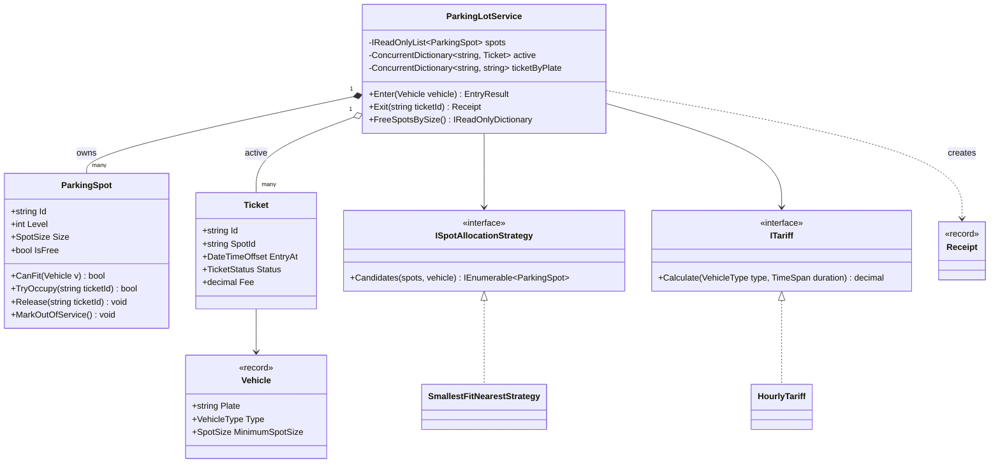
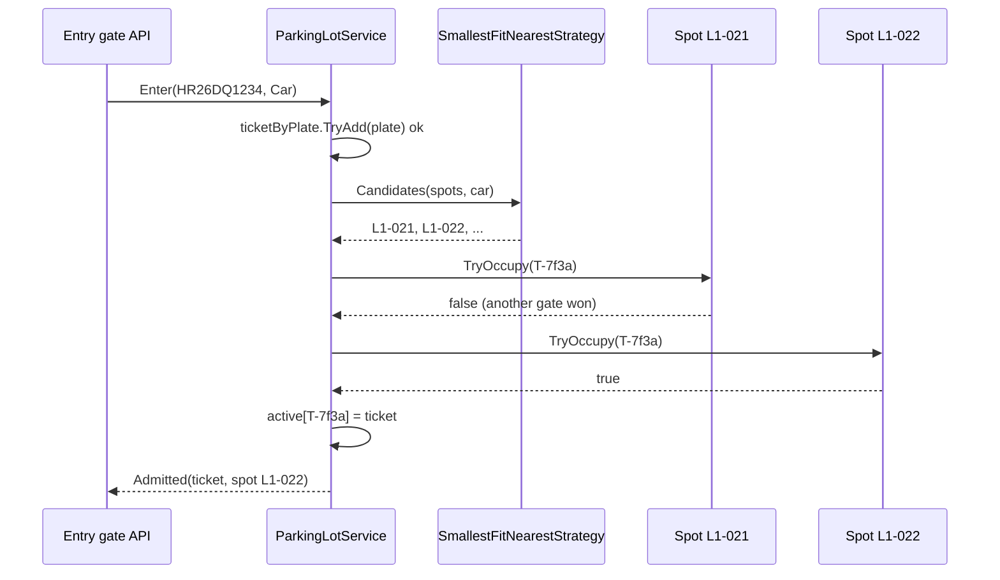
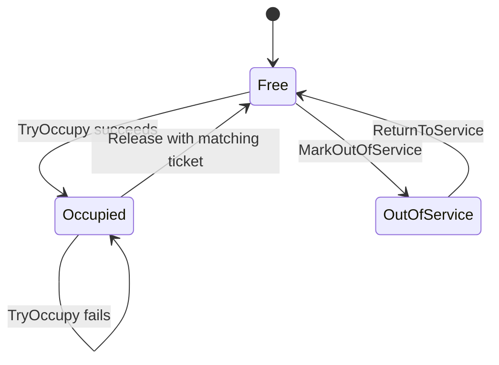
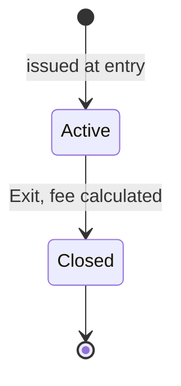
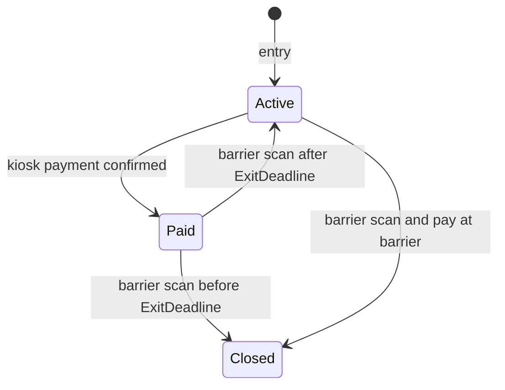

The parking lot is the classic first low-level design (LLD) interview problem. It looks easy, which is exactly why it is useful: the interviewer wants to see whether you ask the right questions, split responsibilities sensibly, and notice the one genuinely hard part. That hard part is concurrency. Two cars arrive at two gates at the same moment, and there is one spot left. Exactly one of them must get it.

## Learning objectives

By the end of this case study you will be able to:

1. Turn a vague prompt ("design a parking lot") into clear functional and non-functional requirements by asking clarifying questions.
2. Identify the core classes (vehicle, spot, ticket, tariff, allocation rule, lot) and give each one a single job.
3. Draw the class diagram and the state diagrams for a spot and a ticket.
4. Use Strategy for two independent decisions: *which spot* and *how much to charge*.
5. Make spot assignment safe under concurrent entry using an atomic compare-and-swap (`Interlocked.CompareExchange`).
6. Write xUnit tests for pricing, allocation and a real race condition, with a controllable clock.
7. Explain how the design changes when the lot's state moves into PostgreSQL.

## Prerequisites

- [Identifying classes and responsibilities](#/lesson/m07-classes-responsibilities): we use the nouns-and-verbs technique.
- [Strategy](#/lesson/m06-strategy): spot allocation and pricing are both strategies.
- [Class diagrams](#/lesson/m05-class-diagrams): you should be able to read composition and dependency arrows.

Helpful but optional: [Deadlocks, optimistic and pessimistic locking](#/lesson/m09-locking) for the database section.

## Explain it like I'm a beginner

Think of the multi-level car park at a big mall. You drive up to the boom barrier. A machine reads your number plate, prints a slip with a time on it, and the barrier lifts. A screen says "Level 2: 14 free". You park. Three hours later you drive to the exit barrier, the machine reads your slip, says "₹150", you pay, and the barrier lifts.

Inside the software, a few "workers" do this together:

- A **spot** knows only one thing: is someone parked in me, and who?
- A **ticket** is the slip: which car, which spot, what time it came in.
- A **tariff** is the price board at the entrance: "₹50 per hour for cars, first 15 minutes free".
- An **allocation rule** is the attendant who waves you towards a spot: "small cars to the small spots first, please".
- The **lot** is the manager. It does not do the work itself. It asks the others in the right order.

Now the tricky bit. Two attendants at two gates both look at the board, both see "1 free spot on Level 3", and both wave a car towards spot L3-042. Two cars, one spot. In software this is called a **race condition** (two actions racing, and the result depends on who finishes first). The fix is like a key hook: there is only one key for each spot, and whoever grabs the key first gets the spot. The second attendant finds the hook empty and picks the next spot. In C# that key hook is an **atomic compare-and-swap** (an operation the CPU guarantees happens all at once, with no one able to sneak in between the check and the change).

## Requirements

### Clarifying questions

In an interview, spend the first five minutes here. Each answer below is an assumption we will design for; a different answer would change the design.

| Question | Assumed answer | Why it matters |
|---|---|---|
| What vehicles do we support? | Motorcycles, cars and buses. | Decides spot sizes and fitting rules. |
| Can a small vehicle use a bigger spot? | Yes, if no right-sized spot is free. A bus can never use a car spot. | Decides the allocation rule. |
| One building or many? | One building, 3 levels, about 450 spots. Multi-site is an extension. | Keeps state in one process for now. |
| How many entry and exit gates? | 2 entry gates, 2 exit gates, running at the same time. | Forces us to handle concurrency. |
| Is the plate read automatically? | Yes, by a camera (ANPR). We receive the plate as text. | Plate is our identity key; we must normalise "HR 26 dq 1234" to "HR26DQ1234". |
| How is the fee calculated? | Per started hour by vehicle type, with a 15-minute free grace and a 24-hour cap. | Pricing will change, so it must be swappable. |
| Is payment in scope? | Calculating the fee is in scope. Taking the money (UPI, card, FASTag) is behind another system. | Keeps the lot free of payment-provider code. |
| Lost tickets? Reservations? EV charging? | Not in the first version. They are exercises. | Prevents over-engineering on day one. |
| Do we need history? | Each exit produces a receipt. Long-term storage is another component's job. | We return a `Receipt` and stop there. |

### Functional requirements

1. **Entry**: given a plate and vehicle type, assign a suitable free spot and issue a ticket with the entry time. If no suitable spot is free, refuse entry.
2. **No duplicates**: a plate that is already inside cannot enter again (usually a camera misread or a cloned plate, and worth flagging).
3. **Exit**: given a ticket id, calculate the fee, free the spot, and return a receipt. A ticket can be used to exit only once.
4. **Availability**: show how many spots of each size are free, for the display boards.
5. **Maintenance**: staff can take a spot out of service (a water leak, say) and bring it back.

### Non-functional requirements

- **Correctness under concurrency**: with 4 gates working at once, no spot is ever given to two vehicles and no ticket is ever closed twice. This is the most important requirement.
- **Latency**: entry should decide in well under 100 ms so the barrier feels instant. With 450 spots in memory, a linear scan takes microseconds, so we don't need a clever index yet.
- **Testability**: pricing and allocation must be testable without real time passing. We inject the clock.
- **Changeability**: the mall changes its tariff every few months and may add EV bays. Those changes should touch one class each.
- **Availability**: if the process restarts, active tickets must not be lost. In-memory state is fine for this lesson, but we name this as a limitation and solve it in Exercise 5.

### Out of scope

Payment collection, staff log-in, camera integration, reservations and multi-site management.

## Identifying classes and responsibilities

Read the requirements and underline the nouns and verbs. Nouns become candidate classes; verbs become candidate methods.

- Nouns: vehicle, plate, vehicle type, spot, spot size, level, ticket, entry time, fee, tariff, receipt, lot, gate, display board.
- Verbs: enter, assign, issue, exit, calculate, free, show availability, take out of service.

Not every noun deserves a class. **Gate** is only a place where requests come from; in our code it is the HTTP endpoint, so it doesn't need a class. **Level** is just a number on the spot; a `Level` class would hold a list and nothing else. **Display board** reads availability; it is a consumer, not part of the core.

| Class | Responsibility (one sentence) | Why it is separate |
|---|---|---|
| `Vehicle` (record) | Holds a normalised plate and type, and knows the minimum spot size it needs. | It is a value: two vehicles with the same plate and type are the same. |
| `ParkingSpot` | Knows its size and level, and claims or releases itself atomically. | The only place that guards "one vehicle per spot". |
| `Ticket` | Records who parked where and when, and moves from Active to Closed once. | Has a lifecycle and identity (the ticket id). |
| `Receipt` (record) | An immutable summary handed to the driver at exit. | Output data, no behaviour. |
| `ISpotAllocationStrategy` | Orders free, fitting spots by preference. | The mall will change this rule. |
| `ITariff` | Turns a vehicle type and a duration into a fee. | Prices change on a different schedule from allocation. |
| `ParkingLotService` | Coordinates entry and exit, owns the active tickets. | A single entry point (Facade) for gates and APIs. |
| `TimeProvider` | Tells us what time it is. | Built into .NET 8+; lets tests control time. |

A useful test for each responsibility: *"who would ask me to change this?"* The finance team changes the tariff. The operations team changes the allocation rule. Nobody should need to edit `ParkingSpot` for either request. That is the [Single Responsibility Principle](#/lesson/m04-srp) in practice.

## Class diagram



How to read it: `ParkingLotService` sits in the middle and depends on two interfaces, not on any concrete pricing or allocation class. The filled diamond to `ParkingSpot` is composition: the lot owns its spots, and spots don't exist outside a lot. The hollow diamond to `Ticket` is aggregation: the lot holds the *active* tickets, but a closed ticket lives on in a receipt or a database. Notice what `ParkingSpot` does *not* hold: no reference to a `Ticket` object, only the ticket id. That keeps the spot tiny, and it means claiming a spot is a single atomic write of one reference.

The entry flow, step by step:



The strategy returns a *preference list*, not a promise. By the time the lot tries spot L1-021, a car at the other gate may already have claimed it, so `TryOccupy` returns `false` and the lot simply tries the next one. This "suggest, then claim atomically, then fall back" loop is the heart of the concurrency design. The plate check comes first so the same car can't be admitted twice by two cameras.

## Patterns and design decisions

### Strategy, twice

Allocation and pricing are independent decisions that change for different reasons, so each gets its own interface ([Strategy](#/lesson/m06-strategy)).

- `ISpotAllocationStrategy` returns free spots that fit, in order of preference. Our default, `SmallestFitNearestStrategy`, prefers the smallest spot that fits (so a motorcycle doesn't waste a bus bay), then the lowest level, then the lowest spot number. A different mall might prefer "spread cars across levels to balance ramp traffic". That's a new class, not an edit.
- `ITariff` turns a duration into money. `HourlyTariff` charges per *started* hour after a grace period, with a daily cap. A weekend tariff or a flat "₹100 per entry" event tariff is a new class.

Why not one big `IParkingPolicy` interface with both methods? Because then every new pricing idea would also have to restate an allocation rule. Two small interfaces are easier to combine.

### Facade for the gates

`ParkingLotService` is a Facade: gates, the admin UI and the display boards call two or three simple methods, and don't need to know about strategies or spot internals. It is also the **consistency boundary**: all rules about "one ticket per plate" and "one exit per ticket" live here.

### Result instead of exceptions for expected outcomes

"Lot full" and "already inside" are normal business outcomes that happen every day. We return an `EntryResult` with an `EntryOutcome` enum rather than throwing. An unknown ticket id at the exit, on the other hand, means a bug or tampering, so `Exit` throws `TicketNotFoundException`. See [Options pattern and Result pattern](#/lesson/m06-options-result) for the general rule.

### No Singleton class

It is tempting to write `ParkingLot.Instance`. Don't. A static singleton makes tests share state and makes a second building impossible. Instead, register one `ParkingLotService` as a singleton *in the DI container*. Same "one per process" behaviour, without the hidden global. See [Singleton](#/lesson/m06-singleton).

### Injected clock

`TimeProvider` (built into .NET 8 and later) gives us `GetUtcNow()`. Production uses `TimeProvider.System`; tests use a tiny manual clock that we move forward by "3 hours" instantly. Store times as UTC `DateTimeOffset` and convert to Indian Standard Time only for display.

### Concurrency: two cars, one spot

There are four races to handle. The first three are the classic interview answer; the fourth is the one reviewers catch.

1. **Two gates claim the same spot.** Each `ParkingSpot` stores the id of the ticket parked in it, or `null` when free. `TryOccupy` uses `Interlocked.CompareExchange(ref _ticketId, ticketId, null)`. In plain English: "set the field to my ticket id, *but only if* it is still null, and tell me what was there". The CPU does the check and the write as one indivisible step. If two threads try at once, exactly one sees `null` come back and wins; the other sees the winner's id and moves on.
2. **The same plate at two gates** (a misread, or a car that reversed and re-entered). `ConcurrentDictionary.TryAdd(plate, ticketId)` is atomic too: only one `TryAdd` for a given key succeeds.
3. **The same ticket scanned at two exits.** `ConcurrentDictionary.TryRemove(ticketId, out ticket)` hands the ticket to exactly one caller. The other gets `false` and we report "ticket not active".
4. **Maintenance closes a spot while a car is being admitted to it.** This one is easy to miss. A first draft kept a separate `_outOfService` flag: `MarkOutOfService` checked "no ticket" and then set the flag, while `TryOccupy` checked the flag and then did its compare-and-swap. Interleave those four steps and a car is parked in a spot that is closed for a water leak. The fix is to keep the spot's *whole* state in the one field that is compare-and-swapped: `null` (free), a private marker object (out of service), or a ticket id (occupied). Closing a spot is then `CompareExchange(ref _ticketId, marker, null)`, exactly like claiming it, and only one of the two can win.

Why not one big `lock` around `Enter` and `Exit`? It would also be correct, and for 450 spots and 4 gates it would be fast enough. Honestly, a single lock is a perfectly good interview answer if you say why. The atomic version scales better (gates never wait for each other), and it keeps each invariant next to the data it protects. The trade-off is that you must reason carefully about the order of steps, which we do in the comments in the code.

:::callout type=warning title="Check-then-act is the classic bug"
`if (spot.IsFree) spot.Occupant = ticketId;` looks fine and passes every single-threaded test. Under load, two threads can both read `IsFree == true` before either writes. Any time you see "check a condition, then act on it" on shared data, the check and the act must be one atomic step.
:::

## State transitions

A spot has a small lifecycle:



A spot starts free. A successful `TryOccupy` moves it to Occupied, and only `Release` with the *same* ticket id moves it back. That guard stops a buggy exit from freeing someone else's spot. Staff can take a free spot out of service. We chose not to allow taking an occupied spot out of service directly: the car has to leave first. The self-loop shows that a losing `TryOccupy` changes nothing.

The ticket's lifecycle is even simpler, and that is deliberate:



A ticket is Active from entry until exit, then Closed forever. Exercise 4 adds a Paid state for "pay at the kiosk, then leave within 15 minutes", which is how many real car parks work. Keeping the first version to two states makes the core easy to verify.

## C# implementation

Project layout (one ASP.NET Core project):

```text
ParkingLot.Api/
  Program.cs
  Domain/Vehicle.cs
  Domain/ParkingSpot.cs
  Domain/Ticket.cs
  Allocation/SpotAllocation.cs
  Pricing/HourlyTariff.cs
  ParkingLotService.cs
  LotLayout.cs
```

```csharp file=Domain/Vehicle.cs
namespace ParkingLot.Domain;

public enum VehicleType { Motorcycle, Car, Bus }

/// <summary>Ordered smallest to largest, so "fits" is a simple comparison.</summary>
public enum SpotSize { Small = 0, Compact = 1, Large = 2 }

public sealed record Vehicle
{
    public Vehicle(string plate, VehicleType type)
    {
        if (string.IsNullOrWhiteSpace(plate)) throw new ArgumentException("Plate is required.", nameof(plate));
        Plate = NormalisePlate(plate);
        if (Plate.Length == 0) throw new ArgumentException("Plate has no letters or digits.", nameof(plate));
        Type = type;
    }

    public string Plate { get; }
    public VehicleType Type { get; }

    public SpotSize MinimumSpotSize => Type switch
    {
        VehicleType.Motorcycle => SpotSize.Small,
        VehicleType.Car => SpotSize.Compact,
        VehicleType.Bus => SpotSize.Large,
        _ => throw new ArgumentOutOfRangeException(nameof(Type), Type, "Unknown vehicle type."),
    };

    /// <summary>"hr 26 dq-1234" and "HR26DQ1234" are the same car.</summary>
    public static string NormalisePlate(string plate) =>
        new string(plate.Where(char.IsLetterOrDigit).ToArray()).ToUpperInvariant();
}
```

```csharp file=Domain/ParkingSpot.cs
namespace ParkingLot.Domain;

/// <summary>
/// One physical bay. Thread-safe: the spot's whole state is a single reference that is only ever changed
/// with Interlocked.CompareExchange, so "check free" and "claim" happen as one atomic step.
/// null = free; OutOfServiceMarker = closed for maintenance; anything else = the ticket parked here.
/// </summary>
public sealed class ParkingSpot
{
    // A private instance, compared by reference, so no ticket id can ever be mistaken for it.
    private static readonly string OutOfServiceMarker = new("#out-of-service#".ToCharArray());
    private string? _ticketId;

    public ParkingSpot(int level, int number, SpotSize size)
    {
        ArgumentOutOfRangeException.ThrowIfNegative(level);
        ArgumentOutOfRangeException.ThrowIfNegativeOrZero(number);
        Level = level;
        Number = number;
        Size = size;
        Id = $"L{level}-{number:D3}";
    }

    public string Id { get; }
    public int Level { get; }
    public int Number { get; }
    public SpotSize Size { get; }

    public string? TicketId
    {
        get
        {
            var holder = Volatile.Read(ref _ticketId);
            return ReferenceEquals(holder, OutOfServiceMarker) ? null : holder;
        }
    }

    public bool IsOutOfService => ReferenceEquals(Volatile.Read(ref _ticketId), OutOfServiceMarker);
    public bool IsFree => Volatile.Read(ref _ticketId) is null;

    public bool CanFit(Vehicle vehicle) => Size >= vehicle.MinimumSpotSize;

    /// <summary>Claims the spot for a ticket. Returns false if someone else holds it.</summary>
    public bool TryOccupy(string ticketId)
    {
        ArgumentException.ThrowIfNullOrEmpty(ticketId);
        // Atomic: write ticketId only if the field is still null (free). Fails if occupied or out of service.
        return Interlocked.CompareExchange(ref _ticketId, ticketId, null) is null;
    }

    /// <summary>Frees the spot. Only the ticket that holds it may release it.</summary>
    public void Release(string ticketId)
    {
        while (true)
        {
            var current = Volatile.Read(ref _ticketId);
            if (ReferenceEquals(current, OutOfServiceMarker) || !string.Equals(current, ticketId, StringComparison.Ordinal))
                throw new InvalidOperationException($"Spot {Id} is not held by ticket {ticketId}.");
            // CompareExchange compares references, so swap using the exact instance we just read.
            if (ReferenceEquals(Interlocked.CompareExchange(ref _ticketId, null, current), current)) return;
        }
    }

    /// <summary>Closes a free spot. Same compare-and-swap as TryOccupy, so a car can't slip in between
    /// "is it free?" and "close it".</summary>
    public void MarkOutOfService()
    {
        var previous = Interlocked.CompareExchange(ref _ticketId, OutOfServiceMarker, null);
        if (previous is null || ReferenceEquals(previous, OutOfServiceMarker)) return;   // closed now, or already
        throw new InvalidOperationException($"Spot {Id} is occupied; move the vehicle first.");
    }

    /// <summary>Reopens the spot only if it is out of service; never frees a parked car.</summary>
    public void ReturnToService() => Interlocked.CompareExchange(ref _ticketId, null, OutOfServiceMarker);
}
```

```csharp file=Domain/Ticket.cs
namespace ParkingLot.Domain;

public enum TicketStatus { Active, Closed }

public sealed class Ticket
{
    internal Ticket(string id, Vehicle vehicle, string spotId, DateTimeOffset entryAt)
    {
        Id = id;
        Vehicle = vehicle;
        SpotId = spotId;
        EntryAt = entryAt;
    }

    public string Id { get; }
    public Vehicle Vehicle { get; }
    public string SpotId { get; }
    public DateTimeOffset EntryAt { get; }
    public TicketStatus Status { get; private set; } = TicketStatus.Active;
    public DateTimeOffset? ExitAt { get; private set; }
    public decimal? Fee { get; private set; }

    internal void Close(DateTimeOffset exitAt, decimal fee)
    {
        if (Status != TicketStatus.Active) throw new InvalidOperationException($"Ticket {Id} is already closed.");
        if (exitAt < EntryAt) throw new ArgumentException("Exit cannot be before entry.", nameof(exitAt));
        ArgumentOutOfRangeException.ThrowIfNegative(fee);
        ExitAt = exitAt;
        Fee = fee;
        Status = TicketStatus.Closed;
    }
}

public sealed record Receipt(string TicketId, string Plate, string SpotId,
    DateTimeOffset EntryAt, DateTimeOffset ExitAt, decimal Fee)
{
    public TimeSpan Duration => ExitAt - EntryAt;
}

public enum EntryOutcome { Admitted, LotFull, AlreadyInside }

public sealed record EntryResult(EntryOutcome Outcome, Ticket? Ticket)
{
    public static EntryResult Admitted(Ticket ticket) => new(EntryOutcome.Admitted, ticket);
    public static EntryResult LotFull() => new(EntryOutcome.LotFull, null);
    public static EntryResult AlreadyInside() => new(EntryOutcome.AlreadyInside, null);
}

public sealed class TicketNotFoundException(string ticketId)
    : Exception($"Ticket {ticketId} is not active (unknown, or already used to exit).")
{
    public string TicketId { get; } = ticketId;
}
```

```csharp file=Allocation/SpotAllocation.cs
using ParkingLot.Domain;

namespace ParkingLot.Allocation;

/// <summary>
/// Orders free spots that fit the vehicle, best first. The result is a hint: by the time the caller
/// tries a spot, another gate may have taken it, so callers must claim with TryOccupy and fall back.
/// </summary>
public interface ISpotAllocationStrategy
{
    IEnumerable<ParkingSpot> Candidates(IReadOnlyList<ParkingSpot> spots, Vehicle vehicle);
}

/// <summary>Smallest spot that fits (don't waste bus bays), then lowest level, then lowest number.</summary>
public sealed class SmallestFitNearestStrategy : ISpotAllocationStrategy
{
    public IEnumerable<ParkingSpot> Candidates(IReadOnlyList<ParkingSpot> spots, Vehicle vehicle) =>
        spots.Where(s => s.IsFree && s.CanFit(vehicle))
             .OrderBy(s => s.Size)
             .ThenBy(s => s.Level)
             .ThenBy(s => s.Number);
}
```

```csharp file=Pricing/HourlyTariff.cs
using ParkingLot.Domain;

namespace ParkingLot.Pricing;

public interface ITariff
{
    decimal Calculate(VehicleType type, TimeSpan duration);
}

public sealed record Rate(decimal PerHour, decimal DailyCap);

/// <summary>
/// Free within the grace period. Otherwise each started hour is charged, each full 24 hours costs the
/// daily cap, and the leftover part-day is charged per started hour but never more than the cap.
/// </summary>
public sealed class HourlyTariff : ITariff
{
    private readonly IReadOnlyDictionary<VehicleType, Rate> _rates;
    private readonly TimeSpan _grace;

    public HourlyTariff(IReadOnlyDictionary<VehicleType, Rate> rates, TimeSpan grace)
    {
        ArgumentNullException.ThrowIfNull(rates);
        if (grace < TimeSpan.Zero) throw new ArgumentOutOfRangeException(nameof(grace));
        _rates = rates;
        _grace = grace;
    }

    /// <summary>Example rates for a city mall. Real rates come from configuration.</summary>
    public static HourlyTariff MallDefaults() => new(new Dictionary<VehicleType, Rate>
    {
        [VehicleType.Motorcycle] = new(20m, 150m),
        [VehicleType.Car] = new(50m, 400m),
        [VehicleType.Bus] = new(150m, 1200m),
    }, TimeSpan.FromMinutes(15));

    public decimal Calculate(VehicleType type, TimeSpan duration)
    {
        if (duration < TimeSpan.Zero) throw new ArgumentOutOfRangeException(nameof(duration));
        if (!_rates.TryGetValue(type, out var rate)) throw new InvalidOperationException($"No rate for {type}.");
        if (duration <= _grace) return 0m;

        var fullDays = duration.Ticks / TimeSpan.TicksPerDay;
        var leftover = duration.Ticks % TimeSpan.TicksPerDay;
        var startedHours = (leftover + TimeSpan.TicksPerHour - 1) / TimeSpan.TicksPerHour; // integer ceiling
        var partDay = Math.Min(startedHours * rate.PerHour, rate.DailyCap);
        return fullDays * rate.DailyCap + partDay;
    }
}
```

```csharp file=ParkingLotService.cs
using System.Collections.Concurrent;
using ParkingLot.Allocation;
using ParkingLot.Domain;
using ParkingLot.Pricing;

namespace ParkingLot;

/// <summary>Facade used by gates and APIs. Thread-safe; register one instance per car park.</summary>
public sealed class ParkingLotService
{
    private readonly IReadOnlyList<ParkingSpot> _spots;
    private readonly Dictionary<string, ParkingSpot> _spotsById;
    private readonly ISpotAllocationStrategy _allocation;
    private readonly ITariff _tariff;
    private readonly TimeProvider _clock;
    private readonly ConcurrentDictionary<string, Ticket> _active = new(StringComparer.Ordinal);
    private readonly ConcurrentDictionary<string, string> _ticketByPlate = new(StringComparer.Ordinal);

    public ParkingLotService(IEnumerable<ParkingSpot> spots, ISpotAllocationStrategy allocation, ITariff tariff, TimeProvider clock)
    {
        _spots = spots.ToList();
        if (_spots.Count == 0) throw new ArgumentException("A car park needs at least one spot.", nameof(spots));
        _spotsById = _spots.ToDictionary(s => s.Id, StringComparer.Ordinal); // throws on duplicate ids
        _allocation = allocation;
        _tariff = tariff;
        _clock = clock;
    }

    public int ActiveTickets => _active.Count;

    public EntryResult Enter(Vehicle vehicle)
    {
        ArgumentNullException.ThrowIfNull(vehicle);
        var ticketId = "T-" + Guid.NewGuid().ToString("N")[..12];

        // Step 1: reserve the plate. Atomic, so two cameras reading one car admit it once.
        if (!_ticketByPlate.TryAdd(vehicle.Plate, ticketId)) return EntryResult.AlreadyInside();

        // Step 2: walk the preference list and claim the first spot we can win.
        foreach (var spot in _allocation.Candidates(_spots, vehicle))
        {
            if (!spot.CanFit(vehicle)) continue;        // don't trust a buggy strategy with a bus
            if (!spot.TryOccupy(ticketId)) continue;    // another gate won this spot; try the next
            var ticket = new Ticket(ticketId, vehicle, spot.Id, _clock.GetUtcNow());
            _active[ticketId] = ticket;
            return EntryResult.Admitted(ticket);
        }

        // Step 3: nothing free. Undo step 1, but only our own reservation.
        _ticketByPlate.TryRemove(new KeyValuePair<string, string>(vehicle.Plate, ticketId));
        return EntryResult.LotFull();
    }

    public Receipt Exit(string ticketId)
    {
        ArgumentException.ThrowIfNullOrEmpty(ticketId);
        // Atomic hand-off: if two exit gates scan the same ticket, only one gets it.
        if (!_active.TryRemove(ticketId, out var ticket)) throw new TicketNotFoundException(ticketId);

        var now = _clock.GetUtcNow();
        var fee = _tariff.Calculate(ticket.Vehicle.Type, now - ticket.EntryAt);
        ticket.Close(now, fee);
        _spotsById[ticket.SpotId].Release(ticketId);
        _ticketByPlate.TryRemove(new KeyValuePair<string, string>(ticket.Vehicle.Plate, ticketId));
        return new Receipt(ticket.Id, ticket.Vehicle.Plate, ticket.SpotId, ticket.EntryAt, now, fee);
    }

    public Ticket? FindActive(string ticketId) => _active.GetValueOrDefault(ticketId);

    public IReadOnlyDictionary<SpotSize, int> FreeSpotsBySize() =>
        Enum.GetValues<SpotSize>().ToDictionary(size => size, size => _spots.Count(s => s.Size == size && s.IsFree));

    public ParkingSpot GetSpot(string spotId) =>
        _spotsById.TryGetValue(spotId, out var s) ? s : throw new KeyNotFoundException($"No spot {spotId}.");
}
```

```csharp file=LotLayout.cs
using ParkingLot.Domain;

namespace ParkingLot;

public static class LotLayout
{
    /// <summary>Numbers spots per level: small bays first, then compact, then large.</summary>
    public static IReadOnlyList<ParkingSpot> Build(int levels, int small, int compact, int large)
    {
        var spots = new List<ParkingSpot>(levels * (small + compact + large));
        for (var level = 1; level <= levels; level++)
        {
            var n = 1;
            for (var i = 0; i < small; i++) spots.Add(new ParkingSpot(level, n++, SpotSize.Small));
            for (var i = 0; i < compact; i++) spots.Add(new ParkingSpot(level, n++, SpotSize.Compact));
            for (var i = 0; i < large; i++) spots.Add(new ParkingSpot(level, n++, SpotSize.Large));
        }
        return spots;
    }
}
```

```csharp file=Program.cs
using System.Text.Json.Serialization;
using ParkingLot;
using ParkingLot.Allocation;
using ParkingLot.Domain;
using ParkingLot.Pricing;

var builder = WebApplication.CreateBuilder(args);
builder.Services.ConfigureHttpJsonOptions(o => o.SerializerOptions.Converters.Add(new JsonStringEnumConverter()));

builder.Services.AddSingleton(TimeProvider.System);
builder.Services.AddSingleton<ISpotAllocationStrategy, SmallestFitNearestStrategy>();
builder.Services.AddSingleton<ITariff>(_ => HourlyTariff.MallDefaults());
// One car park per process: 3 levels x (20 small + 100 compact + 30 large) = 450 spots.
builder.Services.AddSingleton(sp => new ParkingLotService(
    LotLayout.Build(levels: 3, small: 20, compact: 100, large: 30),
    sp.GetRequiredService<ISpotAllocationStrategy>(),
    sp.GetRequiredService<ITariff>(),
    sp.GetRequiredService<TimeProvider>()));

var app = builder.Build();

app.MapPost("/entries", (EntryRequest req, ParkingLotService lot) =>
{
    if (string.IsNullOrWhiteSpace(req.Plate)) return Results.Problem("Plate is required.", statusCode: 400);
    var result = lot.Enter(new Vehicle(req.Plate, req.Type));
    return result.Outcome switch
    {
        EntryOutcome.Admitted => Results.Created($"/tickets/{result.Ticket!.Id}",
            new { result.Ticket.Id, result.Ticket.SpotId, result.Ticket.EntryAt }),
        EntryOutcome.LotFull => Results.Problem("No suitable spot is free.", statusCode: 409),
        EntryOutcome.AlreadyInside => Results.Problem("This vehicle is already inside.", statusCode: 409),
        _ => Results.StatusCode(500),
    };
});

app.MapPost("/tickets/{ticketId}/exit", (string ticketId, ParkingLotService lot) =>
{
    try { return Results.Ok(lot.Exit(ticketId)); }
    catch (TicketNotFoundException ex) { return Results.Problem(ex.Message, statusCode: 404); }
});

app.MapGet("/availability", (ParkingLotService lot) => Results.Ok(lot.FreeSpotsBySize()));

app.Run();

public sealed record EntryRequest(string Plate, VehicleType Type);
```

A few decisions worth pointing out:

- **`Exit` removes the ticket first, then calculates.** If two exit gates race, the loser never touches the spot. If the tariff threw an exception after removal, the ticket would be lost from memory; in a real system you would persist the closed ticket in the same database transaction (Exercise 5).
- **The strategy can't break the invariant.** Even if a buggy strategy returned an occupied spot or a car spot for a bus, `CanFit` and `TryOccupy` would refuse it. Rules that protect correctness live in the domain, not in a pluggable policy.
- **`FreeSpotsBySize` is approximate under load.** It counts while gates are working, so a board might show 3 when it is really 2 for a few milliseconds. That's acceptable for a display board. It would not be acceptable for the entry decision itself, which is why entry uses `TryOccupy`, not the count.

## Automated testing

Three kinds of test cover the design: pure pricing tests, lot behaviour tests with a manual clock, and a concurrency test that actually races threads.

```csharp
using ParkingLot;
using ParkingLot.Allocation;
using ParkingLot.Domain;
using ParkingLot.Pricing;
using Xunit;

public sealed class ManualClock(DateTimeOffset start) : TimeProvider
{
    private DateTimeOffset _now = start;
    public override DateTimeOffset GetUtcNow() => _now;
    public void Advance(TimeSpan by) => _now += by;
}

public class HourlyTariffTests
{
    private readonly HourlyTariff _tariff = HourlyTariff.MallDefaults();

    [Theory]
    [InlineData(14, 0)]          // inside grace
    [InlineData(15, 0)]          // exactly the grace period is still free
    [InlineData(16, 50)]         // one started hour
    [InlineData(130, 150)]       // 2 h 10 min = 3 started hours
    [InlineData(600, 400)]       // 10 hours capped at 400
    [InlineData(1560, 500)]      // 26 hours = one day cap + 2 hours
    public void Car_fees(int minutes, int expected) =>
        Assert.Equal((decimal)expected, _tariff.Calculate(VehicleType.Car, TimeSpan.FromMinutes(minutes)));
}

public class ParkingLotServiceTests
{
    private static readonly DateTimeOffset Start = new(2026, 10, 18, 4, 30, 0, TimeSpan.Zero); // 10:00 IST

    private static (ParkingLotService Lot, ManualClock Clock) NewLot(int small = 1, int compact = 2, int large = 1)
    {
        var clock = new ManualClock(Start);
        var lot = new ParkingLotService(LotLayout.Build(1, small, compact, large),
            new SmallestFitNearestStrategy(), HourlyTariff.MallDefaults(), clock);
        return (lot, clock);
    }

    [Fact]
    public void Motorcycle_gets_small_spot_and_car_gets_compact()
    {
        var (lot, _) = NewLot();
        Assert.Equal("L1-001", lot.Enter(new Vehicle("DL 3S AB 1234", VehicleType.Motorcycle)).Ticket!.SpotId);
        Assert.Equal("L1-002", lot.Enter(new Vehicle("HR26DQ1234", VehicleType.Car)).Ticket!.SpotId);
    }

    [Fact]
    public void Car_falls_back_to_large_spot_but_never_small()
    {
        var (lot, _) = NewLot(small: 1, compact: 0, large: 1);
        Assert.Equal("L1-002", lot.Enter(new Vehicle("KA01AA0001", VehicleType.Car)).Ticket!.SpotId);
        Assert.Equal(EntryOutcome.LotFull, lot.Enter(new Vehicle("KA01AA0002", VehicleType.Car)).Outcome);
    }

    [Fact]
    public void Same_plate_cannot_enter_twice_even_with_different_spacing()
    {
        var (lot, _) = NewLot();
        lot.Enter(new Vehicle("hr 26 dq 1234", VehicleType.Car));
        Assert.Equal(EntryOutcome.AlreadyInside, lot.Enter(new Vehicle("HR26DQ1234", VehicleType.Car)).Outcome);
    }

    [Fact]
    public void Exit_charges_by_duration_and_frees_the_spot()
    {
        var (lot, clock) = NewLot();
        var ticket = lot.Enter(new Vehicle("MH12AB1234", VehicleType.Car)).Ticket!;
        clock.Advance(TimeSpan.FromMinutes(130));
        var receipt = lot.Exit(ticket.Id);
        Assert.Equal(150m, receipt.Fee);
        Assert.True(lot.GetSpot(ticket.SpotId).IsFree);
        Assert.Equal(TicketStatus.Closed, ticket.Status);
    }

    [Fact]
    public void A_ticket_can_exit_only_once()
    {
        var (lot, _) = NewLot();
        var ticket = lot.Enter(new Vehicle("MH12AB1234", VehicleType.Car)).Ticket!;
        lot.Exit(ticket.Id);
        Assert.Throws<TicketNotFoundException>(() => lot.Exit(ticket.Id));
    }

    [Fact]
    public void Out_of_service_spot_is_skipped()
    {
        var (lot, _) = NewLot(small: 0, compact: 2, large: 0);
        lot.GetSpot("L1-001").MarkOutOfService();
        Assert.Equal("L1-002", lot.Enter(new Vehicle("TN09ZZ0001", VehicleType.Car)).Ticket!.SpotId);
    }
}

public class ParkingConcurrencyTests
{
    [Fact]
    public void Many_cars_racing_for_few_spots_never_share_a_spot()
    {
        var lot = new ParkingLotService(LotLayout.Build(1, 0, 10, 0), new SmallestFitNearestStrategy(),
            HourlyTariff.MallDefaults(), TimeProvider.System);
        var results = new System.Collections.Concurrent.ConcurrentBag<EntryResult>();

        Parallel.For(0, 500, new ParallelOptions { MaxDegreeOfParallelism = 16 },
            i => results.Add(lot.Enter(new Vehicle($"UP16CAR{i:D4}", VehicleType.Car))));

        var admitted = results.Where(r => r.Outcome == EntryOutcome.Admitted).ToList();
        Assert.Equal(10, admitted.Count);
        Assert.Equal(10, admitted.Select(r => r.Ticket!.SpotId).Distinct().Count());
        Assert.Equal(490, results.Count(r => r.Outcome == EntryOutcome.LotFull));
    }

    [Fact]
    public void Two_exit_gates_scanning_one_ticket_close_it_once()
    {
        var lot = new ParkingLotService(LotLayout.Build(1, 0, 1, 0), new SmallestFitNearestStrategy(),
            HourlyTariff.MallDefaults(), TimeProvider.System);
        var ticket = lot.Enter(new Vehicle("GJ01XY0001", VehicleType.Car)).Ticket!;
        var ok = 0; var rejected = 0;
        Parallel.For(0, 8, _ =>
        {
            try { lot.Exit(ticket.Id); Interlocked.Increment(ref ok); }
            catch (TicketNotFoundException) { Interlocked.Increment(ref rejected); }
        });
        Assert.Equal(1, ok);
        Assert.Equal(7, rejected);
    }

    [Fact]
    public void Maintenance_and_entry_never_both_win_a_spot()
    {
        for (var round = 0; round < 200; round++)
        {
            var spot = new ParkingSpot(1, 1, SpotSize.Compact);
            var occupied = false;
            var closed = false;
            Parallel.Invoke(
                () => occupied = spot.TryOccupy("T-1"),
                () => { try { spot.MarkOutOfService(); closed = true; } catch (InvalidOperationException) { } });
            Assert.True(occupied ^ closed);                       // exactly one of them wins, every time
        }
    }

    [Fact]
    public void Return_to_service_never_frees_a_parked_car()
    {
        var spot = new ParkingSpot(1, 1, SpotSize.Compact);
        Assert.True(spot.TryOccupy("T-1"));
        spot.ReturnToService();
        Assert.Equal("T-1", spot.TicketId);
    }
}
```

What these tests buy you:

- The tariff tests pin the edge cases (exactly 15 minutes, exactly a started hour, the cap, more than a day). Pricing bugs cost real money and real complaints, so test boundaries, not just one happy path.
- `ManualClock` is a hand-written fake. The real `FakeTimeProvider` lives in the `Microsoft.Extensions.TimeProvider.Testing` package; ours is six lines and does the same job here.
- The maintenance test pins race 4. Before the fix, it could pass a hundred times and fail on the hundred-and-first; with one compare-and-swapped field there is no interleaving in which both sides win.
- The concurrency test runs 500 entries across 16 threads against 10 spots. Against a naive check-then-act spot, it fails often but not always, which is the nature of race bugs. A passing run doesn't *prove* the code is safe; the proof is the reasoning about atomic operations. The test is a smoke alarm, not a guarantee. Run it in a loop of 100 when you change the locking code.

## Bad design vs good design

**Bad**: one `ParkingLot` god class.

```csharp
public class ParkingLot
{
    public static ParkingLot Instance = new();
    public List<string?> Spots = new(new string?[450]);       // index = spot, value = plate
    public Dictionary<string, DateTime> EntryTimes = new();

    public int Park(string plate, string type)
    {
        for (int i = 0; i < Spots.Count; i++)
            if (Spots[i] == null && (type != "bus" || i >= 400))  // magic numbers for spot sizes
            { Spots[i] = plate; EntryTimes[plate] = DateTime.Now; return i; }
        return -1;
    }

    public decimal Leave(string plate)
    {
        var hours = (DateTime.Now - EntryTimes[plate]).TotalHours;
        var fee = type == "car" ? Math.Ceiling(hours) * 50 : ...;   // pricing tangled with exit
        Spots[Spots.IndexOf(plate)] = null;
        return (decimal)fee;
    }
}
```

What goes wrong:

- **Race condition**: `Spots[i] == null` then `Spots[i] = plate` is check-then-act on a shared `List`. Two gates can park two cars in spot 37. `List<T>` and `Dictionary` are not even safe for concurrent writes; they can corrupt their internal arrays.
- **Static singleton**: every test shares `Instance`, so tests interfere, and a second building can't exist.
- **`DateTime.Now`**: local time, untestable, and wrong twice a year in countries with daylight saving. Fees can't be tested without waiting.
- **Magic numbers** (`i >= 400` means "large spot") and string types (`"bus"`) let typos compile.
- **Mixed reasons to change**: finance's tariff change and operations' allocation change both edit this class.
- **`-1` for full**: callers forget to check and park in spot -1.

**Good**: the design above. Each rule has one home, the shared state is guarded by atomic operations, time is injected, and outcomes are typed.

**Is the good design over-engineered for a small lot?** For a 20-spot office car park with one gate, a single class with a `lock`, an enum and an injected clock would be fine. The two strategy interfaces earn their place when prices or allocation rules change, or when you run several sites with different rules. Say this out loud in an interview: it shows judgement.

## Alternative designs

1. **One lock instead of atomics.** Put `lock (_gate)` around the body of `Enter` and `Exit`. Simpler to reason about, correct, and fast enough for a few gates. It becomes a bottleneck only with many concurrent callers, or if someone adds slow work (a database call, a camera API) inside the lock.
2. **Free-spot queues per size.** Keep a `ConcurrentQueue<ParkingSpot>` (or a priority queue under a lock) of free spots for each size. Entry dequeues in O(1) instead of scanning. Worth it at tens of thousands of spots, or a city-wide pool. The cost: the queue and the spot state can disagree if you forget to enqueue on release or on return-to-service.
3. **Spot inheritance** (`SmallSpot`, `CompactSpot`, `LargeSpot` subclasses). Common in textbook answers. It adds classes but no behaviour, because the only difference is a size value. Prefer the enum. Use subclasses only if spot types really behave differently, for example an `EvChargingSpot` that also manages a charging session.
4. **Database as the source of truth.** For several gates on several servers, in-memory state is not enough. Store spots and sessions in PostgreSQL. A partial unique index (`CREATE UNIQUE INDEX ON parking_session (spot_id) WHERE exited_at IS NULL`) makes "one active session per spot" impossible to break, and `SELECT ... FOR UPDATE SKIP LOCKED` lets each gate grab a different free spot without waiting. Exercise 5 works through this.
5. **Event-driven display boards.** Instead of boards polling `FreeSpotsBySize`, the lot raises `SpotOccupied` and `SpotReleased` events ([Observer](#/lesson/m06-observer)). Better for 30 boards across the building; unnecessary for one.

## Practical playground

Open the reference class model in the LLD designer. Try adding an `EvChargingSpot` concept, a `Payment` step, or a `Level` class, and see what new arrows each one needs. If an addition needs arrows to almost every class, it is probably in the wrong place.

:::playground type=lld title="Parking lot reference model"
```json
{
  "classes": [
    { "id": "Lot", "name": "ParkingLotService", "kind": "class",
      "fields": ["-IReadOnlyList~ParkingSpot~ _spots", "-ConcurrentDictionary _active", "-ConcurrentDictionary _ticketByPlate", "-TimeProvider _clock"],
      "methods": ["+EntryResult Enter(Vehicle vehicle)", "+Receipt Exit(string ticketId)", "+IReadOnlyDictionary FreeSpotsBySize()"],
      "responsibility": "Facade for gates; enforces one ticket per plate and one exit per ticket" },
    { "id": "Spot", "name": "ParkingSpot", "kind": "class",
      "fields": ["+string Id", "+int Level", "+SpotSize Size", "-string? _ticketId"],
      "methods": ["+bool CanFit(Vehicle v)", "+bool TryOccupy(string ticketId)", "+void Release(string ticketId)", "+void MarkOutOfService()"],
      "responsibility": "Claims and releases itself atomically" },
    { "id": "Vehicle", "name": "Vehicle", "kind": "record",
      "fields": ["+string Plate", "+VehicleType Type"], "methods": ["+SpotSize MinimumSpotSize"],
      "responsibility": "Normalised plate plus type" },
    { "id": "Ticket", "name": "Ticket", "kind": "class",
      "fields": ["+string Id", "+string SpotId", "+DateTimeOffset EntryAt", "+TicketStatus Status", "+decimal? Fee"],
      "methods": ["~void Close(DateTimeOffset exitAt, decimal fee)"],
      "responsibility": "Records one stay; Active to Closed once" },
    { "id": "Receipt", "name": "Receipt", "kind": "record",
      "fields": ["+string TicketId", "+DateTimeOffset EntryAt", "+DateTimeOffset ExitAt", "+decimal Fee"], "methods": [] },
    { "id": "EntryResult", "name": "EntryResult", "kind": "record",
      "fields": ["+EntryOutcome Outcome", "+Ticket? Ticket"], "methods": [] },
    { "id": "IAlloc", "name": "ISpotAllocationStrategy", "kind": "interface",
      "fields": [], "methods": ["IEnumerable~ParkingSpot~ Candidates(spots, Vehicle vehicle)"] },
    { "id": "Smallest", "name": "SmallestFitNearestStrategy", "kind": "class",
      "fields": [], "methods": ["+IEnumerable~ParkingSpot~ Candidates(spots, Vehicle vehicle)"],
      "responsibility": "Smallest fitting size, then lowest level and number" },
    { "id": "ITariff", "name": "ITariff", "kind": "interface",
      "fields": [], "methods": ["decimal Calculate(VehicleType type, TimeSpan duration)"] },
    { "id": "Hourly", "name": "HourlyTariff", "kind": "class",
      "fields": ["-IReadOnlyDictionary _rates", "-TimeSpan _grace"], "methods": ["+decimal Calculate(VehicleType type, TimeSpan duration)"],
      "responsibility": "Per started hour after grace, with a daily cap" },
    { "id": "SpotSize", "name": "SpotSize", "kind": "enum", "fields": ["Small", "Compact", "Large"], "methods": [] },
    { "id": "VehicleType", "name": "VehicleType", "kind": "enum", "fields": ["Motorcycle", "Car", "Bus"], "methods": [] }
  ],
  "relations": [
    { "from": "Lot", "to": "Spot", "kind": "composition", "multiplicity": "1..*" },
    { "from": "Lot", "to": "Ticket", "kind": "aggregation", "label": "active", "multiplicity": "0..*" },
    { "from": "Lot", "to": "IAlloc", "kind": "dependency" },
    { "from": "Lot", "to": "ITariff", "kind": "dependency" },
    { "from": "Lot", "to": "Receipt", "kind": "dependency", "label": "creates" },
    { "from": "Lot", "to": "EntryResult", "kind": "dependency", "label": "returns" },
    { "from": "Ticket", "to": "Vehicle", "kind": "association" },
    { "from": "Smallest", "to": "IAlloc", "kind": "implements" },
    { "from": "Hourly", "to": "ITariff", "kind": "implements" },
    { "from": "Spot", "to": "SpotSize", "kind": "association" },
    { "from": "Vehicle", "to": "VehicleType", "kind": "association" }
  ]
}
```
:::

## Exercises

:::exercise id=m18-parking-lot-ex1 difficulty=beginner kind=code title="Implement the hourly tariff"
Implement `HourlyTariff.Calculate`. The mall's rules: stays up to and including the grace period are free. Otherwise every *started* hour costs the hourly rate. Each full 24 hours costs the daily cap, and the leftover part of a day is charged per started hour but never more than the cap.
::requirements
- Use integer arithmetic on ticks (or whole minutes) for "started hours". Avoid floating-point rounding surprises.
- Negative durations are a bug: throw `ArgumentOutOfRangeException`.
- An unknown vehicle type throws `InvalidOperationException`.
::acceptance
- Car, 15 minutes: ₹0. Car, 16 minutes: ₹50.
- Car, 2 h 10 min: ₹150.
- Car, 10 hours: ₹400 (capped).
- Car, 26 hours: ₹500 (one cap plus 2 hours).
- Motorcycle, 3 hours: ₹60.
::hint
Split the problem in two: whole days, and what is left over.
::hint
`duration.Ticks / TimeSpan.TicksPerDay` gives whole days; `%` gives the leftover ticks.
::hint
Integer ceiling division: `(a + b - 1) / b` rounds up without using `double`.
::hint
```csharp
var startedHours = (leftover + TimeSpan.TicksPerHour - 1) / TimeSpan.TicksPerHour;
var partDay = Math.Min(startedHours * rate.PerHour, rate.DailyCap);
```
::starter
```csharp file=HourlyTariff.cs
using System;
using System.Collections.Generic;

public enum VehicleType { Motorcycle, Car, Bus }

public sealed record Rate(decimal PerHour, decimal DailyCap);

public sealed class HourlyTariff
{
    private readonly IReadOnlyDictionary<VehicleType, Rate> _rates;
    private readonly TimeSpan _grace;

    public HourlyTariff(IReadOnlyDictionary<VehicleType, Rate> rates, TimeSpan grace)
    {
        _rates = rates;
        _grace = grace;
    }

    public static HourlyTariff MallDefaults() => new(new Dictionary<VehicleType, Rate>
    {
        [VehicleType.Motorcycle] = new(20m, 150m),
        [VehicleType.Car] = new(50m, 400m),
        [VehicleType.Bus] = new(150m, 1200m),
    }, TimeSpan.FromMinutes(15));

    public decimal Calculate(VehicleType type, TimeSpan duration) => throw new NotImplementedException();
}
```
::tests
```csharp file=HourlyTariffTests.cs
using System;
using System.Collections.Generic;
using Xunit;

public class HourlyTariffExerciseTests
{
    private readonly HourlyTariff _t = HourlyTariff.MallDefaults();

    [Theory]
    [InlineData(0, 0)]
    [InlineData(15, 0)]
    [InlineData(16, 50)]
    [InlineData(60, 50)]
    [InlineData(61, 100)]
    [InlineData(130, 150)]
    [InlineData(600, 400)]
    [InlineData(1440, 400)]
    [InlineData(1560, 500)]
    public void Car(int minutes, int expected) =>
        Assert.Equal((decimal)expected, _t.Calculate(VehicleType.Car, TimeSpan.FromMinutes(minutes)));

    [Fact]
    public void Motorcycle_three_hours() => Assert.Equal(60m, _t.Calculate(VehicleType.Motorcycle, TimeSpan.FromHours(3)));

    [Fact]
    public void Negative_duration_throws() =>
        Assert.Throws<ArgumentOutOfRangeException>(() => _t.Calculate(VehicleType.Car, TimeSpan.FromMinutes(-1)));

    [Fact]
    public void Unknown_type_throws()
    {
        var t = new HourlyTariff(new Dictionary<VehicleType, Rate> { [VehicleType.Car] = new(50m, 400m) }, TimeSpan.Zero);
        Assert.Throws<InvalidOperationException>(() => t.Calculate(VehicleType.Bus, TimeSpan.FromHours(1)));
    }
}
```
::solution
Handle the guards first, then split into whole days and leftover ticks, and use integer ceiling division for started hours.

```csharp file=HourlyTariff.cs
using System;
using System.Collections.Generic;

public enum VehicleType { Motorcycle, Car, Bus }

public sealed record Rate(decimal PerHour, decimal DailyCap);

public sealed class HourlyTariff
{
    private readonly IReadOnlyDictionary<VehicleType, Rate> _rates;
    private readonly TimeSpan _grace;

    public HourlyTariff(IReadOnlyDictionary<VehicleType, Rate> rates, TimeSpan grace)
    {
        _rates = rates;
        _grace = grace;
    }

    public static HourlyTariff MallDefaults() => new(new Dictionary<VehicleType, Rate>
    {
        [VehicleType.Motorcycle] = new(20m, 150m),
        [VehicleType.Car] = new(50m, 400m),
        [VehicleType.Bus] = new(150m, 1200m),
    }, TimeSpan.FromMinutes(15));

    public decimal Calculate(VehicleType type, TimeSpan duration)
    {
        if (duration < TimeSpan.Zero) throw new ArgumentOutOfRangeException(nameof(duration));
        if (!_rates.TryGetValue(type, out var rate)) throw new InvalidOperationException($"No rate for {type}.");
        if (duration <= _grace) return 0m;

        var fullDays = duration.Ticks / TimeSpan.TicksPerDay;
        var leftover = duration.Ticks % TimeSpan.TicksPerDay;
        var startedHours = (leftover + TimeSpan.TicksPerHour - 1) / TimeSpan.TicksPerHour;
        return fullDays * rate.DailyCap + Math.Min(startedHours * rate.PerHour, rate.DailyCap);
    }
}
```

Note the 24-hour case: `fullDays = 1`, `leftover = 0`, so started hours is 0 and the fee is exactly one cap.
::mistakes
- Using `Math.Ceiling(duration.TotalHours)` and getting 3 hours for 2 h 00 min 00.0000001 s due to floating-point error from upstream calculations.
- Applying the grace period to every day, or subtracting it from the duration ("first 15 minutes free" is not "15 minutes off every stay").
- Capping the *total* at one day's cap, so a 3-day stay costs the same as a 10-hour one.
::extensions
Add a `WeekendTariff` that wraps `HourlyTariff` and applies a 20 % surcharge when the entry time falls on a Saturday or Sunday in IST. What extra input does `Calculate` now need, and does that change the interface?
:::

:::exercise id=m18-parking-lot-ex2 difficulty=beginner kind=code title="EV-aware spot allocation"
The mall adds EV charging bays. Write `EvAwareAllocationStrategy`: electric vehicles should get a charger bay if one fits, and non-electric vehicles should only use a charger bay if nothing else fits. Within each group, keep the smallest-fit, lowest-level, lowest-number order.
::requirements
- Only free spots that fit are returned.
- EV: fitting charger spots first, then fitting non-charger spots.
- Non-EV: fitting non-charger spots first, then fitting charger spots.
::acceptance
- An EV car gets the charger bay even when a plain compact bay has a lower number.
- A petrol car gets the plain bay; it takes the charger bay only when the plain bays are full.
- Occupied spots and spots that are too small never appear.
::hint
This is a sort problem. What is the *first* sort key?
::hint
Make "is this spot the wrong kind for this vehicle?" a boolean key. `false` sorts before `true`.
::hint
`OrderBy(s => s.HasCharger != v.IsElectric).ThenBy(s => s.Size).ThenBy(s => s.Level).ThenBy(s => s.Number)`.
::starter
```csharp file=EvAllocation.cs
using System;
using System.Collections.Generic;
using System.Linq;

public enum SpotSize { Small = 0, Compact = 1, Large = 2 }

public sealed record EvVehicle(string Plate, SpotSize MinimumSize, bool IsElectric);

public sealed record EvSpot(string Id, int Level, int Number, SpotSize Size, bool HasCharger, bool IsFree)
{
    public bool CanFit(EvVehicle v) => Size >= v.MinimumSize;
}

public interface IEvSpotAllocationStrategy
{
    IEnumerable<EvSpot> Candidates(IReadOnlyList<EvSpot> spots, EvVehicle vehicle);
}

public sealed class EvAwareAllocationStrategy : IEvSpotAllocationStrategy
{
    public IEnumerable<EvSpot> Candidates(IReadOnlyList<EvSpot> spots, EvVehicle vehicle) =>
        throw new NotImplementedException();
}
```
::tests
```csharp file=EvAllocationTests.cs
using System.Linq;
using Xunit;

public class EvAllocationTests
{
    private static readonly EvSpot[] Spots =
    {
        new("L1-001", 1, 1, SpotSize.Small, false, true),
        new("L1-002", 1, 2, SpotSize.Compact, false, true),
        new("L1-003", 1, 3, SpotSize.Compact, true, true),
        new("L1-004", 1, 4, SpotSize.Compact, false, false),
        new("L2-001", 2, 1, SpotSize.Compact, true, true),
    };

    private readonly EvAwareAllocationStrategy _s = new();

    [Fact]
    public void Ev_car_prefers_charger_bays()
    {
        var ids = _s.Candidates(Spots, new EvVehicle("KA01EV0001", SpotSize.Compact, true)).Select(x => x.Id).ToArray();
        Assert.Equal(new[] { "L1-003", "L2-001", "L1-002" }, ids);
    }

    [Fact]
    public void Petrol_car_prefers_plain_bays()
    {
        var ids = _s.Candidates(Spots, new EvVehicle("KA01PT0001", SpotSize.Compact, false)).Select(x => x.Id).ToArray();
        Assert.Equal(new[] { "L1-002", "L1-003", "L2-001" }, ids);
    }

    [Fact]
    public void Ev_motorcycle_still_prefers_charger_even_if_bigger()
    {
        var first = _s.Candidates(Spots, new EvVehicle("KA01EB0001", SpotSize.Small, true)).First();
        Assert.Equal("L1-003", first.Id);
    }

    [Fact]
    public void Occupied_and_too_small_spots_are_excluded()
    {
        var ids = _s.Candidates(Spots, new EvVehicle("X", SpotSize.Compact, false)).Select(x => x.Id).ToList();
        Assert.DoesNotContain("L1-004", ids);
        Assert.DoesNotContain("L1-001", ids);
    }
}
```
::solution
Filter first, then sort by "wrong kind of bay" as the leading key, then the usual nearest order.

```csharp file=EvAllocation.cs
using System;
using System.Collections.Generic;
using System.Linq;

public enum SpotSize { Small = 0, Compact = 1, Large = 2 }

public sealed record EvVehicle(string Plate, SpotSize MinimumSize, bool IsElectric);

public sealed record EvSpot(string Id, int Level, int Number, SpotSize Size, bool HasCharger, bool IsFree)
{
    public bool CanFit(EvVehicle v) => Size >= v.MinimumSize;
}

public interface IEvSpotAllocationStrategy
{
    IEnumerable<EvSpot> Candidates(IReadOnlyList<EvSpot> spots, EvVehicle vehicle);
}

public sealed class EvAwareAllocationStrategy : IEvSpotAllocationStrategy
{
    public IEnumerable<EvSpot> Candidates(IReadOnlyList<EvSpot> spots, EvVehicle vehicle) =>
        spots.Where(s => s.IsFree && s.CanFit(vehicle))
             .OrderBy(s => s.HasCharger != vehicle.IsElectric)   // false (right kind) first
             .ThenBy(s => s.Size)
             .ThenBy(s => s.Level)
             .ThenBy(s => s.Number);
}
```

The third test is a business decision: an EV motorcycle takes a compact charger bay over a small plain bay. If the mall prefers "never put a bike in a car charger bay", make size the first key for small vehicles. Either way it is one class to change.
::alternatives
Use a decorator: `EvPreferenceStrategy(ISpotAllocationStrategy inner)` that takes the inner strategy's order and stably partitions it into "right kind" and "wrong kind". That reuses any existing ordering rule instead of repeating it.
::mistakes
- Filtering non-EVs out of charger bays completely, so a full plain section turns away petrol cars while charger bays sit empty.
- Sorting by `HasCharger` descending for everyone, which sends petrol cars to chargers first.
::extensions
Charger bays have a 4-hour limit for EVs, after which an idle fee applies. Which class should own that rule: the spot, the tariff, or a new charging-session class?
:::

:::exercise id=m18-parking-lot-ex3 difficulty=intermediate kind=code title="Make spot claiming race-free"
The starter's `SimpleLot.Enter` is already written: it walks the spots and calls `TryOccupy` on each. Implement `ParkingBay.TryOccupy` and `ParkingBay.Release` so that two threads can never hold the same bay, and only the holder can release it.
::requirements
- No `lock` statements: use `Interlocked.CompareExchange`.
- `Release` with the wrong ticket id throws `InvalidOperationException` and leaves the bay occupied.
::acceptance
- Single-threaded: occupy, second occupy fails, release, occupy again succeeds.
- 500 parallel entries against 8 bays admit exactly 8, all on different bays.
- Releasing with a wrong ticket id throws and the bay stays occupied.
::hint
What two things must happen as *one* step in `TryOccupy`?
::hint
`Interlocked.CompareExchange(ref location, value, comparand)` writes `value` only if `location == comparand`, and returns what was there before.
::hint
For `TryOccupy`, the comparand is `null`. For `Release`, the value is `null` and the comparand is the ticket id.
::hint
```csharp
public bool TryOccupy(string ticketId) => Interlocked.CompareExchange(ref _holder, ticketId, null) is null;
```
::hint
`CompareExchange` on strings compares *references*, not contents. Ticket ids that are equal strings but different instances would fail to match in `Release`. Compare the returned value with `string.Equals` and, if it differs, you know the swap didn't happen.
::starter
```csharp file=ParkingBay.cs
using System;
using System.Collections.Generic;
using System.Linq;
using System.Threading;

public sealed class ParkingBay(string id)
{
    private string? _holder;
    public string Id { get; } = id;
    public string? Holder => Volatile.Read(ref _holder);
    public bool IsFree => Holder is null;

    public bool TryOccupy(string ticketId) => throw new NotImplementedException();
    public void Release(string ticketId) => throw new NotImplementedException();
}

public sealed class SimpleLot(IEnumerable<ParkingBay> bays)
{
    private readonly List<ParkingBay> _bays = bays.ToList();

    /// <summary>Returns the bay id, or null when full. Already written: do not change.</summary>
    public string? Enter(string ticketId)
    {
        foreach (var bay in _bays)
            if (bay.IsFree && bay.TryOccupy(ticketId)) return bay.Id;
        return null;
    }
}
```
::tests
```csharp file=ParkingBayTests.cs
using System;
using System.Collections.Concurrent;
using System.Linq;
using System.Threading.Tasks;
using Xunit;

public class ParkingBayTests
{
    [Fact]
    public void Occupy_release_cycle()
    {
        var bay = new ParkingBay("B1");
        Assert.True(bay.TryOccupy("T1"));
        Assert.False(bay.TryOccupy("T2"));
        bay.Release("T1");
        Assert.True(bay.TryOccupy("T2"));
        Assert.Equal("T2", bay.Holder);
    }

    [Fact]
    public void Wrong_ticket_cannot_release()
    {
        var bay = new ParkingBay("B1");
        bay.TryOccupy("T1");
        Assert.Throws<InvalidOperationException>(() => bay.Release("T9"));
        Assert.Equal("T1", bay.Holder);
    }

    [Fact]
    public void Release_matches_by_value_not_reference()
    {
        var bay = new ParkingBay("B1");
        bay.TryOccupy(new string("T1".ToCharArray()));
        bay.Release(new string("T1".ToCharArray()));
        Assert.True(bay.IsFree);
    }

    [Fact]
    public void Parallel_entries_never_share_a_bay()
    {
        var lot = new SimpleLot(Enumerable.Range(1, 8).Select(i => new ParkingBay($"B{i}")));
        var won = new ConcurrentBag<string>();
        Parallel.For(0, 500, new ParallelOptions { MaxDegreeOfParallelism = 16 }, i =>
        {
            var bay = lot.Enter($"T{i}");
            if (bay is not null) won.Add(bay);
        });
        Assert.Equal(8, won.Count);
        Assert.Equal(8, won.Distinct().Count());
    }
}
```
::solution
`TryOccupy` is a single compare-and-swap from `null`. `Release` must handle the reference-equality trap: `CompareExchange` compares references, so read the current holder, check it by value, and swap using that exact reference. Loop in case it changed in between.

```csharp file=ParkingBay.cs
using System;
using System.Collections.Generic;
using System.Linq;
using System.Threading;

public sealed class ParkingBay(string id)
{
    private string? _holder;
    public string Id { get; } = id;
    public string? Holder => Volatile.Read(ref _holder);
    public bool IsFree => Holder is null;

    public bool TryOccupy(string ticketId)
    {
        ArgumentException.ThrowIfNullOrEmpty(ticketId);
        return Interlocked.CompareExchange(ref _holder, ticketId, null) is null;
    }

    public void Release(string ticketId)
    {
        while (true)
        {
            var current = Volatile.Read(ref _holder);
            if (!string.Equals(current, ticketId, StringComparison.Ordinal))
                throw new InvalidOperationException($"Bay {Id} is not held by {ticketId}.");
            // Swap using the exact reference we saw; if someone changed it meanwhile, retry.
            if (ReferenceEquals(Interlocked.CompareExchange(ref _holder, null, current), current)) return;
        }
    }
}

public sealed class SimpleLot(IEnumerable<ParkingBay> bays)
{
    private readonly List<ParkingBay> _bays = bays.ToList();

    public string? Enter(string ticketId)
    {
        foreach (var bay in _bays)
            if (bay.IsFree && bay.TryOccupy(ticketId)) return bay.Id;
        return null;
    }
}
```

Note that `SimpleLot.Enter` still checks `IsFree` first. That check is now only an optimisation (skip obviously taken bays); correctness comes from `TryOccupy`. The main lesson code uses the same `Release` loop, because ticket ids arriving from an HTTP request are new string objects, not the instance stored in the spot.
::alternatives
A `lock (_sync)` inside each bay is equally correct and easier to read. Per-bay locks never contend unless two gates pick the same bay, so performance is similar. Choose atomics when the state is one reference; choose a lock when two or more fields must change together.
::mistakes
- Writing `if (_holder == null) _holder = ticketId;` — the classic check-then-act race.
- Using `Interlocked.CompareExchange(ref _holder, null, ticketId)` in `Release` with a ticket string from a different source, which silently does nothing because references differ.
- Using `lock (this)` — any outside code can lock the same object and cause surprising waits.
::extensions
Add `TryTransfer(string fromTicket, string toTicket)` for a valet who moves a car's ticket to a new id, atomically.
:::

:::exercise id=m18-parking-lot-ex4 difficulty=intermediate kind=design title="Pay at the kiosk, exit within 15 minutes"
Many car parks make you pay at a kiosk on the way to your car, and then give you 15 minutes to reach the exit barrier. If you take longer, the barrier asks for the extra time. Redesign the ticket lifecycle and the classes involved. Draw the state diagram and the class changes.
::acceptance
- A state diagram with at least Active, Paid and Closed, including what happens when the 15 minutes run out.
- It is clear which class decides "can this ticket leave now?" and which class calculates the extra fee.
- Paying twice for the same period is impossible, even if the driver taps the UPI button twice.
- Payment provider code (UPI, card) is not inside the ticket or the lot.
::hint
The fee is no longer computed at the barrier. Where is it computed now, and what must the ticket remember?
::hint
A Paid ticket needs `PaidUntil` (the time up to which parking is paid) and `ExitDeadline` (paid time plus 15 minutes).
::hint
Overstaying doesn't need a new "Overdue" state if the barrier checks `now <= ExitDeadline`. It moves the ticket back to Active with the old `PaidUntil` as the new charging start.
::hint
Idempotency: the kiosk sends a payment id; the ticket records which payment ids it has accepted and ignores repeats. See [Idempotency keys](#/lesson/m10-idempotency).
::solution


Class changes:

- `Ticket` gains `ChargedFrom` (entry time at first, then the end of the last paid period), `PaidUntil`, `ExitDeadline` and a set of accepted `PaymentId`s. Methods: `Quote(now, ITariff)`, `MarkPaid(paymentId, amount, now, exitWindow)`, `CanExit(now)`.
- `ITariff` is unchanged. The extra fee after an overstay is `tariff.Calculate(type, now - ChargedFrom)` where `ChargedFrom` is the old `PaidUntil`. Decide whether the grace period applies again; most operators say no, which means the tariff needs an `applyGrace` flag or a second method. That is a real interface decision to discuss.
- A new `PaymentKiosk` application service: asks the lot for a quote, calls `IPaymentGateway` (adapter for UPI or card), then calls `lot.ConfirmPayment(ticketId, paymentId, amount)`. The lot looks up the ticket and calls `MarkPaid`.
- `ParkingLotService.Exit` becomes `TryExit(ticketId)` returning `ExitDecision` (`Open`, `PayDifference(amount)`).
- Double taps: `MarkPaid` ignores a `paymentId` it has already accepted. Two *different* payments for the same period are refused because `Quote` returns ₹0 once `PaidUntil >= now`.

The ticket still holds no payment-provider code: it only records facts. The gateway adapter is behind an interface in the kiosk service.
::mistakes
- Letting the barrier recompute the fee from entry time, charging the driver twice.
- Adding `PaymentStatus`, `IsPaid`, `HasPaid` and `Paid` fields that can disagree. One `Status` plus timestamps is enough.
- Calling the UPI SDK from inside `Ticket`.
:::

:::exercise id=m18-parking-lot-ex5 difficulty=advanced kind=written title="Move the lot's state into PostgreSQL"
The operator now runs 40 car parks across Delhi NCR and wants a mobile app showing live availability. Gates run on several servers per site. In-memory state is no longer enough. Design the tables and the SQL for entry and exit, and explain how each of the three races from this lesson (two cars one spot, one plate two gates, one ticket two exits) is prevented in the database.
::acceptance
- Tables for sites, spots and parking sessions, with the constraints that enforce the invariants.
- An entry statement that picks and claims a free spot without two gates waiting on each other.
- An explanation of what happens when a gate server crashes mid-entry.
- A note on how availability is served to thousands of app users without hammering the primary database.
::hint
Constraints are your friend: what unique index means "one open session per spot"?
::hint
A *partial* unique index applies only to rows matching a `WHERE` clause, such as `exited_at IS NULL`.
::hint
`SELECT ... FOR UPDATE SKIP LOCKED LIMIT 1` lets concurrent transactions each grab a different row instead of queueing behind one.
::hint
Exit is an `UPDATE ... WHERE id = $1 AND exited_at IS NULL RETURNING ...`. Zero rows updated means someone else already closed it.
::hint
Availability for the app can be a per-site counter table updated in the same transaction, cached for a few seconds, or read from a replica. A few seconds of staleness is fine for "about 40 free".
::solution
**Schema (PostgreSQL 17)**

```sql
CREATE TABLE site (id int PRIMARY KEY, name text NOT NULL);
CREATE TABLE spot (
  id        bigint GENERATED ALWAYS AS IDENTITY PRIMARY KEY,
  site_id   int NOT NULL REFERENCES site(id),
  code      text NOT NULL,                 -- 'L1-042'
  size      smallint NOT NULL,             -- 0 small, 1 compact, 2 large
  level     smallint NOT NULL,
  in_service boolean NOT NULL DEFAULT true,
  UNIQUE (site_id, code)
);
CREATE TABLE parking_session (
  id         uuid PRIMARY KEY,
  site_id    int NOT NULL REFERENCES site(id),
  spot_id    bigint NOT NULL REFERENCES spot(id),
  plate      text NOT NULL,
  vehicle_type smallint NOT NULL,
  entered_at timestamptz NOT NULL DEFAULT now(),
  exited_at  timestamptz,
  fee        numeric(10,2)
);
-- Race 1: two cars, one spot
CREATE UNIQUE INDEX one_open_session_per_spot  ON parking_session (spot_id)        WHERE exited_at IS NULL;
-- Race 2: one plate, two gates
CREATE UNIQUE INDEX one_open_session_per_plate ON parking_session (site_id, plate) WHERE exited_at IS NULL;
```

**Entry (one transaction)**

```sql
WITH candidate AS (
  SELECT s.id FROM spot s
  WHERE s.site_id = $1 AND s.in_service AND s.size >= $2
    AND NOT EXISTS (SELECT 1 FROM parking_session p WHERE p.spot_id = s.id AND p.exited_at IS NULL)
  ORDER BY s.size, s.level, s.code
  LIMIT 1
  FOR UPDATE OF s SKIP LOCKED
)
INSERT INTO parking_session (id, site_id, spot_id, plate, vehicle_type)
SELECT $3, $1, id, $4, $5 FROM candidate
RETURNING spot_id;
```

`SKIP LOCKED` means a second gate's transaction skips the spot row the first one has locked and takes the next one, so gates don't queue. The lock alone isn't enough, though: it is taken on the `spot` row, but "occupied" lives in `parking_session`. A transaction whose snapshot was taken just before another gate committed can still see the spot as free, lock it once the first lock is released, and try to insert. The partial unique indexes are the real guarantee: even if the query logic had a bug, PostgreSQL rejects a second open session for the same spot or plate with a unique-violation error (SQLSTATE 23505). The application maps a plate violation to "already inside" and retries a spot violation once.

**Exit (race 3)**

```sql
UPDATE parking_session SET exited_at = now(), fee = $2
WHERE id = $1 AND exited_at IS NULL
RETURNING spot_id, entered_at;
```

If two exit gates run this at once, the row lock makes the second wait, then re-check `exited_at IS NULL`, find it false, and update zero rows. Zero rows means "ticket not active". In practice compute the fee in C# from `entered_at` first, then run this update; if it updates zero rows, discard the fee.

**Crash mid-entry**: the transaction either committed (session exists, barrier should open; the gate retries by looking up the open session for that plate) or it didn't (nothing happened). Use the session id generated by the gate as an idempotency key so a retry doesn't create a second session.

**Availability for the app**: don't run `COUNT(*)` per app request across 40 sites. Options: a `site_availability` counter row updated in the entry/exit transaction (simple, but a hot row per site under heavy traffic); or compute counts every 5 seconds into a cache (Redis or `IMemoryCache` per API instance) and serve from there. Staleness of a few seconds is acceptable, and say so in the UI ("updated 5 s ago").

The in-memory `ParkingSpot.TryOccupy` disappears in this design: the database becomes the compare-and-swap. The C# domain classes still hold the rules (fitting, pricing), and the repository maps them to SQL. See [Deadlocks, optimistic and pessimistic locking](#/lesson/m09-locking).
::mistakes
- Using `SELECT` to find a free spot and a separate `INSERT` without locks or constraints: the same check-then-act race, now across servers.
- Relying on `SERIALIZABLE` isolation alone and forgetting to retry serialization failures.
- Putting a global lock (`LOCK TABLE spot`) on every entry, which serialises all 40 sites.
:::

## Interview questions

:::interview
::q beginner
What classes would you start with for a parking lot, and why not more?
::a
`Vehicle`, `ParkingSpot`, `Ticket`, an allocation strategy, a tariff, and a `ParkingLotService` that coordinates them. I'd skip `Gate`, `Level` and `DisplayBoard` classes at first: a gate is just the caller, a level is a number on the spot, and the board reads availability. Each class should have one reason to change; finance changes the tariff, operations changes allocation, and neither should touch the spot.
::q beginner
Why use an enum for spot size instead of subclasses like `CompactSpot` and `LargeSpot`?
::a
The subclasses would differ only in a value, not in behaviour. An ordered enum (`Small < Compact < Large`) makes "fits" a single comparison and makes adding a size cheap. I'd introduce a subclass only for a spot type with genuinely different behaviour, such as an EV bay that manages a charging session.
::q intermediate
Two cars reach two entry gates at the same time and there is one spot left. Walk me through how your design handles it.
::a
Both gates call `Enter`. Both ask the strategy for candidates and both may see the same spot first. Each calls `TryOccupy`, which does `Interlocked.CompareExchange(ref _ticketId, myTicketId, null)`. The CPU guarantees only one of those succeeds. The winner gets a ticket. The loser sees `false`, tries the next candidate, finds none, undoes its plate reservation, and returns `LotFull`. A single lock around `Enter` would also be correct; I chose atomics so gates never wait for each other, and because the protected state is a single reference.
::q intermediate
How do you test pricing that depends on how long a car stayed?
::a
Inject the clock (`TimeProvider`) into the lot and keep the tariff a pure function of `(vehicleType, duration)`. Tariff tests call `Calculate` directly with boundary durations: exactly the grace period, one tick past it, exactly one hour, the daily cap and more than 24 hours. Lot tests use a manual clock: enter, advance by 130 minutes, exit, assert ₹150. No `Thread.Sleep`, no real waiting.
::q advanced
The lot now spans several servers. What changes in the concurrency design?
::a
In-memory atomics only protect one process. The source of truth moves to the database. Partial unique indexes (`spot_id WHERE exited_at IS NULL`, and `(site_id, plate) WHERE exited_at IS NULL`) make the invariants impossible to violate. Entry selects a free spot with `FOR UPDATE SKIP LOCKED` so concurrent gates take different rows instead of queueing, and inserts the session in the same transaction. Exit is a conditional `UPDATE ... WHERE exited_at IS NULL`, and zero rows updated means another gate already closed it. Gate requests carry an idempotency key so retries after a timeout don't create duplicate sessions. Availability for apps is served from a short-lived cache, accepting a few seconds of staleness.
::q advanced
A product manager asks for "pre-booking a spot from the app 30 minutes before arrival". What does that do to your model?
::a
A spot gets a new state, Held, with an expiry, and a `Reservation` entity with its own lifecycle (Held → Converted on arrival, or Expired). Allocation must skip held spots except for the matching plate. Expiry needs either a background job or lazy expiry (treat a hold as free if `held_until < now` when claiming). The concurrency rules stay the same pattern: claim with a conditional update and protect with a unique constraint. I'd also ask about no-show fees and overbooking policy, because they change the economics more than the code. This is the same "hold with expiry" problem as [inventory reservation](#/lesson/m18-inventory-reservation) and [movie ticket booking](#/lesson/m18-movie-ticket).
:::

## Summary and revision

- Start with clarifying questions. Vehicle types, spot fitting rules, gate count and pricing rules each change the design.
- Give each class one job: the spot guards occupancy, the ticket records a stay, the tariff prices it, the strategy picks spots, the lot coordinates.
- Use Strategy for allocation and pricing because they change for different reasons. Keep correctness rules (fits, one holder) in the domain where a strategy can't break them.
- The hard part is concurrency. Any check-then-act on shared state must become one atomic step: `Interlocked.CompareExchange` for a spot, `ConcurrentDictionary.TryAdd`/`TryRemove` for plates and tickets, or a lock.
- Inject `TimeProvider` so fees are testable.
- Across several servers, the database becomes the arbiter: partial unique indexes, `FOR UPDATE SKIP LOCKED`, and conditional updates.

**Terminology**: race condition, check-then-act, compare-and-swap (CAS), facade, strategy, partial unique index, idempotency key.

:::flashcards
Q: What is the "check-then-act" bug in a parking lot?
A: Two gates both check that a spot is free, then both assign it. The check and the assignment must be one atomic step.
Q: What does Interlocked.CompareExchange(ref x, value, comparand) do?
A: Atomically writes value into x only if x equals comparand (by reference for objects), and returns the previous value of x.
Q: Why is spot allocation a Strategy?
A: Operators change the rule (smallest fit, spread across levels, EV first) independently of pricing and of the spot itself.
Q: Why return EntryResult instead of throwing when the lot is full?
A: "Full" is an expected daily outcome, not a bug. Exceptions are for the unexpected, such as an unknown ticket at exit.
Q: Why inject TimeProvider into the parking lot?
A: So tests can move time forward instantly and fees can be tested at exact boundaries without waiting.
Q: How does PostgreSQL enforce "one open session per spot"?
A: A partial unique index: CREATE UNIQUE INDEX ON parking_session (spot_id) WHERE exited_at IS NULL.
Q: What does FOR UPDATE SKIP LOCKED buy you at entry?
A: Concurrent gates each lock a different free spot row instead of waiting for the same one.
Q: When is a single lock around Enter and Exit a good choice?
A: For a small lot with a few gates and only fast in-memory work inside the lock. It is simpler and still correct.
:::

## Knowledge check

:::quiz pass=70
::q single
Gate A and gate B both run `if (spot.IsFree) spot.Occupy(ticket)` at the same moment for the last free spot. What can happen?
- [ ] Gate B always waits for gate A automatically.
- [x] Both see the spot as free and both assign it, so two cars get one spot.
- [ ] The .NET runtime throws a concurrency exception.
- [ ] Only the first gate in registration order can run.
> Check-then-act on shared state is not atomic. Both threads can read "free" before either writes. Nothing in .NET detects this for you.
::q single
The mall wants motorcycles to stop taking car bays when small bays are free. Which class should change?
- [ ] `ParkingSpot`
- [ ] `Ticket`
- [x] The allocation strategy
- [ ] `HourlyTariff`
> Choosing which free spot to offer is the allocation strategy's job. The spot only knows whether a vehicle fits.
::q single
A buggy allocation strategy returns a compact spot for a bus. What stops the bus being parked there?
- [ ] Nothing; strategies are trusted.
- [x] The lot checks `CanFit` on every candidate before calling `TryOccupy`.
- [ ] The tariff refuses to price it.
- [ ] The database.
> Rules that protect correctness belong in the domain, not in a pluggable policy that might be wrong.
::q multi
Which of these correctly prevent the same ticket being used at two exit gates at once? (Select all that apply.)
- [x] `ConcurrentDictionary.TryRemove(ticketId, out t)` so only one caller gets the ticket.
- [x] A conditional SQL `UPDATE ... WHERE id = $1 AND exited_at IS NULL` and checking the row count.
- [ ] Checking `ticket.Status == Active` and then setting it to Closed in two statements.
- [x] A lock around the whole exit operation.
> The third option is check-then-act again. The others make the check and the change one atomic step.
::q single
A car stays exactly 15 minutes and the grace period is 15 minutes. Under this lesson's tariff, what is the fee?
- [x] ₹0
- [ ] ₹50
- [ ] ₹12.50
- [ ] It depends on the time of day.
> The rule is "up to and including the grace period is free". Pin boundaries like this in tests, because they generate customer complaints.
::q single
Why not write `public static ParkingLot Instance`?
- [ ] Static fields are slower.
- [x] Tests share hidden global state, and you can't run two car parks in one process.
- [ ] C# doesn't allow static fields on classes with constructors.
- [ ] It would break JSON serialization.
> Registering one instance as a DI singleton gives the same "one per process" behaviour without the hidden global.
::q single
The lot moves to PostgreSQL with gates on several servers. What is the strongest guarantee that no spot has two open sessions?
- [ ] A C# `lock` in the API.
- [ ] Reading the spot first and inserting only if free.
- [x] A partial unique index on `spot_id` where `exited_at IS NULL`.
- [ ] Running the API with one thread.
> A C# lock protects one process only. A database constraint holds no matter how many servers or bugs there are.
:::

## Completion criteria

You have finished this case study when you can:

- [ ] List at least six clarifying questions and say how each answer changes the design.
- [ ] Draw the class diagram and the spot state diagram from memory.
- [ ] Explain the two-cars-one-spot race and two correct ways to prevent it.
- [ ] Complete exercises 1 and 3 with all tests passing.
- [ ] Complete at least one of exercises 4 and 5 and compare with the model solution.
- [ ] Score at least 70 % on the knowledge check.
