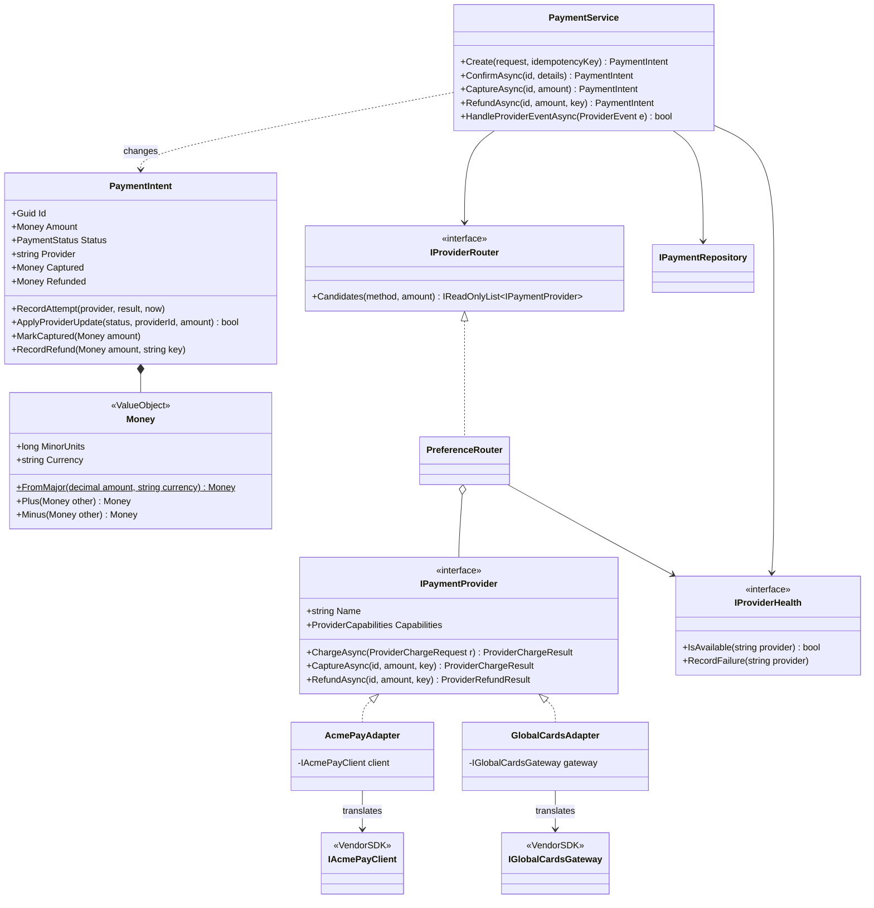
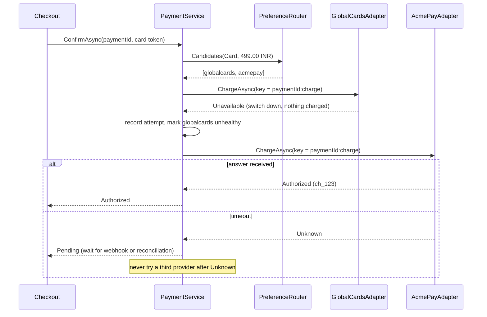
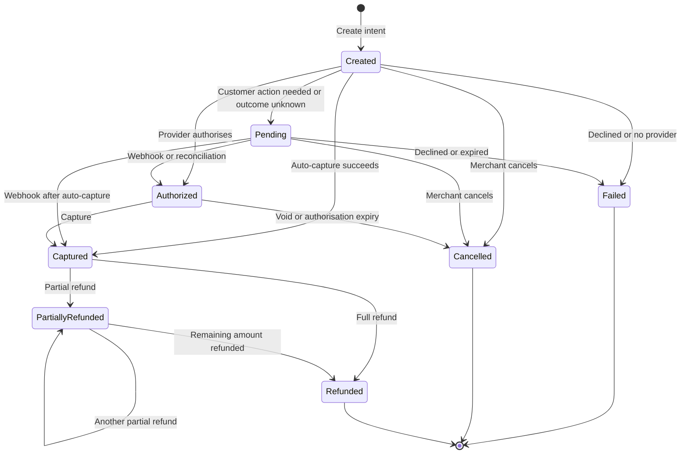

Your e-commerce company in Bengaluru takes payments through one provider. It works until the provider has a 40-minute outage during a sale, and the business asks: "Can we add a second provider, and switch automatically?" Then finance asks for partial refunds. Then a customer is charged twice because the app retried after a timeout.

This case study designs a **payment gateway abstraction**: the layer inside *your* application that talks to one or more external payment providers. It is not the design of a payment provider itself, and not the full ledger-and-reconciliation system (that is the [payment system HLD case](#/lesson/m17-payment-system)). The providers used here — "AcmePay" and "GlobalCards" — are fictional, so we can show realistic quirks without claiming to describe any real company's API.

## Learning objectives

By the end of this case study you will be able to:

1. List the functional and non-functional requirements of a payment abstraction, including the money-safety ones (no double charge, no lost charge).
2. Represent money exactly, as an integer number of minor units (paise, cents) plus a currency.
3. Write **adapters** that translate each provider's request format, status strings and error codes into one internal model.
4. Route payments to providers with a **strategy**, and fail over only when it is *provably safe*.
5. Model the payment lifecycle as a state machine that tolerates late, duplicate and out-of-order webhooks.
6. Make create, confirm and refund idempotent, and verify webhook signatures correctly.

## Prerequisites

- [Adapter](#/lesson/m06-adapter): each provider gets one.
- [Strategy](#/lesson/m06-strategy): routing rules are a strategy.
- [Idempotency keys](#/lesson/m10-idempotency): the core money-safety tool.
- [Webhooks](#/lesson/m10-webhooks): how providers tell us what happened later.

## Explain it like I'm a beginner

Imagine you run a shop and accept payment through **two different card machines** from two banks. Each machine has its own buttons, its own printed slips and its own error messages: one prints "DECLINED 51", the other shows "insufficient_funds".

You don't want every cashier to learn both machines. So you hire one experienced cashier who stands in front of both and gives everyone else **one simple set of instructions**: "charge ₹499", "refund ₹200". Behind the counter, that cashier knows which machine to use and translates the slips into plain words: *approved*, *declined because of low balance*, *machine not working*.

- That cashier's translation skill is the **Adapter** pattern: one translator per machine.
- Choosing which machine to use (card machine A for cards, B for UPI; skip A if it's broken today) is a **Strategy**.
- The cashier's simple instructions are a **Facade**: one front door for a complicated back room.

Two rules the cashier never breaks:

1. **If a machine says "not connected", it is safe to try the other machine.** Nothing was charged.
2. **If a machine freezes halfway, never try the other machine.** The customer may already have been charged. Wait for the bank's message or check the bank's records. Charging again could take the money twice.

That second rule is the most important idea in this lesson.

## Requirements

### Functional requirements

1. **Create** a payment for a merchant order with an amount, currency, method (card, UPI, net banking) and capture mode (capture immediately, or authorise now and capture later).
2. **Confirm** the payment with method details (card token, UPI VPA). The system chooses a provider, submits the charge, and returns a normalised result: authorised, captured, needs customer action (UPI approval, 3-D Secure), failed, or pending.
3. **Capture** an authorised payment, fully or partially (for example, a hotel pre-authorises ₹10,000 and captures ₹8,400).
4. **Refund** a captured payment, fully or in several partial refunds, never more than was captured.
5. **Cancel** a payment that is not yet captured.
6. **Receive webhooks** from providers for asynchronous outcomes (the customer approved the UPI request two minutes later).
7. Support **several providers**, each with different methods and currencies, and route by method, currency, preference and provider health.

### Non-functional requirements

- **No double charge.** A retried request, a duplicate webhook, or a timeout must never lead to charging twice.
- **No lost charge.** If the outcome is unknown (timeout), the payment stays *pending* and is resolved by webhook or reconciliation, not marked failed.
- **Exact money.** No floating point. Amounts are integers in minor units.
- **Provider independence.** Adding a third provider means one adapter class plus configuration.
- **Security.** Webhooks are verified with HMAC signatures and a timestamp window. Card numbers never enter our system (we only see tokens).
- **Observability.** Every provider attempt is recorded with its outcome and error code.

### Clarifying questions to ask

| Question | Our assumption |
|---|---|
| Are we a payment provider, or a merchant using providers? | A merchant using providers. |
| Do we store card numbers? | No. The provider's checkout tokenises cards; we receive a token. This keeps most of the PCI DSS scope with the provider. |
| Which currencies? | INR mainly, USD for international cards. The model supports others by exponent. |
| Do we build the ledger and settlement reconciliation? | Out of scope; we expose the data a ledger needs. |
| Do all providers support partial refunds and separate capture? | No. Capabilities are declared per provider. |
| What happens on provider timeout? | The payment becomes *Pending*; no automatic retry on another provider. |
| How are webhooks authenticated? | HMAC-SHA256 over `timestamp.body` with a shared secret, 5-minute tolerance. |

## Identifying classes and responsibilities

**Nouns:** payment, amount, currency, method, provider, charge, authorisation, capture, refund, status, error, attempt, routing rule, health, webhook, event, signature, idempotency key.
**Verbs:** create, confirm, route, charge, translate, capture, refund, cancel, verify, de-duplicate, apply update.

| Class | Kind | Responsibility |
|---|---|---|
| `Money` | value object | Exact amount in minor units plus currency; safe arithmetic. |
| `PaymentIntent` | aggregate root | Our record of one payment: status, provider binding, captured and refunded totals, attempts. |
| `PaymentStateMachine` | static table | Which status changes are legal. |
| `IPaymentProvider` | port (interface) | What our system needs from any provider. |
| `ProviderCapabilities` | value object | Methods, currencies and features a provider supports. |
| `ProviderChargeResult`, `PaymentError` | value objects | The normalised answer from any provider. |
| `AcmePayAdapter`, `GlobalCardsAdapter` | adapters | Translate our model to and from each provider's SDK. |
| `IProviderRouter` (`PreferenceRouter`) | strategy | Ordered list of providers to try for a payment. |
| `IProviderHealth` (`ConsecutiveFailureHealth`) | circuit breaker | Temporarily skips a provider after repeated failures. |
| `PaymentService` | facade / application service | The single entry point: create, confirm, capture, refund, handle events. |
| `IPaymentRepository` | repository | Stores intents and the idempotency keys that created them. |
| `WebhookSignatureVerifier` | domain service | Checks signature and timestamp of incoming webhooks. |
| `IWebhookTranslator` | adapter | Turns a provider's webhook body into a `ProviderEvent`. |

## Class diagram



How to read it. Everything to the right of `IPaymentProvider` is **someone else's world**: their SDKs, their names, their status codes. Each adapter is the only class that knows a given SDK. Everything to the left is **our world**, where there is one vocabulary: `ProviderOutcome`, `PaymentErrorCode`, `PaymentStatus`. If a provider renames a status or we replace them, exactly one adapter changes.

The router holds the providers and consults health, but it doesn't call them. The service calls them, one at a time, in the router's order. Keeping "who to try" (router) separate from "what to do with the answer" (service) is what lets us test the failover rules with fake providers.

### Confirm with safe failover



The diagram shows both rules from the beginner section. After **Unavailable** we move on, because that outcome means the provider rejected the request before processing it. After **Unknown** we stop, because the charge may have gone through. The idempotency key is stable per payment, so if we later retry *the same provider*, it returns the original charge instead of creating a new one.

## Patterns and design decisions

### 1. Money as minor units

`0.1 + 0.2` in floating point is `0.30000000000000004`. Even `decimal`, which is exact for rupees, invites mistakes like ₹10.005 that no provider accepts. Providers almost always take integer minor units (49,900 paise for ₹499). So `Money` stores a `long` and a currency, knows each currency's exponent (INR 2, JPY 0, KWD 3), and refuses to mix currencies or go negative. Conversion from a user-entered decimal happens once, at the edge, and rejects extra decimals instead of silently rounding.

### 2. Adapter: one translator per provider

Real provider APIs differ in at least five ways: amount format (minor units vs decimal strings), currency format (`"INR"` vs ISO numeric `"356"`), status vocabulary, error codes, and failure signalling (HTTP status vs response code vs exception). The adapter turns all five into our model. The most valuable part of an adapter is often the **error mapping**, because that's where "safe to fail over" versus "outcome unknown" is decided.

| Provider says | We map to | Safe to try another provider? |
|---|---|---|
| AcmePay `"authorized"` / GlobalCards `"00"` | `Authorized` | Not needed |
| AcmePay `"failed"` + `insufficient_funds` / GlobalCards `"51"` | `Declined`, `InsufficientFunds` | No: the customer's bank said no; a second try just annoys them |
| AcmePay HTTP 429 or 503 / GlobalCards `"91"` | `Unavailable` | **Yes**: request was refused before processing |
| AcmePay HTTP 500 or a timeout / GlobalCards `"68"` | `Unknown` | **No**: the charge may exist |

These semantics are what our fictional SDK documentation states. For a real provider, read its documentation carefully; that table is the most important thing you will write.

### 3. Strategy: routing

`PreferenceRouter` filters providers by capability (method and currency) and health, then orders them by a configured preference per method. Other strategies are easy to plug in: lowest fee for the amount, split traffic 80/20 for an experiment, or "route RuPay cards to provider X". The service doesn't change.

### 4. Circuit breaker for provider health

`ConsecutiveFailureHealth` marks a provider unavailable for 30 seconds after 5 consecutive failures. During an outage, payments go straight to the backup instead of waiting for a timeout on every attempt. It is deliberately simple; see [circuit breaker](#/lesson/m10-circuit-breaker) for half-open probing and failure-rate windows.

### 5. State machine that tolerates the real world

Webhooks arrive late, twice, or out of order. A `charge.authorized` event can arrive *after* we already saw `charge.captured`. So `ApplyProviderUpdate` returns `false` (ignore) for a duplicate or a stale status, instead of throwing. Commands from our own code (`MarkCaptured`, `RecordRefund`) still throw on an illegal move, because those are bugs or user errors.

### 6. Idempotency at three levels

- **Create:** the client's `Idempotency-Key` maps to one intent. Same key with a different body is an error (422), because the client is misusing the key.
- **Provider calls:** we send a stable key (`{paymentId}:charge`, `{paymentId}:refund:{key}`) so a retry to the same provider can't create a second charge.
- **Webhooks:** each event id is processed once. The "already processed?" check and the "mark processed" write are separate steps, so two simultaneous deliveries of the same event can both pass the check. That race is harmless only because the update runs under the per-payment lock and `ApplyProviderUpdate` is idempotent: the second delivery finds the status already applied and returns false. In PostgreSQL, make the de-duplication itself atomic with `INSERT ... ON CONFLICT DO NOTHING` on `(provider, event_id)` in the same transaction as the status update.
- **Binding:** an event is applied only if it comes from the provider the payment is bound to. An event from any other provider is logged and ignored.

### 7. Facade

`PaymentService` is the only class the rest of the application uses. It serialises work per payment (one confirm, capture or refund at a time for a given intent), records every attempt, and owns the failover rule.

The in-memory `SemaphoreSlim` per payment only protects one process. With three API instances behind a load balancer, two refund requests for the same payment can land on different machines, and both would pass the "refundable" check. In production the lock lives in PostgreSQL. Don't hold a row lock (`SELECT ... FOR UPDATE`) open across a provider HTTP call that may take 30 seconds; that pins a connection and blocks every other operation on the row. Instead, use short transactions: (1) lock the row, check the rule, write an *in-flight* record (for a refund, a `refunds` row in status `Requested` that already counts against the refundable amount) and commit; (2) call the provider with the stable idempotency key; (3) in a new short transaction, mark the record `Completed` or `Failed`. If the process dies between (2) and (3), a reconciliation job finds the `Requested` row and asks the provider. The in-memory dictionary of semaphores also never shrinks; a real service would drop entries for finished payments or rely on the database lock alone.

## State transitions



How to read it:

- **Pending is a waiting room, not a failure.** UPI collect requests sit here until the customer approves in their bank app. Timeouts also land here. Something must eventually move every pending payment out: a webhook, a reconciliation job that asks the provider, or an expiry rule (for example, Failed after 30 minutes with no news).
- **Captured is where money has moved.** From here, only refunds are possible. Cancel is not; you can't void a capture.
- **PartiallyRefunded loops to itself.** Several partial refunds are fine as long as the total refunded never exceeds the total captured. That rule is enforced by `RecordRefund`, not by the diagram.
- **Failed is terminal for this intent.** If the customer wants to try another card, create a new attempt on the same intent before submission, or a new intent; never reuse a failed one silently.

## C# implementation

```text
Payments.Api/
  Program.cs
  Domain/Money.cs
  Domain/PaymentIntent.cs
  Providers/Contracts.cs
  Providers/AcmePay.cs
  Providers/GlobalCards.cs
  Application/Routing.cs
  Application/PaymentService.cs
  Application/Webhooks.cs
```

### Money

```csharp file=Domain/Money.cs
using System.Globalization;

namespace Payments;

public static class Currencies
{
    private static readonly Dictionary<string, int> Exponents = new(StringComparer.OrdinalIgnoreCase)
    {
        ["INR"] = 2, ["USD"] = 2, ["EUR"] = 2, ["JPY"] = 0, ["KWD"] = 3,
    };

    public static int ExponentOf(string currency) =>
        Exponents.TryGetValue(currency, out var e) ? e : throw new ArgumentException($"Unsupported currency '{currency}'.", nameof(currency));

    internal static long Factor(string currency)
    {
        long f = 1;
        for (var i = 0; i < ExponentOf(currency); i++) f *= 10;
        return f;
    }
}

/// <summary>An exact, non-negative amount in minor units (paise, cents).</summary>
public readonly record struct Money
{
    public Money(long minorUnits, string currency)
    {
        ArgumentOutOfRangeException.ThrowIfNegative(minorUnits);
        Currencies.ExponentOf(currency);
        MinorUnits = minorUnits;
        Currency = currency.ToUpperInvariant();
    }

    public long MinorUnits { get; }
    public string Currency { get; }
    public bool IsZero => MinorUnits == 0;

    public static Money Zero(string currency) => new(0, currency);

    /// <summary>Converts a user-facing amount, refusing more decimals than the currency allows (no silent rounding).</summary>
    public static Money FromMajor(decimal amount, string currency)
    {
        var minor = amount * Currencies.Factor(currency);
        if (minor != decimal.Truncate(minor))
            throw new ArgumentException($"{amount} has more decimal places than {currency.ToUpperInvariant()} allows.", nameof(amount));
        return new Money((long)minor, currency);
    }

    public decimal ToMajor() => MinorUnits / (decimal)Currencies.Factor(Currency);

    public Money Plus(Money other) { EnsureSameCurrency(other); return new Money(checked(MinorUnits + other.MinorUnits), Currency); }
    public Money Minus(Money other) { EnsureSameCurrency(other); return new Money(MinorUnits - other.MinorUnits, Currency); }

    public static bool operator >(Money a, Money b) { a.EnsureSameCurrency(b); return a.MinorUnits > b.MinorUnits; }
    public static bool operator <(Money a, Money b) { a.EnsureSameCurrency(b); return a.MinorUnits < b.MinorUnits; }
    public static bool operator >=(Money a, Money b) => !(a < b);
    public static bool operator <=(Money a, Money b) => !(a > b);

    public override string ToString() =>
        $"{ToMajor().ToString("F" + Currencies.ExponentOf(Currency), CultureInfo.InvariantCulture)} {Currency}";

    private void EnsureSameCurrency(Money other)
    {
        if (!string.Equals(Currency, other.Currency, StringComparison.Ordinal))
            throw new InvalidOperationException($"Cannot combine {Currency} with {other.Currency}.");
    }
}
```

### The payment intent and its state machine

```csharp file=Domain/PaymentIntent.cs
namespace Payments;

public enum PaymentMethod { Card, Upi, NetBanking }

public enum PaymentStatus { Created, Pending, Authorized, Captured, PartiallyRefunded, Refunded, Failed, Cancelled }

public static class PaymentStateMachine
{
    private static readonly Dictionary<PaymentStatus, PaymentStatus[]> Allowed = new()
    {
        [PaymentStatus.Created] = [PaymentStatus.Pending, PaymentStatus.Authorized, PaymentStatus.Captured, PaymentStatus.Failed, PaymentStatus.Cancelled],
        [PaymentStatus.Pending] = [PaymentStatus.Authorized, PaymentStatus.Captured, PaymentStatus.Failed, PaymentStatus.Cancelled],
        [PaymentStatus.Authorized] = [PaymentStatus.Captured, PaymentStatus.Cancelled],
        [PaymentStatus.Captured] = [PaymentStatus.PartiallyRefunded, PaymentStatus.Refunded],
        [PaymentStatus.PartiallyRefunded] = [PaymentStatus.PartiallyRefunded, PaymentStatus.Refunded],
    };

    public static bool CanMove(PaymentStatus from, PaymentStatus to) => Allowed.TryGetValue(from, out var next) && next.Contains(to);
}

public sealed class InvalidPaymentTransitionException(PaymentStatus from, PaymentStatus to)
    : InvalidOperationException($"A payment cannot move from {from} to {to}.");

public sealed class PaymentRuleException(string message) : InvalidOperationException(message);

public sealed record PaymentAttempt(string Provider, DateTimeOffset At, ProviderOutcome Outcome, string? ProviderPaymentId, PaymentErrorCode? Error);

public sealed class PaymentIntent
{
    private readonly List<PaymentAttempt> _attempts = [];
    private readonly HashSet<string> _refundKeys = [];

    public PaymentIntent(Guid id, string merchantOrderId, Money amount, PaymentMethod method, bool autoCapture, DateTimeOffset createdAt)
    {
        ArgumentException.ThrowIfNullOrWhiteSpace(merchantOrderId);
        if (amount.IsZero) throw new PaymentRuleException("A payment amount must be positive.");
        Id = id;
        MerchantOrderId = merchantOrderId;
        Amount = amount;
        Method = method;
        AutoCapture = autoCapture;
        CreatedAt = createdAt;
        Captured = Money.Zero(amount.Currency);
        Refunded = Money.Zero(amount.Currency);
    }

    public Guid Id { get; }
    public string MerchantOrderId { get; }
    public Money Amount { get; }
    public PaymentMethod Method { get; }
    public bool AutoCapture { get; }
    public DateTimeOffset CreatedAt { get; }
    public PaymentStatus Status { get; private set; } = PaymentStatus.Created;
    public string? Provider { get; private set; }
    public string? ProviderPaymentId { get; private set; }
    public string? NextActionUrl { get; private set; }
    public PaymentError? LastError { get; private set; }
    public Money Captured { get; private set; }
    public Money Refunded { get; private set; }
    public Money Refundable => Captured.Minus(Refunded);
    public int Version { get; private set; }
    public IReadOnlyList<PaymentAttempt> Attempts => _attempts;

    /// <summary>Applies the synchronous answer of one provider call.</summary>
    public void RecordAttempt(string provider, ProviderChargeResult result, DateTimeOffset now)
    {
        _attempts.Add(new PaymentAttempt(provider, now, result.Outcome, result.ProviderPaymentId, result.Error?.Code));
        if (result.Error is not null) LastError = result.Error;
        switch (result.Outcome)
        {
            case ProviderOutcome.Authorized:
                Bind(provider, result.ProviderPaymentId); MoveTo(PaymentStatus.Authorized); break;
            case ProviderOutcome.Captured:
                Bind(provider, result.ProviderPaymentId); Captured = Amount; MoveTo(PaymentStatus.Captured); break;
            case ProviderOutcome.RequiresAction:
                Bind(provider, result.ProviderPaymentId); NextActionUrl = result.NextActionUrl; MoveTo(PaymentStatus.Pending); break;
            case ProviderOutcome.Unknown:
                Bind(provider, result.ProviderPaymentId); MoveTo(PaymentStatus.Pending); break;   // keep the provider so reconciliation knows whom to ask
            case ProviderOutcome.Declined:
                MoveTo(PaymentStatus.Failed); break;
            case ProviderOutcome.Unavailable:
                break;                                                                                // nothing happened at the provider
        }
    }

    /// <summary>Applies a status reported later (webhook or reconciliation). Returns false for duplicates and stale updates.</summary>
    public bool ApplyProviderUpdate(PaymentStatus reported, string providerPaymentId, Money? amount)
    {
        if (Status == reported || !PaymentStateMachine.CanMove(Status, reported)) return false;
        ProviderPaymentId ??= providerPaymentId;
        if (reported == PaymentStatus.Captured) Captured = amount ?? Amount;
        MoveTo(reported);
        return true;
    }

    public void MarkCaptured(Money amount)
    {
        if (amount.IsZero || amount > Amount) throw new PaymentRuleException($"Capture must be between 0 and {Amount}.");
        MoveTo(PaymentStatus.Captured);
        Captured = amount;
    }

    public bool HasRefund(string refundKey) => _refundKeys.Contains(refundKey);

    public void EnsureRefundable(Money amount)
    {
        if (Status is not (PaymentStatus.Captured or PaymentStatus.PartiallyRefunded))
            throw new PaymentRuleException($"Only captured payments can be refunded (status is {Status}).");
        if (amount.IsZero || amount > Refundable) throw new PaymentRuleException($"Refund must be between 0 and {Refundable}.");
    }

    public void RecordRefund(Money amount, string refundKey)
    {
        if (_refundKeys.Contains(refundKey)) return;                   // the same refund request, seen again
        EnsureRefundable(amount);
        _refundKeys.Add(refundKey);
        Refunded = Refunded.Plus(amount);
        MoveTo(Refunded == Captured ? PaymentStatus.Refunded : PaymentStatus.PartiallyRefunded);
    }

    public void Fail(PaymentError error)
    {
        LastError = error;
        MoveTo(PaymentStatus.Failed);
    }

    public void Cancel() => MoveTo(PaymentStatus.Cancelled);

    private void Bind(string provider, string? providerPaymentId)
    {
        Provider = provider;
        ProviderPaymentId = providerPaymentId ?? ProviderPaymentId;
    }

    private void MoveTo(PaymentStatus next)
    {
        if (!PaymentStateMachine.CanMove(Status, next)) throw new InvalidPaymentTransitionException(Status, next);
        Status = next;
        Version++;
    }
}
```

### The provider port

```csharp file=Providers/Contracts.cs
namespace Payments;

/// <summary>Normalised outcome of a provider call. Unavailable = provably not processed; Unknown = may have been processed.</summary>
public enum ProviderOutcome { Authorized, Captured, RequiresAction, Declined, Unavailable, Unknown }

public enum PaymentErrorCode { InsufficientFunds, CardDeclined, AuthenticationFailed, InvalidVpa, ProviderUnavailable, Timeout, Unknown }

public sealed record PaymentError(PaymentErrorCode Code, string Message);

public sealed record PaymentDetails(string? CardToken = null, string? Vpa = null);

public sealed record ProviderChargeRequest(Guid PaymentId, Money Amount, PaymentMethod Method, PaymentDetails Details, bool AutoCapture, string IdempotencyKey);

public sealed record ProviderChargeResult(ProviderOutcome Outcome, string? ProviderPaymentId = null, string? NextActionUrl = null, PaymentError? Error = null);

public sealed record ProviderRefundResult(bool Succeeded, string? ProviderRefundId, PaymentError? Error);

public sealed record ProviderCapabilities(IReadOnlySet<PaymentMethod> Methods, IReadOnlySet<string> Currencies, bool SupportsSeparateCapture);

/// <summary>What our system needs from any payment provider. Implemented by one adapter per provider.</summary>
public interface IPaymentProvider
{
    string Name { get; }
    ProviderCapabilities Capabilities { get; }
    Task<ProviderChargeResult> ChargeAsync(ProviderChargeRequest request, CancellationToken ct);
    Task<ProviderChargeResult> CaptureAsync(string providerPaymentId, Money amount, string idempotencyKey, CancellationToken ct);
    Task<ProviderRefundResult> RefundAsync(string providerPaymentId, Money amount, string idempotencyKey, CancellationToken ct);
}

/// <summary>A provider's asynchronous report, already translated into our vocabulary.</summary>
public sealed record ProviderEvent(string EventId, string Provider, string ProviderPaymentId, Guid PaymentId, PaymentStatus Status, Money? Amount);

public interface IWebhookTranslator
{
    string Provider { get; }
    /// <summary>Returns null for event types we don't handle, so the endpoint can acknowledge them with 200.</summary>
    ProviderEvent? Translate(string body);
}
```

### Adapter 1: AcmePay (JSON API with status strings)

The `Payments.Vendors.AcmePay` namespace stands in for a vendor's NuGet package we don't control. Only the adapter uses it.

```csharp file=Providers/AcmePay.cs
using System.Collections.Concurrent;
using System.Text.Json;
using Payments.Vendors.AcmePay;

namespace Payments.Vendors.AcmePay
{
    // ---- Fictional vendor SDK surface (we don't own this code) ----
    public sealed record AcmeChargeRequest(long Amount, string Currency, string Source, bool Capture, string Reference);
    public sealed record AcmeCharge(string Id, string Status, string? FailureCode, string? RedirectUrl);
    public sealed record AcmeRefund(string Id, string Status);
    public sealed class AcmeApiException(int statusCode, string message) : Exception(message)
    {
        public int StatusCode { get; } = statusCode;
    }

    public interface IAcmePayClient
    {
        Task<AcmeCharge> CreateChargeAsync(AcmeChargeRequest request, string idempotencyKey, CancellationToken ct);
        Task<AcmeCharge> CaptureAsync(string chargeId, long amount, string idempotencyKey, CancellationToken ct);
        Task<AcmeRefund> RefundAsync(string chargeId, long amount, string idempotencyKey, CancellationToken ct);
    }

    /// <summary>Local stand-in for the vendor's sandbox, used by Program.cs.</summary>
    public sealed class SimulatedAcmePayClient : IAcmePayClient
    {
        private readonly ConcurrentDictionary<string, AcmeCharge> _byKey = new();

        public Task<AcmeCharge> CreateChargeAsync(AcmeChargeRequest r, string idempotencyKey, CancellationToken ct) =>
            Task.FromResult(_byKey.GetOrAdd(idempotencyKey, _ =>
            {
                var id = "ch_" + Guid.NewGuid().ToString("N")[..10];
                if (r.Source.StartsWith("upi:", StringComparison.Ordinal)) return new AcmeCharge(id, "pending_customer", null, "upi://pay?pa=shop@acme");
                if (r.Source == "card:tok_fail_funds") return new AcmeCharge(id, "failed", "insufficient_funds", null);
                return new AcmeCharge(id, r.Capture ? "captured" : "authorized", null, null);
            }));

        public Task<AcmeCharge> CaptureAsync(string chargeId, long amount, string idempotencyKey, CancellationToken ct) =>
            Task.FromResult(new AcmeCharge(chargeId, "captured", null, null));

        public Task<AcmeRefund> RefundAsync(string chargeId, long amount, string idempotencyKey, CancellationToken ct) =>
            Task.FromResult(new AcmeRefund("rf_" + Guid.NewGuid().ToString("N")[..10], "succeeded"));
    }
}

namespace Payments
{
    public sealed class AcmePayAdapter(IAcmePayClient client) : IPaymentProvider
    {
        public string Name => "acmepay";

        public ProviderCapabilities Capabilities { get; } = new(
            new HashSet<PaymentMethod> { PaymentMethod.Card, PaymentMethod.Upi },
            new HashSet<string> { "INR" },
            SupportsSeparateCapture: true);

        public async Task<ProviderChargeResult> ChargeAsync(ProviderChargeRequest r, CancellationToken ct)
        {
            var source = r.Method switch
            {
                PaymentMethod.Upi => "upi:" + r.Details.Vpa,
                PaymentMethod.Card => "card:" + r.Details.CardToken,
                _ => throw new NotSupportedException($"AcmePay does not support {r.Method}."),
            };
            return await Call(async () => MapCharge(await client.CreateChargeAsync(
                new AcmeChargeRequest(r.Amount.MinorUnits, r.Amount.Currency, source, r.AutoCapture, r.PaymentId.ToString()), r.IdempotencyKey, ct)), ct);
        }

        public Task<ProviderChargeResult> CaptureAsync(string providerPaymentId, Money amount, string idempotencyKey, CancellationToken ct) =>
            Call(async () => MapCharge(await client.CaptureAsync(providerPaymentId, amount.MinorUnits, idempotencyKey, ct)), ct);

        public async Task<ProviderRefundResult> RefundAsync(string providerPaymentId, Money amount, string idempotencyKey, CancellationToken ct)
        {
            var refund = await client.RefundAsync(providerPaymentId, amount.MinorUnits, idempotencyKey, ct);
            return refund.Status == "succeeded"
                ? new ProviderRefundResult(true, refund.Id, null)
                : new ProviderRefundResult(false, refund.Id, new PaymentError(PaymentErrorCode.Unknown, $"AcmePay refund status {refund.Status}"));
        }

        public static ProviderChargeResult MapCharge(AcmeCharge c) => c.Status switch
        {
            "authorized" => new ProviderChargeResult(ProviderOutcome.Authorized, c.Id),
            "captured" => new ProviderChargeResult(ProviderOutcome.Captured, c.Id),
            "pending_customer" => new ProviderChargeResult(ProviderOutcome.RequiresAction, c.Id, c.RedirectUrl),
            "failed" => new ProviderChargeResult(ProviderOutcome.Declined, c.Id, Error: MapFailure(c.FailureCode)),
            _ => new ProviderChargeResult(ProviderOutcome.Unknown, c.Id, Error: new PaymentError(PaymentErrorCode.Unknown, $"Unrecognised AcmePay status '{c.Status}'")),
        };

        private static PaymentError MapFailure(string? code) => code switch
        {
            "insufficient_funds" => new PaymentError(PaymentErrorCode.InsufficientFunds, "Insufficient funds."),
            "invalid_vpa" => new PaymentError(PaymentErrorCode.InvalidVpa, "The UPI ID is not valid."),
            "authentication_failed" => new PaymentError(PaymentErrorCode.AuthenticationFailed, "Customer authentication failed."),
            _ => new PaymentError(PaymentErrorCode.CardDeclined, "The payment was declined."),
        };

        /// <summary>Turns transport failures into outcomes. 429/503 mean "not processed"; 500 and timeouts mean "maybe processed".</summary>
        private static async Task<ProviderChargeResult> Call(Func<Task<ProviderChargeResult>> call, CancellationToken ct)
        {
            try { return await call(); }
            catch (AcmeApiException ex) when (ex.StatusCode is 429 or 503)
            { return new ProviderChargeResult(ProviderOutcome.Unavailable, Error: new PaymentError(PaymentErrorCode.ProviderUnavailable, ex.Message)); }
            catch (AcmeApiException ex) when (ex.StatusCode >= 500)
            { return new ProviderChargeResult(ProviderOutcome.Unknown, Error: new PaymentError(PaymentErrorCode.Unknown, ex.Message)); }
            catch (TimeoutException ex)
            { return new ProviderChargeResult(ProviderOutcome.Unknown, Error: new PaymentError(PaymentErrorCode.Timeout, ex.Message)); }
            catch (OperationCanceledException ex) when (!ct.IsCancellationRequested)
            { return new ProviderChargeResult(ProviderOutcome.Unknown, Error: new PaymentError(PaymentErrorCode.Timeout, ex.Message)); }
        }
    }

    public sealed class AcmePayWebhookTranslator : IWebhookTranslator
    {
        public string Provider => "acmepay";

        public ProviderEvent? Translate(string body)
        {
            using var doc = JsonDocument.Parse(body);
            var root = doc.RootElement;
            var data = root.GetProperty("data");
            PaymentStatus? status = root.GetProperty("type").GetString() switch
            {
                "charge.authorized" => PaymentStatus.Authorized,
                "charge.captured" => PaymentStatus.Captured,
                "charge.failed" => PaymentStatus.Failed,
                _ => null,                                                   // e.g. "dispute.created": not handled here
            };
            if (status is null) return null;
            Money? amount = data.TryGetProperty("amount", out var a) ? new Money(a.GetInt64(), data.GetProperty("currency").GetString()!) : null;
            return new ProviderEvent(root.GetProperty("id").GetString()!, Provider, data.GetProperty("charge_id").GetString()!,
                Guid.Parse(data.GetProperty("reference").GetString()!), status.Value, amount);
        }
    }
}
```

### Adapter 2: GlobalCards (synchronous SDK with ISO-style response codes)

```csharp file=Providers/GlobalCards.cs
using System.Globalization;
using Payments.Vendors.GlobalCards;

namespace Payments.Vendors.GlobalCards
{
    // ---- Fictional vendor SDK: decimal-string amounts, numeric currency codes, two-digit response codes ----
    public sealed record GcAuthRequest(string MerchantRef, string Amount, string CurrencyNumeric, string CardToken);
    public sealed record GcResponse(string ResponseCode, string? TxnRef, string? Message);

    public interface IGlobalCardsGateway
    {
        GcResponse Authorize(GcAuthRequest request);
        GcResponse Settle(string txnRef, string amount);
        GcResponse Credit(string txnRef, string amount);
    }

    public sealed class SimulatedGlobalCardsGateway : IGlobalCardsGateway
    {
        public GcResponse Authorize(GcAuthRequest r) => r.CardToken switch
        {
            "tok_gc_51" => new GcResponse("51", null, "Insufficient funds"),
            "tok_gc_91" => new GcResponse("91", null, "Issuer unavailable"),
            _ => new GcResponse("00", "gc_" + Guid.NewGuid().ToString("N")[..10], "Approved"),
        };
        public GcResponse Settle(string txnRef, string amount) => new("00", txnRef, "Settled");
        public GcResponse Credit(string txnRef, string amount) => new("00", "cr_" + Guid.NewGuid().ToString("N")[..10], "Credited");
    }
}

namespace Payments
{
    public sealed class GlobalCardsAdapter(IGlobalCardsGateway gateway) : IPaymentProvider
    {
        private static readonly Dictionary<string, string> NumericCurrency = new() { ["INR"] = "356", ["USD"] = "840" };

        public string Name => "globalcards";

        public ProviderCapabilities Capabilities { get; } = new(
            new HashSet<PaymentMethod> { PaymentMethod.Card },
            new HashSet<string> { "INR", "USD" },
            SupportsSeparateCapture: true);

        public Task<ProviderChargeResult> ChargeAsync(ProviderChargeRequest r, CancellationToken ct)
        {
            if (r.Method != PaymentMethod.Card) throw new NotSupportedException("GlobalCards only processes cards.");
            var auth = gateway.Authorize(new GcAuthRequest(r.PaymentId.ToString("N"), FormatAmount(r.Amount), NumericCurrency[r.Amount.Currency], r.Details.CardToken ?? ""));
            var result = MapResponse(auth, ProviderOutcome.Authorized);
            if (result.Outcome == ProviderOutcome.Authorized && r.AutoCapture)
            {
                var settled = MapResponse(gateway.Settle(auth.TxnRef!, FormatAmount(r.Amount)), ProviderOutcome.Captured);
                // Captured: done. Unknown: the money may have moved, so report Unknown (Pending) and let reconciliation decide.
                // Declined or Unavailable: settlement provably did not happen; keep the authorisation and capture later.
                if (settled.Outcome is ProviderOutcome.Captured or ProviderOutcome.Unknown) result = settled with { ProviderPaymentId = auth.TxnRef };
            }
            return Task.FromResult(result);
        }

        public Task<ProviderChargeResult> CaptureAsync(string providerPaymentId, Money amount, string idempotencyKey, CancellationToken ct) =>
            Task.FromResult(MapResponse(gateway.Settle(providerPaymentId, FormatAmount(amount)), ProviderOutcome.Captured) with { ProviderPaymentId = providerPaymentId });

        public Task<ProviderRefundResult> RefundAsync(string providerPaymentId, Money amount, string idempotencyKey, CancellationToken ct)
        {
            var r = gateway.Credit(providerPaymentId, FormatAmount(amount));
            return Task.FromResult(r.ResponseCode == "00"
                ? new ProviderRefundResult(true, r.TxnRef, null)
                : new ProviderRefundResult(false, null, new PaymentError(PaymentErrorCode.Unknown, $"GlobalCards credit failed with {r.ResponseCode}")));
        }

        public static string FormatAmount(Money m) =>
            m.ToMajor().ToString("F" + Currencies.ExponentOf(m.Currency), CultureInfo.InvariantCulture);

        public static ProviderChargeResult MapResponse(GcResponse r, ProviderOutcome onApproved) => r.ResponseCode switch
        {
            "00" => new ProviderChargeResult(onApproved, r.TxnRef),
            "51" => new ProviderChargeResult(ProviderOutcome.Declined, r.TxnRef, Error: new PaymentError(PaymentErrorCode.InsufficientFunds, "Insufficient funds.")),
            "05" or "57" => new ProviderChargeResult(ProviderOutcome.Declined, r.TxnRef, Error: new PaymentError(PaymentErrorCode.CardDeclined, "Do not honour.")),
            "91" or "96" => new ProviderChargeResult(ProviderOutcome.Unavailable, Error: new PaymentError(PaymentErrorCode.ProviderUnavailable, "Issuer or switch unavailable.")),
            "68" => new ProviderChargeResult(ProviderOutcome.Unknown, r.TxnRef, Error: new PaymentError(PaymentErrorCode.Timeout, "Response received too late.")),
            // An unrecognised code is NOT a decline: it might be a new "approved" variant. Unknown sends it to reconciliation.
            _ => new ProviderChargeResult(ProviderOutcome.Unknown, r.TxnRef, Error: new PaymentError(PaymentErrorCode.Unknown, $"Unrecognised response code {r.ResponseCode}.")),
        };
    }
}
```

Notice how different the two SDKs are: one is async with JSON-ish records and HTTP exceptions; the other is synchronous with decimal strings and two-digit codes. Both adapters expose the identical `IPaymentProvider` surface.

Two details a reviewer should catch. First, an **unrecognised response code maps to Unknown, never to Declined**: if the provider adds a new "approved with conditions" code, calling it a decline would tell the customer "failed" while their money was taken. Second, GlobalCards takes no idempotency key; its `MerchantRef` (our payment id) is what reconciliation uses to look the charge up, which is one more reason we never resend a charge after an Unknown outcome. A real synchronous SDK should also be called with a timeout so a hung socket can't hold a request thread forever.

### Routing and provider health

```csharp file=Application/Routing.cs
using Microsoft.Extensions.Options;

namespace Payments;

public interface IProviderHealth
{
    bool IsAvailable(string provider);
    void RecordSuccess(string provider);
    void RecordFailure(string provider);
}

/// <summary>A minimal circuit breaker: after N consecutive failures, skip the provider for a cool-down period.</summary>
public sealed class ConsecutiveFailureHealth(TimeProvider clock, int threshold = 5, int openSeconds = 30) : IProviderHealth
{
    private readonly Dictionary<string, (int Failures, DateTimeOffset OpenUntil)> _state = new();
    private readonly Lock _gate = new();

    public bool IsAvailable(string provider)
    {
        lock (_gate) return !_state.TryGetValue(provider, out var s) || clock.GetUtcNow() >= s.OpenUntil;
    }

    public void RecordSuccess(string provider)
    {
        lock (_gate) _state.Remove(provider);
    }

    public void RecordFailure(string provider)
    {
        lock (_gate)
        {
            var (failures, openUntil) = _state.GetValueOrDefault(provider);
            failures++;
            if (failures >= threshold) { openUntil = clock.GetUtcNow().AddSeconds(openSeconds); failures = 0; }
            _state[provider] = (failures, openUntil);
        }
    }
}

public sealed class RoutingOptions
{
    /// <summary>Provider names in order of preference, per method.</summary>
    public Dictionary<PaymentMethod, List<string>> Preference { get; set; } = new();
}

public interface IProviderRouter
{
    IReadOnlyList<IPaymentProvider> Candidates(PaymentMethod method, Money amount);
}

public sealed class PreferenceRouter(IEnumerable<IPaymentProvider> providers, IProviderHealth health, IOptions<RoutingOptions> options) : IProviderRouter
{
    private readonly IReadOnlyList<IPaymentProvider> _providers = providers.ToList();

    public IReadOnlyList<IPaymentProvider> Candidates(PaymentMethod method, Money amount)
    {
        var preference = options.Value.Preference.GetValueOrDefault(method) ?? [];
        int Rank(IPaymentProvider p) { var i = preference.IndexOf(p.Name); return i < 0 ? int.MaxValue : i; }

        return _providers
            .Where(p => p.Capabilities.Methods.Contains(method) && p.Capabilities.Currencies.Contains(amount.Currency))
            .Where(p => health.IsAvailable(p.Name))
            .OrderBy(Rank).ThenBy(p => p.Name, StringComparer.Ordinal)
            .ToList();
    }
}
```

### The payment service (facade)

```csharp file=Application/PaymentService.cs
using System.Collections.Concurrent;
using Microsoft.Extensions.Logging;

namespace Payments;

public sealed record CreatePaymentRequest(string MerchantOrderId, decimal Amount, string Currency, PaymentMethod Method, bool AutoCapture);

public sealed class IdempotencyConflictException(string message) : Exception(message);

public interface IPaymentRepository
{
    PaymentIntent? Get(Guid id);
    /// <summary>Creates the intent once per idempotency key. Throws IdempotencyConflictException if the key was used with a different request.</summary>
    (PaymentIntent Intent, bool Created) AddOnce(string idempotencyKey, string requestFingerprint, Func<PaymentIntent> create);
    void Save(PaymentIntent intent);
}

public interface IProcessedEventStore
{
    bool IsProcessed(string provider, string eventId);
    void MarkProcessed(string provider, string eventId);
}

public sealed class PaymentService(
    IPaymentRepository payments,
    IProcessedEventStore processedEvents,
    IProviderRouter router,
    IProviderHealth health,
    IEnumerable<IPaymentProvider> providers,
    TimeProvider clock,
    ILogger<PaymentService> logger)
{
    private readonly Dictionary<string, IPaymentProvider> _byName = providers.ToDictionary(p => p.Name);
    private readonly ConcurrentDictionary<Guid, SemaphoreSlim> _locks = new();

    public PaymentIntent Create(CreatePaymentRequest r, string idempotencyKey)
    {
        ArgumentException.ThrowIfNullOrWhiteSpace(idempotencyKey);
        var amount = Money.FromMajor(r.Amount, r.Currency);
        var fingerprint = $"{r.MerchantOrderId}|{amount}|{r.Method}|{r.AutoCapture}";
        var (intent, _) = payments.AddOnce(idempotencyKey, fingerprint,
            () => new PaymentIntent(Guid.NewGuid(), r.MerchantOrderId, amount, r.Method, r.AutoCapture, clock.GetUtcNow()));
        return intent;
    }

    public Task<PaymentIntent> ConfirmAsync(Guid paymentId, PaymentDetails details, CancellationToken ct = default) =>
        Exclusive(paymentId, async intent =>
        {
            if (intent.Status != PaymentStatus.Created) return intent;          // already submitted: confirming again is a no-op

            foreach (var provider in router.Candidates(intent.Method, intent.Amount))
            {
                var request = new ProviderChargeRequest(intent.Id, intent.Amount, intent.Method, details, intent.AutoCapture, $"{intent.Id}:charge");
                ProviderChargeResult result;
                try { result = await provider.ChargeAsync(request, ct); }
                catch (Exception ex) when (ex is not OperationCanceledException)
                {
                    logger.LogError(ex, "Provider {Provider} threw for payment {PaymentId}", provider.Name, intent.Id);
                    result = new ProviderChargeResult(ProviderOutcome.Unknown, Error: new PaymentError(PaymentErrorCode.Unknown, ex.Message));
                }

                intent.RecordAttempt(provider.Name, result, clock.GetUtcNow());
                logger.LogInformation("Payment {PaymentId} via {Provider}: {Outcome} {Error}", intent.Id, provider.Name, result.Outcome, result.Error?.Code);

                if (result.Outcome == ProviderOutcome.Unavailable) { health.RecordFailure(provider.Name); continue; }   // provably not charged
                if (result.Outcome == ProviderOutcome.Unknown) health.RecordFailure(provider.Name); else health.RecordSuccess(provider.Name);
                return intent;                                                   // never try another provider after a possible charge
            }

            intent.Fail(new PaymentError(PaymentErrorCode.ProviderUnavailable, "No payment provider is available right now."));
            return intent;
        }, ct);

    public Task<PaymentIntent> CaptureAsync(Guid paymentId, decimal? amount = null, CancellationToken ct = default) =>
        Exclusive(paymentId, async intent =>
        {
            if (intent.Status != PaymentStatus.Authorized) throw new PaymentRuleException($"Only authorised payments can be captured (status is {intent.Status}).");
            var toCapture = amount is null ? intent.Amount : Money.FromMajor(amount.Value, intent.Amount.Currency);
            var result = await ProviderOf(intent).CaptureAsync(intent.ProviderPaymentId!, toCapture, $"{intent.Id}:capture", ct);
            if (result.Outcome != ProviderOutcome.Captured) throw new PaymentRuleException($"Capture failed: {result.Error?.Message ?? result.Outcome.ToString()}");
            intent.MarkCaptured(toCapture);
            return intent;
        }, ct);

    public Task<PaymentIntent> RefundAsync(Guid paymentId, decimal amount, string refundKey, CancellationToken ct = default) =>
        Exclusive(paymentId, async intent =>
        {
            ArgumentException.ThrowIfNullOrWhiteSpace(refundKey);
            if (intent.HasRefund(refundKey)) return intent;                      // a retried refund request
            var money = Money.FromMajor(amount, intent.Amount.Currency);
            intent.EnsureRefundable(money);                                       // check before calling the provider
            var result = await ProviderOf(intent).RefundAsync(intent.ProviderPaymentId!, money, $"{intent.Id}:refund:{refundKey}", ct);
            if (!result.Succeeded) throw new PaymentRuleException($"Refund failed: {result.Error?.Message}");
            intent.RecordRefund(money, refundKey);
            return intent;
        }, ct);

    /// <summary>Applies a verified webhook. Returns false for duplicates and stale events. Callers should still answer 200.</summary>
    public async Task<bool> HandleProviderEventAsync(ProviderEvent e, CancellationToken ct = default)
    {
        if (processedEvents.IsProcessed(e.Provider, e.EventId)) return false;
        if (payments.Get(e.PaymentId) is null)
        {
            logger.LogWarning("Event {EventId} from {Provider} refers to unknown payment {PaymentId}", e.EventId, e.Provider, e.PaymentId);
            return false;                                                          // acknowledge; a 500 would make the provider retry forever
        }
        var applied = await Exclusive(e.PaymentId, intent =>
        {
            // An event from a provider this payment is not bound to must never change it.
            if (intent.Provider is not null && intent.Provider != e.Provider)
            {
                logger.LogWarning("Event {EventId} from {Provider} ignored: payment {PaymentId} is bound to {Bound}", e.EventId, e.Provider, intent.Id, intent.Provider);
                return Task.FromResult(false);
            }
            return Task.FromResult(intent.ApplyProviderUpdate(e.Status, e.ProviderPaymentId, e.Amount));
        }, ct);
        processedEvents.MarkProcessed(e.Provider, e.EventId);                     // ApplyProviderUpdate is idempotent, so a race here is harmless
        return applied;
    }

    private IPaymentProvider ProviderOf(PaymentIntent intent) =>
        intent.Provider is not null && _byName.TryGetValue(intent.Provider, out var p) ? p
            : throw new PaymentRuleException("This payment is not bound to a provider.");

    /// <summary>One operation at a time per payment. In PostgreSQL: SELECT ... FOR UPDATE on the payment row, or a version check.</summary>
    private async Task<T> Exclusive<T>(Guid paymentId, Func<PaymentIntent, Task<T>> action, CancellationToken ct)
    {
        var gate = _locks.GetOrAdd(paymentId, _ => new SemaphoreSlim(1, 1));
        await gate.WaitAsync(ct);
        try
        {
            var intent = payments.Get(paymentId) ?? throw new KeyNotFoundException($"Payment {paymentId} not found.");
            var result = await action(intent);
            payments.Save(intent);
            return result;
        }
        finally { gate.Release(); }
    }
}

public sealed class InMemoryPaymentRepository : IPaymentRepository
{
    private readonly Dictionary<Guid, PaymentIntent> _byId = new();
    private readonly Dictionary<string, (string Fingerprint, Guid Id)> _byKey = new();
    private readonly Lock _gate = new();

    public PaymentIntent? Get(Guid id) { lock (_gate) return _byId.GetValueOrDefault(id); }

    public (PaymentIntent Intent, bool Created) AddOnce(string idempotencyKey, string requestFingerprint, Func<PaymentIntent> create)
    {
        lock (_gate)
        {
            if (_byKey.TryGetValue(idempotencyKey, out var existing))
            {
                if (existing.Fingerprint != requestFingerprint)
                    throw new IdempotencyConflictException("This Idempotency-Key was already used with a different request.");
                return (_byId[existing.Id], false);
            }
            var intent = create();
            _byId[intent.Id] = intent;
            _byKey[idempotencyKey] = (requestFingerprint, intent.Id);
            return (intent, true);
        }
    }

    public void Save(PaymentIntent intent) { /* in memory: the object is already stored */ }
}

public sealed class InMemoryProcessedEventStore : IProcessedEventStore
{
    private readonly HashSet<(string, string)> _seen = [];
    private readonly Lock _gate = new();
    public bool IsProcessed(string provider, string eventId) { lock (_gate) return _seen.Contains((provider, eventId)); }
    public void MarkProcessed(string provider, string eventId) { lock (_gate) _seen.Add((provider, eventId)); }
}
```

### Webhook verification and wiring

```csharp file=Application/Webhooks.cs
using System.Security.Cryptography;
using System.Text;

namespace Payments;

/// <summary>Verifies "HMAC-SHA256(secret, timestamp + '.' + body)" signatures with a replay window.</summary>
public sealed class WebhookSignatureVerifier(TimeProvider clock, TimeSpan tolerance)
{
    public static string Sign(string secret, long unixTimestamp, string body) =>
        Convert.ToHexStringLower(HMACSHA256.HashData(Encoding.UTF8.GetBytes(secret), Encoding.UTF8.GetBytes($"{unixTimestamp}.{body}")));

    public bool IsValid(string secret, string signature, long unixTimestamp, string body)
    {
        if (string.IsNullOrEmpty(secret) || string.IsNullOrEmpty(signature)) return false;
        var age = clock.GetUtcNow() - DateTimeOffset.FromUnixTimeSeconds(unixTimestamp);
        if (age.Duration() > tolerance) return false;                          // too old (replay) or too far in the future
        var expected = Encoding.ASCII.GetBytes(Sign(secret, unixTimestamp, body));
        var actual = Encoding.ASCII.GetBytes(signature.Trim().ToLowerInvariant());
        return CryptographicOperations.FixedTimeEquals(expected, actual);       // no early exit that leaks timing
    }
}
```

```csharp file=Program.cs
using Payments;
using Payments.Vendors.AcmePay;
using Payments.Vendors.GlobalCards;
using Microsoft.AspNetCore.Mvc;

var builder = WebApplication.CreateBuilder(args);

builder.Services.AddSingleton(TimeProvider.System);

// Vendor SDKs (simulated here) and one adapter per provider.
builder.Services.AddSingleton<IAcmePayClient, SimulatedAcmePayClient>();
builder.Services.AddSingleton<IGlobalCardsGateway, SimulatedGlobalCardsGateway>();
builder.Services.AddSingleton<IPaymentProvider, AcmePayAdapter>();
builder.Services.AddSingleton<IPaymentProvider, GlobalCardsAdapter>();
builder.Services.AddSingleton<AcmePayWebhookTranslator>();

builder.Services.Configure<RoutingOptions>(o =>
{
    o.Preference[PaymentMethod.Card] = ["globalcards", "acmepay"];
    o.Preference[PaymentMethod.Upi] = ["acmepay"];
});
builder.Services.AddSingleton<IProviderHealth>(sp => new ConsecutiveFailureHealth(sp.GetRequiredService<TimeProvider>()));
builder.Services.AddSingleton<IProviderRouter, PreferenceRouter>();
builder.Services.AddSingleton<IPaymentRepository, InMemoryPaymentRepository>();
builder.Services.AddSingleton<IProcessedEventStore, InMemoryProcessedEventStore>();
builder.Services.AddSingleton<PaymentService>();
builder.Services.AddSingleton(sp => new WebhookSignatureVerifier(sp.GetRequiredService<TimeProvider>(), TimeSpan.FromMinutes(5)));

var app = builder.Build();

app.MapPost("/payments", ([FromHeader(Name = "Idempotency-Key")] string key, CreatePaymentRequest r, PaymentService svc) =>
{
    try { var p = svc.Create(r, key); return Results.Ok(new { p.Id, p.Status, Amount = p.Amount.ToString() }); }
    catch (IdempotencyConflictException ex) { return Results.Problem(ex.Message, statusCode: StatusCodes.Status422UnprocessableEntity); }
    catch (ArgumentException ex) { return Results.Problem(ex.Message, statusCode: StatusCodes.Status400BadRequest); }
});

app.MapPost("/payments/{id:guid}/confirm", async (Guid id, PaymentDetails details, PaymentService svc, CancellationToken ct) =>
{
    var p = await svc.ConfirmAsync(id, details, ct);
    return Results.Ok(new { p.Id, p.Status, p.NextActionUrl, Error = p.LastError?.Code.ToString() });
});

app.MapPost("/payments/{id:guid}/refunds", async (Guid id, RefundDto dto, [FromHeader(Name = "Idempotency-Key")] string key, PaymentService svc, CancellationToken ct) =>
{
    try { var p = await svc.RefundAsync(id, dto.Amount, key, ct); return Results.Ok(new { p.Id, p.Status, Refunded = p.Refunded.ToString() }); }
    catch (PaymentRuleException ex) { return Results.Problem(ex.Message, statusCode: StatusCodes.Status409Conflict); }
});

app.MapPost("/webhooks/acmepay", async (HttpRequest http, WebhookSignatureVerifier verifier, AcmePayWebhookTranslator translator,
    PaymentService svc, IConfiguration config, CancellationToken ct) =>
{
    using var reader = new StreamReader(http.Body);
    var body = await reader.ReadToEndAsync(ct);                                  // verify the raw bytes, before any JSON parsing
    if (!long.TryParse(http.Headers["Acme-Timestamp"].ToString(), out var timestamp)) return Results.BadRequest();
    if (!verifier.IsValid(config["AcmePay:WebhookSecret"] ?? "", http.Headers["Acme-Signature"].ToString(), timestamp, body))
        return Results.Unauthorized();
    var providerEvent = translator.Translate(body);
    if (providerEvent is null) return Results.Ok(new { applied = false });        // an event type we don't handle
    var applied = await svc.HandleProviderEventAsync(providerEvent, ct);
    return Results.Ok(new { applied });                                           // 200 even for duplicates, so the provider stops retrying
});

app.Run();

public sealed record RefundDto(decimal Amount);
```

## Automated testing

Payments are where tests pay for themselves. We test the money type, each adapter's translation table, and the service's money-safety rules with scripted fake providers.

### Money and adapters

```csharp
using Payments;
using Payments.Vendors.AcmePay;
using Payments.Vendors.GlobalCards;
using Xunit;

public class MoneyAndAdapterTests
{
    [Fact]
    public void Money_uses_currency_exponent()
    {
        Assert.Equal(49900, Money.FromMajor(499m, "INR").MinorUnits);
        Assert.Equal(1500, Money.FromMajor(1500m, "jpy").MinorUnits);
        Assert.Throws<ArgumentException>(() => Money.FromMajor(10.005m, "INR"));
        Assert.Throws<InvalidOperationException>(() => Money.FromMajor(1m, "INR").Plus(Money.FromMajor(1m, "USD")));
        Assert.Equal("499.00 INR", Money.FromMajor(499m, "INR").ToString());
    }

    private sealed class ThrowingAcmeClient(Exception ex) : IAcmePayClient
    {
        public Task<AcmeCharge> CreateChargeAsync(AcmeChargeRequest r, string k, CancellationToken ct) => throw ex;
        public Task<AcmeCharge> CaptureAsync(string id, long a, string k, CancellationToken ct) => throw ex;
        public Task<AcmeRefund> RefundAsync(string id, long a, string k, CancellationToken ct) => throw ex;
    }

    private static ProviderChargeRequest CardRequest() =>
        new(Guid.NewGuid(), Money.FromMajor(499m, "INR"), PaymentMethod.Card, new PaymentDetails(CardToken: "tok_1"), false, "k1");

    [Theory]
    [InlineData(503, ProviderOutcome.Unavailable)]
    [InlineData(429, ProviderOutcome.Unavailable)]
    [InlineData(500, ProviderOutcome.Unknown)]
    public async Task Acme_http_errors_map_to_safe_outcomes(int status, ProviderOutcome expected)
    {
        var adapter = new AcmePayAdapter(new ThrowingAcmeClient(new AcmeApiException(status, "boom")));
        Assert.Equal(expected, (await adapter.ChargeAsync(CardRequest(), CancellationToken.None)).Outcome);
    }

    [Fact]
    public async Task Acme_timeout_is_unknown_not_failed()
    {
        var adapter = new AcmePayAdapter(new ThrowingAcmeClient(new TimeoutException("read timeout")));
        var result = await adapter.ChargeAsync(CardRequest(), CancellationToken.None);
        Assert.Equal(ProviderOutcome.Unknown, result.Outcome);
        Assert.Equal(PaymentErrorCode.Timeout, result.Error!.Code);
    }

    [Fact]
    public void GlobalCards_codes_and_formats_translate()
    {
        Assert.Equal("499.00", GlobalCardsAdapter.FormatAmount(Money.FromMajor(499m, "INR")));
        Assert.Equal(PaymentErrorCode.InsufficientFunds, GlobalCardsAdapter.MapResponse(new GcResponse("51", "t", null), ProviderOutcome.Authorized).Error!.Code);
        Assert.Equal(ProviderOutcome.Unavailable, GlobalCardsAdapter.MapResponse(new GcResponse("91", null, null), ProviderOutcome.Authorized).Outcome);
        Assert.Equal(ProviderOutcome.Unknown, GlobalCardsAdapter.MapResponse(new GcResponse("68", "t", null), ProviderOutcome.Authorized).Outcome);
    }
}
```

### Service: failover, refunds, webhooks, idempotency

```csharp
using Microsoft.Extensions.Logging.Abstractions;
using Microsoft.Extensions.Options;
using Payments;
using Xunit;

public class PaymentServiceTests
{
    private sealed class ScriptedProvider(string name, params ProviderOutcome[] outcomes) : IPaymentProvider
    {
        private readonly Queue<ProviderOutcome> _outcomes = new(outcomes);
        public int Calls { get; private set; }
        public string Name => name;
        public ProviderCapabilities Capabilities { get; } = new(new HashSet<PaymentMethod> { PaymentMethod.Card, PaymentMethod.Upi }, new HashSet<string> { "INR" }, true);
        public Task<ProviderChargeResult> ChargeAsync(ProviderChargeRequest r, CancellationToken ct)
        {
            Calls++;
            var o = _outcomes.Dequeue();
            return Task.FromResult(new ProviderChargeResult(o, o == ProviderOutcome.Unavailable ? null : $"{name}_pay_1"));
        }
        public Task<ProviderChargeResult> CaptureAsync(string id, Money amount, string key, CancellationToken ct) =>
            Task.FromResult(new ProviderChargeResult(ProviderOutcome.Captured, id));
        public Task<ProviderRefundResult> RefundAsync(string id, Money amount, string key, CancellationToken ct) =>
            Task.FromResult(new ProviderRefundResult(true, "rf_1", null));
    }

    private static PaymentService Build(params IPaymentProvider[] providers)
    {
        var health = new ConsecutiveFailureHealth(TimeProvider.System);
        var options = Options.Create(new RoutingOptions());
        options.Value.Preference[PaymentMethod.Card] = providers.Select(p => p.Name).ToList();
        return new PaymentService(new InMemoryPaymentRepository(), new InMemoryProcessedEventStore(),
            new PreferenceRouter(providers, health, options), health, providers, TimeProvider.System, NullLogger<PaymentService>.Instance);
    }

    private static CreatePaymentRequest Req(decimal amount = 499m, bool autoCapture = false) => new("ORD-1", amount, "INR", PaymentMethod.Card, autoCapture);

    [Fact]
    public async Task Fails_over_when_first_provider_is_unavailable()
    {
        var a = new ScriptedProvider("a", ProviderOutcome.Unavailable);
        var b = new ScriptedProvider("b", ProviderOutcome.Authorized);
        var svc = Build(a, b);
        var p = await svc.ConfirmAsync(svc.Create(Req(), "k1").Id, new PaymentDetails("tok"));
        Assert.Equal(PaymentStatus.Authorized, p.Status);
        Assert.Equal("b", p.Provider);
        Assert.Equal(2, p.Attempts.Count);
    }

    [Fact]
    public async Task Never_fails_over_after_an_unknown_outcome()
    {
        var a = new ScriptedProvider("a", ProviderOutcome.Unknown);
        var b = new ScriptedProvider("b", ProviderOutcome.Authorized);
        var svc = Build(a, b);
        var p = await svc.ConfirmAsync(svc.Create(Req(), "k1").Id, new PaymentDetails("tok"));
        Assert.Equal(PaymentStatus.Pending, p.Status);
        Assert.Equal("a", p.Provider);
        Assert.Equal(0, b.Calls);
    }

    [Fact]
    public async Task Refunds_never_exceed_the_captured_amount()
    {
        var svc = Build(new ScriptedProvider("a", ProviderOutcome.Captured));
        var id = svc.Create(Req(499m, autoCapture: true), "k1").Id;
        await svc.ConfirmAsync(id, new PaymentDetails("tok"));
        var p = await svc.RefundAsync(id, 300m, "r1");
        Assert.Equal(PaymentStatus.PartiallyRefunded, p.Status);
        await svc.RefundAsync(id, 300m, "r1");                                  // same key: no second refund
        Assert.Equal(30000, p.Refunded.MinorUnits);
        await Assert.ThrowsAsync<PaymentRuleException>(() => svc.RefundAsync(id, 200m, "r2"));
        Assert.Equal(PaymentStatus.Refunded, (await svc.RefundAsync(id, 199m, "r3")).Status);
    }

    [Fact]
    public async Task Duplicate_and_stale_webhooks_are_ignored()
    {
        var svc = Build(new ScriptedProvider("a", ProviderOutcome.RequiresAction));
        var id = svc.Create(Req(), "k1").Id;
        await svc.ConfirmAsync(id, new PaymentDetails(Vpa: "asha@bank"));
        var captured = new ProviderEvent("evt_2", "a", "a_pay_1", id, PaymentStatus.Captured, Money.FromMajor(499m, "INR"));
        Assert.True(await svc.HandleProviderEventAsync(captured));
        Assert.False(await svc.HandleProviderEventAsync(captured));                                                   // duplicate delivery
        Assert.False(await svc.HandleProviderEventAsync(captured with { EventId = "evt_1", Status = PaymentStatus.Authorized }));   // arrives late
    }

    [Fact]
    public async Task Events_from_another_provider_or_for_unknown_payments_are_ignored()
    {
        var svc = Build(new ScriptedProvider("a", ProviderOutcome.RequiresAction));
        var id = svc.Create(Req(), "k1").Id;
        var p = await svc.ConfirmAsync(id, new PaymentDetails(Vpa: "asha@bank"));
        Assert.False(await svc.HandleProviderEventAsync(new ProviderEvent("evt_x", "b", "b_pay_9", id, PaymentStatus.Captured, null)));
        Assert.Equal(PaymentStatus.Pending, p.Status);                                                                 // bound to "a"
        Assert.False(await svc.HandleProviderEventAsync(new ProviderEvent("evt_y", "a", "a_pay_1", Guid.NewGuid(), PaymentStatus.Captured, null)));
    }

    [Fact]
    public void Reused_idempotency_key_with_different_body_is_rejected()
    {
        var svc = Build(new ScriptedProvider("a"));
        var first = svc.Create(Req(499m), "k1");
        Assert.Same(first, svc.Create(Req(499m), "k1"));
        Assert.Throws<IdempotencyConflictException>(() => svc.Create(Req(599m), "k1"));
    }
}
```

A real project would add **contract tests** per adapter that run against each provider's sandbox in CI (nightly, not on every commit), and a **reconciliation test**: given a provider settlement report and our intents, list mismatches.

## Bad design vs good design

### Bad: provider calls sprinkled through the checkout code

```csharp
public async Task<string> Pay(Order order, string method, string token)
{
    double amount = order.Total;                                        // floating point money
    try
    {
        if (method == "card")
        {
            var res = await _acme.CreateChargeAsync(new((long)(amount * 100), "INR", "card:" + token, true, order.Id), Guid.NewGuid().ToString(), default);
            if (res.Status == "captured") { order.Paid = true; return "ok"; }
            return "failed";
        }
        // ... UPI branch, net banking branch ...
    }
    catch (Exception)
    {
        // "provider is flaky, try the other one"
        var r = _globalCards.Authorize(new(order.Id, amount.ToString(), "356", token));
        return r.ResponseCode == "00" ? "ok" : "failed";
    }
    return "failed";
}
```

What goes wrong:

1. **Double charges.** Any exception, including a timeout *after* AcmePay captured the money, triggers a charge on GlobalCards. The customer pays twice.
2. **New idempotency key per call.** `Guid.NewGuid()` on every attempt means retries to the same provider also create new charges.
3. **Floating-point money.** `(long)(amount * 100)` turns ₹19.99 into 1998 paise on some values, because 19.99 isn't exactly representable in a `double`.
4. **Culture bugs.** `amount.ToString()` on a server with a German locale writes `"499,00"`.
5. **Provider vocabulary leaks** into business code (`"captured"`, `"00"`), so replacing a provider means editing checkout.
6. **No record.** There is no intent and no attempt history, so support can't answer "was I charged?".

### Good: the design above

- `Money` in minor units, converted once at the edge.
- One adapter per provider with an explicit outcome table that separates *Unavailable* from *Unknown*.
- A router strategy plus a health breaker for safe, fast failover.
- An intent with a state machine, attempt history and idempotent operations.
- Verified and de-duplicated webhooks.

### When is less enough?

If you have **one provider and no plans for a second**, you don't need a router or a health breaker. Keep the `IPaymentProvider` interface and a single adapter anyway: the adapter is where error mapping lives, and the interface makes the service testable with fakes. Money in minor units, idempotency keys and the state machine are never optional.

## Alternative designs

### 1. Use a payment orchestration service

Some companies sell "payment orchestration" — a single API in front of many providers, with routing and failover built in. **Better when** you need many providers across countries and don't want to maintain adapters. **Cost:** another vendor in the money path, its fees, and less control over routing rules. Your code still needs an adapter (to the orchestrator), a state machine and idempotency.

### 2. Provider-specific flows instead of one generic interface

Instead of forcing every provider into `ChargeAsync`, model method-specific ports: `ICardProcessor` (authorise/capture/void), `IUpiProcessor` (collect/intent/status). **Better when** methods are truly different (UPI mandates, EMI, BNPL). **Cost:** more interfaces and a router per method. Our single port works because we normalised the shared parts and kept `RequiresAction` for the rest.

### 3. Event-driven payments with an outbox

`ConfirmAsync` writes "charge requested" to an outbox; a worker calls the provider and records the result. The API returns `Pending` immediately. **Better when** provider latency is high or variable, or when you want retries fully decoupled from user requests. **Cost:** the client must poll or listen for the result.

### 4. Reconciliation-first design

Treat the provider's settlement file as the source of truth and our intents as expectations. A daily job compares them and raises exceptions. **Not an alternative but a companion**: every serious payment system needs it, because webhooks get lost and bugs happen. See the [payment system HLD](#/lesson/m17-payment-system).

## Practical playground

The reference model is below. In the designer, try adding a `NorthStarPayAdapter` for a third (fictional) provider, or a `LowestFeeRouter` strategy that picks the cheapest provider for the amount.

:::playground type=lld title="Payment gateway reference model"
```json
{
  "classes": [
    { "id": "Money", "name": "Money", "kind": "record",
      "fields": ["+long MinorUnits", "+string Currency"],
      "methods": ["+static Money FromMajor(decimal amount, string currency)", "+Money Plus(Money other)", "+Money Minus(Money other)", "+decimal ToMajor()"],
      "responsibility": "Exact non-negative amount in minor units" },
    { "id": "PaymentStatus", "name": "PaymentStatus", "kind": "enum",
      "fields": ["Created", "Pending", "Authorized", "Captured", "PartiallyRefunded", "Refunded", "Failed", "Cancelled"], "methods": [] },
    { "id": "PaymentIntent", "name": "PaymentIntent", "kind": "class",
      "fields": ["+Guid Id", "+Money Amount", "+PaymentStatus Status", "+string? Provider", "+Money Captured", "+Money Refunded", "-HashSet<string> _refundKeys"],
      "methods": ["+void RecordAttempt(string provider, ProviderChargeResult result, DateTimeOffset now)", "+bool ApplyProviderUpdate(PaymentStatus reported, string providerPaymentId, Money? amount)", "+void MarkCaptured(Money amount)", "+void RecordRefund(Money amount, string refundKey)"],
      "responsibility": "Aggregate root: one payment's status, binding and totals" },
    { "id": "IPaymentProvider", "name": "IPaymentProvider", "kind": "interface",
      "fields": [], "methods": ["string Name", "ProviderCapabilities Capabilities", "Task<ProviderChargeResult> ChargeAsync(ProviderChargeRequest r, CancellationToken ct)", "Task<ProviderChargeResult> CaptureAsync(string id, Money amount, string key, CancellationToken ct)", "Task<ProviderRefundResult> RefundAsync(string id, Money amount, string key, CancellationToken ct)"],
      "responsibility": "Port: what we need from any provider" },
    { "id": "ProviderChargeResult", "name": "ProviderChargeResult", "kind": "record",
      "fields": ["+ProviderOutcome Outcome", "+string? ProviderPaymentId", "+string? NextActionUrl", "+PaymentError? Error"], "methods": [],
      "responsibility": "Normalised provider answer" },
    { "id": "AcmePayAdapter", "name": "AcmePayAdapter", "kind": "class",
      "fields": ["-IAcmePayClient client"], "methods": ["+Task<ProviderChargeResult> ChargeAsync(ProviderChargeRequest r, CancellationToken ct)"],
      "responsibility": "Translates AcmePay statuses, errors and HTTP failures" },
    { "id": "GlobalCardsAdapter", "name": "GlobalCardsAdapter", "kind": "class",
      "fields": ["-IGlobalCardsGateway gateway"], "methods": ["+Task<ProviderChargeResult> ChargeAsync(ProviderChargeRequest r, CancellationToken ct)"],
      "responsibility": "Translates two-digit response codes and decimal-string amounts" },
    { "id": "IProviderRouter", "name": "IProviderRouter", "kind": "interface",
      "fields": [], "methods": ["IReadOnlyList<IPaymentProvider> Candidates(PaymentMethod method, Money amount)"],
      "responsibility": "Strategy: ordered providers to try" },
    { "id": "PreferenceRouter", "name": "PreferenceRouter", "kind": "class",
      "fields": ["-IReadOnlyList<IPaymentProvider> _providers"], "methods": ["+IReadOnlyList<IPaymentProvider> Candidates(PaymentMethod method, Money amount)"],
      "responsibility": "Filters by capability and health, orders by preference" },
    { "id": "IProviderHealth", "name": "IProviderHealth", "kind": "interface",
      "fields": [], "methods": ["bool IsAvailable(string provider)", "void RecordSuccess(string provider)", "void RecordFailure(string provider)"],
      "responsibility": "Circuit breaker per provider" },
    { "id": "PaymentService", "name": "PaymentService", "kind": "class",
      "fields": ["-ConcurrentDictionary<Guid, SemaphoreSlim> _locks"],
      "methods": ["+PaymentIntent Create(CreatePaymentRequest r, string key)", "+Task<PaymentIntent> ConfirmAsync(Guid id, PaymentDetails details, CancellationToken ct)", "+Task<PaymentIntent> RefundAsync(Guid id, decimal amount, string key, CancellationToken ct)", "+Task<bool> HandleProviderEventAsync(ProviderEvent e, CancellationToken ct)"],
      "responsibility": "Facade: idempotent operations and safe failover" },
    { "id": "IPaymentRepository", "name": "IPaymentRepository", "kind": "interface",
      "fields": [], "methods": ["PaymentIntent? Get(Guid id)", "(PaymentIntent, bool) AddOnce(string key, string fingerprint, Func<PaymentIntent> create)"],
      "responsibility": "Stores intents and creation keys" },
    { "id": "WebhookSignatureVerifier", "name": "WebhookSignatureVerifier", "kind": "class",
      "fields": ["-TimeSpan tolerance"], "methods": ["+bool IsValid(string secret, string signature, long timestamp, string body)"],
      "responsibility": "HMAC check with replay window" },
    { "id": "IWebhookTranslator", "name": "IWebhookTranslator", "kind": "interface",
      "fields": [], "methods": ["ProviderEvent Translate(string body)"], "responsibility": "Adapter for incoming events" }
  ],
  "relations": [
    { "from": "AcmePayAdapter", "to": "IPaymentProvider", "kind": "implements" },
    { "from": "GlobalCardsAdapter", "to": "IPaymentProvider", "kind": "implements" },
    { "from": "PreferenceRouter", "to": "IProviderRouter", "kind": "implements" },
    { "from": "PreferenceRouter", "to": "IPaymentProvider", "kind": "aggregation", "multiplicity": "1..*" },
    { "from": "PreferenceRouter", "to": "IProviderHealth", "kind": "association" },
    { "from": "IPaymentProvider", "to": "ProviderChargeResult", "kind": "dependency", "label": "returns" },
    { "from": "PaymentService", "to": "IProviderRouter", "kind": "association" },
    { "from": "PaymentService", "to": "IProviderHealth", "kind": "association" },
    { "from": "PaymentService", "to": "IPaymentRepository", "kind": "association" },
    { "from": "PaymentService", "to": "PaymentIntent", "kind": "dependency", "label": "changes" },
    { "from": "PaymentIntent", "to": "Money", "kind": "composition" },
    { "from": "PaymentIntent", "to": "PaymentStatus", "kind": "association" },
    { "from": "WebhookSignatureVerifier", "to": "PaymentService", "kind": "dependency", "label": "guards" },
    { "from": "IWebhookTranslator", "to": "PaymentService", "kind": "dependency", "label": "feeds" }
  ]
}
```
:::

## Exercises

:::exercise id=m18-payment-gateway-ex1 difficulty=beginner kind=code title="Build the Money value object"
Implement `Money` so that amounts are stored as integer minor units and conversions never round silently.
::requirements
- Exponents: INR 2, USD 2, JPY 0, KWD 3. Unknown currencies throw `ArgumentException`.
- `FromMajor(499.00m, "INR")` gives 49,900 minor units. `FromMajor(10.005m, "INR")` throws.
- `Plus` throws `InvalidOperationException` for different currencies.
- Negative minor units are rejected.
- Currency codes are normalised to upper case.
::acceptance
- `FromMajor(1.5m, "KWD").MinorUnits == 1500`.
- `FromMajor(1500m, "jpy").Currency == "JPY"`.
- `new Money(-1, "INR")` throws `ArgumentOutOfRangeException`.
- `FromMajor(19.99m, "INR").MinorUnits == 1999` (no floating-point drift).
::hint
Keep a small dictionary from currency code to exponent; the factor is 10 to that power.
::hint
Multiply the decimal amount by the factor. If the result has a fractional part, the input had too many decimals.
::hint
`decimal.Truncate(x) != x` tells you there's a fractional part.
::hint
```csharp
var minor = amount * factor;
if (minor != decimal.Truncate(minor)) throw new ArgumentException("too many decimals");
return new Money((long)minor, currency);
```
::starter
```csharp file=Money.cs
using System;
using System.Collections.Generic;

public readonly record struct Money
{
    public Money(long minorUnits, string currency)
    {
        throw new NotImplementedException();
    }

    public long MinorUnits { get; }
    public string Currency { get; }

    public static int ExponentOf(string currency) => throw new NotImplementedException();
    public static Money FromMajor(decimal amount, string currency) => throw new NotImplementedException();
    public decimal ToMajor() => throw new NotImplementedException();
    public Money Plus(Money other) => throw new NotImplementedException();
}
```
::tests
```csharp file=MoneyTests.cs
using System;
using Xunit;

public class MoneyTests
{
    [Fact] public void Rupees_to_paise() => Assert.Equal(49900, Money.FromMajor(499.00m, "INR").MinorUnits);
    [Fact] public void No_floating_drift() => Assert.Equal(1999, Money.FromMajor(19.99m, "INR").MinorUnits);
    [Fact] public void Three_decimal_currency() => Assert.Equal(1500, Money.FromMajor(1.5m, "KWD").MinorUnits);
    [Fact] public void Zero_decimal_currency_normalises_code()
    {
        var yen = Money.FromMajor(1500m, "jpy");
        Assert.Equal(1500, yen.MinorUnits);
        Assert.Equal("JPY", yen.Currency);
    }
    [Fact] public void Too_many_decimals_rejected() => Assert.Throws<ArgumentException>(() => Money.FromMajor(10.005m, "INR"));
    [Fact] public void Unknown_currency_rejected() => Assert.Throws<ArgumentException>(() => Money.FromMajor(1m, "XYZ"));
    [Fact] public void Negative_rejected() => Assert.Throws<ArgumentOutOfRangeException>(() => new Money(-1, "INR"));
    [Fact] public void Mixed_currency_add_rejected() =>
        Assert.Throws<InvalidOperationException>(() => Money.FromMajor(1m, "INR").Plus(Money.FromMajor(1m, "USD")));
    [Fact] public void Round_trip() => Assert.Equal(499.5m, Money.FromMajor(499.5m, "INR").ToMajor());
}
```
::solution
```csharp file=Money.cs
using System;
using System.Collections.Generic;

public readonly record struct Money
{
    private static readonly Dictionary<string, int> Exponents = new(StringComparer.OrdinalIgnoreCase)
    {
        ["INR"] = 2, ["USD"] = 2, ["JPY"] = 0, ["KWD"] = 3,
    };

    public Money(long minorUnits, string currency)
    {
        ArgumentOutOfRangeException.ThrowIfNegative(minorUnits);
        ExponentOf(currency);
        MinorUnits = minorUnits;
        Currency = currency.ToUpperInvariant();
    }

    public long MinorUnits { get; }
    public string Currency { get; }

    public static int ExponentOf(string currency) =>
        Exponents.TryGetValue(currency, out var e) ? e : throw new ArgumentException($"Unsupported currency {currency}.", nameof(currency));

    private static long Factor(string currency)
    {
        long f = 1;
        for (var i = 0; i < ExponentOf(currency); i++) f *= 10;
        return f;
    }

    public static Money FromMajor(decimal amount, string currency)
    {
        var minor = amount * Factor(currency);
        if (minor != decimal.Truncate(minor)) throw new ArgumentException($"{amount} has too many decimals for {currency}.", nameof(amount));
        return new Money((long)minor, currency);
    }

    public decimal ToMajor() => MinorUnits / (decimal)Factor(Currency);

    public Money Plus(Money other)
    {
        if (other.Currency != Currency) throw new InvalidOperationException($"Cannot add {other.Currency} to {Currency}.");
        return new Money(checked(MinorUnits + other.MinorUnits), Currency);
    }
}
```
`decimal` is exact for these inputs, so `19.99m * 100` is exactly `1999`. The same calculation with `double` can produce `1998.9999999999998`, and a cast to `long` truncates it to 1998. `checked` turns an overflow into an exception instead of a silent wrap-around.
::mistakes
- Using `double` anywhere in the conversion.
- Rounding instead of rejecting extra decimals, which hides a bug in the caller.
- Comparing currencies case-sensitively without normalising first.
::extensions
Add `Allocate(int parts)` that splits ₹100.00 into 3 parts as 33.34 + 33.33 + 33.33, so splits always add back up exactly.
:::

:::exercise id=m18-payment-gateway-ex2 difficulty=beginner kind=design title="Add a 'pay later' provider without refunds"
Product wants a buy-now-pay-later provider, "LaterPay". It supports only INR, only its own method (`PayLater`), always captures immediately, and **has no refund API**: refunds are raised as a support ticket with them and take 3–5 days. Describe the design changes.
::acceptance
- Lists the new and changed types.
- Explains how the router avoids sending card payments to LaterPay.
- Describes how a refund on a LaterPay payment works end to end, including its status while waiting.
- Names at least one place where you must *not* add LaterPay-specific `if` statements.
::hint
Capabilities already describe methods and currencies. What capability is missing?
::hint
A refund that completes days later is like a payment that completes later. What did we do for those?
::hint
Add `SupportsRefundApi` to `ProviderCapabilities`, and a `RefundPending` concept.
::solution
**New or changed types**

- `PaymentMethod.PayLater` (new enum value).
- `ProviderCapabilities` gets `bool SupportsRefundApi` (and `SupportsSeparateCapture = false` for LaterPay).
- `LaterPayAdapter : IPaymentProvider`. `ChargeAsync` maps LaterPay's "approved" to `Captured`, and "customer must complete KYC" to `RequiresAction`. `RefundAsync` creates a support ticket through LaterPay's merchant API and returns a new result, `ProviderRefundResult(Succeeded: false, Pending: true, TicketId)`.
- The intent tracks refunds as a small list of `Refund` records with their own status (`Requested`, `Completed`, `Failed`), instead of a single `Refunded` total. `Refunded` is the sum of completed refunds; `Refundable` subtracts requested ones too, so you can't request more than was captured while one is in flight.
- A webhook or a daily reconciliation job completes pending refunds.

**Routing.** No change to `PreferenceRouter`: it already filters by `Capabilities.Methods`, so card payments never reach LaterPay and PayLater payments only reach LaterPay.

**Where not to add ifs.** Not in `PaymentService.RefundAsync` ("if provider == laterpay"). The adapter says "pending", and the generic refund-record lifecycle handles it. Not in checkout code either.
::alternatives
Disallow refunds through the API for providers without refund support and route them to a manual finance workflow. Simpler, but the payment record then doesn't reflect reality until someone updates it by hand.
::mistakes
- Marking the payment `Refunded` when the ticket is raised. The money hasn't moved yet.
- Allowing a second refund request while the first is still pending, which can over-refund.
:::

:::exercise id=m18-payment-gateway-ex3 difficulty=intermediate kind=code title="Write an adapter for a legacy bank SDK"
A bank, "MetroBank", offers a synchronous card SDK with quirks. Write `MetroBankAdapter.Charge` that translates our request into theirs and their response into our `ChargeResult`.
::requirements
- Amounts go to MetroBank as a string in major units with exactly 2 decimals, using `.` as the separator regardless of server culture.
- Currency goes as ISO 4217 numeric: INR `356`, USD `840`. Other currencies throw `NotSupportedException` before calling the SDK.
- Response codes: `00` approved → `Authorized`; `51` → `Declined` with `InsufficientFunds`; `05` → `Declined` with `CardDeclined`; `91` → `Unavailable`; anything else → `Unknown` with the raw code in the message.
- If the SDK throws `TimeoutException`, return `Unknown` with error `Timeout`.
::acceptance
- ₹499 is sent as `"499.00"` and `"356"` even when the current culture uses a comma as the decimal separator (as `de-DE` does).
- Code `51` yields `Declined` and `InsufficientFunds`.
- Code `91` yields `Unavailable` with no transaction id.
- A timeout yields `Unknown`, not `Declined`.
- EUR throws `NotSupportedException` and the SDK is never called.
::hint
Write the translation as two small pure functions (request mapping and response mapping). The adapter method just glues them together.
::hint
`ToString("F2", CultureInfo.InvariantCulture)` always uses `.` and two decimals.
::hint
A `switch` expression on the response code keeps the whole translation table readable in one place.
::hint
Catch `TimeoutException` only around the SDK call, so a bug in your own mapping code isn't hidden as "Unknown".
::starter
```csharp file=MetroBankAdapter.cs
using System;
using System.Collections.Generic;
using System.Globalization;

public enum Outcome { Authorized, Declined, Unavailable, Unknown }
public enum ErrorCode { None, InsufficientFunds, CardDeclined, ProviderUnavailable, Timeout, Unknown }

public sealed record ChargeRequest(long MinorUnits, string Currency, string CardToken, string Reference);
public sealed record ChargeResult(Outcome Outcome, string? TransactionId, ErrorCode Error, string Message);

// ---- The bank's SDK (do not change) ----
public sealed record MetroAuthRequest(string Amount, string CurrencyNumeric, string Token, string MerchantRef);
public sealed record MetroAuthResponse(string Code, string? TxnId);
public interface IMetroBankSdk { MetroAuthResponse Authorise(MetroAuthRequest request); }

public sealed class MetroBankAdapter(IMetroBankSdk sdk)
{
    public ChargeResult Charge(ChargeRequest request) => throw new NotImplementedException();
}
```
::tests
```csharp file=MetroBankAdapterTests.cs
using System;
using System.Globalization;
using Xunit;

public class MetroBankAdapterTests
{
    private sealed class FakeSdk(Func<MetroAuthRequest, MetroAuthResponse> respond) : IMetroBankSdk
    {
        public MetroAuthRequest? Last { get; private set; }
        public int Calls { get; private set; }
        public MetroAuthResponse Authorise(MetroAuthRequest request) { Calls++; Last = request; return respond(request); }
    }

    private static ChargeRequest Rupees(long paise) => new(paise, "INR", "tok_1", "ORD-9");

    [Fact]
    public void Formats_amount_and_currency_independent_of_culture()
    {
        var previous = CultureInfo.CurrentCulture;
        var commaCulture = (CultureInfo)CultureInfo.InvariantCulture.Clone();
        commaCulture.NumberFormat.NumberDecimalSeparator = ",";       // behaves like de-DE for decimals
        CultureInfo.CurrentCulture = commaCulture;
        try
        {
            var sdk = new FakeSdk(_ => new MetroAuthResponse("00", "T1"));
            var result = new MetroBankAdapter(sdk).Charge(Rupees(49900));
            Assert.Equal("499.00", sdk.Last!.Amount);
            Assert.Equal("356", sdk.Last.CurrencyNumeric);
            Assert.Equal(Outcome.Authorized, result.Outcome);
            Assert.Equal("T1", result.TransactionId);
        }
        finally { CultureInfo.CurrentCulture = previous; }
    }

    [Theory]
    [InlineData("51", Outcome.Declined, ErrorCode.InsufficientFunds)]
    [InlineData("05", Outcome.Declined, ErrorCode.CardDeclined)]
    [InlineData("91", Outcome.Unavailable, ErrorCode.ProviderUnavailable)]
    [InlineData("N7", Outcome.Unknown, ErrorCode.Unknown)]
    public void Maps_response_codes(string code, Outcome outcome, ErrorCode error)
    {
        var result = new MetroBankAdapter(new FakeSdk(_ => new MetroAuthResponse(code, code == "91" ? null : "T2"))).Charge(Rupees(100));
        Assert.Equal(outcome, result.Outcome);
        Assert.Equal(error, result.Error);
    }

    [Fact]
    public void Unknown_code_keeps_raw_code_in_message() =>
        Assert.Contains("N7", new MetroBankAdapter(new FakeSdk(_ => new MetroAuthResponse("N7", null))).Charge(Rupees(100)).Message);

    [Fact]
    public void Timeout_is_unknown()
    {
        var result = new MetroBankAdapter(new FakeSdk(_ => throw new TimeoutException())).Charge(Rupees(100));
        Assert.Equal(Outcome.Unknown, result.Outcome);
        Assert.Equal(ErrorCode.Timeout, result.Error);
    }

    [Fact]
    public void Unsupported_currency_never_reaches_the_bank()
    {
        var sdk = new FakeSdk(_ => new MetroAuthResponse("00", "T"));
        Assert.Throws<NotSupportedException>(() => new MetroBankAdapter(sdk).Charge(new ChargeRequest(100, "EUR", "t", "r")));
        Assert.Equal(0, sdk.Calls);
    }
}
```
::solution
```csharp file=MetroBankAdapter.cs
using System;
using System.Collections.Generic;
using System.Globalization;

public enum Outcome { Authorized, Declined, Unavailable, Unknown }
public enum ErrorCode { None, InsufficientFunds, CardDeclined, ProviderUnavailable, Timeout, Unknown }

public sealed record ChargeRequest(long MinorUnits, string Currency, string CardToken, string Reference);
public sealed record ChargeResult(Outcome Outcome, string? TransactionId, ErrorCode Error, string Message);

public sealed record MetroAuthRequest(string Amount, string CurrencyNumeric, string Token, string MerchantRef);
public sealed record MetroAuthResponse(string Code, string? TxnId);
public interface IMetroBankSdk { MetroAuthResponse Authorise(MetroAuthRequest request); }

public sealed class MetroBankAdapter(IMetroBankSdk sdk)
{
    private static readonly Dictionary<string, string> Numeric = new(StringComparer.OrdinalIgnoreCase) { ["INR"] = "356", ["USD"] = "840" };

    public ChargeResult Charge(ChargeRequest request)
    {
        var metroRequest = ToMetro(request);                     // throws NotSupportedException before any SDK call
        MetroAuthResponse response;
        try { response = sdk.Authorise(metroRequest); }
        catch (TimeoutException) { return new ChargeResult(Outcome.Unknown, null, ErrorCode.Timeout, "MetroBank did not answer in time."); }
        return FromMetro(response);
    }

    private static MetroAuthRequest ToMetro(ChargeRequest r)
    {
        if (!Numeric.TryGetValue(r.Currency, out var numeric)) throw new NotSupportedException($"MetroBank does not support {r.Currency}.");
        var major = (r.MinorUnits / 100m).ToString("F2", CultureInfo.InvariantCulture);
        return new MetroAuthRequest(major, numeric, r.CardToken, r.Reference);
    }

    private static ChargeResult FromMetro(MetroAuthResponse r) => r.Code switch
    {
        "00" => new ChargeResult(Outcome.Authorized, r.TxnId, ErrorCode.None, "Approved"),
        "51" => new ChargeResult(Outcome.Declined, r.TxnId, ErrorCode.InsufficientFunds, "Insufficient funds"),
        "05" => new ChargeResult(Outcome.Declined, r.TxnId, ErrorCode.CardDeclined, "Do not honour"),
        "91" => new ChargeResult(Outcome.Unavailable, null, ErrorCode.ProviderUnavailable, "Issuer unavailable"),
        _ => new ChargeResult(Outcome.Unknown, r.TxnId, ErrorCode.Unknown, $"Unrecognised MetroBank code '{r.Code}'"),
    };
}
```
Unrecognised codes map to **Unknown**, not Declined. If MetroBank adds a new "approved with conditions" code next year, treating it as a decline would make you tell the customer "failed" while their money was taken. Unknown sends the payment to reconciliation instead.
::mistakes
- `amount.ToString()` without an invariant culture: `"499,00"` on a German or French server.
- Catching every exception as Unknown, which hides your own `NullReferenceException`s.
- Mapping unknown codes to Declined.
::extensions
Add `Capture(txnId, minorUnits)` and a test that proves the adapter sends the *same* MetroBank merchant reference on a retry, so the bank can de-duplicate.
:::

:::exercise id=m18-payment-gateway-ex4 difficulty=intermediate kind=written title="Webhooks, polling or both?"
Your team debates how to learn the final outcome of UPI payments that end up Pending. One engineer says "webhooks only — polling is wasteful". Another says "poll the provider every 5 seconds". Write a recommendation with numbers, covering lost webhooks, ordering and load.
::acceptance
- Explains what happens to a pending payment if a webhook is lost, under each option.
- Estimates polling load for a concrete volume (for example, 20,000 pending payments per hour).
- Recommends a combination with specific intervals and a final timeout.
- Mentions signature verification, de-duplication and out-of-order handling.
::hint
Webhooks are fast but not guaranteed. Polling is guaranteed (eventually) but costly. Can you get most of both?
::hint
Polling doesn't have to be every 5 seconds forever. Think about backing off.
::hint
Whatever path brings the news, it ends in the same `ApplyProviderUpdate` call. Why does that matter?
::solution
**Webhooks only.** Usually the final status arrives within seconds of the customer approving. But webhooks can be lost: our endpoint was deploying, a firewall rule changed, the provider's retries gave up. Then the payment stays Pending forever, the order never ships, and the customer has paid. Not acceptable alone.

**Polling only, every 5 s.** At 20,000 pending payments per hour, each pending for about 2 minutes on average (an estimate), there are roughly 20,000 × 2 / 60 ≈ 670 payments pending at any moment. Polling each every 5 s is about 134 status calls per second, all day. Many providers rate-limit status APIs, and most of those calls return "still pending".

**Recommendation: webhooks first, polling as a safety net with backoff.**

- Webhooks are the primary path, with signature verification, a 5-minute timestamp window, and de-duplication by event id.
- A reconciliation worker polls only payments that are still Pending after **1 minute**, then at 2, 5, 10 and 20 minutes (backing off). Most payments never get polled, because the webhook arrives first.
- After **30 minutes** without a final status, mark the payment Failed (or Expired) *only if* the provider confirms it is not captured; otherwise raise an alert for manual review.
- Both paths call the same idempotent `ApplyProviderUpdate`, so it doesn't matter which arrives first or whether both arrive. Stale statuses ("authorised" after "captured") are ignored by the state machine.
- A daily settlement-file reconciliation catches anything both paths missed.

Estimated polling load drops to a small fraction of the naive approach, because only the few payments whose webhook is late or lost get polled more than once.
::mistakes
- Treating a lost webhook as "payment failed".
- Polling with no backoff and no stop condition.
- Applying webhook data without verifying the signature, or trusting the amount in an unsigned callback URL.
:::

:::exercise id=m18-payment-gateway-ex5 difficulty=advanced kind=code title="A safe webhook handler"
Implement `WebhookHandler.Handle` that verifies the signature, rejects replays, de-duplicates events and applies only forward status changes.
::requirements
- Signature: lowercase hex of `HMAC-SHA256(secret, "{timestamp}.{body}")`, compared in constant time.
- Reject (return `Rejected`) if the timestamp is more than 5 minutes away from "now" (in either direction).
- Body format: `eventId|paymentId|status` where status is `authorized`, `captured` or `failed`.
- An event id already processed returns `Duplicate` and changes nothing.
- A status that would move the payment backwards (or isn't allowed from its current status) returns `Ignored`.
- Otherwise update the payment and return `Applied`.
- Allowed moves: Pending → Authorized, Captured or Failed; Authorized → Captured or Failed.
::acceptance
- A correctly signed `captured` event for a Pending payment returns `Applied` and the payment becomes Captured.
- The same event again returns `Duplicate`.
- An `authorized` event arriving after `captured` returns `Ignored` and the payment stays Captured.
- A wrong signature or a 6-minute-old timestamp returns `Rejected`.
- Unknown payment ids return `Ignored` (log it in real life), not an exception.
::hint
Do the cheap and security-critical checks first: timestamp window, then signature. Only then parse the body.
::hint
`CryptographicOperations.FixedTimeEquals` compares two byte arrays without an early exit. Compare the ASCII bytes of the two hex strings.
::hint
Keep a `HashSet<string>` of processed event ids. Record the id when you return `Applied` or `Ignored`, so a re-delivered stale event is also a duplicate.
::hint
The forward-only rule is a tiny transition table: `Dictionary<Status, Status[]>`.
::starter
```csharp file=WebhookHandler.cs
using System;
using System.Collections.Generic;
using System.Linq;
using System.Security.Cryptography;
using System.Text;

public enum PayStatus { Pending, Authorized, Captured, Failed }
public enum WebhookResult { Applied, Duplicate, Ignored, Rejected }

public sealed class Payment(Guid id, PayStatus status)
{
    public Guid Id { get; } = id;
    public PayStatus Status { get; set; } = status;
}

public sealed class WebhookHandler(string secret, IDictionary<Guid, Payment> payments, TimeProvider clock)
{
    public static readonly TimeSpan Tolerance = TimeSpan.FromMinutes(5);

    public static string Sign(string secret, long timestamp, string body) =>
        Convert.ToHexStringLower(HMACSHA256.HashData(Encoding.UTF8.GetBytes(secret), Encoding.UTF8.GetBytes($"{timestamp}.{body}")));

    public WebhookResult Handle(string body, long timestamp, string signature) => throw new NotImplementedException();
}
```
::tests
```csharp file=WebhookHandlerTests.cs
using System;
using System.Collections.Generic;
using Xunit;

public class WebhookHandlerTests
{
    private sealed class FixedClock(DateTimeOffset now) : TimeProvider
    {
        public override DateTimeOffset GetUtcNow() => now;
    }

    private const string Secret = "whsec_test";
    private static readonly DateTimeOffset Now = new(2026, 3, 14, 12, 0, 0, TimeSpan.Zero);
    private static readonly long Ts = Now.ToUnixTimeSeconds();

    private static (WebhookHandler H, Payment P) Build(PayStatus status = PayStatus.Pending)
    {
        var p = new Payment(Guid.NewGuid(), status);
        return (new WebhookHandler(Secret, new Dictionary<Guid, Payment> { [p.Id] = p }, new FixedClock(Now)), p);
    }

    private static WebhookResult Send(WebhookHandler h, string body, long ts) => h.Handle(body, ts, WebhookHandler.Sign(Secret, ts, body));

    [Fact]
    public void Applies_then_reports_duplicate()
    {
        var (h, p) = Build();
        var body = $"evt_1|{p.Id}|captured";
        Assert.Equal(WebhookResult.Applied, Send(h, body, Ts));
        Assert.Equal(PayStatus.Captured, p.Status);
        Assert.Equal(WebhookResult.Duplicate, Send(h, body, Ts));
    }

    [Fact]
    public void Late_authorized_after_captured_is_ignored()
    {
        var (h, p) = Build();
        Send(h, $"evt_2|{p.Id}|captured", Ts);
        Assert.Equal(WebhookResult.Ignored, Send(h, $"evt_1|{p.Id}|authorized", Ts));
        Assert.Equal(PayStatus.Captured, p.Status);
    }

    [Fact]
    public void Bad_signature_is_rejected()
    {
        var (h, p) = Build();
        Assert.Equal(WebhookResult.Rejected, h.Handle($"evt_1|{p.Id}|captured", Ts, new string('0', 64)));
        Assert.Equal(PayStatus.Pending, p.Status);
    }

    [Fact]
    public void Tampered_body_is_rejected()
    {
        var (h, p) = Build();
        var sig = WebhookHandler.Sign(Secret, Ts, $"evt_1|{p.Id}|failed");
        Assert.Equal(WebhookResult.Rejected, h.Handle($"evt_1|{p.Id}|captured", Ts, sig));
    }

    [Fact]
    public void Old_timestamp_is_rejected()
    {
        var (h, p) = Build();
        Assert.Equal(WebhookResult.Rejected, Send(h, $"evt_1|{p.Id}|captured", Ts - 6 * 60));
    }

    [Fact]
    public void Unknown_payment_is_ignored()
    {
        var (h, _) = Build();
        Assert.Equal(WebhookResult.Ignored, Send(h, $"evt_9|{Guid.NewGuid()}|captured", Ts));
    }

    [Fact]
    public void Authorized_then_captured_both_apply()
    {
        var (h, p) = Build();
        Assert.Equal(WebhookResult.Applied, Send(h, $"evt_1|{p.Id}|authorized", Ts));
        Assert.Equal(WebhookResult.Applied, Send(h, $"evt_2|{p.Id}|captured", Ts));
        Assert.Equal(PayStatus.Captured, p.Status);
    }
}
```
::solution
```csharp file=WebhookHandler.cs
using System;
using System.Collections.Generic;
using System.Linq;
using System.Security.Cryptography;
using System.Text;

public enum PayStatus { Pending, Authorized, Captured, Failed }
public enum WebhookResult { Applied, Duplicate, Ignored, Rejected }

public sealed class Payment(Guid id, PayStatus status)
{
    public Guid Id { get; } = id;
    public PayStatus Status { get; set; } = status;
}

public sealed class WebhookHandler(string secret, IDictionary<Guid, Payment> payments, TimeProvider clock)
{
    public static readonly TimeSpan Tolerance = TimeSpan.FromMinutes(5);

    private static readonly Dictionary<PayStatus, PayStatus[]> Forward = new()
    {
        [PayStatus.Pending] = new[] { PayStatus.Authorized, PayStatus.Captured, PayStatus.Failed },
        [PayStatus.Authorized] = new[] { PayStatus.Captured, PayStatus.Failed },
    };

    private readonly HashSet<string> _processed = new();
    private readonly object _gate = new();

    public static string Sign(string secret, long timestamp, string body) =>
        Convert.ToHexStringLower(HMACSHA256.HashData(Encoding.UTF8.GetBytes(secret), Encoding.UTF8.GetBytes($"{timestamp}.{body}")));

    public WebhookResult Handle(string body, long timestamp, string signature)
    {
        // 1. Replay window, then signature: cheap, and before trusting anything in the body.
        var age = clock.GetUtcNow() - DateTimeOffset.FromUnixTimeSeconds(timestamp);
        if (age.Duration() > Tolerance) return WebhookResult.Rejected;
        var expected = Encoding.ASCII.GetBytes(Sign(secret, timestamp, body));
        var actual = Encoding.ASCII.GetBytes(signature ?? "");
        if (!CryptographicOperations.FixedTimeEquals(expected, actual)) return WebhookResult.Rejected;

        // 2. Parse.
        var parts = body.Split('|');
        if (parts.Length != 3 || !Guid.TryParse(parts[1], out var paymentId)) return WebhookResult.Rejected;
        PayStatus? reported = parts[2] switch
        {
            "authorized" => PayStatus.Authorized,
            "captured" => PayStatus.Captured,
            "failed" => PayStatus.Failed,
            _ => null,
        };
        if (reported is null) return WebhookResult.Rejected;

        // 3. De-duplicate and apply forward-only, atomically.
        lock (_gate)
        {
            if (_processed.Contains(parts[0])) return WebhookResult.Duplicate;
            _processed.Add(parts[0]);
            if (!payments.TryGetValue(paymentId, out var payment)) return WebhookResult.Ignored;
            if (!Forward.TryGetValue(payment.Status, out var allowed) || !allowed.Contains(reported.Value)) return WebhookResult.Ignored;
            payment.Status = reported.Value;
            return WebhookResult.Applied;
        }
    }
}
```
The order of checks is the design. **Timestamp and signature first**, so an attacker can't make you parse or look up anything. **Constant-time comparison**, so response timing doesn't reveal how many leading characters of a forged signature were right. **De-duplicate and apply under one lock**, so two simultaneous deliveries of the same event can't both apply. And **forward-only**, so late events can't undo newer facts.

Return HTTP 200 for `Applied`, `Duplicate` and `Ignored`, so the provider stops retrying; return 401 or 400 for `Rejected`.
::mistakes
- Comparing signatures with `==` (timing leak) or comparing a re-serialised JSON body instead of the raw bytes.
- Returning 500 for duplicates, which makes the provider retry forever.
- Skipping the timestamp check, which lets an attacker replay an old, validly signed "captured" event.
- Processing the event outside the lock that guards the duplicate check.
::extensions
Support secret rotation: accept signatures from either of two configured secrets during a 24-hour overlap.
:::

## Interview questions

:::interview
::q beginner
Why should money be stored as an integer number of minor units?
::a
Floating-point types can't represent most decimal fractions exactly (0.1 + 0.2 ≠ 0.3), so sums and conversions drift by fractions of a paisa and cause reconciliation mismatches. Providers usually take integer minor units anyway (49,900 paise for ₹499). A `Money` type with a `long` and a currency, plus a per-currency exponent (JPY 0, INR 2, KWD 3), makes arithmetic exact and blocks mixing currencies.
::q beginner
What does an adapter do in a payment integration?
::a
It translates between our internal model and one provider's API: request format (amount as minor units or decimal string, currency code style), response statuses, error codes and failure signals (HTTP codes, exceptions, response codes). Business code depends only on our `IPaymentProvider` interface. Replacing or adding a provider changes one adapter, and the adapter is the single place where error semantics are decided.
::q intermediate
A provider call times out. Should you retry on a different provider?
::a
No. A timeout means the outcome is unknown: the charge may have succeeded. Retrying elsewhere risks a double charge. Mark the payment Pending, keep the provider binding, and resolve it through the webhook, a status query, or reconciliation. Retrying the *same* provider with the *same* idempotency key is safe if the provider supports idempotency. Fail over to another provider only on outcomes that prove nothing was processed (connection refused, 429, 503, or a documented "not processed" code).
::q intermediate
How do you make refunds safe against retries and over-refunding?
::a
Require a client idempotency key per refund request and store processed keys on the payment. Send a derived, stable key to the provider (`{paymentId}:refund:{key}`). Check `amount <= captured - refunded` before calling the provider, and serialise operations per payment (row lock or version check), so two concurrent refunds can't both pass the check. Record each refund with its own status if the provider completes refunds asynchronously.
::q advanced
Webhooks can arrive late, twice, or out of order. How does your state machine cope?
::a
Webhook updates go through `ApplyProviderUpdate`, which returns false instead of throwing for a duplicate (same status) or a stale status (a move the table doesn't allow from the current status, such as Authorized after Captured). Events are de-duplicated by `(provider, eventId)`, and the update itself is idempotent, so a race between two deliveries is harmless. Commands from our own code still throw on illegal moves, because those indicate bugs. The endpoint verifies the HMAC over the raw body with a timestamp window, and returns 200 for duplicates so the provider stops retrying.
::q advanced
How would you design routing to minimise fees while keeping success rates high?
::a
Make routing a strategy that scores each capable, healthy provider: estimated fee for the amount and method (from a fee table), recent authorisation success rate for that card network or bank (from metrics, over a sliding window), and latency. Choose the best score, with a small exploration share (for example 5 %) so you keep fresh data on alternatives. Keep hard rules first: capability, currency, regulatory constraints and merchant contracts. Failover rules stay unchanged: only after provably-unprocessed outcomes. Log the routing decision and inputs on each attempt so finance can audit it.
:::

## Summary and revision

**Key takeaways**

- Store money as **integer minor units plus currency**; convert once at the edge and reject extra decimals.
- Put each provider behind an **adapter**. Its most important job is mapping errors into *Declined*, *Unavailable* (safe to fail over) and *Unknown* (never fail over).
- Choose providers with a **routing strategy** filtered by capabilities and a health **circuit breaker**.
- Model payments as a **state machine** where Pending is a waiting room, Captured means money moved, and webhooks can only move status forward.
- Make create, provider calls, refunds and webhooks **idempotent**, and serialise operations per payment.
- Verify webhooks with **HMAC over the raw body**, a timestamp window and constant-time comparison.

**Terminology:** minor units, adapter, port, capability, routing strategy, circuit breaker, authorisation, capture, void, partial refund, pending, reconciliation, idempotency key, request fingerprint, HMAC, replay window.

:::flashcards
Q: Why is "Unknown" different from "Declined"?
A: Declined means the charge certainly failed. Unknown (timeout, HTTP 500) means it may have succeeded, so you must not charge again elsewhere.
Q: When is it safe to fail over to another provider?
A: Only after an outcome that proves the request was not processed, such as 429, 503 or a documented "not processed" code.
Q: What is ₹499 in minor units?
A: 49,900 paise.
Q: Why send a stable idempotency key to the provider?
A: So a retry of the same request returns the original charge instead of creating a new one.
Q: What should a payment's status be after a provider timeout?
A: Pending, bound to that provider, until a webhook, status query or reconciliation decides.
Q: Why compare webhook signatures with FixedTimeEquals?
A: A normal comparison stops at the first mismatch, and the timing difference can help an attacker forge a signature byte by byte.
Q: What does the webhook timestamp window prevent?
A: Replay of an old, validly signed event.
Q: What does a request fingerprint do in idempotent create?
A: It detects a client reusing an idempotency key with a different request body, which is rejected instead of silently returning the old result.
:::

## Knowledge check

:::quiz pass=70
::q single
The primary provider returns HTTP 503 for a card charge. The second provider supports the card. What should happen?
- [x] Try the second provider; a 503 means the request was not processed.
- [ ] Mark the payment Failed and ask the customer to retry.
- [ ] Mark the payment Pending and wait for a webhook.
- [ ] Retry the first provider in a tight loop.
> 503 (and 429) mean the provider refused the request before processing it, which is the one case where failover is safe.
::q single
The primary provider times out after 30 seconds. What should happen?
- [ ] Try the second provider immediately.
- [x] Mark the payment Pending, keep it bound to the first provider, and resolve via webhook or status check.
- [ ] Mark the payment Failed.
- [ ] Refund the customer.
> A timeout leaves the outcome unknown. Charging elsewhere risks taking the money twice.
::q single
`(long)(19.99 * 100)` using `double` can produce 1998. What design choice prevents this class of bug?
- [ ] Using `float` instead of `double`.
- [ ] Rounding with `Math.Round`.
- [x] A `Money` value object in integer minor units, converted from `decimal` once with a check for extra decimals.
- [ ] Storing amounts as strings.
> Exact representation plus one guarded conversion point removes floating-point drift entirely.
::q multi
A `charge.authorized` webhook arrives after the payment is already Captured. Which statements are true? (Select all that apply.)
- [x] The update should be ignored, not applied.
- [x] The endpoint should still answer 200, so the provider stops retrying.
- [ ] The payment should move back to Authorized.
- [ ] The endpoint should return 500 to signal a problem.
> Webhooks arrive out of order. The state machine only allows forward moves, and duplicates or stale events are acknowledged and ignored.
::q single
A client sends `POST /payments` twice with the same Idempotency-Key, but the second body has a different amount. What should the server do?
- [ ] Create a second payment.
- [ ] Return the first payment silently.
- [x] Reject the second request (for example, 422), because the key was reused with a different request.
- [ ] Update the first payment's amount.
> A fingerprint of the original request detects misuse. Silently returning the old payment would hide a client bug that involves money.
::q single
Where should "GlobalCards response code 91 means issuer unavailable" be written?
- [ ] In `PaymentService.ConfirmAsync`.
- [ ] In the checkout controller.
- [x] In `GlobalCardsAdapter`, as part of its response-mapping table.
- [ ] In the `PaymentStatus` enum.
> Provider vocabulary belongs only in that provider's adapter. Everything else speaks our normalised outcomes.
::q single
Captured: ₹499. Refunded so far: ₹300. A refund request for ₹200 arrives. What happens?
- [ ] It succeeds and the payment becomes Refunded.
- [x] It is rejected before calling the provider, because only ₹199 is refundable.
- [ ] It succeeds and the extra ₹1 is taken from the merchant.
- [ ] It is sent to the provider, which will decide.
> Check `amount <= captured - refunded` locally, under the per-payment lock, before calling the provider.
:::

## Completion criteria

You have finished this case study when you can:

- [ ] Score at least 70 % on the knowledge check.
- [ ] Complete exercises 1 and 3; both downloaded projects pass `dotnet test`.
- [ ] Complete exercise 5 and explain the order of its checks.
- [ ] Draw the payment state diagram and mark which transitions webhooks may trigger.
- [ ] Explain to a colleague, in under two minutes, why a timeout must never trigger failover to another provider.
