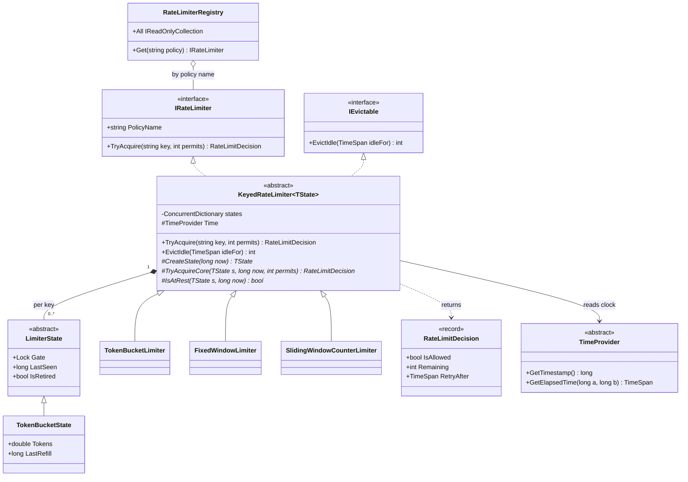
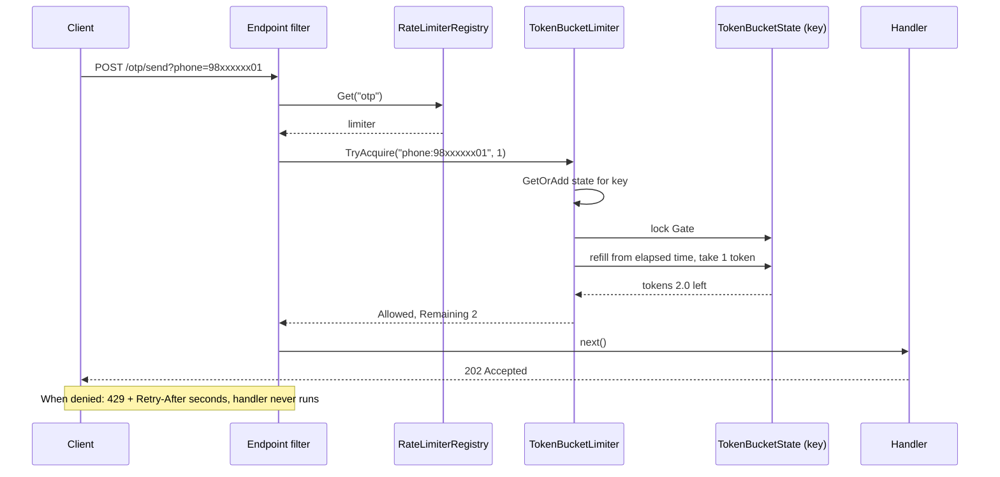
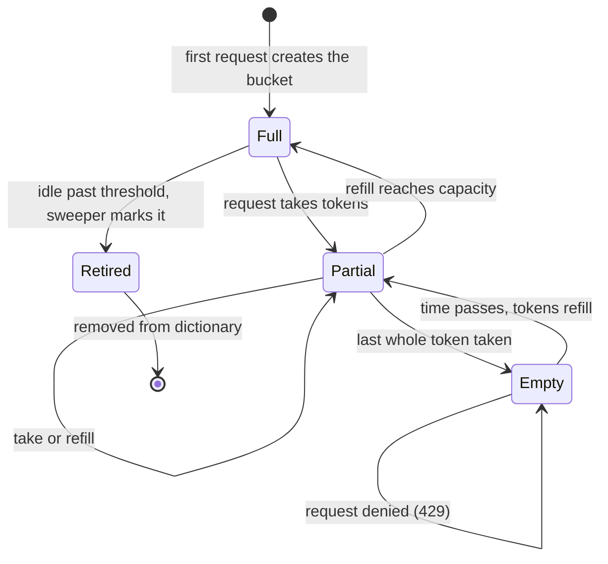
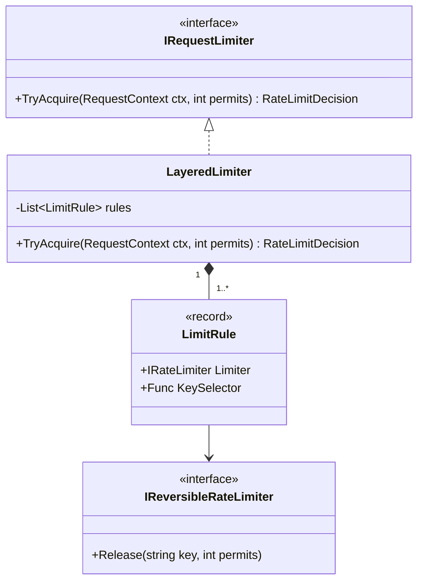

A rate limiter answers one question, thousands of times a second: "may this caller do this thing right now?" It sounds like a one-line `if`. In practice it is a small, sharp piece of design: you have to pick an algorithm, keep per-caller state without leaking memory, stay correct when 64 threads ask at once, and test time-based behaviour without sleeping. This case study builds an in-process limiter from requirements to tested code. The distributed version (Redis, many servers) is covered in [Distributed rate limiter](#/lesson/m17-rate-limiter).

## Learning objectives

By the end of this case study you will be able to:

1. Turn a vague request ("stop OTP abuse") into functional and non-functional requirements with numbers.
2. Identify the classes of a rate limiter: policy, algorithm, per-key state, registry, clock and HTTP adapter.
3. Implement token bucket, fixed window and sliding window counter algorithms in C#, and explain their trade-offs.
4. Make per-key state thread-safe with fine-grained locks, and evict idle keys without races.
5. Test time-dependent code deterministically with a hand-written `TimeProvider`.
6. Plug the limiter into ASP.NET Core as an endpoint filter that returns `429` with `Retry-After`.
7. Decide when to use the built-in `System.Threading.RateLimiting` package instead of your own design.

## Prerequisites

- [Rate limiting algorithms](#/lesson/m10-rate-limiting): we use the algorithms here; that lesson explains them at the HTTP level.
- [Strategy](#/lesson/m06-strategy) and [Template Method](#/lesson/m06-template-method): the two patterns that shape this design.
- [Concurrency patterns](#/lesson/m13-concurrency-patterns): locks, races and atomic operations.
- [Designing for testability](#/lesson/m04-testability): injecting the clock.

## Explain it like I'm a beginner

Think of a metro station turnstile at Rajiv Chowk during rush hour. The station can only let so many people onto the platform per minute, or the platform overflows. Staff do not ban anyone; they just slow people down.

A rate limiter is that turnstile for software. Every request is a person. The limiter decides "go" or "wait", and when it says "wait", it tells you roughly how long (the `Retry-After` header).

Here is the most popular way to run the turnstile, the **token bucket**. Picture a jar that holds at most 10 coins. A machine drops one coin into the jar every 6 seconds. To pass, you must take a coin. If the jar is empty, you wait. If nobody comes for a minute, the jar fills up to 10 and then stops filling, so a group of 10 can pass at once (a *burst*), but over a long time no more than 10 per minute get through.

Two other ways are common:

- **Fixed window**: "at most 5 login attempts per 15-minute block". A counter resets at the start of each block. Simple, but a sneaky user can do 5 attempts at 10:14:59 and 5 more at 10:15:00.
- **Sliding window**: the same rule, but the limiter looks at the *last* 15 minutes from now, not the current block, so the trick above stops working.

Each caller (a phone number, a user id, an IP address) gets its own jar or counter. The code you write manages thousands of these jars safely.

## Requirements

### The scenario

You work on the backend of a citizen services portal used across several Indian states. Three incidents in one month:

1. A bot requested **40,000 OTP SMS** to random numbers in one night. At roughly ₹0.15–0.25 per SMS (an estimate; it varies by provider), that is a real bill, and it annoys real people.
2. Credential stuffing on `/login`: thousands of password guesses per account.
3. One partner integration hammers `/search` and slows it down for everyone.

The team runs 2–4 instances of an ASP.NET Core API behind a load balancer. You are asked for an **in-process** limiter first: it protects each instance on its own and needs no new infrastructure. A Redis-based global limiter may come later.

### Functional requirements

| # | Requirement |
|---|---|
| F1 | Limit requests per **key** (phone number, user id, client IP, API key). |
| F2 | Support several **named policies** with different rules: `otp` = 3 per minute with bursts of 3; `login` = 5 per 15 minutes; `search` = 60 per minute, smooth. |
| F3 | Support three **algorithms**: token bucket, fixed window counter, sliding window counter. Adding a fourth must not change existing classes. |
| F4 | A request may cost more than 1 permit (a bulk export costs 10). |
| F5 | Return a **decision**: allowed or not, permits remaining, and a retry-after hint when denied. |
| F6 | HTTP adapter: denied requests get `429 Too Many Requests` with a `Retry-After` header (RFC 6585). |

### Non-functional requirements

| # | Requirement | Target |
|---|---|---|
| N1 | Correctness under concurrency | With capacity 100 and no refill, 1,000 parallel calls on one key allow **exactly** 100. |
| N2 | Latency | A decision is an in-memory operation: no I/O, no allocation on the hot path once the key exists. |
| N3 | Memory | Keys that have been idle for 10 minutes and are back at rest are evicted. 1 million distinct IPs per day must not grow memory forever. |
| N4 | Testability | Every time-based rule is testable without `Thread.Sleep`. |
| N5 | Contention | Calls on *different* keys must not block each other. |
| N6 | Fail-safe | A bug in the limiter must not take the API down; the default is to log and allow (*fail open*) for non-critical policies. |

### Clarifying questions (ask these before designing)

- **Per instance or global?** With 3 instances and an in-process limit of 3 OTP/minute, a determined user could get up to 9 per minute. Is that acceptable for phase 1? (Here: yes, with sticky routing by phone number reducing it further.)
- **What is the key?** IP addresses behind a carrier-grade NAT are shared by many mobile users. Limiting OTP by *phone number* is fairer than by IP.
- **Burst or smooth?** Token bucket allows bursts up to capacity; sliding window is smoother. Product wants OTP bursts of 3 (users mistype), but smooth search traffic.
- **What happens when denied?** Reject immediately (429) or queue and wait? For HTTP APIs, reject. Queueing holds a thread or connection and moves the problem elsewhere.
- **Fail open or fail closed?** For login, failing closed (deny on error) may lock everyone out during a bug. Usually fail open and alert.
- **Does a denied request cost anything?** In our design, no. Some systems penalise denied calls to slow down attackers; that is a separate policy.

## Identifying classes and responsibilities

Start with nouns and verbs from the requirements: *policy*, *key*, *algorithm*, *decision*, *permit*, *window*, *bucket*, *retry-after*, *evict*, *clock*.

| Class | Kind | Responsibility (one reason to change) |
|---|---|---|
| `RateLimitDecision` | value (record struct) | Immutable answer: allowed, remaining, retry-after. |
| `IRateLimiter` | interface | The contract callers depend on: `TryAcquire(key, permits)`. |
| `KeyedRateLimiter<TState>` | abstract class | Owns the per-key dictionary, locking, idle eviction and argument checks. The *skeleton* of every algorithm. |
| `LimiterState` | abstract class | Per-key mutable state plus its lock and "last seen" time. |
| `TokenBucketLimiter` + `TokenBucketState` | class | Token bucket maths: refill, take, retry-after. |
| `FixedWindowLimiter` + `FixedWindowState` | class | Counter that resets at window boundaries. |
| `SlidingWindowCounterLimiter` + `SlidingWindowState` | class | Weighted blend of the previous and current window. |
| `TokenBucketOptions`, `WindowOptions` | records | Validated configuration for each algorithm. |
| `IRateLimiterRegistry` / `RateLimiterRegistry` | interface + class | Finds a limiter by policy name. |
| `TimeProvider` | BCL abstract class | The clock. Injected so tests can control time. |
| `IdleLimiterSweeper` | `BackgroundService` | Calls eviction every minute. |
| `RateLimitEndpointExtensions` | static class | HTTP adapter: maps a decision to `429` and headers. |

Two deliberate splits:

- **Algorithm vs storage.** The dictionary, locks and eviction are the same for every algorithm. Only the maths differs. So the shared part goes in a base class and the maths in subclasses.
- **Domain vs HTTP.** The limiter knows nothing about `HttpContext`. You could reuse it in a background job that calls a partner API ("at most 20 calls per second to the GST portal").

## Class diagram



How to read it: callers only see `IRateLimiter` (and the sweeper only sees `IEvictable`). `KeyedRateLimiter<TState>` is the template: its public `TryAcquire` finds or creates the state for a key, takes that key's lock, and calls the abstract `TryAcquireCore`. Each algorithm subclass fills in three "hook" methods marked with `*`. The filled diamond from the limiter to `LimiterState` is composition: the limiter creates and destroys state objects, one per key. The registry *aggregates* limiters (hollow diamond) because it only looks them up; the DI container owns their lifetime. Every limiter reads the time from an injected `TimeProvider`, never from `DateTime.UtcNow`.

### One request, step by step



The filter is a thin adapter: build a key, ask the limiter, translate the answer. The lock is held only for the arithmetic, a few hundred nanoseconds at most (an estimate; measure it on your hardware), and only for this one key. A request for a different phone number takes a different lock and never waits.

## Patterns and design decisions

### Template Method for the shared skeleton

Every algorithm needs the same steps: validate arguments, find or create per-key state, lock it, read the time, run the algorithm, record "last seen". Only the "run the algorithm" step varies. That is the textbook shape of [Template Method](#/lesson/m06-template-method). The base class owns the order of steps and the tricky concurrency rules, so a new algorithm cannot forget the lock.

*Why not composition instead?* You could inject an `IAlgorithm<TState>` into one `KeyedRateLimiter`. That is equally valid (Strategy). We chose inheritance because the hooks share the state type tightly and the hierarchy is shallow (one level). If you find yourself needing two levels of subclasses, switch to composition.

### Strategy at the policy level

Callers ask the registry for a policy by name and get an `IRateLimiter`. Whether it is a token bucket or a sliding window is invisible to them. Changing `search` from fixed window to sliding window is a one-line change in `Program.cs`. That is [Strategy](#/lesson/m06-strategy).

### Registry (a simple factory)

`RateLimiterRegistry` maps names to limiters and throws a clear error for an unknown policy at startup, not at the first request. Building limiters from configuration (`appsettings.json`) is an extension exercise.

### Fine-grained locking

Three options for thread safety:

| Option | Correct? | Contention |
|---|---|---|
| One global `lock` around everything | Yes | Every request on every key waits for the same lock. Breaks N5. |
| `Interlocked` operations only (lock-free) | Possible for a single counter; hard for a bucket, which updates two fields (tokens and last refill time) together | Lowest |
| **One lock per key** | Yes | Only callers of the *same* key wait for each other |

We use one lock per key, with .NET 9+'s `System.Threading.Lock` type (the C# `lock` statement uses it efficiently). Lock-free designs are tempting, but a token bucket must update `Tokens` and `LastRefill` atomically together. With two separate `Interlocked` operations, two threads can both refill from the same old timestamp and mint double tokens.

`ConcurrentDictionary.GetOrAdd` may run the factory twice under a race; only one result is stored. That is harmless here because creating a state has no side effects.

### Monotonic time, not wall-clock time

We measure elapsed time with `TimeProvider.GetTimestamp()` and `GetElapsedTime()`, which use a monotonic clock (one that never jumps backwards). `DateTime.UtcNow` can jump when the server syncs with NTP; a jump backwards of 2 seconds could make elapsed time negative and break refill maths. The code also guards against negative elapsed time anyway.

### Idle eviction without races

Without eviction, every IP that ever called you stays in memory. A state is safe to drop when it is *at rest*: a full bucket, or a window that has expired. Dropping such a state is invisible to the caller, because a brand-new state would behave the same.

The race to avoid: the sweeper decides to drop a key, and at that same moment a request takes a token from it. If the sweeper then removes the state, the request's token is "forgotten" and the next request gets a fresh full bucket. Our fix: the sweeper marks the state `IsRetired` **inside the key's lock**, then removes it. `TryAcquire` checks `IsRetired` inside the same lock and, if set, loops to fetch or create a fresh state. No request ever updates a retired state.

### Fail open

The endpoint filter catches unexpected exceptions from the limiter, logs them, and lets the request through. For a payment endpoint you might choose the opposite. Make it a per-policy decision, not an accident.

## State transitions

Each key's token bucket moves through a small lifecycle:



How to read it: a bucket is created *full*, which is why a new user can immediately make 3 OTP requests. Taking tokens moves it to *partial*, then *empty*. Denied requests do not change state (they cost nothing). Time alone moves it back up, and refill stops at capacity: unused tokens are not banked forever. Only a *full* bucket that has also been idle long enough can be retired. That rule is what makes eviction invisible: an empty bucket is never evicted, otherwise an attacker would get a free refill simply by waiting for the sweeper.

Window-based limiters have the same shape with different names: *counting* (under the limit), *exhausted* (at the limit), then *expired* when the window passes, which is their "at rest" state.

## C# implementation

Project layout:

```text
Portal.Api/
  Program.cs
  RateLimiting/
    RateLimitDecision.cs
    IRateLimiter.cs
    KeyedRateLimiter.cs
    TokenBucketLimiter.cs
    FixedWindowLimiter.cs
    SlidingWindowCounterLimiter.cs
    RateLimiterRegistry.cs
    IdleLimiterSweeper.cs
    RateLimitEndpointExtensions.cs
Portal.Tests/
  RateLimiting/ManualTimeProvider.cs
  RateLimiting/TokenBucketLimiterTests.cs
  RateLimiting/WindowLimiterTests.cs
```

### The decision and the contracts

```csharp file=RateLimiting/RateLimitDecision.cs
namespace Portal.RateLimiting;

/// <summary>The answer to "may this key spend these permits now?".</summary>
public readonly record struct RateLimitDecision(bool IsAllowed, int Remaining, TimeSpan RetryAfter)
{
    public static RateLimitDecision Allow(int remaining) => new(true, Math.Max(0, remaining), TimeSpan.Zero);

    public static RateLimitDecision Deny(TimeSpan retryAfter) =>
        new(false, 0, retryAfter < TimeSpan.Zero ? TimeSpan.Zero : retryAfter);
}
```

```csharp file=RateLimiting/IRateLimiter.cs
namespace Portal.RateLimiting;

public interface IRateLimiter
{
    string PolicyName { get; }

    /// <summary>Atomically checks and consumes permits for one key. Never blocks on other keys.</summary>
    RateLimitDecision TryAcquire(string key, int permits = 1);
}

/// <summary>Separate role interface: only the sweeper needs it (Interface Segregation).</summary>
public interface IEvictable
{
    /// <summary>Removes keys idle for at least <paramref name="idleFor"/> whose state is back at rest.</summary>
    int EvictIdle(TimeSpan idleFor);
}
```

### The template: per-key state, locking and eviction

```csharp file=RateLimiting/KeyedRateLimiter.cs
using System.Collections.Concurrent;

namespace Portal.RateLimiting;

public abstract class LimiterState
{
    internal readonly Lock Gate = new();
    internal long LastSeen;      // TimeProvider timestamp of the last request
    internal bool IsRetired;     // set by the sweeper, under Gate, before removal
}

/// <summary>Template Method: owns the dictionary, locking and eviction. Subclasses supply the maths.</summary>
public abstract class KeyedRateLimiter<TState> : IRateLimiter, IEvictable where TState : LimiterState
{
    private readonly ConcurrentDictionary<string, TState> _states = new(StringComparer.Ordinal);

    protected KeyedRateLimiter(string policyName, TimeProvider time)
    {
        ArgumentException.ThrowIfNullOrWhiteSpace(policyName);
        PolicyName = policyName;
        Time = time ?? throw new ArgumentNullException(nameof(time));
    }

    public string PolicyName { get; }
    public int TrackedKeys => _states.Count;
    protected TimeProvider Time { get; }

    /// <summary>The largest cost one request may ask for. Larger requests could never succeed.</summary>
    protected abstract int MaxPermits { get; }
    protected abstract TState CreateState(long now);
    /// <summary>Called with the key's lock held. Must not block or do I/O.</summary>
    protected abstract RateLimitDecision TryAcquireCore(TState state, long now, int permits);
    /// <summary>True when a fresh state would behave identically, so dropping this one is invisible.</summary>
    protected abstract bool IsAtRest(TState state, long now);

    public RateLimitDecision TryAcquire(string key, int permits = 1)
    {
        ArgumentException.ThrowIfNullOrEmpty(key);
        ArgumentOutOfRangeException.ThrowIfNegativeOrZero(permits);
        ArgumentOutOfRangeException.ThrowIfGreaterThan(permits, MaxPermits);

        while (true)
        {
            var state = _states.GetOrAdd(key, static (_, self) => self.CreateState(self.Time.GetTimestamp()), this);
            lock (state.Gate)
            {
                if (state.IsRetired) continue;          // lost a race with the sweeper; fetch a fresh state
                long now = Time.GetTimestamp();         // read inside the lock so time never goes backwards per key
                state.LastSeen = now;
                return TryAcquireCore(state, now, permits);
            }
        }
    }

    public int EvictIdle(TimeSpan idleFor)
    {
        int removed = 0;
        foreach (var (key, state) in _states)
        {
            lock (state.Gate)
            {
                long now = Time.GetTimestamp();
                if (Time.GetElapsedTime(state.LastSeen, now) < idleFor || !IsAtRest(state, now)) continue;
                state.IsRetired = true;
                // Remove only if the dictionary still holds *this* state object.
                if (_states.TryRemove(new KeyValuePair<string, TState>(key, state))) removed++;
            }
        }
        return removed;
    }

    /// <summary>Converts a TimeSpan into TimeProvider timestamp units without overflow for long windows.</summary>
    protected long ToTimestampUnits(TimeSpan span) => (long)(span.TotalSeconds * Time.TimestampFrequency);
}
```

Notes on the details:

- `GetOrAdd` with a `static` lambda and the `this` argument avoids allocating a closure on every call (N2).
- New states get `LastSeen` equal to their creation time, so a state created and never used is still evictable later.
- `TryRemove(KeyValuePair)` removes only if the value is the same object. That protects against removing a *replacement* state another thread just added.

### Token bucket

```csharp file=RateLimiting/TokenBucketLimiter.cs
namespace Portal.RateLimiting;

public sealed record TokenBucketOptions
{
    public TokenBucketOptions(int capacity, double tokensPerSecond)
    {
        ArgumentOutOfRangeException.ThrowIfNegativeOrZero(capacity);
        if (!(tokensPerSecond > 0) || double.IsInfinity(tokensPerSecond))
            throw new ArgumentOutOfRangeException(nameof(tokensPerSecond), "Refill rate must be a positive number.");
        Capacity = capacity;
        TokensPerSecond = tokensPerSecond;
    }

    public int Capacity { get; }
    public double TokensPerSecond { get; }

    /// <summary>Convenience: "3 per minute" = capacity 3, refill 3/60 tokens per second.</summary>
    public static TokenBucketOptions PerPeriod(int permits, TimeSpan period) => new(permits, permits / period.TotalSeconds);
}

public sealed class TokenBucketState : LimiterState
{
    internal double Tokens;
    internal long LastRefill;
}

public sealed class TokenBucketLimiter(string policyName, TokenBucketOptions options, TimeProvider time)
    : KeyedRateLimiter<TokenBucketState>(policyName, time)
{
    protected override int MaxPermits => options.Capacity;

    protected override TokenBucketState CreateState(long now) =>
        new() { Tokens = options.Capacity, LastRefill = now, LastSeen = now };

    protected override RateLimitDecision TryAcquireCore(TokenBucketState s, long now, int permits)
    {
        Refill(s, now);
        if (s.Tokens >= permits)
        {
            s.Tokens -= permits;
            return RateLimitDecision.Allow((int)Math.Floor(s.Tokens));
        }
        double missing = permits - s.Tokens;
        return RateLimitDecision.Deny(TimeSpan.FromSeconds(missing / options.TokensPerSecond));
    }

    protected override bool IsAtRest(TokenBucketState s, long now)
    {
        Refill(s, now);
        return s.Tokens >= options.Capacity;
    }

    private void Refill(TokenBucketState s, long now)
    {
        double elapsedSeconds = Time.GetElapsedTime(s.LastRefill, now).TotalSeconds;
        if (elapsedSeconds <= 0) return;                 // defensive: never refill backwards
        s.Tokens = Math.Min(options.Capacity, s.Tokens + elapsedSeconds * options.TokensPerSecond);
        s.LastRefill = now;
    }
}
```

**Lazy refill** is the key idea: there is no timer adding tokens. Each request computes "how many tokens would have dripped in since I last looked?" That costs one subtraction and one multiplication, and means 1 million idle buckets cost zero CPU.

Worked example with `otp` (capacity 3, refill 3 per 60 s = 0.05 tokens/s): at 10:00:00 a user sends 3 OTPs, leaving 0 tokens. At 10:00:05 the 4th request finds 0.25 tokens and is denied with retry-after (1 − 0.25) / 0.05 = 15 s. At 10:00:20 there is exactly 1 token and the request succeeds.

### Fixed window counter

```csharp file=RateLimiting/FixedWindowLimiter.cs
namespace Portal.RateLimiting;

public sealed record WindowOptions
{
    public WindowOptions(int permitLimit, TimeSpan window)
    {
        ArgumentOutOfRangeException.ThrowIfNegativeOrZero(permitLimit);
        ArgumentOutOfRangeException.ThrowIfLessThanOrEqual(window, TimeSpan.Zero);
        PermitLimit = permitLimit;
        Window = window;
    }

    public int PermitLimit { get; }
    public TimeSpan Window { get; }
}

public sealed class FixedWindowState : LimiterState
{
    internal long WindowStart;
    internal int Count;
}

/// <summary>Counts permits in consecutive windows that start at the key's first request.</summary>
public sealed class FixedWindowLimiter(string policyName, WindowOptions options, TimeProvider time)
    : KeyedRateLimiter<FixedWindowState>(policyName, time)
{
    private readonly long _windowUnits = (long)(options.Window.TotalSeconds * time.TimestampFrequency);

    protected override int MaxPermits => options.PermitLimit;

    protected override FixedWindowState CreateState(long now) => new() { WindowStart = now, LastSeen = now };

    protected override RateLimitDecision TryAcquireCore(FixedWindowState s, long now, int permits)
    {
        Advance(s, now);
        if (s.Count + permits <= options.PermitLimit)
        {
            s.Count += permits;
            return RateLimitDecision.Allow(options.PermitLimit - s.Count);
        }
        return RateLimitDecision.Deny(Time.GetElapsedTime(now, s.WindowStart + _windowUnits));
    }

    protected override bool IsAtRest(FixedWindowState s, long now)
    {
        Advance(s, now);
        return s.Count == 0;
    }

    private void Advance(FixedWindowState s, long now)
    {
        long elapsed = now - s.WindowStart;
        if (elapsed < _windowUnits) return;
        s.WindowStart += elapsed / _windowUnits * _windowUnits;   // jump to the window that contains "now"
        s.Count = 0;
    }
}
```

`Advance` jumps forward by *whole* windows, so windows stay aligned to the first request even after a long gap. Retry-after is simply "time until this window ends".

### Sliding window counter

The sliding window *log* stores every timestamp: exact, but memory grows with the limit (60 timestamps per key for 60/min). The sliding window *counter* keeps just two numbers, the count in the previous window and in the current one, and estimates the last-60-seconds count by weighting the previous window by how much of it still overlaps.

Example: limit 60/min. Previous minute had 50 requests, current minute has 20, and we are 15 s (25 %) into the current minute. Estimated count = 50 × 0.75 + 20 = 57.5. One more request makes 58.5, which is ≤ 60, so it is allowed.

```csharp file=RateLimiting/SlidingWindowCounterLimiter.cs
namespace Portal.RateLimiting;

public sealed class SlidingWindowState : LimiterState
{
    internal long WindowStart;
    internal int Previous;
    internal int Current;
}

/// <summary>Approximates a true sliding window with two counters. Assumes requests in the
/// previous window were spread evenly, which is the price of O(1) memory per key.</summary>
public sealed class SlidingWindowCounterLimiter(string policyName, WindowOptions options, TimeProvider time)
    : KeyedRateLimiter<SlidingWindowState>(policyName, time)
{
    private readonly long _w = (long)(options.Window.TotalSeconds * time.TimestampFrequency);

    protected override int MaxPermits => options.PermitLimit;

    protected override SlidingWindowState CreateState(long now) => new() { WindowStart = now, LastSeen = now };

    protected override RateLimitDecision TryAcquireCore(SlidingWindowState s, long now, int permits)
    {
        long elapsed = Advance(s, now);
        double weight = 1.0 - (double)elapsed / _w;
        double estimated = s.Previous * weight + s.Current;

        if (estimated + permits <= options.PermitLimit)
        {
            s.Current += permits;
            return RateLimitDecision.Allow((int)Math.Floor(options.PermitLimit - estimated - permits));
        }

        // Estimate the wait: how far must the window slide so the previous window's share shrinks enough?
        long waitUnits;
        int headroom = options.PermitLimit - s.Current - permits;
        if (s.Previous > 0 && headroom >= 0)
        {
            double neededElapsed = _w * (1.0 - (double)headroom / s.Previous);
            waitUnits = Math.Max(1, (long)Math.Ceiling(neededElapsed) - elapsed);
        }
        else waitUnits = _w - elapsed;   // must wait at least until the next window starts
        return RateLimitDecision.Deny(Time.GetElapsedTime(0, waitUnits));
    }

    protected override bool IsAtRest(SlidingWindowState s, long now)
    {
        Advance(s, now);
        return s.Previous == 0 && s.Current == 0;
    }

    /// <summary>Rolls windows forward and returns the time elapsed inside the current window.</summary>
    private long Advance(SlidingWindowState s, long now)
    {
        long elapsed = now - s.WindowStart;
        if (elapsed >= 2 * _w)
        {
            s.Previous = 0;
            s.Current = 0;
            s.WindowStart = now - elapsed % _w;
        }
        else if (elapsed >= _w)
        {
            s.Previous = s.Current;
            s.Current = 0;
            s.WindowStart += _w;
        }
        return now - s.WindowStart;
    }
}
```

### Registry, sweeper and HTTP adapter

```csharp file=RateLimiting/RateLimiterRegistry.cs
namespace Portal.RateLimiting;

public interface IRateLimiterRegistry
{
    IRateLimiter Get(string policyName);
    IReadOnlyCollection<IRateLimiter> All { get; }
}

public sealed class UnknownRateLimitPolicyException(string name)
    : InvalidOperationException($"No rate limit policy named '{name}' is registered.");

public sealed class RateLimiterRegistry : IRateLimiterRegistry
{
    private readonly Dictionary<string, IRateLimiter> _byName;

    public RateLimiterRegistry(IEnumerable<IRateLimiter> limiters)
    {
        _byName = new Dictionary<string, IRateLimiter>(StringComparer.OrdinalIgnoreCase);
        foreach (var l in limiters)
            if (!_byName.TryAdd(l.PolicyName, l))
                throw new InvalidOperationException($"Duplicate rate limit policy '{l.PolicyName}'.");
    }

    public IReadOnlyCollection<IRateLimiter> All => _byName.Values;

    public IRateLimiter Get(string policyName) =>
        _byName.TryGetValue(policyName, out var l) ? l : throw new UnknownRateLimitPolicyException(policyName);
}
```

```csharp file=RateLimiting/IdleLimiterSweeper.cs
using Microsoft.Extensions.Hosting;
using Microsoft.Extensions.Logging;

namespace Portal.RateLimiting;

/// <summary>Evicts idle, at-rest keys once a minute so memory tracks active callers, not all-time callers.</summary>
public sealed class IdleLimiterSweeper(IRateLimiterRegistry registry, TimeProvider time, ILogger<IdleLimiterSweeper> log)
    : BackgroundService
{
    public static readonly TimeSpan Interval = TimeSpan.FromMinutes(1);
    public static readonly TimeSpan IdleThreshold = TimeSpan.FromMinutes(10);

    protected override async Task ExecuteAsync(CancellationToken stoppingToken)
    {
        using var timer = new PeriodicTimer(Interval, time);
        while (await timer.WaitForNextTickAsync(stoppingToken))
        {
            foreach (var limiter in registry.All)
            {
                if (limiter is not IEvictable e) continue;
                try
                {
                    int n = e.EvictIdle(IdleThreshold);
                    if (n > 0) log.LogDebug("Evicted {Count} idle keys from {Policy}", n, limiter.PolicyName);
                }
                catch (Exception ex)
                {
                    log.LogError(ex, "Sweeping {Policy} failed", limiter.PolicyName);
                }
            }
        }
    }
}
```

```csharp file=RateLimiting/RateLimitEndpointExtensions.cs
using System.Globalization;
using Microsoft.AspNetCore.Builder;
using Microsoft.AspNetCore.Http;
using Microsoft.Extensions.DependencyInjection;
using Microsoft.Extensions.Logging;

namespace Portal.RateLimiting;

public static class RateLimitEndpointExtensions
{
    /// <summary>Adds an in-process rate limit to one endpoint. Fails open if the limiter throws.</summary>
    public static TBuilder WithLocalRateLimit<TBuilder>(this TBuilder builder, string policy,
        Func<HttpContext, string> keySelector) where TBuilder : IEndpointConventionBuilder
    {
        builder.AddEndpointFilter(async (ctx, next) =>
        {
            var http = ctx.HttpContext;
            RateLimitDecision decision;
            try
            {
                var limiter = http.RequestServices.GetRequiredService<IRateLimiterRegistry>().Get(policy);
                decision = limiter.TryAcquire(keySelector(http));
            }
            catch (Exception ex) when (ex is not UnknownRateLimitPolicyException)
            {
                http.RequestServices.GetRequiredService<ILoggerFactory>()
                    .CreateLogger("RateLimiting").LogError(ex, "Rate limiter {Policy} failed; allowing request", policy);
                return await next(ctx);
            }

            http.Response.Headers["X-RateLimit-Remaining"] = decision.Remaining.ToString(CultureInfo.InvariantCulture);
            if (decision.IsAllowed) return await next(ctx);

            int seconds = (int)Math.Ceiling(decision.RetryAfter.TotalSeconds);
            http.Response.Headers.RetryAfter = Math.Max(1, seconds).ToString(CultureInfo.InvariantCulture);
            return Results.Problem(title: "Too many requests", statusCode: StatusCodes.Status429TooManyRequests,
                detail: $"Try again in {Math.Max(1, seconds)} seconds.");
        });
        return builder;
    }

    /// <summary>Client IP as seen by Kestrel. Behind a proxy, configure ForwardedHeaders first.</summary>
    public static string ClientIp(HttpContext http) => "ip:" + (http.Connection.RemoteIpAddress?.ToString() ?? "unknown");
}
```

### Composition root

```csharp file=Program.cs
using Portal.RateLimiting;

var builder = WebApplication.CreateBuilder(args);

builder.Services.AddSingleton(TimeProvider.System);
// Limiters hold per-key state, so they MUST be singletons: a scoped limiter would forget everything per request.
builder.Services.AddSingleton<IRateLimiter>(sp =>
    new TokenBucketLimiter("otp", TokenBucketOptions.PerPeriod(3, TimeSpan.FromMinutes(1)), sp.GetRequiredService<TimeProvider>()));
builder.Services.AddSingleton<IRateLimiter>(sp =>
    new FixedWindowLimiter("login", new WindowOptions(5, TimeSpan.FromMinutes(15)), sp.GetRequiredService<TimeProvider>()));
builder.Services.AddSingleton<IRateLimiter>(sp =>
    new SlidingWindowCounterLimiter("search", new WindowOptions(60, TimeSpan.FromMinutes(1)), sp.GetRequiredService<TimeProvider>()));
builder.Services.AddSingleton<IRateLimiterRegistry, RateLimiterRegistry>();
builder.Services.AddHostedService<IdleLimiterSweeper>();

var app = builder.Build();

app.MapPost("/otp/send", (string phone) => Results.Accepted())
   .WithLocalRateLimit("otp", http => "phone:" + http.Request.Query["phone"].ToString());

app.MapPost("/login", (LoginRequest req) => Results.Ok())
   .WithLocalRateLimit("login", RateLimitEndpointExtensions.ClientIp);

app.MapGet("/search", (string q) => Results.Ok(new { q, results = Array.Empty<string>() }))
   .WithLocalRateLimit("search", RateLimitEndpointExtensions.ClientIp);

app.Run();

public sealed record LoginRequest(string UserName, string Password);
```

## Automated testing

Time-based code is only testable if *you* control the clock. Since .NET 8, `TimeProvider` is the standard abstraction. The `Microsoft.Extensions.TimeProvider.Testing` NuGet package ships a `FakeTimeProvider`; here is a tiny hand-written one so the tests have no dependencies. It overrides the monotonic timestamp and sets its frequency to 10 million per second (one `TimeSpan` tick), which makes the arithmetic easy to follow.

```csharp
using Xunit;

namespace Portal.Tests;

public sealed class ManualTimeProvider : TimeProvider
{
    private long _ticks;
    private static readonly DateTimeOffset Epoch = new(2026, 1, 1, 0, 0, 0, TimeSpan.Zero);
    public override long TimestampFrequency => TimeSpan.TicksPerSecond;
    public override long GetTimestamp() => Interlocked.Read(ref _ticks);
    public override DateTimeOffset GetUtcNow() => Epoch.AddTicks(Interlocked.Read(ref _ticks));
    public void Advance(TimeSpan by) => Interlocked.Add(ref _ticks, by.Ticks);
}
```

Token bucket behaviour, including burst, refill, retry-after and the concurrency requirement N1:

```csharp
using Portal.RateLimiting;
using Xunit;

namespace Portal.Tests;

public class TokenBucketLimiterTests
{
    private static (TokenBucketLimiter L, ManualTimeProvider T) Otp()
    {
        var t = new ManualTimeProvider();
        return (new TokenBucketLimiter("otp", TokenBucketOptions.PerPeriod(3, TimeSpan.FromMinutes(1)), t), t);
    }

    [Fact]
    public void Allows_a_burst_up_to_capacity_then_denies()
    {
        var (l, _) = Otp();
        Assert.True(l.TryAcquire("p1").IsAllowed);
        Assert.True(l.TryAcquire("p1").IsAllowed);
        var third = l.TryAcquire("p1");
        Assert.True(third.IsAllowed);
        Assert.Equal(0, third.Remaining);
        Assert.False(l.TryAcquire("p1").IsAllowed);
    }

    [Fact]
    public void Refills_lazily_and_reports_retry_after()
    {
        var (l, t) = Otp();
        for (int i = 0; i < 3; i++) l.TryAcquire("p1");
        t.Advance(TimeSpan.FromSeconds(5));                     // 0.25 tokens dripped in
        var denied = l.TryAcquire("p1");
        Assert.False(denied.IsAllowed);
        Assert.Equal(15.0, denied.RetryAfter.TotalSeconds, 3);
        t.Advance(TimeSpan.FromSeconds(16));                    // comfortably past 1 whole token
        Assert.True(l.TryAcquire("p1").IsAllowed);
    }

    [Fact]
    public void Keys_are_independent()
    {
        var (l, _) = Otp();
        for (int i = 0; i < 3; i++) l.TryAcquire("p1");
        Assert.True(l.TryAcquire("p2").IsAllowed);
    }

    [Fact]
    public void Exactly_capacity_allowed_under_parallel_load()
    {
        var t = new ManualTimeProvider();
        var l = new TokenBucketLimiter("bulk", new TokenBucketOptions(100, 0.0001), t);
        int allowed = 0;
        Parallel.For(0, 1000, _ => { if (l.TryAcquire("hot").IsAllowed) Interlocked.Increment(ref allowed); });
        Assert.Equal(100, allowed);
    }

    [Fact]
    public void Rejects_requests_bigger_than_capacity() =>
        Assert.Throws<ArgumentOutOfRangeException>(() => Otp().L.TryAcquire("p1", permits: 4));

    [Fact]
    public void Evicts_only_idle_full_buckets()
    {
        var (l, t) = Otp();
        for (int i = 0; i < 3; i++) l.TryAcquire("empty");
        l.TryAcquire("other");
        t.Advance(TimeSpan.FromSeconds(30));                    // "empty" has 1.5 tokens; "other" is full again
        Assert.Equal(1, l.EvictIdle(TimeSpan.FromSeconds(20))); // only "other" goes
        t.Advance(TimeSpan.FromSeconds(60));                    // now "empty" is full and idle too
        Assert.Equal(1, l.EvictIdle(TimeSpan.FromSeconds(20)));
        Assert.Equal(0, l.TrackedKeys);
    }
}
```

Window limiters, including the boundary burst that fixed windows allow and sliding windows prevent:

```csharp
using Portal.RateLimiting;
using Xunit;

namespace Portal.Tests;

public class WindowLimiterTests
{
    private static readonly WindowOptions TenPerMinute = new(10, TimeSpan.FromMinutes(1));

    private static int Spend(IRateLimiter l, string key, int attempts)
    {
        int ok = 0;
        for (int i = 0; i < attempts; i++) if (l.TryAcquire(key).IsAllowed) ok++;
        return ok;
    }

    [Fact]
    public void Fixed_window_resets_at_boundary_and_allows_double_burst()
    {
        var t = new ManualTimeProvider();
        var l = new FixedWindowLimiter("f", TenPerMinute, t);
        l.TryAcquire("k");                                      // window starts at t=0
        t.Advance(TimeSpan.FromSeconds(59));
        Assert.Equal(9, Spend(l, "k", 20));                     // 9 more in the last second
        t.Advance(TimeSpan.FromSeconds(1));
        Assert.Equal(10, Spend(l, "k", 20));                    // 10 more one second later: 19 in ~1 s
    }

    [Fact]
    public void Fixed_window_retry_after_is_time_to_window_end()
    {
        var t = new ManualTimeProvider();
        var l = new FixedWindowLimiter("f", TenPerMinute, t);
        Spend(l, "k", 10);
        t.Advance(TimeSpan.FromSeconds(45));
        Assert.Equal(15.0, l.TryAcquire("k").RetryAfter.TotalSeconds, 3);
    }

    [Fact]
    public void Sliding_window_smooths_the_boundary_burst()
    {
        var t = new ManualTimeProvider();
        var l = new SlidingWindowCounterLimiter("s", TenPerMinute, t);
        l.TryAcquire("k");
        t.Advance(TimeSpan.FromSeconds(59));
        Assert.Equal(9, Spend(l, "k", 20));
        t.Advance(TimeSpan.FromSeconds(1));                     // previous window (10) still weighs 100 %
        Assert.Equal(0, Spend(l, "k", 20));
        t.Advance(TimeSpan.FromSeconds(30));                    // 50 % of previous: 5 still counted
        Assert.Equal(5, Spend(l, "k", 20));
    }

    [Fact]
    public void Registry_rejects_duplicates_and_unknown_names()
    {
        var t = new ManualTimeProvider();
        var a = new FixedWindowLimiter("login", TenPerMinute, t);
        Assert.Throws<InvalidOperationException>(() => new RateLimiterRegistry(new IRateLimiter[] { a, a }));
        Assert.Throws<UnknownRateLimitPolicyException>(() => new RateLimiterRegistry(new IRateLimiter[] { a }).Get("otp"));
    }
}
```

What these tests buy you:

- **No sleeps.** The whole suite runs in milliseconds and never flakes on a slow CI agent.
- **The concurrency test is deterministic in outcome.** The clock is frozen, so no tokens refill; any count other than exactly 100 is a real bug. Try deleting the `lock` and the test fails most runs (it is a race, so not always; that is why you keep the lock even when the test passes once).
- **Eviction rules are pinned.** The "empty bucket must not be evicted" test protects against the free-refill attack.

For the HTTP adapter, add one integration test with `WebApplicationFactory` that sends 4 requests to `/otp/send` and asserts the 4th returns 429 with a `Retry-After` header. Keep most tests at the unit level: they are faster and pinpoint failures.

## Bad design vs good design

### Bad: the static helper

```csharp
public static class Throttle
{
    private static readonly Dictionary<string, (int Count, DateTime Start)> _hits = new();

    public static bool Allow(string key, int limit, int seconds)
    {
        if (!_hits.TryGetValue(key, out var h) || (DateTime.Now - h.Start).TotalSeconds > seconds)
            h = (0, DateTime.Now);
        h.Count++;
        _hits[key] = h;
        return h.Count <= limit;
    }
}
```

What is wrong, concretely:

1. **Not thread-safe.** `Dictionary` corrupts itself under concurrent writes. Under load this can throw, or in older runtimes even spin forever.
2. **Lost updates.** Even with a `ConcurrentDictionary`, read-modify-write of the tuple is not atomic: two requests read `Count = 4`, both write 5, and both pass a limit of 5.
3. **Untestable time.** `DateTime.Now` is local time; it jumps at daylight-saving changes in many countries and with NTP corrections. Tests would need real sleeps.
4. **Unbounded memory.** Keys are never removed. One million IPs a day is one million entries a day, forever.
5. **Limit passed on every call.** Two call sites can disagree about the limit for the same key. The policy should live in one place.
6. **Denied requests still count.** `Count++` runs even when denied, so a user who keeps retrying is locked out for longer than the rule says. Sometimes that is intentional, but here it is an accident.
7. **Static.** Cannot be swapped, configured per environment or replaced with a distributed limiter later.

### Good: the design above

- Policies are named objects created once; callers cannot pass conflicting limits.
- One lock per key: correct and low contention.
- `TimeProvider` makes every time rule testable.
- Eviction keeps memory proportional to *active* keys.
- `IRateLimiter` lets you replace the in-process implementation with a Redis-backed one without touching endpoints.

### Is the full design worth it?

For a single internal admin tool with 20 users, honestly no. Use the built-in ASP.NET Core middleware (next section) and move on. Build your own when you need something it does not do: domain-level limits outside HTTP (a job that calls a partner API), custom keys and costs, custom eviction, or a stepping stone to your own distributed design.

## Alternative designs

### Use the built-in `System.Threading.RateLimiting`

.NET ships `System.Threading.RateLimiting` (`TokenBucketRateLimiter`, `FixedWindowRateLimiter`, `SlidingWindowRateLimiter`, `ConcurrencyLimiter`, and `PartitionedRateLimiter` for per-key limits). ASP.NET Core adds middleware on top:

```csharp
builder.Services.AddRateLimiter(o =>
{
    o.RejectionStatusCode = StatusCodes.Status429TooManyRequests;
    o.AddPolicy("otp", http => RateLimitPartition.GetTokenBucketLimiter(
        partitionKey: http.Request.Query["phone"].ToString(),
        factory: _ => new TokenBucketRateLimiterOptions
        {
            TokenLimit = 3, TokensPerPeriod = 1, ReplenishmentPeriod = TimeSpan.FromSeconds(20),
            QueueLimit = 0, AutoReplenishment = true
        }));
});
app.UseRateLimiter();
app.MapPost("/otp/send", (string phone) => Results.Accepted()).RequireRateLimiting("otp");
```

Strengths: maintained by Microsoft, supports queuing and leases, integrates with endpoint metadata. Differences: it replenishes in discrete steps per period rather than continuously, and per-partition state management is handled for you (with less control). **For most HTTP APIs this is the right default.** This case study's value is learning the design so you can reason about, extend or replace it.

### Composition instead of inheritance

Replace `KeyedRateLimiter<TState>` subclasses with one `KeyedRateLimiter` that takes an `IRateAlgorithm` (`CreateState`, `TryAcquire`, `IsAtRest`). Better if you want to wrap algorithms (for example, a "logging algorithm" decorator) or choose them from configuration at runtime. Slightly more indirection.

### Lock-free with `Interlocked`

A fixed window counter can be lock-free: pack the window number and count into one `long` and update with `Interlocked.CompareExchange` in a loop. Faster under extreme contention on one hot key, but harder to read and to extend to buckets. Only worth it if profiling shows the per-key lock is a bottleneck, which for most APIs it is not.

### Sliding window log

Store a queue of timestamps per key. Exact, with simple maths. Memory is O(limit) per key: fine for "5 logins per 15 minutes", wasteful for "10,000 calls per hour". (Exercise 3.)

### Distributed limiter

Several instances sharing one Redis with an atomic Lua script. Gives a global limit but adds a network hop (around a millisecond in the same region, an estimate) and a new failure mode: what if Redis is down? A common hybrid is a generous in-process limit as a first line of defence plus a global Redis limit for expensive actions. See [Distributed rate limiter](#/lesson/m17-rate-limiter).

## Practical playground

Open the reference class model in the LLD designer. Try these changes and check whether the diagram still respects the dependency rules:

1. Add a `ConcurrencyLimiter` (limits in-flight requests, not rate). Does it fit `KeyedRateLimiter<TState>`, or does it need a different abstraction?
2. Add a `CompositeRateLimiter` that enforces "per user AND per IP". Which interface should it implement?
3. Move the algorithm into an `IRateAlgorithm` interface (composition) and compare the two diagrams.

:::playground type=lld title="In-process rate limiter — reference model"
```json
{
  "classes": [
    { "id": "IRateLimiter", "name": "IRateLimiter", "kind": "interface", "fields": ["+string PolicyName"], "methods": ["+RateLimitDecision TryAcquire(string key, int permits)"], "responsibility": "Contract every caller depends on" },
    { "id": "IEvictable", "name": "IEvictable", "kind": "interface", "fields": [], "methods": ["+int EvictIdle(TimeSpan idleFor)"], "responsibility": "Role interface used only by the sweeper" },
    { "id": "Keyed", "name": "KeyedRateLimiter<TState>", "kind": "abstract", "fields": ["-ConcurrentDictionary states", "#TimeProvider Time"], "methods": ["+RateLimitDecision TryAcquire(string key, int permits)", "+int EvictIdle(TimeSpan idleFor)", "#TState CreateState(long now)", "#RateLimitDecision TryAcquireCore(TState s, long now, int permits)", "#bool IsAtRest(TState s, long now)"], "responsibility": "Template: per-key state, locking, eviction" },
    { "id": "State", "name": "LimiterState", "kind": "abstract", "fields": ["+Lock Gate", "+long LastSeen", "+bool IsRetired"], "methods": [], "responsibility": "Per-key mutable state and its lock" },
    { "id": "TB", "name": "TokenBucketLimiter", "kind": "class", "fields": ["-TokenBucketOptions options"], "methods": ["#RateLimitDecision TryAcquireCore(TokenBucketState s, long now, int permits)"], "responsibility": "Lazy refill token bucket maths" },
    { "id": "TBS", "name": "TokenBucketState", "kind": "class", "fields": ["+double Tokens", "+long LastRefill"], "methods": [] },
    { "id": "FW", "name": "FixedWindowLimiter", "kind": "class", "fields": ["-WindowOptions options"], "methods": ["#RateLimitDecision TryAcquireCore(FixedWindowState s, long now, int permits)"], "responsibility": "Counter per aligned window" },
    { "id": "SW", "name": "SlidingWindowCounterLimiter", "kind": "class", "fields": ["-WindowOptions options"], "methods": ["#RateLimitDecision TryAcquireCore(SlidingWindowState s, long now, int permits)"], "responsibility": "Weighted previous + current window" },
    { "id": "Decision", "name": "RateLimitDecision", "kind": "record", "fields": ["+bool IsAllowed", "+int Remaining", "+TimeSpan RetryAfter"], "methods": [] },
    { "id": "TBO", "name": "TokenBucketOptions", "kind": "record", "fields": ["+int Capacity", "+double TokensPerSecond"], "methods": [] },
    { "id": "WO", "name": "WindowOptions", "kind": "record", "fields": ["+int PermitLimit", "+TimeSpan Window"], "methods": [] },
    { "id": "Registry", "name": "RateLimiterRegistry", "kind": "class", "fields": ["-Dictionary byName"], "methods": ["+IRateLimiter Get(string policyName)"], "responsibility": "Finds a limiter by policy name" },
    { "id": "Sweeper", "name": "IdleLimiterSweeper", "kind": "class", "fields": [], "methods": ["#Task ExecuteAsync(CancellationToken ct)"], "responsibility": "Periodic eviction of idle keys" },
    { "id": "Clock", "name": "TimeProvider", "kind": "abstract", "fields": [], "methods": ["+long GetTimestamp()", "+TimeSpan GetElapsedTime(long start, long end)"], "responsibility": "Injected clock" }
  ],
  "relations": [
    { "from": "Keyed", "to": "IRateLimiter", "kind": "implements" },
    { "from": "Keyed", "to": "IEvictable", "kind": "implements" },
    { "from": "TB", "to": "Keyed", "kind": "inherits" },
    { "from": "FW", "to": "Keyed", "kind": "inherits" },
    { "from": "SW", "to": "Keyed", "kind": "inherits" },
    { "from": "TBS", "to": "State", "kind": "inherits" },
    { "from": "Keyed", "to": "State", "kind": "composition", "label": "per key", "multiplicity": "0..*" },
    { "from": "Keyed", "to": "Clock", "kind": "association" },
    { "from": "Keyed", "to": "Decision", "kind": "dependency", "label": "returns" },
    { "from": "TB", "to": "TBO", "kind": "association" },
    { "from": "FW", "to": "WO", "kind": "association" },
    { "from": "SW", "to": "WO", "kind": "association" },
    { "from": "Registry", "to": "IRateLimiter", "kind": "aggregation", "multiplicity": "1..*" },
    { "from": "Sweeper", "to": "Registry", "kind": "dependency" },
    { "from": "Sweeper", "to": "IEvictable", "kind": "dependency" }
  ]
}
```
:::

## Exercises

:::exercise id=m18-rate-limiter-ex1 difficulty=beginner kind=code title="Fixed window counter for one key"
Implement a single-key fixed window counter: at most `limit` permits per `window`, where windows start at the first request and stay aligned after that. The clock is an injected `TimeProvider`.
::requirements
- `TryAcquire()` returns true and counts the permit if the current window has room.
- When the window has passed, jump forward by whole windows and reset the count.
- `RetryAfter` returns the time until the current window ends (zero if a permit is available now).
::acceptance
- 5 calls in a 5-per-minute window succeed; the 6th fails.
- After 60 seconds, calls succeed again.
- After a 150-second gap, the window start is aligned to 120 s (not 150 s), so `RetryAfter` after 5 more calls is 30 s.
::hint
You need two fields: when the current window started, and how many permits it has used.
::hint
Use `time.GetTimestamp()` for "now" and `time.GetElapsedTime(start, now)` for durations.
::hint
"Jump forward by whole windows": number of windows passed = elapsed ticks / window ticks (integer division).
::hint
```csharp
var elapsed = _time.GetElapsedTime(_windowStart, now);
if (elapsed >= _window) { long n = elapsed.Ticks / _window.Ticks; _windowStart += ToUnits(n * _window.Ticks); _count = 0; }
```
::hint
Convert TimeSpan ticks to timestamp units with `ticks * _time.TimestampFrequency / TimeSpan.TicksPerSecond`. Watch out for overflow with large frequencies; using `double` for the conversion is fine here.
::starter
```csharp file=FixedWindowCounter.cs
using System;

public sealed class FixedWindowCounter
{
    private readonly int _limit;
    private readonly TimeSpan _window;
    private readonly TimeProvider _time;

    public FixedWindowCounter(int limit, TimeSpan window, TimeProvider time)
    {
        _limit = limit;
        _window = window;
        _time = time;
    }

    public bool TryAcquire() => throw new NotImplementedException();

    public TimeSpan RetryAfter() => throw new NotImplementedException();
}
```
::tests
```csharp file=FixedWindowCounterTests.cs
using System;
using System.Threading;
using Xunit;

public sealed class ManualClock : TimeProvider
{
    private long _ticks;
    public override long TimestampFrequency => TimeSpan.TicksPerSecond;
    public override long GetTimestamp() => Interlocked.Read(ref _ticks);
    public void Advance(TimeSpan by) => Interlocked.Add(ref _ticks, by.Ticks);
}

public class FixedWindowCounterTests
{
    [Fact]
    public void Allows_limit_then_denies()
    {
        var c = new FixedWindowCounter(5, TimeSpan.FromMinutes(1), new ManualClock());
        for (int i = 0; i < 5; i++) Assert.True(c.TryAcquire());
        Assert.False(c.TryAcquire());
    }

    [Fact]
    public void Resets_after_window()
    {
        var clock = new ManualClock();
        var c = new FixedWindowCounter(5, TimeSpan.FromMinutes(1), clock);
        for (int i = 0; i < 5; i++) c.TryAcquire();
        clock.Advance(TimeSpan.FromSeconds(60));
        Assert.True(c.TryAcquire());
    }

    [Fact]
    public void Retry_after_is_time_to_window_end()
    {
        var clock = new ManualClock();
        var c = new FixedWindowCounter(2, TimeSpan.FromMinutes(1), clock);
        c.TryAcquire(); c.TryAcquire();
        clock.Advance(TimeSpan.FromSeconds(40));
        Assert.Equal(TimeSpan.FromSeconds(20), c.RetryAfter());
    }

    [Fact]
    public void Windows_stay_aligned_after_a_gap()
    {
        var clock = new ManualClock();
        var c = new FixedWindowCounter(5, TimeSpan.FromMinutes(1), clock);
        c.TryAcquire();
        clock.Advance(TimeSpan.FromSeconds(150));
        for (int i = 0; i < 5; i++) Assert.True(c.TryAcquire());
        Assert.Equal(TimeSpan.FromSeconds(30), c.RetryAfter());
    }

    [Fact]
    public void Retry_after_is_zero_when_room_left() =>
        Assert.Equal(TimeSpan.Zero, new FixedWindowCounter(1, TimeSpan.FromMinutes(1), new ManualClock()).RetryAfter());
}
```
::solution
Keep a window start (in timestamp units) and a count. Before every operation, roll the window forward by a whole number of windows.

```csharp file=FixedWindowCounter.cs
using System;

public sealed class FixedWindowCounter
{
    private readonly int _limit;
    private readonly TimeSpan _window;
    private readonly TimeProvider _time;
    private long _windowStart;
    private int _count;
    private bool _started;

    public FixedWindowCounter(int limit, TimeSpan window, TimeProvider time)
    {
        ArgumentOutOfRangeException.ThrowIfNegativeOrZero(limit);
        ArgumentOutOfRangeException.ThrowIfLessThanOrEqual(window, TimeSpan.Zero);
        _limit = limit;
        _window = window;
        _time = time;
    }

    public bool TryAcquire()
    {
        Roll(_time.GetTimestamp());
        if (_count >= _limit) return false;
        _count++;
        return true;
    }

    public TimeSpan RetryAfter()
    {
        long now = _time.GetTimestamp();
        Roll(now);
        if (_count < _limit) return TimeSpan.Zero;
        return _window - _time.GetElapsedTime(_windowStart, now);
    }

    private void Roll(long now)
    {
        if (!_started) { _windowStart = now; _started = true; return; }
        var elapsed = _time.GetElapsedTime(_windowStart, now);
        if (elapsed < _window) return;
        long windows = elapsed.Ticks / _window.Ticks;
        _windowStart += (long)(windows * _window.TotalSeconds * _time.TimestampFrequency);
        _count = 0;
    }
}
```

The `_started` flag makes the first request start the first window, which matches "windows start at the first request". Note this class is not thread-safe; wrap it in a lock or use it from a keyed limiter that locks for you.
::mistakes
- Setting `_windowStart = now` on every reset. That drifts the windows to the latest request and changes the rule.
- Using `DateTime.Now`, which makes the tests impossible without sleeping.
- Counting denied requests, which extends lockouts by accident.
::extensions
Make it thread-safe with a `Lock` and add a test that runs 1,000 parallel `TryAcquire` calls and expects exactly `limit` successes.
:::

:::exercise id=m18-rate-limiter-ex2 difficulty=beginner kind=code title="Token bucket with lazy refill"
Implement a single token bucket. It starts full. Tokens drip in continuously at `tokensPerSecond`, never above `capacity`. Refill is computed lazily on each call; there is no timer.
::requirements
- `TryTake(int tokens = 1)` returns true and removes tokens if enough are available.
- `Available` returns the current (refilled) token count.
- `TimeUntil(int tokens)` returns how long until that many tokens will be available (zero if available now).
- Requests for more than `capacity` tokens throw `ArgumentOutOfRangeException`.
::acceptance
- Capacity 10, rate 2/s: 10 takes succeed, the 11th fails.
- After 1.5 s, 3 tokens are available.
- After a long idle period, `Available` is capped at capacity.
- `TimeUntil(4)` with 1 token and 2 tokens/s is 1.5 s.
::hint
Store two fields: the token count (a `double`) and the timestamp of the last refill.
::hint
Refill = elapsed seconds × rate, then `Math.Min(capacity, ...)`.
::hint
Call the same private `Refill(now)` at the start of every public member, so all of them see the same picture.
::hint
`TimeUntil(n)` = `max(0, n - tokens) / rate` seconds.
::starter
```csharp file=TokenBucket.cs
using System;

public sealed class TokenBucket
{
    public TokenBucket(int capacity, double tokensPerSecond, TimeProvider time)
    {
        throw new NotImplementedException();
    }

    public double Available => throw new NotImplementedException();

    public bool TryTake(int tokens = 1) => throw new NotImplementedException();

    public TimeSpan TimeUntil(int tokens) => throw new NotImplementedException();
}
```
::tests
```csharp file=TokenBucketTests.cs
using System;
using System.Threading;
using Xunit;

public sealed class StepClock : TimeProvider
{
    private long _ticks;
    public override long TimestampFrequency => TimeSpan.TicksPerSecond;
    public override long GetTimestamp() => Interlocked.Read(ref _ticks);
    public void Advance(TimeSpan by) => Interlocked.Add(ref _ticks, by.Ticks);
}

public class TokenBucketTests
{
    [Fact]
    public void Starts_full_and_drains()
    {
        var b = new TokenBucket(10, 2, new StepClock());
        for (int i = 0; i < 10; i++) Assert.True(b.TryTake());
        Assert.False(b.TryTake());
    }

    [Fact]
    public void Refills_continuously()
    {
        var clock = new StepClock();
        var b = new TokenBucket(10, 2, clock);
        for (int i = 0; i < 10; i++) b.TryTake();
        clock.Advance(TimeSpan.FromSeconds(1.5));
        Assert.Equal(3.0, b.Available, 6);
        Assert.True(b.TryTake(3));
        Assert.False(b.TryTake());
    }

    [Fact]
    public void Caps_at_capacity()
    {
        var clock = new StepClock();
        var b = new TokenBucket(10, 2, clock);
        b.TryTake(5);
        clock.Advance(TimeSpan.FromHours(1));
        Assert.Equal(10.0, b.Available, 6);
    }

    [Fact]
    public void Time_until_tokens()
    {
        var clock = new StepClock();
        var b = new TokenBucket(10, 2, clock);
        b.TryTake(9);
        Assert.Equal(1.5, b.TimeUntil(4).TotalSeconds, 6);
        Assert.Equal(TimeSpan.Zero, b.TimeUntil(1));
    }

    [Fact]
    public void Rejects_more_than_capacity() =>
        Assert.Throws<ArgumentOutOfRangeException>(() => new TokenBucket(10, 2, new StepClock()).TryTake(11));

    [Fact]
    public void Failed_take_does_not_consume()
    {
        var b = new TokenBucket(5, 1, new StepClock());
        b.TryTake(4);
        Assert.False(b.TryTake(2));
        Assert.True(b.TryTake(1));
    }
}
```
::solution
```csharp file=TokenBucket.cs
using System;

public sealed class TokenBucket
{
    private readonly int _capacity;
    private readonly double _rate;
    private readonly TimeProvider _time;
    private double _tokens;
    private long _lastRefill;

    public TokenBucket(int capacity, double tokensPerSecond, TimeProvider time)
    {
        ArgumentOutOfRangeException.ThrowIfNegativeOrZero(capacity);
        if (!(tokensPerSecond > 0)) throw new ArgumentOutOfRangeException(nameof(tokensPerSecond));
        _capacity = capacity;
        _rate = tokensPerSecond;
        _time = time ?? throw new ArgumentNullException(nameof(time));
        _tokens = capacity;
        _lastRefill = time.GetTimestamp();
    }

    public double Available { get { Refill(); return _tokens; } }

    public bool TryTake(int tokens = 1)
    {
        ArgumentOutOfRangeException.ThrowIfNegativeOrZero(tokens);
        ArgumentOutOfRangeException.ThrowIfGreaterThan(tokens, _capacity);
        Refill();
        if (_tokens < tokens) return false;
        _tokens -= tokens;
        return true;
    }

    public TimeSpan TimeUntil(int tokens)
    {
        ArgumentOutOfRangeException.ThrowIfGreaterThan(tokens, _capacity);
        Refill();
        double missing = tokens - _tokens;
        return missing <= 0 ? TimeSpan.Zero : TimeSpan.FromSeconds(missing / _rate);
    }

    private void Refill()
    {
        long now = _time.GetTimestamp();
        double seconds = _time.GetElapsedTime(_lastRefill, now).TotalSeconds;
        if (seconds <= 0) return;
        _tokens = Math.Min(_capacity, _tokens + seconds * _rate);
        _lastRefill = now;
    }
}
```

Lazy refill turns "a timer per bucket" into "one multiplication per call". It also means an idle bucket costs nothing, which matters when you track a million keys.
::mistakes
- Refilling with integer division, which loses fractional tokens (rate 0.05/s would never refill).
- Forgetting the cap, so an idle bucket accumulates thousands of tokens and allows a huge burst.
- Updating `_lastRefill` only when tokens are added *and* rounding, which leaks time.
::extensions
Add a `Reserve(int tokens)` method that lets the balance go negative and returns the wait time, so a background job can "book" its next slot and `await Task.Delay` until then.
:::

:::exercise id=m18-rate-limiter-ex3 difficulty=intermediate kind=code title="Sliding window log"
Implement an exact sliding window: at most `limit` permits in any `window`-long interval ending now. Store the timestamps of accepted permits in a queue and drop the ones older than the window.
::requirements
- `TryAcquire()` drops expired timestamps, then accepts if fewer than `limit` remain.
- `RetryAfter()` returns how long until the oldest timestamp expires (zero if a permit is available).
- Only accepted requests are recorded.
::acceptance
- With 10 per minute: 1 call at t=0, 9 calls at t=59 s, then at t=60 s exactly 1 call succeeds (the t=0 one expired), not 10.
- At t=119 s all 9 from t=59 s are gone, so 9 more succeed.
- `RetryAfter` when full equals oldest + window − now.
::hint
A `Queue<long>` of timestamps in arrival order means the oldest is always at the front.
::hint
"Expired" means `now - timestamp >= window`. Use `GetElapsedTime(ts, now)`.
::hint
Dequeue while the front is expired; then compare `Count` to `limit`.
::hint
```csharp
while (_log.Count > 0 && _time.GetElapsedTime(_log.Peek(), now) >= _window) _log.Dequeue();
```
::starter
```csharp file=SlidingWindowLog.cs
using System;
using System.Collections.Generic;

public sealed class SlidingWindowLog
{
    private readonly int _limit;
    private readonly TimeSpan _window;
    private readonly TimeProvider _time;
    private readonly Queue<long> _log = new();

    public SlidingWindowLog(int limit, TimeSpan window, TimeProvider time)
    {
        _limit = limit;
        _window = window;
        _time = time;
    }

    public int Count => _log.Count;

    public bool TryAcquire() => throw new NotImplementedException();

    public TimeSpan RetryAfter() => throw new NotImplementedException();
}
```
::tests
```csharp file=SlidingWindowLogTests.cs
using System;
using System.Threading;
using Xunit;

public sealed class TestClock : TimeProvider
{
    private long _ticks;
    public override long TimestampFrequency => TimeSpan.TicksPerSecond;
    public override long GetTimestamp() => Interlocked.Read(ref _ticks);
    public void Advance(TimeSpan by) => Interlocked.Add(ref _ticks, by.Ticks);
}

public class SlidingWindowLogTests
{
    private static int Spend(SlidingWindowLog l, int n) { int ok = 0; for (int i = 0; i < n; i++) if (l.TryAcquire()) ok++; return ok; }

    [Fact]
    public void No_boundary_burst()
    {
        var clock = new TestClock();
        var l = new SlidingWindowLog(10, TimeSpan.FromMinutes(1), clock);
        l.TryAcquire();
        clock.Advance(TimeSpan.FromSeconds(59));
        Assert.Equal(9, Spend(l, 20));
        clock.Advance(TimeSpan.FromSeconds(1));
        Assert.Equal(1, Spend(l, 20));
        clock.Advance(TimeSpan.FromSeconds(59));
        Assert.Equal(9, Spend(l, 20));
    }

    [Fact]
    public void Retry_after_uses_oldest_entry()
    {
        var clock = new TestClock();
        var l = new SlidingWindowLog(2, TimeSpan.FromMinutes(1), clock);
        l.TryAcquire();
        clock.Advance(TimeSpan.FromSeconds(10));
        l.TryAcquire();
        clock.Advance(TimeSpan.FromSeconds(5));
        Assert.Equal(TimeSpan.FromSeconds(45), l.RetryAfter());
    }

    [Fact]
    public void Denied_requests_are_not_recorded()
    {
        var l = new SlidingWindowLog(3, TimeSpan.FromMinutes(1), new TestClock());
        Spend(l, 10);
        Assert.Equal(3, l.Count);
    }

    [Fact]
    public void Retry_after_zero_when_available() =>
        Assert.Equal(TimeSpan.Zero, new SlidingWindowLog(1, TimeSpan.FromSeconds(1), new TestClock()).RetryAfter());
}
```
::solution
```csharp file=SlidingWindowLog.cs
using System;
using System.Collections.Generic;

public sealed class SlidingWindowLog
{
    private readonly int _limit;
    private readonly TimeSpan _window;
    private readonly TimeProvider _time;
    private readonly Queue<long> _log = new();

    public SlidingWindowLog(int limit, TimeSpan window, TimeProvider time)
    {
        ArgumentOutOfRangeException.ThrowIfNegativeOrZero(limit);
        ArgumentOutOfRangeException.ThrowIfLessThanOrEqual(window, TimeSpan.Zero);
        _limit = limit;
        _window = window;
        _time = time;
    }

    public int Count => _log.Count;

    public bool TryAcquire()
    {
        long now = _time.GetTimestamp();
        Expire(now);
        if (_log.Count >= _limit) return false;
        _log.Enqueue(now);
        return true;
    }

    public TimeSpan RetryAfter()
    {
        long now = _time.GetTimestamp();
        Expire(now);
        if (_log.Count < _limit) return TimeSpan.Zero;
        return _window - _time.GetElapsedTime(_log.Peek(), now);
    }

    private void Expire(long now)
    {
        while (_log.Count > 0 && _time.GetElapsedTime(_log.Peek(), now) >= _window) _log.Dequeue();
    }
}
```

The log is exact and easy to reason about. Its cost is memory: up to `limit` longs per key (8 bytes each), so 10,000 per hour across 100,000 keys is roughly 8 GB in the worst case. That is why production systems prefer the two-counter approximation for big limits.
::alternatives
A ring buffer of fixed size `limit` avoids the `Queue` growth and reallocations: the slot you are about to overwrite holds the oldest timestamp, so "is it older than the window?" is one comparison.
::mistakes
- Using `>` instead of `>=` for expiry, which makes the window one tick longer than specified.
- Recording denied requests, which fills the log with rejections and locks the caller out.
::extensions
Replace the `Queue<long>` with a ring buffer (`long[]` plus a head index) and show with a test that behaviour is unchanged.
:::

:::exercise id=m18-rate-limiter-ex4 difficulty=intermediate kind=design title="Layered limits: per user AND per IP AND global"
Product wants three limits on `/search`: 60 per minute per user, 300 per minute per IP (offices share IPs), and 5,000 per minute for the whole instance. A request must pass all three. A request denied by one limit must **not** consume permits from the others.

Design the classes. Draw the class diagram and explain how you avoid "partial consumption".
::acceptance
- The endpoint still depends on one abstraction, not three limiters.
- Each limit keeps its own algorithm and key selector.
- No permit is consumed unless all limits allow the request, or consumed permits are returned on failure.
- The retry-after reported is the largest of the denials.
::hint
"Several limiters that look like one limiter" is a well-known structural pattern.
::hint
A Composite needs each child to support either "check then commit" or "take then give back".
::hint
Option A: add `TryAcquire` + `Release(key, permits)` to children and roll back on failure. Option B: two-phase `Peek` then `Commit` under all relevant locks, which risks deadlock unless locks are taken in a fixed order.
::hint
Each child needs its own key: wrap it as `(IRateLimiter Limiter, Func<RequestContext, string> Key)`.
::solution


`LayeredLimiter` is a Composite over rules. It acquires from each rule in order (global first, since it is the cheapest to reject). If rule *k* denies, it calls `Release` on rules 1..k−1 and returns the denial with the largest retry-after seen. `Release` is easy for token buckets (add tokens back, capped) and counters (decrement). Releasing is not perfectly exact under concurrency: another caller might have been denied in between. That is an acceptable, conservative error. The two-phase alternative is exact but must lock several keys at once; lock ordering by `(policy, key)` avoids deadlock but adds complexity that is rarely worth it.
::alternatives
Order rules from cheapest-to-deny to most specific, or from most likely to deny first, to minimise rollbacks. If rollbacks are rare, you might accept partial consumption and skip `Release` entirely, documenting the slight unfairness.
::mistakes
- Making the endpoint call three limiters directly; the rule order and rollback logic then gets copied into every endpoint.
- Returning the *first* denial's retry-after; the caller then retries too early and is denied again by another rule.
:::

:::exercise id=m18-rate-limiter-ex5 difficulty=advanced kind=code title="Thread-safe keyed limiter with safe eviction"
Build `KeyedTokenBuckets`: a thread-safe, per-key token bucket limiter with idle eviction. It must satisfy N1 (exactly-capacity under parallel load), N5 (different keys do not block each other), and eviction must never give an attacker a free refill.
::requirements
- `bool TryAcquire(string key)` takes one token from that key's bucket.
- `int EvictIdle(TimeSpan idleFor)` removes buckets idle at least `idleFor` **and** full.
- `int Count` returns the number of tracked keys.
- A request that races with eviction must never be applied to a bucket that has been removed.
::acceptance
- 1,000 parallel calls on one key with capacity 50 and a frozen clock allow exactly 50.
- An empty bucket idle for longer than `idleFor` but not yet refilled is not evicted.
- Full, idle buckets are evicted and later requests get a fresh bucket.
- No global lock: each key has its own.
::hint
`ConcurrentDictionary<string, Bucket>` gives you thread-safe lookup; it does not make the bucket's maths atomic.
::hint
Put a lock object inside each bucket and do refill + take while holding it.
::hint
For eviction, decide *and* mark the bucket as dead while holding its lock. `TryAcquire` must check that flag under the same lock and retry with a fresh lookup if set.
::hint
Use `dict.TryRemove(new KeyValuePair<string, Bucket>(key, bucket))` so you only remove the exact object you inspected.
::hint
```csharp
while (true) {
  var b = _buckets.GetOrAdd(key, _ => new Bucket(...));
  lock (b.Gate) { if (b.Dead) continue; b.LastSeen = now; return b.TryTake(now); }
}
```
::starter
```csharp file=KeyedTokenBuckets.cs
using System;
using System.Collections.Concurrent;

public sealed class KeyedTokenBuckets
{
    private readonly int _capacity;
    private readonly double _tokensPerSecond;
    private readonly TimeProvider _time;

    public KeyedTokenBuckets(int capacity, double tokensPerSecond, TimeProvider time)
    {
        _capacity = capacity;
        _tokensPerSecond = tokensPerSecond;
        _time = time;
    }

    public int Count => throw new NotImplementedException();

    public bool TryAcquire(string key) => throw new NotImplementedException();

    public int EvictIdle(TimeSpan idleFor) => throw new NotImplementedException();
}
```
::tests
```csharp file=KeyedTokenBucketsTests.cs
using System;
using System.Threading;
using System.Threading.Tasks;
using Xunit;

public sealed class FrozenClock : TimeProvider
{
    private long _ticks;
    public override long TimestampFrequency => TimeSpan.TicksPerSecond;
    public override long GetTimestamp() => Interlocked.Read(ref _ticks);
    public void Advance(TimeSpan by) => Interlocked.Add(ref _ticks, by.Ticks);
}

public class KeyedTokenBucketsTests
{
    [Fact]
    public void Exactly_capacity_under_parallel_load()
    {
        var l = new KeyedTokenBuckets(50, 1, new FrozenClock());
        int ok = 0;
        Parallel.For(0, 1000, _ => { if (l.TryAcquire("hot")) Interlocked.Increment(ref ok); });
        Assert.Equal(50, ok);
    }

    [Fact]
    public void Parallel_keys_are_independent()
    {
        var l = new KeyedTokenBuckets(5, 1, new FrozenClock());
        int ok = 0;
        Parallel.For(0, 1000, i => { if (l.TryAcquire("k" + (i % 20))) Interlocked.Increment(ref ok); });
        Assert.Equal(100, ok);
        Assert.Equal(20, l.Count);
    }

    [Fact]
    public void Empty_bucket_is_not_evicted_before_refill()
    {
        var clock = new FrozenClock();
        var l = new KeyedTokenBuckets(10, 1, clock);
        for (int i = 0; i < 10; i++) l.TryAcquire("a");
        clock.Advance(TimeSpan.FromSeconds(5));
        Assert.Equal(0, l.EvictIdle(TimeSpan.FromSeconds(3)));
        Assert.Equal(1, l.Count);
        for (int i = 0; i < 5; i++) Assert.True(l.TryAcquire("a"));
        Assert.False(l.TryAcquire("a"));
    }

    [Fact]
    public void Full_idle_bucket_is_evicted()
    {
        var clock = new FrozenClock();
        var l = new KeyedTokenBuckets(10, 1, clock);
        l.TryAcquire("a");
        l.TryAcquire("b");
        clock.Advance(TimeSpan.FromSeconds(30));
        Assert.Equal(2, l.EvictIdle(TimeSpan.FromSeconds(10)));
        Assert.Equal(0, l.Count);
        Assert.True(l.TryAcquire("a"));
    }

    [Fact]
    public void Recently_used_bucket_is_kept()
    {
        var clock = new FrozenClock();
        var l = new KeyedTokenBuckets(10, 100, clock);
        l.TryAcquire("a");
        clock.Advance(TimeSpan.FromSeconds(2));
        Assert.Equal(0, l.EvictIdle(TimeSpan.FromSeconds(10)));
    }

    [Fact]
    public void Eviction_racing_with_requests_never_loses_a_take()
    {
        var clock = new FrozenClock();
        var l = new KeyedTokenBuckets(1000, 0.000001, clock);
        int ok = 0;
        var evictor = Task.Run(() => { for (int i = 0; i < 2000; i++) l.EvictIdle(TimeSpan.Zero); });
        Parallel.For(0, 1500, _ => { if (l.TryAcquire("hot")) Interlocked.Increment(ref ok); });
        evictor.Wait();
        // Buckets are never full after the first take, so eviction must never remove "hot".
        Assert.Equal(1000, ok);
    }
}
```
::solution
```csharp file=KeyedTokenBuckets.cs
using System;
using System.Collections.Concurrent;
using System.Collections.Generic;
using System.Threading;

public sealed class KeyedTokenBuckets
{
    private sealed class Bucket
    {
        public readonly Lock Gate = new();
        public double Tokens;
        public long LastRefill;
        public long LastSeen;
        public bool Dead;
    }

    private readonly ConcurrentDictionary<string, Bucket> _buckets = new(StringComparer.Ordinal);
    private readonly int _capacity;
    private readonly double _tokensPerSecond;
    private readonly TimeProvider _time;

    public KeyedTokenBuckets(int capacity, double tokensPerSecond, TimeProvider time)
    {
        ArgumentOutOfRangeException.ThrowIfNegativeOrZero(capacity);
        if (!(tokensPerSecond > 0)) throw new ArgumentOutOfRangeException(nameof(tokensPerSecond));
        _capacity = capacity;
        _tokensPerSecond = tokensPerSecond;
        _time = time;
    }

    public int Count => _buckets.Count;

    public bool TryAcquire(string key)
    {
        ArgumentException.ThrowIfNullOrEmpty(key);
        while (true)
        {
            var b = _buckets.GetOrAdd(key, static (_, self) =>
            {
                long t = self._time.GetTimestamp();
                return new Bucket { Tokens = self._capacity, LastRefill = t, LastSeen = t };
            }, this);

            lock (b.Gate)
            {
                if (b.Dead) continue;
                long now = _time.GetTimestamp();
                b.LastSeen = now;
                Refill(b, now);
                if (b.Tokens < 1) return false;
                b.Tokens -= 1;
                return true;
            }
        }
    }

    public int EvictIdle(TimeSpan idleFor)
    {
        int removed = 0;
        foreach (var (key, b) in _buckets)
        {
            lock (b.Gate)
            {
                long now = _time.GetTimestamp();
                if (b.Dead || _time.GetElapsedTime(b.LastSeen, now) < idleFor) continue;
                Refill(b, now);
                if (b.Tokens < _capacity) continue;      // not at rest: evicting would grant a free refill
                b.Dead = true;
                if (_buckets.TryRemove(new KeyValuePair<string, Bucket>(key, b))) removed++;
            }
        }
        return removed;
    }

    private void Refill(Bucket b, long now)
    {
        double s = _time.GetElapsedTime(b.LastRefill, now).TotalSeconds;
        if (s <= 0) return;
        b.Tokens = Math.Min(_capacity, b.Tokens + s * _tokensPerSecond);
        b.LastRefill = now;
    }
}
```

Why the `Dead` flag is necessary: without it, a request can fetch bucket B from the dictionary, the sweeper can then remove B, and the request then takes a token from B, an object nobody will ever see again. The next request creates a full bucket: one token was "lost", and repeated races leak permits. Marking and checking under the same lock makes "remove" and "use" mutually exclusive.
::alternatives
Instead of eviction scans, store buckets in `MemoryCache` with sliding expiration. Simpler, but the cache does not know your "at rest" rule, so it may evict empty buckets and grant free refills. Fine for non-security limits; not for OTP or login.
::mistakes
- Locking on the dictionary for every request (one global lock).
- Removing by key only (`TryRemove(key, out _)`), which can remove a newly created replacement bucket.
- Reading the clock before taking the lock; a thread that waited for the lock then computes refill with a stale timestamp.
::extensions
Add a hard cap on tracked keys (say 500,000). When the cap is reached, evict the least recently seen at-rest buckets first, and decide what to do if none are at rest (fail open with a metric, or deny new keys).
:::

## Interview questions

:::interview
::q beginner
Explain the token bucket algorithm and why it allows bursts.
::a
Each key has a bucket with a maximum capacity of tokens. Tokens are added at a fixed rate, up to the capacity. Each request takes one or more tokens; if there are not enough, it is denied. Because an idle bucket fills up to capacity, a caller who has been quiet can spend the whole capacity at once: that is the burst. Over the long run the average rate cannot exceed the refill rate. Capacity controls burst size; refill rate controls sustained throughput. Implement refill lazily: on each request, add `elapsed × rate` tokens, so idle buckets cost nothing.
::q beginner
Why inject `TimeProvider` instead of calling `DateTime.UtcNow`?
::a
So tests control time. With a fake provider, a test can "advance 15 seconds" instantly and assert exact results, instead of sleeping (slow and flaky). `TimeProvider.GetTimestamp()` also gives a monotonic clock that does not jump with NTP adjustments, which protects refill maths from negative elapsed times. It is built into .NET 8+, and `FakeTimeProvider` is available in a testing package.
::q intermediate
Fixed window vs sliding window counter vs sliding window log: when do you pick each?
::a
**Fixed window**: one counter per key, cheapest, easy to explain ("5 per 15 minutes"), but allows up to 2× the limit around a boundary. Fine for coarse limits like daily quotas. **Sliding window log**: exact, stores every timestamp, memory O(limit) per key; good for small limits on sensitive actions (login attempts). **Sliding window counter**: two counters per key, approximates the log by assuming the previous window was uniform; O(1) memory and smooth, a good default for API traffic. **Token bucket**: best when you want controlled bursts plus a sustained rate.
::q intermediate
How do you make a per-key limiter thread-safe without a global lock?
::a
Store state in a `ConcurrentDictionary<string, State>` and give each state its own lock. Hold that lock only for the in-memory arithmetic; never do I/O inside it. Read the clock inside the lock. Calls for different keys use different locks and never contend. `ConcurrentDictionary` alone is not enough: it makes the lookup safe, but a bucket update reads and writes two fields that must change together. For a single counter, an `Interlocked.CompareExchange` loop is a lock-free alternative.
::q advanced
Your in-process limit is 3 OTP/minute and you run 4 instances behind a round-robin load balancer. What is the effective limit, and how would you fix it?
::a
Up to 12 per minute per phone number, because each instance has its own buckets. Options: (1) sticky routing by phone number (consistent hashing at the load balancer), which makes in-process limits nearly global until instances scale up or down; (2) divide the limit by instance count, which is fragile under autoscaling; (3) a shared store such as Redis with an atomic script, which gives a true global limit at the cost of a network hop and a dependency (decide fail-open vs fail-closed when it is down); (4) a hybrid: generous in-process limits as a cheap first filter plus a global limit only for expensive actions like SMS. For OTP, money is at stake, so I would pick a global limit plus a daily per-number cap stored in the database.
::q advanced
How do you evict idle keys safely, and what goes wrong if you get it wrong?
::a
Only evict state that is "at rest": a full bucket or an expired window, because then a fresh state behaves identically. Mark the state as retired while holding its lock, then remove it from the dictionary with a compare-and-remove (`TryRemove(KeyValuePair)`). Requests check the retired flag under the same lock and re-fetch if set. Mistakes: evicting empty buckets gives attackers a free refill; removing without the flag lets an in-flight request update an orphaned object (leaking permits); removing by key alone can delete a replacement state another thread just created. Using `MemoryCache` expiry ignores the at-rest rule.
:::

## Summary and revision

- **Requirements first**: key, policies, algorithms, cost, decision shape, HTTP mapping; then NFRs with numbers (exactly-N under concurrency, bounded memory, no sleeps in tests).
- **Template Method** holds the shared skeleton (dictionary, lock, clock, eviction); each **algorithm** fills three hooks. **Strategy** lets callers stay ignorant of the algorithm.
- **Lazy refill** makes buckets cost nothing while idle.
- **One lock per key**, clock read inside the lock, `GetOrAdd` with a static lambda.
- **Evict only at-rest state**, mark retired under the lock, compare-and-remove.
- **TimeProvider** + a manual fake makes time-based tests instant and deterministic.
- For plain HTTP throttling, the built-in ASP.NET Core rate limiting middleware is usually enough.

**Terminology**: token bucket, refill rate, burst capacity, fixed window, sliding window log, sliding window counter, monotonic clock, fail open, partition key, eviction, compare-and-remove.

:::flashcards
Q: What does the capacity of a token bucket control, and what does the refill rate control?
A: Capacity is the maximum burst size; refill rate is the sustained average throughput.
Q: What is lazy refill?
A: Computing tokens added since the last look (elapsed × rate, capped) on each request instead of running a timer.
Q: Why can a fixed window allow 2× the limit?
A: A caller can use the full limit at the end of one window and again at the start of the next, within a very short interval.
Q: How does a sliding window counter estimate the count?
A: previous-window count × (fraction of the previous window still overlapping) + current-window count.
Q: Why is ConcurrentDictionary alone not enough for a token bucket?
A: It makes the lookup thread-safe, but the bucket's read-modify-write of tokens and last-refill time must be atomic too: use a per-key lock.
Q: When is it safe to evict a key's state?
A: When it is idle and at rest (full bucket or expired window), so a fresh state behaves identically.
Q: Why use TimeProvider.GetTimestamp rather than DateTime.UtcNow?
A: It is monotonic (no NTP jumps) and can be faked in tests.
Q: What HTTP status and header signal rate limiting?
A: 429 Too Many Requests with a Retry-After header (seconds).
:::

## Knowledge check

:::quiz pass=70
::q single
A token bucket has capacity 20 and refills 1 token per second. A client has been idle for 10 minutes. How many requests can it make in the next second?
- [ ] 1
- [ ] 10
- [x] About 20 (21 if a token drips in during that second)
- [ ] 600
> Refill stops at capacity, so after a long idle period the bucket holds 20 tokens. During the next second one more token can drip in. Banking 600 tokens would defeat the limit.
::q single
Your fixed window limit is 100 per minute. Logs show one client made 198 requests between 10:00:58 and 10:01:02, all allowed. What happened?
- [ ] The limiter has a race condition.
- [x] The client used the end of one window and the start of the next; fixed windows allow this.
- [ ] The clock went backwards.
- [ ] Denied requests were counted.
> This boundary burst is a known property of fixed windows. A sliding window (log or counter) would have prevented it.
::q single
Under load testing, a limiter with capacity 100 and no refill allowed 103 requests on one key. Which design flaw most likely explains it?
- [ ] Using `double` for tokens.
- [x] The read-modify-write of the bucket is not protected by a lock, so concurrent requests saw the same token count.
- [ ] Using `TimeProvider` instead of `DateTime`.
- [ ] Keys are compared case-insensitively.
> Two threads read 1 token, both decide "allowed", both write 0. A per-key lock (or an atomic compare-and-swap) prevents lost updates.
::q multi
Which statements about evicting idle keys are correct? (Select all that apply.)
- [x] Evicting an empty bucket gives the caller a free refill.
- [x] The eviction decision and the "retired" mark must happen under the key's lock.
- [ ] Evicting by key alone (`TryRemove(key, out _)`) is always safe.
- [x] Without eviction, memory grows with every distinct key ever seen.
> Removing by key alone can delete a replacement state created by another thread after you inspected the old one. Compare-and-remove avoids that.
::q single
A test for "retry-after is 15 seconds" uses `Thread.Sleep(15000)`. What is the best fix?
- [ ] Reduce the sleep to 1.5 seconds and scale the limits.
- [x] Inject a `TimeProvider` and advance a fake clock by 15 seconds in the test.
- [ ] Mark the test as `[Fact(Skip = "slow")]`.
- [ ] Use `DateTime.UtcNow` with a tolerance.
> A controllable clock makes time-based tests instant and deterministic. Scaled sleeps are still slow and flaky on busy CI agents.
::q single
You need "5 login attempts per 15 minutes per account", exactly, with no boundary burst. Traffic is low. Which algorithm fits best?
- [ ] Fixed window counter
- [x] Sliding window log
- [ ] Token bucket with capacity 5 and no refill
- [ ] Concurrency limiter
> The log is exact and its memory cost (5 timestamps per account) is trivial at this limit. A token bucket with no refill would never let the user back in.
::q single
Your limiter is registered as `AddScoped<IRateLimiter, TokenBucketLimiter>()`. What happens?
- [ ] It works, with slightly more allocations.
- [x] Every request gets a new limiter with full buckets, so nothing is ever limited.
- [ ] It throws at startup.
- [ ] Only concurrent requests are limited.
> The limiter's dictionary is its memory of past requests. It must be a singleton (or backed by a shared store).
:::

## Completion criteria

You have finished this case study when you can:

- [ ] Score at least 70 % on the knowledge check.
- [ ] Complete exercises 1 and 2 and get `dotnet test` green.
- [ ] Complete exercise 5 and explain, without notes, why the `Dead` flag is needed.
- [ ] Sketch the class diagram from memory and point to where Template Method and Strategy appear.
- [ ] Explain to a teammate when you would use the built-in ASP.NET Core rate limiter instead of this design.
