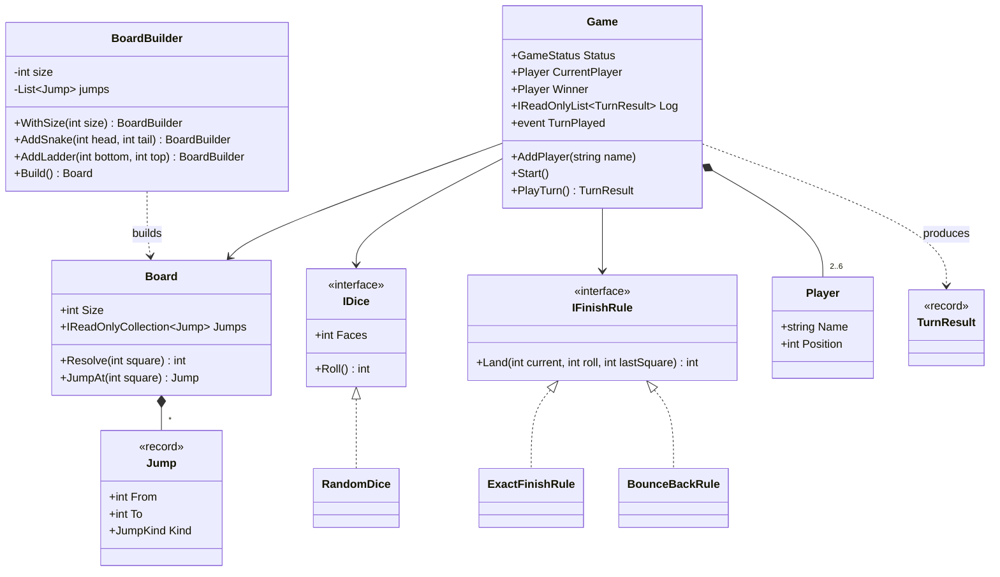
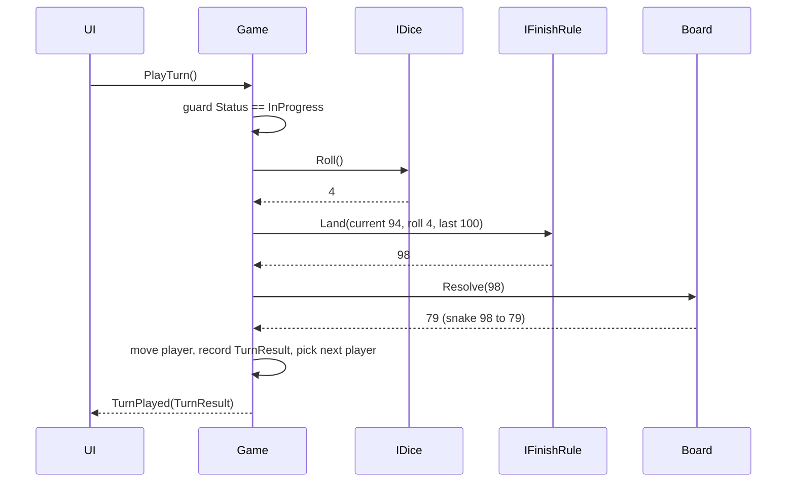
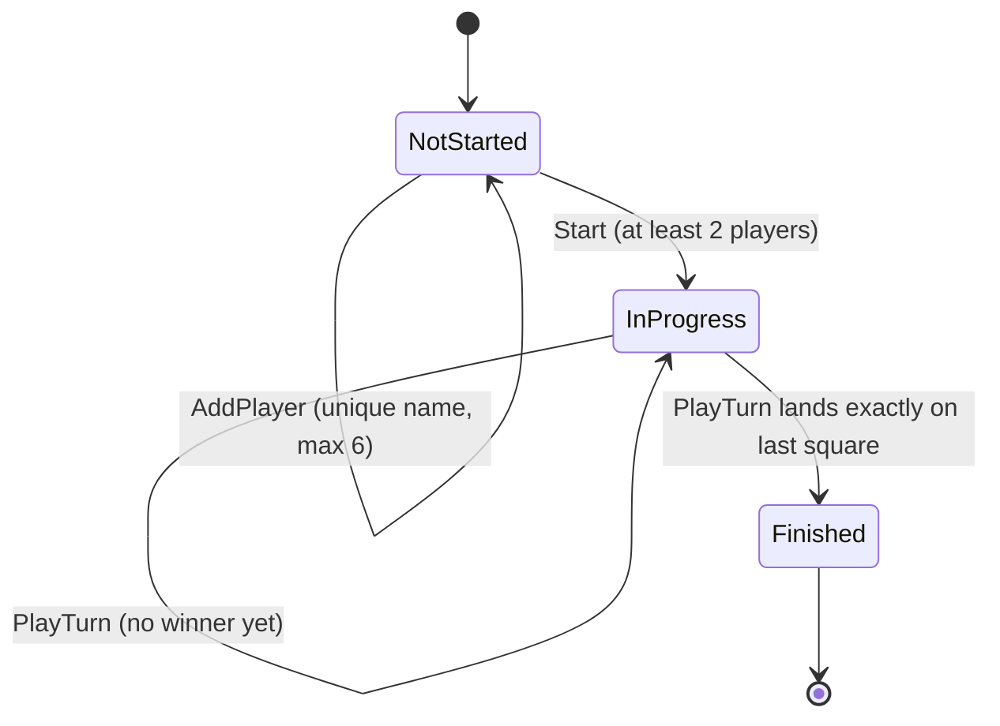
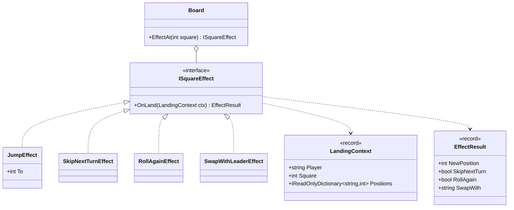

Snakes and ladders is a children's game, and it's a good first LLD case study because the rules are simple enough to hold in your head. That leaves your attention free for the design questions that matter in every system: where randomness enters, how to make it testable, how to validate configuration once, and how to let house rules vary without `if` statements spreading through the code.

## Learning objectives

By the end of this case study you will be able to:

1. Write functional and non-functional requirements for a small game, and list the clarifying questions that change the design.
2. Identify `Board`, `Jump`, `Player`, `IDice`, `IFinishRule` and `Game`, and give each one a single responsibility.
3. Validate a board once, in a Builder, so the rest of the code can trust it.
4. Put randomness behind an interface, so tests use scripted dice and a game can be replayed from a seed.
5. Model the game's lifecycle (NotStarted → InProgress → Finished) and reject actions in the wrong state.
6. Swap house rules (exact finish vs bounce back) with the Strategy pattern.
7. Compute the exact expected number of rolls with a small Markov-chain calculation.

## Prerequisites

- [Classes, objects, fields, properties and methods](#/lesson/m01-classes-objects) and [Interfaces and abstract classes](#/lesson/m01-interfaces-abstract).
- [Identifying classes and responsibilities](#/lesson/m07-classes-responsibilities): we use the nouns-and-verbs method.
- [Testable object design](#/lesson/m07-testable-design): the dice interface is a "seam" (a place where a test can swap in its own object).

## Explain it like I'm a beginner

Picture the board game on a table in a Jaipur living room. There's a printed board with squares 1 to 100. Ladders take you up and snakes bring you down. There's a die, and three cousins with coloured tokens.

Now imagine you are the **referee app** on a phone that runs the game. What does it need to know?

- **The board**: how many squares, and where each snake and ladder starts and ends. The board is printed once and never changes during a game.
- **The players**: their names, where each token stands, and whose turn it is.
- **The die**: something that gives a number from 1 to 6.
- **The house rules**: your family might say "you must land exactly on 100", while your neighbours say "if you overshoot, bounce back".
- **The game's progress**: has it started, is it running, who won?

Each bullet becomes a class. Two ideas make the design good rather than just working:

1. **The die is replaceable.** In a real game it's random. In a test it's a scripted list ("roll 3, then 6, then 1"), so the test knows exactly what should happen. This is like a magician's trick deck, used for rehearsals.
2. **Check the board once, when it's printed.** A board where a snake's head sits on square 100, or a ladder lands on a snake's head, is a misprint. Catch it when the board is built, not in the middle of a game.

## Requirements

### Functional requirements

1. A board has squares 1..N (N = 100 by default). Players start off the board at square 0.
2. A board has snakes (head → lower tail) and ladders (bottom → higher top).
3. 2–6 players with unique names join before the game starts. Turn order is the joining order.
4. On a turn the current player rolls one die (1–6) and moves forward that many squares. If they land on a snake's head or a ladder's bottom, they move to its other end.
5. **Finish rule (configurable):** *exact finish*: if the roll would pass N, the player doesn't move. *Bounce back*: the player walks back by the overshoot.
6. **Optional house rule:** rolling a 6 gives another roll.
7. The first player to reach exactly N wins, and the game ends. No turns are allowed after that.
8. Each turn is recorded (who, roll, from, to, which snake or ladder), and observers (UI, logs) are notified.

### Non-functional requirements

- **Deterministic tests.** Every rule must be testable without real randomness.
- **Reproducibility.** Given a seed, a game can be replayed exactly on the same build. That's useful for bug reports ("game 4812 went wrong"). .NET does not promise that `new Random(seed)` produces the same sequence across runtime versions, so anything that must replay months later (a disputed online game) stores the rolls themselves in the turn log, not just the seed.
- **Fail fast on bad configuration.** Invalid boards are rejected when built, with every problem listed at once.
- **Small and readable.** No class over about 100 lines. This is a beginner case study, and the code should stay readable.

### Clarifying questions

| Question | Assumption |
|---|---|
| Board size fixed at 100? | Default 100, configurable (a 50-square kids' version is common). |
| Can a ladder end on a snake's head (a chain)? | No. The builder rejects chains, so each move has at most one jump. |
| Is a 6 needed to enter the board? | No (good extension). |
| What happens on overshoot? | Configurable: exact finish (default) or bounce back. |
| More than one die? | One die; the `IDice` interface allows others. |
| Can two tokens share a square? | Yes, there's no capturing. |
| Does the game continue for 2nd and 3rd place? | No, it ends at the first winner (extension). |

## Identifying classes and responsibilities

Nouns: *board, square, snake, ladder, player, token, die, turn, roll, rule, game, winner*. Verbs: *roll, move, climb, slide, win, join, start, record*.

*Square* doesn't need a class: it's an `int`. *Token* is the same as the player's position. *Snake* and *ladder* behave identically, since both move you from one square to another, so they share one class: `Jump`. Its kind is derived from the direction.

| Class | Kind | Responsibility |
|---|---|---|
| `Jump` | value object (record) | A from-square and a to-square; it's a snake if it goes down and a ladder if it goes up. |
| `Board` | immutable domain object | Size and jumps; `Resolve(square)` returns where you end up. |
| `BoardBuilder` | builder | Collects snakes and ladders, validates everything, builds an immutable `Board`. |
| `IDice` / `RandomDice` | strategy + adapter over `Random` | Produces rolls. Tests substitute a scripted version. |
| `IFinishRule` / `ExactFinishRule` / `BounceBackRule` | strategy | Where a roll lands near the end of the board. |
| `Player` | entity | Name and current square. Only `Game` moves it. |
| `GameOptions` | options | House-rule switches, such as extra roll on 6. |
| `TurnResult` | value object | What happened in one turn, for logs, UI and replays. |
| `Game` | aggregate root | Players, turn order, lifecycle, applying rules, notifying observers. |

Why is `Board` separate from `Game`? A board is **configuration**: the same printed board is used by thousands of games. A game is **session state**: positions and turns. Mixing them means you can't reuse or validate a board on its own, and tests have to build a whole game just to check a snake.

:::callout type=mistake title="Making Snake and Ladder separate subclasses"
`abstract class Jump` with `Snake : Jump` and `Ladder : Jump` looks object-oriented, but the two subclasses have no different behaviour. Both just say "go to square X". Inheritance without different behaviour is noise. Derive the kind from the data instead: `To > From` means ladder.
:::

## Class diagram



How to read it:

- **`Game` sits at the centre** and depends on three things it doesn't own: a board (shared configuration), a die and a finish rule (both interfaces). It **owns** its players (filled diamond), because players exist only inside one game.
- **`BoardBuilder` builds `Board`** (dashed arrow). `Board` has no public constructor, so an unvalidated board can't exist.
- **Two interfaces, two strategies.** `IDice` and `IFinishRule` are the variation points. A new house rule or a loaded die for a demo is a new class, not an edit to `Game`.
- `TurnResult` is what flows out to the UI and the log, through the `TurnPlayed` event (Observer).

## Patterns and design decisions

### Builder with validation: "make illegal boards unrepresentable"

`BoardBuilder` collects jumps through readable methods (`AddSnake(97, 78)`), and `Build()` checks every rule at once:

- every square is in 1..N;
- no jump starts on square 1 or on N (a snake on 100 would make winning impossible);
- no two jumps start on the same square;
- no jump ends where another starts (no chains, so a move has at most one jump);
- snakes go down and ladders go up.

If anything fails, `Build` throws one `InvalidBoardException` that lists **all** problems. A board designer fixing a 12-snake layout wants every error at once, not one per attempt. Once built, `Board` is immutable, so `Game` never re-checks anything. This is "parse, don't validate": turn unchecked input into a type that can only hold valid values.

### Strategy for dice and finish rules

`IDice` has one method. `RandomDice` wraps `System.Random` and takes the `Random` instance in its constructor. Production code passes `Random.Shared` (thread-safe) or a seeded `new Random(seed)` for replays. Tests pass a scripted die that returns a fixed list. Without this seam, a test for "landing on a snake" would have to loop until the random number happened to be right.

`IFinishRule` captures the one rule that families argue about. Exact finish and bounce back are each a few lines. Adding "overshoot wins anyway" (some kids' versions) is a third class.

:::callout type=tradeoff title="Interface or a Func?"
`IFinishRule` could be a `Func<int, int, int, int>`. With one method and no dependencies, a delegate is legitimate and shorter. We use an interface because it gives the rule a name in logs and DI registrations, and because the advanced exercise reuses it. Either choice is defensible. Say why in an interview.
:::

### Lifecycle guards

`Game` has three states. Methods check the state first and throw `InvalidOperationException` when called at the wrong time. Calling `PlayTurn` after someone won is a bug in the caller, not a normal outcome, so an exception is right here. Contrast this with the movie-booking case, where "seat taken" was an expected outcome and returned a result.

### Observer for UI and logs

`Game` raises `event Action<TurnResult>? TurnPlayed`. A console UI prints it; a web UI pushes it over SignalR; an analytics module counts snake bites. `Game` doesn't know any of them exist. For a single process, a plain C# event is enough. Across services you'd publish a message instead.

### Turn sequence



Reading it: `Game` asks each collaborator one question, in order. The die says how far; the finish rule says where that lands near the end; the board says whether a snake or ladder changes it. `Game` itself only orchestrates and keeps the books. Each question can be answered, and tested, by a different small class.

## State transitions



Each arrow is a method, and its guard is written in brackets:

- `AddPlayer` is legal only in `NotStarted`. Joining a running game would make turn order ambiguous.
- `Start` requires at least two players. A one-player "game" is a simulation, which the advanced exercise handles separately.
- `PlayTurn` is legal only in `InProgress`. The turn that lands on the last square moves the game to `Finished` and records the winner.
- Nothing leaves `Finished`. A rematch is a **new** `Game` with the same board. That is cheap, because the board is immutable and shared.

Inside `InProgress`, there's a smaller loop for whose turn it is: after each roll, the turn passes to the next player, unless the extra-roll-on-6 option is on and the roll was a 6.

## C# implementation

```text
SnakesAndLadders/
  Domain/Board.cs        Jump, Board, BoardBuilder, InvalidBoardException
  Domain/Dice.cs         IDice, RandomDice
  Domain/FinishRules.cs  IFinishRule, ExactFinishRule, BounceBackRule
  Domain/Game.cs         Player, GameOptions, TurnResult, GameStatus, Game
  Program.cs             console demo with a seeded die
```

```csharp file=Domain/Board.cs
namespace SnakesAndLadders.Domain;

public enum JumpKind { Snake, Ladder }

public sealed record Jump(int From, int To)
{
    public JumpKind Kind => To > From ? JumpKind.Ladder : JumpKind.Snake;
}

public sealed class InvalidBoardException(IReadOnlyList<string> problems)
    : Exception("Invalid board: " + string.Join("; ", problems))
{
    public IReadOnlyList<string> Problems { get; } = problems;
}

/// <summary>Immutable, always valid. Only BoardBuilder can create one.</summary>
public sealed class Board
{
    private readonly Dictionary<int, Jump> _jumpsByStart;

    internal Board(int size, IEnumerable<Jump> jumps)
    {
        Size = size;
        _jumpsByStart = jumps.ToDictionary(j => j.From);
    }

    public int Size { get; }
    public IReadOnlyCollection<Jump> Jumps => _jumpsByStart.Values;

    public Jump? JumpAt(int square) => _jumpsByStart.GetValueOrDefault(square);

    /// <summary>Where a token that lands on <paramref name="square"/> finally rests (at most one jump: chains are invalid).</summary>
    public int Resolve(int square) => JumpAt(square)?.To ?? square;
}

public sealed class BoardBuilder
{
    private int _size = 100;
    private readonly List<Jump> _jumps = [];
    private readonly List<JumpKind> _kinds = [];   // what the caller declared, so a "ladder" that goes down is caught

    public BoardBuilder WithSize(int size) { _size = size; return this; }
    public BoardBuilder AddSnake(int head, int tail) { _jumps.Add(new Jump(head, tail)); _kinds.Add(JumpKind.Snake); return this; }
    public BoardBuilder AddLadder(int bottom, int top) { _jumps.Add(new Jump(bottom, top)); _kinds.Add(JumpKind.Ladder); return this; }

    public Board Build()
    {
        var problems = new List<string>();
        if (_size < 10) problems.Add($"Board size {_size} is below the minimum of 10.");

        for (var i = 0; i < _jumps.Count; i++)
        {
            var (j, declared) = (_jumps[i], _kinds[i]);
            if (j.From == j.To) problems.Add($"Jump {j.From}->{j.To} goes nowhere.");
            else if (j.Kind != declared) problems.Add($"{declared} {j.From}->{j.To} goes the wrong way.");
            foreach (var sq in new[] { j.From, j.To })
                if (sq < 1 || sq > _size) problems.Add($"Square {sq} in {j.From}->{j.To} is outside 1..{_size}.");
            if (j.From == 1 || j.From == _size) problems.Add($"No jump may start on square {j.From}.");
        }

        foreach (var dup in _jumps.GroupBy(j => j.From).Where(g => g.Count() > 1))
            problems.Add($"More than one jump starts on square {dup.Key}.");

        var starts = _jumps.Select(j => j.From).ToHashSet();
        foreach (var j in _jumps.Where(j => starts.Contains(j.To)))
            problems.Add($"Jump {j.From}->{j.To} ends where another jump starts (chains are not allowed).");

        if (problems.Count > 0) throw new InvalidBoardException(problems);
        return new Board(_size, _jumps);
    }

    /// <summary>A sample 100-square layout used by the demo (not any specific commercial board).</summary>
    public static Board Classic() => new BoardBuilder()
        .AddLadder(4, 25).AddLadder(13, 46).AddLadder(33, 49).AddLadder(42, 63).AddLadder(50, 69).AddLadder(62, 81).AddLadder(74, 92)
        .AddSnake(27, 5).AddSnake(40, 3).AddSnake(43, 18).AddSnake(54, 31).AddSnake(66, 45).AddSnake(76, 58).AddSnake(89, 53).AddSnake(99, 41)
        .Build();
}
```

```csharp file=Domain/Dice.cs
namespace SnakesAndLadders.Domain;

public interface IDice
{
    int Faces { get; }
    int Roll();
}

/// <summary>Adapter over System.Random. Pass a seeded Random to replay a game exactly.</summary>
public sealed class RandomDice(Random random, int faces = 6) : IDice
{
    public int Faces { get; } = faces >= 2 ? faces : throw new ArgumentOutOfRangeException(nameof(faces));
    public int Roll() => random.Next(1, Faces + 1);   // upper bound is exclusive
}
```

```csharp file=Domain/FinishRules.cs
namespace SnakesAndLadders.Domain;

/// <summary>Decides where a roll lands before snakes and ladders are applied.</summary>
public interface IFinishRule
{
    int Land(int current, int roll, int lastSquare);
}

/// <summary>Overshooting the last square means you don't move.</summary>
public sealed class ExactFinishRule : IFinishRule
{
    public int Land(int current, int roll, int lastSquare) =>
        current + roll > lastSquare ? current : current + roll;
}

/// <summary>Overshooting bounces you back: 98 + 5 on a 100-square board lands on 97.</summary>
public sealed class BounceBackRule : IFinishRule
{
    public int Land(int current, int roll, int lastSquare)
    {
        var target = current + roll;
        return target <= lastSquare ? target : lastSquare - (target - lastSquare);
    }
}
```

```csharp file=Domain/Game.cs
namespace SnakesAndLadders.Domain;

public enum GameStatus { NotStarted, InProgress, Finished }

public sealed class Player(string name)
{
    public string Name { get; } = name;
    public int Position { get; internal set; }   // 0 = not yet on the board; only Game moves players
    public override string ToString() => $"{Name}@{Position}";
}

public sealed class GameOptions
{
    public bool ExtraRollOnSix { get; init; }
    public int MaxPlayers { get; init; } = 6;
}

public sealed record TurnResult(int TurnNumber, string Player, int Roll, int From, int Landed, int To, Jump? Jump, bool RollsAgain, bool Won);

public sealed class Game(Board board, IDice dice, IFinishRule finishRule, GameOptions? options = null)
{
    private readonly GameOptions _options = options ?? new GameOptions();
    private readonly List<Player> _players = [];
    private readonly List<TurnResult> _log = [];
    private int _current;

    public event Action<TurnResult>? TurnPlayed;

    public GameStatus Status { get; private set; } = GameStatus.NotStarted;
    public IReadOnlyList<Player> Players => _players;
    public IReadOnlyList<TurnResult> Log => _log;
    public Player? Winner { get; private set; }
    public Player CurrentPlayer => Status == GameStatus.InProgress ? _players[_current] : throw new InvalidOperationException("Game is not in progress.");

    public Player AddPlayer(string name)
    {
        Require(GameStatus.NotStarted, "add players");
        ArgumentException.ThrowIfNullOrWhiteSpace(name);
        if (_players.Count >= _options.MaxPlayers) throw new InvalidOperationException($"At most {_options.MaxPlayers} players.");
        if (_players.Any(p => string.Equals(p.Name, name, StringComparison.OrdinalIgnoreCase)))
            throw new InvalidOperationException($"A player called '{name}' already joined.");
        var player = new Player(name);
        _players.Add(player);
        return player;
    }

    public void Start()
    {
        Require(GameStatus.NotStarted, "start");
        if (_players.Count < 2) throw new InvalidOperationException("At least 2 players are needed.");
        Status = GameStatus.InProgress;
    }

    public TurnResult PlayTurn()
    {
        Require(GameStatus.InProgress, "play a turn");
        var player = _players[_current];
        var roll = dice.Roll();
        var from = player.Position;
        var landed = finishRule.Land(from, roll, board.Size);
        var jump = board.JumpAt(landed);
        var to = board.Resolve(landed);
        player.Position = to;

        var won = to == board.Size;
        var rollsAgain = !won && _options.ExtraRollOnSix && roll == dice.Faces;
        if (won) { Status = GameStatus.Finished; Winner = player; }
        else if (!rollsAgain) _current = (_current + 1) % _players.Count;

        var result = new TurnResult(_log.Count + 1, player.Name, roll, from, landed, to, jump, rollsAgain, won);
        _log.Add(result);
        TurnPlayed?.Invoke(result);
        return result;
    }

    /// <summary>Plays until someone wins; maxTurns guards against an endless loop from a broken rule.</summary>
    public Player PlayToEnd(int maxTurns = 10_000)
    {
        if (Status == GameStatus.NotStarted) Start();
        for (var i = 0; i < maxTurns && Status == GameStatus.InProgress; i++) PlayTurn();
        return Winner ?? throw new InvalidOperationException($"No winner after {maxTurns} turns.");
    }

    private void Require(GameStatus expected, string action)
    {
        if (Status != expected) throw new InvalidOperationException($"Cannot {action} when the game is {Status}.");
    }
}
```

```csharp file=Program.cs
using SnakesAndLadders.Domain;

namespace SnakesAndLadders;

public static class Program
{
    public static void Main(string[] args)
    {
        var seed = args.Length > 0 && int.TryParse(args[0], out var s) ? s : 2026;
        var game = new Game(BoardBuilder.Classic(), new RandomDice(new Random(seed)), new ExactFinishRule(),
                            new GameOptions { ExtraRollOnSix = true });
        foreach (var name in new[] { "Aarav", "Meera", "Kabir" }) game.AddPlayer(name);
        game.TurnPlayed += t =>
        {
            var note = t.Jump is null ? "" : $" ({t.Jump.Kind} {t.Jump.From}->{t.Jump.To})";
            Console.WriteLine($"#{t.TurnNumber} {t.Player} rolled {t.Roll}: {t.From} -> {t.To}{note}{(t.RollsAgain ? ", rolls again" : "")}");
        };
        var winner = game.PlayToEnd();
        Console.WriteLine($"{winner.Name} wins after {game.Log.Count} turns (seed {seed}).");
    }
}
```

Points worth noticing:

- **`Board` has an `internal` constructor.** Only code in the same assembly, meaning the builder, can create boards. In a larger solution, the domain lives in its own project, and that becomes a real boundary.
- **`random.Next(1, Faces + 1)`.** The upper bound of `Random.Next` is exclusive. Writing `Next(1, 6)` is a classic bug: it never rolls a 6.
- **`PlayToEnd` has a `maxTurns` guard.** With a buggy rule (say, a bounce-back that can loop), a `while (true)` hangs your test runner. A guard turns a hang into a clear failure.
- **`Player.Position` has an `internal set`.** The UI can read positions but can't move tokens.
- **`Game` is not thread-safe, on purpose.** One game is driven by one caller at a time. If a web server receives "roll" from two browser tabs at once, serialise commands per game (a lock, or one `Channel<T>` consumer per game) outside the domain class rather than sprinkling locks inside it.
- **State changes before observers run.** `PlayTurn` updates positions and the log, then raises `TurnPlayed`. If a subscriber throws, the game is still consistent, but the exception reaches the caller. A UI that must never break play should catch inside its own handler.

## Automated testing

The key tool is a scripted die. It's three lines, and it makes every rule testable.

```csharp
using SnakesAndLadders.Domain;
using Xunit;

namespace SnakesAndLadders.Tests;

public sealed class ScriptedDice(params int[] rolls) : IDice
{
    private int _next;
    public int Faces => 6;
    public int Roll() => _next < rolls.Length ? rolls[_next++] : throw new InvalidOperationException("Script exhausted.");
}

public sealed class SnakeLadderTests
{
    private static Board SmallBoard() => new BoardBuilder().WithSize(30)
        .AddLadder(3, 22).AddSnake(17, 7).AddSnake(29, 1).Build();

    private static Game TwoPlayers(IDice dice, IFinishRule? rule = null, GameOptions? options = null)
    {
        var g = new Game(SmallBoard(), dice, rule ?? new ExactFinishRule(), options);
        g.AddPlayer("Asha"); g.AddPlayer("Ravi"); g.Start();
        return g;
    }

    [Fact]
    public void Ladder_takes_player_up()
    {
        var t = TwoPlayers(new ScriptedDice(3)).PlayTurn();
        Assert.Equal(22, t.To);
        Assert.Equal(JumpKind.Ladder, t.Jump!.Kind);
    }

    [Fact]
    public void Snake_takes_player_down()
    {
        var g = TwoPlayers(new ScriptedDice(6, 1, 6, 1, 5));   // Asha: 6, 12, 17 -> 7 (no extra roll option)
        g.PlayTurn(); g.PlayTurn(); g.PlayTurn(); g.PlayTurn();
        var t = g.PlayTurn();
        Assert.Equal(17, t.Landed);
        Assert.Equal(7, t.To);
    }

    [Fact]
    public void Turns_alternate_and_six_gives_extra_roll_when_enabled()
    {
        var g = TwoPlayers(new ScriptedDice(6, 2, 4), options: new GameOptions { ExtraRollOnSix = true });
        Assert.Equal("Asha", g.PlayTurn().Player);
        Assert.Equal("Asha", g.PlayTurn().Player);   // extra roll
        Assert.Equal("Ravi", g.PlayTurn().Player);
    }

    [Theory]
    [InlineData(27, 5, 27)]   // exact finish: 32 > 30, stay
    [InlineData(27, 3, 30)]
    public void Exact_finish(int from, int roll, int expected) =>
        Assert.Equal(expected, new ExactFinishRule().Land(from, roll, 30));

    [Theory]
    [InlineData(98, 5, 97)]
    [InlineData(95, 6, 99)]
    [InlineData(94, 6, 100)]
    public void Bounce_back(int from, int roll, int expected) =>
        Assert.Equal(expected, new BounceBackRule().Land(from, roll, 100));

    [Fact]
    public void Winning_finishes_the_game_and_blocks_further_turns()
    {
        var g = new Game(new BoardBuilder().WithSize(10).Build(), new ScriptedDice(5, 1, 5), new ExactFinishRule());
        g.AddPlayer("A"); g.AddPlayer("B"); g.Start();
        g.PlayTurn(); g.PlayTurn();
        Assert.True(g.PlayTurn().Won);
        Assert.Equal(GameStatus.Finished, g.Status);
        Assert.Equal("A", g.Winner!.Name);
        Assert.Throws<InvalidOperationException>(() => g.PlayTurn());
    }

    [Fact]
    public void Lifecycle_guards()
    {
        var g = new Game(SmallBoard(), new ScriptedDice(), new ExactFinishRule());
        g.AddPlayer("Solo");
        Assert.Throws<InvalidOperationException>(() => g.Start());
        Assert.Throws<InvalidOperationException>(() => g.PlayTurn());
        Assert.Throws<InvalidOperationException>(() => g.AddPlayer("solo"));   // names are case-insensitive
    }

    [Fact]
    public void Builder_reports_every_problem_at_once()
    {
        var ex = Assert.Throws<InvalidBoardException>(() => new BoardBuilder().WithSize(30)
            .AddSnake(30, 2)          // starts on last square
            .AddLadder(5, 12).AddSnake(12, 4)   // chain
            .AddLadder(20, 10)        // ladder going down
            .Build());
        Assert.Equal(3, ex.Problems.Count);
    }

    [Fact]
    public void Same_seed_replays_the_same_game()
    {
        string[] Play(int seed)
        {
            var g = new Game(BoardBuilder.Classic(), new RandomDice(new Random(seed)), new ExactFinishRule());
            g.AddPlayer("A"); g.AddPlayer("B");
            g.PlayToEnd();
            return g.Log.Select(t => $"{t.Player}:{t.Roll}:{t.To}").ToArray();
        }
        Assert.Equal(Play(7), Play(7));
    }

    [Fact]
    public void Observers_are_notified()
    {
        var g = TwoPlayers(new ScriptedDice(2));
        TurnResult? seen = null;
        g.TurnPlayed += t => seen = t;
        g.PlayTurn();
        Assert.Equal(2, seen!.To);
    }
}
```

What the suite shows:

- **Every rule test uses `ScriptedDice`.** You read the script and know the expected outcome, with no luck involved.
- **The `Theory` tests for the finish rules** cover the boundaries: exactly reaching the end, one past, several past. Finish rules are pure functions, so they're the cheapest code to test.
- **The builder test asserts the count of problems,** proving the builder collects all errors instead of stopping at the first.
- **The seed test** checks reproducibility without depending on what `Random(7)` produces. It compares two runs with each other, not with a hard-coded list that could change between .NET versions.

## Bad design vs good design

**Bad: everything in one method, with randomness inside**

```csharp
public class SnakeLadderGame
{
    public int[] Positions = new int[4];
    public Dictionary<int, int> Snakes = new() { [99] = 41, [100] = 1 };   // a snake on 100: nobody can ever win
    public void Play()
    {
        var rnd = new Random();
        var turn = 0;
        while (true)
        {
            var roll = rnd.Next(1, 6);              // bug: never rolls 6
            Positions[turn] += roll;
            if (Positions[turn] > 100) Positions[turn] -= roll;
            if (Snakes.ContainsKey(Positions[turn])) Positions[turn] = Snakes[Positions[turn]];
            if (Ladders.ContainsKey(Positions[turn])) Positions[turn] = Ladders[Positions[turn]]; // chains silently allowed
            Console.WriteLine($"Player {turn} at {Positions[turn]}");
            if (Positions[turn] == 100) break;
            turn = (turn + 1) % 4;
        }
    }
    public Dictionary<int, int> Ladders = new();
}
```

Problems:

1. **Randomness is created inside**, so no test can predict the outcome.
2. **No board validation**: a snake on 100 makes the game endless, and the `while (true)` hangs.
3. **Off-by-one in `Next(1, 6)`**: a 6 is never rolled.
4. **Rules hard-coded**: switching to bounce back means editing the loop.
5. **Console output inside the game**, so it can't be used from a web UI.
6. **Public mutable arrays**: any caller can teleport a player.

**Good**: the design above. The die is injected, the board is validated once and immutable, rules are strategies, lifecycle is guarded, output goes through an event, and there's a turn limit as a safety net.

**When is the simple version fine?** A 30-line throwaway script to show a child how the game works doesn't need any of this. The structure pays off as soon as you need tests, a second UI, or configurable rules.

## Alternative designs

| Alternative | Idea | Better when | Cost |
|---|---|---|---|
| **Board as an array** | `int[] next` of size N+1 where `next[i]` is where square i resolves to. | Hot loops (simulating millions of games); O(1) lookup without hashing. | Less self-describing; jump metadata (kind) needs a second structure. |
| **Cell objects** | Each square is an `ICell` with `OnLand(Player)`, e.g. `SnakeCell`, `LadderCell`, `SkipTurnCell`. | Many special square types (power-ups, traps). | More classes; cells need a narrow way to affect the game without becoming god objects. See exercise 4. |
| **Event-sourced game** | Store only `RollRecorded` events; positions are computed by replaying them. | Online play, audit, spectating, reconnecting players. | More machinery; needs versioning of rules. |
| **Functional core** | `GameState Apply(GameState, int roll)` as a pure function over immutable records. | Simulation, undo and replay come for free. | Unfamiliar to some teams; the UI needs a thin shell that holds the current state. |
| **Delegates instead of strategy interfaces** | `Func<int,int,int,int> finishRule`. | Tiny rules with no dependencies. | Less discoverable; no name in logs or DI. |

## Practical playground

The reference class model is below. In the designer, try adding a `SkipTurnCell` special square. Does it fit as a `Jump`, or does it need a new abstraction? Exercise 4 discusses the answer.

:::playground type=lld title="Snake and ladder reference model"
```json
{
  "classes": [
    { "id": "Jump", "name": "Jump", "kind": "record", "fields": ["+int From", "+int To"], "methods": ["+JumpKind Kind"], "responsibility": "A snake (down) or ladder (up)" },
    { "id": "JumpKind", "name": "JumpKind", "kind": "enum", "fields": ["Snake", "Ladder"], "methods": [] },
    { "id": "Board", "name": "Board", "kind": "class", "fields": ["+int Size", "-Dictionary jumpsByStart"], "methods": ["+int Resolve(int square)", "+Jump? JumpAt(int square)"], "responsibility": "Immutable, always-valid board" },
    { "id": "BoardBuilder", "name": "BoardBuilder", "kind": "class", "fields": ["-int size", "-List jumps"], "methods": ["+BoardBuilder WithSize(int size)", "+BoardBuilder AddSnake(int head, int tail)", "+BoardBuilder AddLadder(int bottom, int top)", "+Board Build()"], "responsibility": "Collects and validates jumps, then builds a Board" },
    { "id": "IDice", "name": "IDice", "kind": "interface", "fields": [], "methods": ["int Roll()", "int Faces"] },
    { "id": "RandomDice", "name": "RandomDice", "kind": "class", "fields": ["-Random random"], "methods": ["+int Roll()"], "responsibility": "Seeded or shared randomness" },
    { "id": "IFinishRule", "name": "IFinishRule", "kind": "interface", "fields": [], "methods": ["int Land(int current, int roll, int lastSquare)"] },
    { "id": "Exact", "name": "ExactFinishRule", "kind": "class", "fields": [], "methods": ["+int Land(int current, int roll, int lastSquare)"] },
    { "id": "Bounce", "name": "BounceBackRule", "kind": "class", "fields": [], "methods": ["+int Land(int current, int roll, int lastSquare)"] },
    { "id": "Player", "name": "Player", "kind": "class", "fields": ["+string Name", "+int Position"], "methods": [], "responsibility": "A participant and their square" },
    { "id": "GameStatus", "name": "GameStatus", "kind": "enum", "fields": ["NotStarted", "InProgress", "Finished"], "methods": [] },
    { "id": "TurnResult", "name": "TurnResult", "kind": "record", "fields": ["+string Player", "+int Roll", "+int From", "+int To", "+bool Won"], "methods": [], "responsibility": "What happened in one turn" },
    { "id": "Game", "name": "Game", "kind": "class", "fields": ["+GameStatus Status", "-List players", "-int current"], "methods": ["+Player AddPlayer(string name)", "+void Start()", "+TurnResult PlayTurn()", "+event TurnPlayed"], "responsibility": "Turn order, lifecycle and rule orchestration" }
  ],
  "relations": [
    { "from": "BoardBuilder", "to": "Board", "kind": "dependency", "label": "builds" },
    { "from": "Board", "to": "Jump", "kind": "composition", "multiplicity": "*" },
    { "from": "Jump", "to": "JumpKind", "kind": "association" },
    { "from": "RandomDice", "to": "IDice", "kind": "implements" },
    { "from": "Exact", "to": "IFinishRule", "kind": "implements" },
    { "from": "Bounce", "to": "IFinishRule", "kind": "implements" },
    { "from": "Game", "to": "Board", "kind": "association" },
    { "from": "Game", "to": "IDice", "kind": "association" },
    { "from": "Game", "to": "IFinishRule", "kind": "association" },
    { "from": "Game", "to": "Player", "kind": "composition", "multiplicity": "2..6" },
    { "from": "Game", "to": "GameStatus", "kind": "association" },
    { "from": "Game", "to": "TurnResult", "kind": "dependency", "label": "produces" }
  ]
}
```
:::

## Exercises

:::exercise id=m18-snake-ladder-ex1 difficulty=beginner kind=code title="Bounce-back finish rule"
Implement `BounceBackRule.Land`. If the roll would take the player past the last square, they walk back by the amount they overshot.
::acceptance
- 98 + 5 on a 100-square board lands on 97.
- 94 + 6 lands exactly on 100.
- 95 + 6 lands on 99.
- Rolls that don't reach the end simply add: 10 + 4 = 14.
::hint
First compute where the player would be with no wall: `current + roll`.
::hint
If that is beyond `lastSquare`, how far beyond is it? That distance is the overshoot.
::hint
The answer is `lastSquare - overshoot`.
::hint
```csharp
var target = current + roll;
return target <= lastSquare ? target : lastSquare - (target - lastSquare);
```
::starter
```csharp file=FinishRules.cs
using System;

public interface IFinishRule { int Land(int current, int roll, int lastSquare); }

public sealed class BounceBackRule : IFinishRule
{
    public int Land(int current, int roll, int lastSquare) => throw new NotImplementedException();
}
```
::tests
```csharp file=FinishRuleTests.cs
using Xunit;

public class FinishRuleTests
{
    [Theory]
    [InlineData(98, 5, 100, 97)]
    [InlineData(94, 6, 100, 100)]
    [InlineData(95, 6, 100, 99)]
    [InlineData(10, 4, 100, 14)]
    [InlineData(28, 6, 30, 26)]
    public void Lands(int current, int roll, int last, int expected) =>
        Assert.Equal(expected, new BounceBackRule().Land(current, roll, last));
}
```
::solution
```csharp file=FinishRules.cs
using System;

public interface IFinishRule { int Land(int current, int roll, int lastSquare); }

public sealed class BounceBackRule : IFinishRule
{
    public int Land(int current, int roll, int lastSquare)
    {
        var target = current + roll;
        return target <= lastSquare ? target : lastSquare - (target - lastSquare);
    }
}
```
Because this is a pure function (no state, no randomness), a single `Theory` covers it completely. Notice that `Game` didn't change at all to support the new rule. That's the Open/Closed Principle in action.
::mistakes
- Writing `lastSquare - roll`, which ignores where the player started.
- Treating `target == lastSquare` as an overshoot (`<` instead of `<=`).
::extensions
Add a `GenerousFinishRule` where any overshoot counts as a win, and decide whether `Game` needs to change. Hint: what does `Land` return?
:::

:::exercise id=m18-snake-ladder-ex2 difficulty=beginner kind=code title="Validating board builder"
Implement `BoardBuilder.Build()` so that it rejects invalid boards and lists every problem it finds in a single `InvalidBoardException`.
::requirements
Problems to detect (one message each):
- a square outside 1..size;
- a jump that starts on square 1 or on the last square;
- two jumps that start on the same square;
- a jump that ends where another jump starts (a chain).
::acceptance
- A valid board builds, and `Resolve` follows ladders and snakes.
- A snake starting on the last square is rejected.
- A ladder ending on a snake's head is rejected as a chain.
- A board with three different problems reports exactly three messages.
::hint
Don't throw on the first problem. Add messages to a `List<string>` and throw once at the end if the list isn't empty.
::hint
Duplicate starts: group jumps by `From` and look for groups with more than one jump.
::hint
Chains: build a `HashSet<int>` of all start squares, then flag any jump whose `To` is in that set.
::hint
```csharp
var starts = _jumps.Select(j => j.From).ToHashSet();
foreach (var j in _jumps.Where(j => starts.Contains(j.To)))
    problems.Add($"Chain at {j.To}");
```
::starter
```csharp file=BoardBuilder.cs
using System;
using System.Collections.Generic;
using System.Linq;

public sealed record Jump(int From, int To);

public sealed class InvalidBoardException(IReadOnlyList<string> problems) : Exception(string.Join("; ", problems))
{
    public IReadOnlyList<string> Problems { get; } = problems;
}

public sealed class Board
{
    private readonly Dictionary<int, int> _next;
    internal Board(int size, IEnumerable<Jump> jumps) { Size = size; _next = jumps.ToDictionary(j => j.From, j => j.To); }
    public int Size { get; }
    public int Resolve(int square) => _next.TryGetValue(square, out var to) ? to : square;
}

public sealed class BoardBuilder
{
    private int _size = 100;
    private readonly List<Jump> _jumps = new();
    public BoardBuilder WithSize(int size) { _size = size; return this; }
    public BoardBuilder Add(int from, int to) { _jumps.Add(new Jump(from, to)); return this; }

    public Board Build() => throw new NotImplementedException();
}
```
::tests
```csharp file=BoardBuilderTests.cs
using Xunit;

public class BoardBuilderTests
{
    [Fact] public void Valid_board_resolves_jumps()
    {
        var b = new BoardBuilder().WithSize(50).Add(3, 22).Add(40, 5).Build();
        Assert.Equal(22, b.Resolve(3));
        Assert.Equal(5, b.Resolve(40));
        Assert.Equal(10, b.Resolve(10));
    }

    [Fact] public void Snake_on_last_square_rejected() =>
        Assert.Single(Assert.Throws<InvalidBoardException>(() => new BoardBuilder().WithSize(50).Add(50, 3).Build()).Problems);

    [Fact] public void Chain_rejected() =>
        Assert.Single(Assert.Throws<InvalidBoardException>(() => new BoardBuilder().WithSize(50).Add(4, 20).Add(20, 2).Build()).Problems);

    [Fact] public void Out_of_range_rejected() =>
        Assert.NotEmpty(Assert.Throws<InvalidBoardException>(() => new BoardBuilder().WithSize(50).Add(10, 60).Build()).Problems);

    [Fact] public void Reports_all_problems()
    {
        var ex = Assert.Throws<InvalidBoardException>(() => new BoardBuilder().WithSize(50)
            .Add(1, 30)                 // starts on square 1
            .Add(8, 12).Add(8, 2)       // duplicate start
            .Add(30, 4).Add(25, 30)     // 25 -> 30 ends where 30 -> 4 starts; 1 -> 30 also does
            .Build());
        Assert.Equal(4, ex.Problems.Count);
    }
}
```
::solution
```csharp file=BoardBuilder.cs
using System;
using System.Collections.Generic;
using System.Linq;

public sealed record Jump(int From, int To);

public sealed class InvalidBoardException(IReadOnlyList<string> problems) : Exception(string.Join("; ", problems))
{
    public IReadOnlyList<string> Problems { get; } = problems;
}

public sealed class Board
{
    private readonly Dictionary<int, int> _next;
    internal Board(int size, IEnumerable<Jump> jumps) { Size = size; _next = jumps.ToDictionary(j => j.From, j => j.To); }
    public int Size { get; }
    public int Resolve(int square) => _next.TryGetValue(square, out var to) ? to : square;
}

public sealed class BoardBuilder
{
    private int _size = 100;
    private readonly List<Jump> _jumps = new();
    public BoardBuilder WithSize(int size) { _size = size; return this; }
    public BoardBuilder Add(int from, int to) { _jumps.Add(new Jump(from, to)); return this; }

    public Board Build()
    {
        var problems = new List<string>();
        foreach (var j in _jumps)
        {
            if (j.From < 1 || j.From > _size || j.To < 1 || j.To > _size)
                problems.Add($"{j.From}->{j.To} is outside 1..{_size}.");
            if (j.From == 1 || j.From == _size)
                problems.Add($"{j.From}->{j.To} starts on square {j.From}.");
        }
        foreach (var g in _jumps.GroupBy(j => j.From).Where(g => g.Count() > 1))
            problems.Add($"{g.Count()} jumps start on square {g.Key}.");
        var starts = _jumps.Select(j => j.From).ToHashSet();
        foreach (var j in _jumps.Where(j => starts.Contains(j.To)))
            problems.Add($"{j.From}->{j.To} ends where another jump starts.");

        if (problems.Count > 0) throw new InvalidBoardException(problems);
        return new Board(_size, _jumps);
    }
}
```
In the last test, the four problems are: 1→30 starts on square 1; two jumps start on 8; 1→30 ends where 30→4 starts; 25→30 ends where 30→4 starts. The builder found them all in one pass. Board designers fix everything in one go, and `Board` itself never needs a single check.
::mistakes
- Throwing on the first problem, which forces a fix-and-retry loop.
- Validating inside `Board.Resolve` on every move instead of once at build time.
- Making `Board`'s constructor public, so callers can bypass the builder.
::extensions
Add a warning (not an error) when a board has no ladders in the first 20 squares, and return warnings alongside the board from a `BuildWithReport()` method.
:::

:::exercise id=m18-snake-ladder-ex3 difficulty=intermediate kind=code title="Extra rolls and the three-sixes rule"
Many families play: a 6 earns another roll, but **three 6s in a row forfeit the whole turn**. The player goes back to where they started the turn, and play passes on. Implement `TurnRunner.Roll`, which applies one die roll to the current player on a board with no snakes or ladders, using exact finish.
::requirements
- Positions start at 0. Moving past `lastSquare` means not moving (exact finish), but the roll still counts towards the sixes rule.
- A roll of 6 (that isn't the third in a row) keeps the same player.
- A third consecutive 6 resets the player to their position at the **start of this turn** and passes the turn.
- Any non-6 roll ends the turn, and play passes on.
- Reaching `lastSquare` exactly sets `Winner`. Further rolls throw `InvalidOperationException`.
::acceptance
- Rolls 6, 2 for player 0 → player 0 at 8, now player 1's turn.
- Rolls 6, 6, 6 for player 0 → back to 0, player 1's turn.
- Rolls 6, 6, 3 → player 0 at 15, player 1's turn.
- A six that would overshoot still earns an extra roll.
- Winning stops the game.
::hint
You need two pieces of turn state besides positions: how many sixes in a row this turn, and where the player stood when the turn began.
::hint
Record `_turnStart = position` only when a **new** turn begins (when the sixes counter is 0).
::hint
Order matters: check "third six" before moving. A forfeited roll doesn't move the player at all.
::hint
```text
if sixes == 0: turnStart = pos[current]
if roll == 6 and sixes == 2: pos[current] = turnStart; pass turn; return Forfeited
move with exact finish; if won: set winner; return Won
if roll == 6: sixes++; return RollAgain
pass turn; return TurnOver
```
::hint
"Pass turn" should also reset the sixes counter to 0, so write it once as a small private method.
::starter
```csharp file=TurnRunner.cs
using System;
using System.Collections.Generic;

public enum RollOutcome { TurnOver, RollAgain, Forfeited, Won }

public sealed class TurnRunner
{
    private readonly int[] _positions;
    private readonly int _lastSquare;

    public TurnRunner(int players, int lastSquare)
    {
        if (players < 2) throw new ArgumentOutOfRangeException(nameof(players));
        _positions = new int[players];
        _lastSquare = lastSquare;
    }

    public int Current { get; private set; }
    public int? Winner { get; private set; }
    public IReadOnlyList<int> Positions => _positions;

    public RollOutcome Roll(int roll) => throw new NotImplementedException();
}
```
::tests
```csharp file=TurnRunnerTests.cs
using System;
using Xunit;

public class TurnRunnerTests
{
    private static RollOutcome[] RollAll(TurnRunner t, params int[] rolls) => Array.ConvertAll(rolls, t.Roll);

    [Fact] public void Six_then_two()
    {
        var t = new TurnRunner(2, 100);
        Assert.Equal(new[] { RollOutcome.RollAgain, RollOutcome.TurnOver }, RollAll(t, 6, 2));
        Assert.Equal(8, t.Positions[0]);
        Assert.Equal(1, t.Current);
    }

    [Fact] public void Three_sixes_forfeit_and_reset()
    {
        var t = new TurnRunner(2, 100);
        t.Roll(4); t.Roll(1);                 // player 0 at 4, player 1 at 1
        Assert.Equal(RollOutcome.Forfeited, RollAll(t, 6, 6, 6)[2]);
        Assert.Equal(4, t.Positions[0]);
        Assert.Equal(1, t.Current);
    }

    [Fact] public void Two_sixes_then_three()
    {
        var t = new TurnRunner(3, 100);
        RollAll(t, 6, 6, 3);
        Assert.Equal(15, t.Positions[0]);
        Assert.Equal(1, t.Current);
    }

    [Fact] public void Overshooting_six_still_rolls_again()
    {
        var t = new TurnRunner(2, 10);
        t.Roll(5); t.Roll(1);                  // p0 = 5
        Assert.Equal(RollOutcome.RollAgain, t.Roll(6));   // 11 > 10: no move
        Assert.Equal(5, t.Positions[0]);
        Assert.Equal(0, t.Current);
    }

    [Fact] public void Winning_stops_the_game()
    {
        var t = new TurnRunner(2, 10);
        t.Roll(6);
        Assert.Equal(RollOutcome.Won, t.Roll(4));
        Assert.Equal(0, t.Winner);
        Assert.Throws<InvalidOperationException>(() => t.Roll(1));
    }

    [Fact] public void Sixes_counter_resets_between_players()
    {
        var t = new TurnRunner(2, 100);
        RollAll(t, 6, 6, 1);   // p0 ends with two sixes
        Assert.Equal(RollOutcome.RollAgain, t.Roll(6));   // p1's first six, not a "third"
        Assert.Equal(1, t.Current);
    }
}
```
::solution
```csharp file=TurnRunner.cs
using System;
using System.Collections.Generic;

public enum RollOutcome { TurnOver, RollAgain, Forfeited, Won }

public sealed class TurnRunner
{
    private readonly int[] _positions;
    private readonly int _lastSquare;
    private int _sixesThisTurn;
    private int _turnStart;

    public TurnRunner(int players, int lastSquare)
    {
        if (players < 2) throw new ArgumentOutOfRangeException(nameof(players));
        _positions = new int[players];
        _lastSquare = lastSquare;
    }

    public int Current { get; private set; }
    public int? Winner { get; private set; }
    public IReadOnlyList<int> Positions => _positions;

    public RollOutcome Roll(int roll)
    {
        if (Winner is not null) throw new InvalidOperationException("The game is over.");
        ArgumentOutOfRangeException.ThrowIfLessThan(roll, 1);
        ArgumentOutOfRangeException.ThrowIfGreaterThan(roll, 6);

        if (_sixesThisTurn == 0) _turnStart = _positions[Current];

        if (roll == 6 && _sixesThisTurn == 2)
        {
            _positions[Current] = _turnStart;
            PassTurn();
            return RollOutcome.Forfeited;
        }

        var target = _positions[Current] + roll;
        if (target <= _lastSquare) _positions[Current] = target;

        if (_positions[Current] == _lastSquare)
        {
            Winner = Current;
            return RollOutcome.Won;
        }

        if (roll == 6) { _sixesThisTurn++; return RollOutcome.RollAgain; }

        PassTurn();
        return RollOutcome.TurnOver;
    }

    private void PassTurn()
    {
        _sixesThisTurn = 0;
        Current = (Current + 1) % _positions.Length;
    }
}
```
**Design note.** This rule needs memory across rolls (the sixes count and the turn-start position), so it can't be a pure `IFinishRule`. In the full design it becomes a separate `ITurnPolicy` that `Game` consults after each roll, or `Game` gains a small "turn in progress" state. Either way, keep it out of `IDice` and `Board`. Neither of them knows about turns.
::mistakes
- Setting `_turnStart` on every roll, so a forfeit only undoes the last six.
- Forgetting to reset the sixes counter when the turn passes, so the next player's first six counts as their "third".
- Moving the player on the third six before resetting, which is harmless here but wrong if a ladder would fire.
::extensions
Move this behaviour into the main `Game` behind an `ITurnPolicy` interface with `ExtraRollOnSixPolicy` and `ThreeSixesForfeitPolicy`, and keep all existing tests green.
:::

:::exercise id=m18-snake-ladder-ex4 difficulty=intermediate kind=design title="Special squares without a god class"
Product wants special squares: **Skip** (lose your next turn), **Boost** (roll again), and **Swap** (swap places with the player in the lead). Snakes and ladders still exist. Design how these fit without turning `Game` into a giant `switch`.
::acceptance
- A single abstraction covers snakes, ladders and the three new squares.
- Squares can change the game only through a narrow, explicit interface, not by holding a reference to `Game`.
- Show the class diagram and the order of operations in a turn.
- Explain how the builder validates the new squares (e.g., no Skip on the last square).
::hint
What do all these squares have in common? They all react when a player *lands* on them.
::hint
Let a square return a description of what should happen (an "effect") instead of doing it. That keeps squares from reaching into the game.
::hint
`ISquareEffect.OnLand(LandingContext ctx)` returns an `EffectResult` record: new position, skip next turn, roll again, swap with player X.
::hint
`Game` applies the `EffectResult`. `Jump` becomes one implementation (`MoveTo`). The board maps square numbers to effects.
::solution


Each effect receives a **read-only** `LandingContext` and returns an `EffectResult`. Effects never mutate the game, so each is a pure function you can test with a hand-built context. `Game.PlayTurn` becomes: roll → finish rule → `board.EffectAt(landed)?.OnLand(ctx)` → apply the result (move, set a skip flag on the player, keep the turn, or swap two positions) → decide the next player (skipping anyone flagged). Swaps and skips are applied by `Game` in one place, so turn-order rules stay together.

Builder validation grows by effect type: no effect on squares 1 or N; a `JumpEffect` must not land on another effect's square (the chain rule generalised); at most one effect per square. Snakes and ladders are created by `AddSnake`/`AddLadder` as `JumpEffect`s, so existing callers don't change.

This is Strategy (each effect) plus a light Command (the result describes an action for `Game` to execute). The narrow `EffectResult` is what prevents a god class: adding a sixth square type adds a class, and only touches `Game` if it needs a new kind of result field.
::alternatives
Give effects an `IGameActions` interface (`Move`, `SkipNext`, `GrantRoll`) to call directly, which is a mediator-style port. It's more flexible for complex effects, but harder to test, because you need a fake `IGameActions`, and ordering of side effects is less obvious.
::mistakes
- Passing `Game` itself into `OnLand`. Squares can then do anything, including starting a new game.
- Keeping snakes and ladders as a separate dictionary alongside effects, so the board now has two ways to say "something happens on square 40".
:::

:::exercise id=m18-snake-ladder-ex5 difficulty=advanced kind=code title="Exact expected game length"
How many rolls does a single player need, on average, to finish a given board? Instead of simulating thousands of games, compute it **exactly** with value iteration over a Markov chain (a model where the next state depends only on the current state). Let E[s] be the expected number of rolls to finish from square s. Then E[N] = 0, and for every other resting square s:

E[s] = 1 + (1/6) × Σ over rolls r = 1..6 of E[next(s, r)]

where `next` applies exact finish and then the board's jump. Repeat the update for all squares until no value changes by more than 1e-12.
::requirements
- Implement `ExpectedRolls.FromStart(int size, IReadOnlyDictionary<int,int> jumps)` for a player starting at square 0.
- Use exact finish: an overshooting roll leaves the player where they are, and still costs a roll.
- Squares that start a jump are never resting squares, so you can ignore their own E value.
- Stop after convergence, or throw `InvalidOperationException` after 1,000,000 sweeps (an unwinnable board).
::acceptance
- Size 1, no jumps → 6 (you need a 1, probability 1/6).
- Size 3 with ladder 1→3 → 4.
- Size 3 with snake 2→0 → 6.
- A 100-square board with no jumps gives a value between 30 and 40.
::hint
Store E in a `double[size + 1]`, starting at 0. Square N stays 0 forever.
::hint
`next(s, r)`: `t = s + r`; if `t > size` then `t = s`; then if `jumps` contains `t`, use `jumps[t]`.
::hint
One sweep: for s from size−1 down to 0, compute the new E[s] from the formula, track the largest change, and write it straight back (Gauss–Seidel style updates converge faster).
::hint
```csharp
var sum = 0.0;
for (var r = 1; r <= 6; r++) sum += e[Next(s, r)];
var updated = 1 + sum / 6;
```
::hint
Check the small cases by hand on paper. For size 3 with ladder 1→3, from 0: rolls 1 and 3 win, roll 2 goes to square 2 (E = 6), and rolls 4–6 stay. So E0 = 1 + (0 + 6 + 0 + 3·E0)/6, which solves to E0 = 4.
::starter
```csharp file=ExpectedRolls.cs
using System;
using System.Collections.Generic;

public static class ExpectedRolls
{
    public static double FromStart(int size, IReadOnlyDictionary<int, int> jumps) => throw new NotImplementedException();
}
```
::tests
```csharp file=ExpectedRollsTests.cs
using System;
using System.Collections.Generic;
using Xunit;

public class ExpectedRollsTests
{
    private static readonly Dictionary<int, int> None = new();

    [Fact] public void Single_square_needs_a_one() => Assert.Equal(6.0, ExpectedRolls.FromStart(1, None), 6);
    [Fact] public void Ladder_shortens() => Assert.Equal(4.0, ExpectedRolls.FromStart(3, new Dictionary<int, int> { [1] = 3 }), 6);
    [Fact] public void Snake_lengthens() => Assert.Equal(6.0, ExpectedRolls.FromStart(3, new Dictionary<int, int> { [2] = 0 }), 6);
    [Fact] public void Hundred_squares_plain()
    {
        var e = ExpectedRolls.FromStart(100, None);
        Assert.True(e > 30 && e < 40, $"got {e}");
    }
    [Fact] public void Unwinnable_board_throws() =>
        Assert.Throws<InvalidOperationException>(() => ExpectedRolls.FromStart(3, new Dictionary<int, int> { [1] = 0, [2] = 0, [3] = 0 }));
}
```
::solution
```csharp file=ExpectedRolls.cs
using System;
using System.Collections.Generic;

public static class ExpectedRolls
{
    public static double FromStart(int size, IReadOnlyDictionary<int, int> jumps)
    {
        ArgumentOutOfRangeException.ThrowIfLessThan(size, 1);
        var e = new double[size + 1];   // e[size] stays 0

        int Next(int s, int roll)
        {
            var t = s + roll;
            if (t > size) t = s;                       // exact finish: overshoot means stay
            return jumps.TryGetValue(t, out var to) ? to : t;
        }

        for (var sweep = 0; sweep < 1_000_000; sweep++)
        {
            var maxChange = 0.0;
            for (var s = size - 1; s >= 0; s--)
            {
                if (jumps.ContainsKey(s)) continue;    // never a resting square
                var sum = 0.0;
                for (var r = 1; r <= 6; r++) sum += e[Next(s, r)];
                var updated = 1 + sum / 6;
                maxChange = Math.Max(maxChange, Math.Abs(updated - e[s]));
                e[s] = updated;
            }
            if (maxChange < 1e-12) return e[0];
        }
        throw new InvalidOperationException("Did not converge: the board may be unwinnable.");
    }
}
```
**Why value iteration works.** Each sweep moves every E[s] closer to the true value, because the equations form a contraction: every roll has a fixed chance of making progress. If the finish can't be reached, the values grow forever, and the sweep cap turns that into an error instead of a hang. In the unwinnable test, the jump on square 3 sends a winning landing back to 0.

**Why this belongs in an LLD lesson.** It reuses the same domain ideas (board size, jumps, finish rule) in a completely different use case: analytics instead of play. A board designer can now see "this layout averages 38 rolls" before shipping it. Good domain objects make that kind of reuse easy. In the full design, pass the real `Board` and `IFinishRule` instead of a dictionary.
::alternatives
Monte Carlo simulation: play 100,000 seeded games with `Game.PlayToEnd` and average the turn count. It's simpler to write and handles any rule, including stateful ones like three-sixes, but it's only approximate, and its precision improves only with the square root of the number of runs. For stateless rules, the exact method is both faster and precise. You can also solve the linear system directly with Gaussian elimination.
::mistakes
- Forgetting that an overshooting roll still costs a roll. That is the "+1" in the formula.
- Including jump-start squares as resting squares; their E values are never used.
- Looping until values are exactly equal. Floating-point values may never be exactly equal, so use a tolerance.
::extensions
Extend the calculation to report the probability of finishing within 50 rolls, by tracking a probability distribution over squares instead of expectations.
:::

## Interview questions

:::interview
::q beginner
Why put the die behind an `IDice` interface?
::a
Randomness makes tests unpredictable. With `IDice`, production code injects `RandomDice` (seeded for replays, or `Random.Shared`), and tests inject a scripted die that returns exactly the rolls the test needs. The same seam lets you replay a reported bug from its seed. It's the same idea as injecting `TimeProvider` for time.
::q beginner
Why are snakes and ladders one class?
::a
They behave identically: landing on the start moves you to the end. Separate subclasses would add types with no different behaviour. One `Jump` record with a derived `Kind` (up means ladder, down means snake) is simpler, and it validates the same way.
::q intermediate
Where do you validate the board, and why there?
::a
Once, in `BoardBuilder.Build()`, which collects every problem (out-of-range squares, jumps starting on 1 or N, duplicate starts, chains) and throws a single exception listing them all. `Board` has no public constructor, so an invalid board can't exist, and `Game` never re-validates. It's "parse, don't validate": convert unchecked input into a type that guarantees validity.
::q intermediate
How would you support both "exact finish" and "bounce back" without `if` statements in `Game`?
::a
Strategy: an `IFinishRule` with `int Land(int current, int roll, int last)`, implemented by `ExactFinishRule` and `BounceBackRule`, and injected into `Game`. Each rule is a pure function with its own boundary tests. A new house rule is a new class. For a rule that needs memory across rolls (three sixes forfeit), use a separate stateful turn policy, because it's a different responsibility.
::q advanced
How would you turn this into an online multiplayer game with reconnecting players?
::a
Keep the domain as-is and wrap it. The server owns the die (clients never roll, which prevents cheating) and processes commands per game sequentially, for example one `Channel<T>` or actor per game. Persist the game as an event log (`PlayerJoined`, `GameStarted`, `RollMade` with the value), so state can be rebuilt by replay after a crash, and a reconnecting client receives the log or a snapshot plus later events. Add a turn timeout (auto-roll or skip after 30 seconds) as a scheduled command. Each command carries the expected turn number for idempotency, so a duplicate "roll" click doesn't roll twice. Push `TurnPlayed` events through SignalR groups per game.
::q advanced
How would you estimate how long a board design takes to finish, and which method would you choose?
::a
Two options. Monte Carlo: simulate N seeded games and average. It's simple, works for any rule (including stateful ones), but has sampling error that shrinks as 1/√N. Markov-chain analysis: write E[s] = 1 + average of E[next(s, r)] over the six rolls and solve by value iteration or Gaussian elimination. It's exact and fast for ~100 states, but only for rules where the next square depends only on the current square and roll. I'd use the exact method in a board-designer tool and Monte Carlo to validate stateful house rules.
:::

## Summary and revision

**Key takeaways**

- Separate configuration (`Board`, immutable, validated once) from session state (`Game`, players, turns).
- Put randomness behind `IDice`. Scripted dice make every rule test deterministic, and seeds make bugs replayable.
- A Builder that collects all problems is friendlier than one that fails on the first.
- House rules are strategies. Stateless ones are pure functions; stateful ones get their own policy object.
- Guard the lifecycle (NotStarted → InProgress → Finished) and reject actions in the wrong state.
- Raise events for UI and logs instead of writing to the console from the domain.
- The same domain model supports analytics, such as exact expected game length.

**Terminology**: seam, scripted (fake) dice, seed, builder, invariant, strategy, observer, lifecycle guard, Markov chain, value iteration.

:::flashcards
Q: Why does Random.Next(1, 6) never return 6?
A: The upper bound is exclusive. Use Next(1, 7), or Next(1, faces + 1).
Q: What makes a snakes-and-ladders board invalid?
A: Squares out of range, a jump starting on 1 or the last square, two jumps on one start square, or a chain (a jump ending on another jump's start).
Q: Why is Board immutable?
A: It's shared configuration, validated once; immutability means no game can corrupt it, and rematches reuse it for free.
Q: How do you replay a reported game?
A: Construct RandomDice with new Random(seed) using the logged seed and the same .NET version.
Q: Which pattern lets you swap exact finish for bounce back?
A: Strategy: IFinishRule with one implementation per house rule.
Q: Why does PlayToEnd take maxTurns?
A: A broken rule or board could loop forever. The guard turns a hang into a clear failure.
Q: Expected rolls formula for a resting square s?
A: E[s] = 1 + (1/6) × sum over r = 1..6 of E[next(s, r)], with E[last] = 0.
:::

## Knowledge check

:::quiz pass=70
::q single
A test needs a player to land exactly on square 17, which has a snake. What's the best way to make that deterministic?
- [ ] Loop `PlayTurn` until the player happens to land on 17.
- [ ] Use `new Random(17)`.
- [x] Inject a scripted `IDice` that returns the needed rolls.
- [ ] Set `Player.Position = 17` from the test.
> A scripted die states the scenario explicitly. Looping is slow and flaky; seeds produce unknown sequences; setting positions directly bypasses the logic you want to test.
::q single
A designer adds a ladder 5→12 and a snake 12→4. What should happen?
- [ ] The player climbs to 12 and then slides to 4.
- [ ] The second jump silently replaces the first.
- [x] `BoardBuilder.Build()` rejects the board as a chain.
- [ ] It's caught when a player lands on 5.
> Chains make move outcomes surprising and complicate rules. Validating at build time means `Game` never meets an invalid board.
::q multi
Which belong in `Game` rather than `Board`? (Select all that apply.)
- [x] Player positions.
- [x] Whose turn it is.
- [ ] Where the snakes are.
- [x] Whether the game has finished.
> The board is shared, immutable configuration. Positions, turn order and lifecycle are session state.
::q single
`PlayTurn` is called after a player has won. What should happen?
- [ ] It returns a `TurnResult` with `Roll = 0`.
- [x] It throws `InvalidOperationException`, because calling it in the `Finished` state is a caller bug.
- [ ] It starts a new game.
- [ ] It silently does nothing.
> Lifecycle guards make illegal calls loud. Starting a rematch is a separate, explicit action: create a new `Game`.
::q single
Family rule: "three 6s in a row forfeit the turn". Why can't it be just another `IFinishRule`?
- [ ] Interfaces can't have three implementations.
- [x] It needs memory across rolls (sixes count, turn-start position), while a finish rule is a pure function of one roll.
- [ ] It involves the die.
- [ ] It's not a real rule.
> Different responsibilities need different abstractions. A stateful turn policy keeps the finish rule pure.
::q single
You need the exact average number of rolls for a new 100-square layout with standard rules. Which approach gives an exact answer?
- [ ] Simulate 1,000 games.
- [x] Solve the Markov-chain equations (value iteration or Gaussian elimination).
- [ ] Count the snakes and ladders.
- [ ] Average the jump lengths.
> With stateless rules, each square's expected value depends only on the six possible next squares, which gives a solvable system. Simulation only approximates it.
:::

## Completion criteria

You have finished this case study when you can:

- [ ] Score at least 70 % on the knowledge check.
- [ ] Pass the tests for exercises 1, 2 and 3.
- [ ] Explain why the die is an interface, and show a scripted-dice test from memory.
- [ ] Draw the game's state diagram and name the guard on each arrow.
- [ ] Complete exercise 4 or 5 and compare with the model solution.
