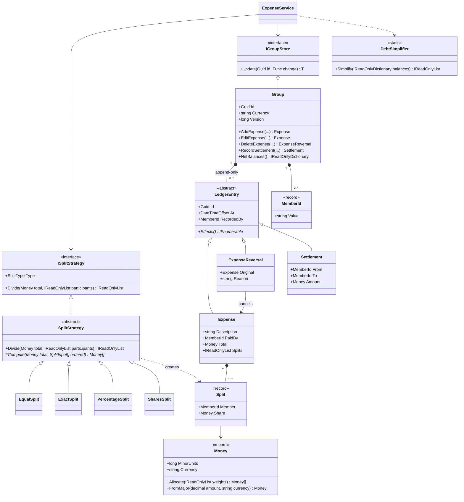
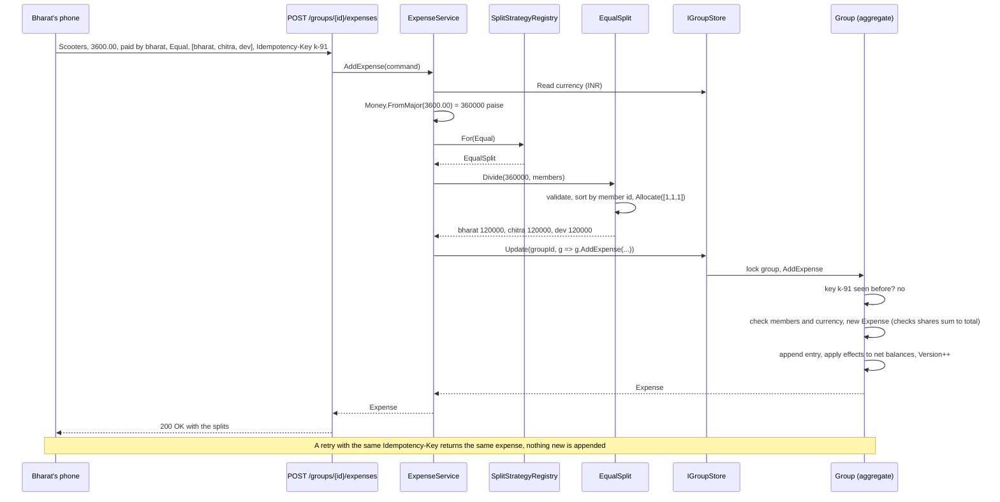
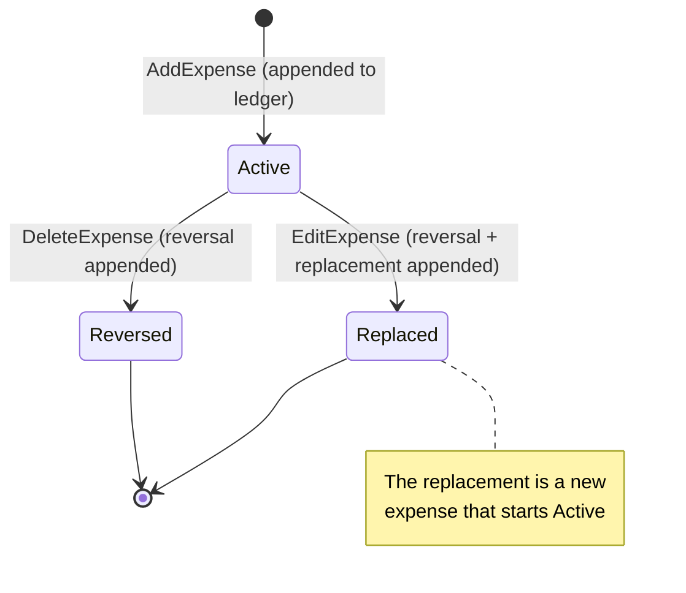
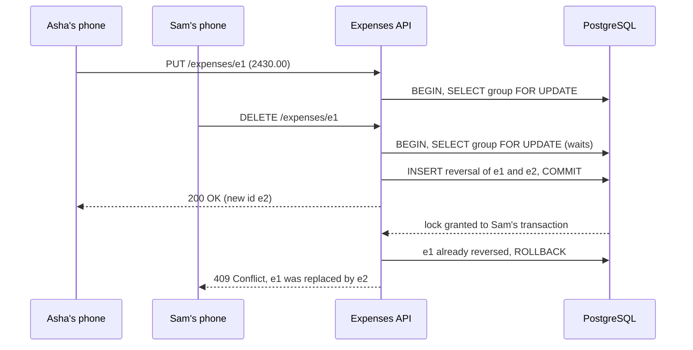

Four friends go to Goa. One books the villa, another pays for scooters, a third picks up the seafood dinner. On the way home nobody remembers who owes whom. Expense-sharing apps solve this, and they make a great low-level design (LLD) case study: the domain is familiar, but it hides real traps. Money must never be a `double`. ₹1,000 split three ways leaves a paisa that must go *somewhere*, the same way every time. Editing an expense must not rewrite history. Two flatmates adding groceries from two phones at the same moment must not corrupt the balances. And "simplify debts" turns out to be an NP-hard problem in general.

## Learning objectives

By the end of this case study you will be able to:

1. Turn "split bills with friends" into requirements: groups, expenses, split types, balances, settle up, history.
2. Model money as a value object in minor units (paise) and explain why `double` is wrong.
3. Implement equal, exact, percentage and shares splits as Strategies with validation and deterministic rounding.
4. Keep an append-only ledger where edits and deletes are reversals, and derive net balances from it.
5. Simplify debts with a greedy algorithm, and explain why it is not always optimal.
6. Protect a group's balances from concurrent updates and double submissions, and sketch the PostgreSQL schema.

## Prerequisites

- [Strategy](#/lesson/m06-strategy): split types are strategies.
- [Entities and value objects](#/lesson/m08-entities-value-objects) and [Immutable objects](#/lesson/m07-immutability): `Money`, `Split` and ledger entries.
- [Aggregates](#/lesson/m08-aggregates): a group is a consistency boundary.
- [Locking](#/lesson/m09-locking): pessimistic and optimistic concurrency in PostgreSQL.

## Explain it like I'm a beginner

Imagine a shared notebook on the Goa trip. Every time someone pays for something, they write one line: "Aisha paid ₹24,000 for the villa, for all four of us." Nobody crosses lines out. If a line was wrong, you write a new line that cancels it, and then the correct one.

At any moment you can work out each person's **balance**: how much they paid minus their share of everything. Aisha paid ₹24,000 and her share of the villa is ₹6,000, so she is **owed** ₹18,000. Dev paid nothing and his share is ₹6,000, so he **owes** ₹6,000. All balances always add up to exactly zero, because every rupee someone is owed, someone else owes.

**Settling up** means paying people back with as few payments as possible. Instead of everyone paying everyone for every bill, you look only at final balances: Dev pays Aisha, Bharat pays Aisha, done.

The same notebook works for flatmates in Bengaluru splitting rent (by room size), Wi-Fi (equally) and groceries (whoever bought them). Different bills need different **split rules**: equal, exact amounts, percentages, or shares.

## Requirements

### The scenario

You are building the backend of an expense-sharing app, an ASP.NET Core API with PostgreSQL. Users create groups (a trip, a flat, an office lunch club), add expenses, see who owes whom, and record repayments made by UPI or cash.

### Functional requirements

| # | Requirement |
|---|---|
| F1 | Create a **group** with a name, a currency (INR by default) and 2 or more members. |
| F2 | Add an **expense**: description, who paid, total, and how it is split among some or all members. |
| F3 | Split types: **equal**, **exact** amounts, **percentage**, **shares** (for example, 3:2:2 by room size). |
| F4 | Validate splits: exact amounts must add up to the total; percentages to exactly 100 %; no duplicate or unknown members. |
| F5 | Show each member's **net balance** (positive = is owed, negative = owes). |
| F6 | **Settle up**: suggest a short list of payments that clears all balances; record a payment. |
| F7 | **Edit** or **delete** an expense without losing history. |
| F8 | Show the group's **history** in order, including who recorded each entry. |

### Non-functional requirements

| # | Requirement | Target |
|---|---|---|
| N1 | Exactness | No paisa is ever created or lost. Shares of an expense add up to its total exactly; balances add up to zero. |
| N2 | Determinism | The same split always gives the same paisa to the same person, whatever order the members are listed in. |
| N3 | Auditability | Nothing is updated or deleted in place; every change is a new entry with who and when. |
| N4 | Concurrency | Two expenses added at the same moment to one group are both recorded, and balances stay correct. |
| N5 | Idempotency | A double tap on "Save" on a slow mobile network records the expense once. |

### Clarifying questions

- **One payer or several?** We support one payer per expense; multi-payer is an extension where the payer side becomes a second split.
- **One currency or many?** One currency per group for now. A trip to Bangkok adds THB; see "Alternative designs".
- **Who may edit?** Any member, and the history shows who did it.
- **Should "simplify debts" change who pays whom?** It can make Chitra pay Aisha even though Chitra never shared a bill with her. Many apps make it an opt-in group setting. We show it as a suggestion.
- **Can a member leave with a non-zero balance?** No; they must settle first.

## Identifying classes and responsibilities

| Class | Kind | Responsibility |
|---|---|---|
| `Money` | value object (record struct) | Amount in minor units (paise) plus currency; safe arithmetic; fair allocation of a total by weights. |
| `MemberId` | value object | A member's identity in a group, normalised for comparison. |
| `Split` | value object | One member's share of one expense. |
| `ISplitStrategy` + `SplitStrategy` | interface + abstract class | Turn a total and participants into shares. The base class does the shared validation and ordering (Template Method). |
| `EqualSplit`, `ExactSplit`, `PercentageSplit`, `SharesSplit` | classes | One rule each. |
| `SplitStrategyRegistry` | class | Finds the strategy for a `SplitType`. |
| `LedgerEntry` | abstract record | An immutable line in the notebook, with its effect on balances. |
| `Expense`, `ExpenseReversal`, `Settlement` | records | The three kinds of entry. |
| `Group` | entity, aggregate root | Members, the ledger, cached net balances, invariants, idempotency keys. |
| `DebtSimplifier` | static class | Turns net balances into a short list of `Transfer`s. |
| `IGroupStore` | interface | Loads and saves a group under a per-group lock. |
| `ExpenseService` | application service | Orchestrates: parse money, pick strategy, update the group. |

Notice what is *not* a class: there is no `Balance` table that gets updated. Balances are **derived** from the ledger, which is the single source of truth. `Group` caches them in memory for speed, but you can always recompute them.

## Class diagram



How to read it: on the left are the **split strategies**. `ExpenseService` depends on the `ISplitStrategy` interface; the abstract `SplitStrategy` implements it with a fixed skeleton (validate, sort members, compute, check the sum) and leaves one hook, `Compute`, to the four concrete rules. In the middle is the **ledger**: `LedgerEntry` is an abstract, immutable record with three kinds. An `Expense` *owns* its splits (composition); an `ExpenseReversal` points at the expense it cancels; a `Settlement` records a repayment. `Group` is the aggregate root: it owns its members and its ledger, and it is the only place entries are appended, so its invariants (members exist, currencies match, an expense is reversed at most once) are checked in one place. `Money` and `MemberId` are value objects used everywhere. `DebtSimplifier` is a pure function over balances, which makes it trivial to test.

### Adding an expense, step by step



The pure work, converting rupees to paise and computing the split, happens **before** taking the group's lock, so the lock is held only for checks and an append. Inside the lock, the group first looks up the idempotency key (N5): if Bharat's phone retries after a timeout, the first expense is returned and nothing is added twice. Then it checks that every person is a member, constructs the immutable `Expense` (whose constructor refuses shares that do not add up), and appends it. Applying an entry updates the cached net balance of each affected member; the entry's effects always sum to zero, so the balances always do too (N1).

## Patterns and design decisions

### Money is a value object in minor units

Never use `double` for money: `0.1 + 0.2` is `0.30000000000000004`, and errors accumulate. Use **`long` minor units** (paise; exact, maps to `bigint`, makes the leftover paisa explicit), as we do, or **`decimal`** (maps to `numeric(12,2)`, but still needs explicit share rounding). `Money` is immutable, refuses to mix INR with THB, and refuses more than two decimals. It assumes two minor-unit digits; production code would look up the exponent per currency (JPY 0, KWD 3).

### Strategy for split types, Template Method for the shared rules

Each split rule is a [Strategy](#/lesson/m06-strategy). Adding "split by nights stayed" means one new class and one DI registration, nothing else. The shared rules (positive total, at least one participant, no duplicates, deterministic order, shares must add up) live in the abstract base class as a [Template Method](#/lesson/m06-template-method), so a new strategy cannot forget them.

### Rounding: largest remainder, ties by member id

Splitting a total by weights rarely divides evenly. The rule (the *largest remainder method*):

1. Give everyone the floor of their exact share.
2. Count the paise left over (always fewer than the number of people).
3. Hand them out one each, to the people with the largest fractional remainder; break ties by member id in ordinal order.

Worked example: dinner of **₹500.05** (50,005 paise) split 33.33 % / 33.33 % / 33.34 % between aisha, bharat and chitra.

| Member | Exact share (paise) | Floor | Remainder | Extra paisa | Final |
|---|---|---|---|---|---|
| aisha | 16,666.6665 | 16,666 | 0.6665 | +1 (tie with bharat, "aisha" sorts first) | 16,667 |
| bharat | 16,666.6665 | 16,666 | 0.6665 | 0 | 16,666 |
| chitra | 16,671.6670 | 16,671 | 0.6670 | +1 (largest remainder) | 16,672 |
| **Total** | | 50,003 | | 2 | **50,005** |

Rounding each share with `Math.Round` gives 16,667 + 16,667 + 16,672 = 50,006: a paisa invented. The rule is exact by construction; sorting by member id first makes it independent of input order (N2). Percentages become integer basis points (33.33 % → 3,333), and products use `Int128` so huge totals cannot overflow.

### The ledger is append-only; edits are reversals

An `Expense` is immutable. **Deleting** appends an `ExpenseReversal` with the exact negative effects; **editing** appends a reversal *and* a replacement, atomically. History shows what changed and who changed it (N3), balances are always "sum of all effects", and nobody's edit is silently overwritten. It is the accountant's correcting entry and a small version of [event sourcing](#/lesson/m08-event-sourcing). A reversed expense cannot be reversed again.

### Balances are derived; the group caches them

A net balance is the sum of a member's effects. `Group` updates a cached `Dictionary<MemberId, long>` on every append, so reads are O(members). In PostgreSQL it is a `SUM` over ledger lines, optionally cached in the same transaction.

### Debt simplification: greedy, and why it is not optimal

From net balances, a greedy algorithm settles everything in at most *n − 1* payments:

1. Put creditors (positive) and debtors (negative) in two max-heaps by amount (`PriorityQueue` with a "largest first" comparer; ties by member id).
2. Take the largest debtor and the largest creditor. The debtor pays `min(debt, credit)`.
3. Put whoever still has a non-zero balance back. Repeat until both heaps are empty.

Each step zeroes at least one person, so there are at most *n − 1* steps, and each costs O(log n).

Greedy is **not always minimal**. Five flatmates: ishaan +₹5,000, jaya +₹4,000, kabir −₹4,000, leela −₹3,000, meera −₹2,000. Greedy pairs kabir with ishaan first and needs **4** payments. The optimum is **3** (kabir → jaya ₹4,000, leela → ishaan ₹3,000, meera → ishaan ₹2,000), because {jaya, kabir} and {ishaan, leela, meera} each sum to zero. The minimum is *n* minus the largest number of disjoint zero-sum groups; finding that is NP-hard (it generalises subset sum). Up to about 15 people, an exact search over 2ⁿ subsets is feasible; beyond that, greedy is the practical answer.

### Concurrency and idempotency

Appends commute, but some operations must be serialised: two deletes of one expense, an edit racing a delete, one idempotency key arriving twice. So every change runs under the group's lock: a `Lock` per group in memory; in PostgreSQL `SELECT ... FROM expense_group WHERE id = $1 FOR UPDATE`, or an optimistic `version` check. The lock is per *group*, the aggregate boundary, so different groups never block each other.

## State transitions

### Balances across the Goa trip

Members: aisha, bharat, chitra, dev. Positive = is owed.

| Step | Entry | aisha | bharat | chitra | dev | Sum |
|---|---|---|---|---|---|---|
| 1 | Villa ₹24,000 paid by aisha, equal among 4 (₹6,000 each) | +18,000 | −6,000 | −6,000 | −6,000 | 0 |
| 2 | Scooters ₹3,600 paid by bharat, equal among bharat, chitra, dev | +18,000 | −3,600 | −7,200 | −7,200 | 0 |
| 3 | Dinner ₹5,000 paid by chitra, exact: 1,500 / 1,000 / 1,250 / 1,250 | +16,500 | −4,600 | −3,450 | −8,450 | 0 |
| 4 | Settlement: dev pays aisha ₹8,450 | +8,050 | −4,600 | −3,450 | 0 | 0 |

Before step 4, greedy simplification suggests three payments: dev → aisha ₹8,450, bharat → aisha ₹4,600, chitra → aisha ₹3,450. Without simplification, the bills create six pairwise debts after netting each pair (for example, chitra owes aisha ₹6,000 for the villa and aisha owes chitra ₹1,500 for dinner).

### The life of an expense



How to read it: an expense is *active* from the moment it is appended. It leaves that state in exactly one of two ways, and both add entries rather than change the existing one. A delete appends a reversal and the expense becomes *reversed*. An edit appends a reversal and a brand-new replacement expense, which starts its own life as active. There is no way back: a reversed or replaced expense cannot be reversed again (the group refuses), which prevents the double-delete bug where cancelling twice would credit people twice.

## C# implementation

```text
Tally.Api/
  Program.cs
  Domain/Money.cs  Domain/Splits.cs  Domain/Ledger.cs  Domain/Group.cs  Domain/DebtSimplifier.cs
  Application/GroupStore.cs  Application/ExpenseService.cs
```

### Money and member identity

```csharp file=Domain/Money.cs
using System.Globalization;

namespace Tally.Expenses.Domain;

public class ExpenseDomainException(string message) : Exception(message);

public sealed class InvalidSplitException(string message) : ExpenseDomainException(message);

/// <summary>Money in minor units (paise for INR). Assumes two decimal places per currency unit.</summary>
public readonly record struct Money
{
    public Money(long minorUnits, string currency)
    {
        if (currency is not { Length: 3 } || !currency.All(char.IsAsciiLetterUpper))
            throw new ArgumentException("Currency must be a 3-letter ISO code such as INR.", nameof(currency));
        MinorUnits = minorUnits;
        Currency = currency;
    }

    public long MinorUnits { get; }
    public string Currency { get; }
    public bool IsPositive => MinorUnits > 0;
    public bool IsNegative => MinorUnits < 0;

    public static Money Zero(string currency) => new(0, currency);

    public static Money FromMajor(decimal amount, string currency)
    {
        decimal minor = amount * 100m;
        if (minor != decimal.Truncate(minor))
            throw new ArgumentException($"{amount} has more than two decimal places.", nameof(amount));
        return new Money(checked((long)minor), currency);
    }

    public decimal ToMajor() => MinorUnits / 100m;

    public static Money operator +(Money a, Money b) => new(checked(a.MinorUnits + b.MinorUnits), Same(a, b));
    public static Money operator -(Money a, Money b) => new(checked(a.MinorUnits - b.MinorUnits), Same(a, b));
    public static Money operator -(Money a) => new(checked(-a.MinorUnits), a.Currency);

    /// <summary>
    /// Splits this amount by integer weights with the largest remainder method. Shares always add up exactly.
    /// Leftover minor units go to the largest fractional remainders; ties go to the lower index.
    /// </summary>
    public Money[] Allocate(IReadOnlyList<long> weights)
    {
        if (MinorUnits < 0) throw new InvalidOperationException("Only non-negative amounts can be allocated.");
        if (weights.Count == 0 || weights.Any(w => w < 0)) throw new InvalidSplitException("Weights must be non-negative.");
        long totalWeight = 0;
        foreach (var w in weights) totalWeight = checked(totalWeight + w);
        if (totalWeight == 0) throw new InvalidSplitException("At least one weight must be positive.");

        var shares = new long[weights.Count];
        var remainders = new Int128[weights.Count];
        long allocated = 0;
        for (int i = 0; i < weights.Count; i++)
        {
            Int128 exact = (Int128)MinorUnits * weights[i];          // Int128: no overflow for large totals
            shares[i] = (long)(exact / totalWeight);
            remainders[i] = exact % totalWeight;
            allocated += shares[i];
        }

        long leftover = MinorUnits - allocated;                       // 0 <= leftover < weights.Count
        foreach (int i in Enumerable.Range(0, shares.Length).OrderByDescending(k => remainders[k]).ThenBy(k => k).Take((int)leftover))
            shares[i]++;

        var currency = Currency;
        return shares.Select(s => new Money(s, currency)).ToArray();
    }

    public override string ToString() => $"{Currency} {ToMajor().ToString("0.00", CultureInfo.InvariantCulture)}";

    private static string Same(Money a, Money b) =>
        a.Currency == b.Currency ? a.Currency : throw new ExpenseDomainException($"Cannot combine {a.Currency} with {b.Currency}.");
}

/// <summary>A member's id within a group, trimmed and lower-cased so "Aisha " and "aisha" are the same person.</summary>
public readonly record struct MemberId
{
    public MemberId(string value)
    {
        ArgumentException.ThrowIfNullOrWhiteSpace(value);
        Value = value.Trim().ToLowerInvariant();
    }

    public string Value { get; }

    public override string ToString() => Value;
}
```

Why can the leftover never exceed the number of people? Each person's fractional remainder is less than one paisa, so together they are less than *n* paise. And only people with a non-zero remainder receive one, so a member with weight 0 never gets a stray paisa.

### Split strategies

```csharp file=Domain/Splits.cs
namespace Tally.Expenses.Domain;

public enum SplitType { Equal, Exact, Percentage, Shares }

public sealed record Split(MemberId Member, Money Share);

/// <summary>One participant and the number that matters for the split type (ignored for Equal).</summary>
public sealed record SplitInput(MemberId Member, decimal Value = 0);

public interface ISplitStrategy
{
    SplitType Type { get; }
    IReadOnlyList<Split> Divide(Money total, IReadOnlyList<SplitInput> participants);
}

/// <summary>Template Method: shared validation and deterministic ordering; subclasses compute the shares.</summary>
public abstract class SplitStrategy : ISplitStrategy
{
    public abstract SplitType Type { get; }

    public IReadOnlyList<Split> Divide(Money total, IReadOnlyList<SplitInput> participants)
    {
        if (!total.IsPositive) throw new InvalidSplitException("An expense must be greater than zero.");
        if (participants.Count == 0) throw new InvalidSplitException("At least one person must share the expense.");
        if (participants.Select(p => p.Member).Distinct().Count() != participants.Count)
            throw new InvalidSplitException("Each person may appear only once in a split.");

        // Sorting first makes the result independent of the order the client sent (who gets the extra paisa).
        var ordered = participants.OrderBy(p => p.Member.Value, StringComparer.Ordinal).ToArray();
        var shares = Compute(total, ordered);

        if (shares.Sum(s => s.MinorUnits) != total.MinorUnits)
            throw new InvalidOperationException($"{GetType().Name} produced shares that do not add up to {total}.");
        return ordered.Select((p, i) => new Split(p.Member, shares[i])).ToArray();
    }

    protected abstract Money[] Compute(Money total, SplitInput[] ordered);
}

public sealed class EqualSplit : SplitStrategy
{
    public override SplitType Type => SplitType.Equal;

    protected override Money[] Compute(Money total, SplitInput[] ordered) =>
        total.Allocate(Enumerable.Repeat(1L, ordered.Length).ToArray());
}

public sealed class ExactSplit : SplitStrategy
{
    public override SplitType Type => SplitType.Exact;

    protected override Money[] Compute(Money total, SplitInput[] ordered)
    {
        var shares = new Money[ordered.Length];
        for (int i = 0; i < ordered.Length; i++)
        {
            if (ordered[i].Value < 0) throw new InvalidSplitException($"{ordered[i].Member}'s amount cannot be negative.");
            try { shares[i] = Money.FromMajor(ordered[i].Value, total.Currency); }
            catch (ArgumentException ex) { throw new InvalidSplitException(ex.Message); }
        }
        long sum = shares.Sum(s => s.MinorUnits);
        if (sum != total.MinorUnits)
        {
            var diff = new Money(total.MinorUnits - sum, total.Currency);
            throw new InvalidSplitException($"Amounts add up to {new Money(sum, total.Currency)}, not {total} (difference {diff}).");
        }
        return shares;
    }
}

public sealed class PercentageSplit : SplitStrategy
{
    public override SplitType Type => SplitType.Percentage;

    protected override Money[] Compute(Money total, SplitInput[] ordered)
    {
        var basisPoints = new long[ordered.Length];
        for (int i = 0; i < ordered.Length; i++)
        {
            decimal p = ordered[i].Value;
            if (p < 0 || p > 100) throw new InvalidSplitException($"{ordered[i].Member}'s percentage must be between 0 and 100.");
            decimal bp = p * 100m;
            if (bp != decimal.Truncate(bp)) throw new InvalidSplitException("Percentages may have at most two decimal places.");
            basisPoints[i] = (long)bp;
        }
        if (basisPoints.Sum() != 10_000)
            throw new InvalidSplitException($"Percentages add up to {ordered.Sum(x => x.Value)} %, not 100 %.");
        return total.Allocate(basisPoints);
    }
}

public sealed class SharesSplit : SplitStrategy
{
    public override SplitType Type => SplitType.Shares;

    protected override Money[] Compute(Money total, SplitInput[] ordered)
    {
        var weights = new long[ordered.Length];
        for (int i = 0; i < ordered.Length; i++)
        {
            decimal s = ordered[i].Value;
            if (s < 0 || s != decimal.Truncate(s) || s > 1_000_000)
                throw new InvalidSplitException($"{ordered[i].Member}'s shares must be a whole number from 0 to 1,000,000.");
            weights[i] = (long)s;
        }
        if (weights.Sum() == 0) throw new InvalidSplitException("At least one person must have a share.");
        return total.Allocate(weights);
    }
}

public sealed class SplitStrategyRegistry(IEnumerable<ISplitStrategy> strategies)
{
    private readonly Dictionary<SplitType, ISplitStrategy> _byType = strategies.ToDictionary(s => s.Type);

    public ISplitStrategy For(SplitType type) =>
        _byType.TryGetValue(type, out var s) ? s : throw new ExpenseDomainException($"Split type {type} is not supported.");
}
```

Rent for three Bengaluru flatmates is a good shares example: ₹45,000 at 3:2:2 by room size. 4,500,000 paise × 3/7 = 1,928,571.43 and × 2/7 = 1,285,714.29 twice. The floors add up to 4,499,999, so one paisa is left and goes to the largest remainder, the 3-share room: 1,928,572 + 1,285,714 + 1,285,714 = 4,500,000.

### The ledger

```csharp file=Domain/Ledger.cs
namespace Tally.Expenses.Domain;

/// <summary>An immutable line in the group's notebook. Its effects always sum to zero.</summary>
public abstract record LedgerEntry
{
    protected LedgerEntry(Guid id, DateTimeOffset at, MemberId recordedBy)
    {
        Id = id;
        At = at;
        RecordedBy = recordedBy;
    }

    public Guid Id { get; }
    public DateTimeOffset At { get; }
    public MemberId RecordedBy { get; }

    /// <summary>Signed change to each member's net balance, in minor units. Positive = is owed more.</summary>
    public abstract IEnumerable<(MemberId Member, long Delta)> Effects();
}

public sealed record Expense : LedgerEntry
{
    public Expense(Guid id, DateTimeOffset at, MemberId recordedBy, string description, MemberId paidBy,
        Money total, SplitType splitType, IReadOnlyList<Split> splits) : base(id, at, recordedBy)
    {
        ArgumentException.ThrowIfNullOrWhiteSpace(description);
        if (!total.IsPositive) throw new ExpenseDomainException("An expense must be greater than zero.");
        if (splits.Count == 0) throw new InvalidSplitException("An expense needs at least one share.");
        if (splits.Any(s => s.Share.Currency != total.Currency || s.Share.IsNegative))
            throw new InvalidSplitException("Shares must be non-negative and in the expense currency.");
        if (splits.Select(s => s.Member).Distinct().Count() != splits.Count)
            throw new InvalidSplitException("Each person may appear only once in a split.");
        if (splits.Sum(s => s.Share.MinorUnits) != total.MinorUnits)
            throw new InvalidSplitException("Shares must add up exactly to the total.");

        Description = description.Trim();
        PaidBy = paidBy;
        Total = total;
        SplitType = splitType;
        Splits = splits.ToArray();
    }

    public string Description { get; }
    public MemberId PaidBy { get; }
    public Money Total { get; }
    public SplitType SplitType { get; }
    public IReadOnlyList<Split> Splits { get; }

    public override IEnumerable<(MemberId Member, long Delta)> Effects()
    {
        yield return (PaidBy, Total.MinorUnits);
        foreach (var s in Splits) yield return (s.Member, -s.Share.MinorUnits);
    }
}

/// <summary>Cancels an expense exactly. Used for deletes, and (with a replacement) for edits.</summary>
public sealed record ExpenseReversal : LedgerEntry
{
    public ExpenseReversal(Guid id, DateTimeOffset at, MemberId recordedBy, Expense original, string reason)
        : base(id, at, recordedBy)
    {
        Original = original;
        Reason = string.IsNullOrWhiteSpace(reason) ? "Deleted" : reason.Trim();
    }

    public Expense Original { get; }
    public string Reason { get; }

    public override IEnumerable<(MemberId Member, long Delta)> Effects() =>
        Original.Effects().Select(e => (e.Member, -e.Delta));
}

/// <summary>A repayment: From pays To. From's debt shrinks, To's credit shrinks.</summary>
public sealed record Settlement : LedgerEntry
{
    public Settlement(Guid id, DateTimeOffset at, MemberId recordedBy, MemberId from, MemberId to, Money amount)
        : base(id, at, recordedBy)
    {
        if (from == to) throw new ExpenseDomainException("A member cannot pay themselves.");
        if (!amount.IsPositive) throw new ExpenseDomainException("A settlement must be greater than zero.");
        From = from;
        To = to;
        Amount = amount;
    }

    public MemberId From { get; }
    public MemberId To { get; }
    public Money Amount { get; }

    public override IEnumerable<(MemberId Member, long Delta)> Effects()
    {
        yield return (From, Amount.MinorUnits);
        yield return (To, -Amount.MinorUnits);
    }
}
```

The properties have only getters, so not even a `with` expression can change an entry after construction. Each constructor enforces its own invariant: an `Expense` whose shares do not add up simply cannot exist.

### The group aggregate

```csharp file=Domain/Group.cs
namespace Tally.Expenses.Domain;

/// <summary>Aggregate root: the only place ledger entries are appended, so all invariants live here.</summary>
public sealed class Group
{
    private readonly HashSet<MemberId> _members = [];
    private readonly Dictionary<MemberId, long> _net = new();
    private readonly List<LedgerEntry> _history = [];
    private readonly Dictionary<Guid, Expense> _expenses = new();
    private readonly HashSet<Guid> _reversed = [];
    private readonly Dictionary<string, Expense> _byIdempotencyKey = new(StringComparer.Ordinal);

    public Group(Guid id, string name, string currency, IEnumerable<MemberId> members)
    {
        ArgumentException.ThrowIfNullOrWhiteSpace(name);
        Id = id;
        Name = name.Trim();
        Currency = Money.Zero(currency).Currency;      // validates the code
        foreach (var m in members) AddMember(m);
        if (_members.Count < 2) throw new ExpenseDomainException("A group needs at least two members.");
    }

    public Guid Id { get; }
    public string Name { get; }
    public string Currency { get; }
    /// <summary>Incremented on every change; the optimistic concurrency token when persisted.</summary>
    public long Version { get; private set; }
    public IReadOnlyCollection<MemberId> Members => _members;
    public IReadOnlyList<LedgerEntry> History => _history;

    public void AddMember(MemberId member)
    {
        if (_members.Add(member)) { _net[member] = 0; Version++; }
    }

    public Expense AddExpense(string description, MemberId paidBy, Money total, SplitType splitType,
        IReadOnlyList<Split> splits, MemberId recordedBy, DateTimeOffset at, string? idempotencyKey = null)
    {
        if (idempotencyKey is not null && _byIdempotencyKey.TryGetValue(idempotencyKey, out var earlier))
            return earlier;                                           // a retry: do nothing twice
        var expense = CreateExpense(description, paidBy, total, splitType, splits, recordedBy, at);
        Append(expense);
        if (idempotencyKey is not null) _byIdempotencyKey[idempotencyKey] = expense;
        return expense;
    }

    public ExpenseReversal DeleteExpense(Guid expenseId, MemberId by, string reason, DateTimeOffset at)
    {
        RequireMember(by);
        var original = RequireReversible(expenseId);
        var reversal = new ExpenseReversal(Guid.NewGuid(), at, by, original, reason);
        Append(reversal);
        _reversed.Add(expenseId);
        return reversal;
    }

    /// <summary>Edit = reversal + replacement, validated completely before either is appended.</summary>
    public (ExpenseReversal Reversal, Expense Replacement) EditExpense(Guid expenseId, string description, MemberId paidBy,
        Money total, SplitType splitType, IReadOnlyList<Split> splits, MemberId by, DateTimeOffset at)
    {
        var original = RequireReversible(expenseId);
        var replacement = CreateExpense(description, paidBy, total, splitType, splits, by, at);
        var reversal = new ExpenseReversal(Guid.NewGuid(), at, by, original, $"Edited; replaced by {replacement.Id}");
        Append(reversal);
        Append(replacement);
        _reversed.Add(expenseId);
        return (reversal, replacement);
    }

    public Settlement RecordSettlement(MemberId from, MemberId to, Money amount, MemberId by, DateTimeOffset at)
    {
        RequireMember(from);
        RequireMember(to);
        RequireMember(by);
        RequireCurrency(amount);
        var settlement = new Settlement(Guid.NewGuid(), at, by, from, to, amount);
        Append(settlement);
        return settlement;
    }

    /// <summary>A snapshot: safe to use after the group's lock is released.</summary>
    public IReadOnlyDictionary<MemberId, Money> NetBalances() =>
        _net.ToDictionary(kv => kv.Key, kv => new Money(kv.Value, Currency));

    private Expense CreateExpense(string description, MemberId paidBy, Money total, SplitType splitType,
        IReadOnlyList<Split> splits, MemberId recordedBy, DateTimeOffset at)
    {
        RequireMember(paidBy);
        RequireMember(recordedBy);
        RequireCurrency(total);
        foreach (var s in splits) RequireMember(s.Member);
        return new Expense(Guid.NewGuid(), at, recordedBy, description, paidBy, total, splitType, splits);
    }

    private Expense RequireReversible(Guid expenseId)
    {
        if (!_expenses.TryGetValue(expenseId, out var expense))
            throw new ExpenseDomainException($"Expense {expenseId} is not part of this group.");
        if (_reversed.Contains(expenseId))
            throw new ExpenseDomainException("This expense has already been edited or deleted.");
        return expense;
    }

    private void RequireMember(MemberId m)
    {
        if (!_members.Contains(m)) throw new ExpenseDomainException($"'{m}' is not a member of {Name}.");
    }

    private void RequireCurrency(Money m)
    {
        if (m.Currency != Currency) throw new ExpenseDomainException($"{Name} uses {Currency}, not {m.Currency}.");
    }

    private void Append(LedgerEntry entry)
    {
        var effects = entry.Effects().ToArray();
        if (effects.Sum(x => x.Delta) != 0) throw new InvalidOperationException("A ledger entry must not create or destroy money.");
        foreach (var (member, delta) in effects) _net[member] = checked(_net[member] + delta);
        _history.Add(entry);
        if (entry is Expense expense) _expenses.Add(expense.Id, expense);
        Version++;
    }
}
```

`Group` is not thread-safe on purpose: it is an in-memory model of one aggregate, and the store decides how concurrent access is serialised. That keeps the domain free of locks and easy to test.

### Debt simplification

```csharp file=Domain/DebtSimplifier.cs
namespace Tally.Expenses.Domain;

public sealed record Transfer(MemberId From, MemberId To, Money Amount);

/// <summary>Greedy settle-up: largest debtor pays largest creditor. At most n-1 transfers; not always the minimum.</summary>
public static class DebtSimplifier
{
    public static IReadOnlyList<Transfer> Simplify(IReadOnlyDictionary<MemberId, Money> balances)
    {
        if (balances.Count == 0) return [];
        string currency = balances.Values.First().Currency;
        var creditors = new PriorityQueue<MemberId, (long Amount, string Id)>(LargestFirst.Instance);
        var debtors = new PriorityQueue<MemberId, (long Amount, string Id)>(LargestFirst.Instance);
        long sum = 0;

        foreach (var (member, money) in balances)
        {
            if (money.Currency != currency) throw new ExpenseDomainException("All balances must be in one currency.");
            sum = checked(sum + money.MinorUnits);
            if (money.IsPositive) creditors.Enqueue(member, (money.MinorUnits, member.Value));
            else if (money.IsNegative) debtors.Enqueue(member, (-money.MinorUnits, member.Value));
        }
        if (sum != 0) throw new ExpenseDomainException($"Balances must add up to zero, but are off by {new Money(sum, currency)}.");

        var transfers = new List<Transfer>();
        while (creditors.TryDequeue(out var creditor, out var credit) && debtors.TryDequeue(out var debtor, out var debt))
        {
            long amount = Math.Min(credit.Amount, debt.Amount);
            transfers.Add(new Transfer(debtor, creditor, new Money(amount, currency)));
            if (credit.Amount > amount) creditors.Enqueue(creditor, (credit.Amount - amount, credit.Id));
            if (debt.Amount > amount) debtors.Enqueue(debtor, (debt.Amount - amount, debt.Id));
        }
        return transfers;
    }

    private sealed class LargestFirst : IComparer<(long Amount, string Id)>
    {
        public static readonly LargestFirst Instance = new();

        public int Compare((long Amount, string Id) x, (long Amount, string Id) y)
        {
            int byAmount = y.Amount.CompareTo(x.Amount);                 // larger amount first
            return byAmount != 0 ? byAmount : string.CompareOrdinal(x.Id, y.Id);
        }
    }
}
```

Because the balances sum to zero, the creditor and debtor heaps always empty together, so the loop never drops anyone.

### Store and application service

```csharp file=Application/GroupStore.cs
using System.Collections.Concurrent;
using Tally.Expenses.Domain;

namespace Tally.Expenses.Application;

public sealed class GroupNotFoundException(Guid id) : Exception($"Group {id} was not found.");

public interface IGroupStore
{
    void Add(Group group);
    T Read<T>(Guid groupId, Func<Group, T> query);
    T Update<T>(Guid groupId, Func<Group, T> change);
}

/// <summary>
/// In-memory stand-in for PostgreSQL. One lock per group plays the role of
/// SELECT ... FOR UPDATE on the group row: changes to one group are serialised, different groups run in parallel.
/// </summary>
public sealed class InMemoryGroupStore : IGroupStore
{
    private sealed class Slot(Group group)
    {
        public readonly Lock Gate = new();
        public readonly Group Group = group;
    }

    private readonly ConcurrentDictionary<Guid, Slot> _groups = new();

    public void Add(Group group)
    {
        if (!_groups.TryAdd(group.Id, new Slot(group))) throw new InvalidOperationException($"Group {group.Id} already exists.");
    }

    public T Read<T>(Guid groupId, Func<Group, T> query)
    {
        var slot = Find(groupId);
        lock (slot.Gate) return query(slot.Group);
    }

    public T Update<T>(Guid groupId, Func<Group, T> change)
    {
        var slot = Find(groupId);
        lock (slot.Gate) return change(slot.Group);
    }

    private Slot Find(Guid id) => _groups.TryGetValue(id, out var s) ? s : throw new GroupNotFoundException(id);
}
```

```csharp file=Application/ExpenseService.cs
using Tally.Expenses.Domain;

namespace Tally.Expenses.Application;

public sealed record ShareInput(string Member, decimal Value = 0);

public sealed record AddExpenseCommand(Guid GroupId, string Description, string PaidBy, decimal Amount,
    SplitType SplitType, IReadOnlyList<ShareInput> Shares, string RecordedBy, string? IdempotencyKey = null);

public sealed record BalanceView(string Member, decimal Amount);

public sealed record TransferView(string From, string To, decimal Amount);

public sealed class ExpenseService(IGroupStore store, SplitStrategyRegistry strategies, TimeProvider time)
{
    public Guid CreateGroup(string name, string currency, IEnumerable<string> members)
    {
        var group = new Group(Guid.NewGuid(), name, currency, members.Select(m => new MemberId(m)));
        store.Add(group);
        return group.Id;
    }

    public Expense AddExpense(AddExpenseCommand cmd)
    {
        var (total, splits) = Prepare(cmd);                       // pure work, outside the group's lock
        return store.Update(cmd.GroupId, g => g.AddExpense(cmd.Description, new MemberId(cmd.PaidBy), total,
            cmd.SplitType, splits, new MemberId(cmd.RecordedBy), time.GetUtcNow(), cmd.IdempotencyKey));
    }

    public Expense EditExpense(Guid expenseId, AddExpenseCommand replacement)
    {
        var (total, splits) = Prepare(replacement);
        return store.Update(replacement.GroupId, g => g.EditExpense(expenseId, replacement.Description,
            new MemberId(replacement.PaidBy), total, replacement.SplitType, splits,
            new MemberId(replacement.RecordedBy), time.GetUtcNow()).Replacement);
    }

    public ExpenseReversal DeleteExpense(Guid groupId, Guid expenseId, string by, string reason) =>
        store.Update(groupId, g => g.DeleteExpense(expenseId, new MemberId(by), reason, time.GetUtcNow()));

    public Settlement RecordSettlement(Guid groupId, string from, string to, decimal amount, string recordedBy)
    {
        var money = Money.FromMajor(amount, store.Read(groupId, g => g.Currency));
        return store.Update(groupId, g => g.RecordSettlement(new MemberId(from), new MemberId(to), money,
            new MemberId(recordedBy), time.GetUtcNow()));
    }

    public IReadOnlyList<BalanceView> Balances(Guid groupId) =>
        store.Read(groupId, g => g.NetBalances())
            .OrderBy(kv => kv.Key.Value, StringComparer.Ordinal)
            .Select(kv => new BalanceView(kv.Key.Value, kv.Value.ToMajor()))
            .ToArray();

    public IReadOnlyList<TransferView> SettleUpPlan(Guid groupId) =>
        DebtSimplifier.Simplify(store.Read(groupId, g => g.NetBalances()))
            .Select(t => new TransferView(t.From.Value, t.To.Value, t.Amount.ToMajor()))
            .ToArray();

    private (Money Total, IReadOnlyList<Split> Splits) Prepare(AddExpenseCommand cmd)
    {
        var total = Money.FromMajor(cmd.Amount, store.Read(cmd.GroupId, g => g.Currency));
        var inputs = cmd.Shares.Select(s => new SplitInput(new MemberId(s.Member), s.Value)).ToArray();
        return (total, strategies.For(cmd.SplitType).Divide(total, inputs));
    }
}
```

### Composition root

```csharp file=Program.cs
using System.Text.Json.Serialization;
using Tally.Expenses.Application;
using Tally.Expenses.Domain;

var builder = WebApplication.CreateBuilder(args);
builder.Services.ConfigureHttpJsonOptions(o => o.SerializerOptions.Converters.Add(new JsonStringEnumConverter()));
builder.Services.AddSingleton(TimeProvider.System);
builder.Services.AddSingleton<ISplitStrategy, EqualSplit>();
builder.Services.AddSingleton<ISplitStrategy, ExactSplit>();
builder.Services.AddSingleton<ISplitStrategy, PercentageSplit>();
builder.Services.AddSingleton<ISplitStrategy, SharesSplit>();
builder.Services.AddSingleton<SplitStrategyRegistry>();
builder.Services.AddSingleton<IGroupStore, InMemoryGroupStore>();   // PostgreSQL-backed store in production
builder.Services.AddSingleton<ExpenseService>();

var app = builder.Build();
var groups = app.MapGroup("/groups");

groups.MapPost("/", (CreateGroupRequest req, ExpenseService svc) => Handle(() =>
{
    var id = svc.CreateGroup(req.Name, req.Currency, req.Members);
    return Results.Created($"/groups/{id}", new { id });
}));

groups.MapPost("/{groupId:guid}/expenses", (Guid groupId, ExpenseRequest req, HttpRequest http, ExpenseService svc) => Handle(() =>
{
    string? key = http.Headers["Idempotency-Key"].FirstOrDefault();
    var e = svc.AddExpense(new AddExpenseCommand(groupId, req.Description, req.PaidBy, req.Amount,
        req.SplitType, req.Shares, req.RecordedBy, key));
    return Results.Ok(new
    {
        e.Id, e.Description, Total = e.Total.ToMajor(),
        Splits = e.Splits.Select(s => new { Member = s.Member.Value, Amount = s.Share.ToMajor() }),
    });
}));

groups.MapGet("/{groupId:guid}/balances", (Guid groupId, ExpenseService svc) => Handle(() => Results.Ok(svc.Balances(groupId))));

groups.MapGet("/{groupId:guid}/settle-up", (Guid groupId, ExpenseService svc) => Handle(() => Results.Ok(svc.SettleUpPlan(groupId))));

groups.MapPost("/{groupId:guid}/settlements", (Guid groupId, SettlementRequest req, ExpenseService svc) => Handle(() =>
{
    var s = svc.RecordSettlement(groupId, req.From, req.To, req.Amount, req.RecordedBy);
    return Results.Ok(new { s.Id, From = s.From.Value, To = s.To.Value, Amount = s.Amount.ToMajor() });
}));

app.Run();

static IResult Handle(Func<IResult> action)
{
    try { return action(); }
    catch (GroupNotFoundException ex) { return Results.NotFound(new { error = ex.Message }); }
    catch (Exception ex) when (ex is ExpenseDomainException or ArgumentException)
    {
        return Results.Problem(ex.Message, statusCode: StatusCodes.Status400BadRequest);
    }
}

public sealed record CreateGroupRequest(string Name, string Currency, string[] Members);
public sealed record ExpenseRequest(string Description, string PaidBy, decimal Amount, SplitType SplitType,
    ShareInput[] Shares, string RecordedBy);
public sealed record SettlementRequest(string From, string To, decimal Amount, string RecordedBy);
```

Authentication is omitted for brevity. In production, `RecordedBy` comes from the signed-in user's claims, never from the request body, and every endpoint checks that the caller is a member of the group.

### PostgreSQL schema notes

```sql
CREATE TABLE expense_group (
    id         uuid PRIMARY KEY,
    name       text NOT NULL,
    currency   char(3) NOT NULL,
    version    bigint NOT NULL DEFAULT 0,          -- optimistic concurrency token
    created_at timestamptz NOT NULL DEFAULT now()
);

CREATE TABLE group_member (
    group_id  uuid NOT NULL REFERENCES expense_group (id),
    member_id text NOT NULL,
    PRIMARY KEY (group_id, member_id)
);

CREATE TABLE ledger_entry (
    id                 uuid PRIMARY KEY,
    group_id           uuid NOT NULL REFERENCES expense_group (id),
    kind               text NOT NULL CHECK (kind IN ('expense', 'reversal', 'settlement')),
    recorded_by        text NOT NULL,
    recorded_at        timestamptz NOT NULL,
    description        text,
    amount_minor       bigint NOT NULL CHECK (amount_minor > 0),
    currency           char(3) NOT NULL,
    split_type         text,
    reverses_entry_id  uuid UNIQUE REFERENCES ledger_entry (id),   -- an expense can be reversed once
    idempotency_key    text,
    UNIQUE (group_id, idempotency_key)
);

-- One row per member affected by an entry; the deltas of one entry sum to zero.
CREATE TABLE ledger_line (
    entry_id    uuid NOT NULL REFERENCES ledger_entry (id),
    group_id    uuid NOT NULL,
    member_id   text NOT NULL,
    delta_minor bigint NOT NULL,
    PRIMARY KEY (entry_id, member_id),
    FOREIGN KEY (group_id, member_id) REFERENCES group_member (group_id, member_id)
);
CREATE INDEX ledger_line_group_member ON ledger_line (group_id, member_id);

-- Net balances for one group.
SELECT member_id, SUM(delta_minor) AS net_minor
FROM ledger_line WHERE group_id = $1
GROUP BY member_id;
```

Design notes: `ledger_line` stores each entry's signed effect per member (payer `+total − own share`, others `−share`), which makes balances a plain `SUM` and lets you check "every entry sums to zero" with one query. `reverses_entry_id UNIQUE` makes a double delete impossible even if application code has a bug, and `UNIQUE (group_id, idempotency_key)` does the same for double submissions. Grant the application role `INSERT` and `SELECT` on the ledger tables, but not `UPDATE` or `DELETE`, to enforce immutability in the database. Each write transaction starts with `SELECT ... FROM expense_group WHERE id = $1 FOR UPDATE` (or bumps `version` with `WHERE version = $expected`) so changes to one group are serialised. For groups with years of history, add a balance snapshot table updated in the same transaction.

## Automated testing

The domain is pure, so most tests need no fakes at all. A fixed `DateTimeOffset` stands in for the clock.

```csharp
using Tally.Expenses.Application;
using Tally.Expenses.Domain;
using Xunit;

namespace Tally.Tests;

public class SplitAndLedgerTests
{
    private static readonly DateTimeOffset At = new(2026, 12, 20, 10, 0, 0, TimeSpan.FromHours(5.5));
    private static MemberId M(string s) => new(s);
    private static Money Inr(decimal rupees) => Money.FromMajor(rupees, "INR");
    private static SplitInput[] Each(params string[] names) => names.Select(n => new SplitInput(M(n))).ToArray();

    private static Group Goa() => new(Guid.NewGuid(), "Goa trip", "INR", new[] { M("aisha"), M("bharat"), M("chitra"), M("dev") });

    [Fact]
    public void Percentage_split_never_loses_a_paisa()
    {
        var shares = new PercentageSplit().Divide(Inr(500.05m), new[]
        {
            new SplitInput(M("chitra"), 33.34m), new SplitInput(M("bharat"), 33.33m), new SplitInput(M("aisha"), 33.33m),
        });
        Assert.Equal(new long[] { 16_667, 16_666, 16_672 }, shares.Select(s => s.Share.MinorUnits).ToArray());
        Assert.Equal("aisha", shares[0].Member.Value);
    }

    [Fact]
    public void Shares_split_gives_the_leftover_to_the_largest_remainder()
    {
        var rent = new SharesSplit().Divide(Inr(45_000m), new[]
        {
            new SplitInput(M("asha"), 3), new SplitInput(M("ravi"), 2), new SplitInput(M("sam"), 2),
        });
        Assert.Equal(new long[] { 1_928_572, 1_285_714, 1_285_714 }, rent.Select(s => s.Share.MinorUnits).ToArray());
    }

    [Fact]
    public void Exact_split_must_add_up()
    {
        var ex = Assert.Throws<InvalidSplitException>(() => new ExactSplit().Divide(Inr(5_000m), new[]
        {
            new SplitInput(M("aisha"), 1_500m), new SplitInput(M("bharat"), 1_000m), new SplitInput(M("chitra"), 1_250m),
        }));
        Assert.Contains("difference INR 1250.00", ex.Message);
    }

    [Fact]
    public void Goa_trip_balances_match_the_worked_example_and_sum_to_zero()
    {
        var g = Goa();
        g.AddExpense("Villa", M("aisha"), Inr(24_000m), SplitType.Equal,
            new EqualSplit().Divide(Inr(24_000m), Each("aisha", "bharat", "chitra", "dev")), M("aisha"), At);
        g.AddExpense("Scooters", M("bharat"), Inr(3_600m), SplitType.Equal,
            new EqualSplit().Divide(Inr(3_600m), Each("bharat", "chitra", "dev")), M("bharat"), At);
        g.AddExpense("Dinner", M("chitra"), Inr(5_000m), SplitType.Exact, new ExactSplit().Divide(Inr(5_000m), new[]
        {
            new SplitInput(M("aisha"), 1_500m), new SplitInput(M("bharat"), 1_000m),
            new SplitInput(M("chitra"), 1_250m), new SplitInput(M("dev"), 1_250m),
        }), M("chitra"), At);

        var net = g.NetBalances();
        Assert.Equal(1_650_000L, net[M("aisha")].MinorUnits);
        Assert.Equal(-845_000L, net[M("dev")].MinorUnits);
        Assert.Equal(0L, net.Values.Sum(m => m.MinorUnits));

        var plan = DebtSimplifier.Simplify(net);
        Assert.Equal(3, plan.Count);
        Assert.Equal("dev", plan[0].From.Value);
        Assert.Equal(845_000L, plan[0].Amount.MinorUnits);
    }

    [Fact]
    public void Edit_is_a_reversal_plus_replacement_and_cannot_happen_twice()
    {
        var g = Goa();
        var groceries = g.AddExpense("Groceries", M("aisha"), Inr(1_200m), SplitType.Equal,
            new EqualSplit().Divide(Inr(1_200m), Each("aisha", "bharat")), M("aisha"), At);
        g.EditExpense(groceries.Id, "Groceries (corrected)", M("aisha"), Inr(1_000m), SplitType.Equal,
            new EqualSplit().Divide(Inr(1_000m), Each("aisha", "bharat")), M("bharat"), At);

        Assert.Equal(3, g.History.Count);                                   // expense, reversal, replacement
        Assert.Equal(-50_000L, g.NetBalances()[M("bharat")].MinorUnits);    // owes half of 1,000
        Assert.Throws<ExpenseDomainException>(() => g.DeleteExpense(groceries.Id, M("aisha"), "oops", At));
    }

    [Fact]
    public void Same_idempotency_key_records_the_expense_once()
    {
        var g = Goa();
        var splits = new EqualSplit().Divide(Inr(600m), Each("aisha", "dev"));
        var first = g.AddExpense("Taxi", M("dev"), Inr(600m), SplitType.Equal, splits, M("dev"), At, "k-91");
        var retry = g.AddExpense("Taxi", M("dev"), Inr(600m), SplitType.Equal, splits, M("dev"), At, "k-91");
        Assert.Same(first, retry);
        Assert.Single(g.History);
    }

    [Fact]
    public void Greedy_is_not_always_minimal()
    {
        var net = new Dictionary<MemberId, Money>
        {
            [M("ishaan")] = Inr(5_000m), [M("jaya")] = Inr(4_000m),
            [M("kabir")] = Inr(-4_000m), [M("leela")] = Inr(-3_000m), [M("meera")] = Inr(-2_000m),
        };
        Assert.Equal(4, DebtSimplifier.Simplify(net).Count);                // the optimum is 3
    }

    [Fact]
    public void Concurrent_expenses_on_one_group_are_all_recorded()
    {
        var store = new InMemoryGroupStore();
        var g = Goa();
        store.Add(g);
        var splits = new EqualSplit().Divide(Inr(30m), Each("aisha", "bharat", "chitra"));
        Parallel.For(0, 1_000, _ => store.Update(g.Id, x =>
            x.AddExpense("Chai", M("aisha"), Inr(30m), SplitType.Equal, splits, M("aisha"), At)));
        var net = store.Read(g.Id, x => x.NetBalances());
        Assert.Equal(2_000_000L, net[M("aisha")].MinorUnits);               // 1,000 x (3,000 - 1,000) paise
        Assert.Equal(1_000, store.Read(g.Id, x => x.History.Count));
    }
}
```

The worked examples from this lesson are the test data, so the prose and the code cannot drift apart. The last test is the concurrency requirement N4: remove the lock in `InMemoryGroupStore` and the dictionary inside `Group` races, entries go missing, and the counts no longer match.

## Bad design vs good design

### Bad: mutable pairwise balances in floating point

```csharp
public class SplitService
{
    public Dictionary<(string From, string To), double> Owes = new();

    public void AddExpense(string paidBy, double amount, List<string> people)
    {
        double share = Math.Round(amount / people.Count, 2);
        foreach (var p in people.Where(p => p != paidBy))
            Owes[(p, paidBy)] = Owes.GetValueOrDefault((p, paidBy)) + share;
    }

    public void DeleteExpense(string paidBy, double amount, List<string> people)
    {
        double share = Math.Round(amount / people.Count, 2);
        foreach (var p in people.Where(p => p != paidBy)) Owes[(p, paidBy)] -= share;
    }
}
```

What goes wrong:

1. **`double` money.** Rounding errors accumulate; after a year of chai and auto rides, balances read ₹0.0000001 and "settled" never shows.
2. **Rounding per share.** ₹1,000 among 3 becomes 333.33 × 3 = 999.99; a paisa vanishes on every such bill.
3. **No history.** Deleting needs the caller to remember the original amount and people; get one wrong and balances are silently corrupted, with no audit trail.
4. **Pairwise matrix.** O(n²) entries that need separate netting; the net-balance view is what users want.
5. **Not thread-safe**, no idempotency, no validation (a person not in the group, a negative amount).

### Good: the design above

Minor units with largest-remainder allocation; strategies that validate; immutable entries with reversals; balances derived from one append-only ledger; a per-group lock and idempotency keys; database constraints as a second line of defence.

### Is it over-engineered?

For a weekend trip spreadsheet, yes. For an app that holds people's money relationships for years, every piece earns its place: the ledger is your answer when a user asks "why do I owe ₹437.50?".

## Alternative designs

**Pairwise debt graph instead of net balances.** Keep "who owes whom" per pair. Users sometimes prefer it ("I only want to pay people I actually shared bills with"), and it is what you show when simplification is off. Net balances are simpler and are what simplification needs; you can always derive pairwise views from the ledger.

**Store balances, not derive them.** A `member_balance` table updated in the same transaction as each ledger insert makes reads O(1) for huge histories. It is a cache: a nightly job should recompute from the ledger and alert on any difference.

**Full event sourcing.** Our ledger already is a list of events. Going further (events as the only storage, projections for balances and activity feeds) adds replay and temporal queries at the cost of more infrastructure; see [Event sourcing](#/lesson/m08-event-sourcing).

**Multi-currency.** On a Bangkok trip, store each expense's original amount and currency, plus the converted amount in the group currency, the rate, its source and timestamp, all immutable. Balances stay in one currency. The alternative, separate balances per currency, avoids rate disputes but complicates settling up.

**Exact minimum settle-up.** For groups up to about 15, search subsets for the largest number of disjoint zero-sum groups (dynamic programming over 2ⁿ bitmasks); the playground does this. For bigger groups, greedy is the practical answer.

**`decimal` rupees instead of `long` paise.** Equally correct if you round explicitly with the same largest-remainder rule; maps to `numeric(12,2)`. `long` makes rounding impossible to forget.

## Practical playground

The program builds the Goa trip balances and the flatmates example, runs greedy simplification, and compares it with an exact search for the minimum number of payments. Try: (1) add an expense of ₹999.99 split equally among 4 and check that balances still sum to zero; (2) find balances where greedy and optimal differ by 2; (3) time the exact search for 12, 16 and 20 members to see 2ⁿ growth.

:::playground type=csharp title="Balances, greedy settle-up and the exact minimum"
```csharp file=Program.cs
using System;
using System.Collections.Generic;
using System.Linq;

public static class Program
{
    public static void Main()
    {
        // Goa trip, in paise. Positive = is owed.
        var goa = new Dictionary<string, long> { ["aisha"] = 0, ["bharat"] = 0, ["chitra"] = 0, ["dev"] = 0 };
        AddEqual(goa, "aisha", 2_400_000, "aisha", "bharat", "chitra", "dev");   // villa
        AddEqual(goa, "bharat", 360_000, "bharat", "chitra", "dev");             // scooters
        AddExact(goa, "chitra", ("aisha", 150_000), ("bharat", 100_000), ("chitra", 125_000), ("dev", 125_000)); // dinner
        Report("Goa trip", goa);

        var flat = new Dictionary<string, long>
        {
            ["ishaan"] = 500_000, ["jaya"] = 400_000, ["kabir"] = -400_000, ["leela"] = -300_000, ["meera"] = -200_000,
        };
        Report("Flatmates", flat);
    }

    private static void AddEqual(Dictionary<string, long> net, string payer, long total, params string[] people)
    {
        var ordered = people.OrderBy(p => p, StringComparer.Ordinal).ToArray();
        long baseShare = total / ordered.Length, extra = total % ordered.Length;
        net[payer] += total;
        for (int i = 0; i < ordered.Length; i++) net[ordered[i]] -= baseShare + (i < extra ? 1 : 0);
    }

    private static void AddExact(Dictionary<string, long> net, string payer, params (string Who, long Paise)[] shares)
    {
        net[payer] += shares.Sum(s => s.Paise);
        foreach (var (who, paise) in shares) net[who] -= paise;
    }

    private static void Report(string title, Dictionary<string, long> net)
    {
        Console.WriteLine($"== {title} ==");
        foreach (var (who, paise) in net.OrderBy(kv => kv.Key, StringComparer.Ordinal))
            Console.WriteLine($"  {who,-8} {paise / 100m,12:N2}");
        Console.WriteLine($"  sum      {net.Values.Sum() / 100m,12:N2}");

        var transfers = Greedy(net);
        Console.WriteLine($"  greedy: {transfers.Count} payments");
        foreach (var (from, to, paise) in transfers) Console.WriteLine($"    {from} pays {to} {paise / 100m:N2}");
        Console.WriteLine($"  exact minimum: {MinimumPayments(net.Values.Where(v => v != 0).ToArray())} payments");
        Console.WriteLine();
    }

    private static List<(string From, string To, long Paise)> Greedy(Dictionary<string, long> net)
    {
        var cmp = Comparer<(long Amount, string Id)>.Create((x, y) =>
            y.Amount != x.Amount ? y.Amount.CompareTo(x.Amount) : string.CompareOrdinal(x.Id, y.Id));
        var creditors = new PriorityQueue<string, (long, string)>(cmp);
        var debtors = new PriorityQueue<string, (long, string)>(cmp);
        foreach (var (who, v) in net)
        {
            if (v > 0) creditors.Enqueue(who, (v, who));
            else if (v < 0) debtors.Enqueue(who, (-v, who));
        }
        var result = new List<(string, string, long)>();
        while (creditors.TryDequeue(out var c, out var cp) && debtors.TryDequeue(out var d, out var dp))
        {
            long pay = Math.Min(cp.Item1, dp.Item1);
            result.Add((d, c, pay));
            if (cp.Item1 > pay) creditors.Enqueue(c, (cp.Item1 - pay, c));
            if (dp.Item1 > pay) debtors.Enqueue(d, (dp.Item1 - pay, d));
        }
        return result;
    }

    /// <summary>n minus the largest number of disjoint zero-sum groups. Exponential: small groups only.</summary>
    private static int MinimumPayments(long[] balances)
    {
        int n = balances.Length;
        var sum = new long[1 << n];
        var best = new int[1 << n];
        for (int mask = 1; mask < 1 << n; mask++)
        {
            int low = System.Numerics.BitOperations.TrailingZeroCount(mask);
            sum[mask] = sum[mask & (mask - 1)] + balances[low];
            for (int i = 0; i < n; i++)
                if ((mask & (1 << i)) != 0) best[mask] = Math.Max(best[mask], best[mask ^ (1 << i)]);
            if (sum[mask] == 0) best[mask]++;
        }
        return n - best[(1 << n) - 1];
    }
}
```
:::

## Exercises

:::exercise id=m18-splitwise-ex1 difficulty=beginner kind=code title="Split a bill equally to the paisa"
Implement an equal split in paise. The shares must add up exactly to the total, and any leftover paise go one each to members in ordinal (alphabetical, culture-independent) order of their ids, whatever order they were passed in.
::requirements
- `EqualSplitter.Split(long totalPaise, IReadOnlyList<string> members)` returns each member's share in paise.
- `totalPaise` must be positive (`ArgumentOutOfRangeException`).
- `members` must be non-empty and unique (`ArgumentException`).
::acceptance
- ₹1,000.00 (100,000 paise) among chitra, aisha, bharat: aisha 33,334, bharat 33,333, chitra 33,333.
- The same input in a different order gives the same result.
- 2 paise among 3 people: aisha 1, bharat 1, chitra 0.
- For every total from 1 to 1,000 and 1 to 7 members, the shares add up to the total.
::hint
Integer division gives everyone the same base share. What is left over?
::hint
`total % count` paise remain, and there are fewer of them than people.
::hint
Sort the members with `StringComparer.Ordinal` first, then give one extra paisa to the first `remainder` of them.
::hint
```csharp
long baseShare = total / n, remainder = total % n;
for (int i = 0; i < n; i++) result[ordered[i]] = baseShare + (i < remainder ? 1 : 0);
```
::starter
```csharp file=EqualSplitter.cs
using System;
using System.Collections.Generic;

public static class EqualSplitter
{
    public static IReadOnlyDictionary<string, long> Split(long totalPaise, IReadOnlyList<string> members) =>
        throw new NotImplementedException();
}
```
::tests
```csharp file=EqualSplitterTests.cs
using System;
using System.Linq;
using Xunit;

public class EqualSplitterTests
{
    [Fact]
    public void Leftover_paisa_goes_to_the_first_member_by_id()
    {
        var r = EqualSplitter.Split(100_000, new[] { "chitra", "aisha", "bharat" });
        Assert.Equal(33_334L, r["aisha"]);
        Assert.Equal(33_333L, r["bharat"]);
        Assert.Equal(33_333L, r["chitra"]);
    }

    [Fact]
    public void Input_order_does_not_matter()
    {
        var a = EqualSplitter.Split(1_001, new[] { "dev", "aisha", "chitra" });
        var b = EqualSplitter.Split(1_001, new[] { "chitra", "dev", "aisha" });
        foreach (var k in new[] { "aisha", "chitra", "dev" }) Assert.Equal(a[k], b[k]);
    }

    [Fact]
    public void Tiny_amounts_are_shared_fairly()
    {
        var r = EqualSplitter.Split(2, new[] { "aisha", "bharat", "chitra" });
        Assert.Equal(1L, r["aisha"]);
        Assert.Equal(1L, r["bharat"]);
        Assert.Equal(0L, r["chitra"]);
    }

    [Fact]
    public void Shares_always_add_up()
    {
        var names = new[] { "a", "b", "c", "d", "e", "f", "g" };
        for (long total = 1; total <= 1_000; total++)
            for (int n = 1; n <= names.Length; n++)
                Assert.Equal(total, EqualSplitter.Split(total, names.Take(n).ToArray()).Values.Sum());
    }

    [Fact]
    public void Rejects_bad_input()
    {
        Assert.Throws<ArgumentOutOfRangeException>(() => EqualSplitter.Split(0, new[] { "aisha" }));
        Assert.Throws<ArgumentException>(() => EqualSplitter.Split(100, Array.Empty<string>()));
        Assert.Throws<ArgumentException>(() => EqualSplitter.Split(100, new[] { "aisha", "aisha" }));
    }
}
```
::solution
```csharp file=EqualSplitter.cs
using System;
using System.Collections.Generic;
using System.Linq;

public static class EqualSplitter
{
    public static IReadOnlyDictionary<string, long> Split(long totalPaise, IReadOnlyList<string> members)
    {
        ArgumentOutOfRangeException.ThrowIfNegativeOrZero(totalPaise);
        ArgumentNullException.ThrowIfNull(members);
        if (members.Count == 0) throw new ArgumentException("At least one member is required.", nameof(members));

        var ordered = members.OrderBy(m => m, StringComparer.Ordinal).ToArray();
        if (ordered.Distinct(StringComparer.Ordinal).Count() != ordered.Length)
            throw new ArgumentException("Members must be unique.", nameof(members));

        long baseShare = totalPaise / ordered.Length;
        long remainder = totalPaise % ordered.Length;
        var result = new Dictionary<string, long>(StringComparer.Ordinal);
        for (int i = 0; i < ordered.Length; i++) result[ordered[i]] = baseShare + (i < remainder ? 1 : 0);
        return result;
    }
}
```

The remainder is always smaller than the number of people, so nobody gets more than one extra paisa. Sorting with `StringComparer.Ordinal` (not the current culture) makes the result the same on every server.
::mistakes
- Using `double` and `Math.Round`, which invents or loses a paisa.
- Giving all leftover paise to the payer or to `members[0]`, which depends on input order.
- Sorting with the current culture, which can differ between servers.
::extensions
Add weights (shares) and handle the leftover with the largest remainder method instead.
:::

:::exercise id=m18-splitwise-ex2 difficulty=beginner kind=written title="Model the flat's monthly bills"
Three flatmates in Bengaluru, Asha, Ravi and Sam, share: rent ₹45,000 (paid by Asha to the landlord, split by room size 3:2:2), Wi-Fi ₹1,180 (paid by Ravi, equal), and groceries ₹2,340 (paid by Sam; Ravi was away, so only Asha and Sam). Write a short note: list the entities and value objects you need, the split type for each bill with the paise each person owes, everyone's net balance, and two invariants the model must enforce.
::acceptance
- Separates entities (identity, lifecycle) from value objects (compared by value).
- Picks a split type per bill and computes shares that add up exactly.
- Net balances sum to zero.
- States at least two invariants.
::hint
An expense has an identity (it can be edited or deleted); an amount of money does not.
::hint
Rent: 4,500,000 paise in 7 shares. Do the floors add up to the total?
::hint
₹1,180 ÷ 3 is not a whole number of paise. Who gets the extra?
::solution
**Entities**: `Group` (the flat; aggregate root), `Expense`, `ExpenseReversal`, `Settlement` (each with an id and timestamp). **Value objects**: `Money` (paise + currency), `MemberId`, `Split` (member + share), `SplitInput`.

**Rent, shares 3:2:2.** 4,500,000 × 3/7 = 1,928,571.43; × 2/7 = 1,285,714.29. Floors sum to 4,499,999; the leftover paisa goes to the largest remainder (Asha's): Asha ₹19,285.72, Ravi ₹12,857.14, Sam ₹12,857.14.

**Wi-Fi, equal.** 118,000 ÷ 3 = 39,333 r 1; ordinal order is asha, ravi, sam: Asha ₹393.34, Ravi ₹393.33, Sam ₹393.33.

**Groceries, equal between Asha and Sam:** ₹1,170 each.

**Net balances** (paid − owed): Asha 45,000 − (19,285.72 + 393.34 + 1,170) = **+₹24,150.94**. Ravi 1,180 − (12,857.14 + 393.33) = **−₹12,070.47**. Sam 2,340 − (12,857.14 + 393.33 + 1,170) = **−₹12,080.47**. Sum: 24,150.94 − 12,070.47 − 12,080.47 = 0.

**Invariants**: shares of an expense add up exactly to its total; all net balances sum to zero; every person in a split is a group member; an expense can be reversed at most once; entries are never changed in place.
::mistakes
- Making `Money` an entity with an id.
- Rounding rent shares to whole rupees, so they no longer add up to ₹45,000.
- Including Ravi in the groceries split.
:::

:::exercise id=m18-splitwise-ex3 difficulty=intermediate kind=code title="Percentage split with exact rounding"
Implement a percentage split in paise with the largest remainder method. Percentages may have up to two decimal places and must add up to exactly 100. Leftover paise go to the largest fractional remainders, ties broken by member id in ordinal order.
::requirements
- `PercentageSplitter.Split(long totalPaise, IReadOnlyList<PercentShare> shares)`.
- `totalPaise <= 0` throws `ArgumentOutOfRangeException`.
- Empty input, duplicate members, a percentage below 0 or above 100, more than two decimals, or a sum other than 100 throw `InvalidSplitException`.
- Very large totals must not overflow.
::acceptance
- ₹500.05 at aisha 33.33, bharat 33.33, chitra 33.34: 16,667 / 16,666 / 16,672.
- Villa ₹24,999 at 40 / 35 / 25: 999,960 / 874,965 / 624,975.
- 1 paisa at 50 / 50 between zoya and arjun: arjun 1, zoya 0.
- A 0 % member gets 0 paise.
- 4,000,000,000,000,000,000 paise at 50 / 50 gives exactly half each.
::hint
Turn percentages into whole basis points: 33.33 % becomes 3,333 out of 10,000. Now everything is integer arithmetic.
::hint
Exact share = total × weight / 10,000. Keep the floor and the remainder (`%`) for each person.
::hint
`total × weight` can exceed `long.MaxValue`. Do that multiplication in `Int128` (or `decimal`).
::hint
Leftover = total − sum of floors. Sort indices by remainder descending, then by member id, and add 1 paisa to the first `leftover`.
::hint
```csharp
Int128 exact = (Int128)totalPaise * weights[i];
floor[i] = (long)(exact / 10_000);
rem[i] = (long)(exact % 10_000);
```
::starter
```csharp file=PercentageSplitter.cs
using System;
using System.Collections.Generic;

public sealed record PercentShare(string Member, decimal Percent);

public sealed class InvalidSplitException(string message) : Exception(message);

public static class PercentageSplitter
{
    public static IReadOnlyDictionary<string, long> Split(long totalPaise, IReadOnlyList<PercentShare> shares) =>
        throw new NotImplementedException();
}
```
::tests
```csharp file=PercentageSplitterTests.cs
using System;
using Xunit;

public class PercentageSplitterTests
{
    private static PercentShare P(string m, decimal p) => new(m, p);

    [Fact]
    public void Dinner_example_matches_the_lesson()
    {
        var r = PercentageSplitter.Split(50_005, new[] { P("chitra", 33.34m), P("aisha", 33.33m), P("bharat", 33.33m) });
        Assert.Equal(16_667L, r["aisha"]);
        Assert.Equal(16_666L, r["bharat"]);
        Assert.Equal(16_672L, r["chitra"]);
    }

    [Fact]
    public void Even_percentages_split_exactly()
    {
        var r = PercentageSplitter.Split(2_499_900, new[] { P("aisha", 40), P("bharat", 35), P("chitra", 25) });
        Assert.Equal(999_960L, r["aisha"]);
        Assert.Equal(874_965L, r["bharat"]);
        Assert.Equal(624_975L, r["chitra"]);
    }

    [Fact]
    public void Ties_go_to_the_lower_member_id()
    {
        var r = PercentageSplitter.Split(1, new[] { P("zoya", 50), P("arjun", 50) });
        Assert.Equal(1L, r["arjun"]);
        Assert.Equal(0L, r["zoya"]);
    }

    [Fact]
    public void Zero_percent_member_gets_nothing()
    {
        var r = PercentageSplitter.Split(1_001, new[] { P("aisha", 50), P("bharat", 50), P("chitra", 0) });
        Assert.Equal(0L, r["chitra"]);
        Assert.Equal(1_001L, r["aisha"] + r["bharat"]);
    }

    [Fact]
    public void Huge_totals_do_not_overflow()
    {
        var r = PercentageSplitter.Split(4_000_000_000_000_000_000, new[] { P("aisha", 50), P("bharat", 50) });
        Assert.Equal(2_000_000_000_000_000_000L, r["aisha"]);
        Assert.Equal(2_000_000_000_000_000_000L, r["bharat"]);
    }

    [Fact]
    public void Rejects_invalid_percentages()
    {
        Assert.Throws<InvalidSplitException>(() => PercentageSplitter.Split(100, new[] { P("a", 50), P("b", 49.99m) }));
        Assert.Throws<InvalidSplitException>(() => PercentageSplitter.Split(100, new[] { P("a", 33.333m), P("b", 66.667m) }));
        Assert.Throws<InvalidSplitException>(() => PercentageSplitter.Split(100, new[] { P("a", 110), P("b", -10) }));
        Assert.Throws<InvalidSplitException>(() => PercentageSplitter.Split(100, new[] { P("a", 50), P("a", 50) }));
        Assert.Throws<InvalidSplitException>(() => PercentageSplitter.Split(100, Array.Empty<PercentShare>()));
        Assert.Throws<ArgumentOutOfRangeException>(() => PercentageSplitter.Split(0, new[] { P("a", 100) }));
    }
}
```
::solution
```csharp file=PercentageSplitter.cs
using System;
using System.Collections.Generic;
using System.Linq;

public sealed record PercentShare(string Member, decimal Percent);

public sealed class InvalidSplitException(string message) : Exception(message);

public static class PercentageSplitter
{
    private const long Whole = 10_000;   // 100.00 % in basis points

    public static IReadOnlyDictionary<string, long> Split(long totalPaise, IReadOnlyList<PercentShare> shares)
    {
        ArgumentOutOfRangeException.ThrowIfNegativeOrZero(totalPaise);
        if (shares is null || shares.Count == 0) throw new InvalidSplitException("At least one person must share the expense.");

        var ordered = shares.OrderBy(s => s.Member, StringComparer.Ordinal).ToArray();
        if (ordered.Select(s => s.Member).Distinct(StringComparer.Ordinal).Count() != ordered.Length)
            throw new InvalidSplitException("Each person may appear only once.");

        var weights = new long[ordered.Length];
        for (int i = 0; i < ordered.Length; i++)
        {
            decimal p = ordered[i].Percent;
            if (p < 0 || p > 100) throw new InvalidSplitException($"{ordered[i].Member}: percentage must be between 0 and 100.");
            decimal bp = p * 100m;
            if (bp != decimal.Truncate(bp)) throw new InvalidSplitException("Percentages may have at most two decimal places.");
            weights[i] = (long)bp;
        }
        if (weights.Sum() != Whole)
            throw new InvalidSplitException($"Percentages add up to {ordered.Sum(s => s.Percent)} %, not 100 %.");

        var floor = new long[ordered.Length];
        var rem = new long[ordered.Length];
        long allocated = 0;
        for (int i = 0; i < ordered.Length; i++)
        {
            Int128 exact = (Int128)totalPaise * weights[i];
            floor[i] = (long)(exact / Whole);
            rem[i] = (long)(exact % Whole);
            allocated += floor[i];
        }

        long leftover = totalPaise - allocated;   // always fewer than the number of people
        foreach (int i in Enumerable.Range(0, ordered.Length).OrderByDescending(k => rem[k]).ThenBy(k => k).Take((int)leftover))
            floor[i]++;

        var result = new Dictionary<string, long>(StringComparer.Ordinal);
        for (int i = 0; i < ordered.Length; i++) result[ordered[i].Member] = floor[i];
        return result;
    }
}
```

Because `ordered` is sorted by member id, "ties go to the lower index" is the same as "ties go to the lower member id". A 0 % member has remainder 0, and since the leftover is never larger than the number of non-zero remainders, it never receives a paisa.
::alternatives
Do the arithmetic in `decimal` (28–29 significant digits) instead of `Int128`; equally exact for realistic totals. Or reuse a general `Allocate(weights)` on `Money`, as the lesson does, so equal, percentage and shares splits share one tested rounding routine.
::mistakes
- Rounding each share with `Math.Round(total * p / 100)`: the dinner example then sums to 50,006.
- Comparing the percentage sum with `double` tolerance instead of exact basis points.
- Multiplying in `long`: 4 × 10¹⁸ × 5,000 overflows (or throws in a `checked` context).
- Breaking ties by input order, so two phones produce different splits.
::extensions
Accept "shares" (3:2:2) through the same routine by passing integer weights instead of basis points.
:::

:::exercise id=m18-splitwise-ex4 difficulty=intermediate kind=design title="Edits, deletes and two phones at once"
Asha and Sam both open the ₹2,340 grocery expense on their phones. Asha changes it to ₹2,430 (a typo); 3 seconds later Sam, still seeing the old version, deletes it ("Ravi already paid the shop"). Separately, Ravi's phone on a weak network sends "Add expense: Wi-Fi ₹1,180" twice. Design how the system handles all three, end to end: domain rules, API, and PostgreSQL. Include a sequence diagram for the edit/delete race.
::acceptance
- Edits and deletes are appended entries (reversals), never `UPDATE` or `DELETE`.
- Exactly one of Asha's edit and Sam's delete applies to the original; the other is rejected with a clear message, and the user can retry against the new state.
- The duplicate Wi-Fi request records one expense.
- Names the database constraints and locks that enforce this even if application code has a bug.
::hint
After Asha's edit, the original expense has been reversed. What should happen when Sam tries to reverse it again?
::hint
How does the client say "I am editing the version I saw"? Think of an `If-Match` header or an expected version.
::hint
The idempotency key belongs to the request, generated by the client before the first attempt, and is stored with the expense.
::hint
`reverses_entry_id UNIQUE`, `UNIQUE (group_id, idempotency_key)`, and `SELECT ... FOR UPDATE` on the group row.
::solution
**Domain rules.** An expense can be reversed once (`Group.RequireReversible`). Edit = reversal + replacement appended atomically; delete = reversal. Both target a specific expense id.

**The race.** Both requests lock the group in turn. Asha's edit arrives first: it reverses the original and appends a replacement. Sam's delete then finds the original already reversed and gets `409 Conflict` ("This expense was edited by Asha at 19:02; refresh to see the new version"). Sam can then delete the *replacement* if he still wants to.



Asha's transaction holds the group's row lock, so Sam's waits. When it continues it re-reads the state, sees `e1` is reversed and rolls back. Even without the lock, the `UNIQUE (reverses_entry_id)` constraint would reject a second reversal of `e1`.

**Optimistic alternative.** The client sends `If-Match: "v41"` (the group or expense version it saw). The API checks `UPDATE expense_group SET version = version + 1 WHERE id = $1 AND version = 41`; zero rows means someone changed the group and the API returns `412 Precondition Failed`. This avoids holding a lock during user think-time, at the cost of more conflicts in busy groups.

**Duplicate Wi-Fi.** The app generates `Idempotency-Key: 6c1f...` when the user taps Save and reuses it on every retry. `Group.AddExpense` returns the stored expense for a known key, and `UNIQUE (group_id, idempotency_key)` makes the second insert fail if two retries race past the check. The API then returns the original expense with `200`.

**Audit.** History shows: Sam added groceries ₹2,340; Asha edited it to ₹2,430 (reversal + new entry); Sam's delete was rejected (log it as an attempt, not a ledger entry).
::mistakes
- Implementing edit as `UPDATE expense SET amount = ...`, which loses the old value and races silently.
- Last-write-wins: Sam's delete silently undoing Asha's correction.
- Generating the idempotency key on the server, which cannot tell a retry from a new expense.
:::

:::exercise id=m18-splitwise-ex5 difficulty=advanced kind=code title="Simplify debts"
Given net balances in paise (positive = is owed, negative = owes), produce a list of transfers that settles everyone, using the greedy rule: the largest debtor pays the largest creditor the smaller of the two amounts; repeat. Break ties by member id in ordinal order so the result is deterministic.
::requirements
- `DebtSimplifier.Simplify(IReadOnlyDictionary<string, long> netBalances)` returns transfers in the order they were made.
- Balances that do not sum to zero throw `ArgumentException`. Zero balances are ignored.
- At most *k − 1* transfers, where *k* is the number of non-zero balances. Every transfer amount is positive.
- Use a heap (`PriorityQueue`) so each step is O(log n).
::acceptance
- Goa: aisha +1,650,000, bharat −460,000, chitra −345,000, dev −845,000 gives dev→aisha 845,000, bharat→aisha 460,000, chitra→aisha 345,000.
- Flatmates (ishaan +500,000, jaya +400,000, kabir −400,000, leela −300,000, meera −200,000) gives exactly 4 transfers in the order kabir→ishaan, leela→jaya, meera→ishaan, meera→jaya.
- For 200 random groups, applying the transfers brings every balance to zero.
::hint
Split the members into creditors and debtors. You always need the largest of each.
::hint
Two `PriorityQueue<string, (long Amount, string Id)>` with a comparer that puts larger amounts first and then smaller ids first.
::hint
Each step: dequeue both, transfer `min(credit, debt)`, and re-enqueue whoever still has a non-zero remainder.
::hint
The sum is zero, so both queues empty at the same time. Check the sum before you start, with `checked` arithmetic.
::hint
```csharp
var cmp = Comparer<(long Amount, string Id)>.Create((x, y) =>
    x.Amount != y.Amount ? y.Amount.CompareTo(x.Amount) : string.CompareOrdinal(x.Id, y.Id));
```
::starter
```csharp file=DebtSimplifier.cs
using System;
using System.Collections.Generic;

public sealed record Transfer(string From, string To, long Amount);

public static class DebtSimplifier
{
    public static IReadOnlyList<Transfer> Simplify(IReadOnlyDictionary<string, long> netBalances) =>
        throw new NotImplementedException();
}
```
::tests
```csharp file=DebtSimplifierTests.cs
using System;
using System.Collections.Generic;
using System.Linq;
using Xunit;

public class DebtSimplifierTests
{
    private static string Show(IReadOnlyList<Transfer> t) => string.Join(" | ", t.Select(x => $"{x.From}>{x.To}:{x.Amount}"));

    [Fact]
    public void Goa_trip_settles_in_three_payments()
    {
        var t = DebtSimplifier.Simplify(new Dictionary<string, long>
        {
            ["aisha"] = 1_650_000, ["bharat"] = -460_000, ["chitra"] = -345_000, ["dev"] = -845_000,
        });
        Assert.Equal("dev>aisha:845000 | bharat>aisha:460000 | chitra>aisha:345000", Show(t));
    }

    [Fact]
    public void Flatmates_greedy_uses_four_payments_with_deterministic_ties()
    {
        var t = DebtSimplifier.Simplify(new Dictionary<string, long>
        {
            ["meera"] = -200_000, ["leela"] = -300_000, ["kabir"] = -400_000, ["jaya"] = 400_000, ["ishaan"] = 500_000,
        });
        Assert.Equal("kabir>ishaan:400000 | leela>jaya:300000 | meera>ishaan:100000 | meera>jaya:100000", Show(t));
    }

    [Fact]
    public void Random_groups_always_settle()
    {
        var rng = new Random(2026);
        for (int round = 0; round < 200; round++)
        {
            int n = rng.Next(2, 9);
            var net = new Dictionary<string, long>();
            long sum = 0;
            for (int i = 0; i < n - 1; i++) { long v = rng.Next(-500_000, 500_001); net["m" + i] = v; sum += v; }
            net["m" + (n - 1)] = -sum;

            var transfers = DebtSimplifier.Simplify(net);
            var after = new Dictionary<string, long>(net);
            foreach (var x in transfers)
            {
                Assert.True(x.Amount > 0);
                after[x.From] += x.Amount;
                after[x.To] -= x.Amount;
            }
            Assert.True(after.Values.All(v => v == 0));
            Assert.True(transfers.Count <= Math.Max(0, net.Values.Count(v => v != 0) - 1));
        }
    }

    [Fact]
    public void All_zero_means_no_transfers() =>
        Assert.Empty(DebtSimplifier.Simplify(new Dictionary<string, long> { ["a"] = 0, ["b"] = 0 }));

    [Fact]
    public void Unbalanced_input_is_rejected() =>
        Assert.Throws<ArgumentException>(() => DebtSimplifier.Simplify(new Dictionary<string, long> { ["a"] = 100, ["b"] = -99 }));
}
```
::solution
```csharp file=DebtSimplifier.cs
using System;
using System.Collections.Generic;

public sealed record Transfer(string From, string To, long Amount);

public static class DebtSimplifier
{
    private static readonly IComparer<(long Amount, string Id)> LargestFirst =
        Comparer<(long Amount, string Id)>.Create((x, y) =>
            x.Amount != y.Amount ? y.Amount.CompareTo(x.Amount) : string.CompareOrdinal(x.Id, y.Id));

    public static IReadOnlyList<Transfer> Simplify(IReadOnlyDictionary<string, long> netBalances)
    {
        ArgumentNullException.ThrowIfNull(netBalances);
        var creditors = new PriorityQueue<string, (long Amount, string Id)>(LargestFirst);
        var debtors = new PriorityQueue<string, (long Amount, string Id)>(LargestFirst);
        long sum = 0;
        foreach (var (member, balance) in netBalances)
        {
            sum = checked(sum + balance);
            if (balance > 0) creditors.Enqueue(member, (balance, member));
            else if (balance < 0) debtors.Enqueue(member, (checked(-balance), member));
        }
        if (sum != 0) throw new ArgumentException($"Balances must sum to zero but sum to {sum}.", nameof(netBalances));

        var transfers = new List<Transfer>();
        while (creditors.TryDequeue(out var creditor, out var credit) && debtors.TryDequeue(out var debtor, out var debt))
        {
            long amount = Math.Min(credit.Amount, debt.Amount);
            transfers.Add(new Transfer(debtor, creditor, amount));
            if (credit.Amount > amount) creditors.Enqueue(creditor, (credit.Amount - amount, creditor));
            if (debt.Amount > amount) debtors.Enqueue(debtor, (debt.Amount - amount, debtor));
        }
        return transfers;
    }
}
```

Each iteration zeroes at least one person and never creates a new non-zero balance, so there are at most *k − 1* transfers (the last transfer zeroes two people). In the flatmates case the optimum is 3 (kabir→jaya, leela→ishaan, meera→ishaan), which greedy misses because it does not look for subsets that sum to zero.
::alternatives
For groups up to about 15 people, compute the true minimum: *k* minus the maximum number of disjoint zero-sum subsets, found by dynamic programming over bitmasks (see the playground). Or offer "only pay people you shared bills with" by simplifying within the pairwise debt graph instead of over net balances.
::mistakes
- Sorting once and walking two lists without re-inserting the remainder in the right place, which breaks the "largest first" rule.
- Using a culture-sensitive string comparison for ties.
- Forgetting the zero-sum check, so bad input silently drops someone's money.
- Claiming greedy is optimal.
::extensions
Add a `MinimumTransfers` function using the bitmask DP and a test that finds a case where it beats greedy.
:::

## Interview questions

:::interview
::q beginner
How would you store money in this app, and why not `double`?
::a
As a value object holding an integer number of minor units (paise) plus a currency code, stored in PostgreSQL as `bigint` (or `numeric(12,2)` if you prefer `decimal`). `double` is binary floating point: 0.1 cannot be represented exactly, errors accumulate, and equality checks like "balance is zero" fail. Integer paise make arithmetic exact and make rounding an explicit, testable decision.
::q beginner
How do you compute each person's balance in a group?
::a
For every entry, the payer's balance goes up by the total and each participant's goes down by their share; a settlement moves the amount from payer to payee. Sum those effects per member. Positive means the member is owed money, negative means they owe. The sum over all members is always zero, which is a cheap invariant to check. Cache the balances, but treat the ledger as the source of truth.
::q intermediate
₹1,000 split three ways. Who gets the extra paisa, and how do you make it fair and repeatable?
::a
Give everyone the floor (33,333 paise), then distribute the leftover (1 paisa) by the largest remainder method; with equal weights all remainders tie, so break ties by a stable key such as member id in ordinal order. Sort before allocating so the result does not depend on the order the client sent. The shares then always add up exactly, and the same split produces the same result on every server. Rounding each share independently would produce 333.33 × 3 = 999.99.
::q intermediate
How do you support editing and deleting expenses?
::a
Expenses are immutable ledger entries. Delete appends a reversal with the exact negative effects; edit appends a reversal plus a replacement, atomically. History stays complete ("who changed what, when"), balances remain "sum of all entries", and a reversed expense cannot be reversed again (enforced in the aggregate and by a unique constraint). Concurrent edits are serialised per group with a row lock or an optimistic version check, and the loser gets a conflict and retries against the new state.
::q advanced
Explain your debt simplification algorithm. Is it optimal?
::a
Greedy over net balances: two max-heaps for creditors and debtors; repeatedly the largest debtor pays the largest creditor the smaller amount, re-inserting any remainder. At most n − 1 transfers, O(n log n). Not optimal in general: the minimum number of transfers is n minus the maximum number of disjoint subsets whose balances sum to zero, an NP-hard problem related to subset sum. Example: +5,000, +4,000, −4,000, −3,000, −2,000 needs 3 payments, greedy produces 4. For small groups (up to about 15) an exact bitmask DP is feasible. Product-wise, simplification can make people pay someone they never shared a bill with, so offer it as an option.
::q advanced
How would you handle concurrency and double submissions at scale in PostgreSQL?
::a
The group is the consistency boundary. Each write transaction locks the group row (`SELECT ... FOR UPDATE`) or uses optimistic concurrency on a `version` column, then inserts ledger rows. Different groups never contend, so this scales horizontally with the number of groups; one huge group is the hot spot, which is acceptable because human-entered expenses are rare per group. Double submissions use a client-generated idempotency key stored with the entry and protected by `UNIQUE (group_id, idempotency_key)`. Double reversals are blocked by `UNIQUE (reverses_entry_id)`. The app role cannot `UPDATE` or `DELETE` ledger rows. Balances are a `SUM` over `ledger_line` with an index on `(group_id, member_id)`, plus an optional snapshot table updated in the same transaction and reconciled nightly.
:::

## Summary and revision

- **Money** is a value object in integer minor units with a currency; never `double`.
- **Split types are Strategies**; a Template Method base class does shared validation and sorting.
- **Largest remainder allocation** with ties by member id: shares always add up, results are repeatable.
- **Append-only ledger**: expenses, reversals and settlements are immutable; edit = reversal + replacement.
- **Balances are derived** (sum of effects, always zero in total) and cached by the aggregate.
- **Greedy simplification**: at most n − 1 payments, not always minimal; the exact problem is NP-hard.
- **Per-group serialisation**, idempotency keys and database constraints keep concurrent use safe.

**Terminology**: minor units, value object, largest remainder method, basis points, ledger, reversal, net balance, aggregate root, idempotency key, debt simplification, zero-sum subset.

:::flashcards
Q: Why store money as long paise instead of double rupees?
A: Integer arithmetic is exact; binary floating point cannot represent 0.1 exactly and errors accumulate.
Q: What is the largest remainder method?
A: Give everyone the floor of their exact share, then hand out the leftover units one each to the largest fractional remainders.
Q: How do you make split rounding deterministic?
A: Sort participants by a stable id (ordinal comparison) before allocating, and break remainder ties by that order.
Q: How is an expense edited in an append-only ledger?
A: Append a reversal of the original and a new replacement expense, atomically.
Q: What must every ledger entry's effects sum to?
A: Zero: money moves between members but is never created or destroyed.
Q: What does a positive net balance mean?
A: The member is owed money by the group.
Q: How many transfers does greedy simplification need at most?
A: n − 1 for n members with non-zero balances.
Q: Why is greedy debt simplification not always optimal?
A: It ignores subsets of members whose balances already sum to zero; finding the most such subsets is NP-hard.
Q: What stops a double tap on Save from creating two expenses?
A: A client-generated idempotency key stored with the expense, backed by a unique constraint.
:::

## Knowledge check

:::quiz pass=70
::q single
A ₹100 cab ride is split equally among aisha, bharat and chitra using `Math.Round(100.0 / 3, 2)` for each share. What is the problem?
- [ ] Nothing; 33.33 is the correct share.
- [x] The shares add up to ₹99.99, so one paisa disappears from the balances.
- [ ] `Math.Round` is too slow for money.
- [ ] Chitra should pay more because she sorts last.
> Rounding each share independently breaks "shares add up to the total". Allocate floors, then hand out the leftover paisa.
::q single
Two servers split the same ₹1,000 bill and give the extra paisa to different people. What most likely causes it?
- [x] The leftover goes to the first member in the request's order, which differs between the web and mobile clients.
- [ ] One server uses `long`, the other `int`.
- [ ] Clock skew between servers.
- [ ] The database rounds differently.
> Sort participants by a stable id with ordinal comparison before allocating.
::q single
A user deletes a ₹2,340 grocery expense. In this design, what happens in the database?
- [ ] `DELETE FROM ledger_entry WHERE id = ...`
- [ ] `UPDATE ledger_entry SET amount_minor = 0 ...`
- [x] A reversal entry is inserted whose lines are the exact negatives of the original.
- [ ] The balance table is decremented and the expense is hidden.
> Entries are immutable. The reversal keeps history and keeps balances as the sum of all entries.
::q single
Asha edits an expense; seconds later Sam, who still sees the old version, deletes the same original. What should the system do?
- [ ] Apply both; the delete wins because it came last.
- [x] Apply the edit; reject the delete with a conflict because the original is already reversed.
- [ ] Apply the delete and silently drop the edit.
- [ ] Merge them into a ₹0 expense.
> An expense can be reversed once. The group lock or version check serialises the requests and the second one fails cleanly.
::q single
Balances: ishaan +5,000, jaya +4,000, kabir −4,000, leela −3,000, meera −2,000. Greedy produces 4 payments. What is the minimum?
- [ ] 2
- [x] 3
- [ ] 4
- [ ] 5
> {jaya, kabir} and {ishaan, leela, meera} each sum to zero: kabir→jaya, leela→ishaan, meera→ishaan. Minimum = 5 people − 2 zero-sum groups = 3.
::q multi
Which of these protect against a double tap on "Save" creating two expenses? (Select all that apply.)
- [x] A client-generated `Idempotency-Key` sent on every retry.
- [x] `UNIQUE (group_id, idempotency_key)` on the ledger table.
- [ ] Generating a new GUID on the server for each request.
- [ ] Disabling the Save button for 2 seconds as the only protection.
> The key must come from the client so the server can recognise a retry. The constraint protects against two retries racing past the application check.
::q single
A group with 400 members and 5 years of history shows balances slowly. What is the best first fix?
- [ ] Switch money to `double` to speed up sums.
- [x] Keep a balance snapshot updated in the same transaction as each entry (or index `ledger_line` by group and member), and reconcile it against the ledger.
- [ ] Delete entries older than a year.
- [ ] Compute balances on the client.
> Derived data can be cached as long as the ledger remains the source of truth and the cache is verified.
:::

## Completion criteria

You have finished this case study when you can:

- [ ] Score at least 70 % on the knowledge check.
- [ ] Pass the tests for exercises 1, 3 and 5 with `dotnet test`.
- [ ] Explain, with the ₹500.05 example, why per-share rounding breaks and the largest remainder method does not.
- [ ] Draw the class diagram from memory and show where Strategy and Template Method appear.
- [ ] Explain why edits are reversals, how a group's balances stay correct under concurrent requests, and why greedy settle-up is not always optimal.
