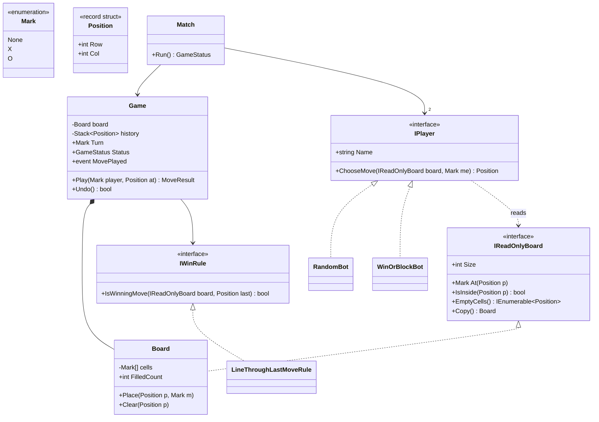
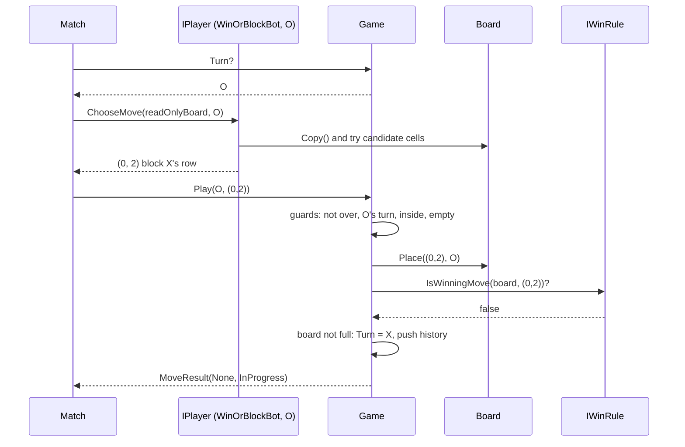
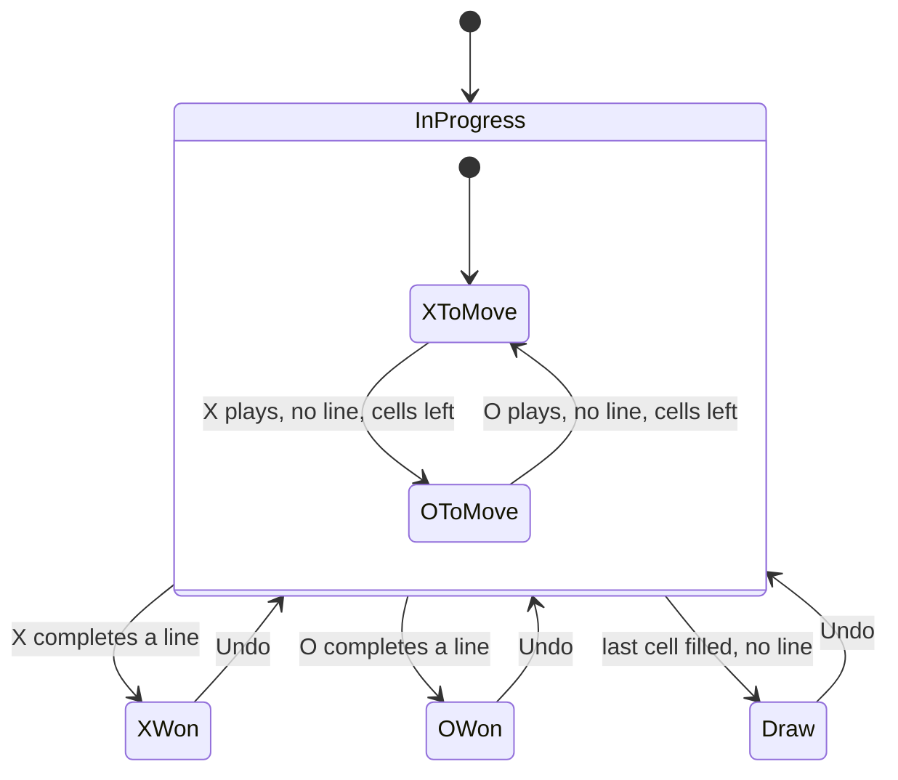

Tic-tac-toe is often the very first LLD question in an interview, and it's easy to underestimate. Everyone can code a 3×3 grid. Interviewers are watching whether you separate the board from the rules from the players, whether your win check is correct *and* efficient, and whether your design survives "now make it 4×4" or "now add a computer player".

## Learning objectives

By the end of this case study you will be able to:

1. Turn "build tic-tac-toe" into requirements and ask the clarifying questions that shape the design.
2. Separate `Board` (cells), `Game` (turns, status, rules) and players (who chooses a move).
3. Validate a move in a fixed order and report a precise reason for every rejection.
4. Check for a win in O(N) by looking only at the lines through the last move, and in O(1) with counters.
5. Model the game's lifecycle with a state diagram, including the "win on the last cell" edge case.
6. Implement undo with a stack of moves (Command), and computer players with Strategy.
7. Write a minimax bot that never loses.

## Prerequisites

- [Classes, objects, fields, properties and methods](#/lesson/m01-classes-objects) and [Interfaces and abstract classes](#/lesson/m01-interfaces-abstract).
- [Big O notation](#/lesson/m01-big-o): we compare win-check algorithms by cost.
- [Identifying classes and responsibilities](#/lesson/m07-classes-responsibilities).

## Explain it like I'm a beginner

Think of two friends playing on a paper napkin in a Chennai café. They draw a 3×3 grid. One plays X, the other O. They take turns writing their mark in an empty box. The first to get three in a row (across, down or diagonal) wins. If all nine boxes fill up with no line, it's a draw.

Notice the different jobs in that scene:

- **The napkin grid** just holds marks. It doesn't know whose turn it is or who won. That's the **board**.
- **The rules** say: take turns, only use empty boxes, check for a line after each move, stop when someone wins. That's the **game**.
- **The players** decide *where* to write. One friend thinks hard; the other picks randomly. That's a **player strategy**, and the game doesn't care which kind is playing.

One more idea. After you write an X, you don't need to look at the whole grid to see whether you won. **Your new X can only complete a line that passes through it**: its row, its column, and maybe a diagonal. Looking only there is faster, and it matters on bigger boards.

## Requirements

### Functional requirements

1. An N×N board (N ≥ 3, default 3). A player wins with N in a row: any row, column or either main diagonal.
2. Two players, X and O. X moves first by default (configurable).
3. A move names a player and a cell (row, column). It's rejected, with a specific reason, if:
   - the game is over;
   - it isn't that player's turn;
   - the cell is off the board;
   - the cell is already taken.
4. After every accepted move, the status is one of: in progress, X won, O won, draw.
5. A move that completes a line on the last empty cell is a **win**, not a draw.
6. Undo the last move (any number of times, back to an empty board).
7. Players can be humans (moves come from the UI) or bots (moves come from a strategy).
8. Observers (UI, logs) are notified of each move.

### Non-functional requirements

- **Correct and simple first.** Code that a reviewer can verify by reading.
- **Efficient win check.** O(N) per move with no extra state, or O(1) per move with O(N) counters. Never O(N²) per move. For N = 3 it doesn't matter, but for a 15×15 variant, scanning the whole board after every move is 225 cells against 15 to 60.
- **Deterministic tests.** Bots that use randomness take an injected `Random`.
- **UI-agnostic.** No `Console` calls in the domain.

### Clarifying questions

| Question | Assumption |
|---|---|
| Board size fixed at 3? | N×N, N ≥ 3. A win needs N in a row. K-in-a-row on bigger boards is exercise 4. |
| Who moves first? | X, configurable. |
| Is a human-vs-computer mode needed? | Yes, through a player strategy interface. |
| Should invalid moves throw? | No. Return a result with a reason; a mis-click isn't exceptional. |
| Undo: one level or unlimited? | Unlimited, back to the empty board. |
| Networked play, timers, scoring across rounds? | Out of scope; they wrap around `Game`. |

## Identifying classes and responsibilities

Nouns: *board, cell, mark, player, move, turn, line, winner, draw, game, bot*. Verbs: *place, validate, check win, take turns, undo, choose move*.

| Class | Kind | Responsibility |
|---|---|---|
| `Mark` | enum | `None`, `X`, `O`. |
| `Position` | value object (record struct) | A cell's row and column. |
| `IReadOnlyBoard` | interface | What players and UIs may see: size, marks, empty cells, a copy for "what if" thinking. |
| `Board` | domain object | Stores marks; places and clears them. Knows nothing about turns. |
| `IWinRule` / `LineThroughLastMoveRule` | strategy | Did this move complete a line? |
| `Game` | aggregate root | Turn order, move validation, status, undo history, events. |
| `MoveResult`, `MoveError`, `GameStatus` | result types | What happened, and why a move was refused. |
| `IPlayer` | strategy | Chooses a position given a read-only board. |
| `WinOrBlockBot`, `RandomBot` | concrete strategies | Simple computer players. |
| `Match` | application service | Runs a game between two `IPlayer`s until it ends. |

Why does `Board` not check for wins? Because "what counts as a win" is a *rule*, and rules vary: N in a row, K in a row, "misère" (whoever makes a line *loses*). A board is just storage, and storage shouldn't change when rules do. This is the [Single Responsibility Principle](#/lesson/m04-srp) at small scale.

:::callout type=mistake title="The player that owns the board"
A common first draft gives each `Player` a reference to the board and a `MakeMove()` method that writes into it. Now two objects can write to the board, the turn order lives nowhere, and a buggy bot can place two marks. Players should only **choose** a position. The **game** validates and applies it.
:::

## Class diagram



How to read it:

- `Game` **owns** the `Board` (composition). Nobody else gets the writable `Board`. Players and UIs see only `IReadOnlyBoard`, so a bot *cannot* place a mark behind the game's back. The type system enforces the rule from the callout.
- `IWinRule` is a separate strategy, so `Game` doesn't hard-code what a win is.
- `IPlayer` implementations depend only on `IReadOnlyBoard`. A bot can call `Copy()` to try moves on its own scratch board, which is how the minimax bot in exercise 5 thinks ahead.
- `Match` is a thin loop that connects two players to one game. Human play in a web UI doesn't need `Match` at all: the controller calls `game.Play` directly.

## Patterns and design decisions

### Validation order matters

`Game.Play(player, position)` checks, in this order:

1. **Game over?** → `GameOver`
2. **Not this player's turn?** → `NotYourTurn`
3. **Off the board?** → `OutOfBounds`
4. **Cell taken?** → `Occupied`

The order is deliberate. A move on an occupied cell *after* the game ended should say "game over", which is the more useful message. And the bounds check must come before the occupancy check, because reading `board[5, 5]` on a 3×3 board would throw. Each failure returns a `MoveResult` and leaves the game **exactly as it was**.

### Win check: only the lines through the last move

After placing a mark at (r, c), only four lines can have changed: row r, column c, the main diagonal (if r == c) and the anti-diagonal (if r + c == N − 1). Checking those costs at most 4N cell reads: 12 for 3×3, and still only 60 on a 15×15 board, compared with 225 for a full scan. This rule needs no extra state, so undo is trivial.

A faster option (exercise 3): keep a counter per row, per column and for each diagonal. X adds +1 and O adds −1. A line is won when its counter reaches +N or −N. Each move is then O(1), at the cost of 2N + 2 integers and updating them on undo.

| Approach | Cost per move | Extra state | Undo |
|---|---|---|---|
| Full board scan | O(N²) | none | trivial |
| **Lines through last move** | **O(N)** | none | trivial |
| Counters | O(1) | 2N + 2 ints | must decrement |

For N = 3 any of them is instant. We choose "lines through last move" as the default because it's O(N), stateless and obviously correct. The counter version is the answer to the interviewer's follow-up, "can you make it O(1)?".

### Strategy for players

`IPlayer.ChooseMove(board, me)` returns a `Position`. Humans, random bots, heuristic bots and minimax bots all fit. The game never calls `IPlayer` itself. That's `Match`'s job, so the domain doesn't care whether moves arrive from a keyboard, a web request or an algorithm.

`WinOrBlockBot` shows the pattern with a classic heuristic: (1) win if you can; (2) block the opponent's immediate win; (3) take the centre; (4) take a corner; (5) take any cell. It plays reasonably, but isn't perfect.

### Command-style undo

Each accepted move is pushed onto a `Stack<Position>`. The mark is implied by the turn order, but storing it would be equally fine. `Undo` pops the last position, clears that cell, gives the turn back, and sets the status to `InProgress`. That last step is always correct, because the game was in progress before any move was made. Storing moves rather than board snapshots is cheap: 9 moves maximum on 3×3. It also doubles as a replay log.

### Observer for UIs

`event Action<Mark, Position, GameStatus>? MovePlayed` lets a console renderer, a SignalR hub or a logger react without the game knowing about them. Undo changes the board too, so it raises its own `MoveUndone` event. A UI that only listens to `MovePlayed` would keep showing a mark that is no longer there.

### One move, step by step



Two things to notice. The bot does its "what if" thinking on a **copy** of the board, never on the real one. And all four guards run before the board is touched, so a rejected move has no side effects to roll back.

## State transitions



How to read it:

- `InProgress` is a **composite state** containing the turn sub-machine. Rejected moves are self-loops that change nothing, so they aren't drawn.
- The three outcomes are terminal for `Play`, which returns `GameOver`. The only way out is `Undo`, which restores the previous in-progress position.
- **The win check comes before the draw check.** The arrow to `Draw` says "no line". A ninth move that completes a line goes to `XWon`, even though the board is now full. Checking "board full" first is one of the most common bugs in this problem, and there's a test for it below.

## C# implementation

```text
TicTacToeKit/
  Domain/Board.cs        Mark, Position, IReadOnlyBoard, Board
  Domain/WinRules.cs     IWinRule, LineThroughLastMoveRule
  Domain/Game.cs         GameStatus, MoveError, MoveResult, Game
  Players/Players.cs     IPlayer, RandomBot, WinOrBlockBot, Match
  Program.cs             bot-vs-bot demo
```

```csharp file=Domain/Board.cs
namespace TicTacToeKit.Domain;

public enum Mark { None, X, O }

public static class MarkExtensions
{
    public static Mark Opponent(this Mark m) => m switch
    {
        Mark.X => Mark.O,
        Mark.O => Mark.X,
        _ => throw new ArgumentOutOfRangeException(nameof(m), m, "None has no opponent."),
    };
}

public readonly record struct Position(int Row, int Col)
{
    public override string ToString() => $"({Row},{Col})";
}

/// <summary>What players and UIs may see. They cannot write to the game's board.</summary>
public interface IReadOnlyBoard
{
    int Size { get; }
    Mark At(Position p);
    bool IsInside(Position p);
    IEnumerable<Position> EmptyCells();
    Board Copy();
}

/// <summary>Plain storage for marks. Knows nothing about turns or wins.</summary>
public sealed class Board : IReadOnlyBoard
{
    private readonly Mark[] _cells;

    public Board(int size = 3)
    {
        ArgumentOutOfRangeException.ThrowIfLessThan(size, 3);
        Size = size;
        _cells = new Mark[size * size];
    }

    private Board(int size, Mark[] cells, int filled) { Size = size; _cells = cells; FilledCount = filled; }

    public int Size { get; }
    public int FilledCount { get; private set; }
    public bool IsFull => FilledCount == _cells.Length;

    public bool IsInside(Position p) => (uint)p.Row < (uint)Size && (uint)p.Col < (uint)Size;

    public Mark At(Position p) => IsInside(p) ? _cells[p.Row * Size + p.Col] : throw new ArgumentOutOfRangeException(nameof(p), p, "Outside the board.");

    public void Place(Position p, Mark mark)
    {
        if (mark == Mark.None) throw new ArgumentException("Use Clear to empty a cell.", nameof(mark));
        if (At(p) != Mark.None) throw new InvalidOperationException($"Cell {p} is already taken.");
        _cells[p.Row * Size + p.Col] = mark;
        FilledCount++;
    }

    public void Clear(Position p)
    {
        if (At(p) == Mark.None) throw new InvalidOperationException($"Cell {p} is already empty.");
        _cells[p.Row * Size + p.Col] = Mark.None;
        FilledCount--;
    }

    public IEnumerable<Position> EmptyCells()
    {
        for (var r = 0; r < Size; r++)
            for (var c = 0; c < Size; c++)
                if (_cells[r * Size + c] == Mark.None) yield return new Position(r, c);
    }

    public Board Copy() => new(Size, (Mark[])_cells.Clone(), FilledCount);
}
```

```csharp file=Domain/WinRules.cs
namespace TicTacToeKit.Domain;

/// <summary>Decides whether the mark just placed at <c>last</c> completes a winning line.</summary>
public interface IWinRule
{
    bool IsWinningMove(IReadOnlyBoard board, Position last);
}

/// <summary>N in a row through the last move: O(N) per move, no extra state.</summary>
public sealed class LineThroughLastMoveRule : IWinRule
{
    public bool IsWinningMove(IReadOnlyBoard board, Position last)
    {
        var mark = board.At(last);
        if (mark == Mark.None) return false;
        var n = board.Size;

        bool Line(Func<int, Position> cellAt)
        {
            for (var i = 0; i < n; i++)
                if (board.At(cellAt(i)) != mark) return false;
            return true;
        }

        return Line(i => new Position(last.Row, i))
            || Line(i => new Position(i, last.Col))
            || (last.Row == last.Col && Line(i => new Position(i, i)))
            || (last.Row + last.Col == n - 1 && Line(i => new Position(i, n - 1 - i)));
    }
}
```

```csharp file=Domain/Game.cs
namespace TicTacToeKit.Domain;

public enum GameStatus { InProgress, XWon, OWon, Draw }

public enum MoveError { None, GameOver, NotYourTurn, OutOfBounds, Occupied }

public sealed record MoveResult(MoveError Error, GameStatus Status)
{
    public bool IsSuccess => Error == MoveError.None;
}

public sealed class Game
{
    private readonly Board _board;
    private readonly IWinRule _winRule;
    private readonly Stack<Position> _history = new();

    public Game(int size = 3, Mark firstPlayer = Mark.X, IWinRule? winRule = null)
    {
        if (firstPlayer == Mark.None) throw new ArgumentException("First player must be X or O.", nameof(firstPlayer));
        _board = new Board(size);
        _winRule = winRule ?? new LineThroughLastMoveRule();
        Turn = firstPlayer;
    }

    /// <summary>Raised after each accepted move with the mover, the cell and the new status.</summary>
    public event Action<Mark, Position, GameStatus>? MovePlayed;

    /// <summary>Raised after Undo with the cell that was cleared.</summary>
    public event Action<Position>? MoveUndone;

    public IReadOnlyBoard Board => _board;
    public Mark Turn { get; private set; }
    public GameStatus Status { get; private set; } = GameStatus.InProgress;
    public bool IsOver => Status != GameStatus.InProgress;
    public IReadOnlyCollection<Position> History => _history;

    public MoveResult Play(Mark player, Position at)
    {
        if (IsOver) return Reject(MoveError.GameOver);
        if (player != Turn) return Reject(MoveError.NotYourTurn);
        if (!_board.IsInside(at)) return Reject(MoveError.OutOfBounds);
        if (_board.At(at) != Mark.None) return Reject(MoveError.Occupied);

        _board.Place(at, player);
        _history.Push(at);

        // Win is checked before "board full": a line on the last cell is a win, not a draw.
        if (_winRule.IsWinningMove(_board, at)) Status = player == Mark.X ? GameStatus.XWon : GameStatus.OWon;
        else if (_board.IsFull) Status = GameStatus.Draw;
        else Turn = player.Opponent();

        MovePlayed?.Invoke(player, at, Status);
        return new MoveResult(MoveError.None, Status);
    }

    public bool Undo()
    {
        if (!_history.TryPop(out var last)) return false;
        Turn = _board.At(last);   // the mover gets the turn back
        _board.Clear(last);
        Status = GameStatus.InProgress;
        MoveUndone?.Invoke(last);
        return true;
    }

    private MoveResult Reject(MoveError error) => new(error, Status);
}
```

```csharp file=Players/Players.cs
using TicTacToeKit.Domain;

namespace TicTacToeKit.Players;

public interface IPlayer
{
    string Name { get; }
    Position ChooseMove(IReadOnlyBoard board, Mark me);
}

public sealed class RandomBot(Random random, string name = "Random") : IPlayer
{
    public string Name { get; } = name;
    public Position ChooseMove(IReadOnlyBoard board, Mark me)
    {
        var empty = board.EmptyCells().ToList();
        return empty.Count > 0 ? empty[random.Next(empty.Count)] : throw new InvalidOperationException("No empty cells.");
    }
}

/// <summary>Heuristic: win, else block, else centre, else a corner, else any cell. Deterministic.</summary>
public sealed class WinOrBlockBot(IWinRule? rule = null, string name = "WinOrBlock") : IPlayer
{
    private readonly IWinRule _rule = rule ?? new LineThroughLastMoveRule();
    public string Name { get; } = name;

    public Position ChooseMove(IReadOnlyBoard board, Mark me)
    {
        var empty = board.EmptyCells().ToList();
        if (empty.Count == 0) throw new InvalidOperationException("No empty cells.");

        if (FindWinningCell(board, empty, me) is { } win) return win;
        if (FindWinningCell(board, empty, me.Opponent()) is { } block) return block;

        var n = board.Size;
        var centre = new Position(n / 2, n / 2);
        if (empty.Contains(centre)) return centre;
        Position[] corners = [new(0, 0), new(0, n - 1), new(n - 1, 0), new(n - 1, n - 1)];
        foreach (var c in corners) if (empty.Contains(c)) return c;
        return empty[0];
    }

    private Position? FindWinningCell(IReadOnlyBoard board, List<Position> empty, Mark mark)
    {
        foreach (var p in empty)
        {
            var scratch = board.Copy();   // think on a copy, never on the real board
            scratch.Place(p, mark);
            if (_rule.IsWinningMove(scratch, p)) return p;
        }
        return null;
    }
}

/// <summary>Runs one game between two players. Human play in a web UI calls Game.Play directly instead.</summary>
public sealed class Match(IPlayer x, IPlayer o, int size = 3)
{
    public Game Game { get; } = new(size);

    public GameStatus Run()
    {
        while (!Game.IsOver)
        {
            var mover = Game.Turn == Mark.X ? x : o;
            var choice = mover.ChooseMove(Game.Board, Game.Turn);
            var result = Game.Play(Game.Turn, choice);
            if (!result.IsSuccess)
                throw new InvalidOperationException($"{mover.Name} chose an illegal move {choice}: {result.Error}");
        }
        return Game.Status;
    }
}
```

```csharp file=Program.cs
using TicTacToeKit.Domain;
using TicTacToeKit.Players;

namespace TicTacToeKit;

public static class Program
{
    public static void Main()
    {
        var match = new Match(new WinOrBlockBot(name: "Asha"), new RandomBot(new Random(42), "Dev"));
        match.Game.MovePlayed += (mark, at, status) => Console.WriteLine($"{mark} -> {at}  [{status}]");
        Console.WriteLine($"Result: {match.Run()}");
        Render(match.Game.Board);
    }

    private static void Render(IReadOnlyBoard board)
    {
        for (var r = 0; r < board.Size; r++)
        {
            var row = Enumerable.Range(0, board.Size)
                .Select(c => board.At(new Position(r, c)) switch { Mark.X => 'X', Mark.O => 'O', _ => '.' });
            Console.WriteLine(string.Join(' ', row));
        }
    }
}
```

Design notes on the code:

- **`(uint)p.Row < (uint)Size`** checks both bounds in one comparison. A negative number cast to `uint` becomes huge.
- **`Board.Place` throws, but `Game.Play` never lets it.** The board guards its own invariant ("never overwrite a mark") as a safety net. The game returns friendly results before reaching it. Two layers, two purposes.
- **`Undo` reads the mark from the cell** to decide whose turn it is again. That stays correct even if the first player was O.
- **`Match.Run` throws when a bot cheats.** An illegal move from code is a bug, not a user mistake.
- **`Game` is not thread-safe.** Every guard in `Play` is a check-then-act: "is it X's turn?" then "place X". Two web requests for the same game running at once could both pass the guards. Keep the domain class single-threaded and serialise access per game outside it (a lock per game id, or a version check when saving), as the last interview answer describes.

## Automated testing

```csharp
using TicTacToeKit.Domain;
using TicTacToeKit.Players;
using Xunit;

namespace TicTacToeKit.Tests;

public sealed class TicTacToeTests
{
    private static Position P(int r, int c) => new(r, c);

    private static Game Play(Game g, params (int R, int C)[] moves)
    {
        foreach (var (r, c) in moves) Assert.True(g.Play(g.Turn, P(r, c)).IsSuccess);
        return g;
    }

    [Fact]
    public void X_wins_a_row_and_the_game_stops()
    {
        var g = Play(new Game(), (0, 0), (1, 0), (0, 1), (1, 1), (0, 2));
        Assert.Equal(GameStatus.XWon, g.Status);
        Assert.Equal(MoveError.GameOver, g.Play(Mark.O, P(2, 2)).Error);
    }

    [Fact]
    public void Rejections_change_nothing()
    {
        var g = Play(new Game(), (1, 1));
        Assert.Equal(MoveError.Occupied, g.Play(Mark.O, P(1, 1)).Error);
        Assert.Equal(MoveError.OutOfBounds, g.Play(Mark.O, P(3, 0)).Error);
        Assert.Equal(MoveError.NotYourTurn, g.Play(Mark.X, P(0, 0)).Error);
        Assert.Equal(Mark.O, g.Turn);
        Assert.Single(g.History);
    }

    [Fact]
    public void Full_board_without_a_line_is_a_draw()
    {
        // X O X / X O O / O X X
        var g = Play(new Game(), (0, 0), (0, 1), (0, 2), (1, 1), (1, 0), (1, 2), (2, 1), (2, 0), (2, 2));
        Assert.Equal(GameStatus.Draw, g.Status);
    }

    [Fact]
    public void Line_on_the_last_cell_is_a_win_not_a_draw()
    {
        // Final board O O X / X O X / O X X: X's 9th move at (2,2) completes the right column
        var g = Play(new Game(), (1, 0), (0, 0), (0, 2), (0, 1), (2, 1), (1, 1), (1, 2), (2, 0), (2, 2));
        Assert.Equal(GameStatus.XWon, g.Status);
        Assert.True(g.Board.Copy().IsFull);
    }

    [Theory]
    [InlineData(true)]
    [InlineData(false)]
    public void Diagonals_win_on_four_by_four(bool main)
    {
        var g = new Game(size: 4);
        for (var i = 0; i < 4; i++)
        {
            var col = main ? i : 3 - i;
            g.Play(Mark.X, P(i, col));
            if (i < 3) g.Play(Mark.O, P(i, main ? (i + 1) % 4 : i));   // O stays off X's diagonal
        }
        Assert.Equal(GameStatus.XWon, g.Status);
    }

    [Fact]
    public void Undo_restores_turn_and_status()
    {
        var g = Play(new Game(), (0, 0), (1, 0), (0, 1), (1, 1), (0, 2));
        Assert.True(g.Undo());
        Assert.Equal(GameStatus.InProgress, g.Status);
        Assert.Equal(Mark.X, g.Turn);
        Assert.Equal(Mark.None, g.Board.At(P(0, 2)));
        while (g.Undo()) { }
        Assert.Equal(9, g.Board.EmptyCells().Count());
    }

    [Fact]
    public void Heuristic_bot_wins_then_blocks()
    {
        var bot = new WinOrBlockBot();
        var win = Play(new Game(), (0, 0), (1, 0), (0, 1), (1, 1));      // X to move, (0,2) wins
        Assert.Equal(P(0, 2), bot.ChooseMove(win.Board, Mark.X));
        var block = Play(new Game(), (0, 0), (1, 1), (0, 1));            // O to move, must block (0,2)
        Assert.Equal(P(0, 2), bot.ChooseMove(block.Board, Mark.O));
    }

    [Fact]
    public void Two_heuristic_bots_draw()
    {
        Assert.Equal(GameStatus.Draw, new Match(new WinOrBlockBot(), new WinOrBlockBot()).Run());
    }

    [Fact]
    public void Observers_see_each_move()
    {
        var g = new Game();
        var seen = new List<Position>();
        g.MovePlayed += (_, at, _) => seen.Add(at);
        Play(g, (1, 1), (0, 0));
        Assert.Equal(new[] { P(1, 1), P(0, 0) }, seen.ToArray());
    }
}
```

What's covered, and why:

- **Every rejection reason**, plus the promise that a rejection changes nothing: same turn, same history.
- **Both draw and the "win on the last cell" edge case.** Swap the win and draw checks in `Game.Play` and the second test fails.
- **Both diagonals on 4×4**, to prove the code isn't secretly hard-coded to 3. The `O` replies are placed off the diagonals so they never block.
- **Undo all the way back**, which checks history and `FilledCount` stay consistent.
- **Bot behaviour** is tested on hand-built positions, not by playing random games and hoping.

## Bad design vs good design

**Bad: one class, string grid, full scan with hard-coded lines**

```csharp
public class TicTacToe
{
    public string[,] grid = new string[3, 3];
    public string current = "X";
    public string Move(int r, int c)
    {
        grid[r, c] = current;                                  // no bounds or occupancy check
        if (IsFull()) return "Draw";                           // BUG: checked before win
        if ((grid[0,0]==current && grid[0,1]==current && grid[0,2]==current) ||
            (grid[1,0]==current && grid[1,1]==current && grid[1,2]==current) /* ...6 more lines... */)
            return current + " wins";
        current = current == "X" ? "O" : "X";
        Console.WriteLine("Next: " + current);                 // UI inside domain
        return "OK";
    }
    bool IsFull() { foreach (var s in grid) if (s == null) return false; return true; }
}
```

Problems:

1. **Draw is checked before win**, so a winning ninth move is reported as a draw.
2. **No validation**: overwriting O's mark is allowed, and `(3, 3)` throws `IndexOutOfRangeException`.
3. **The eight lines are hard-coded**, so it can't be 4×4 without rewriting.
4. **Stringly typed** (`"X"`, `"Draw"`): a typo like `"x"` compiles and breaks silently.
5. **Console output in the domain**, and public mutable fields.
6. **No way to add a computer player** without editing the class.

**Good**: enums and records for types, a board that only stores, a game that validates in a fixed order and checks win before draw, a pluggable win rule, read-only board access for players, and events for output.

**Is it overkill?** For a 15-minute interview warm-up, a single `Game` class with a `Mark[,]` grid, the four guards and a line-through-last-move check is enough. Mention that you'd extract `IPlayer` and `IWinRule` when bots or variants arrive. Interviewers reward knowing *when* to add structure.

## Alternative designs

| Alternative | Idea | Better when | Cost |
|---|---|---|---|
| **Counters win check** | Per-row, per-column and two diagonal counters, +1 for X and −1 for O. | Big N with N in a row; O(1) per move. | Doesn't generalise to K-in-a-row; undo must decrement. |
| **Bitboards** | One 9-bit mask per player; a win is `(mask & line) == line` for 8 precomputed line masks. | Bots searching millions of positions. | Fixed size; less readable. |
| **Immutable game state** | `GameState Apply(Move)` returns a new state; undo means keeping the old reference. | Bots, replays, time-travel debugging. | Allocation per move (trivial at this size). |
| **Event-sourced** | Store `MovePlayed` events; status is computed by replay. | Online play with reconnects and audit. | Extra infrastructure. |
| **Single `Game` class** | No `IPlayer` or `IWinRule`. | Interview warm-up, no variants. | Harder to extend later. |

## Practical playground

The reference model is below. In the designer, try adding a `MisereWinRule` (making a line *loses*). Which class changes, and which classes stay untouched?

:::playground type=lld title="Tic-tac-toe reference model"
```json
{
  "classes": [
    { "id": "Mark", "name": "Mark", "kind": "enum", "fields": ["None", "X", "O"], "methods": [] },
    { "id": "Position", "name": "Position", "kind": "record", "fields": ["+int Row", "+int Col"], "methods": [], "responsibility": "A cell coordinate" },
    { "id": "IReadOnlyBoard", "name": "IReadOnlyBoard", "kind": "interface", "fields": [], "methods": ["int Size", "Mark At(Position p)", "bool IsInside(Position p)", "IEnumerable EmptyCells()", "Board Copy()"] },
    { "id": "Board", "name": "Board", "kind": "class", "fields": ["-Mark[] cells", "+int FilledCount"], "methods": ["+void Place(Position p, Mark m)", "+void Clear(Position p)"], "responsibility": "Stores marks only" },
    { "id": "IWinRule", "name": "IWinRule", "kind": "interface", "fields": [], "methods": ["bool IsWinningMove(IReadOnlyBoard board, Position last)"] },
    { "id": "LineRule", "name": "LineThroughLastMoveRule", "kind": "class", "fields": [], "methods": ["+bool IsWinningMove(IReadOnlyBoard board, Position last)"], "responsibility": "O(N) check of lines through the last move" },
    { "id": "GameStatus", "name": "GameStatus", "kind": "enum", "fields": ["InProgress", "XWon", "OWon", "Draw"], "methods": [] },
    { "id": "Game", "name": "Game", "kind": "class", "fields": ["-Board board", "-Stack history", "+Mark Turn", "+GameStatus Status"], "methods": ["+MoveResult Play(Mark player, Position at)", "+bool Undo()", "+event MovePlayed"], "responsibility": "Turns, validation, status, undo" },
    { "id": "IPlayer", "name": "IPlayer", "kind": "interface", "fields": [], "methods": ["string Name", "Position ChooseMove(IReadOnlyBoard board, Mark me)"] },
    { "id": "RandomBot", "name": "RandomBot", "kind": "class", "fields": ["-Random random"], "methods": ["+Position ChooseMove(IReadOnlyBoard board, Mark me)"] },
    { "id": "WinOrBlockBot", "name": "WinOrBlockBot", "kind": "class", "fields": ["-IWinRule rule"], "methods": ["+Position ChooseMove(IReadOnlyBoard board, Mark me)"], "responsibility": "Win, block, centre, corner heuristic" },
    { "id": "Match", "name": "Match", "kind": "class", "fields": ["+Game Game"], "methods": ["+GameStatus Run()"], "responsibility": "Connects two players to one game" }
  ],
  "relations": [
    { "from": "Board", "to": "IReadOnlyBoard", "kind": "implements" },
    { "from": "Board", "to": "Mark", "kind": "association" },
    { "from": "Game", "to": "Board", "kind": "composition" },
    { "from": "Game", "to": "IWinRule", "kind": "association" },
    { "from": "Game", "to": "GameStatus", "kind": "association" },
    { "from": "LineRule", "to": "IWinRule", "kind": "implements" },
    { "from": "RandomBot", "to": "IPlayer", "kind": "implements" },
    { "from": "WinOrBlockBot", "to": "IPlayer", "kind": "implements" },
    { "from": "WinOrBlockBot", "to": "IWinRule", "kind": "dependency" },
    { "from": "IPlayer", "to": "IReadOnlyBoard", "kind": "dependency", "label": "reads" },
    { "from": "Match", "to": "Game", "kind": "composition" },
    { "from": "Match", "to": "IPlayer", "kind": "association", "multiplicity": "2" }
  ]
}
```
:::

## Exercises

:::exercise id=m18-tic-tac-toe-ex1 difficulty=beginner kind=code title="Who has won?"
Implement `WinChecker.WinnerOf`, which looks at a full or partial N×N grid and returns the mark that owns a complete row, column or main diagonal, or `Mark.None` if there's no winner yet. Assume the grid is a legal position, so at most one player has a line.
::acceptance
- An empty board → `None`.
- A complete top row of X → `X`.
- A complete middle column of O → `O`.
- Both diagonals are detected.
- Works for 4×4 (a line of 3 on a 4×4 board is **not** a win).
::hint
There are 2N + 2 lines to check: N rows, N columns and 2 diagonals.
::hint
Write one helper, `Owner(cells)`, that returns the mark if every cell in a sequence is the same non-`None` mark, and `None` otherwise.
::hint
Generate each line as a sequence of (row, col) pairs: row r is `(r, 0..N-1)`, column c is `(0..N-1, c)`, the diagonal is `(i, i)` and the anti-diagonal is `(i, N-1-i)`.
::hint
```csharp
Mark Owner(IEnumerable<(int R, int C)> line)
{
    var first = Mark.None;
    foreach (var (r, c) in line)
    {
        var m = grid[r, c];
        if (m == Mark.None) return Mark.None;
        if (first == Mark.None) first = m; else if (m != first) return Mark.None;
    }
    return first;
}
```
::starter
```csharp file=WinChecker.cs
using System;
using System.Collections.Generic;
using System.Linq;

public enum Mark { None, X, O }

public static class WinChecker
{
    public static Mark WinnerOf(Mark[,] grid) => throw new NotImplementedException();
}
```
::tests
```csharp file=WinCheckerTests.cs
using Xunit;

public class WinCheckerTests
{
    private const Mark _ = Mark.None, X = Mark.X, O = Mark.O;

    [Fact] public void Empty_has_no_winner() => Assert.Equal(Mark.None, WinChecker.WinnerOf(new Mark[3, 3]));
    [Fact] public void Top_row() => Assert.Equal(X, WinChecker.WinnerOf(new[,] { { X, X, X }, { O, O, _ }, { _, _, _ } }));
    [Fact] public void Middle_column() => Assert.Equal(O, WinChecker.WinnerOf(new[,] { { X, O, X }, { _, O, _ }, { X, O, _ } }));
    [Fact] public void Main_diagonal() => Assert.Equal(X, WinChecker.WinnerOf(new[,] { { X, O, _ }, { O, X, _ }, { _, _, X } }));
    [Fact] public void Anti_diagonal() => Assert.Equal(O, WinChecker.WinnerOf(new[,] { { X, X, O }, { X, O, _ }, { O, _, _ } }));
    [Fact] public void Three_in_a_row_on_four_by_four_is_not_enough() =>
        Assert.Equal(Mark.None, WinChecker.WinnerOf(new[,] { { X, X, X, _ }, { O, O, O, _ }, { _, _, _, _ }, { _, _, _, _ } }));
    [Fact] public void Four_by_four_column() =>
        Assert.Equal(O, WinChecker.WinnerOf(new[,] { { X, _, O, X }, { X, _, O, _ }, { _, X, O, _ }, { _, _, O, X } }));
}
```
::solution
```csharp file=WinChecker.cs
using System;
using System.Collections.Generic;
using System.Linq;

public enum Mark { None, X, O }

public static class WinChecker
{
    public static Mark WinnerOf(Mark[,] grid)
    {
        var n = grid.GetLength(0);
        if (grid.GetLength(1) != n) throw new ArgumentException("Grid must be square.", nameof(grid));

        Mark Owner(IEnumerable<(int R, int C)> line)
        {
            var first = Mark.None;
            foreach (var (r, c) in line)
            {
                var m = grid[r, c];
                if (m == Mark.None) return Mark.None;
                if (first == Mark.None) first = m;
                else if (m != first) return Mark.None;
            }
            return first;
        }

        var idx = Enumerable.Range(0, n);
        var lines = new List<IEnumerable<(int, int)>>();
        for (var k = 0; k < n; k++)
        {
            var fixedK = k;
            lines.Add(idx.Select(i => (fixedK, i)));   // row
            lines.Add(idx.Select(i => (i, fixedK)));   // column
        }
        lines.Add(idx.Select(i => (i, i)));
        lines.Add(idx.Select(i => (i, n - 1 - i)));

        foreach (var line in lines)
            if (Owner(line) is var m && m != Mark.None) return m;
        return Mark.None;
    }
}
```
This full scan is O(N²). It's right for "who won this saved game?" or for checking test fixtures, but inside `Game.Play` the lines-through-last-move check is cheaper.
::mistakes
- Hard-coding the 8 lines of a 3×3 board.
- Treating three `None` cells as a "line of None" winner.
- Capturing the loop variable `k` in a lambda without copying it. In C#, `for` loop variables are shared across iterations, so every lambda would see the final value.
::extensions
Return the winning line's cells too, so the UI can highlight them.
:::

:::exercise id=m18-tic-tac-toe-ex2 difficulty=beginner kind=code title="Validate moves and undo"
Implement `Game.Play` and `Game.Undo` for a 3×3 game. The board and the win check are provided.
::requirements
- Validation order: game over → not your turn → out of bounds → occupied.
- A rejected move changes nothing.
- After an accepted move: win check first, then draw, else pass the turn.
- `Undo` restores the previous position, turn and status. It returns `false` when there's nothing to undo.
::acceptance
- X then O alternate; X playing twice gets `NotYourTurn`.
- Playing on a taken cell gets `Occupied`; `(3,0)` gets `OutOfBounds`.
- A finished game rejects moves with `GameOver`.
- Undo after a win reopens the game with the winner to move again.
::hint
Use early returns for each guard, in the given order, before touching any state.
::hint
Keep a `Stack<(int R, int C, Mark M)>` of accepted moves. That's all undo needs.
::hint
For status after a move: `if (Wins(...)) ... else if (_moves.Count == 9) Draw else Turn = other`.
::hint
```csharp
public bool Undo()
{
    if (!_moves.TryPop(out var m)) return false;
    _cells[m.R, m.C] = Mark.None;
    Turn = m.M;
    Status = GameStatus.InProgress;
    return true;
}
```
::starter
```csharp file=Game.cs
using System;
using System.Collections.Generic;

public enum Mark { None, X, O }
public enum GameStatus { InProgress, XWon, OWon, Draw }
public enum MoveError { None, GameOver, NotYourTurn, OutOfBounds, Occupied }

public sealed class Game
{
    private readonly Mark[,] _cells = new Mark[3, 3];
    private readonly Stack<(int R, int C, Mark M)> _moves = new();

    public Mark Turn { get; private set; } = Mark.X;
    public GameStatus Status { get; private set; } = GameStatus.InProgress;
    public Mark At(int r, int c) => _cells[r, c];

    public MoveError Play(Mark player, int row, int col) => throw new NotImplementedException();
    public bool Undo() => throw new NotImplementedException();

    private bool Wins(Mark m, int r, int c)
    {
        bool All(Func<int, (int, int)> at) { for (var i = 0; i < 3; i++) { var (rr, cc) = at(i); if (_cells[rr, cc] != m) return false; } return true; }
        return All(i => (r, i)) || All(i => (i, c)) || (r == c && All(i => (i, i))) || (r + c == 2 && All(i => (i, 2 - i)));
    }
}
```
::tests
```csharp file=GameTests.cs
using Xunit;

public class GameTests
{
    [Fact] public void Turns_alternate_and_out_of_turn_is_rejected()
    {
        var g = new Game();
        Assert.Equal(MoveError.None, g.Play(Mark.X, 1, 1));
        Assert.Equal(MoveError.NotYourTurn, g.Play(Mark.X, 0, 0));
        Assert.Equal(Mark.O, g.Turn);
    }

    [Fact] public void Occupied_and_out_of_bounds()
    {
        var g = new Game();
        g.Play(Mark.X, 1, 1);
        Assert.Equal(MoveError.Occupied, g.Play(Mark.O, 1, 1));
        Assert.Equal(MoveError.OutOfBounds, g.Play(Mark.O, 3, 0));
        Assert.Equal(MoveError.OutOfBounds, g.Play(Mark.O, 0, -1));
        Assert.Equal(Mark.O, g.Turn);
    }

    [Fact] public void Win_then_game_over()
    {
        var g = new Game();
        g.Play(Mark.X, 0, 0); g.Play(Mark.O, 1, 0); g.Play(Mark.X, 0, 1); g.Play(Mark.O, 1, 1);
        Assert.Equal(MoveError.None, g.Play(Mark.X, 0, 2));
        Assert.Equal(GameStatus.XWon, g.Status);
        Assert.Equal(MoveError.GameOver, g.Play(Mark.O, 2, 2));
    }

    [Fact] public void Draw()
    {
        var g = new Game();
        foreach (var (r, c) in new[] { (0, 0), (0, 1), (0, 2), (1, 1), (1, 0), (1, 2), (2, 1), (2, 0), (2, 2) })
            Assert.Equal(MoveError.None, g.Play(g.Turn, r, c));
        Assert.Equal(GameStatus.Draw, g.Status);
    }

    [Fact] public void Undo_after_win_reopens()
    {
        var g = new Game();
        g.Play(Mark.X, 0, 0); g.Play(Mark.O, 1, 0); g.Play(Mark.X, 0, 1); g.Play(Mark.O, 1, 1); g.Play(Mark.X, 0, 2);
        Assert.True(g.Undo());
        Assert.Equal(GameStatus.InProgress, g.Status);
        Assert.Equal(Mark.X, g.Turn);
        Assert.Equal(Mark.None, g.At(0, 2));
    }

    [Fact] public void Undo_on_empty_returns_false() => Assert.False(new Game().Undo());
}
```
::solution
```csharp file=Game.cs
using System;
using System.Collections.Generic;

public enum Mark { None, X, O }
public enum GameStatus { InProgress, XWon, OWon, Draw }
public enum MoveError { None, GameOver, NotYourTurn, OutOfBounds, Occupied }

public sealed class Game
{
    private readonly Mark[,] _cells = new Mark[3, 3];
    private readonly Stack<(int R, int C, Mark M)> _moves = new();

    public Mark Turn { get; private set; } = Mark.X;
    public GameStatus Status { get; private set; } = GameStatus.InProgress;
    public Mark At(int r, int c) => _cells[r, c];

    public MoveError Play(Mark player, int row, int col)
    {
        if (Status != GameStatus.InProgress) return MoveError.GameOver;
        if (player != Turn) return MoveError.NotYourTurn;
        if ((uint)row > 2 || (uint)col > 2) return MoveError.OutOfBounds;
        if (_cells[row, col] != Mark.None) return MoveError.Occupied;

        _cells[row, col] = player;
        _moves.Push((row, col, player));

        if (Wins(player, row, col)) Status = player == Mark.X ? GameStatus.XWon : GameStatus.OWon;
        else if (_moves.Count == 9) Status = GameStatus.Draw;
        else Turn = player == Mark.X ? Mark.O : Mark.X;
        return MoveError.None;
    }

    public bool Undo()
    {
        if (!_moves.TryPop(out var m)) return false;
        _cells[m.R, m.C] = Mark.None;
        Turn = m.M;
        Status = GameStatus.InProgress;
        return true;
    }

    private bool Wins(Mark m, int r, int c)
    {
        bool All(Func<int, (int, int)> at) { for (var i = 0; i < 3; i++) { var (rr, cc) = at(i); if (_cells[rr, cc] != m) return false; } return true; }
        return All(i => (r, i)) || All(i => (i, c)) || (r == c && All(i => (i, i))) || (r + c == 2 && All(i => (i, 2 - i)));
    }
}
```
Each stack entry is a tiny command ("X played (0,2)"), and undo is its inverse. Storing the mark makes `Undo` independent of who moved first.
::mistakes
- Checking occupancy before bounds, so `(3, 0)` throws `IndexOutOfRangeException`.
- Flipping the turn even when the move won. The winner is then not "to move" after undo.
- Undoing by flipping the turn instead of restoring the stored mark.
::extensions
Add `Redo()` with a second stack that is cleared whenever a new move is played.
:::

:::exercise id=m18-tic-tac-toe-ex3 difficulty=intermediate kind=code title="O(1) win detection with counters"
Implement `CounterWinDetector`. It keeps one counter per row, one per column and one for each diagonal. `Record` adds +1 for X and −1 for O, and returns the winning mark if any affected counter reaches ±N. `Unrecord` reverses a move (for undo).
::acceptance
- On 3×3, X at (0,0), (0,1), (0,2) → `Record` returns X on the third call.
- O on the anti-diagonal of a 4×4 board is detected.
- A mixed line (two X and one O) is never a win.
- After `Unrecord` of a winning move, re-recording a different cell doesn't report a win.
::hint
Each move touches at most four counters: its row, its column, and a diagonal counter only if it lies on that diagonal.
::hint
Use `+1` for X and `-1` for O, so a line with both marks can never reach ±N.
::hint
A cell is on the main diagonal when `row == col`, and on the anti-diagonal when `row + col == N - 1`. The centre of an odd board is on both.
::hint
```csharp
var d = mark == Mark.X ? 1 : -1;
_rows[r] += d; _cols[c] += d;
if (r == c) _diag += d;
if (r + c == _n - 1) _anti += d;
```
::starter
```csharp file=CounterWinDetector.cs
using System;

public enum Mark { None, X, O }

public sealed class CounterWinDetector
{
    private readonly int _n;
    private readonly int[] _rows;
    private readonly int[] _cols;
    private int _diag;
    private int _anti;

    public CounterWinDetector(int n)
    {
        ArgumentOutOfRangeException.ThrowIfLessThan(n, 3);
        _n = n; _rows = new int[n]; _cols = new int[n];
    }

    /// <summary>Records a mark and returns the winner (X or O) if this move completes a line, else None.</summary>
    public Mark Record(int row, int col, Mark mark) => throw new NotImplementedException();

    public void Unrecord(int row, int col, Mark mark) => throw new NotImplementedException();
}
```
::tests
```csharp file=CounterWinDetectorTests.cs
using Xunit;

public class CounterWinDetectorTests
{
    [Fact] public void Row_win()
    {
        var d = new CounterWinDetector(3);
        Assert.Equal(Mark.None, d.Record(0, 0, Mark.X));
        Assert.Equal(Mark.None, d.Record(0, 1, Mark.X));
        Assert.Equal(Mark.X, d.Record(0, 2, Mark.X));
    }

    [Fact] public void Anti_diagonal_on_four_by_four()
    {
        var d = new CounterWinDetector(4);
        d.Record(0, 3, Mark.O); d.Record(1, 2, Mark.O); d.Record(2, 1, Mark.O);
        Assert.Equal(Mark.O, d.Record(3, 0, Mark.O));
    }

    [Fact] public void Mixed_line_never_wins()
    {
        var d = new CounterWinDetector(3);
        d.Record(1, 0, Mark.X); d.Record(1, 1, Mark.O);
        Assert.Equal(Mark.None, d.Record(1, 2, Mark.X));
    }

    [Fact] public void Centre_counts_for_both_diagonals()
    {
        var d = new CounterWinDetector(3);
        d.Record(1, 1, Mark.X); d.Record(0, 2, Mark.X);
        Assert.Equal(Mark.X, d.Record(2, 0, Mark.X));
        var e = new CounterWinDetector(3);
        e.Record(1, 1, Mark.O); e.Record(0, 0, Mark.O);
        Assert.Equal(Mark.O, e.Record(2, 2, Mark.O));
    }

    [Fact] public void Unrecord_reverses()
    {
        var d = new CounterWinDetector(3);
        d.Record(2, 0, Mark.X); d.Record(2, 1, Mark.X);
        Assert.Equal(Mark.X, d.Record(2, 2, Mark.X));
        d.Unrecord(2, 2, Mark.X);
        Assert.Equal(Mark.None, d.Record(1, 2, Mark.X));
    }
}
```
::solution
```csharp file=CounterWinDetector.cs
using System;

public enum Mark { None, X, O }

public sealed class CounterWinDetector
{
    private readonly int _n;
    private readonly int[] _rows;
    private readonly int[] _cols;
    private int _diag;
    private int _anti;

    public CounterWinDetector(int n)
    {
        ArgumentOutOfRangeException.ThrowIfLessThan(n, 3);
        _n = n; _rows = new int[n]; _cols = new int[n];
    }

    public Mark Record(int row, int col, Mark mark)
    {
        var d = Delta(mark);
        Apply(row, col, d);
        var target = d * _n;
        var won = _rows[row] == target || _cols[col] == target
                  || (row == col && _diag == target)
                  || (row + col == _n - 1 && _anti == target);
        return won ? mark : Mark.None;
    }

    public void Unrecord(int row, int col, Mark mark) => Apply(row, col, -Delta(mark));

    private void Apply(int row, int col, int d)
    {
        _rows[row] += d;
        _cols[col] += d;
        if (row == col) _diag += d;
        if (row + col == _n - 1) _anti += d;
    }

    private static int Delta(Mark mark) => mark switch
    {
        Mark.X => 1,
        Mark.O => -1,
        _ => throw new ArgumentOutOfRangeException(nameof(mark), mark, "Only X or O can be recorded."),
    };
}
```
Why ±1 works: a line reaches +N only if all N cells are X, because any O subtracts. It relies on the game never placing two marks in one cell, which `Game` guarantees. To plug it into the main design, wrap it in an `IWinRule` that `Game` notifies on place and undo. That's a small change to `IWinRule`, because this detector is stateful, unlike `LineThroughLastMoveRule`.
::mistakes
- Using one counter per player per line. It works, but doubles the state for no benefit.
- Forgetting the centre cell of an odd board is on both diagonals.
- Not reversing counters on undo, so ghost marks cause false wins later.
::extensions
Benchmark `CounterWinDetector` against `LineThroughLastMoveRule` on a 101×101 board with BenchmarkDotNet, and explain the result in terms of Big O and memory access.
:::

:::exercise id=m18-tic-tac-toe-ex4 difficulty=intermediate kind=design title="Generalise to K in a row (Gomoku)"
Product wants a "Five in a Row" mode on a 15×15 board, where five in a row wins, and also a 4×4 "three in a row" kids' mode. Redesign the board and win rule. Keep `Game.Play`'s signature unchanged.
::acceptance
- Board supports rows ≠ columns (M×N), with K as a separate parameter.
- The win check is O(K) per move and doesn't scan the board.
- Explain why the counter approach from exercise 3 no longer works.
- Show how a game is configured for classic, kids' and Gomoku modes.
::hint
A line of K through the last move can extend in both directions along four axes: horizontal, vertical and the two diagonals.
::hint
For each axis (dr, dc), count consecutive same marks going forward from the last move, then backward, plus 1 for the move itself.
::hint
Stop counting at the board edge or at the first different cell. That's at most 2(K−1) reads per axis.
::hint
Introduce `GameRules(int Rows, int Cols, int K)` and `KInARowRule(int k) : IWinRule`. Classic is `(3, 3, 3)`.
::solution
**Model changes.** `Board(int rows, int cols)` replaces `Board(int size)`. `IReadOnlyBoard` exposes `Rows` and `Cols`. A `GameRules` record holds `(Rows, Cols, K)` plus any future options. `Game(GameRules rules, Mark first = X, IWinRule? rule = null)` defaults the rule to `new KInARowRule(rules.K)`. `Play(Mark, Position)` is unchanged.

```csharp
public sealed class KInARowRule(int k) : IWinRule
{
    private static readonly (int Dr, int Dc)[] Axes = [(0, 1), (1, 0), (1, 1), (1, -1)];

    public bool IsWinningMove(IReadOnlyBoard board, Position last)
    {
        var mark = board.At(last);
        foreach (var (dr, dc) in Axes)
        {
            var count = 1 + Run(board, last, dr, dc, mark) + Run(board, last, -dr, -dc, mark);
            if (count >= k) return true;
        }
        return false;
    }

    private int Run(IReadOnlyBoard b, Position from, int dr, int dc, Mark mark)
    {
        var n = 0;
        for (var p = new Position(from.Row + dr, from.Col + dc);
             n < k - 1 && b.IsInside(p) && b.At(p) == mark;
             p = new Position(p.Row + dr, p.Col + dc)) n++;
        return n;
    }
}
```

**Configuration:**

```csharp
var classic = new Game(new GameRules(3, 3, 3));
var kids    = new Game(new GameRules(4, 4, 3));
var gomoku  = new Game(new GameRules(15, 15, 5));
```

**Why counters fail.** A counter per row says "this row has 4 X marks", but not whether they're *consecutive*. On a 15-wide row, X at columns 1, 3, 5, 7 and 9 gives a count of 5 without five in a row. Counters only work when K equals the full line length.

**Cost.** At most 4 × 2(K−1) cell reads per move: 32 for Gomoku, regardless of board size.

The draw rule stays "board full and no line". Real Gomoku variants also forbid overlines (six or more) for one side; that would be a `StrictFiveRule`, another `IWinRule`.
::alternatives
Keep the board square and add only K. Simpler, but the M×N generalisation costs almost nothing extra, and Connect-Four-style boards (6×7) become possible with a different placement rule (gravity), which is another strategy.
::mistakes
- Counting only forward from the last move, which misses lines where the new mark is in the middle.
- Scanning the full board after each move: 225 cells × 4 directions on 15×15.
- Hard-coding the main diagonals only. In Gomoku, any diagonal anywhere can win.
:::

:::exercise id=m18-tic-tac-toe-ex5 difficulty=advanced kind=code title="Unbeatable minimax bot"
Implement `MinimaxBot.ChooseMove` for 3×3. The bot must never lose. Use minimax (try every move, assume the opponent replies with their best move, and score the result). Prefer faster wins and slower losses, so the bot finishes games instead of toying with the opponent.
::requirements
- Score from the bot's point of view: win = `10 - depth`, loss = `depth - 10`, draw = 0, where depth is the number of moves from now.
- When several moves have the same score, pick the first in row-major order (deterministic).
- The board is a `Mark[9]` array, indexed `row * 3 + col`.
::acceptance
- Takes an immediate win when one exists.
- Blocks an immediate loss.
- Minimax versus minimax from an empty board is a draw.
- Over 20 seeded games against a random player (10 as X, 10 as O), the bot never loses.
::hint
Write `Winner(Mark[] cells)` first, checking the 8 lines of a 3×3 board.
::hint
`Score(cells, toMove, me, depth)`: if someone has won, or the board is full, return the terminal score. Otherwise try each empty cell for `toMove`, recurse with the other mark, and undo.
::hint
When `toMove == me` take the **maximum** child score, otherwise the **minimum**. That's the whole idea of minimax.
::hint
```csharp
var best = toMove == me ? int.MinValue : int.MaxValue;
for (var i = 0; i < 9; i++)
{
    if (cells[i] != Mark.None) continue;
    cells[i] = toMove;
    var s = Score(cells, Other(toMove), me, depth + 1);
    cells[i] = Mark.None;
    best = toMove == me ? Math.Max(best, s) : Math.Min(best, s);
}
```
::hint
The full game tree from an empty board is small enough to search without pruning (Wikipedia gives 255,168 possible games). Add a `Dictionary<string, int>` memo keyed by board, side to move and depth, or alpha–beta pruning, if your tests feel slow.
::starter
```csharp file=MinimaxBot.cs
using System;
using System.Collections.Generic;

public enum Mark { None, X, O }

public static class Board3
{
    private static readonly int[][] Lines =
    [
        [0, 1, 2], [3, 4, 5], [6, 7, 8], [0, 3, 6], [1, 4, 7], [2, 5, 8], [0, 4, 8], [2, 4, 6],
    ];

    public static Mark Winner(Mark[] c)
    {
        foreach (var l in Lines)
            if (c[l[0]] != Mark.None && c[l[0]] == c[l[1]] && c[l[1]] == c[l[2]]) return c[l[0]];
        return Mark.None;
    }

    public static bool IsFull(Mark[] c) => Array.IndexOf(c, Mark.None) < 0;
}

public sealed class MinimaxBot
{
    /// <summary>Returns the cell index (0–8) to play for <paramref name="me"/>.</summary>
    public int ChooseMove(Mark[] cells, Mark me) => throw new NotImplementedException();
}
```
::tests
```csharp file=MinimaxBotTests.cs
using System;
using Xunit;

public class MinimaxBotTests
{
    private const Mark _ = Mark.None, X = Mark.X, O = Mark.O;

    [Fact] public void Takes_immediate_win() =>
        Assert.Equal(2, new MinimaxBot().ChooseMove(new[] { X, X, _, O, O, _, _, _, _ }, X));

    [Fact] public void Blocks_immediate_loss() =>
        Assert.Equal(2, new MinimaxBot().ChooseMove(new[] { X, X, _, _, O, _, _, _, _ }, O));

    [Fact] public void Perfect_vs_perfect_is_a_draw()
    {
        var cells = new Mark[9];
        var bot = new MinimaxBot();
        var turn = X;
        while (Board3.Winner(cells) == Mark.None && !Board3.IsFull(cells))
        {
            cells[bot.ChooseMove(cells, turn)] = turn;
            turn = turn == X ? O : X;
        }
        Assert.Equal(Mark.None, Board3.Winner(cells));
    }

    [Fact] public void Never_loses_to_random()
    {
        var bot = new MinimaxBot();
        for (var game = 0; game < 20; game++)
        {
            var rng = new Random(game);
            var me = game % 2 == 0 ? X : O;
            var cells = new Mark[9];
            var turn = X;
            while (Board3.Winner(cells) == Mark.None && !Board3.IsFull(cells))
            {
                int move;
                if (turn == me) move = bot.ChooseMove(cells, me);
                else { do move = rng.Next(9); while (cells[move] != Mark.None); }
                cells[move] = turn;
                turn = turn == X ? O : X;
            }
            Assert.NotEqual(me == X ? O : X, Board3.Winner(cells));
        }
    }
}
```
::solution
```csharp file=MinimaxBot.cs
using System;
using System.Collections.Generic;

public enum Mark { None, X, O }

public static class Board3
{
    private static readonly int[][] Lines =
    [
        [0, 1, 2], [3, 4, 5], [6, 7, 8], [0, 3, 6], [1, 4, 7], [2, 5, 8], [0, 4, 8], [2, 4, 6],
    ];

    public static Mark Winner(Mark[] c)
    {
        foreach (var l in Lines)
            if (c[l[0]] != Mark.None && c[l[0]] == c[l[1]] && c[l[1]] == c[l[2]]) return c[l[0]];
        return Mark.None;
    }

    public static bool IsFull(Mark[] c) => Array.IndexOf(c, Mark.None) < 0;
}

public sealed class MinimaxBot
{
    private readonly Dictionary<(string Board, Mark ToMove, Mark Me, int Depth), int> _memo = new();

    public int ChooseMove(Mark[] cells, Mark me)
    {
        var work = (Mark[])cells.Clone();   // never mutate the caller's board
        int bestMove = -1, bestScore = int.MinValue;
        for (var i = 0; i < 9; i++)
        {
            if (work[i] != Mark.None) continue;
            work[i] = me;
            var s = Score(work, Other(me), me, 1);
            work[i] = Mark.None;
            if (s > bestScore) { bestScore = s; bestMove = i; }   // strict '>' keeps the first best: deterministic
        }
        return bestMove >= 0 ? bestMove : throw new InvalidOperationException("No moves left.");
    }

    private int Score(Mark[] cells, Mark toMove, Mark me, int depth)
    {
        var w = Board3.Winner(cells);
        if (w == me) return 10 - depth;
        if (w != Mark.None) return depth - 10;
        if (Board3.IsFull(cells)) return 0;

        var key = (string.Concat(Array.ConvertAll(cells, m => (char)('0' + (int)m))), toMove, me, depth);
        if (_memo.TryGetValue(key, out var cached)) return cached;

        var best = toMove == me ? int.MinValue : int.MaxValue;
        for (var i = 0; i < 9; i++)
        {
            if (cells[i] != Mark.None) continue;
            cells[i] = toMove;
            var s = Score(cells, Other(toMove), me, depth + 1);
            cells[i] = Mark.None;
            best = toMove == me ? Math.Max(best, s) : Math.Min(best, s);
        }
        _memo[key] = best;
        return best;
    }

    private static Mark Other(Mark m) => m == Mark.X ? Mark.O : Mark.X;
}
```
**Why it never loses.** Minimax explores every possible continuation and assumes the opponent always picks the reply that's worst for the bot. Tic-tac-toe is a solved game: with perfect play from both sides it's a draw. So a bot that plays perfectly can always secure at least a draw. The `10 - depth` scoring makes it prefer the quickest win and the slowest loss.

**Design fit.** In the main design, this becomes `MinimaxPlayer : IPlayer`, which reads `IReadOnlyBoard`, copies it into a `Mark[9]`, and returns a `Position`. `Game` doesn't change at all. That's the payoff of the Strategy seam.
::alternatives
Alpha–beta pruning gives the same result while skipping branches that can't change the decision. It's essential for bigger games such as Connect Four. For 3×3, a precomputed opening book or the classic rule list (win, block, fork, block fork, centre, opposite corner, empty corner, empty side) also plays perfectly, without search.
::mistakes
- Mutating the caller's array during search. Always search on a copy.
- Scoring all wins as +1, so the bot may delay winning forever (or prefer a long win over an immediate one).
- Using `>=` when picking the best move, which makes the choice depend on iteration details and harder to test.
::extensions
Add alpha–beta pruning, count visited nodes with and without it from the empty board, and report the reduction.
:::

## Interview questions

:::interview
::q beginner
What are the main classes in a tic-tac-toe design, and what does each one do?
::a
`Board` stores marks and nothing else. `Game` owns the board and enforces rules: turn order, validation (game over, wrong turn, out of bounds, occupied), status after each move (win checked before draw), and undo. An `IWinRule` decides what counts as a win. `IPlayer` implementations (human adapter, bots) only *choose* a position from a read-only view of the board. Value types: `Mark`, `Position`, `MoveResult`, `GameStatus`.
::q beginner
How do you check for a win efficiently after a move?
::a
Only lines through the last move can have changed: its row, its column, and a diagonal if the cell lies on one. Check those, which is O(N) per move with no extra state. For O(1), keep counters per row, column and diagonal (+1 for X, −1 for O). A line is won at ±N. That needs undo support and only works when a win means filling a whole line.
::q intermediate
Why should a win be checked before a draw?
::a
The ninth move fills the board, and it can also complete a line. If you check "board full" first, you report a draw for what is actually a win. The correct order after placing a mark is: did this move win? → is the board full? → otherwise pass the turn. Always test this edge case explicitly.
::q intermediate
How would you add a computer opponent without changing the `Game` class?
::a
Introduce `IPlayer.ChooseMove(IReadOnlyBoard, Mark)`. Bots implement it: random, win/block heuristic, minimax. A `Match` (or the controller) asks the current player for a position and calls `game.Play`. Bots get a read-only board, so they can't cheat, and they think on `Copy()`, so they can't corrupt the real game. Bots that use randomness take an injected `Random` for deterministic tests.
::q advanced
How would you extend the design to Gomoku (15×15, five in a row)?
::a
Generalise to an M×N board with K as a rule parameter, and replace the line rule with a K-in-a-row rule: for each of four axes, count consecutive same marks forward and backward from the last move, and win at ≥ K. That's O(K) per move and independent of board size. Counters no longer work, because they count marks in a line, not *consecutive* marks. `Game.Play` keeps its signature; configuration becomes a `GameRules(Rows, Cols, K)` record. Variant-specific rules such as overline bans become further `IWinRule` implementations.
::q advanced
Two players play online through a web API. What changes, and what stays?
::a
The domain stays: `Game`, `Board`, rules. Around it: a game repository (in memory with a per-game lock, or a database row with a version column for optimistic concurrency), so two near-simultaneous requests can't both apply a move. Requests carry the player's identity, which the server maps to X or O, never trusting a client-supplied mark, plus the expected move number for idempotency. Moves are persisted as events, so reconnecting clients can rebuild the board. `MovePlayed` is pushed through SignalR groups. A turn timeout becomes a scheduled command (forfeit or random move).
:::

## Summary and revision

**Key takeaways**

- Board stores, Game rules, players choose. Keep the writable board inside `Game`, and give everyone else `IReadOnlyBoard`.
- Validate in a fixed order (game over → turn → bounds → occupied). Rejections change nothing.
- After a move, check win before draw.
- Win check: lines through the last move (O(N)), or counters (O(1), whole-line wins only), never a full scan per move.
- Undo is a stack of moves. Player types are strategies. UI updates arrive through an event.
- K-in-a-row (Gomoku) generalises the rule to counting consecutive marks along four axes.
- Minimax with depth-adjusted scores gives an unbeatable 3×3 bot.

**Terminology**: composite state, guard order, O(N) vs O(1) win check, read-only interface, strategy, command, minimax, alpha–beta pruning, solved game.

:::flashcards
Q: Which lines can a new mark at (r, c) complete?
A: Row r, column c, the main diagonal if r == c, and the anti-diagonal if r + c == N − 1.
Q: Why check win before draw?
A: The last move can both fill the board and complete a line. That's a win.
Q: Correct validation order for a move?
A: Game over → not your turn → out of bounds → occupied.
Q: How does the counter win check work?
A: Per row, column and diagonal counters; X adds +1, O adds −1; a line is won at ±N.
Q: Why give players IReadOnlyBoard instead of Board?
A: So they can only choose moves, never place marks behind the game's back.
Q: Why do counters fail for Gomoku?
A: They count marks in a line, not consecutive marks. K-in-a-row needs run-length checks.
Q: What does minimax assume about the opponent?
A: That it always plays the reply that is worst for you.
:::

## Knowledge check

:::quiz pass=70
::q single
X's ninth move fills the last empty cell and completes a column. The game reports "Draw". What's the most likely bug?
- [ ] The win rule ignores columns.
- [x] `Play` checks "board full" before checking for a win.
- [ ] Undo corrupted the board.
- [ ] The turn didn't switch.
> The last move can both fill the board and win. Win must be evaluated first.
::q single
A player sends a move to (5, 5) on a finished 3×3 game. Which error should the API return?
- [x] `GameOver`
- [ ] `OutOfBounds`
- [ ] `Occupied`
- [ ] It should throw `IndexOutOfRangeException`.
> Guards run in order: game over first. It's the most useful message, and later checks are irrelevant once the game has ended.
::q single
Why does `WinOrBlockBot` call `board.Copy()` before trying a move?
- [ ] Copying is faster than reading.
- [x] It must not modify the real game's board while "thinking".
- [ ] `IReadOnlyBoard` has no `At` method.
- [ ] To support undo.
> Bots receive a read-only view. Hypothetical moves go on a scratch copy, so the real game state can only change through `Game.Play`.
::q multi
Which statements about the counter win check are true? (Select all that apply.)
- [x] It's O(1) per move.
- [x] It needs counters to be decremented on undo.
- [ ] It works for Gomoku's five-in-a-row on 15×15.
- [x] It relies on a cell never receiving two marks.
> Counters measure how many marks are in a line, not whether they're consecutive. So they only work for full-line wins, and only if the game prevents overwriting.
::q single
Product asks for a "misère" mode where completing a line *loses*. With this lesson's design, what's the smallest change?
- [ ] Rewrite `Board`.
- [ ] Add `if (misere)` in every bot.
- [x] Add a rule (e.g. wrap `IWinRule` or a new status mapping) so `Game` assigns the loss to the player who made the line.
- [ ] Swap the X and O enum values.
> Rules live behind `IWinRule` and the game's status mapping. The board and the players' interface are untouched. Bots that want to play well would need to understand misère, but that's their own strategy.
::q single
Minimax scores a win as `10 - depth` instead of `+1`. Why?
- [ ] To make the numbers fit in a byte.
- [x] So the bot prefers faster wins and slower losses.
- [ ] Because depth is always 10.
- [ ] To avoid recursion.
> With a flat +1, every win looks equal, and the bot may wander. Subtracting depth rewards finishing sooner.
:::

## Completion criteria

You have finished this case study when you can:

- [ ] Score at least 70 % on the knowledge check.
- [ ] Pass the tests for exercises 1, 2 and 3.
- [ ] Explain the four validation guards and their order without notes.
- [ ] State the cost of each win-check approach and when each is appropriate.
- [ ] Complete exercise 4 or 5 and compare with the model solution.
