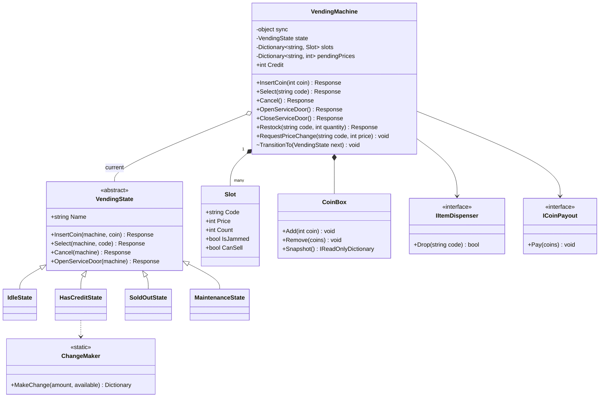
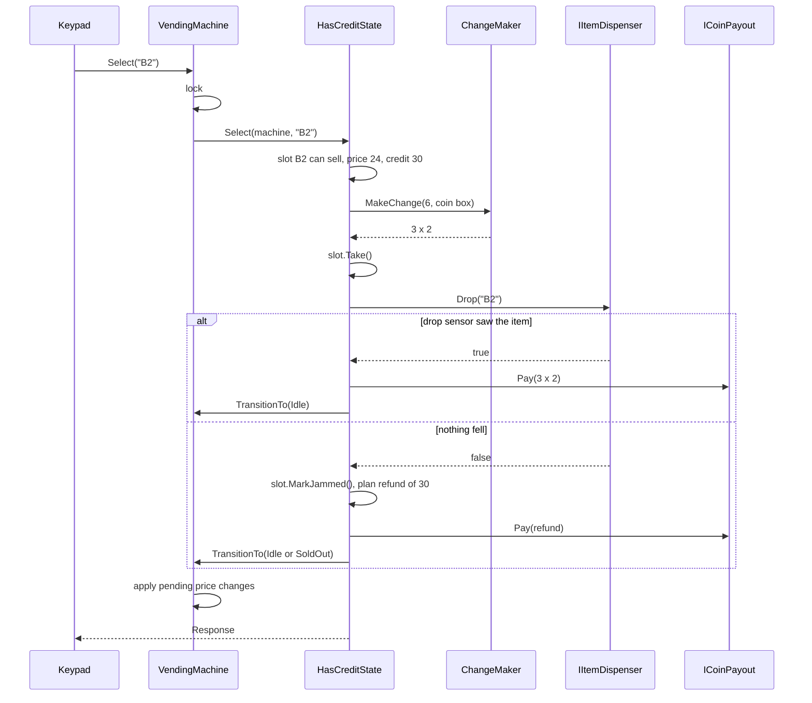
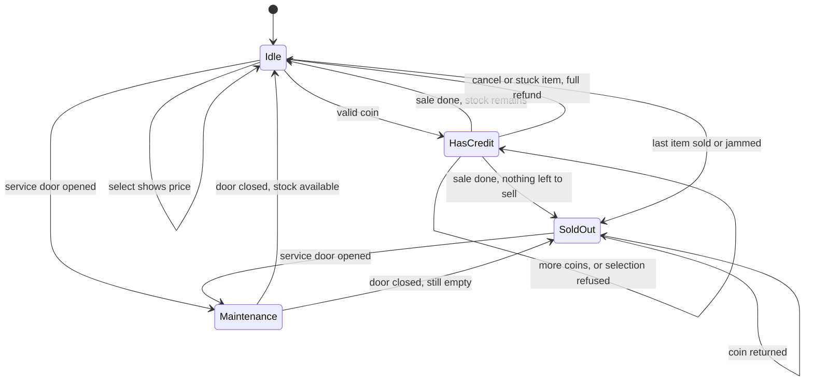
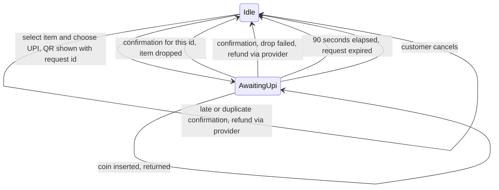

The vending machine is the textbook State pattern example, and for good reason: a machine that behaves differently depending on whether you've put money in is exactly what the pattern was made for. But a design that only shows states is half an answer. Real interviewers push on three edges: making change when the coin box is nearly empty, refunding when the snack gets stuck in the spiral, and what happens when the operator changes a price, or an app customer reserves the last packet, while someone is standing at the machine.

## Learning objectives

By the end of this case study you will be able to:

1. Turn "design a vending machine" into concrete requirements with clarifying questions.
2. Model the machine as states (Idle, HasCredit, SoldOut, Maintenance) and draw the state diagram.
3. Implement the State pattern where each state class asks the machine to switch state, and compare it with a plain `switch`.
4. Make change from a limited coin box with a dynamic programming algorithm, and explain why greedy fails.
5. Order the steps of a sale so a stuck item always leads to a full refund.
6. Keep a sale consistent when remote commands (price changes, app reservations) arrive on other threads.

## Prerequisites

- [State](#/lesson/m06-state): the pattern itself.
- [State machine diagrams](#/lesson/m05-state-diagrams): reading and drawing transitions.
- [Encapsulation and invariant protection](#/lesson/m07-encapsulation-invariants): credit and stock must never go wrong.

If you have done the [ATM case study](#/lesson/m18-atm), you'll notice the same shape. This lesson uses a different style of State pattern (states ask the context to change state) so you see both.

## Explain it like I'm a beginner

Picture a snack machine at a metro station. It's in one of a few "moods":

- **Waiting** (Idle): no money in. If you press a button, it just shows the price.
- **Has your money** (HasCredit): it shows "Credit ₹30". Now pressing B2 actually buys.
- **Empty** (SoldOut): everything is gone. It spits your coin straight back.
- **Being serviced** (Maintenance): the operator has the door open and is restocking.

The same button does different things depending on the mood. That's the whole idea of the **State pattern**: one small class per mood, each knowing what every button means in that mood.

Now the tricky bits:

- You put in ₹30 for a ₹24 packet of chips. The machine owes you ₹6. Its coin box has one ₹5 coin and three ₹2 coins, and no ₹1 coins. A naive machine grabs the ₹5 first, then needs ₹1, has none, and fails. A smarter machine gives three ₹2 coins. Choosing coins this way is the **change-making problem**.
- The machine pushes the chips forward, but they get stuck. A sensor at the bottom (the drop sensor) sees nothing fall. The machine must give back all your money, and mark that slot as jammed so the next person isn't caught too.
- The owner changes prices from a phone app while you're mid-purchase. Your price shouldn't change halfway through, so the machine holds the update until you're done.

## Requirements

### Clarifying questions

| Question | Assumed answer | Why it matters |
|---|---|---|
| Payment methods? | Coins of ₹1, ₹2, ₹5, ₹10 and ₹20. UPI QR is Exercise 2. | Decides the coin model and change-making. |
| Notes? | Not in v1. Note acceptors usually can't pay notes back as change, which complicates refunds. | Keeping coins-only means every refund is payable. |
| How many products? | A grid of slots (A1 to D6), each with a name, price and count. | Slot is a class; price lives on the slot. |
| Can the customer insert more after selecting? | They insert coins first, then select. If credit is short, the screen says how much more. | Decides the order of states. |
| What if exact change can't be made? | Refuse that selection with "exact change only for this item", keep the credit, and let the customer choose another or cancel. | We must check change *before* dropping the item. |
| Drop sensor? | Yes. If no item is detected, refund everything and mark the slot jammed. | The key failure case. |
| Who services it? | An operator opens the door (Maintenance) to restock, clear jams, set prices and empty coins. | Separate state with its own commands. |
| Remote management? | Yes: the operator's cloud can push price changes at any time. Customers can reserve an item from an app and collect it with a code. | These arrive on other threads while a sale is in progress. |
| Concurrency at the machine? | The coin mechanism, keypad and network each raise events on their own threads. | We need one lock around the machine. |

### Functional requirements

1. Accept valid coins and add them to the credit. Return invalid coins immediately.
2. On selection with enough credit: check stock, check change can be made, drop the item, pay the change.
3. On a failed drop: refund the full credit and mark the slot jammed.
4. Cancel at any time with credit: refund the full credit.
5. Go to SoldOut when no slot can sell anything; return coins inserted while sold out.
6. In Maintenance: restock (which also clears a jam), set prices; customers can't buy.
7. Remote price changes apply immediately if no sale is in progress, otherwise as soon as the current sale ends.

### Non-functional requirements

- **Money correctness**: the customer always gets the item plus exact change, or a full refund. The coin box counts always match reality.
- **Thread safety**: events from coin, keypad and network threads never interleave in the middle of a sale.
- **Changeability**: new states (UPI payment, fault mode) can be added without editing every other state.
- **Testability**: hardware (item dispenser, coin payout) sits behind interfaces with fakes.
- **Speed**: the change calculation is tiny (amounts under a few hundred rupees), so it runs in well under a millisecond. Nothing here needs optimisation.

## Identifying classes and responsibilities

Nouns: machine, slot, item, price, stock, coin, credit, coin box, change, display, drop sensor, operator, service door, app order. Verbs: insert, select, cancel, drop, refund, pay out, restock, set price, reserve.

| Class | Responsibility |
|---|---|
| `VendingMachine` | Context: holds the current state, credit, slots and coin box; serialises every input with a lock; applies remote changes at safe moments. |
| `VendingState` (abstract) + `IdleState`, `HasCreditState`, `SoldOutState`, `MaintenanceState` | What each input means in that mood. They switch state by calling `machine.TransitionTo(...)`. |
| `Slot` | A product position: code, name, price, count, jammed flag. Guards its own stock. |
| `CoinBox` | Counts of each coin, add and remove with validation. |
| `ChangeMaker` | Pure function: the fewest coins that make an amount from what's available. |
| `IItemDispenser`, `ICoinPayout` | Ports to the motors and coin hoppers. `Drop` returns whether the drop sensor saw an item. |
| `Response` | What the machine says back: a message, coins returned, item dropped. |

Things we chose *not* to make classes: `Item` (a slot's name and price are enough; there's no item behaviour), `Credit` (an `int` on the machine, guarded by the lock), and `Display` (we return `Response`; a UI adapter renders it).

## Class diagram



How to read it: the machine is the context. It owns its slots and coin box (composition, filled diamonds) and holds one current state (aggregation, hollow diamond, because the state objects are shared singletons that outlive any one machine). The four state classes inherit from an abstract base. `HasCreditState` is the only one that sells, so it is the only one that uses `ChangeMaker`. Hardware is reached through two interfaces.

Notice `TransitionTo` is marked `~` (internal). Only state classes call it, which is the defining feature of this flavour of the State pattern: **the states decide the next state**, and the machine just records it.

A purchase, step by step:



The order matters. **Change is planned before the item drops**, so we never hand over an item and then discover we can't pay the change. **Change is paid only after the drop sensor confirms**, so a stuck item leads to a full refund, not to change for a snack the customer never got. And pending remote price changes are applied only when the machine returns to Idle, so a price never changes in the middle of a sale.

## Patterns and design decisions

### State pattern, "states choose the next state" style

There are two common ways to write the State pattern:

1. Each state method **returns** the next state, and the context assigns it (the [ATM](#/lesson/m18-atm) uses this).
2. Each state method **calls** `context.TransitionTo(next)` when it wants to change, and returns its normal result (this lesson).

Style 2 lets a method return a useful value (our `Response`) without wrapping it in a tuple. The cost is that a state can forget to transition, or transition twice. Both styles are fine; pick one per codebase. We keep `TransitionTo` internal so only states (in the same assembly) can call it.

The states are stateless singletons. All data (credit, slots, coins) lives on the machine. That way switching state is just changing a reference, and there's no risk of one customer's data staying in a state object for the next.

### Is the pattern worth it here?

Honest answer: with four states and seven inputs, the pattern is useful but not essential. A `switch` on an enum inside each method would work. The pattern wins because:

- `HasCreditState.Select` holds the most complex logic in the system, and it's isolated in one small class.
- The base class rejects inputs by default, so a new input (say `ScanUpiQr`) is automatically "not available" everywhere until a state opts in.
- Adding a state (UPI payment, fault mode) is a new class plus a few `TransitionTo` calls, not edits to every method.

If the machine had two states and two buttons, a `switch` would be simpler. Exercise 1 below builds one that way on purpose.

### Change-making with dynamic programming

Indian coins (₹1, ₹2, ₹5, ₹10, ₹20) are a "canonical" system: with *unlimited* coins, always taking the biggest coin that fits gives the fewest coins. But a vending machine never has unlimited coins. With one ₹5 and three ₹2 coins, greedy fails to make ₹6, while 2 + 2 + 2 works. So `ChangeMaker` uses dynamic programming over the coins actually present: for each amount from 0 to the target, it tracks the fewest coins needed, and reconstructs which coins were used. For a target of a few hundred rupees and a few dozen coins, that's a few thousand steps, which is trivial. (The ATM lesson solves the same problem with backtracking; both are valid at this size.)

### One lock around the machine

The coin mechanism, keypad and network each raise events on their own threads. If a coin arrives while `Select` is halfway through, credit could change between "check credit" and "compute change". Every public method takes `lock (_sync)`, so inputs are handled strictly one at a time. We do call the hardware (`Drop`, `Pay`) while holding the lock, which would be a smell in a web server. Here it's deliberate: the machine has one set of motors, and we *want* the next input to wait until the motors stop.

### Remote commands applied at safe points

A remote price change can't be applied mid-sale without surprising the customer. `RequestPriceChange` checks the state under the lock: Idle, SoldOut or Maintenance means "apply now"; HasCredit means "store it in `pendingPrices`", and `TransitionTo` applies pending changes when the machine next enters Idle or SoldOut. This "apply at a safe point" idea shows up everywhere: configuration reloads, schema migrations and feature flags.

### Ports for hardware

`IItemDispenser.Drop` returns a `bool` from the drop sensor; `ICoinPayout.Pay` drives the coin hoppers. Real implementations wrap vendor protocols (many machines use the MDB/ICP bus standard), which is an [Adapter](#/lesson/m06-adapter) job. Tests use fakes that can simulate a jam.

## State transitions



How to read it: from Idle, a valid coin moves to HasCredit; pressing a button just shows the price. In HasCredit, more coins keep you there, and a refused selection (not enough credit, sold out, exact change not possible) also keeps you there with your credit intact. A completed sale, a cancel or a stuck item all end the session. The machine then goes to SoldOut if no slot can sell anything (all empty or jammed), otherwise to Idle. The service door can only be opened from Idle or SoldOut. We chose not to allow it during a customer's session, to avoid an operator accidentally pocketing a customer's credit. Closing the door returns to Idle or SoldOut depending on stock.

## C# implementation

```text
Vending/
  Program.cs
  Domain/Model.cs
  Domain/ChangeMaker.cs
  Domain/VendingMachine.cs
  Domain/States.cs
  Infrastructure/Simulators.cs
```

```csharp file=Domain/Model.cs
namespace Vending.Domain;

public sealed record Response(string Message, IReadOnlyDictionary<int, int>? CoinsReturned = null, string? DroppedSlot = null)
{
    public int ReturnedTotal => CoinsReturned?.Sum(kv => kv.Key * kv.Value) ?? 0;
}

public sealed class Slot
{
    public Slot(string code, string name, int price, int count)
    {
        ArgumentException.ThrowIfNullOrWhiteSpace(code);
        ArgumentOutOfRangeException.ThrowIfNegativeOrZero(price);
        ArgumentOutOfRangeException.ThrowIfNegative(count);
        Code = code.ToUpperInvariant();
        Name = name;
        Price = price;
        Count = count;
    }

    public string Code { get; }
    public string Name { get; }
    public int Price { get; private set; }
    public int Count { get; private set; }
    public bool IsJammed { get; private set; }
    public bool CanSell => Count > 0 && !IsJammed;

    internal void Take()
    {
        if (!CanSell) throw new InvalidOperationException($"Slot {Code} has nothing to sell.");
        Count--;
    }

    internal void MarkJammed() => IsJammed = true;

    internal void Restock(int quantity)
    {
        ArgumentOutOfRangeException.ThrowIfNegativeOrZero(quantity);
        Count += quantity;
        IsJammed = false;   // the operator cleared the spiral while restocking
    }

    internal void SetPrice(int price)
    {
        ArgumentOutOfRangeException.ThrowIfNegativeOrZero(price);
        Price = price;
    }
}

public sealed class CoinBox
{
    public static readonly int[] Accepted = { 1, 2, 5, 10, 20 };
    private readonly Dictionary<int, int> _counts = Accepted.ToDictionary(c => c, _ => 0);

    public CoinBox(IReadOnlyDictionary<int, int>? initial = null)
    {
        if (initial is null) return;
        foreach (var (coin, count) in initial)
        {
            if (!Accepts(coin)) throw new ArgumentException($"₹{coin} is not an accepted coin.");
            ArgumentOutOfRangeException.ThrowIfNegative(count);
            _counts[coin] = count;
        }
    }

    public static bool Accepts(int coin) => Accepted.Contains(coin);
    public int Total => _counts.Sum(kv => kv.Key * kv.Value);
    public IReadOnlyDictionary<int, int> Snapshot() => new Dictionary<int, int>(_counts);

    internal void Add(int coin)
    {
        if (!Accepts(coin)) throw new ArgumentException($"₹{coin} is not an accepted coin.", nameof(coin));
        _counts[coin]++;
    }

    internal void Remove(IReadOnlyDictionary<int, int> coins)
    {
        if (coins.Any(kv => _counts.GetValueOrDefault(kv.Key) < kv.Value))
            throw new InvalidOperationException("Coin box does not hold these coins.");
        foreach (var (coin, count) in coins) _counts[coin] -= count;
    }
}

public interface IItemDispenser
{
    /// <summary>Turns the slot's spiral; returns true only if the drop sensor saw an item fall.</summary>
    bool Drop(string slotCode);
}

public interface ICoinPayout
{
    void Pay(IReadOnlyDictionary<int, int> coins);
}
```

```csharp file=Domain/ChangeMaker.cs
namespace Vending.Domain;

public static class ChangeMaker
{
    /// <summary>
    /// Fewest coins that add up to the amount, using only the coins available (bounded coin change, 0/1 DP).
    /// Returns an empty plan for 0 and null if the amount can't be made.
    /// </summary>
    public static Dictionary<int, int>? MakeChange(int amount, IReadOnlyDictionary<int, int> available)
    {
        ArgumentOutOfRangeException.ThrowIfNegative(amount);
        if (amount == 0) return new Dictionary<int, int>();

        // One entry per physical coin that could be useful (never more than amount / value of any coin).
        var coins = available.Where(kv => kv.Key > 0 && kv.Value > 0)
            .SelectMany(kv => Enumerable.Repeat(kv.Key, Math.Min(kv.Value, amount / kv.Key)))
            .ToArray();

        const int Unreachable = int.MaxValue / 2;
        var best = new int[amount + 1];
        Array.Fill(best, Unreachable);
        best[0] = 0;
        var took = new bool[coins.Length, amount + 1];

        for (var i = 0; i < coins.Length; i++)
            for (var a = amount; a >= coins[i]; a--)            // backwards: each coin used at most once
                if (best[a - coins[i]] + 1 < best[a])
                {
                    best[a] = best[a - coins[i]] + 1;
                    took[i, a] = true;
                }

        if (best[amount] >= Unreachable) return null;

        var plan = new Dictionary<int, int>();
        var remaining = amount;
        for (var i = coins.Length - 1; i >= 0 && remaining > 0; i--)
            if (took[i, remaining])
            {
                plan[coins[i]] = plan.GetValueOrDefault(coins[i]) + 1;
                remaining -= coins[i];
            }
        return plan;
    }
}
```

```csharp file=Domain/VendingMachine.cs
namespace Vending.Domain;

/// <summary>
/// The State pattern context. One lock serialises coin, keypad and network events, so a sale is never
/// interleaved with another input. Hardware calls happen under the lock on purpose: there is one set of motors.
/// </summary>
public sealed class VendingMachine
{
    private readonly object _sync = new();
    private readonly Dictionary<string, Slot> _slots;
    private readonly Dictionary<string, int> _pendingPrices = new(StringComparer.OrdinalIgnoreCase);
    private VendingState _state;

    public VendingMachine(IEnumerable<Slot> slots, CoinBox coins, IItemDispenser dispenser, ICoinPayout payout)
    {
        _slots = slots.ToDictionary(s => s.Code, StringComparer.OrdinalIgnoreCase);
        Coins = coins;
        Dispenser = dispenser;
        Payout = payout;
        _state = AnyStock ? IdleState.Instance : SoldOutState.Instance;
    }

    internal CoinBox Coins { get; }
    internal IItemDispenser Dispenser { get; }
    internal ICoinPayout Payout { get; }
    internal int CreditValue { get; set; }
    internal bool AnyStock => _slots.Values.Any(s => s.CanSell);

    public string StateName { get { lock (_sync) return _state.Name; } }
    public int Credit { get { lock (_sync) return CreditValue; } }
    public int CoinBoxTotal { get { lock (_sync) return Coins.Total; } }

    public Response InsertCoin(int coin) => Handle(s => s.InsertCoin(this, coin));
    public Response Select(string code) => Handle(s => s.Select(this, code));
    public Response Cancel() => Handle(s => s.Cancel(this));
    public Response OpenServiceDoor() => Handle(s => s.OpenServiceDoor(this));
    public Response CloseServiceDoor() => Handle(s => s.CloseServiceDoor(this));
    public Response Restock(string code, int quantity) => Handle(s => s.Restock(this, code, quantity));
    public Response SetPrice(string code, int price) => Handle(s => s.SetPrice(this, code, price));

    /// <summary>From the operator's cloud. Applied now if no sale is in progress, else when the sale ends.</summary>
    public void RequestPriceChange(string code, int price)
    {
        ArgumentOutOfRangeException.ThrowIfNegativeOrZero(price);
        lock (_sync)
        {
            if (FindSlot(code) is null) throw new KeyNotFoundException($"No slot {code}.");
            if (_state is HasCreditState) _pendingPrices[code] = price;
            else FindSlot(code)!.SetPrice(price);
        }
    }

    public SlotView? Slot(string code)
    {
        lock (_sync) return FindSlot(code) is { } s ? new SlotView(s.Code, s.Name, s.Price, s.Count, s.IsJammed) : null;
    }

    private Response Handle(Func<VendingState, Response> input)
    {
        lock (_sync) return input(_state);
    }

    /// <summary>Called only by state classes, always while the lock is held.</summary>
    internal void TransitionTo(VendingState next)
    {
        _state = next;
        if (next is IdleState or SoldOutState) ApplyPendingPrices();
    }

    internal Slot? FindSlot(string code) => _slots.GetValueOrDefault(code.Trim());

    /// <summary>Pays back the whole credit and ends the session. The inserted coins are in the box, so a plan always exists.</summary>
    internal Response RefundAndEnd(string message)
    {
        var plan = ChangeMaker.MakeChange(CreditValue, Coins.Snapshot())
                   ?? throw new InvalidOperationException("Refund impossible: coin box is inconsistent.");
        Coins.Remove(plan);
        Payout.Pay(plan);
        CreditValue = 0;
        TransitionTo(AnyStock ? IdleState.Instance : SoldOutState.Instance);
        return new Response(message, plan);
    }

    private void ApplyPendingPrices()
    {
        foreach (var (code, price) in _pendingPrices) FindSlot(code)?.SetPrice(price);
        _pendingPrices.Clear();
    }
}

public sealed record SlotView(string Code, string Name, int Price, int Count, bool IsJammed);
```

```csharp file=Domain/States.cs
namespace Vending.Domain;

public abstract class VendingState
{
    public abstract string Name { get; }

    public virtual Response InsertCoin(VendingMachine m, int coin) => ReturnCoin(coin, "Not accepting coins right now.");
    public virtual Response Select(VendingMachine m, string code) => new("Please insert coins first.");
    public virtual Response Cancel(VendingMachine m) => new("Nothing to cancel.");
    public virtual Response OpenServiceDoor(VendingMachine m) => new("Service door can't be opened now.");
    public virtual Response CloseServiceDoor(VendingMachine m) => new("Service door is not open.");
    public virtual Response Restock(VendingMachine m, string code, int quantity) => new("Open the service door first.");
    public virtual Response SetPrice(VendingMachine m, string code, int price) => new("Open the service door first.");

    protected static Response ReturnCoin(int coin, string message) =>
        new(message, new Dictionary<int, int> { [coin] = 1 });
}

public sealed class IdleState : VendingState
{
    public static readonly IdleState Instance = new();
    public override string Name => "Idle";

    public override Response InsertCoin(VendingMachine m, int coin)
    {
        if (!CoinBox.Accepts(coin)) return ReturnCoin(coin, "Coin not accepted.");
        m.Coins.Add(coin);
        m.CreditValue = coin;
        m.TransitionTo(HasCreditState.Instance);
        return new Response($"Credit ₹{m.CreditValue}");
    }

    public override Response Select(VendingMachine m, string code) =>
        m.FindSlot(code) is { } slot
            ? new Response(slot.CanSell ? $"{slot.Name}: ₹{slot.Price}. Insert coins." : $"{slot.Name} is sold out.")
            : new Response("Unknown selection.");

    public override Response OpenServiceDoor(VendingMachine m)
    {
        m.TransitionTo(MaintenanceState.Instance);
        return new Response("Service mode.");
    }
}

public sealed class HasCreditState : VendingState
{
    public static readonly HasCreditState Instance = new();
    public override string Name => "HasCredit";

    public override Response InsertCoin(VendingMachine m, int coin)
    {
        if (!CoinBox.Accepts(coin)) return ReturnCoin(coin, $"Coin not accepted. Credit ₹{m.CreditValue}");
        m.Coins.Add(coin);
        m.CreditValue += coin;
        return new Response($"Credit ₹{m.CreditValue}");
    }

    public override Response Select(VendingMachine m, string code)
    {
        var slot = m.FindSlot(code);
        if (slot is null) return new Response("Unknown selection.");
        if (!slot.CanSell) return new Response($"{slot.Name} is sold out. Choose another item.");
        if (m.CreditValue < slot.Price) return new Response($"Insert ₹{slot.Price - m.CreditValue} more.");

        // 1. Plan change before anything moves, so we never drop an item we can't give change for.
        var change = ChangeMaker.MakeChange(m.CreditValue - slot.Price, m.Coins.Snapshot());
        if (change is null) return new Response($"Exact change only for {slot.Name}. Choose another item or cancel.");

        // 2. Drop, and trust only the sensor.
        slot.Take();
        if (!m.Dispenser.Drop(slot.Code))
        {
            slot.MarkJammed();
            return m.RefundAndEnd($"{slot.Name} got stuck. Your ₹{m.CreditValue} has been refunded.");
        }

        // 3. Pay change only after the item is confirmed.
        m.Coins.Remove(change);
        m.Payout.Pay(change);
        m.CreditValue = 0;
        m.TransitionTo(m.AnyStock ? IdleState.Instance : SoldOutState.Instance);
        return new Response($"Enjoy your {slot.Name}!", change, slot.Code);
    }

    public override Response Cancel(VendingMachine m) => m.RefundAndEnd("Cancelled. Please take your coins.");
}

public sealed class SoldOutState : VendingState
{
    public static readonly SoldOutState Instance = new();
    public override string Name => "SoldOut";

    public override Response InsertCoin(VendingMachine m, int coin) => ReturnCoin(coin, "Sold out. Coin returned.");
    public override Response Select(VendingMachine m, string code) => new("Sold out.");

    public override Response OpenServiceDoor(VendingMachine m)
    {
        m.TransitionTo(MaintenanceState.Instance);
        return new Response("Service mode.");
    }
}

public sealed class MaintenanceState : VendingState
{
    public static readonly MaintenanceState Instance = new();
    public override string Name => "Maintenance";

    public override Response InsertCoin(VendingMachine m, int coin) => ReturnCoin(coin, "Machine is being serviced.");
    public override Response Select(VendingMachine m, string code) => new("Machine is being serviced.");

    public override Response Restock(VendingMachine m, string code, int quantity)
    {
        var slot = m.FindSlot(code);
        if (slot is null) return new Response("Unknown slot.");
        slot.Restock(quantity);
        return new Response($"{slot.Code} now has {slot.Count}.");
    }

    public override Response SetPrice(VendingMachine m, string code, int price)
    {
        var slot = m.FindSlot(code);
        if (slot is null) return new Response("Unknown slot.");
        slot.SetPrice(price);
        return new Response($"{slot.Code} price is now ₹{price}.");
    }

    public override Response CloseServiceDoor(VendingMachine m)
    {
        m.TransitionTo(m.AnyStock ? IdleState.Instance : SoldOutState.Instance);
        return new Response("Ready.");
    }
}
```

```csharp file=Infrastructure/Simulators.cs
using Microsoft.Extensions.Logging;
using Vending.Domain;

namespace Vending.Infrastructure;

public sealed class SimulatedDispenser(ILogger<SimulatedDispenser> log) : IItemDispenser
{
    /// <summary>Slot codes whose next drop should fail, to rehearse the stuck-item path.</summary>
    public HashSet<string> JamNext { get; } = new(StringComparer.OrdinalIgnoreCase);

    public bool Drop(string slotCode)
    {
        if (JamNext.Remove(slotCode)) { log.LogWarning("Drop sensor saw nothing for {Slot}", slotCode); return false; }
        log.LogInformation("Dropped {Slot}", slotCode);
        return true;
    }
}

public sealed class SimulatedPayout(ILogger<SimulatedPayout> log) : ICoinPayout
{
    public void Pay(IReadOnlyDictionary<int, int> coins) =>
        log.LogInformation("Paying out {Coins}", string.Join(", ", coins.Select(kv => $"{kv.Value} x ₹{kv.Key}")));
}
```

```csharp file=Program.cs
using Vending.Domain;
using Vending.Infrastructure;

var builder = WebApplication.CreateBuilder(args);

builder.Services.AddSingleton<IItemDispenser, SimulatedDispenser>();
builder.Services.AddSingleton<ICoinPayout, SimulatedPayout>();
builder.Services.AddSingleton(sp => new VendingMachine(
    new[]
    {
        new Slot("A1", "Masala chips", 20, 8),
        new Slot("A2", "Salted peanuts", 15, 10),
        new Slot("B1", "Chocolate bar", 40, 6),
        new Slot("B2", "Cookies", 24, 12),
    },
    new CoinBox(new Dictionary<int, int> { [1] = 20, [2] = 20, [5] = 20, [10] = 10, [20] = 5 }),
    sp.GetRequiredService<IItemDispenser>(),
    sp.GetRequiredService<ICoinPayout>()));

var app = builder.Build();

// A simulator front panel. Real hardware would call the machine from device-driver callbacks instead.
app.MapPost("/coins/{value:int}", (int value, VendingMachine m) => m.InsertCoin(value));
app.MapPost("/select/{code}", (string code, VendingMachine m) => m.Select(code));
app.MapPost("/cancel", (VendingMachine m) => m.Cancel());
app.MapGet("/state", (VendingMachine m) => new { m.StateName, m.Credit, m.CoinBoxTotal });
app.MapPut("/remote/prices/{code}", (string code, PriceChange req, VendingMachine m) =>
{
    try { m.RequestPriceChange(code, req.Price); return Results.Accepted(); }
    catch (KeyNotFoundException ex) { return Results.Problem(ex.Message, statusCode: 404); }
});

app.Run();

public sealed record PriceChange(int Price);
```

Things worth noticing:

- **`RefundAndEnd` is the only way a session ends without a sale**, whether by cancel or a stuck item. It pays the refund, zeroes the credit and picks the next state, so none of that can be forgotten in one branch.
- **`Slot.Take()` happens before `Drop`.** If the drop fails, we don't put the count back: the item is physically stuck and can't be sold. The slot is marked jammed until the operator restocks it.
- **The refund can always be paid.** Every coin the customer inserted went into the box, so at least one combination (those exact coins) exists. If `MakeChange` ever returns null for a refund, the box counts are wrong, and we throw rather than guess.
- **`SlotView`** is a read-only copy for callers outside the lock, the same idea as snapshots in the [elevator](#/lesson/m18-elevator).

## Automated testing

```csharp
using Vending.Domain;
using Xunit;

public sealed class FakeDispenser : IItemDispenser
{
    public HashSet<string> Jam { get; } = new();
    public List<string> Dropped { get; } = new();
    public bool Drop(string code) { if (Jam.Contains(code)) return false; Dropped.Add(code); return true; }
}

public sealed class FakePayout : ICoinPayout
{
    public List<IReadOnlyDictionary<int, int>> Payments { get; } = new();
    public int Total => Payments.Sum(p => p.Sum(kv => kv.Key * kv.Value));
    public void Pay(IReadOnlyDictionary<int, int> coins) => Payments.Add(coins);
}

public class VendingMachineTests
{
    private readonly FakeDispenser _dispenser = new();
    private readonly FakePayout _payout = new();

    private VendingMachine Machine(Dictionary<int, int>? coins = null, params Slot[] slots) =>
        new(slots.Length > 0 ? slots : new[] { new Slot("B2", "Cookies", 24, 3), new Slot("A1", "Chips", 20, 1) },
            new CoinBox(coins ?? new Dictionary<int, int> { [1] = 5, [2] = 5, [5] = 5, [10] = 5 }), _dispenser, _payout);

    [Fact]
    public void Buys_with_exact_change()
    {
        var m = Machine();
        m.InsertCoin(20); m.InsertCoin(10);
        var r = m.Select("B2");
        Assert.Equal("B2", r.DroppedSlot);
        Assert.Equal(6, r.ReturnedTotal);
        Assert.Equal("Idle", m.StateName);
        Assert.Equal(0, m.Credit);
    }

    [Fact]
    public void Greedy_trap_change_is_still_paid()
    {
        var m = Machine(new Dictionary<int, int> { [5] = 1, [2] = 3 });
        m.InsertCoin(20); m.InsertCoin(10);
        var r = m.Select("B2");
        Assert.Equal(3, r.CoinsReturned![2]);       // 2 + 2 + 2, not 5 + (missing 1)
    }

    [Fact]
    public void Refuses_when_change_impossible_and_keeps_credit()
    {
        var m = Machine(new Dictionary<int, int>());          // empty coin box
        m.InsertCoin(20); m.InsertCoin(10);                   // box now holds only these two coins
        var r = m.Select("B2");
        Assert.Contains("Exact change only", r.Message);
        Assert.Equal("HasCredit", m.StateName);
        Assert.Equal(30, m.Credit);
        Assert.Empty(_dispenser.Dropped);
    }

    [Fact]
    public void Not_enough_credit_says_how_much_more()
    {
        var m = Machine();
        m.InsertCoin(10);
        Assert.Equal("Insert ₹14 more.", m.Select("B2").Message);
    }

    [Fact]
    public void Stuck_item_refunds_everything_and_jams_the_slot()
    {
        var m = Machine();
        _dispenser.Jam.Add("B2");
        m.InsertCoin(20); m.InsertCoin(10);
        var r = m.Select("B2");
        Assert.Equal(30, r.ReturnedTotal);
        Assert.True(m.Slot("B2")!.IsJammed);
        Assert.Null(r.DroppedSlot);
        Assert.Contains("sold out", m.Select("B2").Message);   // Idle state now shows it as unavailable
    }

    [Fact]
    public void Cancel_refunds_credit()
    {
        var m = Machine();
        m.InsertCoin(10); m.InsertCoin(5);
        Assert.Equal(15, m.Cancel().ReturnedTotal);
        Assert.Equal("Idle", m.StateName);
    }

    [Fact]
    public void Invalid_coin_is_returned_without_credit()
    {
        var m = Machine();
        var r = m.InsertCoin(3);
        Assert.Equal(3, r.ReturnedTotal);
        Assert.Equal("Idle", m.StateName);
    }

    [Fact]
    public void Selling_the_last_item_goes_sold_out_and_restock_recovers()
    {
        var m = Machine(null, new Slot("A1", "Chips", 20, 1));
        m.InsertCoin(20);
        m.Select("A1");
        Assert.Equal("SoldOut", m.StateName);
        Assert.Equal(20, m.InsertCoin(20).ReturnedTotal);
        m.OpenServiceDoor();
        m.Restock("A1", 5);
        m.CloseServiceDoor();
        Assert.Equal("Idle", m.StateName);
    }

    [Fact]
    public void Remote_price_change_waits_for_the_current_sale()
    {
        var m = Machine();
        m.InsertCoin(20); m.InsertCoin(5);
        m.RequestPriceChange("B2", 30);                       // arrives mid-sale
        Assert.Equal(1, m.Select("B2").ReturnedTotal);        // still sold at ₹24
        Assert.Equal(30, m.Slot("B2")!.Price);                // applied once the sale ended
    }

    [Fact]
    public void Concurrent_coins_are_all_counted()
    {
        var m = Machine(new Dictionary<int, int>());
        Parallel.For(0, 1000, new ParallelOptions { MaxDegreeOfParallelism = 16 }, _ => m.InsertCoin(1));
        Assert.Equal(1000, m.Credit);
        Assert.Equal(1000, m.CoinBoxTotal);
    }
}

public class ChangeMakerTests
{
    [Theory]
    [InlineData(6, 3)]     // 2 + 2 + 2
    [InlineData(9, 3)]     // 5 + 2 + 2
    [InlineData(4, 2)]     // 2 + 2
    public void Fewest_coins_from_limited_box(int amount, int expectedCoins)
    {
        var plan = ChangeMaker.MakeChange(amount, new Dictionary<int, int> { [5] = 1, [2] = 3 })!;
        Assert.Equal(amount, plan.Sum(kv => kv.Key * kv.Value));
        Assert.Equal(expectedCoins, plan.Values.Sum());
    }

    [Fact]
    public void Impossible_returns_null() =>
        Assert.Null(ChangeMaker.MakeChange(1, new Dictionary<int, int> { [5] = 1, [2] = 3 }));
}
```

What the tests demonstrate:

- **Every money path asserts money.** Not just "a message appeared", but `ReturnedTotal`, `Credit` and coin box totals.
- **The greedy trap** appears twice: once in the pure `ChangeMaker` tests and once end to end, because the integration (snapshotting the box, removing the right coins) can break separately from the algorithm.
- **"Exact change only"** proves the order of steps: nothing was dropped and the credit is intact.
- **The remote price test** shows the safe-point rule: the change requested mid-sale doesn't affect it, but is applied right after.
- **The concurrency test** inserts 1,000 coins from 16 threads. Without the lock, `credit += coin` is a read-modify-write that can lose updates, and `Dictionary` can be corrupted by concurrent writes.

## Bad design vs good design

**Bad**: flags and a giant method.

```csharp
public class VendingMachine
{
    public bool HasMoney, IsSoldOut, InService;
    public int Credit;

    public string Press(string code)
    {
        if (InService) return "Busy";
        if (!HasMoney) return "Insert coins";
        if (IsSoldOut) return "Sold out";
        var slot = slots[code];
        if (Credit < slot.Price) return "More";
        motor.Drop(code);                                 // ignores the drop sensor
        var change = Credit - slot.Price;
        foreach (var c in new[] { 20, 10, 5, 2, 1 })      // greedy, ignores coin counts
            while (change >= c) { hopper.Pay(c); change -= c; }
        Credit = 0; HasMoney = false;                      // forgot IsSoldOut when the last item goes
        return "Thanks";
    }
}
```

What goes wrong:

- **Boolean flags combine into impossible states.** `HasMoney && InService` or `IsSoldOut && HasMoney`: which wins? With 3 flags there are 8 combinations, most of them meaningless. An explicit state is exactly one of four.
- **Greedy change ignoring counts**: pays coins the hopper doesn't have, or loops forever trying.
- **Ignoring the drop sensor**: a stuck item costs the customer their money.
- **Change paid before confirming the drop** (if you reorder it): a stuck item plus change paid out means a refund is now muddled.
- **No lock**: a coin arriving during `Press` can be lost or double-counted.
- **Price changes applied any time**: the price can change between "check credit" and "compute change".

**Good**: four explicit states, change planned before the drop and paid after the sensor confirms, refunds through one method, and remote changes applied at safe points.

**Where simpler is better**: a single-product tea machine with "insert ₹10, press button" doesn't need the pattern. An enum and a `switch` is clearer, and Exercise 1 builds one. Reach for state classes when states have meaningfully different logic and you expect to add more.

## Alternative designs

1. **Enum and `switch` per input.** Fewer files, and fine for 2–3 states. It gets harder to read as states and inputs multiply, because every method has a `switch` with every state.
2. **Transition table.** A dictionary `(State, Input) → (Guard, Action, NextState)`. Easy to print, to test exhaustively ("every state handles Cancel or explicitly rejects it"), and to load from configuration. Actions still need code somewhere. A good fit when product managers want to see and change the rules.
3. **Escrow for coins.** Keep inserted coins in an escrow tray and return *those exact coins* on cancel instead of computing a refund. Physically simpler refunds and no refund change-making, but it needs escrow hardware, and the coins aren't available for making change for the same customer.
4. **Event-sourced machine log.** Record every input and outcome as an event (`CoinInserted`, `ItemDropped`, `RefundPaid`). The machine's state can be rebuilt by replaying the log, which is useful for audits and for diagnosing a machine remotely. Overkill for one machine; valuable for a fleet.
5. **Actor model.** Instead of a lock, all hardware and network events go into a channel processed by one loop. Equivalent safety, and natural when commands come from a message broker (see the [elevator](#/lesson/m18-elevator) alternatives).

## Practical playground

Open the reference model. Add an `AwaitingUpiState` for QR payments (Exercise 2): which existing states need a transition into it, and does `HasCreditState` need to change at all? Also try replacing the four state classes with a single `VendingStateKind` enum and compare how many relations disappear and how much logic moves into `VendingMachine`.

:::playground type=lld title="Vending machine reference model"
```json
{
  "classes": [
    { "id": "VM", "name": "VendingMachine", "kind": "class",
      "fields": ["-object _sync", "-VendingState _state", "-Dictionary~string, Slot~ _slots", "-Dictionary~string, int~ _pendingPrices", "~int CreditValue"],
      "methods": ["+Response InsertCoin(int coin)", "+Response Select(string code)", "+Response Cancel()", "+Response OpenServiceDoor()", "+Response CloseServiceDoor()", "+void RequestPriceChange(string code, int price)", "~void TransitionTo(VendingState next)", "~Response RefundAndEnd(string message)"],
      "responsibility": "Context; serialises inputs; applies remote changes at safe points" },
    { "id": "VS", "name": "VendingState", "kind": "abstract", "fields": ["+string Name"],
      "methods": ["+Response InsertCoin(m, coin)", "+Response Select(m, code)", "+Response Cancel(m)", "+Response OpenServiceDoor(m)", "+Response Restock(m, code, qty)"],
      "responsibility": "Defaults reject or explain" },
    { "id": "Idle", "name": "IdleState", "kind": "class", "fields": [], "methods": ["+InsertCoin", "+Select", "+OpenServiceDoor"] },
    { "id": "Credit", "name": "HasCreditState", "kind": "class", "fields": [], "methods": ["+InsertCoin", "+Select", "+Cancel"],
      "responsibility": "Plan change, drop, confirm, pay" },
    { "id": "SoldOut", "name": "SoldOutState", "kind": "class", "fields": [], "methods": ["+InsertCoin", "+OpenServiceDoor"] },
    { "id": "Maint", "name": "MaintenanceState", "kind": "class", "fields": [], "methods": ["+Restock", "+SetPrice", "+CloseServiceDoor"] },
    { "id": "Slot", "name": "Slot", "kind": "class",
      "fields": ["+string Code", "+string Name", "+int Price", "+int Count", "+bool IsJammed"],
      "methods": ["+bool CanSell", "~void Take()", "~void MarkJammed()", "~void Restock(int quantity)"] },
    { "id": "Box", "name": "CoinBox", "kind": "class", "fields": ["-Dictionary~int, int~ _counts"],
      "methods": ["+static bool Accepts(int coin)", "~void Add(int coin)", "~void Remove(coins)", "+IReadOnlyDictionary Snapshot()"] },
    { "id": "Change", "name": "ChangeMaker", "kind": "class", "fields": [], "methods": ["+static Dictionary? MakeChange(int amount, available)"],
      "responsibility": "Fewest coins, bounded counts (DP)" },
    { "id": "Disp", "name": "IItemDispenser", "kind": "interface", "fields": [], "methods": ["bool Drop(string slotCode)"] },
    { "id": "Pay", "name": "ICoinPayout", "kind": "interface", "fields": [], "methods": ["void Pay(coins)"] },
    { "id": "Resp", "name": "Response", "kind": "record", "fields": ["+string Message", "+IReadOnlyDictionary? CoinsReturned", "+string? DroppedSlot"], "methods": [] }
  ],
  "relations": [
    { "from": "VM", "to": "VS", "kind": "aggregation", "label": "current" },
    { "from": "Idle", "to": "VS", "kind": "inherits" },
    { "from": "Credit", "to": "VS", "kind": "inherits" },
    { "from": "SoldOut", "to": "VS", "kind": "inherits" },
    { "from": "Maint", "to": "VS", "kind": "inherits" },
    { "from": "VM", "to": "Slot", "kind": "composition", "multiplicity": "1..*" },
    { "from": "VM", "to": "Box", "kind": "composition" },
    { "from": "VM", "to": "Disp", "kind": "dependency" },
    { "from": "VM", "to": "Pay", "kind": "dependency" },
    { "from": "Credit", "to": "Change", "kind": "dependency" },
    { "from": "VS", "to": "Resp", "kind": "dependency", "label": "returns" }
  ]
}
```
:::

## Exercises

:::exercise id=m18-vending-machine-ex1 difficulty=beginner kind=code title="A one-product tea machine with a switch"
Build the simplest possible state machine: an office tea machine that sells one cup for ₹10 and accepts only ₹5 and ₹10 coins. Use an enum and `switch`, not state classes. This is the right tool for a machine this small.
::requirements
- States: `Idle`, `Paid5`, `Ready`.
- `Insert(coin)` returns the amount handed straight back (0 if the coin was kept).
- `Press()` returns true if tea was served.
- `Cancel()` returns the refund and goes back to Idle.
::acceptance
- Idle + ₹5 → Paid5; Paid5 + ₹5 → Ready; Idle + ₹10 → Ready.
- Paid5 + ₹10 → Ready, and ₹5 is returned immediately.
- Any coin other than ₹5 or ₹10 is returned. Any coin inserted in Ready is returned.
- `Press()` in Ready serves and returns to Idle; elsewhere it serves nothing.
- `Cancel()` in Paid5 returns ₹5; in Ready returns ₹10.
::hint
Draw the three states and the arrows first. Every arrow is one `case`.
::hint
Handle "invalid coin" before the `switch`, so every state doesn't need to repeat it.
::hint
Keep `Credit` as a computed property from the state (`Paid5` means 5, `Ready` means 10) so state and money can never disagree.
::hint
```csharp
switch (State)
{
    case TeaState.Idle: State = coin == 10 ? TeaState.Ready : TeaState.Paid5; return 0;
    case TeaState.Paid5: State = TeaState.Ready; return coin == 10 ? 5 : 0;
    default: return coin;   // Ready: already paid
}
```
::starter
```csharp file=TeaMachine.cs
using System;

public enum TeaState { Idle, Paid5, Ready }

public sealed class TeaMachine
{
    public TeaState State { get; private set; } = TeaState.Idle;
    public int Credit => State switch { TeaState.Paid5 => 5, TeaState.Ready => 10, _ => 0 };

    public int Insert(int coin) => throw new NotImplementedException();
    public bool Press() => throw new NotImplementedException();
    public int Cancel() => throw new NotImplementedException();
}
```
::tests
```csharp file=TeaMachineTests.cs
using Xunit;

public class TeaMachineTests
{
    [Fact]
    public void Two_fives_then_press_serves()
    {
        var t = new TeaMachine();
        Assert.Equal(0, t.Insert(5));
        Assert.Equal(TeaState.Paid5, t.State);
        Assert.Equal(0, t.Insert(5));
        Assert.True(t.Press());
        Assert.Equal(TeaState.Idle, t.State);
    }

    [Fact]
    public void Ten_after_five_returns_five()
    {
        var t = new TeaMachine();
        t.Insert(5);
        Assert.Equal(5, t.Insert(10));
        Assert.Equal(TeaState.Ready, t.State);
    }

    [Theory]
    [InlineData(1)]
    [InlineData(2)]
    [InlineData(20)]
    public void Other_coins_are_returned(int coin)
    {
        var t = new TeaMachine();
        Assert.Equal(coin, t.Insert(coin));
        Assert.Equal(TeaState.Idle, t.State);
    }

    [Fact]
    public void Coin_in_ready_is_returned()
    {
        var t = new TeaMachine();
        t.Insert(10);
        Assert.Equal(5, t.Insert(5));
    }

    [Fact]
    public void Press_without_payment_does_nothing()
    {
        var t = new TeaMachine();
        t.Insert(5);
        Assert.False(t.Press());
        Assert.Equal(TeaState.Paid5, t.State);
    }

    [Fact]
    public void Cancel_refunds_credit()
    {
        var t = new TeaMachine();
        t.Insert(10);
        Assert.Equal(10, t.Cancel());
        Assert.Equal(TeaState.Idle, t.State);
        Assert.Equal(0, t.Cancel());
    }
}
```
::solution
```csharp file=TeaMachine.cs
using System;

public enum TeaState { Idle, Paid5, Ready }

public sealed class TeaMachine
{
    public TeaState State { get; private set; } = TeaState.Idle;
    public int Credit => State switch { TeaState.Paid5 => 5, TeaState.Ready => 10, _ => 0 };

    public int Insert(int coin)
    {
        if (coin is not (5 or 10)) return coin;
        switch (State)
        {
            case TeaState.Idle:
                State = coin == 10 ? TeaState.Ready : TeaState.Paid5;
                return 0;
            case TeaState.Paid5:
                State = TeaState.Ready;
                return coin == 10 ? 5 : 0;
            default:
                return coin;                 // already paid in full
        }
    }

    public bool Press()
    {
        if (State != TeaState.Ready) return false;
        State = TeaState.Idle;
        return true;
    }

    public int Cancel()
    {
        var refund = Credit;
        State = TeaState.Idle;
        return refund;
    }
}
```

Deriving `Credit` from `State` is the key design choice: there's no separate number that could drift out of sync with the state. That works because this machine's money is fully described by three states. The snack machine's credit can be any amount, so it needs a real field.
::mistakes
- Keeping a `Credit` field *and* a state, then forgetting to update one of them in a branch.
- Accepting a ₹10 coin in Paid5 and keeping all ₹15.
- Letting `Cancel` in Idle return a negative or stale value.
::extensions
Add a "sugar" button that toggles a flag only while Ready, and is reset when tea is served. Does it need a new state?
:::

:::exercise id=m18-vending-machine-ex2 difficulty=beginner kind=design title="Add UPI QR payment"
The operator wants customers to pay by UPI. The customer selects an item first; the machine shows a dynamic QR code for that exact amount; the payment provider sends a confirmation webhook to the operator's cloud, which forwards it to the machine. If no confirmation arrives within 90 seconds, the request expires. Update the state diagram and describe the classes and ports involved.
::acceptance
- A new state for "waiting for UPI confirmation", with transitions for confirmed, expired, cancelled and duplicate confirmations.
- It is clear what happens if the confirmation arrives *after* the 90 seconds.
- The item is not dropped before the confirmation, and a failed drop after a UPI payment leads to a refund through the provider, not coins.
- Payment provider code is behind a port, not inside a state.
::hint
Unlike coins, the selection comes *first* here. Which existing state accepts "select" without credit?
::hint
The confirmation arrives on a network thread. It goes through the machine's lock like any other input.
::hint
Every QR request needs an id. A confirmation is only valid if it matches the current request id; that's what makes duplicates and late confirmations safe.
::hint
A confirmation for an expired or unknown id still means the customer paid. The machine can't sell (the customer may have walked away), so the right action is an automatic refund through the provider.
::solution


Classes and ports:

- `IUpiGateway` port: `CreateCollectRequest(requestId, amount)` returns QR data; `Refund(requestId)`. An adapter wraps the real provider's API and the webhook signature check.
- `AwaitingUpiState`: holds no data; the machine stores `PendingUpi(RequestId, SlotCode, Amount, ExpiresAt)`. Inputs: `UpiConfirmed(requestId)`, `Tick(now)` for expiry (or a timer that calls `ExpireUpi`), `Cancel`, `InsertCoin` (returned).
- `UpiConfirmed` with a matching id: run the same "take, drop, confirm" steps as `HasCreditState`, but on drop failure call `IUpiGateway.Refund(requestId)` instead of paying coins.
- `UpiConfirmed` with a non-matching id, in any state: the base class handles it by calling `Refund(requestId)` and logging. A duplicate webhook for an already-handled id must not refund twice, so keep a small set of processed request ids (idempotency, see [Idempotency keys](#/lesson/m10-idempotency)).
- Price changes requested while `AwaitingUpi` are deferred the same way as during `HasCredit`, because the QR already shows an amount.
- Cancel and expiry should ask the provider to cancel the collect request where possible, and still be ready to refund if a confirmation arrives later.
::mistakes
- Dropping the item when the customer *says* they've paid, before the provider confirms.
- Ignoring late confirmations, so a customer who paid at second 91 loses money.
- Putting the provider's HTTP calls inside `AwaitingUpiState` instead of a port.
:::

:::exercise id=m18-vending-machine-ex3 difficulty=intermediate kind=code title="Make change with the fewest coins"
Implement `ChangeMaker.MakeChange(amount, available)`: return the fewest coins that add up to `amount` using no more than the available count of each coin, or null if impossible.
::requirements
- Amount 0 returns an empty plan; negative throws `ArgumentOutOfRangeException`.
- The result never uses more of a coin than is available.
- Fewest coins overall, not just "a" valid answer.
::acceptance
- ₹6 from {₹5 × 1, ₹2 × 3}: three ₹2 coins.
- ₹9 from {₹5 × 1, ₹2 × 3}: ₹5 + ₹2 + ₹2.
- ₹30 from {₹20 × 1, ₹10 × 1, ₹5 × 4}: ₹20 + ₹10 (two coins, not ₹20 + ₹5 + ₹5).
- ₹1 from {₹5 × 1, ₹2 × 3}: null.
::hint
Greedy fails with limited coins. Think about solving every smaller amount first.
::hint
`best[a]` = fewest coins to make amount `a`. `best[0] = 0`, and everything else starts as "unreachable".
::hint
Treat each physical coin as an item you can use once (0/1 knapsack). Loop amounts *downwards* for each coin so it isn't reused.
::hint
To rebuild the answer, record `took[i, a] = true` when coin `i` improved amount `a`, then walk back from the last coin: if `took[i, remaining]`, use coin `i` and subtract it.
::hint
```csharp
for (var i = 0; i < coins.Length; i++)
    for (var a = amount; a >= coins[i]; a--)
        if (best[a - coins[i]] + 1 < best[a]) { best[a] = best[a - coins[i]] + 1; took[i, a] = true; }
```
::starter
```csharp file=ChangeMaker.cs
using System;
using System.Collections.Generic;
using System.Linq;

public static class ChangeMaker
{
    public static Dictionary<int, int>? MakeChange(int amount, IReadOnlyDictionary<int, int> available) =>
        throw new NotImplementedException();
}
```
::tests
```csharp file=ChangeMakerTests.cs
using System;
using System.Collections.Generic;
using System.Linq;
using Xunit;

public class ChangeMakerExerciseTests
{
    private static readonly Dictionary<int, int> Small = new() { [5] = 1, [2] = 3 };

    [Fact]
    public void Greedy_trap()
    {
        var p = ChangeMaker.MakeChange(6, Small)!;
        Assert.Equal(3, p[2]);
        Assert.False(p.ContainsKey(5));
    }

    [Fact]
    public void Nine_uses_the_five()
    {
        var p = ChangeMaker.MakeChange(9, Small)!;
        Assert.Equal(1, p[5]);
        Assert.Equal(2, p[2]);
    }

    [Fact]
    public void Fewest_coins()
    {
        var p = ChangeMaker.MakeChange(30, new Dictionary<int, int> { [20] = 1, [10] = 1, [5] = 4 })!;
        Assert.Equal(2, p.Values.Sum());
    }

    [Fact]
    public void Respects_counts()
    {
        var avail = new Dictionary<int, int> { [10] = 1, [5] = 1, [2] = 10, [1] = 2 };
        var p = ChangeMaker.MakeChange(27, avail)!;
        Assert.Equal(27, p.Sum(kv => kv.Key * kv.Value));
        Assert.All(p, kv => Assert.True(kv.Value <= avail[kv.Key]));
        Assert.Equal(8, p.Values.Sum());   // 10 + 5 + 2x6 = 27
    }

    [Fact]
    public void Impossible_is_null() => Assert.Null(ChangeMaker.MakeChange(1, Small));

    [Fact]
    public void Zero_is_empty() => Assert.Empty(ChangeMaker.MakeChange(0, Small)!);

    [Fact]
    public void Negative_throws() =>
        Assert.Throws<ArgumentOutOfRangeException>(() => ChangeMaker.MakeChange(-1, Small));
}
```
::solution
```csharp file=ChangeMaker.cs
using System;
using System.Collections.Generic;
using System.Linq;

public static class ChangeMaker
{
    public static Dictionary<int, int>? MakeChange(int amount, IReadOnlyDictionary<int, int> available)
    {
        ArgumentOutOfRangeException.ThrowIfNegative(amount);
        if (amount == 0) return new Dictionary<int, int>();

        var coins = available.Where(kv => kv.Key > 0 && kv.Value > 0)
            .SelectMany(kv => Enumerable.Repeat(kv.Key, Math.Min(kv.Value, amount / kv.Key)))
            .ToArray();

        const int Unreachable = int.MaxValue / 2;
        var best = new int[amount + 1];
        Array.Fill(best, Unreachable);
        best[0] = 0;
        var took = new bool[coins.Length, amount + 1];

        for (var i = 0; i < coins.Length; i++)
            for (var a = amount; a >= coins[i]; a--)
                if (best[a - coins[i]] + 1 < best[a])
                {
                    best[a] = best[a - coins[i]] + 1;
                    took[i, a] = true;
                }

        if (best[amount] >= Unreachable) return null;

        var plan = new Dictionary<int, int>();
        var remaining = amount;
        for (var i = coins.Length - 1; i >= 0 && remaining > 0; i--)
            if (took[i, remaining])
            {
                plan[coins[i]] = plan.GetValueOrDefault(coins[i]) + 1;
                remaining -= coins[i];
            }
        return plan;
    }
}
```

Why the reconstruction works: `took[i, a]` means "after considering coins 0..i, the best way to make `a` uses coin `i`". Walking from the last coin backwards, if coin `i` was used for `remaining`, the rest of the answer is the best way to make `remaining - coin` from coins 0..i-1, which the earlier rows describe.

Cost: `coins × amount` steps. With at most `amount / value` copies of each coin kept, for ₹100 of change that's a few thousand operations: negligible.
::alternatives
Backtracking from the largest coin (as in the [ATM](#/lesson/m18-atm) lesson) finds *a* valid answer quickly and is easier to explain, but doesn't guarantee the fewest coins in every case. Customers rarely notice the difference; operators do, because paying out many ₹1 coins empties that tube faster.
::mistakes
- Looping amounts upwards, which lets the same coin be used many times (unbounded change).
- Building `coins` with every available coin (for example 500 ₹1 coins for ₹6 of change), which is slow for no benefit.
- Returning `null` for amount 0, which makes "no change due" look like "can't make change".
:::

:::exercise id=m18-vending-machine-ex4 difficulty=intermediate kind=code title="App reservations versus walk-up buyers"
Customers can reserve an item in the operator's app and collect it at the machine within 10 minutes using an order code. Walk-up customers must not be able to buy a reserved unit, and an expired reservation must free its unit. Implement the thread-safe `SlotInventory`.
::requirements
- `TryReserve(orderId)`: holds one unit; returns true. Repeating the same `orderId` returns true without holding a second unit.
- `TryCollect(orderId)`: turns an active hold into a sale; false if unknown or expired.
- `TryTakeWalkUp()`: sells an unheld unit; false if every remaining unit is held.
- Expired holds are released lazily, using the injected `TimeProvider`.
- All methods are thread-safe.
::acceptance
- With one unit: app reserves, walk-up fails, app collects.
- After 10 minutes the hold expires: walk-up succeeds and collect fails.
- 10 units, 200 concurrent mixed reserve and walk-up calls: exactly 10 succeed, and `Available` never goes negative.
::hint
What two numbers matter? Units physically present, and units promised to someone.
::hint
`Available = Count - activeHolds`. A walk-up or a new reservation needs `Available > 0`.
::hint
Store holds as `Dictionary<string, DateTimeOffset>` (order id to expiry). Before every operation, remove holds whose expiry is in the past.
::hint
One `lock` around every method keeps the count and the holds consistent. Read the clock inside the lock.
::starter
```csharp file=SlotInventory.cs
using System;
using System.Collections.Generic;
using System.Linq;

public sealed class SlotInventory(int count, TimeSpan holdFor, TimeProvider clock)
{
    private readonly object _sync = new();
    private readonly Dictionary<string, DateTimeOffset> _holds = new();
    private int _count = count;

    public int Count { get { lock (_sync) return _count; } }
    public int Available => throw new NotImplementedException();

    public bool TryReserve(string orderId) => throw new NotImplementedException();
    public bool TryCollect(string orderId) => throw new NotImplementedException();
    public bool TryTakeWalkUp() => throw new NotImplementedException();
}
```
::tests
```csharp file=SlotInventoryTests.cs
using System;
using System.Threading;
using System.Threading.Tasks;
using Xunit;

public sealed class ManualClock : TimeProvider
{
    private DateTimeOffset _now = new(2026, 10, 18, 6, 0, 0, TimeSpan.Zero);
    public override DateTimeOffset GetUtcNow() => _now;
    public void Advance(TimeSpan by) => _now += by;
}

public class SlotInventoryTests
{
    private static readonly TimeSpan Ten = TimeSpan.FromMinutes(10);

    [Fact]
    public void Reservation_blocks_walk_up_for_the_last_unit()
    {
        var inv = new SlotInventory(1, Ten, new ManualClock());
        Assert.True(inv.TryReserve("ORD-1"));
        Assert.False(inv.TryTakeWalkUp());
        Assert.True(inv.TryCollect("ORD-1"));
        Assert.Equal(0, inv.Count);
    }

    [Fact]
    public void Same_order_reserves_once()
    {
        var inv = new SlotInventory(2, Ten, new ManualClock());
        Assert.True(inv.TryReserve("ORD-1"));
        Assert.True(inv.TryReserve("ORD-1"));
        Assert.Equal(1, inv.Available);
    }

    [Fact]
    public void Expired_hold_frees_the_unit()
    {
        var clock = new ManualClock();
        var inv = new SlotInventory(1, Ten, clock);
        inv.TryReserve("ORD-1");
        clock.Advance(TimeSpan.FromMinutes(11));
        Assert.True(inv.TryTakeWalkUp());
        Assert.False(inv.TryCollect("ORD-1"));
    }

    [Fact]
    public void Unknown_order_cannot_collect()
    {
        var inv = new SlotInventory(3, Ten, new ManualClock());
        Assert.False(inv.TryCollect("NOPE"));
        Assert.Equal(3, inv.Count);
    }

    [Fact]
    public void Concurrent_buyers_never_oversell()
    {
        var inv = new SlotInventory(10, Ten, new ManualClock());
        var wins = 0;
        Parallel.For(0, 200, new ParallelOptions { MaxDegreeOfParallelism = 16 }, i =>
        {
            var ok = i % 2 == 0 ? inv.TryReserve($"ORD-{i}") : inv.TryTakeWalkUp();
            if (ok) Interlocked.Increment(ref wins);
            Assert.True(inv.Available >= 0);
        });
        Assert.Equal(10, wins);
        Assert.Equal(0, inv.Available);
    }
}
```
::solution
```csharp file=SlotInventory.cs
using System;
using System.Collections.Generic;
using System.Linq;

public sealed class SlotInventory(int count, TimeSpan holdFor, TimeProvider clock)
{
    private readonly object _sync = new();
    private readonly Dictionary<string, DateTimeOffset> _holds = new();
    private int _count = count;

    public int Count { get { lock (_sync) return _count; } }

    public int Available
    {
        get { lock (_sync) { PurgeExpired(); return _count - _holds.Count; } }
    }

    public bool TryReserve(string orderId)
    {
        lock (_sync)
        {
            PurgeExpired();
            if (_holds.ContainsKey(orderId)) return true;          // idempotent
            if (_count - _holds.Count <= 0) return false;
            _holds[orderId] = clock.GetUtcNow() + holdFor;
            return true;
        }
    }

    public bool TryCollect(string orderId)
    {
        lock (_sync)
        {
            PurgeExpired();
            if (!_holds.Remove(orderId)) return false;
            _count--;
            return true;
        }
    }

    public bool TryTakeWalkUp()
    {
        lock (_sync)
        {
            PurgeExpired();
            if (_count - _holds.Count <= 0) return false;
            _count--;
            return true;
        }
    }

    private void PurgeExpired()
    {
        var now = clock.GetUtcNow();
        foreach (var id in _holds.Where(h => h.Value <= now).Select(h => h.Key).ToList()) _holds.Remove(id);
    }
}
```

Lazy expiry (purging on every call) avoids a background timer entirely. It is correct because no decision is ever made without purging first. The general version of this problem, with holds across many items and a database, is the [inventory reservation](#/lesson/m18-inventory-reservation) case study.
::alternatives
Use a priority queue ordered by expiry to purge in O(log n) per hold instead of scanning all holds. With a handful of holds per slot, the scan is simpler and fast enough.
::mistakes
- Decrementing `_count` at reservation time, so an expired hold leaks a unit forever.
- Checking `Available` and then reserving in two separate locked sections: check-then-act again.
- Using `DateTime.Now` instead of the injected clock, making expiry untestable.
:::

:::exercise id=m18-vending-machine-ex5 difficulty=advanced kind=written title="Managing a fleet of 2,000 machines"
The operator now runs 2,000 machines across railway stations, hospitals and offices. Machines have patchy 4G connections. Design how machines and the cloud exchange data: telemetry (sales, stock, faults, coin levels), remote commands (price changes, restock plans, disabling a slot), and how each machine keeps working when offline. Explain how commands are made safe to retry and apply, and how you'd detect a machine whose coin box is being skimmed.
::acceptance
- A clear split between what the machine decides locally and what the cloud decides.
- Commands carry ids and versions; you explain idempotency and ordering.
- Offline behaviour: what still works, what's queued, what's refused.
- A reconciliation or anomaly check for cash, with the data it needs.
::hint
The machine must be able to sell with no network at all. Which features truly need the cloud?
::hint
Telemetry is an append-only event log on the machine, uploaded in batches with a sequence number. What does the sequence number let the cloud detect?
::hint
For configuration such as prices, send the *desired state with a version*, not "increase price by ₹5". Applying version 7 twice is harmless; applying "+₹5" twice is not.
::hint
Expected cash in the box can be computed from sales and change events. Compare it with what collectors bank.
::solution
**Local versus cloud decisions**

- *Local, always*: accepting coins, selling, change, refunds, jam handling, deferring price changes until a sale ends. These must work offline.
- *Cloud*: pricing policy, restock planning, route planning for collectors, fleet dashboards, UPI (which needs the network and is disabled offline).

**Telemetry**: each machine writes events (`CoinInserted`, `ItemSold(slot, price, change)`, `RefundPaid`, `SlotJammed`, `DoorOpened`, `CoinLevels`) to a local append-only log with a per-machine sequence number. When online, it uploads batches and the cloud acknowledges the highest sequence received. Gaps in sequence numbers reveal lost data; duplicates (a re-sent batch after a lost acknowledgement) are dropped by `(machineId, seq)`. This is the [idempotent consumer](#/lesson/m12-idempotent-consumers) pattern.

**Commands**: the cloud keeps a *desired configuration* per machine (`prices`, `disabledSlots`) with a version number. The machine polls or receives a push, and applies a configuration only if its version is newer than the one it has. It applies it at a safe point (not mid-sale), then reports `ConfigApplied(version)`. Imperative one-off commands (`EjectCoinsForCollection`, `Reboot`) carry a command id; the machine records processed ids and ignores repeats.

**Offline**: selling, refunds and jams work. Price changes and app reservations can't arrive, so the app must show "machine offline, reservations unavailable" based on the last heartbeat. A reservation made while the machine was reachable and then went offline is honoured locally until it expires, because the hold was already synced to the machine.

**Cash anomaly detection**: expected coins in the box = opening count + Σ inserted − Σ paid out (all from telemetry). When a collector empties the box, they record the bag ID, and the counting centre records the amount. Compare expected versus counted per collection. A consistent shortfall on one route or one collector is a skimming signal. A sudden mismatch on one machine suggests a coin mechanism fault (coins counted but not stored). Add door-open events outside scheduled visits as a second signal.

**Scale estimate**: 2,000 machines × maybe 100 sales a day × a few events per sale is roughly a million small events per day (an estimate). A single PostgreSQL instance with a partitioned events table handles that comfortably; the bigger operational challenge is connectivity, not throughput.
::mistakes
- Making the machine ask the cloud for permission to sell, so a dead SIM card stops all sales.
- Sending price changes as deltas ("+₹5"), which double-apply on retry.
- Trusting the machine's local clock for event order instead of a per-machine sequence number.
:::

## Interview questions

:::interview
::q beginner
What are the states of a vending machine and why model them explicitly?
::a
Idle (no money), HasCredit (money inserted), SoldOut (nothing to sell) and Maintenance (service door open). The same input means different things in each, for example a coin is added to credit in Idle but returned in SoldOut. Explicit states replace combinations of boolean flags (`hasMoney`, `isSoldOut`, `inService`), which allow impossible combinations. With the State pattern, each state is a class that handles inputs for that state, and the base class rejects the rest.
::q beginner
What happens if the item gets stuck?
::a
The drop sensor reports that nothing fell. The machine marks the slot as jammed so nobody else loses money on it, refunds the customer's full credit, and ends the session. It doesn't pay change, because change is only paid after a confirmed drop, and it doesn't restore the slot's count, because the item is physically stuck. The operator clears the jam when restocking.
::q intermediate
Why does greedy change-making fail in a real machine, and what do you use instead?
::a
Greedy is only guaranteed to be optimal for some coin systems with unlimited coins. A machine has limited coins. For ₹6 of change with one ₹5 and three ₹2 coins, greedy takes ₹5, then needs ₹1, and fails, although 2 + 2 + 2 works. I use dynamic programming over the coins actually present (bounded coin change): compute the fewest coins for every amount up to the target, then reconstruct. Amounts are small, so it runs in microseconds. I also compute the plan *before* dropping the item, so "exact change only" is decided while the customer can still choose another item.
::q intermediate
The operator changes the price of an item from the cloud while a customer has ₹25 inserted. What should happen?
::a
The change shouldn't affect the sale in progress. Under the machine's lock, `RequestPriceChange` checks the state. If the machine is idle, it applies immediately. If a sale is in progress, it stores the change, and the transition back to Idle applies it. That keeps the price constant from the moment the customer sees it until the sale ends. The same "apply at a safe point" idea applies to configuration reloads and firmware updates.
::q advanced
A customer reserves the last chocolate bar in the app while someone is standing at the machine about to press B1. How do you make sure only one gets it?
::a
Stock decisions for that slot go through one place: an inventory object guarded by the machine's lock (or a database row if the reservation lives in the cloud). Available stock is `count − active holds`. A reservation succeeds only if available is above zero, and a walk-up sale also requires available above zero, in the same critical section, so check and update are atomic. The reservation has an expiry, released lazily on every check, so a no-show doesn't lock the unit forever. If the reservation is created in the cloud while the machine is online, the machine must confirm the hold before the app shows "reserved"; otherwise both could believe they got it.
::q advanced
How would you test the vending machine's state machine thoroughly?
::a
Three layers. Unit tests per state for each input, including the rejections the base class provides. Scenario tests through the context with fake hardware: happy purchase, exact change only, stuck item, cancel, last item to SoldOut, restock, deferred price change, each asserting money (credit, coins returned, coin box total), not just messages. Then a randomised test: generate long random sequences of inputs (coins, selections, cancels, door open and close, jams) and after every step assert invariants: credit is never negative; coin box total equals initial plus inserted minus paid out; slot counts never go negative; state is SoldOut exactly when no slot can sell and the door is closed. Random sequences find the orderings humans don't think of.
:::

## Summary and revision

- Four explicit states (Idle, HasCredit, SoldOut, Maintenance) replace a tangle of boolean flags.
- In this style of the State pattern, states call `TransitionTo`, and the context holds all data; states are stateless singletons.
- Sale order: check stock and credit, **plan change**, take, **drop and confirm with the sensor**, then **pay change**. A stuck item means a full refund and a jammed slot.
- Change-making with limited coins needs DP or backtracking; greedy fails.
- One lock serialises hardware and network events; hardware calls under the lock are acceptable here because the machine has one set of motors.
- Remote changes are applied at safe points; reservations use holds with expiry, checked and updated atomically.

**Terminology**: State pattern, context, transition, drop sensor, bounded coin change, dynamic programming, safe point, hold, lazy expiry.

:::flashcards
Q: Why are boolean flags a poor model for a vending machine's mode?
A: They combine into impossible states (has money and sold out and in service). An explicit state is exactly one of a known set.
Q: In the "states call TransitionTo" style, who decides the next state?
A: The current state object, by calling the context's TransitionTo; the context only records it.
Q: Why plan change before dropping the item?
A: So "exact change only" is detected while the customer can still choose another item, and an item is never dropped without payable change.
Q: Why pay change only after the drop sensor confirms?
A: A stuck item then leads to a simple full refund, instead of change already paid for an item never received.
Q: Why does greedy change fail in a real machine?
A: Coins are limited. Taking the largest coin first can leave a remainder that can't be made (₹6 from one ₹5 and three ₹2).
Q: How are remote price changes kept from affecting a sale in progress?
A: They're deferred while in HasCredit and applied when the machine transitions back to Idle or SoldOut.
Q: How does lazy expiry of reservations work?
A: Before every stock decision, remove holds whose expiry has passed. No background timer is needed.
Q: When is a plain enum and switch better than state classes?
A: For two or three states with simple, stable behaviour, such as a one-product tea machine.
:::

## Knowledge check

:::quiz pass=70
::q single
The machine is in SoldOut and a customer inserts ₹10. What should happen?
- [ ] The credit becomes ₹10 and the state becomes HasCredit.
- [x] The coin is returned and the state stays SoldOut.
- [ ] The machine opens the service door.
- [ ] The coin is kept as a tip.
> SoldOutState overrides InsertCoin to return the coin. There's nothing to sell, so accepting money would only create refunds.
::q single
Credit is ₹30, the item costs ₹24, and the coin box has one ₹5 and three ₹2 coins. What should the machine pay back?
- [ ] ₹5 and ₹1
- [x] Three ₹2 coins
- [ ] Nothing; refuse the sale
- [ ] ₹5 only
> There's no ₹1 coin, so greedy fails. Bounded change-making finds 2 + 2 + 2.
::q single
The drop sensor sees nothing after the spiral turns. What is the correct response?
- [ ] Pay change and show "Enjoy".
- [ ] Try again until something drops.
- [x] Mark the slot jammed and refund the full credit.
- [ ] Restore the slot count and stay in HasCredit.
> The item is stuck, so the customer gets everything back and the slot is taken out of sale until the operator clears it.
::q multi
Which are good reasons to put every public method of `VendingMachine` behind one lock? (Select all that apply.)
- [x] Coin, keypad and network events arrive on different threads.
- [x] `credit += coin` is a read-modify-write that can lose updates without it.
- [ ] It makes the change-making algorithm faster.
- [x] A price change must not land between "check credit" and "compute change".
> The lock is about consistency, not speed.
::q single
In which state would you defer a remote price change rather than apply it immediately?
- [ ] Idle
- [x] HasCredit
- [ ] SoldOut
- [ ] Maintenance
> Only HasCredit has a customer mid-purchase. The others have no sale in progress.
::q single
A colleague suggests storing `IsSoldOut`, `HasMoney` and `InService` booleans instead of state classes. What is the main problem?
- [ ] Booleans use more memory.
- [x] The flags can combine into contradictory states, and every method must check every combination.
- [ ] C# doesn't allow three booleans on one class.
- [ ] Booleans can't be serialised.
> Three flags give eight combinations, most of them meaningless. Explicit states make illegal states unrepresentable.
::q single
An app customer reserved the last item 11 minutes ago with a 10-minute hold and hasn't collected it. A walk-up customer selects it. What happens with lazy expiry?
- [ ] The walk-up is refused until a background job runs.
- [x] The expired hold is purged during the check and the walk-up sale succeeds.
- [ ] Both get the item.
- [ ] The app customer is charged anyway.
> Every stock decision purges expired holds first, so no background timer is needed.
:::

## Completion criteria

You have finished this case study when you can:

- [ ] Draw the four-state diagram and explain each transition.
- [ ] Explain both State pattern styles (return next state vs call TransitionTo) and choose one.
- [ ] Explain the sale step order and what a stuck item triggers.
- [ ] Complete exercises 1, 3 and 4 with all tests passing.
- [ ] Explain when a plain `switch` is the better design.
- [ ] Score at least 70 % on the knowledge check.
