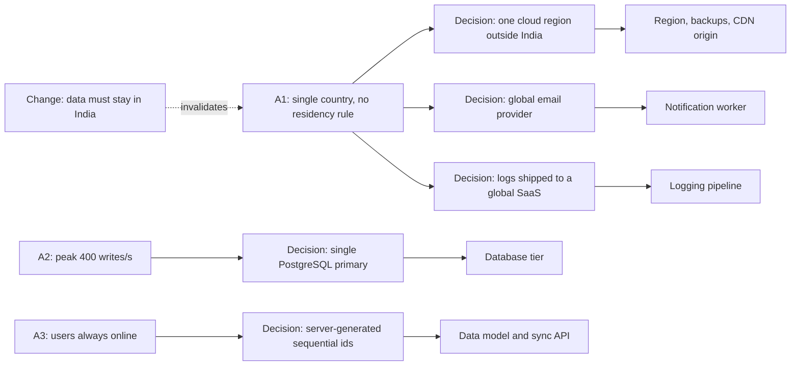
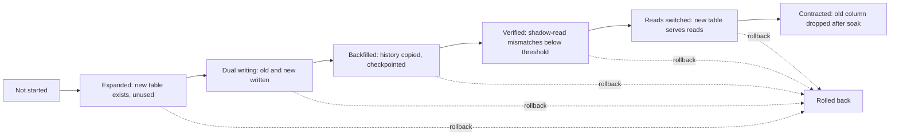
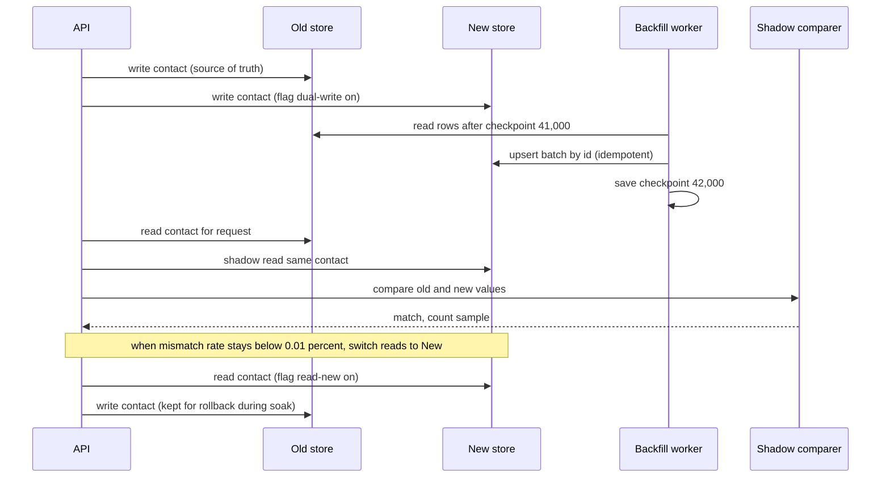

Twenty minutes into a design interview, just as your diagram looks finished, the interviewer says: "Now the client says all data must stay in India." Or "traffic is 50x what we said." Or "home-visit nurses need to work offline for a week." This is not bad luck. It is the most deliberate part of the interview: the interviewer wants to see which parts of your design depend on which assumptions, and whether you can change course without panicking or starting over. In real projects the same thing happens over months instead of minutes, and the system is already running, so the second half of the skill is migration: getting from the old design to the new one without downtime or data loss. This lesson covers both.

## Learning objectives

By the end of this lesson you will be able to:

1. Respond to a changed requirement with the five Rs: restate, re-estimate, ripple, revise, route.
2. Keep an assumption register during an interview and use it to find which components a change affects.
3. Tell additive changes (extend the design) from invalidating changes (a core decision no longer holds).
4. Plan a zero-downtime schema change with expand and contract, including the PostgreSQL operations that avoid long locks.
5. Plan a data-store migration with dual writes or change data capture, a resumable backfill, shadow reads, a gated cutover and a rollback path.
6. Implement and test in C# a gated migration state machine, an assumption impact map and an idempotent, checkpointed backfill.

## Prerequisites

- [Clarifying questions](#/lesson/m19-clarifying-questions): the assumptions you state at the start are what changes later.
- [Recognising overengineering](#/lesson/m19-overengineering): evolution paths and one-way doors.
- [Migrations and schema evolution](#/lesson/m09-migrations-evolution) and [strangler fig](#/lesson/m16-strangler-acl): the building blocks of migration.

## Explain it like I'm a beginner

You are driving from Delhi to Jaipur with the map app open. Halfway there, a message arrives: "Meeting moved to Ajmer." A good driver does not turn around and go home to plan again. They:

1. **Restate** the change: "We now need Ajmer, not Jaipur, by the same time."
2. **Re-estimate**: "Ajmer is about 130 km further. Can we still make it? Fuel?"
3. **Check what is affected** (the ripple): "The hotel booking in Jaipur and the lunch stop are affected. The car, the route as far as Jaipur, and the driver are not."
4. **Revise** the plan: "Keep driving to Jaipur, then carry on along the same road to Ajmer, refuel at Kishangarh."
5. **Route** from where you are to the new plan: "Cancel the hotel now while it is free to cancel, call ahead for lunch."

That last step matters most in real systems. You are never starting from an empty road. Your system is already running with real data, and you must move it to the new design while users keep using it. That move is a migration, and the safe way to do it is in small, reversible steps (like changing lanes one at a time, signalling first).

## First-principles explanation

### Why interviewers change requirements

They are testing three things:

1. **Do you know what your design depends on?** If "data in India" changes nothing in your answer, either your design already handled it or you haven't understood the change.
2. **Can you adapt without starting over?** A good design is a set of decisions with reasons. A changed requirement should invalidate a few decisions, not all of them.
3. **Do you think about the running system?** Senior candidates mention the migration without being asked: "and since this is live, we'd move existing tenants like this..."

### The five Rs

| Step | What you do | What you say |
|---|---|---|
| **Restate** | Repeat the change precisely and ask one or two clarifying questions. | "So all personal data must be stored and processed in India. Does that include backups and logs? And what about support staff abroad?" |
| **Re-estimate** | Redo only the numbers the change affects. | "50x traffic takes peak writes from 400 to 20,000 per second." |
| **Ripple** | Walk your assumption register: which decisions relied on the old assumption, and which components embody them? | "The single-region choice, the CDN configuration and the third-party email service all assumed no residency rule." |
| **Revise** | Change those decisions, keeping everything the change does not touch. Say explicitly what stays. | "Region moves to an Indian cloud region, email switches to a provider with in-country processing, the data model is unchanged." |
| **Route** | Explain how the running system gets there. | "Expand: provision the new region. Copy data with CDC. Shadow-read for a week. Cut over tenant by tenant." |

The two most common mistakes are skipping **ripple** (changing one box and missing three others that depend on the same assumption) and skipping **route** (drawing the new design as if it were greenfield).

### The assumption register

Write your assumptions in a corner of the whiteboard as you go, each with an id: A1 "single country, no residency rule", A2 "peak 400 writes per second", A3 "users always online", A4 "eventual consistency acceptable for the dashboard". When you make a decision, note which assumption it relies on: "single PostgreSQL primary (A2)". When a requirement changes, the register tells you exactly what to revisit. This takes seconds and impresses interviewers, because it shows that your decisions have reasons.

### Additive versus invalidating changes

- **Additive**: the old design still holds; you add something. "Add full-text search over documents" usually adds a search index fed from the database. Nothing else changes.
- **Invalidating**: a core decision is no longer valid. "Users must work offline for a week" invalidates "the server is the only place writes happen", which affects conflict handling, ids, sync protocol and the data model. Say clearly that this is a bigger change, and spend the remaining time on it.

Typical change categories and what they usually hit:

| Change | Usually hits |
|---|---|
| Scale jumps 10x–100x | Database write path, partitioning, caching, cost |
| Consistency tightens (eventual to strong) | Replication choices, caches, read paths, cross-service flows |
| New residency or compliance rule | Region, backups, logs, third-party processors, support access |
| Offline or mobile-first clients | Ids (must be generated on the client), conflict resolution, sync API |
| Latency target tightens | Caching, data locality, synchronous call chains |
| Cost cut | Over-provisioned tiers, cross-region traffic, retention |
| New tenant model (single to multi-tenant) | Every table, every query, authorisation, isolation |

### Migration principles

When a running system must change, these principles keep it safe:

1. **Never big-bang.** Every step leaves a working system and can be rolled back.
2. **Expand before you contract.** Add the new structure alongside the old, move traffic, then remove the old. Never remove first.
3. **Separate deploying code from switching behaviour.** Feature flags let you deploy dual-write code with the flag off, then turn it on.
4. **Copy history and capture new changes.** A backfill copies existing data; dual writes or change data capture keep up with new writes. You need both, and the capture must start **before** the backfill finishes, or changes made during the backfill are lost.
5. **Verify before trusting.** Shadow reads (read both, serve the old, compare) give evidence that the new store is correct.
6. **Cut over gradually.** By tenant, by percentage, or by region, so a problem affects a few users first.
7. **Keep the way back open** until a soak period has passed. Contracting (deleting the old) is the last, irreversible step.
8. **Budget for running both.** During a migration you pay for two copies of the data, extra write load and extra monitoring. Give the migration an owner and an end date, or the "temporary" dual state becomes permanent.
9. **Keep old clients working.** Mobile apps and partner integrations upgrade slowly, so the API must accept the old shape until usage of it (measured, not guessed) drops to near zero.

### Expand and contract for schema changes

Example: in a clinic system, patients had a single `phone` column; the new requirement is multiple contacts with types (mobile, home, emergency contact). The safe sequence (also called parallel change):

1. **Expand**: create `patient_contacts`. Deploy code that ignores it. No risk.
2. **Dual write**: deploy code that writes contacts to both `patients.phone` and `patient_contacts`, behind a flag. Turn the flag on.
3. **Backfill**: copy existing phones into `patient_contacts` in small batches, idempotently, with a checkpoint.
4. **Verify**: shadow-read contacts from the new table, compare with the old column, count mismatches.
5. **Switch reads**: serve contacts from the new table (flag). Keep dual writes on.
6. **Soak**: wait (for example a week, or one full billing cycle) watching errors.
7. **Contract**: stop writing the old column, then drop it in a later release.

PostgreSQL details that keep each step from blocking production:

- Adding a nullable column, or a column with a constant default, is a fast metadata change in modern PostgreSQL (since version 11 for non-volatile defaults), so the expand step is cheap.
- `CREATE INDEX CONCURRENTLY` builds an index without blocking writes (it takes longer and cannot run inside a transaction block).
- `ALTER TABLE ... ADD CONSTRAINT ... NOT VALID` adds a foreign key or check constraint for new rows without scanning existing rows; `VALIDATE CONSTRAINT` checks the old rows later with a weaker lock.
- Backfill in batches of a few thousand rows with short transactions, to avoid long locks and replication lag.
- Set a `lock_timeout` on migration sessions so that a migration waiting for a lock fails fast instead of queueing every other query behind it.

### Moving data between stores

For bigger moves (a new database, a new region, a sharded layout), the shape is the same, with a choice of how to capture new writes:

- **Dual writes from the application**: simple to start, but the two writes are not atomic. A crash between them causes divergence, so you need reconciliation.
- **Change data capture (CDC)** from the old store's log (for example PostgreSQL logical replication): only committed changes flow, ordering is preserved per table, and the application is not changed. More infrastructure.
- **Outbox**: the application writes an event in the same transaction; a relay applies it to the new store. Atomic, but requires code changes for every write path.

Whichever you pick, add **reconciliation**: a job that compares counts and checksums between old and new, by tenant or by time range, and reports differences.

### Rollback thinking

For each step, write down the rollback before you start:

| Step | Rollback |
|---|---|
| Expand | Drop the new table (nothing reads it). |
| Dual write on | Turn the flag off. |
| Backfill | Truncate the new table and restart from checkpoint zero. |
| Switch reads | Flip the read flag back; dual writes kept the old store current. |
| Contract | No rollback after dropping; that's why it waits for the soak period and a backup. |

### Changing requirements in real projects

Over months, requirements change for real: a client adds a regulation, a new customer segment appears, scale arrives in a different shape than forecast. The same five Rs apply, and the record of the change belongs in an architecture decision record: which assumption changed, which decisions were superseded, and the migration plan ([see ADRs](#/lesson/m02-adr)).

## Visual explanation

### The ripple of a changed assumption



The assumption register on the left feeds decisions in the middle, which are embodied in components on the right. When the interviewer says "data must stay in India", it invalidates A1, and following the arrows shows three decisions and three components to revisit: the region (with backups and the CDN origin), the email provider, and the logging pipeline. Nothing hanging off A2 or A3 is touched, so the database tier and the id scheme stay as they are. Saying "these three things change, these two don't" is the ripple step, and it is what separates a calm, precise answer from a redraw of the whole board.

### Expand and contract, phase by phase



Each solid arrow is a gate: dual writes must be on before the backfill finishes so that no write slips through; verification needs enough shadow-read samples with a low mismatch rate; contraction needs the soak period to have passed. Every phase before "contracted" has a dotted rollback arrow, because the old structure is still complete and current. The C# migration state machine later in this lesson enforces exactly these gates.

### Moving a store with dual writes, backfill and shadow reads



The API keeps the old store as the source of truth while it writes to both. The backfill worker copies history in batches after the last saved checkpoint and upserts by id, so re-running a batch after a crash is harmless. Shadow reads compare the two stores on real traffic without affecting users, because the old value is still what the user sees. Once the mismatch rate has stayed below a threshold for enough samples, a flag switches reads to the new store; writes to the old store continue through the soak period so that switching back is instant. Only after the soak does the team stop the old writes and remove the old store.

## Step-by-step example

We follow one interview where the requirement changes three times, then turn one of the changes into a migration plan.

### The starting design

Prompt: "Design a patient records system for a chain of 80 clinics: 3,000 staff users; lab reports, scans and prescriptions uploaded, versioned, reviewed and signed off by doctors."

Assumptions written on the board:

- A1: single country of operation, no residency rule.
- A2: about 3,000 staff users, peak 50 requests per second, 300 writes per second at most during bulk uploads (a lab pushing a day's results at once).
- A3: users are online when they work.
- A4: one clinic chain (single tenant).

Design: a modular monolith (records, reviews, users modules), PostgreSQL with a standby for metadata, object storage for files, a queue for thumbnail and PDF rendering jobs, a search index for document titles and text (fed from an outbox), and SSO. Decisions annotated with assumptions: one region (A1), single primary (A2), server-generated ids (A3), no tenant column (A4).

### Change 1 — "All patient data must remain in India"

*Restate:* "All patient documents, metadata, backups and logs stored and processed in India? Can doctors abroad (for second opinions) view records?" Interviewer: "Yes to all storage; doctors abroad can view through the application."

*Re-estimate:* no change in numbers.

*Ripple:* A1 is invalidated. Affected: region, backup location, search index location, log pipeline (a global log SaaS stores data abroad), email provider (processes recipient data). Unaffected: data model, modules, queue design.

*Revise:* deploy in an Indian cloud region with backups to a second Indian region; keep logs in a region-local log store; choose an email provider with Indian processing or send only links without document content. Users abroad access through the application; no replication abroad.

*Route:* "If this were live: stand up the new region with infrastructure as code, replicate PostgreSQL with logical replication, copy object storage in the background, verify with checksums per clinic, then cut over during a low-traffic window with DNS. Old-region data deleted after verification, with a deletion certificate if the client needs one."

Classification: **mostly additive**, because the architecture already had clean boundaries; the work is in placement, not structure.

### Change 2 — "Sell this to 200 other clinic chains"

*Restate:* "So it becomes multi-tenant SaaS for clinic chains and hospitals. Do tenants need isolation guarantees, like separate databases for some?" Interviewer: "Most are small; two large hospital groups want dedicated databases."

*Re-estimate:* 200 tenants, perhaps 150,000 users, peak 2,500 requests per second, up to 15,000 writes per second during bulk uploads across tenants. Storage grows to hundreds of terabytes of files.

*Ripple:* A4 is invalidated (every table needs a tenant id, every query needs tenant scoping, authorisation needs tenant context). A2 is invalidated (writes may exceed a single primary at peak). Search index needs per-tenant filtering. Object storage keys need a tenant prefix.

*Revise:* `tenant_id` on every table and in every index's leading column, row-level security as a safety net, tenant resolved from the login token; pooled database for small tenants, dedicated databases for the two large ones (same schema, routed by a tenant catalogue); bulk uploads go through the queue so writes are smoothed; search documents carry `tenant_id` and every query filters on it.

*Route:* "Existing data belongs to tenant 1. Expand: add nullable `tenant_id` columns, backfill to tenant 1 in batches, then add `NOT NULL` with a `CHECK ... NOT VALID` and validate. Add tenant-leading indexes concurrently. Switch queries to tenant-scoped versions behind a flag, verified by tests that try cross-tenant access."

Classification: **invalidating**, and the answer says so: "this is the biggest change so far; it touches every table."

### Change 3 — "Home-visit nurses must work offline for up to a week"

*Restate:* "Offline viewing only, or offline edits and sign-offs too?" Interviewer: "Viewing assigned patients' records and adding visit notes and vital signs offline; prescriptions still need a connection."

*Ripple:* A3 is invalidated. Server-generated ids no longer work for records created offline; notes created offline may conflict with changes on the server; files must be cached on devices, which are now a place where patient data lives (encryption at rest, remote wipe); sync needs a protocol.

*Revise:* client-generated ids (UUIDs) for visit notes and vitals; these are append-only, so conflicts are rare (two nurses adding notes don't conflict); edits to the same note use last-writer-wins with the conflict kept as a history entry; a sync API with "changes since version N" per patient list; devices download only assigned patients' records, encrypted, with a size budget and an expiry.

*Route:* "Visit notes move from integer ids to UUIDs: expand with a `uuid` column, backfill, dual-write, switch the API to accept and return UUIDs, keep integer ids internal until all clients are on the new app version, then contract."

### Turning change 2 into an execution plan

| Phase | Action | Gate to next phase | Rollback |
|---|---|---|---|
| Expand | `ALTER TABLE documents ADD COLUMN tenant_id uuid` (nullable, fast), same for all tables; create tenant catalogue | Columns exist in production | Drop columns |
| Dual write | App sets `tenant_id` on every insert and update (flag on) | No inserts with null `tenant_id` for 24 hours (monitored query) | Flag off |
| Backfill | Batches of 5,000 rows per table, `UPDATE ... SET tenant_id = @t1 WHERE id BETWEEN @a AND @b AND tenant_id IS NULL`, checkpoint per table | Zero null rows remaining | Set back to null (or ignore; nothing reads it yet) |
| Constrain | `ADD CONSTRAINT tenant_not_null CHECK (tenant_id IS NOT NULL) NOT VALID`, then `VALIDATE CONSTRAINT`; `CREATE INDEX CONCURRENTLY` on `(tenant_id, ...)` | Constraints validated, indexes valid | Drop constraint and indexes |
| Switch reads | Tenant-scoped queries and row-level security policies on (flag), cross-tenant tests in CI | Error rate and p95 unchanged for 7 days | Flag off |
| Onboard tenant 2 | First new tenant goes live | One billing cycle clean | Suspend tenant 2 |
| Contract | Remove unscoped query paths from code | — | Not needed |

## Production-style C# implementation

The implementation has three parts: a migration plan that enforces the expand-and-contract gates and records history; a backfill worker that copies rows in batches, resumes from a checkpoint and upserts idempotently; and a shadow-read comparer that measures mismatch rates. Stores are behind interfaces with in-memory implementations, so the logic is testable and the real PostgreSQL implementations (using Npgsql) would slot in.

```text
Migrations.Api/
  Program.cs
  Migrations/MigrationPlan.cs
  Migrations/Backfill.cs
  Migrations/ShadowReadComparer.cs
  Migrations/InMemoryStores.cs
```

```csharp file=Migrations/MigrationPlan.cs
namespace Sdlp.Migrations;

public enum MigrationPhase { NotStarted, Expanded, DualWriting, Backfilled, Verified, ReadsSwitched, Contracted, RolledBack }

public sealed class MigrationOptions
{
    public long MinShadowSamples { get; set; } = 10_000;
    public double MaxMismatchRate { get; set; } = 0.0001;     // 0.01 %
    public TimeSpan SoakPeriod { get; set; } = TimeSpan.FromDays(7);
}

/// <summary>Evidence supplied when asking to move to the next phase.</summary>
public sealed record MigrationEvidence(bool BackfillComplete = false, long ShadowSamples = 0, double MismatchRate = 1.0);

public sealed record PhaseChange(MigrationPhase From, MigrationPhase To, DateTimeOffset At, string Note);

public sealed class MigrationGateException(string message) : InvalidOperationException(message);

/// <summary>Expand-and-contract as an explicit state machine. Every gate is checked; every change is recorded.</summary>
public sealed class MigrationPlan(string name, MigrationOptions options, TimeProvider clock)
{
    private readonly List<PhaseChange> _history = new();
    private readonly object _gate = new();

    public string Name { get; } = name;
    public MigrationPhase Phase { get; private set; } = MigrationPhase.NotStarted;
    public IReadOnlyList<PhaseChange> History { get { lock (_gate) return _history.ToList(); } }

    public MigrationPhase Advance(MigrationEvidence evidence)
    {
        lock (_gate)
        {
            var next = Phase switch
            {
                MigrationPhase.NotStarted => MigrationPhase.Expanded,
                MigrationPhase.Expanded => MigrationPhase.DualWriting,
                MigrationPhase.DualWriting when evidence.BackfillComplete => MigrationPhase.Backfilled,
                MigrationPhase.DualWriting => throw new MigrationGateException("Backfill is not complete."),
                MigrationPhase.Backfilled when evidence.ShadowSamples < options.MinShadowSamples =>
                    throw new MigrationGateException($"Need at least {options.MinShadowSamples} shadow-read samples, have {evidence.ShadowSamples}."),
                MigrationPhase.Backfilled when evidence.MismatchRate > options.MaxMismatchRate =>
                    throw new MigrationGateException($"Mismatch rate {evidence.MismatchRate:P3} exceeds {options.MaxMismatchRate:P3}."),
                MigrationPhase.Backfilled => MigrationPhase.Verified,
                MigrationPhase.Verified => MigrationPhase.ReadsSwitched,
                MigrationPhase.ReadsSwitched when SoakElapsed() => MigrationPhase.Contracted,
                MigrationPhase.ReadsSwitched => throw new MigrationGateException($"Soak period of {options.SoakPeriod.TotalDays:0} days has not elapsed."),
                _ => throw new MigrationGateException($"Cannot advance from {Phase}.")
            };
            Record(next, "advance");
            return next;
        }
    }

    public void RollBack(string reason)
    {
        lock (_gate)
        {
            if (Phase is MigrationPhase.NotStarted or MigrationPhase.Contracted or MigrationPhase.RolledBack)
                throw new MigrationGateException($"Rollback is not possible from {Phase}.");
            Record(MigrationPhase.RolledBack, reason);
        }
    }

    private bool SoakElapsed()
    {
        var switched = _history.LastOrDefault(h => h.To == MigrationPhase.ReadsSwitched);
        return switched is not null && clock.GetUtcNow() - switched.At >= options.SoakPeriod;
    }

    private void Record(MigrationPhase next, string note)
    {
        _history.Add(new PhaseChange(Phase, next, clock.GetUtcNow(), note));
        Phase = next;
    }
}
```

```csharp file=Migrations/Backfill.cs
using Microsoft.Extensions.Logging;

namespace Sdlp.Migrations;

public sealed record SourceRow(long Id, string Payload);

public interface IBackfillSource
{
    /// <summary>Rows with Id greater than <paramref name="afterId"/>, ascending, at most <paramref name="limit"/>.</summary>
    Task<IReadOnlyList<SourceRow>> ReadAfterAsync(long afterId, int limit, CancellationToken ct);
}

public interface IBackfillTarget
{
    /// <summary>Insert or replace by Id. Must be idempotent: applying the same batch twice changes nothing.</summary>
    Task UpsertAsync(IReadOnlyList<SourceRow> rows, CancellationToken ct);
}

public interface ICheckpointStore
{
    Task<long> GetAsync(string job, CancellationToken ct);
    Task SaveAsync(string job, long lastId, CancellationToken ct);
}

public sealed record BackfillResult(long RowsCopied, long LastId, int Batches);

/// <summary>Copies history in batches. Safe to stop at any point and re-run: it resumes after the last checkpoint,
/// and a batch applied before a crash but not checkpointed is simply upserted again.</summary>
public sealed class Backfiller(IBackfillSource source, IBackfillTarget target, ICheckpointStore checkpoints, ILogger<Backfiller> logger)
{
    public async Task<BackfillResult> RunAsync(string job, int batchSize, CancellationToken ct)
    {
        ArgumentOutOfRangeException.ThrowIfLessThan(batchSize, 1);
        var last = await checkpoints.GetAsync(job, ct);
        long copied = 0;
        var batches = 0;

        while (!ct.IsCancellationRequested)
        {
            var rows = await source.ReadAfterAsync(last, batchSize, ct);
            if (rows.Count == 0) break;

            await target.UpsertAsync(rows, ct);          // 1. apply
            last = rows[^1].Id;
            await checkpoints.SaveAsync(job, last, ct);  // 2. then checkpoint
            copied += rows.Count;
            batches++;
            logger.LogInformation("Backfill {Job}: batch {Batch} up to id {LastId}", job, batches, last);
        }

        return new BackfillResult(copied, last, batches);
    }
}
```

```csharp file=Migrations/ShadowReadComparer.cs
using Microsoft.Extensions.Logging;

namespace Sdlp.Migrations;

/// <summary>Counts shadow-read comparisons. Thread-safe; cheap enough to call on every request.</summary>
public sealed class ShadowReadComparer(ILogger<ShadowReadComparer> logger)
{
    private long _samples;
    private long _mismatches;

    public long Samples => Interlocked.Read(ref _samples);
    public long Mismatches => Interlocked.Read(ref _mismatches);
    public double MismatchRate => Samples == 0 ? 1.0 : (double)Mismatches / Samples;

    public bool Compare<T>(string key, T oldValue, T newValue, IEqualityComparer<T>? comparer = null)
    {
        Interlocked.Increment(ref _samples);
        var equal = (comparer ?? EqualityComparer<T>.Default).Equals(oldValue, newValue);
        if (!equal)
        {
            Interlocked.Increment(ref _mismatches);
            // Log the key, never the values: they may contain personal data.
            logger.LogWarning("Shadow read mismatch for {Key}", key);
        }
        return equal;
    }
}
```

```csharp file=Migrations/InMemoryStores.cs
using System.Collections.Concurrent;

namespace Sdlp.Migrations;

/// <summary>In-memory stand-ins for the old table, the new table and the checkpoint table.</summary>
public sealed class InMemoryRowStore : IBackfillSource, IBackfillTarget
{
    private readonly ConcurrentDictionary<long, string> _rows = new();

    public void Put(long id, string payload) => _rows[id] = payload;
    public int Count => _rows.Count;
    public string? Get(long id) => _rows.TryGetValue(id, out var v) ? v : null;

    public Task<IReadOnlyList<SourceRow>> ReadAfterAsync(long afterId, int limit, CancellationToken ct) =>
        Task.FromResult<IReadOnlyList<SourceRow>>(_rows.Where(r => r.Key > afterId).OrderBy(r => r.Key).Take(limit)
                                                       .Select(r => new SourceRow(r.Key, r.Value)).ToList());

    public Task UpsertAsync(IReadOnlyList<SourceRow> rows, CancellationToken ct)
    {
        foreach (var r in rows) _rows[r.Id] = r.Payload;
        return Task.CompletedTask;
    }
}

public sealed class InMemoryCheckpointStore : ICheckpointStore
{
    private readonly ConcurrentDictionary<string, long> _cp = new();
    public Task<long> GetAsync(string job, CancellationToken ct) => Task.FromResult(_cp.TryGetValue(job, out var v) ? v : 0L);
    public Task SaveAsync(string job, long lastId, CancellationToken ct) { _cp[job] = lastId; return Task.CompletedTask; }
}

/// <summary>Named stores so DI can tell the old and new tables apart.</summary>
public sealed class ContactStores
{
    public InMemoryRowStore Old { get; } = new();
    public InMemoryRowStore New { get; } = new();
}
```

```csharp file=Program.cs
using Microsoft.Extensions.Options;
using Sdlp.Migrations;

var builder = WebApplication.CreateBuilder(args);

builder.Services.Configure<MigrationOptions>(builder.Configuration.GetSection("Migrations:Contacts"));
builder.Services.AddSingleton(TimeProvider.System);
builder.Services.AddSingleton<ContactStores>();
builder.Services.AddSingleton<ICheckpointStore, InMemoryCheckpointStore>();
builder.Services.AddSingleton<ShadowReadComparer>();
builder.Services.AddSingleton(sp => new MigrationPlan("patient-contacts",
    sp.GetRequiredService<IOptions<MigrationOptions>>().Value, sp.GetRequiredService<TimeProvider>()));
builder.Services.AddSingleton(sp =>
{
    var stores = sp.GetRequiredService<ContactStores>();
    return new Backfiller(stores.Old, stores.New, sp.GetRequiredService<ICheckpointStore>(), sp.GetRequiredService<ILogger<Backfiller>>());
});

var app = builder.Build();

app.MapGet("/migrations/contacts", (MigrationPlan plan, ShadowReadComparer shadow) =>
    Results.Ok(new { plan.Name, Phase = plan.Phase.ToString(), shadow.Samples, shadow.MismatchRate, plan.History }));

app.MapPost("/migrations/contacts/backfill", async (Backfiller backfiller, CancellationToken ct) =>
    Results.Ok(await backfiller.RunAsync("patient-contacts", 5_000, ct)));

app.MapPost("/migrations/contacts/advance", (MigrationPlan plan, ShadowReadComparer shadow, ContactStores stores) =>
{
    try
    {
        var evidence = new MigrationEvidence(
            BackfillComplete: stores.New.Count >= stores.Old.Count,
            ShadowSamples: shadow.Samples,
            MismatchRate: shadow.MismatchRate);
        return Results.Ok(new { Phase = plan.Advance(evidence).ToString() });
    }
    catch (MigrationGateException ex)
    {
        return Results.Problem(ex.Message, statusCode: StatusCodes.Status409Conflict);
    }
});

app.MapPost("/migrations/contacts/rollback", (MigrationPlan plan, string reason) =>
{
    try { plan.RollBack(reason); return Results.Ok(new { Phase = plan.Phase.ToString() }); }
    catch (MigrationGateException ex) { return Results.Problem(ex.Message, statusCode: StatusCodes.Status409Conflict); }
});

app.Run();
```

Design notes:

- **Apply, then checkpoint.** If the process dies after the upsert but before the checkpoint, the next run re-reads that batch and upserts it again. Because the upsert is idempotent, that is harmless. The opposite order (checkpoint first) would skip rows after a crash.
- **Keyset pagination** (`WHERE id > @last ORDER BY id LIMIT @n`) instead of `OFFSET` keeps each batch query fast regardless of how far the backfill has progressed.
- **"Backfill complete" is evidence, not a timestamp.** Here it compares counts; in PostgreSQL you would check that no old rows lack a counterpart (`NOT EXISTS`), per tenant.
- **The plan logs every phase change** with a time and a note. In a real system that history would be stored, and phase changes would require an approver.
- **Contracting is gated by time** through `TimeProvider`, so tests can move the clock forward instead of waiting a week.

## Bad design vs good design

**Bad response to a changed requirement (spoken):**

> "Oh, data in India. OK, let me start over." *(Erases the board.)* "So we'll need a totally different architecture..."

Or the opposite:

> "That's fine, the design handles it." *(It doesn't: the logs and email provider still send data abroad.)*

Problems: the first throws away good decisions the change didn't touch and wastes the remaining time; the second skips the ripple step and misses affected components. Neither mentions how a running system would move.

**Good response:** the five Rs as in change 1: restate with two clarifying questions, note that numbers are unchanged, walk the assumption register to name exactly three affected components, revise those, state what stays, and give a four-step migration route.

**Bad migration plan:** "Saturday night, take the system down, run a script that moves everything to the new schema, bring it up Sunday." No verification, no rollback, a long outage, and if the script fails at 3 a.m. there is no way back.

**Good migration plan:** the expand-and-contract table in the step-by-step example: each phase leaves a working system, each has a gate based on evidence and a rollback, and only the final phase is irreversible.

:::callout type=warning title="Dual writes without reconciliation drift silently"
Application-level dual writes are not atomic: one write can succeed while the other fails. Without a reconciliation job comparing the stores, the drift is invisible until users notice. Either capture changes from the database log (CDC) or the outbox, or run reconciliation continuously during the migration.
:::

:::callout type=tip title="Say what stays the same"
After a requirement change, explicitly listing what does **not** change ("the data model, the queue and the modules are unaffected") shows you understand the dependencies, and saves time.
:::

## Practical playground

The starter is the patient records system after change 1 (single tenant, India region). Apply change 2 (multi-tenant SaaS, 200 tenants, two with dedicated databases) in the canvas: add the tenant catalogue, route the two large tenants to dedicated databases, put bulk uploads on the queue, and label every changed node with the assumption that changed (A2 or A4). Then list, outside the canvas, the migration phases and their gates.

:::playground type=hld title="Apply the multi-tenant change to the records system"
```json
{
  "nodes": [
    { "id": "u", "type": "client", "label": "3,000 staff (one clinic chain)", "props": { "rps": 50 } },
    { "id": "lb", "type": "load-balancer", "label": "Load balancer", "props": { "region": "India (A1 revised)" } },
    { "id": "app", "type": "app-server", "label": "Records app: records, reviews, users modules", "props": { "instances": 2 } },
    { "id": "db", "type": "database", "label": "PostgreSQL metadata, no tenant column (A4)", "props": { "multiAz": true } },
    { "id": "obj", "type": "object-storage", "label": "Lab reports and scans" },
    { "id": "q", "type": "queue", "label": "Rendering jobs" },
    { "id": "w", "type": "worker", "label": "Thumbnail and PDF workers" },
    { "id": "s", "type": "search", "label": "Search index (titles and text)" }
  ],
  "edges": [
    { "from": "u", "to": "lb", "kind": "sync" },
    { "from": "lb", "to": "app", "kind": "sync" },
    { "from": "app", "to": "db", "kind": "sync" },
    { "from": "app", "to": "obj", "kind": "sync" },
    { "from": "app", "to": "q", "kind": "async" },
    { "from": "q", "to": "w", "kind": "async" },
    { "from": "app", "to": "s", "kind": "sync" }
  ]
}
```
:::

## Exercises

:::exercise id=m19-changing-requirements-ex1 difficulty=beginner kind=written title="Additive or invalidating?"
Your design for a food-delivery platform in three cities assumed: A1 orders are placed online in the app; A2 peak 300 orders per minute; A3 restaurants confirm each order manually; A4 payment is by UPI or card before cooking; A5 one country. For each change below, say whether it is additive or invalidating, which assumptions it hits, and the two components most affected.

1. Add cash on delivery.
2. Expand to 40 cities with a 15x peak.
3. Add a public API for restaurant POS systems to accept orders automatically.
4. Offer scheduled orders up to 7 days ahead.
5. Launch in the UAE with data kept in-country.
6. Add live order tracking on a map.
::acceptance
- Each change classified with a one-sentence reason.
- Each names at least one assumption (or says "none, additive") and two components.
- At least two changes marked invalidating.
::hint
Ask, for each change, "which of A1–A5 is no longer true?" If none, it is probably additive.
::hint
Cash on delivery breaks A4: payment no longer precedes cooking. What depends on that?
::hint
15x peak: 4,500 orders per minute is 75 per second. Which component felt the old number?
::solution
1. **Invalidating (A4).** Payment no longer precedes cooking, so the order state machine and the settlement flow change (order confirmed without payment; rider collects cash; reconciliation of cash with riders). Components: order service state machine, settlement and rider-wallet ledger.
2. **Invalidating (A2), possibly A5 if regions differ.** 75 orders per second at peak plus tracking updates; per-city partitioning of dispatch becomes natural. Components: dispatch and matching (now partitioned by city), order database write path.
3. **Invalidating (A3).** Restaurants no longer confirm manually; confirmations arrive automatically, so a POS integration API with authentication, idempotency and rate limits is needed, and the "waiting for restaurant" timeout logic changes. Components: restaurant-facing API, order state machine timeouts.
4. **Additive (mostly).** A scheduler releases orders to restaurants at the right time; pricing and restaurant capacity checks must consider future slots. Components: scheduler, capacity and availability checks.
5. **Invalidating (A5).** A separate in-country deployment (or region) with its own data stores, local payment providers, currency and tax rules. Components: deployment topology and data stores, payment integration.
6. **Additive.** Rider location updates via a real-time channel and an in-memory geo store; the order model gains a tracking view. Components: real-time gateway, location store.
::mistakes
- Marking cash on delivery as additive because it is "just another payment method"; the order of events changes.
- Treating 40 cities as just "more servers" without noticing that dispatch partitions naturally by city.
:::

:::exercise id=m19-changing-requirements-ex2 difficulty=beginner kind=code title="A gated phase machine"
Implement `Phases.Advance`, which moves an expand-and-contract migration to the next phase only when its gate is met, and `Phases.CanRollBack`.
::requirements
- Order: NotStarted → Expanded → DualWriting → Backfilled → Verified → ReadsSwitched → Contracted.
- DualWriting → Backfilled needs `backfillComplete`.
- Backfilled → Verified needs `mismatchRate <= 0.0001`.
- ReadsSwitched → Contracted needs `soakDays >= 7`.
- An unmet gate, or advancing from Contracted, throws `InvalidOperationException`.
- Rollback is possible from every phase except NotStarted and Contracted.
::acceptance
- NotStarted advances to Expanded with no evidence.
- DualWriting with `backfillComplete = false` throws.
- Backfilled with a mismatch rate of 0.001 throws; with 0.00005 it advances.
- ReadsSwitched with 6 soak days throws; with 7 it advances.
- `CanRollBack(Contracted)` is false; `CanRollBack(ReadsSwitched)` is true.
::hint
A `switch` expression with `when` guards maps neatly onto "phase plus condition".
::hint
Put the throwing arms right after the guarded arm for the same phase.
::hint
`CanRollBack` is `phase is not (Phase.NotStarted or Phase.Contracted)`.
::hint
```csharp
Phase.DualWriting when e.BackfillComplete => Phase.Backfilled,
Phase.DualWriting => throw new InvalidOperationException("backfill incomplete"),
```
::starter
```csharp file=Phases.cs
using System;

public enum Phase { NotStarted, Expanded, DualWriting, Backfilled, Verified, ReadsSwitched, Contracted }
public sealed record Evidence(bool BackfillComplete = false, double MismatchRate = 1.0, int SoakDays = 0);

public static class Phases
{
    public static Phase Advance(Phase current, Evidence e) => throw new NotImplementedException();
    public static bool CanRollBack(Phase current) => throw new NotImplementedException();
}
```
::tests
```csharp file=PhasesTests.cs
using System;
using Xunit;

public class PhasesTests
{
    [Fact] public void Starts_by_expanding() => Assert.Equal(Phase.Expanded, Phases.Advance(Phase.NotStarted, new Evidence()));
    [Fact] public void Expanded_to_dual_writing() => Assert.Equal(Phase.DualWriting, Phases.Advance(Phase.Expanded, new Evidence()));

    [Fact] public void Backfill_gate() =>
        Assert.Throws<InvalidOperationException>(() => Phases.Advance(Phase.DualWriting, new Evidence(BackfillComplete: false)));

    [Fact] public void Backfill_passes() =>
        Assert.Equal(Phase.Backfilled, Phases.Advance(Phase.DualWriting, new Evidence(BackfillComplete: true)));

    [Fact] public void Mismatch_gate_blocks() =>
        Assert.Throws<InvalidOperationException>(() => Phases.Advance(Phase.Backfilled, new Evidence(MismatchRate: 0.001)));

    [Fact] public void Mismatch_gate_passes() =>
        Assert.Equal(Phase.Verified, Phases.Advance(Phase.Backfilled, new Evidence(MismatchRate: 0.00005)));

    [Fact] public void Verified_switches_reads() => Assert.Equal(Phase.ReadsSwitched, Phases.Advance(Phase.Verified, new Evidence()));

    [Theory]
    [InlineData(6, false)]
    [InlineData(7, true)]
    public void Soak_gate(int days, bool ok)
    {
        if (ok) Assert.Equal(Phase.Contracted, Phases.Advance(Phase.ReadsSwitched, new Evidence(SoakDays: days)));
        else Assert.Throws<InvalidOperationException>(() => Phases.Advance(Phase.ReadsSwitched, new Evidence(SoakDays: days)));
    }

    [Fact] public void Nothing_after_contracted() =>
        Assert.Throws<InvalidOperationException>(() => Phases.Advance(Phase.Contracted, new Evidence(true, 0, 100)));

    [Fact] public void Rollback_rules()
    {
        Assert.False(Phases.CanRollBack(Phase.NotStarted));
        Assert.False(Phases.CanRollBack(Phase.Contracted));
        Assert.True(Phases.CanRollBack(Phase.ReadsSwitched));
        Assert.True(Phases.CanRollBack(Phase.Expanded));
    }
}
```
::solution
```csharp file=Phases.cs
using System;

public enum Phase { NotStarted, Expanded, DualWriting, Backfilled, Verified, ReadsSwitched, Contracted }
public sealed record Evidence(bool BackfillComplete = false, double MismatchRate = 1.0, int SoakDays = 0);

public static class Phases
{
    public const double MaxMismatchRate = 0.0001;
    public const int SoakDaysRequired = 7;

    public static Phase Advance(Phase current, Evidence e) => current switch
    {
        Phase.NotStarted => Phase.Expanded,
        Phase.Expanded => Phase.DualWriting,
        Phase.DualWriting when e.BackfillComplete => Phase.Backfilled,
        Phase.DualWriting => throw new InvalidOperationException("Backfill is not complete."),
        Phase.Backfilled when e.MismatchRate <= MaxMismatchRate => Phase.Verified,
        Phase.Backfilled => throw new InvalidOperationException($"Mismatch rate {e.MismatchRate} is above {MaxMismatchRate}."),
        Phase.Verified => Phase.ReadsSwitched,
        Phase.ReadsSwitched when e.SoakDays >= SoakDaysRequired => Phase.Contracted,
        Phase.ReadsSwitched => throw new InvalidOperationException($"Soak needs {SoakDaysRequired} days, have {e.SoakDays}."),
        _ => throw new InvalidOperationException($"Cannot advance from {current}.")
    };

    public static bool CanRollBack(Phase current) => current is not (Phase.NotStarted or Phase.Contracted);
}
```

The state machine is small, but writing it down has a real effect on migrations: nobody can "just skip verification this once" without the code saying so, and the gate values are visible to reviewers.
::mistakes
- Allowing Expanded → Backfilled directly, skipping dual writes, which loses writes made during the backfill.
- Using `<` instead of `<=` for the mismatch gate or `>` for soak days, which shifts each boundary by one.
:::

:::exercise id=m19-changing-requirements-ex3 difficulty=intermediate kind=code title="Assumption impact map"
Implement `ImpactMap.Affected`. The map holds edges "X depends on Y" between assumptions, decisions and components. Given a changed assumption, return every node that depends on it directly or transitively, with its distance (1 for direct dependents), ordered by distance and then by name.
::requirements
- `DependsOn(dependent, dependency)` adds an edge.
- Each affected node appears once, at its shortest distance.
- The changed node itself is not in the result.
- Cycles must not cause infinite loops.
- Unknown assumptions return an empty list.
- Names compare case-sensitively with ordinal ordering.
::acceptance
- With A1 → D1 → C1 and A1 → D2 → C2 (arrows meaning "is depended on by"), changing A1 returns D1 and D2 at distance 1, C1 and C2 at distance 2.
- A node reachable by two paths appears once with the shorter distance.
- A cycle D1 → D2 → D1 terminates.
::hint
Store the reverse direction: for each dependency, the list of its dependents.
::hint
Breadth-first search from the changed assumption gives shortest distances naturally.
::hint
Track visited nodes in a `HashSet<string>`; add the start node to it so it is never returned.
::hint
```csharp
var queue = new Queue<(string Node, int Dist)>();
queue.Enqueue((start, 0));
while (queue.Count > 0)
{
    var (n, d) = queue.Dequeue();
    foreach (var dep in Dependents(n))
        if (visited.Add(dep)) { result.Add(new Impact(dep, d + 1)); queue.Enqueue((dep, d + 1)); }
}
```
::starter
```csharp file=ImpactMap.cs
using System;
using System.Collections.Generic;
using System.Linq;

public sealed record Impact(string Node, int Distance);

public sealed class ImpactMap
{
    public void DependsOn(string dependent, string dependency) => throw new NotImplementedException();
    public IReadOnlyList<Impact> Affected(string changed) => throw new NotImplementedException();
}
```
::tests
```csharp file=ImpactMapTests.cs
using System;
using System.Linq;
using Xunit;

public class ImpactMapTests
{
    private static ImpactMap Residency()
    {
        var m = new ImpactMap();
        m.DependsOn("D1 single region", "A1 no residency rule");
        m.DependsOn("D2 global email provider", "A1 no residency rule");
        m.DependsOn("D3 global log SaaS", "A1 no residency rule");
        m.DependsOn("C1 backups", "D1 single region");
        m.DependsOn("C2 notification worker", "D2 global email provider");
        m.DependsOn("C3 log pipeline", "D3 global log SaaS");
        m.DependsOn("D4 single primary", "A2 peak 400 writes");
        m.DependsOn("C4 database tier", "D4 single primary");
        return m;
    }

    [Fact]
    public void Residency_change_ripples_to_three_decisions_and_three_components()
    {
        var a = Residency().Affected("A1 no residency rule");
        Assert.Equal(new[] { "D1 single region", "D2 global email provider", "D3 global log SaaS", "C1 backups", "C2 notification worker", "C3 log pipeline" }
            .OrderBy(x => a.First(i => i.Node == x).Distance).ThenBy(x => x, StringComparer.Ordinal).ToArray(),
            a.Select(i => i.Node).ToArray());
        Assert.All(a.Take(3), i => Assert.Equal(1, i.Distance));
        Assert.All(a.Skip(3), i => Assert.Equal(2, i.Distance));
        Assert.DoesNotContain(a, i => i.Node == "C4 database tier");
    }

    [Fact]
    public void Shortest_distance_wins()
    {
        var m = new ImpactMap();
        m.DependsOn("D1", "A");
        m.DependsOn("C", "D1");
        m.DependsOn("C", "A");
        var c = Assert.Single(m.Affected("A"), i => i.Node == "C");
        Assert.Equal(1, c.Distance);
    }

    [Fact]
    public void Cycles_terminate()
    {
        var m = new ImpactMap();
        m.DependsOn("D1", "A");
        m.DependsOn("D2", "D1");
        m.DependsOn("D1", "D2");
        Assert.Equal(new[] { "D1", "D2" }, m.Affected("A").Select(i => i.Node).ToArray());
    }

    [Fact]
    public void Start_node_not_included_even_in_cycle()
    {
        var m = new ImpactMap();
        m.DependsOn("D1", "A");
        m.DependsOn("A", "D1");
        Assert.Equal(new[] { "D1" }, m.Affected("A").Select(i => i.Node).ToArray());
    }

    [Fact] public void Unknown_returns_empty() => Assert.Empty(new ImpactMap().Affected("A9"));
}
```
::solution
```csharp file=ImpactMap.cs
using System;
using System.Collections.Generic;
using System.Linq;

public sealed record Impact(string Node, int Distance);

public sealed class ImpactMap
{
    private readonly Dictionary<string, HashSet<string>> _dependents = new(StringComparer.Ordinal);

    public void DependsOn(string dependent, string dependency)
    {
        ArgumentException.ThrowIfNullOrWhiteSpace(dependent);
        ArgumentException.ThrowIfNullOrWhiteSpace(dependency);
        if (!_dependents.TryGetValue(dependency, out var set)) _dependents[dependency] = set = new HashSet<string>(StringComparer.Ordinal);
        set.Add(dependent);
    }

    public IReadOnlyList<Impact> Affected(string changed)
    {
        var result = new List<Impact>();
        var visited = new HashSet<string>(StringComparer.Ordinal) { changed };
        var queue = new Queue<(string Node, int Distance)>();
        queue.Enqueue((changed, 0));

        while (queue.Count > 0)
        {
            var (node, distance) = queue.Dequeue();
            if (!_dependents.TryGetValue(node, out var deps)) continue;
            foreach (var dep in deps)
                if (visited.Add(dep))
                {
                    result.Add(new Impact(dep, distance + 1));
                    queue.Enqueue((dep, distance + 1));
                }
        }

        return result.OrderBy(i => i.Distance).ThenBy(i => i.Node, StringComparer.Ordinal).ToList();
    }
}
```

Breadth-first search visits nodes in order of distance, so the first time a node is seen is its shortest distance, and the visited set handles cycles. In an interview you run this algorithm on the whiteboard by following arrows from the changed assumption.
::mistakes
- Depth-first search, which can record a longer distance first.
- Forgetting to seed `visited` with the start node, which returns the start node when there is a cycle back to it.
- Storing edges only in the forward direction and searching the whole graph for each step.
:::

:::exercise id=m19-changing-requirements-ex4 difficulty=intermediate kind=written title="Expand and contract in PostgreSQL"
The `invoices` table stores `amount_rupees integer`. A new requirement: store amounts in paise as `amount_paise bigint`, to support amounts like ₹1,234.56 and very large invoices. The table has 40 million rows and serves 300 writes per second. Write the full migration as a sequence of releases. For each release, give the SQL (if any), the application change, the gate to proceed, and the rollback.
::acceptance
- No step takes a long exclusive lock on `invoices`.
- Writes go to both columns before the backfill finishes.
- The backfill is batched, idempotent and resumable.
- Reads switch only after verification; the old column is dropped last, after a soak.
- `NOT NULL` is enforced without a long table scan under an exclusive lock.
::hint
Add the new column as nullable with no default. Is that a fast operation?
::hint
Batch the backfill by primary key ranges, updating only rows where `amount_paise IS NULL`.
::hint
For `NOT NULL`, add a `CHECK (amount_paise IS NOT NULL) NOT VALID`, then `VALIDATE CONSTRAINT`. Since PostgreSQL 12, `SET NOT NULL` can use a validated check constraint to skip the scan.
::hint
Verification query: count rows where `amount_paise <> amount_rupees * 100`.
::solution
**Release 1 — expand.**
```sql
SET lock_timeout = '3s';
ALTER TABLE invoices ADD COLUMN amount_paise bigint;   -- nullable, no default: metadata-only
```
App: no change. Gate: column exists. Rollback: `ALTER TABLE invoices DROP COLUMN amount_paise;`

**Release 2 — dual write (flag `invoices.dual_write_paise`).**
App writes `amount_paise = amount_rupees * 100` on every insert and update (and new code paths that accept paise write both, with rupees rounded only while the old column still exists). Gate: monitoring query shows zero new rows with `amount_paise IS NULL` created after the flag was enabled, for 24 hours. Rollback: flag off.

**Release 3 — backfill (a job, not a deploy).**
```sql
UPDATE invoices
SET amount_paise = amount_rupees::bigint * 100
WHERE id >= @from AND id < @to AND amount_paise IS NULL;
```
Batches of 10,000 ids, each in its own short transaction, checkpointing `@to` after each batch; pause if replication lag exceeds 5 seconds. Idempotent thanks to `amount_paise IS NULL`. Gate: `SELECT count(*) FROM invoices WHERE amount_paise IS NULL` returns 0. Rollback: none needed (nothing reads the column).

**Release 4 — constrain and verify.**
```sql
ALTER TABLE invoices ADD CONSTRAINT invoices_paise_not_null CHECK (amount_paise IS NOT NULL) NOT VALID;
ALTER TABLE invoices VALIDATE CONSTRAINT invoices_paise_not_null;   -- scans, but allows reads and writes
ALTER TABLE invoices ALTER COLUMN amount_paise SET NOT NULL;           -- uses the validated check, no full scan
ALTER TABLE invoices DROP CONSTRAINT invoices_paise_not_null;
SELECT count(*) FROM invoices WHERE amount_paise <> amount_rupees::bigint * 100;  -- must be 0
```
Also shadow-read in the app: read both, serve rupees, compare. Gate: verification count 0 and shadow mismatch rate 0 over 100,000 reads. Rollback: drop the constraint; flags unchanged.

**Release 5 — switch reads (flag `invoices.read_paise`).**
App reads `amount_paise` and formats ₹ with two decimals; still dual-writes. Gate: 7 days (or one billing cycle) with no increase in errors or support tickets about amounts. Rollback: flag off.

**Release 6 — stop writing the old column.**
App no longer writes `amount_rupees`; make it nullable first (`ALTER COLUMN amount_rupees DROP NOT NULL`) so inserts without it succeed. Gate: a week with no reads of the old column (search code, check query statistics). Rollback: re-enable writes.

**Release 7 — contract.**
Take a backup, then `ALTER TABLE invoices DROP COLUMN amount_rupees;` Rollback: restore from backup only, which is why this waits.
::mistakes
- `ADD COLUMN amount_paise bigint NOT NULL DEFAULT 0`, which hides unmigrated rows behind a plausible-looking zero.
- One giant `UPDATE invoices SET ...` over 40 million rows: long transaction, table bloat, replication lag.
- Dropping the old column in the same release that switches reads.
:::

:::exercise id=m19-changing-requirements-ex5 difficulty=advanced kind=hld title="The data must now stay in India, and the system is live"
A SaaS for gym membership and class booking runs in a single region in Singapore: two app instances, managed PostgreSQL with a replica, object storage (member photos and documents), a Redis cache, a queue with workers, and logs shipped to a global log SaaS. A new law requires all data of Indian customers (60 % of tenants) to be stored and processed in India within six months; other customers stay where they are. Design the target architecture and the migration path, tenant by tenant, without downtime for anyone.
::acceptance
- Two deployments ("cells"): India and Singapore, each with its own data stores; a tenant catalogue routes each tenant to its cell.
- Logs, backups, caches and queues for Indian tenants also stay in India.
- Migration is per tenant: replicate, verify, freeze briefly or cut over, switch routing, clean up.
- The routing layer and catalogue are not a new single point of failure.
- Rollback per tenant is possible until the old copy is deleted.
::hint
Think "deployment stamps" or cells: identical deployments per region, and a global, thin routing layer.
::hint
How does a request know which cell to go to? Login domain, tenant id in the token, or a lookup at the edge.
::hint
Per-tenant data movement: logical replication filtered by tenant is complex; an export-import with a short write freeze per tenant may be simpler for small tenants. Say which and why.
::hint
Shape: global DNS and edge router → tenant catalogue lookup (cached) → cell India or cell Singapore; each cell: LB, app, PostgreSQL, object storage, cache, queue, workers, regional log store.
::starter
```json
{
  "nodes": [
    { "id": "u", "type": "client", "label": "Users (all tenants)", "props": { "rps": 400 } },
    { "id": "lb", "type": "load-balancer", "label": "Load balancer (Singapore)" },
    { "id": "app", "type": "app-server", "label": "Gym booking app", "props": { "instances": 2, "region": "Singapore" } },
    { "id": "db", "type": "database", "label": "PostgreSQL (all tenants)", "props": { "replicas": 1, "region": "Singapore" } },
    { "id": "obj", "type": "object-storage", "label": "Attachments", "props": { "region": "Singapore" } },
    { "id": "cache", "type": "cache", "label": "Redis" },
    { "id": "q", "type": "queue", "label": "Jobs queue" },
    { "id": "w", "type": "worker", "label": "Workers" },
    { "id": "logs", "type": "external", "label": "Global log SaaS" }
  ],
  "edges": [
    { "from": "u", "to": "lb", "kind": "sync" },
    { "from": "lb", "to": "app", "kind": "sync" },
    { "from": "app", "to": "db", "kind": "sync" },
    { "from": "app", "to": "obj", "kind": "sync" },
    { "from": "app", "to": "cache", "kind": "sync" },
    { "from": "app", "to": "q", "kind": "async" },
    { "from": "q", "to": "w", "kind": "async" },
    { "from": "app", "to": "logs", "kind": "async" }
  ]
}
```
::solution
```json
{
  "nodes": [
    { "id": "u", "type": "client", "label": "Users (all tenants)", "props": { "rps": 400 } },
    { "id": "dns", "type": "dns", "label": "Global DNS: app.example.com" },
    { "id": "edge", "type": "api-gateway", "label": "Edge router: tenant id from token, cached catalogue lookup, replicated in both regions" },
    { "id": "cat", "type": "database", "label": "Tenant catalogue: tenant to cell, migration state (tiny, replicated, no customer data)" },
    { "id": "lbIn", "type": "load-balancer", "label": "Cell India LB", "props": { "region": "India" } },
    { "id": "appIn", "type": "app-server", "label": "App (same build)", "props": { "instances": 2, "region": "India" } },
    { "id": "dbIn", "type": "database", "label": "PostgreSQL India + standby, backups to second Indian region", "props": { "multiAz": true, "region": "India" } },
    { "id": "objIn", "type": "object-storage", "label": "Attachments India", "props": { "region": "India" } },
    { "id": "qIn", "type": "queue", "label": "Jobs India + workers", "props": { "region": "India" } },
    { "id": "logIn", "type": "monitoring", "label": "Log store India", "props": { "region": "India" } },
    { "id": "lbSg", "type": "load-balancer", "label": "Cell Singapore LB", "props": { "region": "Singapore" } },
    { "id": "appSg", "type": "app-server", "label": "App (same build)", "props": { "instances": 2, "region": "Singapore" } },
    { "id": "dbSg", "type": "database", "label": "PostgreSQL Singapore", "props": { "replicas": 1, "region": "Singapore" } },
    { "id": "objSg", "type": "object-storage", "label": "Attachments Singapore", "props": { "region": "Singapore" } },
    { "id": "logSg", "type": "monitoring", "label": "Log store Singapore", "props": { "region": "Singapore" } },
    { "id": "mig", "type": "worker", "label": "Tenant mover: export, copy files, verify checksums, flip catalogue" }
  ],
  "edges": [
    { "from": "u", "to": "dns", "kind": "sync" },
    { "from": "dns", "to": "edge", "kind": "sync" },
    { "from": "edge", "to": "cat", "kind": "sync", "label": "cached lookup" },
    { "from": "edge", "to": "lbIn", "kind": "sync", "label": "Indian tenants" },
    { "from": "edge", "to": "lbSg", "kind": "sync", "label": "other tenants" },
    { "from": "lbIn", "to": "appIn", "kind": "sync" },
    { "from": "appIn", "to": "dbIn", "kind": "sync" },
    { "from": "appIn", "to": "objIn", "kind": "sync" },
    { "from": "appIn", "to": "qIn", "kind": "async" },
    { "from": "appIn", "to": "logIn", "kind": "async" },
    { "from": "lbSg", "to": "appSg", "kind": "sync" },
    { "from": "appSg", "to": "dbSg", "kind": "sync" },
    { "from": "appSg", "to": "objSg", "kind": "sync" },
    { "from": "appSg", "to": "logSg", "kind": "async" },
    { "from": "mig", "to": "dbSg", "kind": "sync", "label": "export tenant rows" },
    { "from": "mig", "to": "dbIn", "kind": "sync", "label": "import, verify counts and checksums" },
    { "from": "mig", "to": "objIn", "kind": "sync", "label": "copy files" },
    { "from": "mig", "to": "cat", "kind": "sync", "label": "flip tenant to India" }
  ]
}
```

**Migration path.**

1. **Expand:** build cell India with infrastructure as code, identical to Singapore. Add the tenant catalogue and the edge router, initially routing every tenant to Singapore (no behaviour change). Move Indian tenants' logging to the India log store as soon as their traffic arrives there; stop shipping their logs to the global SaaS.
2. **Pilot:** move three small internal or friendly tenants. Per tenant: copy attachments in the background (most bytes, no freeze needed), then a short write freeze for that tenant only (the app returns "maintenance for your organisation, back in about 10 minutes"), export the tenant's rows, import into India, verify row counts and checksums per table, copy files changed since the background copy, flip the catalogue entry, invalidate caches, unfreeze.
3. **Batch migration:** move tenants in waves of 20, smallest first, scheduled outside each tenant's working hours. Large tenants get a rehearsal on a staging copy and, if the freeze would exceed 15 minutes, logical replication filtered by tenant to shrink the freeze to a final catch-up.
4. **Soak and rollback window:** for 14 days after each wave, keep the Singapore copy read-only. Rollback for a tenant is flipping the catalogue back after replaying the India changes to Singapore (practical only for small tenants), so the soak is also when issues must be caught.
5. **Contract:** delete Indian tenants' data from Singapore, including backups as they age out, and record the deletion for the compliance file.

**Not a new single point of failure:** the catalogue is tiny, replicated in both regions, and cached at the edge with a long TTL; if it is unreachable, the edge keeps routing from cache. **Simpler alternative:** if Indian tenants were 100 % of customers, move the whole deployment once instead of building cells.
::mistakes
- Moving the database but leaving logs, backups or the cache in Singapore.
- A big-bang move of all Indian tenants in one weekend.
- A routing layer that queries the catalogue database on every request without caching.
:::

:::exercise id=m19-changing-requirements-ex6 difficulty=advanced kind=code title="A resumable, idempotent backfill"
Implement `Backfill.RunAsync`. It copies rows from a source to a target in batches using keyset pagination, saves a checkpoint after each batch, and can be re-run after a crash without losing or duplicating rows.
::requirements
- Read rows with id greater than the checkpoint, ascending, up to `batchSize`.
- Upsert the batch into the target, **then** save the checkpoint (the last id of the batch).
- Stop when a read returns no rows, or when cancellation is requested between batches.
- Return the number of rows copied in this run.
- `batchSize` below 1 throws `ArgumentOutOfRangeException`.
::acceptance
- 25 rows with batch size 10: three batches, checkpoint ends at the last id, target has 25 rows.
- If the target throws on the third upsert, re-running copies the remaining rows; the target ends with exactly the 25 source rows.
- If the checkpoint save fails after an upsert, re-running re-applies that batch harmlessly.
- Rows with gaps in ids (1, 2, 5, 9, ...) are all copied.
::hint
Load the checkpoint once at the start; update a local `last` after each batch.
::hint
The order "upsert, then checkpoint" is what makes crashes safe. Think about what each crash point leaves behind.
::hint
Keyset pagination: `ReadAfterAsync(last, batchSize)`. Never use page numbers or offsets.
::hint
```csharp
while (!ct.IsCancellationRequested)
{
    var rows = await source.ReadAfterAsync(last, batchSize, ct);
    if (rows.Count == 0) break;
    await target.UpsertAsync(rows, ct);
    last = rows[^1].Id;
    await checkpoints.SaveAsync(job, last, ct);
    copied += rows.Count;
}
```
::starter
```csharp file=Backfill.cs
using System;
using System.Collections.Generic;
using System.Threading;
using System.Threading.Tasks;

public sealed record Row(long Id, string Value);

public interface IRowSource { Task<IReadOnlyList<Row>> ReadAfterAsync(long afterId, int limit, CancellationToken ct); }
public interface IRowTarget { Task UpsertAsync(IReadOnlyList<Row> rows, CancellationToken ct); }
public interface ICheckpoints { Task<long> GetAsync(string job, CancellationToken ct); Task SaveAsync(string job, long lastId, CancellationToken ct); }

public sealed class Backfill(IRowSource source, IRowTarget target, ICheckpoints checkpoints)
{
    public Task<long> RunAsync(string job, int batchSize, CancellationToken ct) => throw new NotImplementedException();
}
```
::tests
```csharp file=BackfillTests.cs
using System;
using System.Collections.Generic;
using System.Linq;
using System.Threading;
using System.Threading.Tasks;
using Xunit;

public class BackfillTests
{
    private sealed class Source(IEnumerable<long> ids) : IRowSource
    {
        private readonly List<Row> _rows = ids.OrderBy(i => i).Select(i => new Row(i, $"v{i}")).ToList();
        public IReadOnlyList<Row> All => _rows;
        public Task<IReadOnlyList<Row>> ReadAfterAsync(long afterId, int limit, CancellationToken ct) =>
            Task.FromResult<IReadOnlyList<Row>>(_rows.Where(r => r.Id > afterId).Take(limit).ToList());
    }

    private sealed class Target : IRowTarget
    {
        public Dictionary<long, string> Rows { get; } = new();
        public int Calls { get; private set; }
        public int FailOnCall { get; set; } = -1;
        public Task UpsertAsync(IReadOnlyList<Row> rows, CancellationToken ct)
        {
            Calls++;
            if (Calls == FailOnCall) throw new InvalidOperationException("simulated crash");
            foreach (var r in rows) Rows[r.Id] = r.Value;
            return Task.CompletedTask;
        }
    }

    private sealed class Checkpoints : ICheckpoints
    {
        public Dictionary<string, long> Saved { get; } = new();
        public bool FailNextSave { get; set; }
        public Task<long> GetAsync(string job, CancellationToken ct) => Task.FromResult(Saved.TryGetValue(job, out var v) ? v : 0L);
        public Task SaveAsync(string job, long lastId, CancellationToken ct)
        {
            if (FailNextSave) { FailNextSave = false; throw new InvalidOperationException("checkpoint store down"); }
            Saved[job] = lastId;
            return Task.CompletedTask;
        }
    }

    [Fact]
    public async Task Copies_everything_in_batches()
    {
        var src = new Source(Enumerable.Range(1, 25).Select(i => (long)i));
        var tgt = new Target();
        var cp = new Checkpoints();
        var copied = await new Backfill(src, tgt, cp).RunAsync("job", 10, CancellationToken.None);
        Assert.Equal(25, copied);
        Assert.Equal(3, tgt.Calls);
        Assert.Equal(25L, cp.Saved["job"]);
        Assert.Equal(25, tgt.Rows.Count);
    }

    [Fact]
    public async Task Resumes_after_target_crash()
    {
        var src = new Source(Enumerable.Range(1, 25).Select(i => (long)i));
        var tgt = new Target { FailOnCall = 3 };
        var cp = new Checkpoints();
        var bf = new Backfill(src, tgt, cp);
        await Assert.ThrowsAsync<InvalidOperationException>(() => bf.RunAsync("job", 10, CancellationToken.None));
        Assert.Equal(20L, cp.Saved["job"]);
        await bf.RunAsync("job", 10, CancellationToken.None);
        Assert.Equal(src.All.Select(r => r.Id), tgt.Rows.Keys.OrderBy(k => k));
    }

    [Fact]
    public async Task Failed_checkpoint_reapplies_batch_harmlessly()
    {
        var src = new Source(Enumerable.Range(1, 15).Select(i => (long)i));
        var tgt = new Target();
        var cp = new Checkpoints { FailNextSave = true };
        var bf = new Backfill(src, tgt, cp);
        await Assert.ThrowsAsync<InvalidOperationException>(() => bf.RunAsync("job", 10, CancellationToken.None));
        Assert.Equal(10, tgt.Rows.Count);
        Assert.False(cp.Saved.ContainsKey("job"));
        var copied = await bf.RunAsync("job", 10, CancellationToken.None);
        Assert.Equal(15, copied);
        Assert.Equal(15, tgt.Rows.Count);
    }

    [Fact]
    public async Task Handles_gaps_in_ids()
    {
        var ids = new long[] { 1, 2, 5, 9, 30, 31, 100 };
        var tgt = new Target();
        await new Backfill(new Source(ids), tgt, new Checkpoints()).RunAsync("job", 3, CancellationToken.None);
        Assert.Equal(ids, tgt.Rows.Keys.OrderBy(k => k).ToArray());
    }

    [Fact]
    public async Task Bad_batch_size_throws() =>
        await Assert.ThrowsAsync<ArgumentOutOfRangeException>(() =>
            new Backfill(new Source(new long[] { 1 }), new Target(), new Checkpoints()).RunAsync("job", 0, CancellationToken.None));
}
```
::solution
```csharp file=Backfill.cs
using System;
using System.Collections.Generic;
using System.Threading;
using System.Threading.Tasks;

public sealed record Row(long Id, string Value);

public interface IRowSource { Task<IReadOnlyList<Row>> ReadAfterAsync(long afterId, int limit, CancellationToken ct); }
public interface IRowTarget { Task UpsertAsync(IReadOnlyList<Row> rows, CancellationToken ct); }
public interface ICheckpoints { Task<long> GetAsync(string job, CancellationToken ct); Task SaveAsync(string job, long lastId, CancellationToken ct); }

public sealed class Backfill(IRowSource source, IRowTarget target, ICheckpoints checkpoints)
{
    public async Task<long> RunAsync(string job, int batchSize, CancellationToken ct)
    {
        ArgumentOutOfRangeException.ThrowIfLessThan(batchSize, 1);
        var last = await checkpoints.GetAsync(job, ct);
        long copied = 0;

        while (!ct.IsCancellationRequested)
        {
            var rows = await source.ReadAfterAsync(last, batchSize, ct);
            if (rows.Count == 0) break;

            await target.UpsertAsync(rows, ct);
            last = rows[^1].Id;
            await checkpoints.SaveAsync(job, last, ct);
            copied += rows.Count;
        }

        return copied;
    }
}
```

Walk through the crash points. Crash during upsert: no checkpoint was saved for that batch, so the re-run reads it again. Crash after upsert but before checkpoint: the re-run reads the same batch and upserts it again, which changes nothing because upserts by id are idempotent. Crash after checkpoint: the next batch starts cleanly. In the "failed checkpoint" test, the second run copies all 15 rows (it counts the re-applied 10), which is why the return value is "rows copied in this run", not "new rows".

In PostgreSQL the target's upsert is `INSERT ... ON CONFLICT (id) DO UPDATE SET ...`, and the checkpoint is a row in a small `backfill_checkpoints` table, ideally updated in the same transaction as the batch when source and target share a database; then the crash window disappears entirely.
::mistakes
- Saving the checkpoint before the upsert, which skips a batch after a crash.
- `OFFSET`-based pagination, which gets slower with every batch and skips rows when the source changes during the run.
- Using plain inserts in the target, which fail with duplicate-key errors when a batch is re-applied.
::extensions
Add throttling: pause between batches when a supplied `Func<Task<bool>> isUnderPressure` (for example replication lag above 5 s) returns true.
:::

## Automated testing

Migration code deserves more tests than its size suggests, because it runs once against production data and mistakes are expensive.

```csharp
public class MigrationPlanTests
{
    private sealed class ManualClock : TimeProvider
    {
        public DateTimeOffset Now { get; set; } = new(2026, 3, 1, 0, 0, 0, TimeSpan.Zero);
        public override DateTimeOffset GetUtcNow() => Now;
    }

    [Fact]
    public void Full_path_with_gates_and_soak()
    {
        var clock = new ManualClock();
        var plan = new MigrationPlan("contacts", new MigrationOptions { MinShadowSamples = 100, SoakPeriod = TimeSpan.FromDays(7) }, clock);

        plan.Advance(new MigrationEvidence());                                  // Expanded
        plan.Advance(new MigrationEvidence());                                  // DualWriting
        Assert.Throws<MigrationGateException>(() => plan.Advance(new MigrationEvidence(BackfillComplete: false)));
        plan.Advance(new MigrationEvidence(BackfillComplete: true));            // Backfilled
        Assert.Throws<MigrationGateException>(() => plan.Advance(new MigrationEvidence(ShadowSamples: 50, MismatchRate: 0)));
        plan.Advance(new MigrationEvidence(ShadowSamples: 500, MismatchRate: 0)); // Verified
        plan.Advance(new MigrationEvidence());                                  // ReadsSwitched
        clock.Now += TimeSpan.FromDays(6);
        Assert.Throws<MigrationGateException>(() => plan.Advance(new MigrationEvidence()));
        clock.Now += TimeSpan.FromDays(1);
        Assert.Equal(MigrationPhase.Contracted, plan.Advance(new MigrationEvidence()));
        Assert.Throws<MigrationGateException>(() => plan.RollBack("too late"));
    }
}
```

Beyond unit tests:

- **Rehearse on a production-sized copy.** Run the backfill against a restored snapshot to measure duration, lock behaviour and replication lag before touching production.
- **Test old and new application versions against the expanded schema.** During a rolling deploy both run at once; a migration that breaks the old version breaks production.
- **Test the rollback**, not just the forward path. A rollback that has never been run is a hope.
- **Reconciliation as a test.** Counts and checksums per tenant or per id range, run continuously during the migration and once more before contraction.

## Real-world application

- **Regulation changes.** Data-residency and data-protection rules regularly force live systems to move data between regions; the cell-based, tenant-by-tenant approach in exercise 5 is a common shape.
- **Single-tenant to multi-tenant.** Products built for one client and then sold to many go through exactly change 2: tenant ids everywhere, backfilled to tenant 1, then tenant-scoped queries behind a flag.
- **Money and units.** Changing currency precision (rupees to paise), time zones (local to UTC) or measurement units is a classic expand-and-contract migration where verification queries are simple and essential.
- **Re-platforming.** Moving from one database or broker to another uses dual writes or CDC, backfill, shadow reads and a gradual cutover; the strangler-fig pattern does the same for code paths.
- **Policy changes in commerce.** A marketplace that adds a new returns policy, a new GST invoice format or a new seller approval level must absorb new fields and workflow steps without losing order history, which is the same discipline at the data-model level.

## Interview questions

:::interview
::q beginner
The interviewer changes a requirement halfway through. What do you do first?
::a
Restate it precisely and ask one or two clarifying questions, because a vague change leads to a vague redesign. "All data must stay in India: does that include backups and logs, and can staff abroad view it?" Then re-estimate only the numbers that change, and check which earlier decisions depended on the old assumption.
::q beginner
What is expand and contract?
::a
A way to change a schema or interface without downtime: add the new structure alongside the old (expand), make the application write both and read from the old, backfill history, verify, switch reads to the new structure, wait through a soak period, then stop writing and remove the old structure (contract). Every step before contraction can be rolled back.
::q intermediate
Why must dual writes start before the backfill finishes?
::a
The backfill copies rows that exist when it reads them. Any row created or updated after the backfill passed its id range would be missing or stale in the new store unless something else captures it. Dual writes (or CDC) capture those changes. If capture starts only after the backfill, every change made during the backfill is lost. Running both, with idempotent upserts, closes the gap.
::q intermediate
How do you verify a data migration before switching reads?
::a
Three layers. Reconciliation: counts and checksums per tenant or id range between old and new. Targeted queries: for a unit change, `WHERE new <> old * 100` must return zero. Shadow reads: on real traffic, read both, serve the old, compare and count mismatches, and require a mismatch rate below a threshold over enough samples. Log mismatching keys, never values, since they may contain personal data.
::q advanced
"Users must now work offline for a week." Why is this an invalidating change, and what do you change?
::a
It breaks the assumption that the server is the only writer. Records created offline need client-generated ids (UUIDs) rather than server sequences; concurrent offline edits need a conflict policy (append-only notes avoid most conflicts, last-writer-wins with history for the rest, or CRDTs for collaborative fields); clients need a sync protocol ("changes since version N") and a local store with a size budget; and authorisation must cope with actions taken while a permission was being revoked. For migration, switch ids with expand and contract and support old app versions until they age out.
::q advanced
How would you migrate 200 tenants from one region to another without downtime for any of them?
::a
Make the deployment cell-based: identical stacks per region and a thin, replicated tenant catalogue that routes each tenant. Migrate tenant by tenant: copy files in the background, then for small tenants a brief per-tenant write freeze while rows are exported, imported and verified; for large ones, filtered logical replication to shrink the freeze to a catch-up. Flip the catalogue entry, invalidate caches, keep the old copy read-only for a soak period, then delete it. Start with a pilot wave of small, friendly tenants, and rehearse large ones on a staging copy.
:::

## Summary and revision

**Key takeaways**

- Changed requirements are a deliberate interview test. Respond with the five Rs: restate, re-estimate, ripple, revise, route.
- Keep an assumption register; tie decisions to assumptions so the ripple is mechanical.
- Say clearly whether a change is additive or invalidating, and what stays the same.
- Migrations are never big-bang: expand, dual write, backfill, verify, switch reads, soak, contract.
- Capture new writes (dual write, CDC or outbox) before the backfill finishes; make every apply idempotent; checkpoint after applying.
- Verify with reconciliation, targeted queries and shadow reads before switching.
- Every step has a rollback except contraction, which waits for the soak and a backup.

**Terminology**: assumption register, additive change, invalidating change, expand and contract (parallel change), dual write, backfill, keyset pagination, checkpoint, shadow read, reconciliation, soak period, cell (deployment stamp), tenant catalogue.

:::flashcards
Q: The five Rs for a changed requirement?
A: Restate, re-estimate, ripple, revise, route.
Q: What is an assumption register?
A: A short list of numbered assumptions on the board, with each decision tagged by the assumption it relies on.
Q: Expand-and-contract order?
A: Expand, dual write, backfill, verify, switch reads, soak, contract.
Q: Why upsert then checkpoint, not the other way round?
A: A crash after a checkpoint but before the upsert would skip rows; upsert-then-checkpoint only re-applies a batch, which is harmless if upserts are idempotent.
Q: How do you add NOT NULL to a 40-million-row PostgreSQL table without a long lock?
A: Add a CHECK (col IS NOT NULL) NOT VALID, VALIDATE CONSTRAINT, then SET NOT NULL (which can use the validated check since PostgreSQL 12).
Q: What is a shadow read?
A: Reading from both old and new stores, serving the old value, comparing, and counting mismatches.
Q: Which migration step cannot be rolled back?
A: Contraction (dropping the old structure); it waits for the soak period and a fresh backup.
Q: Why are application dual writes risky on their own?
A: They are not atomic; one write can fail, so stores drift unless you reconcile or use CDC or an outbox.
:::

## Knowledge check

:::quiz pass=70
::q single
Midway through, the interviewer says traffic will be 50x higher. Which response is best?
- [ ] Erase the board and start a new design.
- [ ] "The design already scales horizontally, so nothing changes."
- [x] Restate, recompute the affected numbers, identify which decisions relied on the old load (the single primary, the cache size), revise those, and say what stays the same.
- [ ] Add Kafka and Cassandra.
> The five Rs keep good decisions and change only the ones whose assumption broke.
::q single
In expand and contract, when should dual writes start?
- [ ] After the backfill finishes.
- [x] Before the backfill finishes, so changes made during the backfill are captured.
- [ ] After reads are switched.
- [ ] Dual writes are optional if the backfill is fast.
> Otherwise every write that happens during the backfill is missed.
::q single
A backfill saves its checkpoint and then upserts the batch. The process crashes between the two. What happens on restart?
- [ ] The batch is applied twice, which is harmless.
- [x] The batch is skipped, because the checkpoint says it was done.
- [ ] Nothing, the checkpoint order doesn't matter.
- [ ] The whole backfill restarts from zero.
> Always apply, then checkpoint. Re-applying is harmless with idempotent upserts; skipping is data loss.
::q multi
Which are signs of an invalidating (rather than additive) change? (Select all that apply.)
- [x] A core assumption such as "the server is the only writer" no longer holds.
- [x] Many tables or every query must change.
- [ ] A new read-only report is needed.
- [x] The consistency model of a core flow must tighten from eventual to strong.
> A new report is typically additive, served from existing data or a replica.
::q single
Which PostgreSQL step is safe on a busy 40-million-row table?
- [ ] `UPDATE invoices SET amount_paise = amount_rupees * 100;` in one statement.
- [x] `ALTER TABLE invoices ADD COLUMN amount_paise bigint;` (nullable, no default).
- [ ] `CREATE INDEX ON invoices (amount_paise);` without CONCURRENTLY during peak hours.
- [ ] `ALTER TABLE invoices ALTER COLUMN amount_paise SET NOT NULL;` with no prior validated check.
> Adding a nullable column is a metadata change. The others either hold long locks, scan the whole table under a strong lock, or create a huge transaction.
::q single
Shadow reads show a 0.4 % mismatch rate against a 0.01 % threshold. What next?
- [ ] Switch reads anyway, mismatches are small.
- [x] Stay in the verification phase, investigate mismatching keys, fix the cause (often a missed write path), re-backfill affected rows, and re-measure.
- [ ] Contract immediately to remove the old store.
- [ ] Turn off shadow reads.
> The gate exists exactly for this. 0.4 % of a large table is many wrong records.
::q single
Data for Indian tenants must move to India; other tenants stay in Singapore. Which shape fits best?
- [ ] Replicate the whole database to India and keep writing in Singapore.
- [x] Two cells with identical stacks, a replicated tenant catalogue for routing, and tenant-by-tenant migration with verification.
- [ ] Move all tenants to India in one weekend.
- [ ] Encrypt the data in Singapore and leave it there.
> Cells keep each tenant's data in one place, the catalogue routes requests, and per-tenant moves limit blast radius and allow rollback.
:::

## Completion criteria

You have finished this lesson when you can:

- [ ] Score at least 70 % on the knowledge check.
- [ ] Apply the five Rs out loud to a changed requirement in under three minutes, including what stays the same.
- [ ] Complete exercises 2, 3 and 6 with `dotnet test` passing.
- [ ] Write an expand-and-contract plan with gates and rollbacks for a schema change from your own work.
- [ ] Explain why "apply, then checkpoint" and "capture before backfill completes" prevent data loss.
