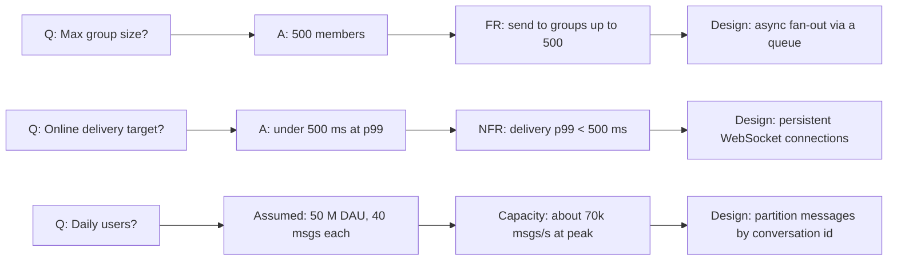
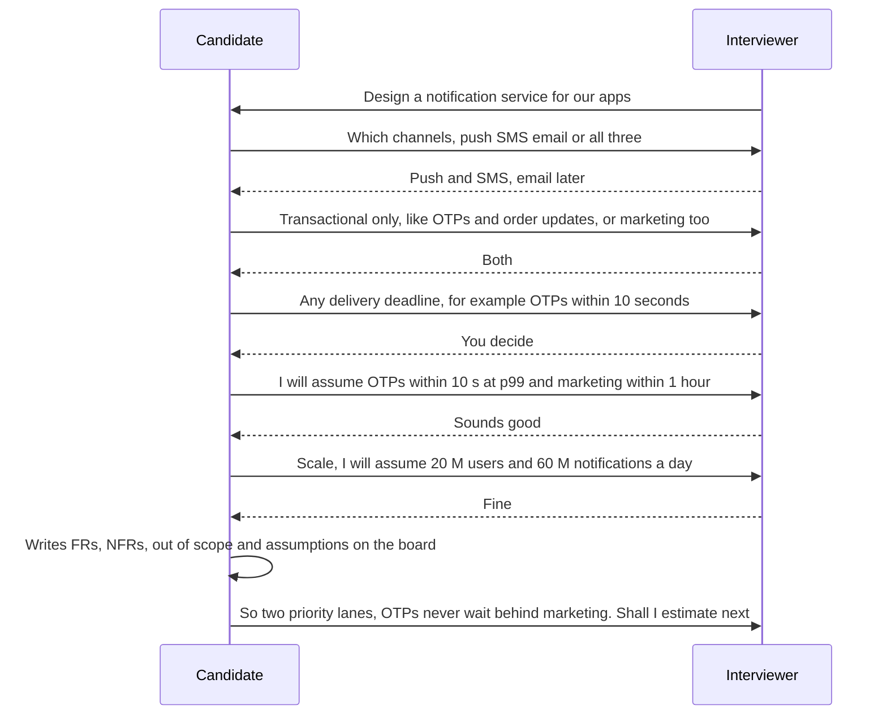

The first five minutes of a design interview decide much of the rest. A candidate who asks the right four questions and writes down crisp requirements has a map for the next forty minutes. A candidate who skips this designs for the wrong problem, or for every problem at once. This lesson gives you a practical method and a question bank for the common system types, and shows how to turn answers into requirements you can design against.

## Learning objectives

By the end of this lesson you will be able to:

1. Explain why clarifying questions matter and which kinds of answer change a design.
2. Group questions into five buckets: users and features, scale, quality targets, constraints, and scope.
3. Use a question bank for common system types (URL shortener, chat, feed, ride-hailing, file storage, payments, notifications, booking, rate limiter, search) and for LLD prompts.
4. State assumptions clearly, with numbers, when the interviewer says "you decide".
5. Turn answers into functional requirements, measurable non-functional requirements, an out-of-scope list and first capacity numbers.
6. Build a small C# tool that checks question coverage and derives capacity numbers from answers.

## Prerequisites

- [How system design interviews work](#/lesson/m19-interview-structure): where this phase sits in the time plan (about 5 minutes of a 45-minute round).
- [Functional and non-functional requirements](#/lesson/m02-requirements): what FRs and NFRs are.
- [Clarifying requirements in HLD](#/lesson/m11-clarifying-requirements): the HLD framework's version of this step. This lesson focuses on interview technique and a reusable question bank.

## Explain it like I'm a beginner

Imagine you're a tailor and a customer walks in and says, "I need a shirt." A bad tailor starts cutting cloth immediately. A good tailor asks a few quick questions first:

- "Is it for office, a wedding or daily wear?" (purpose, which decides the style)
- "When do you need it?" (deadline, which decides how elaborate it can be)
- "Cotton or linen? What budget?" (constraints)
- Then measures: chest, sleeve, length (the numbers).

The tailor doesn't ask 30 questions. They don't ask the customer's favourite film. They ask only what **changes the shirt**. And when the customer says "I don't mind, you choose", the tailor doesn't freeze. They say: "Then I'll make it in cotton, regular fit, ready by Friday. Is that all right?" That is **stating an assumption**.

A system design interview starts the same way. The interviewer says "Design a chat app." You ask a few questions that change the design: one-to-one or groups? How many users? Must messages arrive in order? Do we keep history? When they say "you decide", you pick a sensible answer, say it with a number, and move on.

Then you write the answers down as a short list, your **requirements**. Everything you design afterwards should trace back to that list.

## First-principles explanation

### Why clarifying questions exist

Design prompts are deliberately vague. "Design Instagram" could mean a photo-sharing app for a college of 2,000 students or a global platform with hundreds of millions of users. Those are completely different systems. The interviewer wants to see whether you:

1. **Notice the ambiguity** instead of guessing silently.
2. **Find the dimensions that matter** for this problem.
3. **Make decisions** and move forward when information is missing.

In real projects, the same skill prevents expensive mistakes. A team that builds for "real-time" when the users meant "within an hour" spends months on infrastructure nobody needed.

### The test for a good question

A good clarifying question passes one test: **would a different answer change my design?**

- "Should messages be end-to-end encrypted?" Yes. It changes whether the server can search, filter or index content.
- "What colour is the send button?" No. Don't ask it.
- "How many users?" Yes, but only if you'll turn the answer into a number that drives a decision.

If you can't say how an answer would change your design, skip the question.

### Five buckets

Group your questions so you cover the ground quickly and the interviewer can follow:

| Bucket | Example questions | What the answer changes |
|---|---|---|
| **1. Users and core features** | Who are the users? What are the 2–4 must-have actions? | The APIs, the data model, which flows you design |
| **2. Scale** | Daily active users? Actions per user per day? Read/write ratio? Data size per item? Growth? | Capacity numbers: RPS, storage, bandwidth, and so whether you need caching, sharding or queues |
| **3. Quality targets (NFRs)** | Latency target? Availability? Can data be stale? Can we lose data? Ordering? | Consistency model, replication, caching strategy, sync versus async |
| **4. Constraints** | Existing stack? Regions and data residency? Compliance (payments, health, government)? Budget? Team size? | Technology choices, deployment, security design |
| **5. Scope** | What's explicitly out of scope? Admin tools? Analytics? Mobile and web? | Where you *don't* spend time |

Most interviews need **4–8 questions** in total, picked from these buckets. You don't need every bucket for every problem. A rate limiter has almost no "users and features" questions. A booking system has many.

### Asking versus assuming

You'll often hear "What do you think?" or "You decide." That's not a trap. It's an invitation to show judgement. The pattern is:

> **State the assumption + give a one-line reason + invite correction.**
>
> "I'll assume 10 million daily users, which is a large national app but not global. If you had a different scale in mind, I'll adjust."

Rules for good assumptions:

- **Use numbers.** "A lot of users" is useless. "10 M DAU, 20 actions each a day" lets you compute.
- **Use realistic, round numbers** that make arithmetic easy: 1 M, 10 M, 100 M. Precision isn't the point.
- **Prefer the assumption that makes the problem interesting but not absurd.** For a chat app, assuming 500 users makes the round trivial. Assuming 5 billion makes it fantasy. 50–100 M DAU lets you show real techniques.
- **Write them down** on the board, so you and the interviewer can point back at them.
- **Revisit them** if the interviewer changes something later.

### Turning answers into requirements

At the end of clarification, you should have four short lists on the board:

1. **Functional requirements (FRs)**: 3–5 verbs the system must support. "Users can send a message to a group of up to 500 members."
2. **Non-functional requirements (NFRs)**: each with a **metric and a target**. "Message delivery p99 under 500 ms for online recipients." "99.95 % availability for sending." "No acknowledged message is ever lost."
3. **Out of scope**: what you won't design. "Voice and video calls, message search, admin moderation tools."
4. **Assumptions**: the numbers you assumed, marked as assumed.

Then derive the first capacity numbers (covered in depth in [Estimation practice drills](#/lesson/m19-estimation-practice)):

- 50 M DAU × 40 messages a day = 2 B messages a day.
- 2 B ÷ 86,400 s ≈ 23,000 messages per second on average. Assume ×3 at peak ≈ 70,000 per second.
- 2 B × 200 bytes ≈ 400 GB a day of message data, about 146 TB a year before replication.

And say what the numbers mean: "70,000 writes per second is well beyond one relational primary, so we'll need to partition message storage. I'll partition by conversation id."

### Making NFRs measurable

The most common weakness is vague NFRs. Convert every adjective into a number:

| Vague | Measurable |
|---|---|
| "Fast" | "Feed loads in under 300 ms at p95 for cached users" |
| "Highly available" | "99.9 % monthly availability for redirects (about 43 minutes of downtime a month)" |
| "Real-time" | "Location updates reach the customer within 5 seconds" |
| "Scalable" | "Handles 3× today's peak of 2,000 RPS without re-architecture" |
| "Consistent" | "A seat is never sold twice. Seat-count displays may lag by up to 10 seconds" |
| "Secure" | "Card data never touches our servers (tokenised by the gateway). All admin actions audited" |

Notice the "consistent" row splits into two different requirements. Strong candidates separate the parts that must be strongly consistent from the parts that can be eventually consistent. That split often decides the whole architecture.

### Question bank by system type

Use these as starting points, not scripts. Pick the 4–8 that matter for the prompt you're given.

**URL shortener**

| Question | Why it matters |
|---|---|
| Read/write ratio? (assume about 100:1) | Read-heavy, so cache redirects aggressively |
| Custom aliases? Expiry? | Uniqueness checks, cleanup jobs |
| Click analytics needed, and how fresh? | 301 versus 302 redirects, async event pipeline |
| Can a short code ever be reused? | Code generation and storage lifetime |

**Chat or messaging**

| Question | Why it matters |
|---|---|
| One-to-one only, or groups? Max group size? | Fan-out cost, delivery design |
| Online delivery latency target? Offline delivery? | Persistent connections, push notifications, inbox storage |
| Message ordering guarantees? | Per-conversation sequencing |
| History kept how long? Multi-device sync? | Storage size, sync protocol |
| End-to-end encryption? | Server can't read content: no server-side search |

**News feed or timeline**

| Question | Why it matters |
|---|---|
| Chronological or ranked? | Simple merge versus a ranking service |
| Average and maximum followers? | Fan-out on write versus fan-out on read, celebrity handling |
| How fresh must the feed be? | Precomputation and cache TTLs |
| Media in posts? | Object storage and CDN |

**Ride-hailing or live location**

| Question | Why it matters |
|---|---|
| How often do drivers send location? | Write rate (often the biggest number in the system) |
| Matching radius and target time to match? | Geospatial index choice, matching algorithm |
| One city or many? Surge pricing in scope? | Partitioning by region, extra services |
| What happens when a driver's phone loses signal? | Timeouts, state recovery |

**File storage or sharing**

| Question | Why it matters |
|---|---|
| Max file size? Average size? | Chunked or resumable uploads, direct-to-storage |
| Sync across devices? Conflict handling? | Versioning, sync protocol |
| Sharing permissions model? | Access control design |
| Retention, versioning, deletion rules? | Storage cost, lifecycle policies |

**Payments**

| Question | Why it matters |
|---|---|
| Which payment methods? (cards, UPI, wallets) | Gateway integrations, async confirmation flows |
| Do we store card data? (almost always: no) | PCI DSS scope, tokenisation |
| Refunds and partial captures? | State machine complexity |
| Reconciliation with the bank or gateway? | Ledger design, daily jobs |
| Idempotency for retries? | Idempotency keys on every write |

**Notification system**

| Question | Why it matters |
|---|---|
| Channels: push, SMS, email, in-app? | Provider integrations, per-channel workers |
| Transactional, marketing, or both? | Priority queues, rate limits, opt-out rules |
| Delivery guarantees and deduplication? | At-least-once plus idempotent sends |
| User preferences and quiet hours? | Preference service, scheduling |

**Booking or ticketing**

| Question | Why it matters |
|---|---|
| Seat selection or general admission? | Row-level locking versus counters |
| Peak demand at sale opening? | Waiting room, admission control |
| How long is a seat held during payment? | Hold expiry and cleanup |
| Can we oversell and compensate (like airlines), or never? | Strong consistency on inventory |

**Rate limiter**

| Question | Why it matters |
|---|---|
| Limit by user, API key, IP, or endpoint? | Key design, memory size |
| Single region or global limits? | Local counters versus shared store |
| Hard limit or soft (allow small overshoot)? | Algorithm choice (token bucket, sliding window) |
| What do rejected clients see? | 429 with Retry-After, headers |

**Search or autocomplete**

| Question | Why it matters |
|---|---|
| Corpus size and update rate? | Index size, indexing pipeline |
| Latency target per keystroke? | Precomputed prefixes, caching at the edge |
| Personalised or global suggestions? | Per-user data, privacy |
| Typo tolerance, multiple languages? | Search engine choice |

**LLD prompts (parking lot, elevator, vending machine, library)**

In LLD rounds, questions are about **entities, rules and edge cases**, not scale:

| Question | Why it matters |
|---|---|
| Which types exist? (vehicle sizes, coin denominations, book copies) | Class hierarchy or enums |
| What are the operations? | Public methods |
| What happens at the edges? (lot full, exact change unavailable, lost book) | Error handling, states |
| Concurrency? (two cars at two gates claiming one spot) | Locking or atomic allocation |
| What's likely to change? (new vehicle type, new payment method) | Where to put interfaces |

### Common mistakes

- **Interrogation**: 15 questions in a row. The interviewer gets bored, and you burn the clock. Ask 4–8, grouped.
- **Unused answers**: asking for DAU and never computing anything with it.
- **Leading with technology**: "Can I use Kafka?" isn't a requirements question.
- **Not writing anything down**, so assumptions drift during the session.
- **Asking what the interviewer wants to see** ("What should I focus on?") before showing any thinking. It's better to propose a focus and ask whether it fits.
- **Treating the requirements as fixed.** If the interviewer changes a requirement later, update the board and say what it changes in the design. See [Handling changing requirements](#/lesson/m19-changing-requirements).

### When less clarification is better

Some interviewers give a fully specified prompt: "Design a URL shortener for 100 M new links a month, 10 B redirects a month, 99.99 % availability." Don't re-ask what's already given. Confirm briefly ("So it's very read-heavy, about 4,000 redirects a second on average"), ask one or two genuinely open questions, and move on.

## Visual explanation

### From question to design decision



Read each row left to right. A question gets an answer, or an assumption when the interviewer leaves it to you. The answer becomes a requirement or a capacity number. The requirement drives a design decision. This chain is what interviewers want to see: every box on your final architecture should trace back to a requirement, and every requirement should trace back to a question or a stated assumption. If a design box has no arrow coming into it, ask yourself why it's there.

### A clarification dialogue



This shows the rhythm. Each question is short and specific. When the interviewer says "you decide", the candidate states an assumption with a number and gets a quick nod. The interviewer's answer "both" (transactional and marketing) is the most important one here. The candidate immediately draws a design consequence: two priority lanes so OTPs never queue behind a marketing blast. Clarification ends with a written summary and a transition to estimation.

## Step-by-step example

Prompt: **"Design a system that alerts contractors about new government tenders that match their interests."**

### Step 1 — restate in one sentence

"So: tenders are published on several government portals. Contractors register their interests, and we notify them when a matching tender appears."

### Step 2 — ask grouped questions (about 3 minutes)

- **Users and features**: "What defines a match: category, region, value range, keywords? Do contractors need to see the tender document in our app, or just a link?" *Answer: category, state, value range and keywords. Link plus a summary is enough.*
- **Scale**: "How many contractors and how many new tenders a day?" *Answer: you decide.*
  → **Assumption:** "I'll assume 200,000 registered contractors, each with about 5 saved searches, and about 8,000 new tenders a day across portals."
- **Quality**: "How quickly after publication must the alert arrive?" *Answer: within an hour is fine. Some urgent categories within 15 minutes.*
- **Constraints**: "Do portals offer an API, or do we scrape?" *Answer: mixed. Some have RSS or APIs, others need scraping.*
- **Scope**: "Should I cover bid submission, or only discovery and alerts?" *Answer: only discovery and alerts.*

### Step 3 — write the four lists

**FRs**

1. Ingest new tenders from multiple portals (API, RSS, scraping).
2. Contractors create, edit and delete saved searches (category, state, value range, keywords).
3. Match each new tender against saved searches.
4. Notify by email and push, with a daily digest option.

**NFRs**

- Alert within 60 minutes of publication at p95. Urgent categories within 15 minutes.
- No tender silently missed: every portal fetch is monitored, and failures alert the ops team within 30 minutes.
- No duplicate alerts for the same tender and saved search.
- 99.5 % availability for the contractor web app. Ingestion can tolerate short outages if it catches up.

**Out of scope**: bid submission, document storage, payments for premium plans.

**Assumptions**: 200,000 contractors, 1 M saved searches, 8,000 tenders a day.

### Step 4 — derive first numbers

- Tenders: 8,000 a day ÷ 86,400 ≈ 0.1 per second. Tiny.
- Matching: a naive approach checks every tender against every saved search: 8,000 × 1 M = 8 billion checks a day ≈ 93,000 per second. That's the hot spot.
- **Decision:** invert the problem. Index saved searches by category and state, so each tender is compared only with searches in its category and state, perhaps a few thousand rather than a million. Keyword matching runs only on that small set.
- Notifications: assume 2 % of searches match each day ≈ 20,000 alerts a day. Small.

Now you know where the design effort goes: **matching and reliable ingestion**, not raw scale. That came directly from the questions.

## Production-style C# implementation

This tool supports practice and real requirement workshops. It provides a question bank, checks which question buckets you've covered for a given system type, derives capacity numbers from scale answers, and validates a requirements sheet (for example, flagging NFRs without numeric targets).

```text
Clarify.Api/
  Program.cs
  Requirements/QuestionBank.cs
  Requirements/CoverageChecker.cs
  Requirements/CapacityDeriver.cs
  Requirements/RequirementsSheet.cs
```

```csharp file=Requirements/QuestionBank.cs
namespace Clarify.Requirements;

public enum Bucket { UsersAndFeatures, Scale, QualityTargets, Constraints, Scope }

public enum SystemKind { UrlShortener, Chat, NewsFeed, RideHailing, FileStorage, Payments, Notifications, Booking, RateLimiter, Search }

public sealed record ClarifyingQuestion(Bucket Bucket, string Text, string ChangesInDesign);

public static class QuestionBank
{
    private static readonly Dictionary<SystemKind, ClarifyingQuestion[]> Bank = new()
    {
        [SystemKind.UrlShortener] =
        [
            new(Bucket.Scale, "New links per month and redirects per month?", "Read/write ratio, cache sizing"),
            new(Bucket.UsersAndFeatures, "Custom aliases and expiry?", "Uniqueness checks, cleanup jobs"),
            new(Bucket.QualityTargets, "Redirect latency and availability targets?", "Caching, multi-region"),
            new(Bucket.Scope, "Are click analytics in scope, and how fresh?", "301 vs 302, async events"),
        ],
        [SystemKind.Chat] =
        [
            new(Bucket.UsersAndFeatures, "One-to-one, groups, or both? Max group size?", "Fan-out design"),
            new(Bucket.Scale, "Daily users and messages per user?", "Partitioning, connection count"),
            new(Bucket.QualityTargets, "Delivery latency, ordering and durability guarantees?", "Sequencing, acks, storage"),
            new(Bucket.Constraints, "End-to-end encryption required?", "Server-side search and moderation"),
            new(Bucket.Scope, "Voice, video, search in scope?", "Where not to spend time"),
        ],
        [SystemKind.Payments] =
        [
            new(Bucket.UsersAndFeatures, "Payment methods, refunds, partial captures?", "State machine, integrations"),
            new(Bucket.Constraints, "Do we store card data? Which compliance rules apply?", "PCI scope, tokenisation"),
            new(Bucket.QualityTargets, "Can we ever double-charge or lose a payment?", "Idempotency, ledger, reconciliation"),
            new(Bucket.Scale, "Transactions per day and at peak?", "Throughput, gateway limits"),
        ],
        [SystemKind.Booking] =
        [
            new(Bucket.UsersAndFeatures, "Seat selection or general admission?", "Row locks vs counters"),
            new(Bucket.Scale, "Peak demand when sales open?", "Waiting room, admission control"),
            new(Bucket.QualityTargets, "Is overselling ever acceptable?", "Consistency of inventory"),
            new(Bucket.UsersAndFeatures, "How long is a seat held during payment?", "Hold expiry"),
        ],
        [SystemKind.Notifications] =
        [
            new(Bucket.UsersAndFeatures, "Which channels? Transactional, marketing or both?", "Workers per channel, priority lanes"),
            new(Bucket.QualityTargets, "Delivery deadline per type? Duplicates acceptable?", "Queues, idempotent sends"),
            new(Bucket.Scale, "Notifications per day, and the biggest single blast?", "Burst handling, provider rate limits"),
            new(Bucket.Constraints, "Opt-out, quiet hours and regulatory rules?", "Preference checks before send"),
        ],
    };

    public static IReadOnlyList<ClarifyingQuestion> For(SystemKind kind) =>
        Bank.TryGetValue(kind, out var q) ? q : [];
}
```

The coverage checker answers one practical question: "Have I asked about everything that usually matters for this kind of system?" Each system type has must-ask buckets. A rate limiter, for instance, doesn't need a users-and-features question.

```csharp file=Requirements/CoverageChecker.cs
namespace Clarify.Requirements;

public static class CoverageChecker
{
    private static readonly Bucket[] All = [Bucket.UsersAndFeatures, Bucket.Scale, Bucket.QualityTargets, Bucket.Constraints, Bucket.Scope];

    /// <summary>Buckets that are usually decisive for each system type, in the order to ask them.</summary>
    public static IReadOnlyList<Bucket> MustAsk(SystemKind kind) => kind switch
    {
        SystemKind.RateLimiter => [Bucket.Scale, Bucket.QualityTargets, Bucket.Constraints],
        SystemKind.UrlShortener => [Bucket.Scale, Bucket.UsersAndFeatures, Bucket.QualityTargets, Bucket.Scope],
        SystemKind.Payments => [Bucket.UsersAndFeatures, Bucket.QualityTargets, Bucket.Constraints, Bucket.Scale, Bucket.Scope],
        _ => All,
    };

    public static IReadOnlyList<Bucket> Missing(SystemKind kind, IEnumerable<Bucket> asked)
    {
        var done = asked.ToHashSet();
        return MustAsk(kind).Where(b => !done.Contains(b)).ToList();
    }
}
```

The capacity deriver turns scale answers into the first numbers. Every output is labelled as an estimate, because it rests on assumptions.

```csharp file=Requirements/CapacityDeriver.cs
namespace Clarify.Requirements;

public sealed record ScaleAnswers(
    long DailyActiveUsers,
    double WritesPerUserPerDay,
    double ReadsPerWrite,
    double PeakFactor,
    int BytesPerWrite,
    int RetentionYears,
    int ReplicationFactor = 3);

public sealed record CapacityEstimate(
    double AvgWritesPerSecond,
    double PeakWritesPerSecond,
    double PeakReadsPerSecond,
    double StorageTerabytes,
    IReadOnlyList<string> Notes);

public static class CapacityDeriver
{
    private const double SecondsPerDay = 86_400;

    public static CapacityEstimate Derive(ScaleAnswers a)
    {
        if (a.DailyActiveUsers <= 0 || a.WritesPerUserPerDay <= 0 || a.PeakFactor < 1 || a.BytesPerWrite <= 0 || a.RetentionYears <= 0 || a.ReplicationFactor < 1)
            throw new ArgumentException("Scale answers must be positive, and the peak factor at least 1.");

        var writesPerDay = a.DailyActiveUsers * a.WritesPerUserPerDay;
        var avgWrites = writesPerDay / SecondsPerDay;
        var peakWrites = avgWrites * a.PeakFactor;
        var peakReads = peakWrites * a.ReadsPerWrite;
        var storageTb = writesPerDay * a.BytesPerWrite * 365.0 * a.RetentionYears * a.ReplicationFactor / 1e12;

        var notes = new List<string> { "All figures are estimates based on stated assumptions." };
        // Rough rules of thumb for interviews, not limits: real capacity depends on hardware, schema and queries.
        if (peakWrites > 5_000) notes.Add("Peak writes are high for a single relational primary: consider partitioning or batching.");
        if (peakReads > 10 * Math.Max(peakWrites, 1)) notes.Add("Read-heavy: caching and read replicas are likely worthwhile.");
        if (storageTb > 50) notes.Add("Large retained data: plan tiered or object storage.");

        return new CapacityEstimate(Math.Round(avgWrites, 1), Math.Round(peakWrites, 1), Math.Round(peakReads, 1), Math.Round(storageTb, 2), notes);
    }
}
```

The requirements sheet is the four lists from the board, plus a validator that encodes this lesson's rules.

```csharp file=Requirements/RequirementsSheet.cs
namespace Clarify.Requirements;

public enum Quality { Latency, Availability, Durability, Consistency, Freshness, Throughput, Security }

public sealed record FunctionalRequirement(string Id, string Text);

/// <summary>A measurable NFR: metric (e.g. "p99 delivery"), comparison and numeric target with a unit.</summary>
public sealed record NonFunctionalRequirement(string Id, Quality Quality, string Metric, string Comparison, double? Target, string Unit);

public sealed record Assumption(string Text, bool ConfirmedByInterviewer);

public sealed class RequirementsSheet
{
    public List<FunctionalRequirement> Functional { get; } = [];
    public List<NonFunctionalRequirement> NonFunctional { get; } = [];
    public List<string> OutOfScope { get; } = [];
    public List<Assumption> Assumptions { get; } = [];

    public IReadOnlyList<string> Validate()
    {
        var issues = new List<string>();
        if (Functional.Count == 0) issues.Add("No functional requirements.");
        if (Functional.Count > 6) issues.Add($"{Functional.Count} functional requirements: is the scope too wide for one session?");
        foreach (var n in NonFunctional.Where(n => n.Target is null || string.IsNullOrWhiteSpace(n.Unit)))
            issues.Add($"{n.Id} ({n.Quality}) has no numeric target and unit. Make it measurable.");
        if (NonFunctional.Count == 0) issues.Add("No non-functional requirements: what latency, availability or durability is needed?");
        if (OutOfScope.Count == 0) issues.Add("Nothing listed as out of scope. Say what you will not design.");
        foreach (var a in Assumptions.Where(a => !a.ConfirmedByInterviewer))
            issues.Add($"Assumption not yet confirmed: \"{a.Text}\".");
        var dupes = Functional.GroupBy(f => f.Id).Where(g => g.Count() > 1).Select(g => g.Key);
        issues.AddRange(dupes.Select(d => $"Duplicate requirement id {d}."));
        return issues;
    }
}
```

```csharp file=Program.cs
using Clarify.Requirements;

var builder = WebApplication.CreateBuilder(args);
var app = builder.Build();

app.MapGet("/question-bank/{kind}", (SystemKind kind) => Results.Ok(QuestionBank.For(kind)));

app.MapPost("/coverage/{kind}", (SystemKind kind, List<Bucket> asked) =>
    Results.Ok(new { missing = CoverageChecker.Missing(kind, asked) }));

app.MapPost("/capacity", (ScaleAnswers answers) =>
{
    try { return Results.Ok(CapacityDeriver.Derive(answers)); }
    catch (ArgumentException ex) { return Results.Problem(ex.Message, statusCode: StatusCodes.Status400BadRequest); }
});

app.MapPost("/requirements/validate", (RequirementsSheetDto dto) =>
{
    var sheet = new RequirementsSheet();
    sheet.Functional.AddRange(dto.Functional);
    sheet.NonFunctional.AddRange(dto.NonFunctional);
    sheet.OutOfScope.AddRange(dto.OutOfScope);
    sheet.Assumptions.AddRange(dto.Assumptions);
    return Results.Ok(new { issues = sheet.Validate() });
});

app.Run();

public sealed record RequirementsSheetDto(
    List<FunctionalRequirement> Functional,
    List<NonFunctionalRequirement> NonFunctional,
    List<string> OutOfScope,
    List<Assumption> Assumptions);
```

For enum route values such as `/question-bank/Chat`, minimal APIs bind by name. Add `JsonStringEnumConverter` to the JSON options if you want enums as strings in request and response bodies too.

## Bad design vs good design

**Bad opening (prompt: "Design a ride-hailing app"):**

> "How many users? What database are you using? Should I use microservices? Do you want Kafka? Is it on AWS or Azure? What about drivers? How many cities? Do you want surge pricing? Payments? Ratings? Chat between rider and driver? Scheduled rides?"

Problems: twelve questions in a row, no grouping, several are technology questions, nothing is written down, and no assumptions are stated. Two minutes later the candidate still doesn't know which part matters.

**Good opening:**

> "Let me scope this. Core flow: a rider requests a ride, we match a nearby driver, both see live location until drop-off. I'll leave payments, ratings and scheduled rides out unless you want them.
>
> Scale: I'll assume one large country, 5 M daily rides, about 500,000 drivers online at peak, each sending GPS every 4 seconds. That's about 125,000 location updates a second at peak, so location ingestion is the biggest load.
>
> Quality: match within 30 seconds for most requests, rider sees driver location within 5 seconds of a move, and a ride must never be assigned to two drivers.
>
> Does that match what you'd like to explore?"

Four buckets in about a minute. Assumptions with numbers. One estimate that names the hard part. A consistency requirement split out ("never two drivers") from the freshness requirement ("within 5 seconds"). And a check-in.

:::callout type=tip title="Write it down as you go"
Keep a small "Requirements" box in the corner of the whiteboard: FRs, NFRs, out of scope, assumptions. Point at it when you make a design decision. It shows your design is driven by requirements, and it protects you when the interviewer later asks "why did you add this?"
:::

:::callout type=mistake title="Asking for permission instead of making a call"
"Is it OK if I assume 10 million users?" invites a yes/no exchange for every number. Prefer "I'll assume 10 million users; tell me if you have a different scale in mind." Same politeness, less back-and-forth, and it shows you're comfortable making decisions.
:::

## Practical playground

The playground checks which question buckets you've covered for a system type and lists what's missing, in the order you should ask. Change the system type and the asked buckets, and compare the output against the question bank above.

:::playground type=csharp title="Check your question coverage"
```csharp file=Program.cs
using System;
using System.Collections.Generic;
using System.Linq;

public enum Bucket { UsersAndFeatures, Scale, QualityTargets, Constraints, Scope }

public static class Program
{
    private static readonly Dictionary<string, Bucket[]> MustAsk = new()
    {
        ["chat"] = new[] { Bucket.UsersAndFeatures, Bucket.Scale, Bucket.QualityTargets, Bucket.Constraints, Bucket.Scope },
        ["rate-limiter"] = new[] { Bucket.Scale, Bucket.QualityTargets, Bucket.Constraints },
        ["url-shortener"] = new[] { Bucket.Scale, Bucket.UsersAndFeatures, Bucket.QualityTargets, Bucket.Scope },
    };

    public static void Main()
    {
        var system = "chat";
        var asked = new[] { Bucket.Scale, Bucket.UsersAndFeatures };   // what you asked so far

        var missing = MustAsk[system].Where(b => !asked.Contains(b)).ToList();
        Console.WriteLine($"System: {system}");
        Console.WriteLine(missing.Count == 0
            ? "All key buckets covered. Summarise and move to estimation."
            : "Still to cover: " + string.Join(", ", missing));
    }
}
```
:::

## Exercises

:::exercise id=m19-clarifying-questions-ex1 difficulty=beginner kind=written title="Clarify a metro parking booking app"
Prompt: **"Design an app that lets commuters book a parking spot at metro stations."**

Write: (1) a one-sentence restatement, (2) 5–7 clarifying questions grouped by bucket, each with one line on how the answer would change your design, (3) the assumptions you'd state if the interviewer said "you decide" to all of them, and (4) the four lists: FRs, NFRs (measurable), out of scope, assumptions.
::acceptance
- Questions cover at least four of the five buckets.
- Every question has a "changes the design because…" line.
- Assumptions use numbers (stations, spots, bookings, peak times).
- NFRs each have a metric and a target.
- At least one requirement separates strong consistency (no double booking) from looser freshness.
::hint
What's the scarce resource, and when is demand highest?
::hint
Think about what happens when someone books but doesn't turn up. Does the spot stay blocked all day?
::hint
Strong consistency: one spot, one booking per time slot. What can be eventually consistent? The "spots available" count shown on the home screen.
::hint
Useful numbers: stations in the network, spots per station, the share booked in advance, the morning peak window.
::solution
**Restatement:** "Commuters reserve a parking spot at a chosen metro station for a time window, and enter with that booking."

**Questions:**

- *Users and features*: Daily bookings only, or also monthly passes? (Passes reserve capacity long-term and change inventory logic.) How do users enter: number-plate recognition, QR, or attendant? (Integration with gate hardware, offline behaviour.)
- *Scale*: How many stations and spots? What's the morning peak? (Contention and admission design.)
- *Quality*: Can a spot ever be double-booked? How fresh must the availability count be? (Strong consistency on spot allocation versus a cached count.)
- *Constraints*: Payment required at booking, and which methods (UPI, cards)? (Hold-then-pay flow, payment timeout handling.)
- *Scope*: Are dynamic pricing and penalties for no-shows in scope? (Extra services, worth stating as out of scope.)

**Assumptions:** 120 stations, 200 spots each (24,000 spots). 70 % of spots bookable in advance. Most bookings are made the evening before or 7–9 am. Bookings are for the day (one slot per day). UPI payment at booking. No-shows release the spot at 11 am.

**FRs:**

1. Search stations and see available spots for a date.
2. Book and pay for a spot (hold for 5 minutes while paying).
3. Enter and exit using a QR code checked at the gate.
4. Cancel before 7 am for a refund.

**NFRs:**

- A spot is never allocated to two bookings for the same day (strong consistency).
- Availability counts on search may lag by up to 30 seconds.
- Booking confirmation within 3 s at p95, excluding the payment app's own time.
- Gate check-in works offline for up to 2 hours (gates cache the day's valid QR codes).
- 99.9 % availability during 6–10 am.

**Out of scope:** dynamic pricing, monthly passes, EV charging, penalties.

**Quick estimate:** 24,000 × 0.7 ≈ 17,000 bookings a day. Even if half arrive in one hour, that's about 2.3 bookings per second. Low throughput, so the design focus is correctness (no double booking) and gate reliability, not scale.
::mistakes
- Asking only about scale and skipping the gate. Offline gate behaviour is a real design driver.
- Writing "the system should be fast" instead of a target.
- Forgetting no-shows, which leave spots blocked and waste capacity.
:::

:::exercise id=m19-clarifying-questions-ex2 difficulty=beginner kind=code title="Which buckets are still missing?"
Implement `QuestionCoverage.Missing`. Given a system type and the questions asked so far (each tagged with a bucket), return the must-ask buckets not yet covered, in priority order.
::requirements
- Must-ask buckets by system (in this order):
  - `RateLimiter`: Scale, Quality, Constraints
  - `UrlShortener`: Scale, Features, Quality, Scope
  - every other system: Features, Scale, Quality, Constraints, Scope
- A bucket counts as covered if at least one asked question has that bucket.
- Questions with blank text don't count.
- Also implement `IsReadyToEstimate`: true when both Scale and Quality are covered (if they are must-ask for that system).
::acceptance
- Chat with only a Scale question asked returns Features, Quality, Constraints, Scope.
- Rate limiter never asks for Features.
- Blank questions are ignored.
- `IsReadyToEstimate` is false until Scale and Quality are both covered.
::hint
Start with a `switch` expression that returns the must-ask list for each system.
::hint
Build a `HashSet<Area>` of covered buckets from the non-blank questions.
::hint
`Missing` keeps the must-ask order: `mustAsk.Where(b => !covered.Contains(b))`.
::hint
For `IsReadyToEstimate`, check that neither Scale nor Quality appears in `Missing`.
::starter
```csharp file=QuestionCoverage.cs
using System;
using System.Collections.Generic;
using System.Linq;

public enum Area { Features, Scale, Quality, Constraints, Scope }
public enum SystemType { Chat, UrlShortener, RateLimiter, Booking, Payments }

public sealed record AskedQuestion(Area Area, string Text);

public static class QuestionCoverage
{
    public static IReadOnlyList<Area> Missing(SystemType system, IEnumerable<AskedQuestion> asked) => throw new NotImplementedException();
    public static bool IsReadyToEstimate(SystemType system, IEnumerable<AskedQuestion> asked) => throw new NotImplementedException();
}
```
::tests
```csharp file=QuestionCoverageTests.cs
using System.Linq;
using Xunit;

public class QuestionCoverageTests
{
    private static AskedQuestion Q(Area a, string t = "a real question?") => new(a, t);

    [Fact]
    public void Chat_missing_in_priority_order() =>
        Assert.Equal(new[] { Area.Features, Area.Quality, Area.Constraints, Area.Scope },
                     QuestionCoverage.Missing(SystemType.Chat, new[] { Q(Area.Scale) }).ToArray());

    [Fact]
    public void Rate_limiter_does_not_need_features() =>
        Assert.Empty(QuestionCoverage.Missing(SystemType.RateLimiter, new[] { Q(Area.Scale), Q(Area.Quality), Q(Area.Constraints) }));

    [Fact]
    public void Url_shortener_order() =>
        Assert.Equal(new[] { Area.Scale, Area.Features, Area.Quality, Area.Scope },
                     QuestionCoverage.Missing(SystemType.UrlShortener, new AskedQuestion[0]).ToArray());

    [Fact]
    public void Blank_questions_do_not_count() =>
        Assert.Contains(Area.Scale, QuestionCoverage.Missing(SystemType.Booking, new[] { Q(Area.Scale, "  ") }));

    [Fact]
    public void Ready_to_estimate_needs_scale_and_quality()
    {
        Assert.False(QuestionCoverage.IsReadyToEstimate(SystemType.Payments, new[] { Q(Area.Scale) }));
        Assert.True(QuestionCoverage.IsReadyToEstimate(SystemType.Payments, new[] { Q(Area.Scale), Q(Area.Quality) }));
    }
}
```
::solution
```csharp file=QuestionCoverage.cs
using System;
using System.Collections.Generic;
using System.Linq;

public enum Area { Features, Scale, Quality, Constraints, Scope }
public enum SystemType { Chat, UrlShortener, RateLimiter, Booking, Payments }

public sealed record AskedQuestion(Area Area, string Text);

public static class QuestionCoverage
{
    private static Area[] MustAsk(SystemType system) => system switch
    {
        SystemType.RateLimiter => new[] { Area.Scale, Area.Quality, Area.Constraints },
        SystemType.UrlShortener => new[] { Area.Scale, Area.Features, Area.Quality, Area.Scope },
        _ => new[] { Area.Features, Area.Scale, Area.Quality, Area.Constraints, Area.Scope },
    };

    public static IReadOnlyList<Area> Missing(SystemType system, IEnumerable<AskedQuestion> asked)
    {
        var covered = asked.Where(q => !string.IsNullOrWhiteSpace(q.Text)).Select(q => q.Area).ToHashSet();
        return MustAsk(system).Where(a => !covered.Contains(a)).ToList();
    }

    public static bool IsReadyToEstimate(SystemType system, IEnumerable<AskedQuestion> asked)
    {
        var missing = Missing(system, asked);
        return !missing.Contains(Area.Scale) && !missing.Contains(Area.Quality);
    }
}
```
Keeping the must-ask list as data in one `switch` means adding a new system type is one line, and the priority order is visible at a glance.
::mistakes
- Returning the missing buckets in enum order instead of priority order.
- Counting a blank or placeholder question as coverage.
- Hard-coding `IsReadyToEstimate` to look at the asked list directly, which ignores systems where a bucket isn't must-ask.
:::

:::exercise id=m19-clarifying-questions-ex3 difficulty=intermediate kind=code title="Turn scale answers into capacity numbers"
Implement `ScaleMath.Estimate`, which converts scale answers into the first capacity numbers and design hints.
::requirements
- Writes per day = DAU × writes per user per day.
- Average writes per second = writes per day ÷ 86,400. Peak writes = average × peak factor. Peak reads = peak writes × reads per write.
- Storage (TB) = writes per day × bytes per write × 365 × retention years × replicas ÷ 10¹².
- Round rates to 1 decimal and storage to 2 decimals.
- Hints, in this order, when they apply:
  - `"partition-writes"` when peak writes > 5,000 per second
  - `"cache-reads"` when peak reads ≥ 10 × peak writes
  - `"tiered-storage"` when storage > 50 TB
- Throw `ArgumentException` for non-positive DAU, writes per user, bytes, retention or replicas, or a peak factor below 1.
::acceptance
- 50 M DAU × 40 messages, peak ×3, 1 read per write, 200 B, 1 year, 3 replicas gives about 23,148.1 avg, 69,444.4 peak writes, and 438 TB, with hints partition-writes and tiered-storage.
- A small app gets no hints.
- A read-heavy URL shortener gets `cache-reads`.
- Invalid inputs throw.
::hint
Do the arithmetic in `double` and round only at the end.
::hint
Watch the units: bytes to terabytes is ÷ 10¹² (decimal TB), which is the usual convention in estimates.
::hint
Build the hints list in the order given, with three `if` statements.
::hint
50 M × 40 = 2 × 10⁹ writes per day. ÷ 86,400 ≈ 23,148.1. × 200 B × 365 × 3 ÷ 10¹² ≈ 438.
::starter
```csharp file=ScaleMath.cs
using System;
using System.Collections.Generic;

public sealed record ScaleInput(long Dau, double WritesPerUserPerDay, double ReadsPerWrite, double PeakFactor, int BytesPerWrite, int RetentionYears, int Replicas);

public sealed record ScaleOutput(double AvgWritesPerSec, double PeakWritesPerSec, double PeakReadsPerSec, double StorageTb, IReadOnlyList<string> Hints);

public static class ScaleMath
{
    public static ScaleOutput Estimate(ScaleInput input) => throw new NotImplementedException();
}
```
::tests
```csharp file=ScaleMathTests.cs
using System;
using Xunit;

public class ScaleMathTests
{
    [Fact]
    public void Chat_at_national_scale()
    {
        var r = ScaleMath.Estimate(new ScaleInput(50_000_000, 40, 1, 3, 200, 1, 3));
        Assert.Equal(23148.1, r.AvgWritesPerSec);
        Assert.Equal(69444.4, r.PeakWritesPerSec);
        Assert.Equal(438.0, r.StorageTb);
        Assert.Equal(new[] { "partition-writes", "tiered-storage" }, r.Hints);
    }

    [Fact]
    public void Small_app_has_no_hints()
    {
        var r = ScaleMath.Estimate(new ScaleInput(6_000, 5, 3, 3, 2_000, 1, 2));
        Assert.Empty(r.Hints);
        Assert.Equal(0.3, r.AvgWritesPerSec);
    }

    [Fact]
    public void Read_heavy_shortener_gets_cache_hint()
    {
        var r = ScaleMath.Estimate(new ScaleInput(1_000_000, 0.3, 100, 5, 500, 5, 3));
        Assert.Contains("cache-reads", r.Hints);
        Assert.DoesNotContain("partition-writes", r.Hints);
    }

    [Fact]
    public void Invalid_inputs_throw()
    {
        Assert.Throws<ArgumentException>(() => ScaleMath.Estimate(new ScaleInput(0, 1, 1, 1, 1, 1, 1)));
        Assert.Throws<ArgumentException>(() => ScaleMath.Estimate(new ScaleInput(10, 1, 1, 0.5, 1, 1, 1)));
        Assert.Throws<ArgumentException>(() => ScaleMath.Estimate(new ScaleInput(10, 1, 1, 2, 1, 1, 0)));
    }
}
```
::solution
```csharp file=ScaleMath.cs
using System;
using System.Collections.Generic;

public sealed record ScaleInput(long Dau, double WritesPerUserPerDay, double ReadsPerWrite, double PeakFactor, int BytesPerWrite, int RetentionYears, int Replicas);

public sealed record ScaleOutput(double AvgWritesPerSec, double PeakWritesPerSec, double PeakReadsPerSec, double StorageTb, IReadOnlyList<string> Hints);

public static class ScaleMath
{
    public static ScaleOutput Estimate(ScaleInput i)
    {
        if (i.Dau <= 0 || i.WritesPerUserPerDay <= 0 || i.BytesPerWrite <= 0 || i.RetentionYears <= 0 || i.Replicas <= 0)
            throw new ArgumentException("Inputs must be positive.");
        if (i.PeakFactor < 1) throw new ArgumentException("Peak factor must be at least 1.");

        var perDay = i.Dau * i.WritesPerUserPerDay;
        var avg = perDay / 86_400.0;
        var peak = avg * i.PeakFactor;
        var reads = peak * i.ReadsPerWrite;
        var tb = perDay * i.BytesPerWrite * 365.0 * i.RetentionYears * i.Replicas / 1e12;

        var hints = new List<string>();
        if (peak > 5_000) hints.Add("partition-writes");
        if (reads >= 10 * peak) hints.Add("cache-reads");
        if (tb > 50) hints.Add("tiered-storage");

        return new ScaleOutput(Math.Round(avg, 1), Math.Round(peak, 1), Math.Round(reads, 1), Math.Round(tb, 2), hints);
    }
}
```

In an interview, say the hint out loud, not just the number: "Peak is about 70,000 writes a second, which is beyond one relational primary, so I'll partition by conversation id." The 5,000-per-second threshold here is a rough rule of thumb for discussion, not a measured limit. Real capacity depends on hardware, schema and query patterns.
::mistakes
- Rounding the average before multiplying by the peak factor, which compounds rounding error.
- Using 1,024⁴ for TB in one place and 10¹² in another. Pick one and say which.
- Forgetting replicas, which typically triples storage.
:::

:::exercise id=m19-clarifying-questions-ex4 difficulty=intermediate kind=written title="Turn a transcript into a requirements sheet"
Here's a clarification transcript for "Design a system for daily progress reports on highway construction sites":

> **Candidate:** Who submits reports, and who reads them?
> **Interviewer:** Site engineers submit, project managers and the client's team read.
> **Candidate:** What's in a report?
> **Interviewer:** Quantities done per activity, labour and machinery counts, photos, issues.
> **Candidate:** How many sites?
> **Interviewer:** About 150 active sites, each with 3–5 engineers submitting.
> **Candidate:** When are they submitted?
> **Interviewer:** End of day, mostly 6–8 pm. Some sites have poor connectivity.
> **Candidate:** Do reports need approval?
> **Interviewer:** Yes, the site manager approves before the client sees it. Approved reports must never change.
> **Candidate:** Monthly summaries?
> **Interviewer:** Yes, the client wants a monthly progress report generated from the dailies.
> **Candidate:** Anything else?
> **Interviewer:** Up to you.

Produce: FRs, measurable NFRs, out of scope, assumptions (with numbers where the interviewer left gaps), and a quick estimate with one design conclusion.
::acceptance
- FRs capture submit, approve, read and monthly roll-up.
- NFRs include immutability after approval, offline or weak-network submission, and at least one latency or freshness target.
- Assumptions fill the gaps (photos per report, size, retention) with numbers.
- Estimate leads to a stated design conclusion.
::hint
"Approved reports must never change" is a strong requirement. How would you write it measurably and what does it imply for storage?
::hint
"Poor connectivity" plus "end of day" suggests an offline-first app with queued submission.
::hint
Photos will dominate storage. Assume a number per report and a size.
::hint
Roll-up from dailies to monthly suggests a batch job or a pre-aggregated table.
::solution
**FRs**

1. Site engineers create a daily report: activity quantities, labour, machinery, photos and issues.
2. Site manager approves or returns a report with comments.
3. PMs and client users view approved reports per site and date.
4. System generates a monthly progress report per site from approved dailies.

**NFRs**

- Approved reports are immutable: no update or delete is possible through any API. Corrections are new linked "amendment" records. All changes are audited.
- Submission works offline. Reports queue on the device and sync when connectivity returns, with no data loss for up to 48 hours offline.
- Report submission accepted within 5 s at p95 on a 1 Mbit/s link, excluding photo uploads, which continue in the background.
- Approved reports are visible to the client within 1 minute of approval.
- Monthly report generated within 1 hour after month close.

**Out of scope**: payroll from labour counts, machinery maintenance tracking, client billing.

**Assumptions**: 150 sites × 4 engineers = 600 reports a day. 10 photos each at about 2 MB after compression. Text part about 20 KB. Retention 10 years (contract and audit needs). Peak 6–8 pm.

**Estimate**

- Reports: 600 a day, 70 % in the 2-hour peak: 420 in 7,200 s ≈ 0.06 per second. Trivial.
- Photos: 600 × 10 × 2 MB = 12 GB a day, about 4.4 TB a year, about 44 TB over 10 years (before replication).
- **Conclusion:** throughput is tiny, so a single PostgreSQL database and a small API are enough. The design effort goes into (a) offline-first sync with idempotent submission, (b) direct-to-object-storage photo uploads with lifecycle tiering, and (c) enforcing immutability, with approved rows write-protected by the API and the database role, and amendments as new rows.
::mistakes
- Writing "reports should be secure and reliable" without measurable targets.
- Missing that "never change" needs an amendment mechanism, because real reports do contain mistakes.
- Storing photos in the database.
:::

:::exercise id=m19-clarifying-questions-ex5 difficulty=advanced kind=hld title="Same prompt, different answers: tender alerts"
Use the tender-alert example from this lesson. The interviewer gives you **two different sets of answers** to the same questions. Design for **Variant A**, starting from the starter graph, then explain in your notes exactly which parts would change for **Variant B**, and why.

- **Variant A**: 200,000 contractors, 1 M saved searches, 8,000 tenders a day, alerts within 60 minutes (15 for urgent categories), email and push only.
- **Variant B**: 5,000 contractors, 20,000 saved searches, 300 tenders a day, alerts by next morning, email only, built and run by one developer.
::acceptance
- Variant A design covers ingestion from multiple portals, matching, notification and monitoring of missed fetches.
- Matching is designed to avoid comparing every tender with every saved search.
- Duplicate alerts are prevented (idempotency on tender and search).
- Notes for Variant B remove components rather than adding them, and name what each removal saves.
- The link from each answer to each design choice is stated explicitly.
::hint
In Variant A, how many comparisons would naive matching do per day? What index would cut it down?
::hint
Ingestion is flaky, since portals change and scrapers break. What would tell you a portal silently stopped yielding tenders?
::hint
Dedup key: (tender_id, saved_search_id). A unique constraint does the job.
::hint
Variant B: 300 × 20,000 = 6 M comparisons a day. That's seconds of CPU in a single nightly job.
::hint
Variant A shape: scheduler → fetchers → raw store → normaliser → tenders DB → match workers (index by category and state) → alerts table (unique key) → notification workers → email and push providers, plus monitoring.
::starter
```json
{
  "nodes": [
    { "id": "portals", "type": "external", "label": "Government tender portals" },
    { "id": "app", "type": "app-server", "label": "Tender alert app" },
    { "id": "db", "type": "database", "label": "PostgreSQL" },
    { "id": "users", "type": "client", "label": "Contractors (web and mobile)" }
  ],
  "edges": [
    { "from": "app", "to": "portals", "kind": "sync", "label": "fetch tenders" },
    { "from": "app", "to": "db", "kind": "sync" },
    { "from": "users", "to": "app", "kind": "sync" }
  ]
}
```
::solution
**Variant A: what the answers imply**

- 8,000 tenders × 1 M searches = 8 B naive comparisons a day, so **index saved searches by (category, state)**. Each tender is checked against only the searches in its bucket, often a few thousand, then filtered by value range and keywords.
- 60 minutes (15 for urgent) means **frequent scheduled fetches** per portal (every 5–10 minutes for urgent categories), not a nightly batch.
- Flaky portals means **raw-response storage** (to re-parse after fixing a scraper) and **per-portal freshness monitoring**: alert if a portal yields zero tenders during working hours longer than usual.
- Email and push at about 20,000 alerts a day means **a queue plus notification workers**, with provider retries.

```json
{
  "nodes": [
    { "id": "sched", "type": "scheduler", "label": "Fetch scheduler (per portal, 5-30 min)" },
    { "id": "portals", "type": "external", "label": "Government tender portals (API, RSS, HTML)" },
    { "id": "fetch", "type": "worker", "label": "Portal fetchers and scrapers", "props": { "instances": 3 } },
    { "id": "raw", "type": "object-storage", "label": "Raw responses (for re-parsing)" },
    { "id": "norm", "type": "worker", "label": "Normaliser and dedup (portal + tender ref)" },
    { "id": "db", "type": "database", "label": "PostgreSQL: tenders, saved_searches (indexed by category, state), alerts (unique tender_id, search_id)", "props": { "replicas": 1, "multiAz": true } },
    { "id": "mq", "type": "queue", "label": "New-tender events" },
    { "id": "match", "type": "worker", "label": "Matchers", "props": { "instances": 2 } },
    { "id": "nq", "type": "queue", "label": "Alert deliveries (urgent and normal lanes)" },
    { "id": "notify", "type": "worker", "label": "Notification workers", "props": { "instances": 2 } },
    { "id": "email", "type": "external", "label": "Email provider" },
    { "id": "push", "type": "external", "label": "Push provider" },
    { "id": "lb", "type": "load-balancer", "label": "Load balancer" },
    { "id": "api", "type": "app-server", "label": "Contractor API (saved searches, alert history)", "props": { "instances": 2 } },
    { "id": "users", "type": "client", "label": "Contractors (web and mobile)" },
    { "id": "mon", "type": "monitoring", "label": "Per-portal freshness, scraper errors, queue age" }
  ],
  "edges": [
    { "from": "sched", "to": "fetch", "kind": "async", "label": "fetch job" },
    { "from": "fetch", "to": "portals", "kind": "sync" },
    { "from": "fetch", "to": "raw", "kind": "sync", "label": "store raw" },
    { "from": "fetch", "to": "norm", "kind": "async" },
    { "from": "norm", "to": "db", "kind": "sync", "label": "upsert tender" },
    { "from": "norm", "to": "mq", "kind": "async", "label": "tender created" },
    { "from": "mq", "to": "match", "kind": "async" },
    { "from": "match", "to": "db", "kind": "sync", "label": "candidate searches, insert alerts" },
    { "from": "match", "to": "nq", "kind": "async" },
    { "from": "nq", "to": "notify", "kind": "async" },
    { "from": "notify", "to": "email", "kind": "async" },
    { "from": "notify", "to": "push", "kind": "async" },
    { "from": "users", "to": "lb", "kind": "sync" },
    { "from": "lb", "to": "api", "kind": "sync" },
    { "from": "api", "to": "db", "kind": "sync" },
    { "from": "fetch", "to": "mon", "kind": "async" },
    { "from": "nq", "to": "mon", "kind": "async" }
  ]
}
```

Key points: the unique key on `alerts(tender_id, saved_search_id)` makes matching idempotent, so a re-run after a crash can't double-notify. Separate urgent and normal lanes stop a big batch from delaying urgent alerts. Raw storage plus freshness alerts address the "no tender silently missed" requirement.

**Variant B: what changes and why**

- 300 × 20,000 = 6 M comparisons a day, a few seconds of CPU. **Remove the matcher workers, both queues and the event flow.** Run one nightly job: fetch, normalise, match, insert alerts, send emails. Saves three component types and their monitoring.
- "Next morning" means **no frequent scheduler**. A single cron-style run at 5 am, plus a retry at 6 am.
- One developer means **one deployable app** (API plus the nightly job as a hosted background service), one PostgreSQL database, and a managed email service. No load balancer needed beyond what the hosting platform provides.
- Keep: raw-response storage (cheap insurance when scrapers break), the unique alert key (still prevents duplicates on re-runs), and a simple freshness check that emails the developer if a portal returned nothing.
- Push notifications are out, so remove the push provider.

The lesson: the *questions* were identical. The *answers* moved the design from an event-driven pipeline to a nightly job. That's why clarifying comes first.
::mistakes
- Designing Variant A without addressing the 8 B naive comparisons.
- Treating ingestion as reliable and forgetting freshness monitoring.
- For Variant B, keeping the queues "for future scale". The requirements don't justify them, and one developer has to run them.
- Not stating which answer drove which change.
::extensions
Add a Variant C: the client now requires alerts within 2 minutes for all categories, and two portals offer webhooks. Which parts of Variant A change?
:::

## Automated testing

The tools in this lesson are small, but their rules are worth pinning down:

- **Coverage rules**: one test per system type for its must-ask list, so a later edit can't silently drop a bucket.
- **Capacity maths**: golden cases with hand-computed values (like the 50 M DAU chat case), plus boundary tests for each hint threshold.
- **Requirements validation**: one minimal sheet per rule that breaks only that rule.

```csharp
public class RequirementsSheetTests
{
    [Fact]
    public void Vague_nfr_is_flagged()
    {
        var sheet = new RequirementsSheet();
        sheet.Functional.Add(new("FR1", "Send a message to a group"));
        sheet.NonFunctional.Add(new("NFR1", Quality.Latency, "delivery", "fast", null, ""));
        sheet.OutOfScope.Add("Voice calls");
        Assert.Contains(sheet.Validate(), i => i.Contains("NFR1"));
    }

    [Fact]
    public void Capacity_for_chat_matches_hand_calculation()
    {
        var e = CapacityDeriver.Derive(new ScaleAnswers(50_000_000, 40, 1, 3, 200, 1));
        Assert.Equal(23148.1, e.AvgWritesPerSecond);
        Assert.Equal(438.0, e.StorageTerabytes);
    }
}
```

For your own practice, the best test is a partner: after your five minutes of clarification, they read your four lists back to you. If they can't explain what you're building and what you aren't, the lists need work.

## Real-world application

- **Requirement workshops** with clients use exactly this method: grouped questions, numbers, explicit assumptions confirmed in writing, and an out-of-scope list. In consulting, the out-of-scope list is often what prevents disputes later.
- **Government and infrastructure projects** often come with a long tender document. Clarifying questions become formal pre-bid queries. Each answer changes the scope, so record them as numbered assumptions.
- **Service level objectives**: measurable NFRs ("99.9 % of redirects succeed within 100 ms each month") are the start of SLOs, which you then monitor. See [SLIs, SLOs and SLAs](#/lesson/m14-sli-slo-sla).
- **Design reviews**: one of the most useful review comments is "which requirement is this component for?" It comes straight from the traceability habit in this lesson.
- **Architecture decision records**: assumptions and constraints you uncover here belong in the context section of an [ADR](#/lesson/m02-adr).

## Interview questions

:::interview
::q beginner
Why do you ask clarifying questions before designing?
::a
Because the prompt is deliberately vague, and different answers lead to very different systems. A chat app for 500 people and one for 50 million share almost no architecture. Asking a few targeted questions makes sure I design for the right problem, and shows I can find the dimensions that matter. I only ask questions whose answers would change my design, and I write the answers down as requirements.
::q beginner
What do you do when the interviewer says "you decide"?
::a
I make a reasonable assumption, state it with a number and a short reason, and invite correction. For example: "I'll assume 10 million daily users, a large national app. Tell me if you had a different scale in mind." Then I write it on the board as an assumption and move on. Spending minutes worrying about the exact number costs more than a slightly wrong assumption, and I can adjust later if needed.
::q intermediate
How do you make a non-functional requirement measurable?
::a
Give it a metric, a target and usually a percentile or time window. "Fast" becomes "feed loads in under 300 ms at p95". "Highly available" becomes "99.9 % monthly availability for redirects". "Consistent" usually splits into parts: "a seat is never sold twice" (strong) and "availability counts may lag by up to 10 seconds" (eventual). Measurable NFRs let me make and defend design decisions, such as whether a cache is acceptable.
::q intermediate
How many clarifying questions should you ask?
::a
Usually 4–8, grouped by bucket: users and features, scale, quality targets, constraints and scope. The test is whether each answer would change the design. If the prompt is already detailed, I confirm what's given in one sentence and ask only about genuine gaps. Twenty questions in a row wastes time and makes it look like I can't prioritise.
::q advanced
Halfway through the interview, the interviewer changes a requirement: alerts must now arrive within 1 minute instead of 1 hour. How do you handle it?
::a
Update the requirements box first, so the change is visible. Then trace which design decisions depended on the old requirement. A 1-hour target allowed scheduled polling of portals every 10–30 minutes. A 1-minute target needs push-based ingestion (webhooks where available) or much more frequent polling, plus a faster matching path. I'd say explicitly what changes, what stays, and the new cost: more fetch traffic and possibly being rate-limited by portals. Then I'd adjust the diagram. Handling the change calmly and systematically is itself what's being tested.
::q advanced
How do clarifying questions differ between an LLD and an HLD round?
::a
In HLD, questions focus on scale, quality targets and constraints, because they decide the architecture: partitioning, caching, consistency, replication. In LLD, they focus on entities, operations, rules and edge cases: what types of vehicle or spot exist, what happens when the lot is full, whether two gates can allocate concurrently, and what's likely to change, which tells me where to put interfaces. Estimation questions are rarely needed in LLD. In both, I state assumptions and write the requirements down before designing.
:::

## Summary and revision

**Key takeaways**

- Ask only questions whose answers would change your design. Usually 4–8, in about 5 minutes.
- Use five buckets: users and features, scale, quality targets, constraints, scope.
- When told "you decide": state the assumption, with a number and a one-line reason, and invite correction.
- End with four lists on the board: FRs, measurable NFRs, out of scope, and assumptions.
- Turn scale answers into first numbers, and say what the numbers mean for the design.
- Split consistency requirements into strong and eventual parts. That split often decides the architecture.

**Terminology**: clarifying question, assumption, functional requirement, non-functional requirement, measurable target, percentile, out of scope, traceability, read/write ratio, peak factor.

:::flashcards
Q: What is the test for a good clarifying question?
A: Would a different answer change my design? If not, skip it.
Q: Name the five question buckets.
A: Users and features, scale, quality targets (NFRs), constraints, scope.
Q: How should you state an assumption?
A: Assumption + number + one-line reason + invitation to correct. "I'll assume 10 M DAU; tell me if you had another scale in mind."
Q: What four lists should be on the board after clarification?
A: Functional requirements, measurable non-functional requirements, out of scope, assumptions.
Q: Make "highly available" measurable.
A: For example "99.9 % monthly availability for redirects", about 43 minutes of downtime a month.
Q: How many clarifying questions are typical?
A: About 4–8, grouped, taking about 5 minutes of a 45-minute round.
Q: Why split "consistent" into parts?
A: Some data must be strongly consistent (no double booking), other data can lag (availability counts). The split drives caching and storage choices.
Q: Main difference in LLD clarification?
A: Focus on entities, operations, rules, edge cases and likely changes, not scale.
:::

## Knowledge check

:::quiz pass=70
::q single
The interviewer says "Design a food-delivery app." Which first question is most valuable?
- [ ] "Can I use Kafka?"
- [ ] "What programming language should I use?"
- [x] "Which flows matter most: ordering, restaurant acceptance, rider tracking? And roughly how many orders a day?"
- [ ] "What colour scheme does the app use?"
> It scopes the features and asks for scale, both of which change the design. Technology and UI questions don't.
::q single
The interviewer answers your scale question with "you decide." Best response?
- [ ] "I really need a number to continue."
- [x] "I'll assume 2 M orders a day across 10 cities; I'll adjust if you had something else in mind."
- [ ] Skip estimation entirely.
- [ ] Assume 10 billion orders a day to be safe.
> A realistic, stated assumption with a number keeps you moving and shows judgement. Absurd numbers lead to a fantasy design.
::q single
Which NFR is best written?
- [ ] "The system should be very fast."
- [ ] "The system must scale."
- [x] "Order status updates reach the customer within 5 s at p95."
- [ ] "The system should use caching."
> It names the metric, the target and the percentile. The last option is a design choice, not a requirement.
::q multi
Which are signs of poor clarification? (Select all that apply.)
- [x] Asking 15 questions in a row without grouping.
- [x] Asking for DAU and never using it.
- [ ] Writing assumptions on the board.
- [x] Asking which database the interviewer prefers before stating any requirements.
> Writing assumptions down is good practice. The others waste time or skip the actual requirements.
::q single
For a ticketing system, which requirement split is most useful?
- [ ] Everything must be strongly consistent.
- [ ] Everything can be eventually consistent.
- [x] Seat allocation is strongly consistent. The "seats left" count on the event page may lag by a few seconds.
- [ ] Consistency doesn't matter for ticketing.
> Splitting the requirement lets you cache the display while protecting the critical write.
::q single
The prompt already says "100 M new links a month, 10 B redirects a month, 99.99 % availability." What should you do?
- [ ] Ask all the scale questions again to be thorough.
- [x] Confirm briefly what it implies (about 4,000 redirects a second average, very read-heavy) and ask only about real gaps.
- [ ] Skip requirements and start drawing.
- [ ] Ask for a lower availability target.
> Don't re-ask what's given. Show you understood it, then fill genuine gaps.
::q single
In an LLD round for an elevator system, which question matters most?
- [ ] "How many requests per second?"
- [ ] "Which cloud provider?"
- [x] "How many elevators and floors, and should requests be assigned to the nearest elevator or by a scheduling policy that may change?"
- [ ] "What database will store elevator positions?"
> LLD clarification is about entities, rules and what's likely to change. Here, the scheduling policy is a natural place for an interface.
:::

## Completion criteria

You have finished this lesson when you can:

- [ ] Score at least 70 % on the knowledge check.
- [ ] Complete exercises 2 and 3, with `dotnet test` passing.
- [ ] Complete exercise 1 or 4 and compare with the model answer.
- [ ] Run exercise 5 out loud in 15 minutes, including the Variant B comparison.
- [ ] For any system in the question bank, produce four good questions and four lists in under five minutes.
