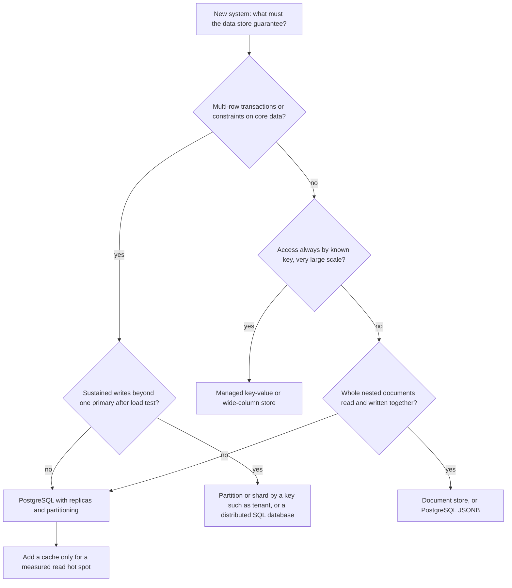
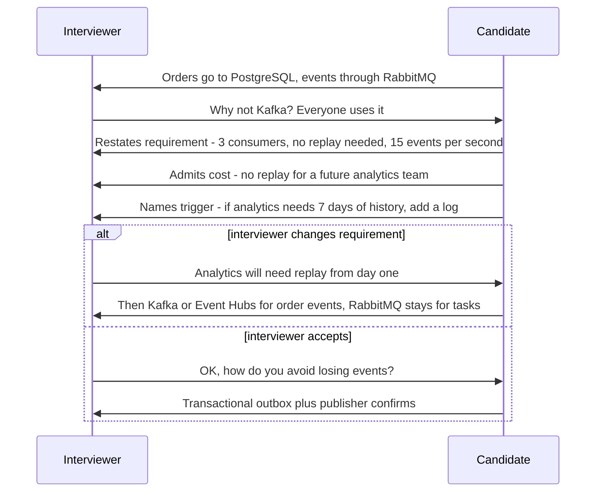

Choosing a database or a message broker in an interview takes ten seconds. Defending the choice when the interviewer leans back and says "why not Kafka?" is where the score is decided. Interviewers rarely care which product you pick. They care whether you can name what the choice buys, what it costs, and what would make you change your mind. This lesson gives you a sentence shape for that, a decision matrix you can sketch in two minutes, the honest trade-offs of the common databases and brokers, and four scripted push-back dialogues to practise with.

## Learning objectives

By the end of this lesson you will be able to:

1. Defend a technology choice with the five-part sentence: choice, because, given, at the cost of, and would revisit if.
2. Build a weighted decision matrix for a database or broker choice in under two minutes, and spot when the result is a close call.
3. State the core trade-offs of PostgreSQL, a document store, a wide-column store, a managed key-value store and a cache, without overselling any of them.
4. State the core trade-offs of a work queue (RabbitMQ, Azure Service Bus), a partitioned log (Kafka), and a database-backed queue.
5. Handle push-back calmly: concede what is true, hold what is justified, and change your mind when a requirement changes.
6. Implement and test a C# decision-matrix service that ranks options, flags close calls, and finds the weight at which the winner flips.

## Prerequisites

- [Relational versus document databases](#/lesson/m09-relational-vs-document): the data-model side of the database choice.
- [Message queues](#/lesson/m12-message-queues): what a broker does and the delivery guarantees it offers.
- [Trade-offs](#/lesson/m11-trade-offs): the general vocabulary of consistency, latency, cost and complexity.

## Explain it like I'm a beginner

Imagine you are buying a vehicle for a small construction firm in Pune. You choose a pickup truck. Your partner asks, "Why not a big lorry? It carries more."

A weak answer is "Lorries are bad" or "Everyone uses pickups." A strong answer is:

> "I chose the pickup **because** we move about 500 kg of tools a day, **given** that our sites are in narrow city lanes. It **costs** us extra trips when we move cement in bulk, maybe twice a month. I would **revisit** it if we win the highway contract where we'd move 5 tonnes a day."

Notice what happened. You did not say the lorry is bad. You said what your situation needs, what you gave up, and when the answer changes. Your partner can now disagree with a specific fact ("actually we move 2 tonnes a day") instead of arguing about opinions.

Defending a database or a message broker in an interview works the same way. "PostgreSQL" or "Kafka" is not an answer; it is the start of one. The full answer (a trade-off statement) ties the tool to a requirement, admits a cost, and names the trigger that would change it.

## First-principles explanation

### What interviewers are actually testing

When an interviewer challenges a choice, they are checking four things:

1. **Do you know why you chose it?** A choice made from habit collapses under one question.
2. **Do you know what it costs?** Every tool has a weakness. A candidate who claims none either does not know it or is hiding it.
3. **Are you anchored to requirements?** The best defence is a requirement you wrote down earlier ("we said 5,000 writes per second and strong consistency for balances").
4. **Can you update?** If the interviewer changes a requirement, the right move is often to change the choice. Defending a choice whose reason has disappeared is stubbornness, not confidence.

### The five-part sentence

Every defence fits this shape:

| Part | Question it answers | Example |
|---|---|---|
| **Choice** | What did you pick? | "PostgreSQL as the primary store" |
| **Because** | Which property of the tool do you rely on? | "because it gives multi-row transactions and foreign keys" |
| **Given** | Which requirement makes that property matter? | "given that a booking must reserve a seat and charge a wallet atomically" |
| **At the cost of** | What do you give up? | "at the cost of scaling writes beyond one primary, which we'd handle later by partitioning by venue" |
| **Would revisit if** | What would change your mind? | "I'd revisit if sustained writes passed what one primary handles in our load test, or if we go multi-region active-active" |

Short version for speaking: **"X, because P, given R; it costs C; I'd change if T."** Practise it until it is automatic.

### Trade-off language that sounds senior

- "This **optimises for** correctness of balances **over** write throughput."
- "We **accept** up to a few seconds of staleness on the dashboard **in exchange for** taking read load off the primary."
- "This is a **reversible** decision: switching brokers later costs a few weeks. The data model is **less reversible**, so I'm spending more time there."
- "**For this scale**, one primary is enough. **At 10x**, I'd partition by tenant."
- "I **don't know** the exact limit; I'd **measure** it with a load test before committing."

Phrases to avoid: "X is better" (better for what?), "industry standard" (whose industry, at what scale?), "it scales" (to what, at what cost?), "we can always" (with what effort?).

### Database options and their honest trade-offs

| Option | What it is good at | What it costs you | Typical fit |
|---|---|---|---|
| **PostgreSQL** (relational) | Transactions across rows and tables, constraints, joins, rich indexing, JSONB for flexible fields, mature tooling | One primary for writes; scaling writes out needs partitioning or sharding work; schema changes need migrations | Most business systems: orders, bookings, ledgers, project management, as the default |
| **Document store** (for example MongoDB) | Flexible nested documents, reading a whole aggregate in one fetch, horizontal scaling built in | Cross-document constraints and joins are weaker; multi-document transactions exist but are not the design centre; schema discipline moves into code | Catalogues, content, per-entity documents read and written whole |
| **Wide-column store** (for example Cassandra) | Very high write throughput across many nodes, tunable consistency, multi-datacentre replication | Queries must be designed around the partition key upfront; no joins; operations are demanding | Time series, messages, event logs at very large scale |
| **Managed key-value** (for example DynamoDB, Azure Cosmos DB) | Predictable low latency by key, managed scaling, no servers to run | Access patterns must be known upfront; ad-hoc queries are hard; cost tracks throughput, so hot keys and scans are expensive | Session, profile and cart data with known key access |
| **Cache** (for example Redis) | Microsecond-to-millisecond reads from memory, rich data structures, counters, rate limits | Memory is expensive; persistence and failover exist but it is not usually the system of record | In front of a database, for sessions, leaderboards, rate limiting |

The default that rarely needs defending at moderate scale is a relational database. That is not because it is "best", but because most systems need transactions and ad-hoc queries, and one well-run PostgreSQL primary with replicas handles a lot of load. The moment you choose something else, the interviewer expects a requirement that pushed you there.

### Messaging options and their honest trade-offs

| Option | Model | Strengths | Costs | Typical fit |
|---|---|---|---|---|
| **Database-backed queue** (a jobs table polled with `FOR UPDATE SKIP LOCKED`) | Rows as jobs | No new infrastructure; jobs commit in the same transaction as the business data | Polling load on the database; modest throughput; no fan-out | Small systems, background jobs, an outbox |
| **Work queue broker** (RabbitMQ, Azure Service Bus) | Messages delivered to competing consumers and removed when acknowledged | Per-message acknowledgement, retries, dead-letter queues, flexible routing, priorities, delayed delivery | Not built for replaying history; very high sustained throughput needs care | Commands and tasks: "send this email", "generate this PDF" |
| **Partitioned log** (Kafka, Azure Event Hubs) | An append-only log split into partitions, retained for a configured time; consumers track their own offsets | High throughput, replay from any offset, many independent consumer groups, ordering within a partition | Ordering only per partition; per-message retry and dead-lettering are your job; more operational surface | Event streams many teams consume, analytics pipelines, change data capture |
| **Managed pub/sub** (SNS, Service Bus topics, Google Pub/Sub) | Topic fan-out to subscriptions | No servers, simple fan-out | Provider limits and pricing; features vary by provider | Notifications and fan-out where a cloud is already chosen |

Two questions decide most messaging choices:

1. **Is the message a task (do this once) or a fact (this happened, anyone may care)?** Tasks fit queues. Facts that several consumers read independently, possibly later, fit logs.
2. **Do you need replay?** If a new consumer next month must read the last 7 days of events, you need retention and offsets, which is a log.

### Decision matrices

A decision matrix (weighted scoring) makes a choice explicit:

1. List 4–6 criteria drawn from the requirements, not from product brochures.
2. Give each a weight (1–5) reflecting how much this system cares.
3. Score each option 1–5 on each criterion.
4. Multiply and sum. The highest total wins.
5. Check whether it is a **close call** (the top two within about 10 %) and which criteria **decided** it.

The matrix is not a calculator that replaces judgement. Its value is that the interviewer can see your weights and argue with one of them, which is a much better conversation than arguing about the answer. If the winner flips when one weight moves slightly, say so: "this is a close call, and it hinges on how much we value replay."

### When not to over-defend

Sometimes the honest answer is "either works". If PostgreSQL and a document store both handle a catalogue of 200,000 products and the team knows PostgreSQL, say: "Both fit; I'm choosing the one the team can run at 3 a.m." Team familiarity and operational maturity are legitimate criteria, often the heaviest ones.

## Visual explanation

### A quick database decision path



Start at the top with the guarantee, not the product. If the core data needs transactions or constraints, a relational database is the default, and the only follow-up is whether writes outgrow one primary (decided by a load test, not by fear). If transactions are not needed and access is always by key at very large scale, a key-value or wide-column store fits. If whole documents are read and written together, a document store fits, but PostgreSQL's JSONB is a valid alternative when you also need transactions elsewhere. Every path ends with the same rule: add a cache only when a measured hot spot justifies it. The diagram is a conversation aid, not a law; real systems often combine two stores.

### A push-back exchange



The candidate does not argue with "everyone uses it". They restate the requirement that drove the choice (three consumers, no replay, a modest rate), admit the cost (a future analytics consumer cannot replay), and name the trigger that would change the decision. Then there are two good endings. If the interviewer changes the requirement, the candidate changes the design, keeping RabbitMQ where it still fits. If the interviewer accepts, the conversation moves forward to the next real risk, losing events between the database and the broker, which the outbox pattern solves. Both endings score well. The bad ending, not shown, is a candidate who defends RabbitMQ after the requirement for replay has appeared.

## Step-by-step example

We will defend the data and messaging choices for **SiteCheck**, a site-inspection system for an infrastructure consultancy: engineers fill in inspection forms on tablets at 400 road and bridge sites, attach photos, and raise non-conformance reports (NCRs) that contractors must close. Estimates (from the [estimation drills](#/lesson/m19-estimation-practice)): 3,000 engineers, about 20,000 inspections per day, peak 15 writes per second, photos in object storage. Downstream: a notification service, a monthly-report generator, and a planned analytics team.

### Step 1 — write the requirements that matter for the choice

- R1: An NCR, its line items and its status history must change together (transactional).
- R2: Inspection forms differ by asset type (bridge bearing, pavement, drainage); new fields appear monthly.
- R3: Peak 15 writes per second, 200 reads per second. Five-year retention.
- R4: When an NCR is raised, notify the contractor and the project manager, and update the report generator.
- R5: Analytics team "maybe next year" wants history.
- R6: Team of six, strong in C# and PostgreSQL, no one has run Kafka.

### Step 2 — the database matrix

Weights from the requirements: transactions (R1) 5, flexible fields (R2) 3, scale headroom (R3) 2, team skill and operations (R6) 4, ad-hoc reporting 3.

| Criterion (weight) | PostgreSQL + JSONB | MongoDB | Cassandra |
|---|---|---|---|
| Transactions and constraints (5) | 5 | 3 | 1 |
| Flexible form fields (3) | 4 | 5 | 3 |
| Scale headroom (2) | 4 | 4 | 5 |
| Team skill and operations (4) | 5 | 2 | 1 |
| Ad-hoc reporting (3) | 5 | 3 | 1 |
| **Weighted total** | 25 + 12 + 8 + 20 + 15 = **80** | 15 + 15 + 8 + 8 + 9 = **55** | 5 + 9 + 10 + 4 + 3 = **31** |

Not a close call: 80 against 55. Decisive criteria: transactions and team skill. Flexible fields, where MongoDB wins, carries less weight and PostgreSQL's JSONB column for asset-specific fields closes most of the gap.

**Defence:** "PostgreSQL, because NCRs need transactions across header, lines and history, given R1. Asset-specific form fields go in a JSONB column with a GIN index, so new fields need no migration. It costs us write scale-out, but we're at 15 writes per second. I'd revisit if we exceeded what one primary handles in a load test, which is not on any forecast."

### Step 3 — the messaging matrix

Criteria: per-message retry and dead-lettering (R4, notifications must not be silently lost) 4, replay for future consumers (R5) 2, operational simplicity for this team (R6) 5, throughput headroom 1, fan-out to several consumers 3.

| Criterion (weight) | Outbox + RabbitMQ | Kafka | Jobs table only |
|---|---|---|---|
| Retry and dead-lettering (4) | 5 | 2 | 3 |
| Replay (2) | 1 | 5 | 2 |
| Operational simplicity (5) | 4 | 2 | 5 |
| Throughput headroom (1) | 4 | 5 | 2 |
| Fan-out (3) | 5 | 5 | 2 |
| **Weighted total** | 20 + 2 + 20 + 4 + 15 = **61** | 8 + 10 + 10 + 5 + 15 = **48** | 12 + 4 + 25 + 2 + 6 = **49** |

RabbitMQ with an outbox wins at 61. Interesting detail: the humble jobs table (49) edges out Kafka (48) for second place, because simplicity carries the heaviest weight. Against that runner-up, the decisive criteria are fan-out (the jobs table cannot fan out cheaply) and retry with dead-lettering. How far would the replay weight have to rise before Kafka wins? Kafka gains 4 points per unit of replay weight over RabbitMQ (5 versus 1), and it is 13 points behind, so replay's weight would have to rise by 13 ÷ 4 = 3.25, from 2 to 5.25. That is above the 1–5 scale, so the result is robust.

**Defence:** "RabbitMQ fed by a transactional outbox. Because it gives per-message acknowledgement, retries and dead-letter queues, given that a lost NCR notification is a contractual problem. The outbox makes the database write and the event atomic. It costs us replay: a future analytics team can't read last month's events from the broker. I'd revisit if analytics needs event history; then I'd add a log, or simply let analytics read from a replica, since the history is already in PostgreSQL."

### Step 4 — anticipate the three most likely challenges

1. "Why not MongoDB for flexible forms?" Answer with R1 and JSONB.
2. "Why not Kafka?" Answer with the matrix and the 3.25 swing.
3. "What if RabbitMQ is down?" The outbox keeps unsent events in PostgreSQL; the relay retries; nothing is lost, notifications are delayed.

### Sample dialogue 1 — "Why not MongoDB?"

> **Interviewer:** Your forms change every month. Isn't a document database the obvious fit?
>
> **Candidate:** The forms are flexible, yes, and a document store would handle that well. Two things pushed me to PostgreSQL. NCRs must update header, lines and history atomically, which is PostgreSQL's home ground. And the team runs PostgreSQL today. For the flexible part, each inspection has typed common columns plus a JSONB column for asset-specific fields, with a GIN index for the few we filter on.
>
> **Interviewer:** Isn't JSONB a hack?
>
> **Candidate:** It's a trade-off. We lose column-level constraints on those fields, so we validate them in the application against a versioned form schema. If one field becomes central to reporting, we promote it to a real column with a migration. I'd call it a hack if the core business data lived in JSONB. It doesn't.

### Sample dialogue 2 — "Why not Kafka?"

> **Interviewer:** Kafka is the industry standard for events. Why RabbitMQ?
>
> **Candidate:** Kafka is the right tool when many consumers read a high-volume stream independently and need replay. We have three consumers, about 20,000 NCR and inspection events a day, and no replay requirement yet. What we do need is per-message retry and dead-lettering for notifications, which RabbitMQ gives us directly. With Kafka I'd build that myself with retry topics.
>
> **Interviewer:** And when analytics arrives?
>
> **Candidate:** Two options. If they need near-real-time events, I'd add Kafka or a managed log for that use case and have the outbox relay publish to both. If daily is enough, they read from a PostgreSQL replica or an export; the history is already there. I wouldn't pay for Kafka's operations now for a team that may never come.

### Sample dialogue 3 — "Redis as the primary store?"

> **Interviewer:** Redis is much faster. Why not keep NCRs in Redis and skip PostgreSQL?
>
> **Candidate:** Redis is faster for reads by key, and I'd use it for things like the per-site open-NCR counter if that became a hot spot. But NCRs are contractual records with five-year retention and audit. I want durable writes, transactions, ad-hoc queries for reports and a mature backup and point-in-time recovery story. Redis has persistence options, but making it the system of record for compliance data would be optimising for a latency we don't need, 200 reads per second, at the cost of the guarantees we do need.

### Sample dialogue 4 — the changed requirement

> **Interviewer:** New requirement: the client wants every event since day one available to a data platform team, replayable, and they expect 50 more event types next year.
>
> **Candidate:** That changes my answer for events. Replay and many independent consumers are exactly what a log is for. I'd introduce Kafka, or Event Hubs if we are on Azure, for domain events, keyed by site id so each site's events stay ordered. The outbox relay publishes there. I'd keep RabbitMQ for commands like "send this email", where per-message retry matters more than replay. Retention would be set by the data team's needs, with long-term history in object storage. The cost is a second messaging system to run, so I'd prefer a managed offering for a team our size.

Notice that in dialogue 4 the candidate changes their mind **because the requirement changed**, and says so explicitly. That is the opposite of being weak.

## Production-style C# implementation

The service below turns the matrix into code: it validates criteria and scores, ranks options, flags close calls, lists the criteria that decided the winner, computes how much each criterion's weight must rise to flip the result, and writes the five-part defence sentence. It is the kind of small internal tool an architecture team might use to keep decision records consistent.

```text
Decisions.Api/
  Program.cs
  Decisions/DecisionModels.cs
  Decisions/DecisionMatrix.cs
  Decisions/DefenceStatement.cs
  Decisions/DecisionLog.cs
```

```csharp file=Decisions/DecisionModels.cs
namespace Sdlp.Decisions;

/// <summary>A criterion drawn from a requirement. Weight is 1 to 5.</summary>
public sealed record Criterion(string Name, int Weight, string Requirement);

/// <summary>Scores per criterion name, each 1 to 5.</summary>
public sealed record OptionScores(string Option, IReadOnlyDictionary<string, int> Scores);

public sealed record RankedOption(string Option, int Total);

/// <summary>How far one criterion's weight must rise before another option catches the winner.</summary>
public sealed record WeightSwing(string Criterion, string Challenger, double ThresholdWeight);

public sealed record DecisionResult(
    IReadOnlyList<RankedOption> Ranking,
    bool IsCloseCall,
    IReadOnlyList<string> DecisiveCriteria,
    IReadOnlyList<WeightSwing> Swings);

public sealed record DecisionRequest(
    string Title,
    IReadOnlyList<Criterion> Criteria,
    IReadOnlyList<OptionScores> Options,
    string Cost,
    string RevisitTrigger);

public sealed record DecisionRecord(string Title, DateTimeOffset At, DecisionResult Result, string Defence);
```

```csharp file=Decisions/DecisionMatrix.cs
namespace Sdlp.Decisions;

public sealed class DecisionMatrix
{
    private readonly IReadOnlyList<Criterion> _criteria;
    private readonly IReadOnlyList<OptionScores> _options;

    public DecisionMatrix(IReadOnlyList<Criterion> criteria, IReadOnlyList<OptionScores> options)
    {
        if (criteria.Count == 0) throw new ArgumentException("At least one criterion is required.", nameof(criteria));
        if (options.Count < 2) throw new ArgumentException("A decision needs at least two options.", nameof(options));
        if (criteria.Select(c => c.Name).Distinct(StringComparer.OrdinalIgnoreCase).Count() != criteria.Count)
            throw new ArgumentException("Criterion names must be unique.", nameof(criteria));

        foreach (var c in criteria)
            if (c.Weight is < 1 or > 5) throw new ArgumentException($"Weight for '{c.Name}' must be 1 to 5.", nameof(criteria));

        foreach (var o in options)
            foreach (var c in criteria)
            {
                if (!o.Scores.TryGetValue(c.Name, out var s))
                    throw new ArgumentException($"Option '{o.Option}' has no score for '{c.Name}'.", nameof(options));
                if (s is < 1 or > 5)
                    throw new ArgumentException($"Score for '{o.Option}' on '{c.Name}' must be 1 to 5.", nameof(options));
            }

        _criteria = criteria;
        _options = options;
    }

    public int Total(OptionScores o) => _criteria.Sum(c => c.Weight * o.Scores[c.Name]);

    /// <param name="closeCallMargin">Top two within this fraction of the winner's total count as a close call.</param>
    public DecisionResult Evaluate(double closeCallMargin = 0.10)
    {
        var ranking = _options
            .Select(o => new RankedOption(o.Option, Total(o)))
            .OrderByDescending(r => r.Total)
            .ThenBy(r => r.Option, StringComparer.Ordinal)
            .ToList();

        var winner = _options.Single(o => o.Option == ranking[0].Option);
        var runnerUp = _options.Single(o => o.Option == ranking[1].Option);
        var isClose = ranking[0].Total - ranking[1].Total <= closeCallMargin * ranking[0].Total;

        // Criteria where the winner out-scored the runner-up, by weighted contribution.
        var decisive = _criteria
            .Select(c => (c.Name, Gain: c.Weight * (winner.Scores[c.Name] - runnerUp.Scores[c.Name])))
            .Where(x => x.Gain > 0)
            .OrderByDescending(x => x.Gain)
            .ThenBy(x => x.Name, StringComparer.Ordinal)
            .Select(x => x.Name)
            .ToList();

        return new DecisionResult(ranking, isClose, decisive, Swings(winner));
    }

    /// <summary>For each criterion, the weight at which some challenger ties the winner if only that weight rises.</summary>
    private List<WeightSwing> Swings(OptionScores winner)
    {
        var swings = new List<WeightSwing>();
        foreach (var c in _criteria)
        {
            WeightSwing? best = null;
            foreach (var other in _options.Where(o => o.Option != winner.Option))
            {
                var slope = other.Scores[c.Name] - winner.Scores[c.Name];
                if (slope <= 0) continue;   // raising this weight only helps the winner
                var baseWinner = Total(winner) - c.Weight * winner.Scores[c.Name];
                var baseOther = Total(other) - c.Weight * other.Scores[c.Name];
                var threshold = (double)(baseWinner - baseOther) / slope;
                if (best is null || threshold < best.ThresholdWeight)
                    best = new WeightSwing(c.Name, other.Option, threshold);
            }
            if (best is not null) swings.Add(best);
        }
        return swings.OrderBy(s => s.ThresholdWeight).ToList();
    }
}
```

```csharp file=Decisions/DefenceStatement.cs
namespace Sdlp.Decisions;

/// <summary>Builds the five-part sentence: choice, because, given, at the cost of, would revisit if.</summary>
public static class DefenceStatement
{
    public static string Build(DecisionRequest request, DecisionResult result)
    {
        var winner = result.Ranking[0];
        var runnerUp = result.Ranking[1];
        var byName = request.Criteria.ToDictionary(c => c.Name, StringComparer.OrdinalIgnoreCase);
        var because = result.DecisiveCriteria.Take(2).ToList();

        var reason = because.Count == 0
            ? "it ties or wins on every criterion"
            : string.Join(" and ", because.Select(n => n.ToLowerInvariant()));
        var given = because.Count == 0
            ? "the stated requirements"
            : string.Join("; ", because.Select(n => byName[n].Requirement));

        var closeNote = result.IsCloseCall
            ? $" This is a close call against {runnerUp.Option} ({winner.Total} vs {runnerUp.Total})."
            : "";
        var swing = result.Swings.FirstOrDefault(s => s.ThresholdWeight <= 5);
        var swingNote = swing is null
            ? ""
            : $" It flips to {swing.Challenger} if the weight of '{swing.Criterion}' reaches {swing.ThresholdWeight:0.##}.";

        return $"We choose {winner.Option} because of {reason}, given {given}. " +
               $"It costs us {request.Cost}. We would revisit if {request.RevisitTrigger}.{closeNote}{swingNote}";
    }
}
```

```csharp file=Decisions/DecisionLog.cs
using System.Collections.Concurrent;

namespace Sdlp.Decisions;

public interface IDecisionLog
{
    void Record(DecisionRecord record);
    IReadOnlyList<DecisionRecord> All();
}

/// <summary>In-memory log for a single instance. A real deployment would store records in PostgreSQL next to the ADRs.</summary>
public sealed class InMemoryDecisionLog : IDecisionLog
{
    private readonly ConcurrentQueue<DecisionRecord> _records = new();
    public void Record(DecisionRecord record) => _records.Enqueue(record);
    public IReadOnlyList<DecisionRecord> All() => _records.ToList();
}
```

```csharp file=Program.cs
using Sdlp.Decisions;

var builder = WebApplication.CreateBuilder(args);
builder.Services.AddSingleton(TimeProvider.System);
builder.Services.AddSingleton<IDecisionLog, InMemoryDecisionLog>();

var app = builder.Build();

app.MapPost("/decisions/evaluate", (DecisionRequest request, IDecisionLog log, TimeProvider clock) =>
{
    try
    {
        var result = new DecisionMatrix(request.Criteria, request.Options).Evaluate();
        var defence = DefenceStatement.Build(request, result);
        log.Record(new DecisionRecord(request.Title, clock.GetUtcNow(), result, defence));
        return Results.Ok(new { result, defence });
    }
    catch (ArgumentException ex)
    {
        return Results.Problem(ex.Message, statusCode: StatusCodes.Status400BadRequest);
    }
});

app.MapGet("/decisions", (IDecisionLog log) => Results.Ok(log.All()));

app.Run();
```

For the SiteCheck messaging matrix, the service returns RabbitMQ at 61, not a close call (the jobs table is second at 49), decisive criteria "Fanout" then "Retry" (then a little "Throughput"), and a swing list whose smallest entry is Kafka on "Replay" at weight 5.25 (above the 1–5 scale, so the defence sentence omits it). The arithmetic is the same as in step 3, which is the point: the tool makes a decision record reproducible and arguable.

Why integers for weights and scores? A 1–5 scale is coarse on purpose. Decimal weights such as 3.7 suggest a precision that the underlying judgement does not have.

## Bad design vs good design

**Bad defence:**

> "I'd use MongoDB because it's web-scale and schemaless, and Kafka because it's what big companies use. PostgreSQL doesn't scale."

What is wrong:

- No requirement is mentioned, so there is nothing to defend.
- "Schemaless" hides the real cost: the schema moves into application code.
- "PostgreSQL doesn't scale" is false as a general statement, and the system has 15 writes per second.
- "What big companies use" is an appeal to authority, and big companies have problems you do not.
- No cost, no trigger. The interviewer has nothing to probe except your confidence.

**Good defence:** the two SiteCheck defences in the step-by-step example. Each ties the tool to a numbered requirement, admits a cost, and names a measurable trigger. Each is also modest: no technology is chosen for a problem the system does not have.

:::callout type=tradeoff title="Polyglot persistence has a running cost"
Using the right store for each job (polyglot persistence) is sound in principle. In practice each extra store adds backups, monitoring, upgrades, security patching, on-call knowledge and data synchronisation. For a team of six, two well-understood stores usually beat five "ideal" ones.
:::

:::callout type=mistake title="Defending after the reason is gone"
If the interviewer changes the requirement that justified your choice, and you keep defending it, you lose more than if you had chosen badly in the first place. Say "That changes things," and redo the decision.
:::

## Practical playground

The starting graph is SiteCheck with PostgreSQL and nothing else. Add the messaging path and label each new component with the requirement (R1–R6) that justifies it. Then do the challenge: switch the design to handle dialogue 4's new requirement (replayable events for a data platform) and note which nodes you add and which you keep.

:::playground type=hld title="SiteCheck: add messaging and defend each component"
```json
{
  "nodes": [
    { "id": "tab", "type": "client", "label": "Engineer tablets (3,000)", "props": { "rps": 200 } },
    { "id": "lb", "type": "load-balancer", "label": "Load balancer" },
    { "id": "api", "type": "app-server", "label": "SiteCheck API", "props": { "instances": 2 } },
    { "id": "db", "type": "database", "label": "PostgreSQL: inspections (JSONB fields), NCRs", "props": { "replicas": 1 } },
    { "id": "obj", "type": "object-storage", "label": "Inspection photos" }
  ],
  "edges": [
    { "from": "tab", "to": "lb", "kind": "sync" },
    { "from": "lb", "to": "api", "kind": "sync" },
    { "from": "api", "to": "db", "kind": "sync", "label": "SQL, NCR in one transaction" },
    { "from": "tab", "to": "obj", "kind": "sync", "label": "pre-signed upload" }
  ]
}
```
:::

## Exercises

:::exercise id=m19-defending-choices-ex1 difficulty=beginner kind=written title="Rewrite four weak defences"
Rewrite each weak defence in the five-part form (choice, because, given, at the cost of, would revisit if). Invent a reasonable requirement where one is missing, and say that you invented it.

1. "Redis, because it's fast." (Context: a leaderboard for a cricket fantasy app, 2 million players, updated every ball.)
2. "Kafka, because it scales." (Context: a hospital appointment system sending SMS reminders, 30,000 a day.)
3. "Cassandra, because we might get big." (Context: a B2B invoicing tool, 400 customers.)
4. "PostgreSQL, because it's what I know." (Context: a payment ledger for a wallet app.)
::acceptance
- Every rewrite has all five parts.
- At least one rewrite changes the technology, because the context does not justify the original.
- Costs are specific (what is harder or more expensive), not "some complexity".
- Revisit triggers are measurable.
::hint
Start each rewrite by naming the requirement. If the requirement does not need the tool's strength, the tool is probably wrong.
::hint
For 2 and 3, compare the numbers to what a simpler option handles comfortably.
::hint
For 4, "it's what I know" is a legitimate criterion (team skill), but it should not be the only one for a ledger. Which property of PostgreSQL actually matters for a ledger?
::hint
Template: "X, because P, given R. It costs C. I'd revisit if T."
::solution
1. "A Redis sorted set for the live leaderboard, **because** it keeps members ordered by score with logarithmic-time updates and range reads, **given** that 2 million players' scores change every ball and the top 100 plus each player's own rank must refresh within a second. It **costs** memory (roughly 2 million entries × ~100 bytes ≈ 200 MB, an estimate) and the leaderboard is rebuildable rather than authoritative, so the points ledger stays in PostgreSQL. I'd **revisit** if we added many leagues per match and memory passed one node's comfortable size; then shard leaderboards by league."
2. "**Changed choice**: a database-backed job table, or a simple managed queue, **because** we need reliable scheduled sends with retries, **given** 30,000 reminders a day, about 0.35 per second on average. It **costs** some polling load on the database and no replay, which no one needs. I'd **revisit** if several other services started consuming appointment events; then a broker with topics."
3. "**Changed choice**: PostgreSQL, **because** invoices need transactions, constraints and ad-hoc reporting, **given** 400 customers and (invented) about 50,000 invoices a month. It **costs** single-primary write limits that are orders of magnitude above our needs. I'd **revisit** if a load test or forecast showed writes approaching one primary's measured limit; partitioning by customer would come first."
4. "PostgreSQL, **because** it gives serialisable or carefully locked transactions, constraints such as `CHECK (balance >= 0)` and durable commits, **given** that every transfer must debit and credit atomically and never overdraw. It's also what the team runs well, which matters for a system where incidents cost money. It **costs** write scale-out; at (invented) 2,000 transfers per second we'd be fine, beyond that we'd partition accounts. I'd **revisit** if transfer volume approached the load-tested limit of one primary."
::mistakes
- Keeping Kafka for 30,000 messages a day because the exercise said Kafka.
- Costs like "it's more complex" with no detail.
- Triggers like "if we grow" with no number.
:::

:::exercise id=m19-defending-choices-ex2 difficulty=beginner kind=code title="Score a decision matrix"
Implement `Matrix.Rank`, which takes criterion weights and option scores and returns the options ordered by weighted total, highest first, with ties broken by option name.
::requirements
- Weights are 1–5. Scores are 1–5. Every option must score every criterion.
- Invalid input throws `ArgumentException` with a message that names the problem.
- At least two options are required.
::acceptance
- The SiteCheck database matrix gives PostgreSQL 80, MongoDB 55, Cassandra 31 in that order.
- Two options with equal totals are ordered alphabetically.
- A missing score, a score of 0 or 6, a weight of 0, or a single option throws `ArgumentException`.
::hint
Total = sum over criteria of weight × score.
::hint
Validate before computing, so the error says exactly what is missing.
::hint
`OrderByDescending(x => x.Total).ThenBy(x => x.Option, StringComparer.Ordinal)`.
::hint
```csharp
foreach (var (option, scores) in options)
    foreach (var (criterion, _) in weights)
        if (!scores.TryGetValue(criterion, out var s) || s < 1 || s > 5)
            throw new ArgumentException($"{option}/{criterion}: score must be 1-5");
```
::starter
```csharp file=Matrix.cs
using System;
using System.Collections.Generic;
using System.Linq;

public sealed record Ranked(string Option, int Total);

public static class Matrix
{
    public static IReadOnlyList<Ranked> Rank(
        IReadOnlyDictionary<string, int> weights,
        IReadOnlyDictionary<string, IReadOnlyDictionary<string, int>> options) =>
        throw new NotImplementedException();
}
```
::tests
```csharp file=MatrixTests.cs
using System;
using System.Collections.Generic;
using System.Linq;
using Xunit;

public class MatrixTests
{
    private static readonly Dictionary<string, int> W = new()
    {
        ["tx"] = 5, ["flex"] = 3, ["scale"] = 2, ["team"] = 4, ["reporting"] = 3
    };

    private static IReadOnlyDictionary<string, int> S(int tx, int flex, int scale, int team, int rep) =>
        new Dictionary<string, int> { ["tx"] = tx, ["flex"] = flex, ["scale"] = scale, ["team"] = team, ["reporting"] = rep };

    [Fact]
    public void SiteCheck_database_matrix()
    {
        var r = Matrix.Rank(W, new Dictionary<string, IReadOnlyDictionary<string, int>>
        {
            ["Cassandra"] = S(1, 3, 5, 1, 1),
            ["MongoDB"] = S(3, 5, 4, 2, 3),
            ["PostgreSQL"] = S(5, 4, 4, 5, 5),
        });
        Assert.Equal(new[] { "PostgreSQL", "MongoDB", "Cassandra" }, r.Select(x => x.Option).ToArray());
        Assert.Equal(new[] { 80, 55, 31 }, r.Select(x => x.Total).ToArray());
    }

    [Fact]
    public void Ties_are_alphabetical()
    {
        var w = new Dictionary<string, int> { ["a"] = 1 };
        var r = Matrix.Rank(w, new Dictionary<string, IReadOnlyDictionary<string, int>>
        {
            ["Zeta"] = new Dictionary<string, int> { ["a"] = 3 },
            ["Alpha"] = new Dictionary<string, int> { ["a"] = 3 },
        });
        Assert.Equal("Alpha", r[0].Option);
    }

    [Fact]
    public void Missing_score_throws() => Assert.Throws<ArgumentException>(() => Matrix.Rank(W,
        new Dictionary<string, IReadOnlyDictionary<string, int>>
        {
            ["A"] = S(1, 1, 1, 1, 1),
            ["B"] = new Dictionary<string, int> { ["tx"] = 1 },
        }));

    [Theory]
    [InlineData(0)]
    [InlineData(6)]
    public void Out_of_range_score_throws(int bad) => Assert.Throws<ArgumentException>(() => Matrix.Rank(W,
        new Dictionary<string, IReadOnlyDictionary<string, int>> { ["A"] = S(bad, 1, 1, 1, 1), ["B"] = S(1, 1, 1, 1, 1) }));

    [Fact]
    public void Zero_weight_throws() => Assert.Throws<ArgumentException>(() => Matrix.Rank(
        new Dictionary<string, int> { ["tx"] = 0 },
        new Dictionary<string, IReadOnlyDictionary<string, int>>
        {
            ["A"] = new Dictionary<string, int> { ["tx"] = 1 },
            ["B"] = new Dictionary<string, int> { ["tx"] = 2 },
        }));

    [Fact]
    public void Single_option_throws() => Assert.Throws<ArgumentException>(() => Matrix.Rank(W,
        new Dictionary<string, IReadOnlyDictionary<string, int>> { ["A"] = S(1, 1, 1, 1, 1) }));
}
```
::solution
```csharp file=Matrix.cs
using System;
using System.Collections.Generic;
using System.Linq;

public sealed record Ranked(string Option, int Total);

public static class Matrix
{
    public static IReadOnlyList<Ranked> Rank(
        IReadOnlyDictionary<string, int> weights,
        IReadOnlyDictionary<string, IReadOnlyDictionary<string, int>> options)
    {
        if (weights.Count == 0) throw new ArgumentException("At least one criterion is required.", nameof(weights));
        if (options.Count < 2) throw new ArgumentException("A decision needs at least two options.", nameof(options));

        foreach (var (criterion, weight) in weights)
            if (weight is < 1 or > 5)
                throw new ArgumentException($"Weight for '{criterion}' must be 1 to 5, was {weight}.", nameof(weights));

        foreach (var (option, scores) in options)
            foreach (var criterion in weights.Keys)
            {
                if (!scores.TryGetValue(criterion, out var s))
                    throw new ArgumentException($"Option '{option}' has no score for '{criterion}'.", nameof(options));
                if (s is < 1 or > 5)
                    throw new ArgumentException($"Score for '{option}' on '{criterion}' must be 1 to 5, was {s}.", nameof(options));
            }

        return options
            .Select(o => new Ranked(o.Key, weights.Sum(w => w.Value * o.Value[w.Key])))
            .OrderByDescending(r => r.Total)
            .ThenBy(r => r.Option, StringComparer.Ordinal)
            .ToList();
    }
}
```

Validation is most of the code, and that is normal for decision tooling: a matrix with a silently missing score produces a confident wrong answer.
::mistakes
- Treating a missing score as 0, which quietly penalises an option.
- Using `Dictionary` enumeration order as the tie-break, which is not a guarantee you should rely on.
::extensions
Add a `closeCallMargin` parameter and return whether the top two are within it.
:::

:::exercise id=m19-defending-choices-ex3 difficulty=intermediate kind=hld title="Choose the messaging for a notification platform"
A state transport department's ticketing app sends booking confirmations, 2-hour departure reminders and cancellation alerts by SMS, email and push. Volume: 1.2 million messages a day, festival peaks of 5x. A fraud team wants to replay all booking events from the last 14 days into a new model. Starting from the synchronous design, choose the messaging components and label each with the requirement it serves. Write the five-part defence for each broker you add.
::acceptance
- Notifications (tasks) go through a queue with retries and dead-lettering, per channel.
- Booking events (facts) are available for 14-day replay, either through a log or another justified mechanism.
- The booking write and the event publication cannot diverge (outbox or equivalent).
- Provider rate limits are respected by consumers, not by the booking API.
- Each added broker has a five-part defence in the solution text.
::hint
Separate tasks ("send this SMS") from facts ("booking 123 was created"). Do they need the same tool?
::hint
14-day replay for a new consumer is a log's home ground. Retries and dead-letter per SMS are a queue's.
::hint
Could the fraud team read from a replica instead of a log? What would they lose (event order, near-real-time)? State it either way.
::hint
Shape: API → PostgreSQL (booking + outbox) → relay → log (booking events) → notification dispatcher → per-channel queues → channel workers → providers; fraud consumer reads the log.
::starter
```json
{
  "nodes": [
    { "id": "app", "type": "client", "label": "Ticketing app", "props": { "rps": 300 } },
    { "id": "api", "type": "app-server", "label": "Booking API", "props": { "instances": 3 } },
    { "id": "db", "type": "database", "label": "PostgreSQL bookings" },
    { "id": "sms", "type": "external", "label": "SMS provider" },
    { "id": "mail", "type": "external", "label": "Email provider" }
  ],
  "edges": [
    { "from": "app", "to": "api", "kind": "sync" },
    { "from": "api", "to": "db", "kind": "sync" },
    { "from": "api", "to": "sms", "kind": "sync", "label": "send inline" },
    { "from": "api", "to": "mail", "kind": "sync", "label": "send inline" }
  ]
}
```
::solution
```json
{
  "nodes": [
    { "id": "app", "type": "client", "label": "Ticketing app", "props": { "rps": 300 } },
    { "id": "api", "type": "app-server", "label": "Booking API", "props": { "instances": 3 } },
    { "id": "db", "type": "database", "label": "PostgreSQL: bookings + outbox table (same transaction)" },
    { "id": "relay", "type": "worker", "label": "Outbox relay", "props": { "instances": 2 } },
    { "id": "log", "type": "stream", "label": "Booking events log, 14-day retention, keyed by booking id (fraud replay)" },
    { "id": "disp", "type": "worker", "label": "Notification dispatcher: preferences, templates" },
    { "id": "q", "type": "queue", "label": "Per-channel queues with retries + DLQ (sms, email, push)" },
    { "id": "smsw", "type": "worker", "label": "SMS workers, rate-limited to provider contract" },
    { "id": "mailw", "type": "worker", "label": "Email workers" },
    { "id": "sched", "type": "scheduler", "label": "Departure reminder scheduler (T-2h)" },
    { "id": "fraud", "type": "worker", "label": "Fraud model consumer (own consumer group)" },
    { "id": "sms", "type": "external", "label": "SMS provider" },
    { "id": "mail", "type": "external", "label": "Email provider" }
  ],
  "edges": [
    { "from": "app", "to": "api", "kind": "sync" },
    { "from": "api", "to": "db", "kind": "sync", "label": "booking + outbox row" },
    { "from": "relay", "to": "db", "kind": "sync", "label": "poll unsent outbox rows" },
    { "from": "relay", "to": "log", "kind": "async", "label": "publish booking events" },
    { "from": "log", "to": "disp", "kind": "async" },
    { "from": "log", "to": "fraud", "kind": "async", "label": "replay 14 days" },
    { "from": "sched", "to": "q", "kind": "async", "label": "reminders due" },
    { "from": "disp", "to": "q", "kind": "async" },
    { "from": "q", "to": "smsw", "kind": "async" },
    { "from": "q", "to": "mailw", "kind": "async" },
    { "from": "smsw", "to": "sms", "kind": "sync" },
    { "from": "mailw", "to": "mail", "kind": "sync" }
  ]
}
```

Defences:

- **Log (Kafka or Event Hubs) for booking events**: because it retains events and lets each consumer group read from any offset, given the fraud team's 14-day replay requirement and several independent consumers. It costs a second messaging system to run (prefer a managed offering) and per-message retry is not built in, which is why notifications do not use it directly. I'd revisit if the fraud team's needs changed to daily batch, in which case a replica or nightly export would do and the log could go.
- **Queue (RabbitMQ or Service Bus) per channel**: because it gives per-message acknowledgement, retry with back-off and dead-lettering, given that each SMS is a task that must be sent once and failures must be visible. 1.2 million a day is about 14 per second on average and 70 at a 5x festival peak, well within a single broker. It costs us another component; I'd revisit if volume grew so that per-channel throughput needed partitioning.
- **Outbox**: because the booking row and its event must not diverge, given that a confirmed booking without a confirmation SMS generates support calls.

A simpler alternative worth stating: if there were no replay requirement, a single broker with topics (fan-out to dispatcher and others) plus the outbox would be enough.
::mistakes
- Sending SMS from the log consumers directly, with no per-message dead-lettering.
- Calling providers inline from the booking API, which ties booking latency to SMS provider latency.
- Publishing to the broker after the database commit without an outbox, so a crash between the two loses events.
:::

:::exercise id=m19-defending-choices-ex4 difficulty=intermediate kind=code title="How robust is the winner?"
Implement `Robustness.Swings`. For each criterion, find the weight at which some other option would **tie** the current winner if only that criterion's weight increased (others fixed). Return one entry per criterion where a tie is reachable, using the lowest such weight across challengers, sorted by threshold ascending. Criteria where raising the weight can only help the winner are omitted.
::requirements
- Totals are unnormalised: Σ weight × score.
- The current winner is the highest total, ties broken alphabetically.
- For criterion c, a challenger B with score s_B > s_A (winner's score) ties at w = (baseA − baseB) ÷ (s_B − s_A), where base is the total without criterion c.
- Thresholds are returned as `double`.
::acceptance
- SiteCheck messaging matrix: the swing for "replay" is Kafka at 5.25.
- PostgreSQL vs MongoDB (weights consistency 3, flex 1, team 2, ops 2): the "flex" swing is MongoDB at 7.
- A criterion where the winner has the top score is omitted.
- Results sorted by threshold ascending.
::hint
Raising a weight helps whoever scores higher on that criterion. If the winner already scores highest, no challenger gains.
::hint
Write the two totals as straight lines in w: T_A(w) = baseA + w × s_A and T_B(w) = baseB + w × s_B. Where do they cross?
::hint
Compute base by subtracting the criterion's current contribution from the full total.
::hint
For each criterion, take the minimum threshold across challengers, then sort all criteria by that minimum.
::starter
```csharp file=Robustness.cs
using System;
using System.Collections.Generic;
using System.Linq;

public sealed record Swing(string Criterion, string Challenger, double ThresholdWeight);

public static class Robustness
{
    public static IReadOnlyList<Swing> Swings(
        IReadOnlyDictionary<string, int> weights,
        IReadOnlyDictionary<string, IReadOnlyDictionary<string, int>> options) =>
        throw new NotImplementedException();
}
```
::tests
```csharp file=RobustnessTests.cs
using System;
using System.Collections.Generic;
using System.Linq;
using Xunit;

public class RobustnessTests
{
    private static IReadOnlyDictionary<string, int> D(params (string K, int V)[] kv) => kv.ToDictionary(x => x.K, x => x.V);

    private static readonly Dictionary<string, int> MsgWeights = new()
    {
        ["retry"] = 4, ["replay"] = 2, ["simplicity"] = 5, ["throughput"] = 1, ["fanout"] = 3
    };

    private static readonly Dictionary<string, IReadOnlyDictionary<string, int>> MsgOptions = new()
    {
        ["RabbitMQ"] = D(("retry", 5), ("replay", 1), ("simplicity", 4), ("throughput", 4), ("fanout", 5)),
        ["Kafka"] = D(("retry", 2), ("replay", 5), ("simplicity", 2), ("throughput", 5), ("fanout", 5)),
        ["JobsTable"] = D(("retry", 3), ("replay", 2), ("simplicity", 5), ("throughput", 2), ("fanout", 2)),
    };

    [Fact]
    public void Replay_swing_is_kafka_at_5_25()
    {
        var s = Robustness.Swings(MsgWeights, MsgOptions).Single(x => x.Criterion == "replay");
        Assert.Equal("Kafka", s.Challenger);
        Assert.Equal(5.25, s.ThresholdWeight, 6);
    }

    [Fact]
    public void Retry_is_omitted_because_winner_scores_highest()
    {
        Assert.DoesNotContain(Robustness.Swings(MsgWeights, MsgOptions), x => x.Criterion == "retry");
    }

    [Fact]
    public void Sorted_ascending()
    {
        var t = Robustness.Swings(MsgWeights, MsgOptions).Select(x => x.ThresholdWeight).ToList();
        Assert.Equal(t.OrderBy(x => x).ToList(), t);
    }

    [Fact]
    public void Postgres_vs_mongo_flex_swing_is_7()
    {
        var w = new Dictionary<string, int> { ["consistency"] = 3, ["flex"] = 1, ["team"] = 2, ["ops"] = 2 };
        var o = new Dictionary<string, IReadOnlyDictionary<string, int>>
        {
            ["PostgreSQL"] = D(("consistency", 5), ("flex", 3), ("team", 5), ("ops", 4)),
            ["MongoDB"] = D(("consistency", 3), ("flex", 5), ("team", 2), ("ops", 3)),
        };
        var s = Assert.Single(Robustness.Swings(w, o));
        Assert.Equal("flex", s.Criterion);
        Assert.Equal("MongoDB", s.Challenger);
        Assert.Equal(7.0, s.ThresholdWeight, 6);
    }
}
```
::solution
```csharp file=Robustness.cs
using System;
using System.Collections.Generic;
using System.Linq;

public sealed record Swing(string Criterion, string Challenger, double ThresholdWeight);

public static class Robustness
{
    public static IReadOnlyList<Swing> Swings(
        IReadOnlyDictionary<string, int> weights,
        IReadOnlyDictionary<string, IReadOnlyDictionary<string, int>> options)
    {
        if (options.Count < 2) throw new ArgumentException("Need at least two options.", nameof(options));
        int Total(IReadOnlyDictionary<string, int> s) => weights.Sum(w => w.Value * s[w.Key]);

        var winner = options
            .OrderByDescending(o => Total(o.Value))
            .ThenBy(o => o.Key, StringComparer.Ordinal)
            .First();

        var result = new List<Swing>();
        foreach (var (criterion, weight) in weights)
        {
            Swing? best = null;
            var sA = winner.Value[criterion];
            var baseA = Total(winner.Value) - weight * sA;
            foreach (var (name, scores) in options)
            {
                if (name == winner.Key) continue;
                var sB = scores[criterion];
                if (sB <= sA) continue;
                var baseB = Total(scores) - weight * sB;
                var threshold = (double)(baseA - baseB) / (sB - sA);
                if (best is null || threshold < best.ThresholdWeight) best = new Swing(criterion, name, threshold);
            }
            if (best is not null) result.Add(best);
        }

        return result.OrderBy(s => s.ThresholdWeight).ThenBy(s => s.Criterion, StringComparer.Ordinal).ToList();
    }
}
```

Check against the lesson: for "replay", RabbitMQ's base is 61 − 2 × 1 = 59 and Kafka's is 48 − 2 × 5 = 38, so the tie is at (59 − 38) ÷ (5 − 1) = 5.25. For "throughput", Kafka gains 1 point per unit of weight and is 13 behind: base 61 − 4 = 57 versus 48 − 5 = 43, threshold 14. Use this in the interview as: "the decision is robust; even weighting replay at the top of the scale doesn't flip it."
::mistakes
- Using the full totals instead of the base totals, which double-counts the criterion.
- Including challengers with a lower score on the criterion, which produces negative or meaningless thresholds.
- Reporting thresholds below the current weight as "flips"; with the winner already ahead, a valid threshold is always above the current weight.
::extensions
Also compute the threshold for *lowering* a weight on which the winner scores higher, so you can say "if we cared less about retries than X, Kafka wins".
:::

:::exercise id=m19-defending-choices-ex5 difficulty=advanced kind=written title="Survive five challenges in a row"
You proposed this design for a multi-tenant project-management SaaS (300 tenant companies, 40,000 users): PostgreSQL with a `tenant_id` on every table and row-level security, Redis for sessions and rate limits, Azure Service Bus for background jobs, and an outbox. Write your answers to the interviewer's five challenges, in order, as you would speak them. Each answer: under 80 words.

1. "Why not a database per tenant? It's more secure."
2. "Row-level security is slow, isn't it?"
3. "Why Service Bus and not Kafka?"
4. "Redis is a single point of failure."
5. "Your largest tenant is now 40 % of all traffic and complains about noisy neighbours. Still happy?"
::acceptance
- Each answer concedes something true before holding or changing the position.
- At least one answer changes the design in response to new information.
- Each answer names a cost and, where relevant, a trigger or a measurement.
- No answer exceeds 80 words.
::hint
Challenge 1 is about isolation versus operations cost. What does 300 databases mean for migrations?
::hint
Challenge 2: you do not know the overhead for your queries without measuring. Say how you would measure and what you would index.
::hint
Challenge 4: what happens to the system if Redis disappears for five minutes? Design it so the answer is "degraded, not down".
::hint
Challenge 5 is the requirement change. A hybrid model (pooled for most tenants, dedicated for the largest) is a common answer.
::solution
1. "A database per tenant gives stronger isolation and easy per-tenant restore, true. The cost is 300 databases to migrate, monitor and pool connections for, with a team of eight. With RLS and `tenant_id` in every index, a shared database isolates logically, and tests check that every query is tenant-scoped. I'd move a tenant to its own database if a contract requires physical isolation."
2. "It adds a predicate to every query, so the overhead depends on indexes. If `tenant_id` leads the relevant indexes, the predicate helps more than it costs. I don't know the exact overhead for our queries, so I'd measure the top 20 queries with `EXPLAIN ANALYZE` with RLS on and off before launch."
3. "Our messages are tasks: send email, generate report, recalculate schedule. Service Bus gives per-message retry, dead-lettering, scheduled delivery and sessions for per-project ordering, managed. We don't need replay or many independent consumers. I'd add a log if an analytics or integration platform needed event history."
4. "Fair, if we let it be one. Sessions fall back to re-authentication, and rate limits fail open with a conservative local limiter, so a Redis outage degrades the system rather than stopping it. We'd also run it as a managed, replicated tier. What we never do is keep data only in Redis."
5. "That changes the picture. 40 % of traffic in one tenant makes it a different workload. I'd move that tenant to a dedicated database, and give them their own worker pool, keeping the code identical. The other 299 stay pooled. Cost: a second deployment shape to operate, which is why it's the exception."
::mistakes
- Defending the pooled model in answer 5 after the requirement changed.
- Claiming RLS has "no overhead" or "huge overhead" without measuring.
- Answering challenge 4 with "Redis is very reliable" instead of designing for its failure.
:::

:::exercise id=m19-defending-choices-ex6 difficulty=advanced kind=hld title="One store or two for a ledger with search?"
A wallet app's ledger (PostgreSQL, 3,000 transfers per second at peak) must also support "search my transactions by merchant name, amount range and free text" for 30 million users, results within 300 ms. One engineer proposes moving everything to a search engine. Design the data path, and defend keeping or splitting stores.
::acceptance
- The ledger stays in a transactional store; search is a derived, rebuildable index.
- The index is fed from committed data (CDC or outbox), with the lag stated.
- The design states what users see while the index lags (for example, the last few seconds come from the primary).
- Defences for both stores use the five-part form.
::hint
What does a search engine not give you that a ledger must have?
::hint
How does a transfer reach the index without a dual write from the API?
::hint
A user who just paid expects to see the payment. Recent transactions could be read from PostgreSQL and merged with search results.
::hint
Shape: API → PostgreSQL → CDC or outbox → log → indexer → search; read path: API → search for history plus PostgreSQL for the last 60 seconds.
::starter
```json
{
  "nodes": [
    { "id": "app", "type": "client", "label": "Wallet app", "props": { "rps": 3000 } },
    { "id": "api", "type": "app-server", "label": "Wallet API", "props": { "instances": 6 } },
    { "id": "db", "type": "database", "label": "PostgreSQL ledger" }
  ],
  "edges": [
    { "from": "app", "to": "api", "kind": "sync" },
    { "from": "api", "to": "db", "kind": "sync" }
  ]
}
```
::solution
```json
{
  "nodes": [
    { "id": "app", "type": "client", "label": "Wallet app", "props": { "rps": 3000 } },
    { "id": "api", "type": "app-server", "label": "Wallet API", "props": { "instances": 6 } },
    { "id": "db", "type": "database", "label": "PostgreSQL ledger, system of record", "props": { "multiAz": true } },
    { "id": "cdc", "type": "worker", "label": "CDC from WAL (logical replication)" },
    { "id": "log", "type": "stream", "label": "Ledger change events" },
    { "id": "idx", "type": "worker", "label": "Indexer, idempotent by transaction id", "props": { "instances": 3 } },
    { "id": "search", "type": "search", "label": "Search index: per-user transaction history, rebuildable" },
    { "id": "mon", "type": "monitoring", "label": "Alert: index lag above 10 s" }
  ],
  "edges": [
    { "from": "app", "to": "api", "kind": "sync" },
    { "from": "api", "to": "db", "kind": "sync", "label": "transfers, last 60 s of history" },
    { "from": "db", "to": "cdc", "kind": "async", "label": "WAL" },
    { "from": "cdc", "to": "log", "kind": "async" },
    { "from": "log", "to": "idx", "kind": "async" },
    { "from": "idx", "to": "search", "kind": "sync", "label": "upsert by transaction id" },
    { "from": "api", "to": "search", "kind": "sync", "label": "search older history" },
    { "from": "mon", "to": "idx", "kind": "async" }
  ]
}
```

Defences:

- **Keep PostgreSQL as the ledger**: because it gives atomic, durable, constrained transfers, given that money must never be created or lost. It costs us weak free-text search, which we delegate. I'd revisit only if write volume outgrew a partitioned PostgreSQL deployment.
- **Add a search index as a derived store**: because it provides relevance-ranked text search with filters at low latency, given the 300 ms requirement over years of history for 30 million users. It costs a second system and seconds of lag. Because it is rebuildable from the log or the ledger, its loss is an outage of search, not a loss of money.
- **CDC rather than dual writes**: a dual write from the API can succeed in one store and fail in the other. Reading the write-ahead log only publishes committed changes.

User experience during lag: the API merges the last 60 seconds from PostgreSQL (a cheap, indexed query by user and time) with search results, de-duplicating by transaction id, so a payment made a second ago is always visible. Moving the ledger itself into the search engine would trade correctness for a convenience, which is the wrong direction for money.
::mistakes
- Making the search engine the system of record for balances.
- Dual-writing from the API to both stores.
- Ignoring index lag, so a user's fresh payment is missing from their history.
:::

## Automated testing

Decision tooling earns trust through tests that pin down its arithmetic and its validation.

```csharp
public class DecisionMatrixTests
{
    private static OptionScores O(string name, int retry, int replay, int simplicity, int throughput, int fanout) =>
        new(name, new Dictionary<string, int>
        {
            ["Retry"] = retry, ["Replay"] = replay, ["Simplicity"] = simplicity, ["Throughput"] = throughput, ["Fanout"] = fanout
        });

    private static readonly Criterion[] Criteria =
    {
        new("Retry", 4, "lost notifications are a contractual problem"),
        new("Replay", 2, "analytics may want history"),
        new("Simplicity", 5, "team of six, no Kafka experience"),
        new("Throughput", 1, "peak 15 events per second"),
        new("Fanout", 3, "three consumers per NCR event"),
    };

    [Fact]
    public void SiteCheck_messaging_is_rabbitmq_and_robust()
    {
        var result = new DecisionMatrix(Criteria, new[]
        {
            O("RabbitMQ", 5, 1, 4, 4, 5), O("Kafka", 2, 5, 2, 5, 5), O("JobsTable", 3, 2, 5, 2, 2)
        }).Evaluate();

        Assert.Equal("RabbitMQ", result.Ranking[0].Option);
        Assert.Equal(61, result.Ranking[0].Total);
        Assert.False(result.IsCloseCall);
        Assert.Equal(5.25, result.Swings.Single(s => s.Criterion == "Replay").ThresholdWeight, 6);
    }

    [Fact]
    public void Missing_score_is_rejected() =>
        Assert.Throws<ArgumentException>(() => new DecisionMatrix(Criteria, new[]
        {
            O("A", 1, 1, 1, 1, 1), new OptionScores("B", new Dictionary<string, int> { ["Retry"] = 3 })
        }));
}
```

Add a test for the defence sentence too: that it contains the winner, the cost and the trigger, and that a close call is mentioned when the top two are within the margin. Tests that assert on whole sentences are brittle; assert on the parts.

## Real-world application

- **Architecture decision records (ADRs).** The five-part sentence maps directly onto an ADR's Context (given), Decision (choice, because), and Consequences (cost, revisit trigger). Teams that write ADRs this way find old decisions easy to revisit, because the trigger is written down. See [ADRs](#/lesson/m02-adr).
- **Vendor and platform selection.** Procurement for public-sector or enterprise systems often requires a documented evaluation with weighted criteria. The matrix and the "how robust is it" check turn that from a formality into a real analysis.
- **Design reviews.** Reviewers ask the same questions as interviewers. A design document whose choices already have costs and triggers moves through review faster ([see design reviews](#/lesson/m19-design-review)).
- **Stakeholder conversations.** "We chose PostgreSQL because..." is a conversation a project director can follow. "Because it's industry standard" invites the next consultant to say the opposite.

## Interview questions

:::interview
::q beginner
What makes a good answer to "why did you choose this database?"
::a
Tie the tool's property to a requirement, admit the cost, and name what would change your mind. For example: "PostgreSQL, because bookings need atomic seat reservation and payment, given our consistency requirement. It costs us write scale-out beyond one primary, which our 2,000 writes per second doesn't need. I'd revisit if a load test showed we were approaching the primary's limit." That gives the interviewer specific claims to probe.
::q beginner
When would you choose a queue over a log, in one sentence each?
::a
A queue when messages are tasks that one worker should process once, with per-message retry and dead-lettering, such as "send this email". A log when messages are facts that several independent consumers read at their own pace, possibly replaying history, such as "order placed" feeding billing, analytics and search.
::q intermediate
The interviewer says "MongoDB is schemaless, so it's more flexible than PostgreSQL." How do you respond?
::a
Agree that it is flexible for document-shaped data, then note that the schema doesn't disappear: it moves into application code, and every reader must handle every historical shape. PostgreSQL gives typed columns for the stable core and JSONB for the variable parts, with indexes on both. The right choice depends on whether the system needs cross-entity transactions and ad-hoc queries (PostgreSQL leans ahead) or mostly reads and writes whole documents at large scale (a document store leans ahead).
::q intermediate
How do you use a decision matrix in an interview without it looking like theatre?
::a
Keep it small: three options, four or five criteria taken from the requirements you already stated, 1–5 scores. Say the weights out loud so the interviewer can challenge one. Then say whether it is a close call and which criteria decided it. If one weight swing flips it, say so: that's an honest summary of uncertainty. Spend two minutes, not ten. The matrix is valuable because it moves the debate from "which tool" to "which weight", which is where real disagreement lives.
::q advanced
Halfway through, the interviewer adds a requirement that undermines your earlier choice. What do you do, and how do you avoid looking indecisive?
::a
Name the change explicitly, say which reason it removes, and redo the decision on the spot: "My reason for RabbitMQ was no replay requirement. With 30-day replay for three teams, a log fits better. I'd keep RabbitMQ for task-style messages and add Kafka for domain events." Then state the migration cost and what stays the same. Changing because the inputs changed is decisive. Indecision is changing without a reason, or refusing to change when the reason is gone.
::q advanced
When is "the team knows it" a valid reason, and when is it not enough?
::a
It is valid and often heavy-weighted: operability at 3 a.m. matters more than theoretical fit, and a team learning a new distributed system during an incident is a real risk. It is not enough when the tool cannot meet a hard requirement, such as replay for many consumers, a regulatory isolation rule, or a write rate beyond what the tool can do even when well run. In those cases, say so, and plan for training, a managed service, or a partner, and include that cost in the decision.
:::

## Summary and revision

**Key takeaways**

- Defend with five parts: choice, because, given, at the cost of, would revisit if.
- Anchor every defence to a requirement you stated earlier. Requirements are your evidence.
- Relational is the default for business data; anything else needs a requirement that pushed you there.
- Queues for tasks with per-message retry; logs for facts with replay and many consumers; a jobs table is fine for small systems.
- A decision matrix moves the debate to weights. Report close calls and the weight swing that would flip the winner.
- Concede what is true, hold what is justified, and change when the requirement changes.
- Team skill and operational maturity are legitimate, often decisive, criteria.

**Terminology**: trade-off, decision matrix, weighted scoring, close call, polyglot persistence, work queue, partitioned log, consumer group, outbox, change data capture, reversible decision.

:::flashcards
Q: The five-part defence?
A: Choice, because (property), given (requirement), at the cost of, would revisit if (trigger).
Q: Queue or log for "send this SMS"?
A: Queue: it is a task that needs per-message retry and dead-lettering.
Q: Queue or log for "order placed" read by billing, search and analytics, with replay?
A: Log: a fact consumed independently by several groups, with retention and offsets.
Q: What is a close call in a decision matrix?
A: The top two totals are within a small margin (about 10 %), so a reasonable weight change could flip the winner; say so.
Q: Why is "industry standard" a weak defence?
A: It names no requirement, no cost and no trigger, and other companies' scale and constraints differ from yours.
Q: What does "schemaless" really mean in practice?
A: The schema moves into application code, and every reader must handle every historical document shape.
Q: What is the cost of polyglot persistence?
A: Each store adds backups, monitoring, upgrades, security patching, on-call knowledge and data synchronisation.
Q: When should you change your choice in an interview?
A: When a requirement that justified it changes; say which reason disappeared and redo the decision.
:::

## Knowledge check

:::quiz pass=70
::q single
An interviewer asks why you chose RabbitMQ. Which answer is strongest?
- [ ] "It's very popular and easy to learn."
- [ ] "Kafka is overkill."
- [x] "Because we need per-message retry and dead-lettering for notifications, given that a lost alert breaks our SLA. It costs us replay; I'd add a log if a consumer needed history."
- [ ] "RabbitMQ is faster than Kafka."
> It names the property, the requirement, the cost and the trigger. "Faster" is not generally true, and "overkill" is a conclusion without a reason.
::q single
A new requirement says three teams must replay 30 days of order events. Your design uses RabbitMQ for order events. Best response?
- [ ] Keep RabbitMQ and tell the teams to store their own copies.
- [x] Move order events to a log with 30-day retention, and keep the queue for task-style messages.
- [ ] Replace PostgreSQL with Kafka.
- [ ] Add more RabbitMQ consumers.
> Replay for several independent consumers is a log's core strength. Task messages can stay on the queue where per-message retry matters.
::q single
A decision matrix gives Option A 64 and Option B 61. What should you say?
- [ ] "A is clearly better."
- [x] "It's a close call. It hinges on these criteria, and if we weighted X slightly more, B would win."
- [ ] "Matrices are unreliable, so let's pick B."
- [ ] Nothing, just choose A.
> 3 points out of 64 is within 5 %. Reporting the close call and the deciding weights is the honest, senior answer.
::q multi
Which are legitimate criteria in a database choice? (Select all that apply.)
- [x] The team's operational experience with the tool.
- [x] Whether core operations need multi-row transactions.
- [x] Known access patterns versus ad-hoc reporting needs.
- [ ] What the largest tech companies use.
> Team skill, transactional needs and query patterns come from your system. Other companies' choices reflect their requirements.
::q single
For a jobs system processing 2,000 background jobs a day in a monolith with PostgreSQL, what is the simplest defensible choice?
- [ ] A Kafka cluster.
- [ ] A Cassandra-backed queue.
- [x] A jobs table polled with `FOR UPDATE SKIP LOCKED`, committed in the same transaction as the business data.
- [ ] A separate microservice with its own database.
> 2,000 jobs a day is about one every 43 seconds. A jobs table adds no infrastructure and gets transactional enqueueing for free.
::q single
The interviewer says, "Redis is faster, why not make it the primary store for orders?" Which response is best?
- [ ] "Redis loses data."
- [ ] "You're right, let's switch."
- [x] "Redis is faster for key reads. Orders need durable, transactional writes, ad-hoc queries and point-in-time recovery, so PostgreSQL stays the system of record and Redis caches hot reads if we measure a need."
- [ ] "Speed doesn't matter."
> Concede the true part, then hold the position with the requirement it serves. "Redis loses data" is an overstatement; it offers persistence options, but it is not usually the system of record.
::q single
A search engine must support free-text search over a ledger. Where should the ledger's system of record live?
- [ ] In the search engine, to avoid duplication.
- [x] In the transactional database, with the search index derived from committed changes.
- [ ] In both, written by the API at the same time.
- [ ] In a cache.
> The index is rebuildable; the ledger is not. Dual writes from the API can diverge, so feed the index from CDC or an outbox.
:::

## Completion criteria

You have finished this lesson when you can:

- [ ] Score at least 70 % on the knowledge check.
- [ ] Say a five-part defence for PostgreSQL, a document store, a queue and a log, each in under 30 seconds.
- [ ] Complete exercises 2 and 4 with `dotnet test` passing.
- [ ] Complete exercise 5 within the word limits, and have a friend play the interviewer for dialogues 1–4.
- [ ] Explain, for one of your own past projects, a choice you would now defend differently and why.
