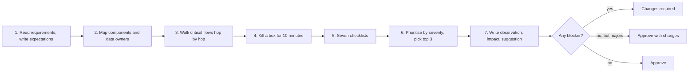
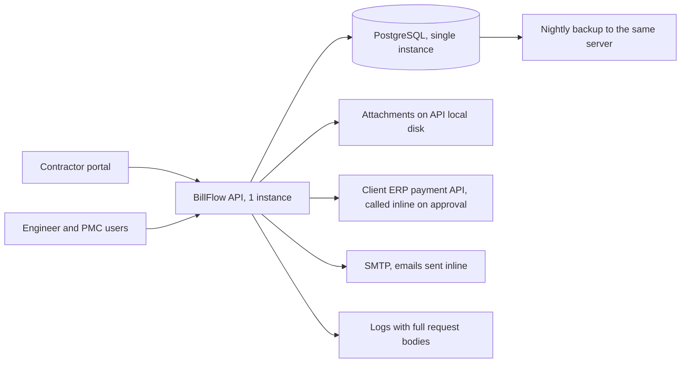

Reviewing someone else's design is a different skill from producing your own. A good reviewer finds the three problems that would hurt most, explains them so the author wants to fix them, and leaves everything else alone. A poor reviewer either rubber-stamps the document or rewrites it in their own style, and in both cases the risky part ships unnoticed. Senior interviews increasingly include a "here's a design, review it" round, and senior jobs involve it weekly. This lesson gives you a method, seven checklists, a feedback format, a complete worked review, and a small C# tool that ranks review comments and catches unhelpful phrasing.

## Learning objectives

By the end of this lesson you will be able to:

1. Run a design review in a fixed order: requirements, map, walk the flows, kill a box, checklists, prioritise, write.
2. Use seven checklists (requirements, scale, failure, security, data, operations, cost) without drowning the author in items.
3. Classify findings by severity (blocker, major, minor, nit, question) and pick the top three.
4. Write feedback as observation, impact and suggestion, phrased about the design rather than the person.
5. Handle disagreement with the author constructively, including when to escalate and when to let go.
6. Review a design out loud in an interview within 20 minutes.
7. Build and test a C# tool that orders comments, decides a verdict, reports uncovered areas, and lints feedback for missing impact and harsh wording.

## Prerequisites

- [Defending choices](#/lesson/m19-defending-choices): reviewing is the other side of defending.
- [Recognising overengineering](#/lesson/m19-overengineering): half of review comments are "this box is not paid for" or "this requirement is not served".
- [OWASP basics](#/lesson/m14-owasp) and [backups and disaster recovery](#/lesson/m14-dr): the security and failure checklists assume them.

## Explain it like I'm a beginner

On large infrastructure projects in India, a bridge designed by one consultant is often checked by an independent **proof-checking consultant** before construction. The proof checker does not redraw the bridge. They take the design, check it against the codes and the site conditions, and send back a list: "the bearing at pier 3 is under-designed for the seismic zone (must fix)", "the drainage spout spacing is unusual, please confirm (question)", "the label on sheet 14 is wrong (minor)".

Three things make a good proof checker:

1. **They start from the requirements**: span, load class, seismic zone, river flood level. A bridge is only right or wrong relative to what it must carry.
2. **They focus on what would fail**, not on whether they would have chosen a different girder shape.
3. **They write findings the designer can act on**: what is wrong, why it matters, what would fix it.

A software design review (architecture review) is the same job. The design document is the drawing. The checklists are the codes. The review comments are the proof checker's list. And just like on a bridge, a problem found on paper costs a fraction of one found after construction.

## First-principles explanation

### What a review is for

A design review exists to **find the expensive mistakes while they are still cheap**. Changing a box on a diagram costs minutes. Changing it after six months of code and a production database costs months. The review is also a chance to share knowledge and to record why decisions were made.

It is **not** for:

- making the design look like the one you would have produced,
- demonstrating how much you know,
- relitigating decisions already made and recorded, unless new facts appeared.

### The review order

Follow the same order every time. It stops you from fixating on the first thing you notice.

1. **Read the requirements first, then stop and write down what you expect to see.** If the design lacks a requirements section, that is your first comment.
2. **Map the design**: list the components and data stores, and who owns each.
3. **Walk the critical flows**: pick the two or three most important user journeys and trace each request through every box, asking at each hop "what if this is slow, down, or called twice?"
4. **Kill a box**: for each component, imagine it is gone for ten minutes. What happens to users, to data, and to the queue behind it?
5. **Run the checklists** for the seven areas below, skimming items that clearly do not apply.
6. **Prioritise**: sort findings by severity, pick the top three, and be ready to drop half the minors.
7. **Write the feedback**, starting with what is strong.

### Severity levels

| Severity | Meaning | Example |
|---|---|---|
| **Blocker** | Must change before building. Risk of data loss, security breach, legal breach or a design that cannot meet a hard requirement. | Bank details written to logs. |
| **Major** | Should change before launch. Real risk of incidents or significant rework. | Synchronous call to a slow third party in the approval path. |
| **Minor** | Worth doing, not urgent. | No alert for bills stuck more than 7 days. |
| **Nit** | Style or naming. Take it or leave it. | Inconsistent naming of states. |
| **Question** | You don't know whether it's a problem. | "What availability does month-end need?" |

The verdict follows from the severities: any blocker means **changes required**; majors without blockers mean **approve with changes**; only minors, nits and questions mean **approve**.

### The seven checklists

Keep each checklist short. The point is to make sure you looked, not to fill a form.

**1. Requirements**
- Are functional requirements and their priorities stated? Which are out of scope?
- Are non-functional requirements quantified: load, latency targets, availability, RPO and RTO, retention, compliance?
- Does every component serve a requirement, and is every requirement served by some component?

**2. Scale**
- Is there an estimate of peak load, data growth and the biggest object sizes?
- What breaks first as load grows, and at roughly what multiple?
- Are there hot keys, hot partitions or fan-out amplification (one request becoming thousands)?
- Do connection counts, thread pools and third-party rate limits fit the instance count?

**3. Failure**
- What happens when each dependency is slow, down, or returns errors? Are there timeouts, retries with back-off and limits, and circuit breakers?
- Is every retried operation idempotent?
- Are there single points of failure against the availability target?
- What happens when a message is delivered twice, out of order, or never?

**4. Security**
- Who are the actors, and how is each authenticated?
- Is authorisation checked on every resource, including object-level checks ("can this user see **this** bill?"), not just roles?
- Where does sensitive data (personal data, financial data, credentials) flow, and is it encrypted in transit and at rest, minimised, and kept out of logs?
- Are inputs validated, uploads scanned and size-limited, and outbound calls restricted (to prevent SSRF)?
- Are secrets in a secret store, and is there an audit trail for sensitive actions?

**5. Data**
- Who owns each piece of data, and is there exactly one source of truth?
- Are consistency needs explicit (which reads must be fresh)? Are concurrent updates handled (optimistic concurrency, conditional updates)?
- How does the schema evolve? Are migrations backwards compatible during deploys?
- What are retention, archival and deletion rules, including personal-data deletion obligations?
- Are backups taken, stored separately, and **tested by restore**?

**6. Operations**
- How is it deployed and rolled back? Can it deploy without downtime?
- What are the SLIs and SLOs, and which alerts page someone?
- Are logs, metrics and traces correlated by a request id?
- Is there a runbook for the top three failure scenarios? Who is on call?

**7. Cost**
- What are the top three cost drivers, and how do they scale with load?
- Are there expensive patterns: cross-region traffic, large egress, always-on capacity for rare peaks, over-provisioned clusters?
- Is there a cheaper design that meets the same requirements?

### How to write feedback

Use **observation, impact, suggestion**:

> **Observation:** Approval calls the ERP payment API synchronously inside the approval request.
> **Impact:** ERP latency or downtime makes approvals fail or time out at month-end, and a retried approval can trigger a second payment.
> **Suggestion:** Record the approval and an outbox row in one transaction, call the ERP from a worker with an idempotency key, and show "payment pending" in the UI.

Rules that keep feedback useful:

- **About the design, not the person.** "The design does not handle duplicate deliveries" rather than "you forgot duplicates".
- **Tie it to a requirement.** "Given the 99.9 % target..." makes the comment a fact about the system, not your taste.
- **Offer, don't dictate.** "One option is..." leaves room for a better idea from the author, who knows the context better than you.
- **Separate must-fix from preference.** Mark nits as nits. If everything is urgent, nothing is.
- **Lead with real strengths.** Specific praise ("the explicit state machine for bill status makes the audit requirement easy") tells the author what to keep.
- **Ask when you don't know.** A question is a perfectly good comment.
- **Avoid absolute and dismissive words** ("obviously", "just", "simply", "clearly"). They make the reader defensive and are rarely true.

### Handling disagreement

You will sometimes disagree with the author about a major point.

1. **Find the root.** Most disagreements are about an unstated requirement or a different estimate. Ask, "What load are you designing for?" before arguing about the design.
2. **Propose an experiment.** "Let's load-test the single primary at 3x expected peak" settles more arguments than debate.
3. **Disagree and commit, explicitly.** If the author owns the decision and the risk is acceptable, record your concern in the decision record and move on.
4. **Escalate only for blockers.** Data loss, security and legal issues justify escalation. Style does not.

### Reviewing in an interview

The "review this design" round usually gives you a diagram and a paragraph, and 20–30 minutes. Narrate the method out loud:

- 2 minutes: restate requirements and ask the missing ones.
- 5 minutes: walk the main flow and kill a box.
- 8 minutes: run the checklists quickly, saying what you check.
- 5 minutes: present the top three findings with severity, impact and suggestion, then the rest briefly.

Interviewers look for **prioritisation** and **tone** as much as for the findings themselves.

## Visual explanation

### The review method



The method is a pipeline. Requirements come first so that every later finding can be tied to one. Mapping gives you the list of boxes to walk and kill. Walking and killing find most real problems, because incidents happen along flows and at failure boundaries; the checklists then catch what those two techniques miss, such as retention or cost. Prioritising before writing is what keeps the review readable. The verdict at the end is mechanical once severities are assigned, which removes a lot of argument.

### The design under review: BillFlow v1

Our worked review is of **BillFlow**, a system for contractors on road projects to submit running-account (RA) bills with measurement sheets and site photos. A site engineer verifies, the project management consultant (PMC) approves, and the client's ERP releases payment. Stated load: 600 contractors, about 3,000 bills a month, attachments of 20–200 MB per bill, heavy use in the last 5 days of each month.



As drawn: one API instance serves contractors and reviewers, writes bills to a single PostgreSQL instance, stores attachments on its own local disk, and on final approval calls the ERP payment API inside the request. Emails go out inline over SMTP. Logs capture full request bodies (which include contractor bank details). Backups run nightly to the same server. Several problems are already visible from the diagram alone; the walk and the checklists will find the rest.

### Walking the approval flow

```mermaid
sequenceDiagram
    participant P1 as PMC user A
    participant P2 as PMC user B
    participant API as BillFlow API
    participant DB as PostgreSQL
    participant ERP as Client ERP
    P1->>API: POST /bills/881/approve
    P2->>API: POST /bills/881/approve
    API->>DB: read bill 881, status EngineerVerified
    API->>DB: read bill 881, status EngineerVerified
    API->>DB: update status Approved for A
    API->>ERP: release payment for bill 881
    API->>DB: update status Approved for B
    API->>ERP: release payment for bill 881 again
    ERP-->>API: timeout on second call
    API-->>P2: 500, user retries
```



Walking the approval flow with two concurrent approvers exposes the most serious correctness bug. Both requests read the bill as "EngineerVerified", both pass the check, both update it to "Approved", and both call the ERP. Nothing in the design makes the status change conditional, and nothing gives the ERP call an idempotency key. The second ERP call times out, the user sees an error and retries, which could cause a third call. A review that only read the diagram might have missed this; walking the flow with "what if this is called twice?" finds it in a minute.

## Step-by-step example

Here is the complete review of BillFlow v1, as you would send it.

### Step 1 — requirements and expectations

From the design doc: 600 contractors, 3,000 bills a month, 20–200 MB attachments, month-end peak, "high availability" (unquantified), payments must be released once per approved bill, bank details are stored, audit trail required by the client.

Expectations before reading the architecture: object storage for attachments (up to 600 GB a month: 3,000 × 200 MB in the worst case), an explicit bill state machine with concurrency control, an idempotent payment release, encrypted bank details kept out of logs, project-scoped authorisation, backups stored elsewhere, and modest compute (3,000 bills a month is about 100 a day, with a month-end peak of perhaps 500 a day).

### Step 2 — strengths (always first)

- The bill status is an explicit state machine (Submitted, EngineerVerified, Approved, PaymentReleased, Rejected) with an audit table recording who changed what and when. This directly meets the client's audit requirement.
- The data model separates bill header, measurement lines and attachments cleanly.
- Load is modest and the design does not over-build: no microservices or brokers that the numbers don't justify.

### Step 3 — findings

| # | Severity | Area | Observation | Impact | Suggestion |
|---|---|---|---|---|---|
| B1 | Blocker | Security, Data | Request bodies, including bank account numbers and IFSC codes, are written to logs. | Financial data is exposed to anyone with log access and copied into log retention and backups; likely breach of the client's data-protection obligations. | Log ids, not bodies. Redact sensitive fields in the logging pipeline, encrypt bank details at rest, and purge existing logs. |
| B2 | Blocker | Data, Failure | Backups are written to the same server as the database. | A disk or server loss destroys the data and its backups together; there is effectively no backup. RPO and RTO are undefined. | Use managed PostgreSQL with automated backups and point-in-time recovery to separate storage, and run a quarterly restore test. State RPO and RTO in the doc. |
| B3 | Blocker | Data, Scale | Attachments are stored on the API server's local disk. | Files are lost if the instance is replaced, and the API cannot run more than one instance. Up to 600 GB a month will fill the disk. | Store attachments in object storage; upload directly from the browser with short-lived pre-signed URLs; store only the object key in the database. |
| M1 | Major | Data | Two approvers can approve the same bill concurrently; the status update is not conditional (see the sequence diagram). | Double approval and double payment release. | Make the transition conditional: `UPDATE bills SET status='Approved', version=version+1 WHERE id=@id AND status='EngineerVerified' AND version=@v`, and treat zero rows updated as "already handled". |
| M2 | Major | Failure | The ERP payment call is synchronous inside the approval request, with no idempotency key. | ERP slowness at month-end makes approvals fail; retries can release payment twice. | Write the approval and an outbox row in one transaction; a worker calls the ERP with the bill id as the idempotency key and records the result. The UI shows "payment pending". |
| M3 | Major | Security | Authorisation checks only the role (Engineer, PMC), not the project. | An engineer on one project can verify bills on another by changing the bill id in the URL (broken object-level access control, OWASP A01). | Check resource ownership on every request: the user must be assigned to the bill's project. Add tests that try cross-project access. |
| M4 | Major | Failure, Operations | One API instance, single database instance, and "high availability" not quantified. | Any deploy or crash is an outage, most painful in the month-end window. | Agree an availability target for month-end. At minimum: two API instances behind a load balancer and a database with a standby. |
| m1 | Minor | Failure | Emails are sent inline over SMTP. | Slow mail servers slow down submissions and approvals. | Send emails from the same outbox worker. |
| m2 | Minor | Operations | No metrics or alerts for bills stuck in a state. | Bills waiting 20 days go unnoticed until a contractor complains. | Add an SLI "bills awaiting action more than 7 days" with a daily report and an alert above a threshold. |
| m3 | Minor | Cost | 200 MB uploads pass through the API. | API bandwidth and memory pressure at month-end; larger instances than needed. | Resolved by the pre-signed upload in B3. |
| Q1 | Question | Requirements | What availability does the month-end window need, and what happens contractually if bills cannot be submitted on the last day? | Determines how far to go on M4. | — |
| Q2 | Question | Security | Are uploaded files scanned for malware before engineers open them? | Engineers open contractor-supplied files. | — |
| N1 | Nit | Data | State names mix "Verified" and "EngineerVerified". | Confusing in reports. | Pick one. |

### Step 4 — the summary

> **Verdict: changes required.** The state machine and audit design are strong and match the client's audit requirement well. Three blockers must be fixed before build: bank details in logs (B1), backups on the same server (B2), and attachments on local disk (B3). Of the majors, the double-approval race (M1) and the non-idempotent ERP call (M2) together can release a payment twice, so I'd treat them as one piece of work. Project-scoped authorisation (M3) is a one-day change with tests. I've left two questions about month-end availability and malware scanning; the answers decide how far to go on M4. Happy to pair on the outbox and the conditional update.

### Step 5 — what the review deliberately did **not** say

- It did not suggest microservices, Kafka or a different database: nothing in the requirements needs them.
- It did not comment on the choice of front-end framework: out of scope for an architecture review.
- It did not list every minor issue found. Two more naming nits were dropped to keep the review focused.

The restraint is part of the quality.

## Production-style C# implementation

The review tool holds a standard checklist, accepts review comments, orders them by severity, decides the verdict, reports which of the seven areas were neither checked nor commented on, and lints comments for missing impact or suggestion on serious findings and for dismissive phrasing.

```text
Review.Api/
  Program.cs
  Review/ReviewModels.cs
  Review/StandardChecklist.cs
  Review/FeedbackLinter.cs
  Review/ReviewReportBuilder.cs
```

```csharp file=Review/ReviewModels.cs
namespace Sdlp.Review;

public enum ReviewArea { Requirements, Scale, Failure, Security, Data, Operations, Cost }

/// <summary>Ordered from most to least severe so that sorting by the enum value ranks findings.</summary>
public enum Severity { Blocker = 0, Major = 1, Minor = 2, Nit = 3, Question = 4 }

public enum Verdict { Approve, ApproveWithChanges, ChangesRequired }

public sealed record ChecklistItem(string Id, ReviewArea Area, string Question);

public sealed record ReviewComment(
    string Id,
    ReviewArea Area,
    Severity Severity,
    string Observation,
    string? Impact = null,
    string? Suggestion = null);

public sealed record LintIssue(string CommentId, string Problem);

public sealed record ReviewRequest(string DesignTitle, IReadOnlyList<ReviewComment> Comments, IReadOnlyList<ReviewArea> CheckedAreas);

public sealed record ReviewReport(
    string DesignTitle,
    Verdict Verdict,
    IReadOnlyList<ReviewComment> Comments,
    IReadOnlyList<ReviewArea> UncoveredAreas,
    IReadOnlyList<LintIssue> LintIssues,
    string Summary);
```

```csharp file=Review/StandardChecklist.cs
namespace Sdlp.Review;

public static class StandardChecklist
{
    public static IReadOnlyList<ChecklistItem> Items { get; } = new[]
    {
        new ChecklistItem("REQ-1", ReviewArea.Requirements, "Are non-functional requirements quantified (load, latency, availability, RPO/RTO, retention)?"),
        new ChecklistItem("REQ-2", ReviewArea.Requirements, "Does every component serve a requirement, and is every requirement served?"),
        new ChecklistItem("SCL-1", ReviewArea.Scale, "Is there an estimate of peak load and data growth, and what breaks first?"),
        new ChecklistItem("SCL-2", ReviewArea.Scale, "Do connection pools, thread pools and third-party rate limits fit the instance count?"),
        new ChecklistItem("FAIL-1", ReviewArea.Failure, "What happens when each dependency is slow or down? Timeouts, bounded retries, circuit breakers?"),
        new ChecklistItem("FAIL-2", ReviewArea.Failure, "Is every retried or redelivered operation idempotent?"),
        new ChecklistItem("FAIL-3", ReviewArea.Failure, "Any single point of failure against the availability target?"),
        new ChecklistItem("SEC-1", ReviewArea.Security, "Is authorisation checked per resource (object level), not only per role?"),
        new ChecklistItem("SEC-2", ReviewArea.Security, "Is sensitive data minimised, encrypted, and kept out of logs?"),
        new ChecklistItem("SEC-3", ReviewArea.Security, "Are uploads validated, size-limited and scanned; are outbound calls restricted?"),
        new ChecklistItem("DATA-1", ReviewArea.Data, "One source of truth per entity; concurrent updates handled?"),
        new ChecklistItem("DATA-2", ReviewArea.Data, "Backups stored separately and tested by restore; retention and deletion rules defined?"),
        new ChecklistItem("DATA-3", ReviewArea.Data, "Are schema migrations backwards compatible during rolling deploys?"),
        new ChecklistItem("OPS-1", ReviewArea.Operations, "Zero-downtime deploy and a tested rollback?"),
        new ChecklistItem("OPS-2", ReviewArea.Operations, "SLIs, SLOs and paging alerts defined; logs, metrics and traces correlated?"),
        new ChecklistItem("COST-1", ReviewArea.Cost, "What are the top three cost drivers and how do they scale?"),
        new ChecklistItem("COST-2", ReviewArea.Cost, "Is there a cheaper design that meets the same requirements?"),
    };
}
```

```csharp file=Review/FeedbackLinter.cs
using System.Text.RegularExpressions;

namespace Sdlp.Review;

public interface IFeedbackLinter
{
    IReadOnlyList<LintIssue> Lint(ReviewComment comment);
}

/// <summary>Catches feedback that is hard to act on or likely to make the author defensive.</summary>
public sealed partial class FeedbackLinter : IFeedbackLinter
{
    [GeneratedRegex(@"\b(obviously|clearly|just|simply|stupid|lazy|terrible|nonsense)\b", RegexOptions.IgnoreCase)]
    private static partial Regex DismissiveWords();

    [GeneratedRegex(@"\b(you forgot|you didn't|you did not|why didn't you|you never)\b", RegexOptions.IgnoreCase)]
    private static partial Regex BlamePhrases();

    public IReadOnlyList<LintIssue> Lint(ReviewComment c)
    {
        var issues = new List<LintIssue>();
        if (string.IsNullOrWhiteSpace(c.Observation))
            issues.Add(new LintIssue(c.Id, "Observation is empty: say what you saw in the design."));

        if (c.Severity is Severity.Blocker or Severity.Major)
        {
            if (string.IsNullOrWhiteSpace(c.Impact))
                issues.Add(new LintIssue(c.Id, "Serious findings need an impact: what goes wrong, for whom?"));
            if (string.IsNullOrWhiteSpace(c.Suggestion))
                issues.Add(new LintIssue(c.Id, "Serious findings need a suggestion, even a tentative one."));
        }

        var text = string.Join(" ", c.Observation, c.Impact, c.Suggestion);
        foreach (Match m in DismissiveWords().Matches(text))
            issues.Add(new LintIssue(c.Id, $"Avoid '{m.Value}': it reads as dismissive and is rarely true."));
        foreach (Match m in BlamePhrases().Matches(text))
            issues.Add(new LintIssue(c.Id, $"'{m.Value}' is about the person. Describe the design instead (\"the design does not...\")."));

        return issues;
    }
}
```

```csharp file=Review/ReviewReportBuilder.cs
namespace Sdlp.Review;

public sealed class ReviewReportBuilder(IFeedbackLinter linter)
{
    public ReviewReport Build(ReviewRequest request)
    {
        ArgumentNullException.ThrowIfNull(request);
        var duplicates = request.Comments.GroupBy(c => c.Id, StringComparer.OrdinalIgnoreCase).Where(g => g.Count() > 1).Select(g => g.Key).ToList();
        if (duplicates.Count > 0)
            throw new ArgumentException($"Duplicate comment ids: {string.Join(", ", duplicates)}.", nameof(request));

        var ordered = request.Comments
            .OrderBy(c => c.Severity)
            .ThenBy(c => c.Area)
            .ThenBy(c => c.Id, StringComparer.Ordinal)
            .ToList();

        var verdict = ordered.Any(c => c.Severity == Severity.Blocker) ? Verdict.ChangesRequired
                    : ordered.Any(c => c.Severity == Severity.Major) ? Verdict.ApproveWithChanges
                    : Verdict.Approve;

        var touched = request.CheckedAreas.Concat(ordered.Select(c => c.Area)).ToHashSet();
        var uncovered = Enum.GetValues<ReviewArea>().Where(a => !touched.Contains(a)).ToList();

        var lint = ordered.SelectMany(c => linter.Lint(c)).ToList();

        var counts = ordered.GroupBy(c => c.Severity).OrderBy(g => g.Key)
                            .Select(g => $"{g.Count()} {g.Key.ToString().ToLowerInvariant()}");
        var top = ordered.Where(c => c.Severity <= Severity.Major).Take(3).Select(c => c.Id);
        var summary = $"{verdict}: {string.Join(", ", counts)}." +
                      (top.Any() ? $" Fix first: {string.Join(", ", top)}." : "") +
                      (uncovered.Count > 0 ? $" Not yet reviewed: {string.Join(", ", uncovered)}." : "");

        return new ReviewReport(request.DesignTitle, verdict, ordered, uncovered, lint, summary);
    }
}
```

```csharp file=Program.cs
using Sdlp.Review;

var builder = WebApplication.CreateBuilder(args);
builder.Services.AddSingleton<IFeedbackLinter, FeedbackLinter>();
builder.Services.AddSingleton<ReviewReportBuilder>();

var app = builder.Build();

app.MapGet("/reviews/checklist", () => Results.Ok(StandardChecklist.Items));

app.MapPost("/reviews", (ReviewRequest request, ReviewReportBuilder reports) =>
{
    try { return Results.Ok(reports.Build(request)); }
    catch (ArgumentException ex) { return Results.Problem(ex.Message, statusCode: StatusCodes.Status400BadRequest); }
});

app.Run();
```

Notes on the design:

- **`[GeneratedRegex]`** (available since .NET 7) compiles the regular expressions at build time. It is a small thing, but it is the idiomatic choice for fixed patterns in modern .NET.
- **The severity enum is ordered** so that `OrderBy(c => c.Severity)` ranks blockers first. Encoding the order in the type avoids a separate lookup table that can drift.
- **"Uncovered areas" uses both comments and explicitly checked areas.** An area with no comments is not necessarily unreviewed; the reviewer may have checked it and found nothing. Asking reviewers to tick areas makes "I didn't look at cost" visible.
- **The linter is advisory.** It flags; it never blocks. Tone checkers that block submissions get gamed quickly.

## Bad design vs good design

Here the "design" being judged is the review itself.

**Bad review:**

> "This is way too simple, obviously it won't scale. Why didn't you use microservices and Kafka? Also logging is bad, backups are bad, and you just put files on disk?? Needs a total rethink. Also rename the states."

Problems: no requirements cited; "won't scale" is false for 100 bills a day; the microservices and Kafka suggestion is overengineering; the real blockers (bank details in logs, backups on the same server) are buried in a list with "rename the states"; no impact or suggestion for any finding; the tone guarantees a defensive response; and the double-payment race is missed entirely because nobody walked the flow.

**Good review:** the worked review above. It starts with strengths, ties each finding to a requirement, ranks by severity, gives impact and a concrete suggestion for every serious finding, groups related findings (M1 and M2), asks questions where the reviewer doesn't know, and drops low-value nits.

:::callout type=tip title="The top-three rule"
If the author reads only three comments, which three should they be? Put those first and say so. A 40-item review with no priority is a burden, not a help.
:::

:::callout type=mistake title="Reviewing the design you would have written"
"I'd have used a document database" is not a finding unless a requirement is unmet. Ask yourself: what goes wrong for users, data, money or operations if they keep their choice? If nothing does, let it go.
:::

## Practical playground

The starter is BillFlow v1. Fix the blockers and majors from the review in the canvas: move attachments to object storage with direct uploads, add a second API instance and a database standby with off-server backups, introduce an outbox worker for ERP calls and emails, and add monitoring for stuck bills. Label each change with the review finding id (B1, M2 and so on). Then compare with the reference solution in exercise 5.

:::playground type=hld title="Fix BillFlow v1 from the review findings"
```json
{
  "nodes": [
    { "id": "cp", "type": "client", "label": "Contractor portal (600 contractors)", "props": { "rps": 10 } },
    { "id": "rev", "type": "client", "label": "Engineers and PMC", "props": { "rps": 5 } },
    { "id": "api", "type": "app-server", "label": "BillFlow API, attachments on local disk", "props": { "instances": 1 } },
    { "id": "db", "type": "database", "label": "PostgreSQL single instance, backups on same server" },
    { "id": "erp", "type": "external", "label": "Client ERP payment API" },
    { "id": "smtp", "type": "external", "label": "SMTP" }
  ],
  "edges": [
    { "from": "cp", "to": "api", "kind": "sync" },
    { "from": "rev", "to": "api", "kind": "sync" },
    { "from": "api", "to": "db", "kind": "sync" },
    { "from": "api", "to": "erp", "kind": "sync", "label": "inline on approval" },
    { "from": "api", "to": "smtp", "kind": "sync", "label": "inline" }
  ]
}
```
:::

## Exercises

:::exercise id=m19-design-review-ex1 difficulty=beginner kind=written title="Rewrite five unhelpful comments"
Rewrite each comment as observation, impact and suggestion, about the design rather than the person, and assign a severity. Invent plausible context where needed and say so.

1. "You forgot caching. Obviously this will be slow."
2. "Why MongoDB?? Terrible choice."
3. "Logging is bad."
4. "This won't scale."
5. "Just use Kubernetes."
::acceptance
- Each rewrite has an observation, an impact (who is affected, how) and a suggestion or a question.
- None uses "you forgot", "obviously", "just", "terrible" or similar.
- Severities are justified; at least one comment becomes a question, and at least one is downgraded or dropped.
::hint
For each, ask: what did the reviewer actually see, and what are they afraid will happen?
::hint
If you cannot name an impact, the comment may be a preference. Turn it into a question or drop it.
::hint
"This won't scale" needs a number: scale to what, and what breaks first?
::hint
"Just use Kubernetes" is a solution looking for a problem. What problem might the reviewer have meant (deploys, scaling, restarts)?
::solution
1. *Minor (or question).* "Observation: product pages are read from PostgreSQL on every request. Impact: at the estimated 1,200 reads per second at sale peaks (my assumption from the traffic section), the primary's CPU may become the bottleneck and p95 could exceed the 300 ms target. Suggestion: measure page query cost under a load test; if it's above budget, cache product pages for 60 seconds with cache-aside."
2. *Question.* "What led to MongoDB for orders? Orders need atomic updates of header, lines and stock reservations, which is easier with multi-row transactions. If there's a requirement I've missed, such as a document-shaped catalogue, could the doc state it?"
3. *Major (assuming PII).* "Observation: the request logging middleware writes full bodies, which include phone numbers and addresses. Impact: personal data spreads into log storage and retention beyond what users consented to. Suggestion: log request ids, routes, status codes and durations; redact known sensitive fields."
4. *Major or dropped, depending on numbers.* "Observation: all writes go to one primary. Impact: the doc's 3-year forecast of 20,000 writes per second at peak is beyond what we've load-tested on a single primary (about 6,000). Suggestion: choose a partition key now (tenant id), and plan partitioning with a trigger at 70 % of tested capacity." If the forecast were 500 writes per second, this comment should be dropped.
5. *Question, likely dropped.* "Is there a deployment or scaling problem the current VM setup doesn't solve? If restarts after crashes are the concern, a managed app platform with health checks may meet it with less operational load than Kubernetes."
::mistakes
- Keeping the original severity for "Logging is bad" without finding the actual risk.
- Turning "This won't scale" into a major finding with no number.
:::

:::exercise id=m19-design-review-ex2 difficulty=beginner kind=code title="Order comments and decide the verdict"
Implement `ReviewMath.Order`, which sorts comments by severity (blocker first) then by id, and `ReviewMath.Decide`, which returns the verdict: any blocker → `ChangesRequired`; otherwise any major → `ApproveWithChanges`; otherwise `Approve`.
::requirements
- Severity order: Blocker, Major, Minor, Nit, Question.
- Ids compare with ordinal string comparison.
- An empty list is `Approve`.
::acceptance
- BillFlow's 13 findings produce `ChangesRequired`.
- Only majors and minors produce `ApproveWithChanges`.
- Only questions and nits produce `Approve`.
- Ordering puts B1, B2, B3 before M1, and Q1 last.
::hint
If the enum values are declared in severity order, sorting by the enum does most of the work.
::hint
`Any(c => c.Severity == Severity.Blocker)` reads clearly.
::hint
`OrderBy(c => c.Severity).ThenBy(c => c.Id, StringComparer.Ordinal)`.
::starter
```csharp file=ReviewMath.cs
using System;
using System.Collections.Generic;
using System.Linq;

public enum Severity { Blocker, Major, Minor, Nit, Question }
public enum Verdict { Approve, ApproveWithChanges, ChangesRequired }
public sealed record Comment(string Id, Severity Severity, string Text);

public static class ReviewMath
{
    public static IReadOnlyList<Comment> Order(IEnumerable<Comment> comments) => throw new NotImplementedException();
    public static Verdict Decide(IEnumerable<Comment> comments) => throw new NotImplementedException();
}
```
::tests
```csharp file=ReviewMathTests.cs
using System;
using System.Collections.Generic;
using System.Linq;
using Xunit;

public class ReviewMathTests
{
    private static Comment C(string id, Severity s) => new(id, s, "text");

    private static readonly Comment[] BillFlow =
    {
        C("Q1", Severity.Question), C("M2", Severity.Major), C("B2", Severity.Blocker), C("m1", Severity.Minor),
        C("N1", Severity.Nit), C("B1", Severity.Blocker), C("M1", Severity.Major), C("B3", Severity.Blocker),
        C("M3", Severity.Major), C("M4", Severity.Major), C("m2", Severity.Minor), C("m3", Severity.Minor), C("Q2", Severity.Question)
    };

    [Fact] public void BillFlow_requires_changes() => Assert.Equal(Verdict.ChangesRequired, ReviewMath.Decide(BillFlow));

    [Fact]
    public void Majors_without_blockers_approve_with_changes() =>
        Assert.Equal(Verdict.ApproveWithChanges, ReviewMath.Decide(new[] { C("M1", Severity.Major), C("m1", Severity.Minor) }));

    [Fact]
    public void Only_questions_and_nits_approve() =>
        Assert.Equal(Verdict.Approve, ReviewMath.Decide(new[] { C("Q1", Severity.Question), C("N1", Severity.Nit) }));

    [Fact] public void Empty_approves() => Assert.Equal(Verdict.Approve, ReviewMath.Decide(Array.Empty<Comment>()));

    [Fact]
    public void Orders_by_severity_then_id()
    {
        var ids = ReviewMath.Order(BillFlow).Select(c => c.Id).ToArray();
        Assert.Equal(new[] { "B1", "B2", "B3", "M1", "M2", "M3", "M4", "m1", "m2", "m3", "N1", "Q1", "Q2" }, ids);
    }
}
```
::solution
```csharp file=ReviewMath.cs
using System;
using System.Collections.Generic;
using System.Linq;

public enum Severity { Blocker, Major, Minor, Nit, Question }
public enum Verdict { Approve, ApproveWithChanges, ChangesRequired }
public sealed record Comment(string Id, Severity Severity, string Text);

public static class ReviewMath
{
    public static IReadOnlyList<Comment> Order(IEnumerable<Comment> comments) =>
        comments.OrderBy(c => c.Severity).ThenBy(c => c.Id, StringComparer.Ordinal).ToList();

    public static Verdict Decide(IEnumerable<Comment> comments)
    {
        var list = comments as IReadOnlyCollection<Comment> ?? comments.ToList();
        if (list.Any(c => c.Severity == Severity.Blocker)) return Verdict.ChangesRequired;
        if (list.Any(c => c.Severity == Severity.Major)) return Verdict.ApproveWithChanges;
        return Verdict.Approve;
    }
}
```

The verdict is deliberately mechanical. Arguments about the verdict become arguments about one comment's severity, which is a smaller and more productive argument.
::mistakes
- Sorting by the severity's name as a string. It works today only because Blocker, Major, Minor, Nit, Question happen to be alphabetical; add a "Critical" level and the order silently breaks.
- Enumerating an `IEnumerable` twice when it might be a one-shot sequence.
:::

:::exercise id=m19-design-review-ex3 difficulty=intermediate kind=code title="Lint review feedback"
Implement `Linter.Lint`, which returns problems with a review comment: empty observation; missing impact or suggestion on blocker or major findings; dismissive words (obviously, clearly, just, simply, stupid, lazy, terrible); and blame phrases (you forgot, you didn't, why didn't you).
::requirements
- Word matching is case-insensitive and whole-word only ("adjust" must not match "just").
- Each dismissive word or blame phrase found produces one problem mentioning it.
- Minor, nit and question comments do not need impact or suggestion.
- Problems are returned in this order: observation, impact, suggestion, words, phrases.
::acceptance
- A major with observation only returns two problems (impact, suggestion).
- "Obviously you forgot retries" returns problems for "Obviously" and "you forgot".
- "Adjust the timeout" returns no problems for a minor comment.
- A well-formed major comment returns no problems.
::hint
Regular expressions with `\b` word boundaries handle whole words.
::hint
Combine observation, impact and suggestion into one string before searching words, so a harsh word anywhere is caught.
::hint
`RegexOptions.IgnoreCase`, and `m.Value` gives the matched text with its original casing.
::hint
```csharp
var words = new Regex(@"\b(obviously|clearly|just|simply|stupid|lazy|terrible)\b", RegexOptions.IgnoreCase);
foreach (Match m in words.Matches(text)) problems.Add($"dismissive: {m.Value}");
```
::starter
```csharp file=Linter.cs
using System;
using System.Collections.Generic;
using System.Text.RegularExpressions;

public enum Sev { Blocker, Major, Minor, Nit, Question }
public sealed record ReviewNote(Sev Severity, string Observation, string? Impact = null, string? Suggestion = null);

public static class Linter
{
    public static IReadOnlyList<string> Lint(ReviewNote note) => throw new NotImplementedException();
}
```
::tests
```csharp file=LinterTests.cs
using System;
using System.Linq;
using Xunit;

public class LinterTests
{
    [Fact]
    public void Major_without_impact_and_suggestion()
    {
        var p = Linter.Lint(new ReviewNote(Sev.Major, "ERP call is synchronous."));
        Assert.Equal(2, p.Count);
        Assert.Contains("impact", p[0].ToLowerInvariant());
        Assert.Contains("suggestion", p[1].ToLowerInvariant());
    }

    [Fact]
    public void Finds_dismissive_word_and_blame_phrase()
    {
        var p = Linter.Lint(new ReviewNote(Sev.Minor, "Obviously you forgot retries"));
        Assert.Equal(2, p.Count);
        Assert.Contains("Obviously", p[0]);
        Assert.Contains("you forgot", p[1]);
    }

    [Fact]
    public void Whole_words_only() => Assert.Empty(Linter.Lint(new ReviewNote(Sev.Minor, "Adjust the timeout")));

    [Fact]
    public void Empty_observation_is_flagged() =>
        Assert.Contains("observation", Linter.Lint(new ReviewNote(Sev.Question, " ")).Single().ToLowerInvariant());

    [Fact]
    public void Well_formed_major_passes() =>
        Assert.Empty(Linter.Lint(new ReviewNote(Sev.Blocker,
            "Bank details are written to logs.",
            "Financial data is exposed to anyone with log access.",
            "Redact sensitive fields and log ids instead.")));

    [Fact]
    public void Harsh_word_in_suggestion_is_caught() =>
        Assert.Single(Linter.Lint(new ReviewNote(Sev.Major, "Files on local disk.", "Lost on redeploy.", "Simply use object storage.")));
}
```
::solution
```csharp file=Linter.cs
using System;
using System.Collections.Generic;
using System.Text.RegularExpressions;

public enum Sev { Blocker, Major, Minor, Nit, Question }
public sealed record ReviewNote(Sev Severity, string Observation, string? Impact = null, string? Suggestion = null);

public static class Linter
{
    private static readonly Regex Words =
        new(@"\b(obviously|clearly|just|simply|stupid|lazy|terrible)\b", RegexOptions.IgnoreCase | RegexOptions.Compiled);
    private static readonly Regex Blame =
        new(@"\b(you forgot|you didn't|why didn't you)\b", RegexOptions.IgnoreCase | RegexOptions.Compiled);

    public static IReadOnlyList<string> Lint(ReviewNote note)
    {
        var problems = new List<string>();
        if (string.IsNullOrWhiteSpace(note.Observation))
            problems.Add("Empty observation: say what you saw in the design.");

        if (note.Severity is Sev.Blocker or Sev.Major)
        {
            if (string.IsNullOrWhiteSpace(note.Impact)) problems.Add("Missing impact: what goes wrong, and for whom?");
            if (string.IsNullOrWhiteSpace(note.Suggestion)) problems.Add("Missing suggestion: offer at least one option.");
        }

        var text = string.Join(" ", note.Observation, note.Impact, note.Suggestion);
        foreach (Match m in Words.Matches(text))
            problems.Add($"Dismissive word '{m.Value}': remove it or replace it with evidence.");
        foreach (Match m in Blame.Matches(text))
            problems.Add($"Blame phrase '{m.Value}': describe the design, not the person.");

        return problems;
    }
}
```

`string.Join` happily skips nothing: null parts become empty strings, so a missing impact does not throw. The production version uses `[GeneratedRegex]`; a static compiled `Regex` is the older equivalent and fine here.
::mistakes
- Using `text.Contains("just")`, which flags "adjust" and "justify".
- Checking only the observation for harsh words.
- Requiring impact on questions, which discourages reviewers from asking.
::extensions
Flag comments longer than 120 words: long comments are usually two comments.
:::

:::exercise id=m19-design-review-ex4 difficulty=intermediate kind=written title="Review an exam-proctoring upload design"
Design summary: "Students taking a 3-hour online exam have their webcam recorded in the browser. Every 60 seconds, the browser uploads a 6 MB video chunk to `POST /proctor/chunks`, which writes it to the API server's disk and inserts a row in PostgreSQL. A nightly job moves chunks to object storage. 200,000 students sit the exam at once. The API runs 10 instances behind a load balancer. Chunks are named `{rollNumber}-{chunkNo}.webm`. Proctors view chunks via `GET /proctor/chunks/{name}`." Run the review method and write the top five findings with severity, area, observation, impact and suggestion, plus one strength and one question.
::acceptance
- The estimate is shown (uploads per second, bandwidth, storage per exam).
- At least one security finding about access to chunks.
- At least one failure finding about uploads on local disk or retries.
- Findings are ranked, and the verdict follows from the severities.
::hint
200,000 students × one 6 MB chunk per 60 s. Compute uploads per second and inbound bandwidth.
::hint
Guess a URL: `GET /proctor/chunks/2026A00123-17.webm`. Who can do that?
::hint
What happens to an instance's local chunks if it crashes before the nightly job?
::hint
What does the browser do if an upload fails mid-exam on a poor connection?
::solution
*Estimate.* 200,000 ÷ 60 ≈ 3,300 uploads per second. × 6 MB ≈ 20 GB/s ≈ 160 Gbps inbound. Per exam: 200,000 × 180 chunks × 6 MB ≈ 216 TB.

**Strength:** chunking every 60 s limits how much is lost on a failure and makes uploads resumable in principle.

| # | Severity | Area | Observation | Impact | Suggestion |
|---|---|---|---|---|---|
| 1 | Blocker | Security | Chunk names are predictable (roll number and sequence) and `GET /proctor/chunks/{name}` has no stated authorisation. | Anyone can enumerate and download other students' webcam video: a serious privacy breach. | Random object keys, proctor-only authorisation with per-exam assignment, short-lived signed read URLs, audit every view. |
| 2 | Blocker | Scale, Cost | 160 Gbps of video passes through 10 API instances. | Each instance would need about 16 Gbps of sustained ingress; the API tier and load balancer become the bottleneck and the main cost. | Browsers upload directly to object storage with pre-signed URLs; the API only issues URLs and records metadata. |
| 3 | Blocker | Data, Failure | Chunks sit on API local disk until a nightly job. | An instance crash or replacement loses hours of evidence for thousands of students, with legal consequences for disputed results. | Covered by finding 2: write directly to durable object storage. |
| 4 | Major | Failure | No client retry or resume behaviour is specified. | Students on weak connections lose chunks permanently; flagged as cheating by gaps. | Browser buffers chunks in IndexedDB, retries with back-off and jitter, and uploads idempotently by chunk id; proctors see "delayed" rather than "missing". |
| 5 | Major | Data | 3,300 row inserts per second for metadata, all at the same moment, plus 216 TB per exam with no retention rule. | Insert spikes at each minute boundary; storage cost grows without bound. | Batch metadata inserts or derive metadata from object-storage events; define retention (for example 90 days after results unless disputed) with lifecycle rules. |

**Question:** what is the legal retention requirement for proctoring video, and does the student consent text cover it?

**Verdict:** changes required (three blockers).
::mistakes
- Missing the enumeration risk because "only proctors know the URL".
- Treating the nightly job as acceptable durability.
- Not computing bandwidth, so the API tier looks fine.
:::

:::exercise id=m19-design-review-ex5 difficulty=advanced kind=hld title="Produce BillFlow v2 from the review"
Using the worked review's findings, produce BillFlow v2. Every change must carry the finding id it resolves in its label. Do not add anything the findings and requirements do not justify.
::acceptance
- B1: sensitive fields redacted from logs and encrypted at rest (show the log pipeline and a secret or key store).
- B2: managed database with standby and point-in-time recovery to separate storage.
- B3: object storage with direct pre-signed uploads and malware scanning (Q2).
- M1 and M2: conditional state transition and an outbox worker calling the ERP with an idempotency key.
- M3: project-scoped authorisation shown at the API.
- M4: at least two API instances behind a load balancer.
- m2: monitoring for stuck bills.
- No broker cluster, microservices or multi-region.
::hint
Start by deleting the local-disk attachment store and the inline ERP and SMTP edges.
::hint
The outbox worker handles both ERP calls and emails; at about 100 bills a day, no broker is needed.
::hint
Malware scanning can be triggered by an object-storage event into a scanning worker that marks the attachment clean or quarantined.
::hint
Put "M3: project membership check on every bill route" in the API's label.
::starter
```json
{
  "nodes": [
    { "id": "cp", "type": "client", "label": "Contractor portal (600 contractors)", "props": { "rps": 10 } },
    { "id": "rev", "type": "client", "label": "Engineers and PMC", "props": { "rps": 5 } },
    { "id": "api", "type": "app-server", "label": "BillFlow API, attachments on local disk", "props": { "instances": 1 } },
    { "id": "db", "type": "database", "label": "PostgreSQL single instance, backups on same server" },
    { "id": "erp", "type": "external", "label": "Client ERP payment API" },
    { "id": "smtp", "type": "external", "label": "SMTP" }
  ],
  "edges": [
    { "from": "cp", "to": "api", "kind": "sync" },
    { "from": "rev", "to": "api", "kind": "sync" },
    { "from": "api", "to": "db", "kind": "sync" },
    { "from": "api", "to": "erp", "kind": "sync", "label": "inline on approval" },
    { "from": "api", "to": "smtp", "kind": "sync", "label": "inline" }
  ]
}
```
::solution
```json
{
  "nodes": [
    { "id": "cp", "type": "client", "label": "Contractor portal (600 contractors)", "props": { "rps": 10 } },
    { "id": "rev", "type": "client", "label": "Engineers and PMC", "props": { "rps": 5 } },
    { "id": "lb", "type": "load-balancer", "label": "Load balancer + TLS (M4)" },
    { "id": "api", "type": "app-server", "label": "BillFlow API: M3 project membership check, M1 conditional status update", "props": { "instances": 2 } },
    { "id": "db", "type": "database", "label": "Managed PostgreSQL + standby, PITR to separate storage (B2), bank details encrypted (B1)", "props": { "multiAz": true } },
    { "id": "kv", "type": "external", "label": "Key vault: encryption keys and secrets (B1)" },
    { "id": "obj", "type": "object-storage", "label": "Attachments, direct pre-signed upload (B3, m3)" },
    { "id": "scan", "type": "worker", "label": "Malware scan on upload event, quarantine (Q2)" },
    { "id": "ob", "type": "worker", "label": "Outbox worker: ERP release with bill id idempotency key (M2), emails (m1)" },
    { "id": "erp", "type": "external", "label": "Client ERP payment API" },
    { "id": "smtp", "type": "external", "label": "SMTP" },
    { "id": "logs", "type": "monitoring", "label": "Logs with redaction, ids only (B1)" },
    { "id": "mon", "type": "monitoring", "label": "SLI: bills waiting over 7 days, outbox age, ERP failures (m2)" }
  ],
  "edges": [
    { "from": "cp", "to": "lb", "kind": "sync" },
    { "from": "rev", "to": "lb", "kind": "sync" },
    { "from": "lb", "to": "api", "kind": "sync" },
    { "from": "api", "to": "db", "kind": "sync", "label": "approval + outbox row in one transaction" },
    { "from": "api", "to": "kv", "kind": "sync", "label": "keys" },
    { "from": "api", "to": "obj", "kind": "sync", "label": "issue pre-signed URLs" },
    { "from": "cp", "to": "obj", "kind": "sync", "label": "upload attachment directly" },
    { "from": "obj", "to": "scan", "kind": "async", "label": "object created event" },
    { "from": "scan", "to": "db", "kind": "sync", "label": "mark clean or quarantined" },
    { "from": "ob", "to": "db", "kind": "sync", "label": "poll outbox SKIP LOCKED" },
    { "from": "ob", "to": "erp", "kind": "sync", "label": "release payment, idempotent" },
    { "from": "ob", "to": "smtp", "kind": "sync" },
    { "from": "api", "to": "logs", "kind": "async" },
    { "from": "mon", "to": "db", "kind": "async" },
    { "from": "mon", "to": "ob", "kind": "async" }
  ]
}
```

Reasoning: each node exists because a finding or requirement demands it, and each label says which. The outbox worker is the only asynchronous machinery: at about 100 bills a day, a broker would add operations without adding a guarantee. The conditional update (M1) and the idempotency key (M2) together guarantee one payment per bill even under concurrent approval and retries. The malware scanner answers Q2 under the assumption that the answer was "no scanning today". Two API instances and a managed standby meet a month-end availability target that is likely around 99.9 %; if Q1's answer is stricter, the next step is a second zone for the API, not a second region.
::mistakes
- Adding a message broker for ERP calls at 100 bills a day.
- Fixing M1 with an application-level lock in one instance's memory, which fails with two instances.
- Leaving the inline SMTP edge in place.
:::

:::exercise id=m19-design-review-ex6 difficulty=advanced kind=written title="Disagreeing with a senior author"
You are reviewing a principal engineer's design for a new reporting platform. They propose copying all operational data nightly into a separate PostgreSQL reporting database using custom ETL scripts. You believe change data capture (CDC) into a warehouse would be better because business users asked for "near-real-time" dashboards. The author says "near-real-time was a nice-to-have, nightly is fine, and CDC is complex." Write (a) your review comment, (b) your reply after their response, and (c) the note you would add to the decision record if they keep their design.
::acceptance
- The comment starts from the requirement, not from your preferred technology.
- The reply proposes a way to resolve the disagreement with facts (ask the requirement owner, measure, or experiment).
- The decision-record note records the concern, the risk, and a trigger to revisit, without hostility.
- The severity you assign is honest (probably not a blocker).
::hint
Is this a disagreement about technology or about the requirement? Find out which.
::hint
Who owns the "near-real-time" requirement? Bring them in rather than arguing between engineers.
::hint
"Disagree and commit" is a legitimate outcome when the risk is not a blocker.
::solution
**(a) Review comment — Question, possibly Major.**
"Observation: the requirements section lists 'near-real-time dashboards' from the finance team, and the design refreshes nightly. Impact: if finance relies on intraday figures for month-end decisions, nightly data won't meet the need and we'd rework the pipeline later. Suggestion: confirm the freshness requirement with the finance owner. If they need intraday data, CDC from the PostgreSQL write-ahead log into the reporting store is one option; if nightly is fine, the current design is simpler and I'd support it."

**(b) Reply after the author's response.**
"Thanks, that helps. Since we read the requirement differently, could we ask the finance lead which decisions depend on the dashboards and how fresh the data must be for them? If nightly is enough, I'm happy to approve. If not, I'd suggest a small spike: CDC for the two busiest tables for a week, to measure the operational effort before deciding. Either way, could the ETL scripts write a watermark (last loaded change time) per table, so moving to incremental loads later is cheaper?"

**(c) Decision-record note (if nightly ETL is kept).**
"Reviewer concern (2026-10-20): business users initially asked for near-real-time dashboards; the finance lead confirmed nightly freshness is acceptable for the next two quarters. Risk: if intraday reporting becomes a requirement, the nightly ETL will need to be replaced or supplemented. Mitigation: ETL records per-table watermarks. Revisit trigger: a confirmed requirement for data fresher than 4 hours, or ETL duration exceeding 3 hours."
::mistakes
- Leading with "CDC is better" instead of with the requirement.
- Marking it a blocker to win the argument.
- Escalating before asking the requirement owner.
- Writing a decision-record note that reads as "I told you so".
:::

## Automated testing

The review tool's logic is small but easy to break silently: a reordered enum changes every verdict, and a careless regex flags half the English language. Test the builder with the BillFlow findings, the linter with tricky words, and the "uncovered areas" logic with explicit checks.

```csharp
public class ReviewReportBuilderTests
{
    private static ReviewReportBuilder Builder() => new(new FeedbackLinter());

    [Fact]
    public void BillFlow_needs_changes_and_lists_blockers_first()
    {
        var comments = new[]
        {
            new ReviewComment("M1", ReviewArea.Data, Severity.Major, "Concurrent approvals not handled.", "Double payment.", "Conditional update."),
            new ReviewComment("B1", ReviewArea.Security, Severity.Blocker, "Bank details in logs.", "Data exposure.", "Redact."),
            new ReviewComment("Q1", ReviewArea.Requirements, Severity.Question, "What availability does month-end need?"),
        };
        var report = Builder().Build(new ReviewRequest("BillFlow v1", comments, new[] { ReviewArea.Cost, ReviewArea.Operations }));

        Assert.Equal(Verdict.ChangesRequired, report.Verdict);
        Assert.Equal("B1", report.Comments[0].Id);
        Assert.Equal(new[] { ReviewArea.Scale, ReviewArea.Failure }, report.UncoveredAreas);
        Assert.Empty(report.LintIssues);
    }

    [Fact]
    public void Linter_ignores_words_inside_other_words()
    {
        var issues = new FeedbackLinter().Lint(new ReviewComment("m1", ReviewArea.Operations, Severity.Minor, "Adjust the alert threshold; the justification is unclear."));
        Assert.Empty(issues);
    }

    [Fact]
    public void Duplicate_ids_are_rejected() =>
        Assert.Throws<ArgumentException>(() => Builder().Build(new ReviewRequest("x",
            new[] { new ReviewComment("A", ReviewArea.Cost, Severity.Nit, "a"), new ReviewComment("a", ReviewArea.Cost, Severity.Nit, "b") },
            Array.Empty<ReviewArea>())));
}
```

Two more tests worth having: a snapshot of `StandardChecklist.Items` ids (so items are not silently removed), and a test that every `ReviewArea` value has at least one checklist item.

## Real-world application

- **Architecture review boards.** Many organisations require a review before a new system or a major change goes to production. The seven areas map closely onto the pillars of public frameworks such as the Azure Well-Architected Framework (reliability, security, cost optimisation, operational excellence, performance efficiency).
- **Pull requests for infrastructure.** Infrastructure-as-code changes get the same checklists in miniature: what does this change break if it fails, who can access it, what does it cost?
- **Vendor and tender evaluations.** When a client receives a design from a vendor, the review method gives a structured, defensible response: findings with severity, impact and suggestion, rather than a vague "not satisfactory".
- **Incident follow-ups.** Post-incident reviews often reveal a finding that a design review could have caught: "no idempotency on the payment callback", "backups on the same host". Adding such findings to your checklist is how a team's review practice improves.
- **Interviews.** The "critique this design" round tests exactly this lesson: method, prioritisation and tone.

## Interview questions

:::interview
::q beginner
What are the first three things you do when asked to review a design?
::a
Read the requirements and write down what I expect to see given them (and if requirements are missing, that's my first comment). Then map the components and the data owners. Then walk the two or three most important flows hop by hop, asking at each step what happens if the next hop is slow, down, or the request arrives twice. Checklists come after, to catch what the walk misses.
::q beginner
How do you write a review comment that the author is likely to act on?
::a
Observation, impact, suggestion, phrased about the design. "Approval calls the ERP synchronously (observation). ERP slowness at month-end fails approvals, and retries can pay twice (impact). One option: record the approval and an outbox row in one transaction and call the ERP from a worker with an idempotency key (suggestion)." Tie it to a requirement, mark the severity honestly, and avoid words like "obviously" or "just".
::q intermediate
How do you decide what is a blocker?
::a
A blocker is a finding where building as designed risks data loss, a security or legal breach, or a hard requirement that cannot be met, and where fixing it later is much more expensive than now. Examples: personal or financial data in logs, backups on the same host, no authorisation on sensitive objects, a payment flow that can double-pay. A slow query or a missing alert is usually major or minor. If I'm unsure, I ask a question rather than inflate the severity.
::q intermediate
What does "kill a box" mean, and what does it typically find?
::a
For each component, imagine it is unavailable for ten minutes and trace the effect on users, data and anything queued behind it. It typically finds single points of failure, synchronous dependencies that should be asynchronous, missing timeouts, queues without limits, and caches whose failure overloads the database (a stampede). It's fast and finds the problems that cause real incidents.
::q advanced
You and the author disagree on a major design point. How do you handle it?
::a
First find whether the disagreement is about a requirement, an estimate, or the technology itself; most are about the first two. Bring in the requirement owner or run a small experiment (a load test, a one-week spike) so facts decide. If the author owns the decision and the risk is not a blocker, disagree and commit: record the concern, the risk and a revisit trigger in the decision record. Escalate only for blockers such as security, data loss or legal issues, and say plainly that you are escalating and why.
::q advanced
In a 25-minute "review this design" interview, how do you allocate time, and what do interviewers look for?
::a
About 2 minutes restating requirements and asking missing ones, 5 minutes walking the main flow and killing boxes, 8 minutes running the checklists aloud, and 5 minutes presenting the top three findings with severity, impact and suggestion, leaving time for discussion. Interviewers look for structure, prioritisation (do you find the double-payment race before the naming nit?), grounding in requirements, security and data awareness, and a constructive tone. Proposing a complete rewrite in your preferred stack usually scores badly.
:::

## Summary and revision

**Key takeaways**

- A review finds expensive mistakes while they are cheap. It is not a redesign in your own style.
- Fixed order: requirements, map, walk flows, kill a box, checklists, prioritise, write.
- Seven areas: requirements, scale, failure, security, data, operations, cost. Keep each checklist short.
- Severity drives the verdict: any blocker means changes required; majors mean approve with changes.
- Write observation, impact, suggestion, about the design, tied to a requirement. Lead with real strengths.
- Pick the top three. Drop low-value nits. Ask when you don't know.
- Resolve disagreement with requirements owners and experiments; disagree and commit for non-blockers, and record it.

**Terminology**: design review, architecture review board, severity, blocker, observation-impact-suggestion, object-level authorisation, idempotency key, outbox, RPO, RTO, SLI, disagree and commit.

:::flashcards
Q: The review order?
A: Requirements, map, walk critical flows, kill a box, seven checklists, prioritise, write.
Q: The seven review areas?
A: Requirements, scale, failure, security, data, operations, cost.
Q: Feedback format for a finding?
A: Observation, impact, suggestion; about the design, tied to a requirement, with an honest severity.
Q: Verdict rules?
A: Any blocker: changes required. Majors but no blockers: approve with changes. Otherwise: approve.
Q: What does walking a flow with "called twice?" usually reveal?
A: Missing idempotency and race conditions, such as a double approval leading to a double payment.
Q: Why are backups on the same server a blocker?
A: One failure destroys data and backups together, so there is effectively no backup and RPO is unbounded.
Q: What is broken object-level authorisation?
A: Checking the user's role but not whether they may access this specific object, so changing an id in the URL exposes others' data.
Q: When should a reviewer escalate?
A: For blockers such as data loss, security or legal risk, not for preferences or style.
:::

## Knowledge check

:::quiz pass=70
::q single
A design stores uploaded attachments on each API instance's local disk and runs two instances. What is the most serious consequence?
- [ ] Slightly higher latency.
- [x] An upload on one instance is invisible to the other, and files are lost when an instance is replaced.
- [ ] Higher cloud cost.
- [ ] Nothing, as long as backups exist.
> Local disk breaks both availability (requests land on the other instance) and durability (instances are replaced). Object storage fixes both.
::q single
Which review comment is best written?
- [ ] "You forgot idempotency, obviously this will double-charge."
- [ ] "Idempotency?"
- [x] "Webhook handling has no deduplication by event id. The provider retries on timeouts, so an invoice could be marked paid twice and two receipts sent. One option: a unique constraint on event id, in the same transaction as the invoice update."
- [ ] "Rewrite the webhook handler."
> It states the observation, the impact tied to the provider's behaviour, and a concrete suggestion, without blame.
::q single
A review has 0 blockers, 2 majors, 5 minors and 3 questions. What is the verdict?
- [ ] Approve.
- [x] Approve with changes.
- [ ] Changes required.
- [ ] Cannot be decided.
> Majors without blockers mean the design can proceed once those changes are made.
::q multi
Which belong on a security checklist for a design review? (Select all that apply.)
- [x] Object-level authorisation on every resource.
- [x] Sensitive data kept out of logs.
- [x] Upload validation and malware scanning.
- [ ] The choice of front-end framework.
> Framework choice is not a security architecture concern by itself; the other three are classic findings.
::q single
Two approvers can approve the same bill at the same time, and approval triggers a payment. Which fix addresses the race in a design with several API instances?
- [ ] An in-memory lock in the API.
- [x] A conditional update (`WHERE status = 'EngineerVerified' AND version = @v`) plus an idempotency key on the payment call.
- [ ] Asking users not to click twice.
- [ ] A larger database instance.
> An in-memory lock only works within one instance. The database condition makes the transition happen once, and the idempotency key protects the external call.
::q single
You disagree with the author about whether dashboards must be near-real-time. What is the best next step?
- [ ] Mark it a blocker so the design cannot proceed.
- [x] Ask the requirement owner which decisions depend on freshness, and propose a small experiment if needed.
- [ ] Escalate to the CTO.
- [ ] Approve silently.
> Most disagreements are about requirements. Bringing in the owner turns opinion into fact.
::q single
In a review interview, which behaviour scores worst?
- [ ] Asking for the availability target before judging the database setup.
- [ ] Presenting three ranked findings with impact and suggestions.
- [x] Proposing a complete rewrite in your preferred stack without tying it to requirements.
- [ ] Mentioning one real strength of the design.
> A rewrite in your own style ignores prioritisation and requirements, which are what the round tests.
:::

## Completion criteria

You have finished this lesson when you can:

- [ ] Score at least 70 % on the knowledge check.
- [ ] Recite the review order and the seven areas without notes.
- [ ] Complete exercises 2 and 3 with `dotnet test` passing.
- [ ] Complete exercise 4 or 5 and compare with the reference.
- [ ] Review a real design document from your work (or an open-source design) and produce a ranked list of at most eight findings with a one-paragraph summary.
