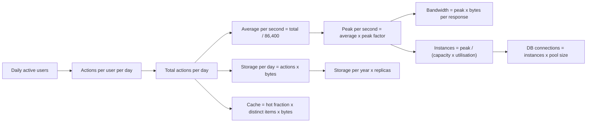
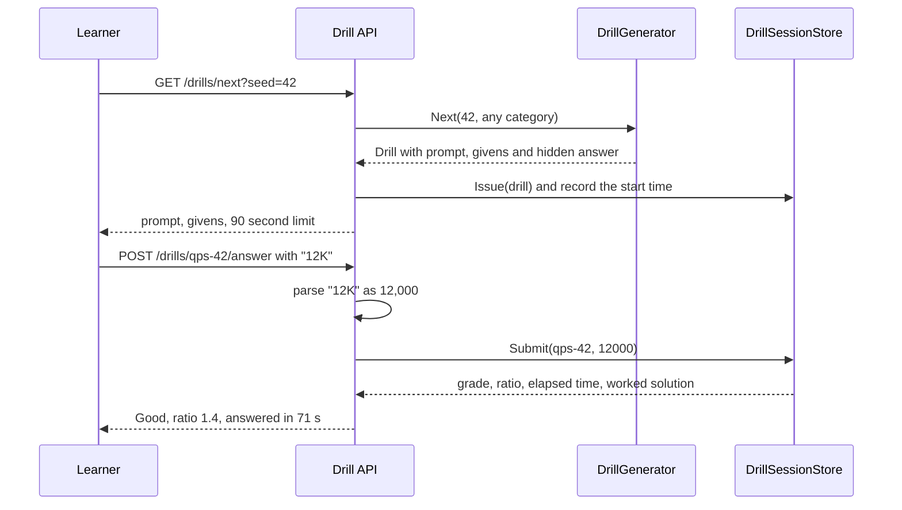

Estimation is the part of a system design interview where many good engineers freeze. They know what a cache is and how a queue works, but when the interviewer says "roughly how much storage per year?", they reach for a calculator, lose two minutes, and come back with a number that is off by a factor of a thousand because a "per month" slipped into a "per second". This lesson is practice, not theory. You will learn a small set of rounding tricks, then work through fourteen drills with the arithmetic shown, then build a C# drill generator and grader so you can keep practising on fresh numbers.

## Learning objectives

By the end of this lesson you will be able to:

1. Turn a product statement ("50 million daily users send 40 messages each") into average and peak requests per second in under 60 seconds.
2. Estimate storage per day and per year, including replicas and index overhead, without a calculator.
3. Estimate bandwidth, cache size, instance count and database connection count, and say which of them breaks first.
4. Use powers of ten and the "86,400 is about 100,000" trick, and know the size of the error it introduces.
5. Narrate an estimate out loud so the interviewer can follow and correct your assumptions.
6. Grade an estimate by its ratio to a reference answer, and explain why "within 3x" is a good answer.
7. Build and test a seeded drill generator, an answer parser and a grader in C#.

## Prerequisites

- [Capacity estimation](#/lesson/m11-capacity-estimation): this lesson assumes you have seen the basic method once.
- [Latency numbers](#/lesson/m11-latency-numbers): useful for the "which part breaks first" questions.
- [How system design interviews work](#/lesson/m19-interview-structure): where estimation fits in a 45-minute session.

If you have never done an estimate before, read the beginner section slowly and do drills 1 to 4 with pen and paper before reading their solutions.

## Explain it like I'm a beginner

Imagine you are organising a wedding in Jaipur. The caterer asks, "How many rotis?" You don't know exactly, and nobody expects you to. You reason: about 600 guests, each eats about 4 rotis, some guests eat more, so plan for 3,000. You did not count every guest. You picked a few numbers you trust, multiplied, and added a safety margin.

That is back-of-the-envelope estimation (capacity estimation). In a system design interview the guests are users, the rotis are requests or bytes, and the safety margin is the peak factor. The interviewer does not care whether the answer is 2,800 or 3,200. They care that you:

- picked sensible starting numbers and **said them out loud** (stated assumptions),
- multiplied them correctly,
- converted units without losing a factor of 1,000,
- and then **used** the number to make a design decision ("3,000 writes per second fits on one PostgreSQL primary, so no sharding yet").

The last point matters most. An estimate that does not change your design is decoration. An estimate that tells you "this needs a CDN" or "one Redis node is enough" is engineering.

A second analogy: a cricket commentator estimating the final score at the 10-over mark. "60 runs in 10 overs, run rate 6, with a faster finish we are looking at around 300." Nobody calls that wrong when the team makes 287. They call it wrong if the commentator says 3,000.

## First-principles explanation

### What estimation is for

An estimate answers one question: **what order of magnitude (power of ten) are we in?** 50 requests per second, 5,000 and 500,000 need three different architectures. 50 fits on a single small server. 5,000 needs a few stateless instances behind a load balancer and probably a cache. 500,000 needs careful partitioning and a design where no single database primary sees every write. Getting within a factor of 2 or 3 is enough to choose between those.

### The five quantities you will estimate again and again

1. **Throughput** (requests or events per second): users × actions per user per day ÷ seconds per day, then × peak factor.
2. **Storage**: items per day × bytes per item × retention days × replicas, plus index overhead.
3. **Bandwidth**: requests per second × bytes per response, or concurrent viewers × bitrate.
4. **Memory** (cache, connections): hot items × bytes per item, or connections × memory per connection.
5. **Instances**: peak load ÷ (capacity per instance × target utilisation), plus spares.

Every drill below is one of these five, sometimes chained.

### The rounding toolkit

| Fact | Exact | Round to | Error |
|---|---|---|---|
| Seconds per day | 86,400 | 100,000 (10^5) | answers ~14 % low, so add a sixth |
| Seconds per month (30 days) | 2,592,000 | 2.5 million | ~4 % |
| Seconds per year | 31,536,000 | 30 million (3 × 10^7) | ~5 % |
| 1 million per day | 11.6 per second | about 12 per second | small |
| 1 KB, 1 MB, 1 GB, 1 TB, 1 PB | 10^3 … 10^15 bytes | use decimal powers | ~2–12 % versus binary units, irrelevant here |
| 1 byte | 8 bits | 8 (or 10 for quick bandwidth with overhead) | — |

Two habits make the arithmetic fast:

- **Write numbers as a mantissa and a power of ten.** 50 million × 40 is 5 × 10^7 × 4 × 10^1 = 20 × 10^8 = 2 × 10^9. You multiply the small numbers and add the exponents.
- **Keep units attached to every number.** "2 × 10^9 messages per day" cannot be confused with "per second". Most estimation disasters are unit disasters.

### Peak factors

Traffic is not flat. Office tools peak in working hours. Food delivery peaks at lunch and dinner. Payments peak on salary days and festival evenings. A results website for a board exam can see most of its day's traffic in the first hour. Typical **peak-to-average** ratios you can state as assumptions:

- general consumer apps: 2–3x,
- strongly time-of-day products (food, commute, streaming in the evening): 3–5x,
- event-driven spikes (exam results, ticket sales, flash sales): 10–100x, and this case needs its own design (queues, pre-rendering, waiting rooms; see the [flash sale case study](#/lesson/m17-flash-sale)).

Say which one you are using and why. The interviewer may correct you, which is good: it is information.

### How precise is precise enough?

A useful grading scale, which the C# grader later in this lesson implements:

- within 1.5x of a careful reference answer: excellent,
- within 3x: good, design decisions will usually be the same,
- within 10x: right order of magnitude, but check whether a decision flips,
- beyond 10x: something is wrong, usually a unit or a missing multiplier.

The ratio is symmetric. Guessing 300 when the reference is 100 is as far off as guessing 33.

### Why practise with a timer

In a 45-minute interview, estimation should take 3–5 minutes. If it takes 12, you lose the deep-dive time where senior candidates earn their score. Timed drills train two things: the arithmetic speed, and the discipline to stop at "good enough". A drill in this lesson has a target of 60–120 seconds.

### When to skip estimation

Not every question needs it. If the prompt is "design the permission model for a project-management tool", estimating requests per second adds little; data modelling matters more. If the interviewer says "assume it is small, focus on the API", do a ten-second sanity check and move on. Estimating when nobody needs it is its own kind of overengineering ([see the lesson](#/lesson/m19-overengineering)).

## Visual explanation

### The estimation chain



Read it left to right. Everything starts from two assumptions you state: how many users, and how many actions each performs per day. Multiply them to get total actions per day. From that one number, three branches grow. Divide by seconds per day to get average throughput, then multiply by a peak factor; peak throughput then drives bandwidth and instance count, and instance count drives database connections (a classic hidden bottleneck). Multiply total actions by bytes per action to get storage, then scale by retention and replicas. Finally, the hot fraction of distinct items gives cache size. If an interviewer changes one assumption, you can see exactly which downstream numbers move.

### A timed drill, as the drill service sees it



The learner asks for a drill. A seed makes it reproducible, so two friends can race on the same numbers. The generator picks a template and fills it with random but realistic values, keeping the answer hidden. The session store remembers when the drill was issued, using an injected clock so tests can control time. When the learner submits "12K", the API parses the shorthand, the store grades it by ratio and returns the elapsed time and the worked solution. Seeing the worked arithmetic straight after your own attempt is what makes practice stick.

## Step-by-step example

Here are fourteen drills. For each, cover the solution, set a timer for the target time, and work it on paper. Then compare. The arithmetic is shown the way you would say it out loud.

### Drill 1 — Chat messages per second (target 60 s)

*Givens:* 50 million daily active users (DAU), 40 messages sent per user per day, peak factor 3.

*Arithmetic:* 5 × 10^7 × 4 × 10^1 = 2 × 10^9 messages per day. Divide by 10^5 seconds: 2 × 10^4 = 20,000 per second. Correct for the 86,400 rounding (add about a sixth): about 23,000 per second on average. Peak: × 3 ≈ 70,000 messages per second.

*So what:* 70,000 writes per second is too many for one relational primary handling every write with indexes. You need to partition messages, for example by conversation id. Say this out loud; it is the reason you estimated.

### Drill 2 — Chat storage per year (target 60 s)

*Givens:* from drill 1, 2 × 10^9 messages per day; 200 bytes per message including metadata; 3 replicas.

*Arithmetic:* 2 × 10^9 × 2 × 10^2 = 4 × 10^11 bytes = 400 GB per day. × 365 ≈ 146 TB per year, call it 150 TB. × 3 replicas ≈ 450 TB of raw disk.

*So what:* hundreds of terabytes per year means a store designed for horizontal scale-out and a retention or archival policy. It also means media (photos, voice notes) must be estimated separately, because a single 1 MB photo equals 5,000 text messages.

### Drill 3 — URL shortener throughput (target 60 s)

*Givens:* 100 million new short links per month, read-to-write ratio 100:1, peak factor 3.

*Arithmetic:* writes: 10^8 ÷ 2.5 × 10^6 seconds per month = 40 per second (exact 38.6). Reads: × 100 = 4,000 per second. Peak reads: × 3 = 12,000 per second.

*So what:* writes are trivial; reads dominate. That points at a cache in front of the database and maybe a CDN for redirects, not at sharding. Forty new ids per second is also nothing for an id scheme; even a single database sequence copes, and the [unique ID generator](#/lesson/m17-unique-id-generator) case study shows when that stops being true.

### Drill 4 — URL shortener storage over 5 years (target 45 s)

*Givens:* 10^8 links per month, 500 bytes per row, 5 years, index overhead 50 %.

*Arithmetic:* 10^8 × 60 months = 6 × 10^9 rows. × 500 bytes = 3 × 10^12 = 3 TB. With indexes: × 1.5 = 4.5 TB.

*So what:* 4.5 TB fits on one large PostgreSQL instance with partitioning by creation month, or a key-value store. Either is defensible. Five years is a long horizon; many teams would plan for the first two years (under 2 TB) and revisit.

### Drill 5 — Photo storage per day and per year (target 90 s)

*Givens:* 2 million DAU, 10 % upload photos, 2 photos each per day, 2 MB per original, thumbnails add 0.3 MB per photo.

*Arithmetic:* 2 × 10^6 × 0.1 × 2 = 4 × 10^5 photos per day. × 2.3 MB = 9.2 × 10^5 MB ≈ 920 GB per day, roughly 0.9 TB. × 365 ≈ 336 TB per year.

*So what:* this belongs in object storage, never in database rows. Cost is a design driver: at an illustrative list price of about $0.02 per GB-month for a standard object-storage tier (check current pricing), 336 TB at the end of year one costs roughly 336,000 × 0.02 ≈ $6,700 per month and keeps growing. Lifecycle rules that move old originals to a colder tier matter.

### Drill 6 — Video streaming bandwidth (target 120 s)

*Givens:* 10 million DAU, 40 minutes watched per user per day, 3 Mbps average bitrate, peak factor 3.

*Arithmetic:* watch seconds per day: 10^7 × 2,400 = 2.4 × 10^10. Average concurrent viewers: 2.4 × 10^10 ÷ 86,400 ≈ 280,000. Peak concurrent: × 3 ≈ 830,000. Peak egress: 8.3 × 10^5 × 3 × 10^6 bits = 2.5 × 10^12 bits per second = 2.5 Tbps. Daily volume: per user 2,400 s × 3 Mb = 7,200 Mb = 900 MB; × 10^7 users = 9 × 10^15 bytes = 9 PB per day.

*So what:* no origin data centre serves 2.5 Tbps by itself in a cost-effective way. A content delivery network (CDN) is not optional here; the design conversation moves to cache hit ratio at the edge and what the origin sees on a miss.

### Drill 7 — Cache size for the URL shortener (target 60 s)

*Givens:* 50 million distinct links are read on a given day; the hottest 20 % take most reads; 500 bytes per cached entry; cache overhead doubles memory.

*Arithmetic:* 5 × 10^7 × 0.2 = 10^7 hot links. × 500 bytes = 5 × 10^9 = 5 GB. × 2 overhead = 10 GB.

*So what:* one cache node with 16–32 GB memory holds it, plus a replica for failover. You do not need a sharded cache cluster at this size. Saying this is a sign of judgement, not laziness.

### Drill 8 — Instance count (target 45 s)

*Givens:* peak 12,000 requests per second (drill 3). Assume one instance handles about 1,000 redirect requests per second (an estimate you would confirm with a load test), run at 60 % target utilisation, keep 2 spare instances.

*Arithmetic:* usable capacity per instance: 1,000 × 0.6 = 600. 12,000 ÷ 600 = 20. Plus 2 spare = 22 instances.

*So what:* 22 small instances is ordinary. The interesting follow-up is drill 9.

### Drill 9 — Database connections (target 45 s)

*Givens:* 22 instances. Npgsql's default maximum pool size is 100 connections per connection string. PostgreSQL's default `max_connections` is 100.

*Arithmetic:* 22 × 100 = 2,200 possible connections against a server that accepts 100 by default.

*So what:* under load, instances will open more connections than the database allows, and requests fail with "too many clients". Fixes: set a small explicit pool size per instance (for example 10, so 220 total), raise `max_connections` carefully (each connection costs server memory), and put a connection pooler such as PgBouncer in front. This is the most common "what breaks first" answer that candidates miss, because it hides between two correct-looking numbers.

### Drill 10 — Log ingestion (target 90 s)

*Givens:* 2,000 servers, 100 log lines per second each, 300 bytes per line, compression ratio about 10:1 (an assumption; it depends heavily on the data), 30 days hot retention.

*Arithmetic:* 2 × 10^3 × 10^2 × 3 × 10^2 = 6 × 10^7 bytes per second = 60 MB/s. × 86,400 ≈ 5.2 × 10^12 = 5.2 TB per day raw. Compressed: about 520 GB per day. 30 days hot: about 15.6 TB.

*So what:* 60 MB/s of continuous ingestion needs a buffer (a log or stream) between producers and the indexer, and the 30-day figure decides your search-cluster disk. Dropping debug logs or sampling them is often the cheapest optimisation; ask whether all 100 lines per second are needed.

### Drill 11 — Mall parking event feed (target 90 s)

*Givens:* a parking-payments company runs 1,200 shopping-mall car parks, average 8 entry and exit lanes each; at peak one vehicle passes each lane every 10 seconds; each pass is a 1 KB event plus a 50 KB number-plate image; the daily average is one third of peak.

*Arithmetic:* lanes: 1,200 × 8 = 9,600. Peak events: 9,600 ÷ 10 = 960 per second. Peak image throughput: 960 × 50 KB = 48 MB/s. Daily average events: 320 per second × 86,400 ≈ 2.8 × 10^7 events per day. Images per day: 2.8 × 10^7 × 50 KB ≈ 1.4 TB.

*So what:* about 1,000 events per second is comfortable for one well-tuned PostgreSQL primary with batch inserts, but the images must go to object storage with only a key in the row. Car-park network links drop from time to time, so lane gateways need local buffering. The estimate says "not a big-data problem for events, a storage-cost problem for images".

### Drill 12 — Notification blast (target 45 s)

*Givens:* 20 million users must receive a push notification within 10 minutes.

*Arithmetic:* 600 seconds. 2 × 10^7 ÷ 6 × 10^2 ≈ 33,000 sends per second.

*So what:* push providers apply their own rate limits and your workers must respect them. Put the sends on a queue, run enough workers to reach the target rate, and accept that "within 10 minutes" may need to be negotiated with product. Sending 33,000 per second synchronously from the API that triggered the campaign is the wrong shape.

### Drill 13 — National real-time payments (target 90 s)

*Givens:* assume 600 million payment transactions per day (the right order of magnitude for India's real-time payment volumes in recent years; check the current published figure), peak factor 4, each transaction writes 2 ledger rows and updates its status 3 times.

*Arithmetic:* 6 × 10^8 ÷ 86,400 ≈ 6,900 per second average. Peak: × 4 ≈ 28,000 per second. Row writes at peak: 28,000 × 5 = 140,000 per second.

*So what:* 140,000 durable writes per second with strict correctness means partitioning the ledger (for example by bank or account range), idempotency keys on every request, and a reconciliation process. It also explains why such systems are built as networks of banks and switches rather than one database.

### Drill 14 — WebSocket memory (target 60 s)

*Givens:* 5 million concurrent connections, about 20 KB of memory per connection on the gateway (buffers plus session state; an estimate that depends on the runtime and settings), each gateway node holds up to 100,000 connections.

*Arithmetic:* memory: 5 × 10^6 × 2 × 10^4 = 10^11 bytes = 100 GB in total. Nodes: 5 × 10^6 ÷ 10^5 = 50, plus spares, say 55–60.

*So what:* the hard part is not memory, it is what happens when a node with 100,000 connections restarts and all of them reconnect at once. Add jittered reconnect delays on the client.

### How to narrate a drill in the interview

Use the same four beats every time:

1. **Assumptions:** "I'll assume 50 million DAU and 40 messages each. Does that sound right?"
2. **Arithmetic:** speak the powers of ten. "5 times 10 to the 7, times 40, is 2 times 10 to the 9 per day."
3. **Result with units:** "About 23,000 per second on average, 70,000 at peak."
4. **Decision:** "That's beyond a single primary for writes, so I'll partition by conversation."

Beat 4 is where the marks are.

## Production-style C# implementation

The drill service below generates reproducible drills from templates, parses shorthand answers such as `12K` or `40 TB`, grades them by ratio, and records timing with an injected clock. It is small, but it is shaped like a real service: templates are strategies registered in DI, state lives behind one class, and nothing reads the system clock directly.

```text
Drills.Api/
  Program.cs
  Estimation/Quantity.cs
  Estimation/Drill.cs
  Estimation/DrillTemplates.cs
  Estimation/DrillGenerator.cs
  Estimation/EstimateGrader.cs
  Estimation/DrillSessionStore.cs
```

```csharp file=Estimation/Quantity.cs
using System.Globalization;

namespace Sdlp.Estimation;

/// <summary>Unit constants and shorthand parsing/formatting for estimates (decimal units: 1K = 1,000).</summary>
public static class Quantity
{
    public const double SecondsPerDay = 86_400;
    public const double SecondsPerMonth = 30 * SecondsPerDay;   // about 2.6 million
    public const double SecondsPerYear = 365 * SecondsPerDay;   // about 31.5 million

    private static readonly (char Suffix, double Factor)[] Multipliers =
    {
        ('K', 1e3), ('M', 1e6), ('G', 1e9), ('B', 1e9), ('T', 1e12), ('P', 1e15)
    };

    private static readonly string[] RateSuffixes = { "/s", "rps", "qps", "ps" };

    /// <summary>Parses "12K", "40 TB", "2.5 Tbps", "1.2e6", "7,000/s". "B" alone means billion; "TB" means terabytes.</summary>
    public static bool TryParse(string? text, out double value)
    {
        value = 0;
        if (string.IsNullOrWhiteSpace(text)) return false;
        var s = text.Replace(",", "").Replace("_", "").Replace(" ", "").Trim();

        foreach (var tail in RateSuffixes)
            if (s.EndsWith(tail, StringComparison.OrdinalIgnoreCase)) { s = s[..^tail.Length]; break; }

        // Bytes or bits after a multiplier: "40TB" -> "40T", "2.5Tb" -> "2.5T".
        if (s.Length >= 2 && (s[^1] == 'B' || s[^1] == 'b') && char.IsLetter(s[^2]))
            s = s[..^1];

        var factor = 1.0;
        if (s.Length > 0 && char.IsLetter(s[^1]) && s[^1] != 'e' && s[^1] != 'E')
        {
            var suffix = char.ToUpperInvariant(s[^1]);
            var match = Array.FindIndex(Multipliers, m => m.Suffix == suffix);
            if (match < 0) return false;
            factor = Multipliers[match].Factor;
            s = s[..^1];
        }

        if (!double.TryParse(s, NumberStyles.Float, CultureInfo.InvariantCulture, out var number)) return false;
        value = number * factor;
        return double.IsFinite(value);
    }

    /// <summary>Formats 23148 as "23.1K" and 2.5e12 as "2.5T".</summary>
    public static string Format(double v)
    {
        var a = Math.Abs(v);
        var (f, s) = a >= 1e15 ? (1e15, "P") : a >= 1e12 ? (1e12, "T") : a >= 1e9 ? (1e9, "B")
                   : a >= 1e6 ? (1e6, "M") : a >= 1e3 ? (1e3, "K") : (1.0, "");
        var scaled = v / f;
        var pattern = Math.Abs(scaled) >= 100 ? "0" : Math.Abs(scaled) >= 10 ? "0.#" : "0.##";
        return scaled.ToString(pattern, CultureInfo.InvariantCulture) + s;
    }
}
```

```csharp file=Estimation/Drill.cs
namespace Sdlp.Estimation;

/// <summary>One timed drill. <see cref="Answer"/> is the reference value in base units (requests/s, bytes, bits/s, count).</summary>
public sealed record Drill(
    string Id,
    string Category,
    string Prompt,
    IReadOnlyList<string> Givens,
    double Answer,
    string Unit,
    string WorkedSolution,
    TimeSpan TimeLimit);

/// <summary>A family of drills. Implementations must be stateless; all randomness comes from the supplied Random.</summary>
public interface IDrillTemplate
{
    string Category { get; }
    Drill Create(Random rng, string id);
}
```

```csharp file=Estimation/DrillTemplates.cs
namespace Sdlp.Estimation;

internal static class Pick
{
    public static T One<T>(Random rng, params T[] options) => options[rng.Next(options.Length)];
}

public sealed class QpsDrillTemplate : IDrillTemplate
{
    private static readonly string[] Products = { "a food-delivery app", "a chat app", "a ride-hailing app", "a hotel-booking app" };
    public string Category => "qps";

    public Drill Create(Random rng, string id)
    {
        var product = Pick.One(rng, Products);
        var dau = Pick.One(rng, 1e6, 2e6, 5e6, 10e6, 50e6);
        var perUser = rng.Next(5, 41);
        var peak = Pick.One(rng, 2.0, 3.0, 5.0);
        var average = dau * perUser / Quantity.SecondsPerDay;
        var answer = average * peak;
        return new Drill(id, Category, $"Estimate peak requests per second for {product}.",
            new[] { $"DAU: {Quantity.Format(dau)}", $"Requests per user per day: {perUser}", $"Peak-to-average: {peak}x" },
            answer, "requests/s",
            $"{Quantity.Format(dau)} x {perUser} / 86,400 = {Quantity.Format(average)}/s average, x {peak} = {Quantity.Format(answer)}/s peak",
            TimeSpan.FromSeconds(60));
    }
}

public sealed class StorageDrillTemplate : IDrillTemplate
{
    public string Category => "storage";

    public Drill Create(Random rng, string id)
    {
        var itemsPerDay = Pick.One(rng, 1e5, 1e6, 1e7, 1e8);
        var bytes = Pick.One(rng, 200.0, 500.0, 2_000.0, 50_000.0);
        var years = rng.Next(1, 6);
        var replicas = Pick.One(rng, 1, 2, 3);
        var answer = itemsPerDay * bytes * 365 * years * replicas;
        return new Drill(id, Category, "Estimate total stored bytes at the end of the period.",
            new[] { $"Items per day: {Quantity.Format(itemsPerDay)}", $"Bytes per item: {bytes}", $"Years: {years}", $"Replicas: {replicas}" },
            answer, "bytes",
            $"{Quantity.Format(itemsPerDay)} x {bytes} B = {Quantity.Format(itemsPerDay * bytes)}B/day, x 365 x {years} x {replicas} = {Quantity.Format(answer)}B",
            TimeSpan.FromSeconds(90));
    }
}

public sealed class BandwidthDrillTemplate : IDrillTemplate
{
    public string Category => "bandwidth";

    public Drill Create(Random rng, string id)
    {
        var viewers = Pick.One(rng, 1e4, 1e5, 5e5, 1e6);
        var mbps = Pick.One(rng, 1.5, 3.0, 5.0, 8.0);
        var answer = viewers * mbps * 1e6;
        return new Drill(id, Category, "Estimate peak egress in bits per second for a live stream.",
            new[] { $"Concurrent viewers: {Quantity.Format(viewers)}", $"Average bitrate: {mbps} Mbps" },
            answer, "bits/s",
            $"{Quantity.Format(viewers)} x {mbps} Mbps = {Quantity.Format(answer)}bps",
            TimeSpan.FromSeconds(45));
    }
}

public sealed class InstanceCountDrillTemplate : IDrillTemplate
{
    public string Category => "instances";

    public Drill Create(Random rng, string id)
    {
        var peak = Pick.One(rng, 2_000.0, 7_000.0, 12_000.0, 40_000.0);
        var perInstance = Pick.One(rng, 250.0, 500.0, 1_000.0);
        var utilisation = Pick.One(rng, 0.5, 0.6, 0.7);
        var spare = Pick.One(rng, 1, 2);
        var answer = Math.Ceiling(peak / (perInstance * utilisation)) + spare;
        return new Drill(id, Category, "How many API instances do you run?",
            new[] { $"Peak: {Quantity.Format(peak)} requests/s", $"One instance handles {perInstance}/s", $"Target utilisation: {utilisation:P0}", $"Spare instances: {spare}" },
            answer, "instances",
            $"{perInstance} x {utilisation} = {perInstance * utilisation}/s usable, {Quantity.Format(peak)} / {perInstance * utilisation} rounded up, + {spare} = {answer}",
            TimeSpan.FromSeconds(45));
    }
}
```

```csharp file=Estimation/DrillGenerator.cs
namespace Sdlp.Estimation;

/// <summary>Picks a template and fills it. The same seed always gives the same drill, so learners can race on identical numbers.</summary>
public sealed class DrillGenerator(IEnumerable<IDrillTemplate> templates)
{
    private readonly IReadOnlyList<IDrillTemplate> _templates = templates.ToList();

    public IReadOnlyList<string> Categories => _templates.Select(t => t.Category).ToList();

    public Drill Next(int seed, string? category = null)
    {
        IReadOnlyList<IDrillTemplate> candidates = category is null
            ? _templates
            : _templates.Where(t => string.Equals(t.Category, category, StringComparison.OrdinalIgnoreCase)).ToList();
        if (candidates.Count == 0)
            throw new ArgumentException($"Unknown drill category '{category}'. Known: {string.Join(", ", Categories)}.", nameof(category));

        var rng = new Random(seed);
        var template = candidates[rng.Next(candidates.Count)];
        return template.Create(rng, $"{template.Category}-{seed}");
    }
}
```

```csharp file=Estimation/EstimateGrader.cs
namespace Sdlp.Estimation;

public enum EstimateGrade { Excellent, Good, RightOrderOfMagnitude, Off }

public sealed record GradeResult(EstimateGrade Grade, double Ratio, string Feedback);

/// <summary>Grades by symmetric ratio: guessing 3x too high is as far off as 3x too low.</summary>
public static class EstimateGrader
{
    public static GradeResult Grade(double reference, double estimate)
    {
        if (!(reference > 0) || !double.IsFinite(reference))
            throw new ArgumentOutOfRangeException(nameof(reference), "Reference must be a positive number.");
        if (!(estimate > 0) || !double.IsFinite(estimate))
            return new GradeResult(EstimateGrade.Off, double.PositiveInfinity, "Estimates must be positive numbers.");

        var ratio = Math.Max(estimate / reference, reference / estimate);
        var direction = estimate > reference ? "high" : "low";
        return ratio switch
        {
            <= 1.5 => new GradeResult(EstimateGrade.Excellent, ratio, "Excellent: within 1.5x."),
            <= 3 => new GradeResult(EstimateGrade.Good, ratio, $"Good: {ratio:0.0}x {direction}, the design decision is very likely the same."),
            <= 10 => new GradeResult(EstimateGrade.RightOrderOfMagnitude, ratio, $"Right order of magnitude, {ratio:0.0}x {direction}. Check whether a design decision flips."),
            _ => new GradeResult(EstimateGrade.Off, ratio, $"Off by {ratio:0}x ({direction}). Look for a unit slip: per day versus per second, bits versus bytes, or a missing multiplier.")
        };
    }
}
```

```csharp file=Estimation/DrillSessionStore.cs
using System.Collections.Concurrent;

namespace Sdlp.Estimation;

public sealed record AttemptResult(string DrillId, GradeResult Grade, TimeSpan Elapsed, bool WithinTime, string WorkedSolution);

/// <summary>Remembers issued drills and grades one submission per drill. Time comes from TimeProvider, so tests control it.</summary>
public sealed class DrillSessionStore(TimeProvider clock)
{
    private sealed record Issued(Drill Drill, DateTimeOffset At);
    private readonly ConcurrentDictionary<string, Issued> _open = new();

    public Drill Issue(Drill drill)
    {
        _open[drill.Id] = new Issued(drill, clock.GetUtcNow());
        return drill;
    }

    /// <summary>Returns null when the drill was never issued or was already answered.</summary>
    public AttemptResult? Submit(string drillId, double estimate)
    {
        if (!_open.TryRemove(drillId, out var issued)) return null;
        var elapsed = clock.GetUtcNow() - issued.At;
        var grade = EstimateGrader.Grade(issued.Drill.Answer, estimate);
        return new AttemptResult(drillId, grade, elapsed, elapsed <= issued.Drill.TimeLimit, issued.Drill.WorkedSolution);
    }
}
```

```csharp file=Program.cs
using Sdlp.Estimation;

var builder = WebApplication.CreateBuilder(args);

builder.Services.AddSingleton(TimeProvider.System);
builder.Services.AddSingleton<IDrillTemplate, QpsDrillTemplate>();
builder.Services.AddSingleton<IDrillTemplate, StorageDrillTemplate>();
builder.Services.AddSingleton<IDrillTemplate, BandwidthDrillTemplate>();
builder.Services.AddSingleton<IDrillTemplate, InstanceCountDrillTemplate>();
builder.Services.AddSingleton<DrillGenerator>();
builder.Services.AddSingleton<DrillSessionStore>();

var app = builder.Build();

app.MapGet("/drills/next", (int? seed, string? category, DrillGenerator generator, DrillSessionStore store) =>
{
    try
    {
        var drill = store.Issue(generator.Next(seed ?? Random.Shared.Next(), category));
        // The answer and worked solution stay on the server until the learner submits.
        return Results.Ok(new { drill.Id, drill.Category, drill.Prompt, drill.Givens, drill.Unit, TimeLimitSeconds = drill.TimeLimit.TotalSeconds });
    }
    catch (ArgumentException ex)
    {
        return Results.Problem(ex.Message, statusCode: StatusCodes.Status400BadRequest);
    }
});

app.MapPost("/drills/{id}/answer", (string id, AnswerRequest request, DrillSessionStore store) =>
{
    if (!Quantity.TryParse(request.Answer, out var estimate))
        return Results.Problem("Could not read that number. Try forms like 12K, 4.5 TB or 2.5e12.", statusCode: StatusCodes.Status400BadRequest);
    var result = store.Submit(id, estimate);
    return result is null ? Results.NotFound() : Results.Ok(result);
});

app.Run();

public sealed record AnswerRequest(string Answer);
```

Design notes:

- **Templates are strategies.** Adding a "cache size" or "database connections" drill is one new class and one registration line. The generator never changes.
- **Seeded randomness.** `new Random(seed)` gives the same sequence for the same seed in a given .NET version, which is all a practice tool needs. Do not use it for anything security-related.
- **The answer never leaves the server before submission.** The endpoint projects the drill into an anonymous object without `Answer` or `WorkedSolution`.
- **One submission per drill.** `TryRemove` makes the second submission return 404, so learners cannot binary-search the answer.
- **Scale honestly.** This runs on one instance with in-memory state. If it ever needed several instances, the session store would move to a shared store such as Redis or PostgreSQL. Not before.

## Bad design vs good design

**Bad estimate (spoken in an interview):**

> "Let's say 100 million users. Each does some requests, maybe 10 to 50. That's, um, a few billion. Divided by... seconds in a month? So like 1,000 per second. We'll need Kafka, Cassandra, and Redis cluster for scale."

Problems:

- No unit attached to "a few billion" (per day? per month?), and then the wrong divisor is used.
- A range of 10–50 is never resolved into a single working number.
- No peak factor.
- The conclusion (three distributed systems) does not follow from 1,000 per second, which a single small database can handle. The estimate was decoration.

**Good estimate:**

> "I'll assume 100 million registered users and 20 % daily active, so 20 million DAU. I'll take 25 requests each per day: 5 times 10 to the 8 per day. Divided by roughly 10 to the 5 seconds, that's 5,000 per second, a bit under 6,000 once I correct for the rounding. With a peak factor of 3, about 18,000 per second at peak. Reads dominate, say 90 %, so about 1,800 writes per second at peak. That fits one PostgreSQL primary with headroom, so I'll start there with read replicas and a cache, and revisit sharding if writes grow 5x."

Every number has a unit, every assumption is spoken, the arithmetic uses powers of ten, and the result drives a concrete, modest decision with a stated trigger for change.

:::callout type=mistake title="The three classic unit slips"
1. Dividing a per-day total by seconds per month (or the reverse): a 30x error.
2. Mixing bits and bytes in bandwidth: an 8x error. Network links are quoted in bits per second, disks and files in bytes.
3. Forgetting replicas or index overhead in storage: a 2–4x error that changes how many disks you buy.
:::

:::callout type=tip title="Round early, but in a consistent direction"
If you round users up, round bytes per item down, or note that your answer is high. Two upward roundings compound into a 2x error without you noticing.
:::

## Practical playground

The playground runs a mini drill session in the console: it generates five drills from fixed seeds, "answers" them with deliberately imperfect estimates, and prints the grade for each. Change the `estimates` array to your own answers, or change the seeds to get new drills. Then try adding a sixth template, for example a cache-size drill.

:::playground type=csharp title="Run five estimation drills"
```csharp file=Program.cs
using System;
using System.Collections.Generic;
using System.Globalization;
using System.Linq;

public sealed record Drill(string Prompt, double Answer, string Unit, string Worked);

public static class Drills
{
    public static Drill Qps(Random r)
    {
        var dau = new[] { 1e6, 5e6, 2e7 }[r.Next(3)];
        var perUser = r.Next(5, 41);
        var peak = new[] { 2.0, 3.0 }[r.Next(2)];
        var ans = dau * perUser / 86_400 * peak;
        return new Drill($"Peak RPS: DAU {dau:0,0}, {perUser} req/user/day, peak {peak}x", ans, "req/s",
            $"{dau:0,0} x {perUser} / 86,400 x {peak} = {ans:0,0}");
    }

    public static Drill Storage(Random r)
    {
        var perDay = new[] { 1e6, 1e7 }[r.Next(2)];
        var bytes = new[] { 500.0, 2_000.0 }[r.Next(2)];
        var ans = perDay * bytes * 365 * 3;
        return new Drill($"Bytes after 1 year: {perDay:0,0} items/day, {bytes} B each, 3 replicas", ans, "bytes",
            $"{perDay:0,0} x {bytes} x 365 x 3 = {ans:0.##E+0}");
    }
}

public static class Program
{
    static string Grade(double reference, double estimate)
    {
        var ratio = Math.Max(estimate / reference, reference / estimate);
        return ratio <= 1.5 ? "Excellent" : ratio <= 3 ? "Good" : ratio <= 10 ? "Order of magnitude" : "Off";
    }

    public static void Main()
    {
        int[] seeds = { 1, 2, 3, 4, 5 };
        double[] estimates = { 2_000, 4e12, 10_000, 1e12, 500 };   // replace with your answers
        for (var i = 0; i < seeds.Length; i++)
        {
            var r = new Random(seeds[i]);
            var d = i % 2 == 0 ? Drills.Qps(r) : Drills.Storage(r);
            var ratio = Math.Max(estimates[i] / d.Answer, d.Answer / estimates[i]);
            Console.WriteLine($"{i + 1}. {d.Prompt}");
            Console.WriteLine($"   you: {estimates[i].ToString("0.##E+0", CultureInfo.InvariantCulture)}  reference: {d.Answer.ToString("0.##E+0", CultureInfo.InvariantCulture)} {d.Unit}");
            Console.WriteLine($"   {Grade(d.Answer, estimates[i])} (ratio {ratio:0.0}) | worked: {d.Worked}");
        }
    }
}
```
:::

## Exercises

:::exercise id=m19-estimation-practice-ex1 difficulty=beginner kind=written title="Three drills in four and a half minutes"
Set a timer for 4 minutes 30 seconds and solve all three on paper. Show the powers-of-ten arithmetic and finish each with one design consequence.

1. A school homework app: 200,000 daily student users, each uploads 15 photos of handwritten homework pages per school day at 1.5 MB. Storage per year (250 school days), single copy.
2. A ride-hailing app: 3 million DAU, each phone sends a location update every 4 seconds while a trip is active, and the average user is on a trip 20 minutes a day. Average and peak (3x) location updates per second.
3. An exam-results website: 1.5 million students check their result within the first hour after release, each loads 3 pages. Peak requests per second, assuming the first 10 minutes take half of the hour's traffic.
::acceptance
- Each answer states its assumptions and units.
- Answers are within 3x of the reference.
- Each answer ends with a design consequence (what you would build or not build because of the number).
- Total time under 4.5 minutes.
::hint
Write every number as mantissa × 10^n before multiplying.
::hint
Drill 2: work out seconds on a trip per day, then updates per user per day, then divide by 86,400.
::hint
Drill 3: half of 4.5 million page loads arrive in 600 seconds.
::hint
Reference shapes: (1) users × photos × bytes × days. (2) DAU × (1,200 s ÷ 4) ÷ 86,400 × 3. (3) 1.5 × 10^6 × 3 × 0.5 ÷ 600.
::solution
**1. Photos.** 2 × 10^5 × 15 = 3 × 10^6 photos per day. × 1.5 MB = 4.5 × 10^6 MB = 4.5 TB per school day. × 250 = 1,125 TB ≈ 1.1 PB per year. *Consequence:* object storage with lifecycle tiering, client-side compression (a 1.5 MB phone photo often compresses to 300–500 KB with little visible loss, an estimate worth testing), and never storing images in the database.

**2. Location updates.** 1,200 s ÷ 4 = 300 updates per user per day. 3 × 10^6 × 300 = 9 × 10^8 per day. ÷ 86,400 ≈ 10,400 per second average. × 3 ≈ 31,000 per second at peak. *Consequence:* these are high-rate, short-lived writes; keep the latest position in memory (an in-memory geo index or cache) and only sample a fraction into durable storage for trip history.

**3. Exam results.** 1.5 × 10^6 × 3 = 4.5 × 10^6 page loads in the hour. Half in 600 s: 2.25 × 10^6 ÷ 600 ≈ 3,750 per second for 10 minutes, five times the rate of the remaining 50 minutes (2.25 × 10^6 ÷ 3,000 s = 750 per second) and three times the hour's average of 1,250 per second. *Consequence:* pre-render result pages or serve results from a CDN-cached static store keyed by roll number, and add a waiting room. Do not let 3,750 per second hit the database with a query per page.
::mistakes
- Using 365 days for a school-day product.
- Forgetting that location updates only happen during trips.
- Averaging the exam traffic over 24 hours, which hides a spike that is the whole point of the question.
:::

:::exercise id=m19-estimation-practice-ex2 difficulty=beginner kind=code title="Back-of-the-envelope helpers"
Implement the static `Envelope` helpers so they can be reused in drills: per-second rate from a per-day total, peak from average, storage with retention and replicas, and instance count with utilisation and spares.
::requirements
- `PerSecond(perDay)` divides by 86,400.
- `Peak(average, factor)` throws `ArgumentOutOfRangeException` when factor is below 1.
- `StorageBytes(itemsPerDay, bytesPerItem, days, replicas)` multiplies everything; days and replicas must be at least 1.
- `InstancesNeeded(peakRps, rpsPerInstance, utilisation, spare)` rounds up before adding spares; utilisation must be in (0, 1].
::acceptance
- 8,640,000 per day is 100 per second.
- 12,000 peak at 1,000 per instance and 60 % utilisation with 2 spares needs 22 instances.
- 12,001 peak needs 23 instances (rounding up).
- Invalid arguments throw `ArgumentOutOfRangeException`.
::hint
These are one-line formulas; the work is in the validation.
::hint
`Math.Ceiling` rounds up. Apply it to `peak / (perInstance * utilisation)` before adding spares.
::hint
Use `ArgumentOutOfRangeException.ThrowIfLessThan(factor, 1.0)` (available since .NET 8) or a plain `if` and `throw`.
::hint
```csharp
public static int InstancesNeeded(double peak, double perInstance, double util, int spare)
{
    if (util <= 0 || util > 1) throw new ArgumentOutOfRangeException(nameof(util));
    return (int)Math.Ceiling(peak / (perInstance * util)) + spare;
}
```
::starter
```csharp file=Envelope.cs
using System;

public static class Envelope
{
    public const double SecondsPerDay = 86_400;

    public static double PerSecond(double perDay) => throw new NotImplementedException();

    public static double Peak(double average, double factor) => throw new NotImplementedException();

    public static double StorageBytes(double itemsPerDay, double bytesPerItem, int days, int replicas) =>
        throw new NotImplementedException();

    public static int InstancesNeeded(double peakRps, double rpsPerInstance, double utilisation, int spare) =>
        throw new NotImplementedException();
}
```
::tests
```csharp file=EnvelopeTests.cs
using System;
using Xunit;

public class EnvelopeTests
{
    [Fact] public void Per_second_from_per_day() => Assert.Equal(100.0, Envelope.PerSecond(8_640_000), 6);

    [Fact] public void Peak_multiplies() => Assert.Equal(300.0, Envelope.Peak(100, 3), 6);

    [Fact] public void Peak_factor_below_one_throws() =>
        Assert.Throws<ArgumentOutOfRangeException>(() => Envelope.Peak(100, 0.5));

    [Fact] public void Storage_includes_retention_and_replicas() =>
        Assert.Equal(2e9 * 200 * 365 * 3, Envelope.StorageBytes(2e9, 200, 365, 3), 0);

    [Fact] public void Storage_rejects_zero_days() =>
        Assert.Throws<ArgumentOutOfRangeException>(() => Envelope.StorageBytes(10, 10, 0, 1));

    [Fact] public void Instances_exact_division() => Assert.Equal(22, Envelope.InstancesNeeded(12_000, 1_000, 0.6, 2));

    [Fact] public void Instances_round_up() => Assert.Equal(23, Envelope.InstancesNeeded(12_001, 1_000, 0.6, 2));

    [Fact] public void Instances_survive_floating_point_noise() => Assert.Equal(30, Envelope.InstancesNeeded(21, 1, 0.7, 0));

    [Theory]
    [InlineData(0.0)]
    [InlineData(1.2)]
    public void Instances_reject_bad_utilisation(double u) =>
        Assert.Throws<ArgumentOutOfRangeException>(() => Envelope.InstancesNeeded(1_000, 100, u, 0));
}
```
::solution
Each helper is a formula plus guards. The guards matter: an estimate tool that silently accepts a peak factor of 0.5 or 120 % utilisation produces confident nonsense.

```csharp file=Envelope.cs
using System;

public static class Envelope
{
    public const double SecondsPerDay = 86_400;

    public static double PerSecond(double perDay)
    {
        ArgumentOutOfRangeException.ThrowIfNegative(perDay);
        return perDay / SecondsPerDay;
    }

    public static double Peak(double average, double factor)
    {
        ArgumentOutOfRangeException.ThrowIfNegative(average);
        ArgumentOutOfRangeException.ThrowIfLessThan(factor, 1.0);
        return average * factor;
    }

    public static double StorageBytes(double itemsPerDay, double bytesPerItem, int days, int replicas)
    {
        ArgumentOutOfRangeException.ThrowIfNegative(itemsPerDay);
        ArgumentOutOfRangeException.ThrowIfNegative(bytesPerItem);
        ArgumentOutOfRangeException.ThrowIfLessThan(days, 1);
        ArgumentOutOfRangeException.ThrowIfLessThan(replicas, 1);
        return itemsPerDay * bytesPerItem * days * replicas;
    }

    public static int InstancesNeeded(double peakRps, double rpsPerInstance, double utilisation, int spare)
    {
        ArgumentOutOfRangeException.ThrowIfNegative(peakRps);
        ArgumentOutOfRangeException.ThrowIfNegativeOrZero(rpsPerInstance);
        if (utilisation <= 0 || utilisation > 1) throw new ArgumentOutOfRangeException(nameof(utilisation), "Utilisation must be in (0, 1].");
        ArgumentOutOfRangeException.ThrowIfNegative(spare);
        // Floating-point division can land a hair above a whole number; round to 9 places first.
        return (int)Math.Ceiling(Math.Round(peakRps / (rpsPerInstance * utilisation), 9)) + spare;
    }
}
```

Note the `Math.Round(..., 9)` before `Math.Ceiling`: in binary floating point, `21 / (1 * 0.7)` evaluates to 30.000000000000004, so a raw ceiling returns 31 instead of 30. Estimation code meets floating point too, and the last test catches it.
::mistakes
- Adding spares before rounding up, which under-provisions by one instance when the division is not whole.
- Accepting utilisation as a percentage (60) in one place and a fraction (0.6) in another.
- Integer division (`int / int`) truncating the per-second rate.
::extensions
Add `BandwidthBitsPerSecond(rps, bytesPerResponse)` and a test that catches the bits-versus-bytes slip.
:::

:::exercise id=m19-estimation-practice-ex3 difficulty=intermediate kind=code title="Parse and grade a spoken answer"
Learners type answers the way they speak: `12K`, `4.5 TB`, `2.5 Tbps`, `7,000/s`, `3e9`. Implement `AnswerParser.TryParse` and `Grader.Grade` so the drill tool can accept those forms and grade by symmetric ratio.
::requirements
- Suffixes K, M, G, B (billion), T, P (case-insensitive). A trailing `B` or `b` after a multiplier letter means bytes or bits and is ignored (`4.5TB` → 4.5 × 10^12).
- Commas, spaces and a trailing `/s`, `rps` or `qps` are ignored.
- Invalid input returns false.
- `Grade(reference, estimate)` returns "Excellent" (ratio ≤ 1.5), "Good" (≤ 3), "Order of magnitude" (≤ 10) or "Off", where ratio = max(e/r, r/e). A non-positive estimate is "Off". A non-positive reference throws.
::acceptance
- `12K` → 12,000; `4.5 TB` → 4.5e12; `7,000/s` → 7,000; `3e9` → 3e9; `2B` → 2e9.
- `abc`, empty string and `12X` return false.
- 300 against a reference of 100 is "Good"; 33 against 100 is also "Good".
- 0 against 100 is "Off".
::hint
Normalise first (remove commas and spaces, strip rate suffixes), then deal with the last character.
::hint
Handle the byte suffix before the multiplier: if the last char is B/b and the char before it is a letter, drop the last char.
::hint
Watch out for scientific notation: `3e9` ends in a digit, but `1.5e` would end in `e`. Only treat letters other than `e` as multipliers.
::hint
Parse the number with `double.TryParse(s, NumberStyles.Float, CultureInfo.InvariantCulture, out var n)` so that a machine set to a European culture does not read `4.5` as 45.
::starter
```csharp file=AnswerParser.cs
using System;
using System.Globalization;

public static class AnswerParser
{
    public static bool TryParse(string? text, out double value) => throw new NotImplementedException();
}

public static class Grader
{
    public static string Grade(double reference, double estimate) => throw new NotImplementedException();
}
```
::tests
```csharp file=AnswerParserTests.cs
using System;
using Xunit;

public class AnswerParserTests
{
    [Theory]
    [InlineData("12K", 12_000.0)]
    [InlineData("4.5 TB", 4.5e12)]
    [InlineData("7,000/s", 7_000.0)]
    [InlineData("3e9", 3e9)]
    [InlineData("2B", 2e9)]
    [InlineData("2.5 Tbps", 2.5e12)]
    [InlineData("40 qps", 40.0)]
    [InlineData("1.2m", 1.2e6)]
    public void Parses(string text, double expected)
    {
        Assert.True(AnswerParser.TryParse(text, out var v));
        Assert.Equal(expected, v, 3);
    }

    [Theory]
    [InlineData("abc")]
    [InlineData("")]
    [InlineData("12X")]
    [InlineData("TB")]
    public void Rejects(string text) => Assert.False(AnswerParser.TryParse(text, out _));

    [Fact] public void Three_times_high_is_good() => Assert.Equal("Good", Grader.Grade(100, 300));
    [Fact] public void Three_times_low_is_good() => Assert.Equal("Good", Grader.Grade(100, 34));
    [Fact] public void Close_is_excellent() => Assert.Equal("Excellent", Grader.Grade(100, 140));
    [Fact] public void Eight_x_is_order_of_magnitude() => Assert.Equal("Order of magnitude", Grader.Grade(100, 800));
    [Fact] public void Zero_is_off() => Assert.Equal("Off", Grader.Grade(100, 0));
    [Fact] public void Bad_reference_throws() => Assert.Throws<ArgumentOutOfRangeException>(() => Grader.Grade(0, 10));
}
```
::solution
```csharp file=AnswerParser.cs
using System;
using System.Globalization;

public static class AnswerParser
{
    private static readonly string[] RateSuffixes = { "/s", "rps", "qps", "ps" };

    public static bool TryParse(string? text, out double value)
    {
        value = 0;
        if (string.IsNullOrWhiteSpace(text)) return false;
        var s = text.Replace(",", "").Replace(" ", "").Trim();

        foreach (var tail in RateSuffixes)
            if (s.EndsWith(tail, StringComparison.OrdinalIgnoreCase)) { s = s[..^tail.Length]; break; }

        if (s.Length >= 2 && (s[^1] == 'B' || s[^1] == 'b') && char.IsLetter(s[^2]))
            s = s[..^1];

        var factor = 1.0;
        if (s.Length > 0 && char.IsLetter(s[^1]) && char.ToLowerInvariant(s[^1]) != 'e')
        {
            factor = char.ToUpperInvariant(s[^1]) switch
            {
                'K' => 1e3, 'M' => 1e6, 'G' => 1e9, 'B' => 1e9, 'T' => 1e12, 'P' => 1e15,
                _ => 0
            };
            if (factor == 0) return false;
            s = s[..^1];
        }

        if (!double.TryParse(s, NumberStyles.Float, CultureInfo.InvariantCulture, out var n)) return false;
        value = n * factor;
        return double.IsFinite(value);
    }
}

public static class Grader
{
    public static string Grade(double reference, double estimate)
    {
        if (!(reference > 0)) throw new ArgumentOutOfRangeException(nameof(reference));
        if (!(estimate > 0)) return "Off";
        var ratio = Math.Max(estimate / reference, reference / estimate);
        return ratio <= 1.5 ? "Excellent" : ratio <= 3 ? "Good" : ratio <= 10 ? "Order of magnitude" : "Off";
    }
}
```

Two details worth noticing. "2.5 Tbps": `ps` is stripped, leaving `2.5Tb`; the trailing `b` follows a letter so it is dropped, leaving `2.5T`. And `TB` alone becomes `T`, then the multiplier is removed, leaving an empty string that `double.TryParse` rejects.
::mistakes
- Treating `B` as bytes everywhere, so `2B` users becomes 2 instead of 2 billion.
- Using the current culture for parsing.
- Grading by difference (`|e - r|`) instead of ratio, which makes every large-number estimate look terrible.
:::

:::exercise id=m19-estimation-practice-ex4 difficulty=intermediate kind=hld title="Size the parking-event platform from your estimate"
Use drill 11's numbers (960 events per second at peak, 48 MB/s of images at peak, about 1.4 TB of images per day, unreliable car-park connectivity) to turn the naive starter design into one whose every component is justified by a number. Put the number in each node's label.
::acceptance
- Images go to object storage, and only keys go into the database.
- A durable buffer absorbs car-park reconnect bursts.
- Instance counts are derived from a stated per-instance capacity and utilisation.
- The database stays a single primary, with the estimate quoted to justify it.
- Nothing is added that no number justifies (no stream platform, no sharded database).
::hint
Which of the two flows (1 KB events or 50 KB images) is the storage problem, and which is the throughput problem?
::hint
When 200 car parks reconnect after an outage, they upload a backlog at once. What absorbs that?
::hint
Assume an ingest instance handles 400 events per second at 60 % utilisation: 960 ÷ 240 = 4, plus 1 spare.
::hint
Shape: lane gateways → load balancer → ingest API → queue → workers → PostgreSQL. Gateways → object storage with pre-signed upload URLs issued by the API.
::starter
```json
{
  "nodes": [
    { "id": "gw", "type": "client", "label": "Car-park lane gateways", "props": { "rps": 960 } },
    { "id": "api", "type": "app-server", "label": "Parking API", "props": { "instances": 1 } },
    { "id": "db", "type": "database", "label": "PostgreSQL (events and images)" }
  ],
  "edges": [
    { "from": "gw", "to": "api", "kind": "sync" },
    { "from": "api", "to": "db", "kind": "sync" }
  ]
}
```
::solution
```json
{
  "nodes": [
    { "id": "gw", "type": "client", "label": "1,200 car parks, 960 events/s peak, local buffer for outages", "props": { "rps": 960 } },
    { "id": "lb", "type": "load-balancer", "label": "Load balancer" },
    { "id": "api", "type": "app-server", "label": "Ingest API: 960/s / (400 x 0.6) = 4 + 1 spare", "props": { "instances": 5 } },
    { "id": "obj", "type": "object-storage", "label": "Plate images: 48 MB/s peak, 1.4 TB/day, 90-day lifecycle" },
    { "id": "q", "type": "queue", "label": "Durable queue: absorbs reconnect backlogs", "props": { "multiAz": true } },
    { "id": "w", "type": "worker", "label": "Workers: batch insert 500 rows", "props": { "instances": 2 } },
    { "id": "db", "type": "database", "label": "PostgreSQL primary: ~1K inserts/s batched, ~28M rows/day, partitioned by day", "props": { "multiAz": true } },
    { "id": "mon", "type": "monitoring", "label": "Alerts: queue depth, insert lag, upload errors" }
  ],
  "edges": [
    { "from": "gw", "to": "lb", "kind": "sync", "label": "1 KB event" },
    { "from": "lb", "to": "api", "kind": "sync" },
    { "from": "api", "to": "q", "kind": "async", "label": "enqueue, ack gateway" },
    { "from": "q", "to": "w", "kind": "async" },
    { "from": "w", "to": "db", "kind": "sync", "label": "multi-row insert" },
    { "from": "gw", "to": "obj", "kind": "sync", "label": "pre-signed PUT, 50 KB image" },
    { "from": "api", "to": "obj", "kind": "sync", "label": "issue pre-signed URL" },
    { "from": "mon", "to": "q", "kind": "async" },
    { "from": "mon", "to": "db", "kind": "async" }
  ]
}
```

Reasoning: the 48 MB/s image flow would dominate the API's network and the database's disk, so gateways upload images directly to object storage with short-lived pre-signed URLs and the event row stores only the object key. Events are small and modest in rate: about 1,000 per second, batched 500 at a time, is roughly 2 insert statements per second, well within one PostgreSQL primary. About 28 million rows per day make daily partitions convenient for retention. The queue exists because of the outage pattern, not because of average load. A stream platform or a sharded database would add cost and operations that no number here requires.
::mistakes
- Storing images as `bytea` in PostgreSQL "to keep things in one place".
- Sizing for the average and forgetting the reconnect burst after a regional outage.
- Adding Kafka because "events" appears in the problem statement.
:::

:::exercise id=m19-estimation-practice-ex5 difficulty=advanced kind=code title="Which assumption matters most?"
In interviews, a strong move is: "the answer is most sensitive to X, so let me check X with you." Implement `EstimateModel`, which holds named assumptions and a formula, evaluates the estimate, and reports how much the result changes when each assumption alone is multiplied by a factor (default 2). Sort the report by impact, largest first.
::requirements
- `Evaluate()` returns the formula applied to the assumptions.
- `Sensitivities(factor)` returns one entry per assumption: the ratio new result ÷ base result when only that assumption is multiplied by `factor`.
- Sort by the absolute value of log(ratio), descending; break ties by assumption name (ordinal).
- `factor` must be positive and not 1. The base result must be positive, otherwise throw `InvalidOperationException`.
- The model's own assumptions must not be modified by `Sensitivities`.
::acceptance
- For storage = users × posts × (textBytes + imageShare × imageBytes) with users 1M, posts 2, textBytes 500, imageShare 0.3, imageBytes 2,000,000, doubling `imageBytes` has a ratio close to 2 while doubling `textBytes` has a ratio close to 1.
- Users and posts both have ratio exactly 2, and ties are ordered by name.
- Calling `Sensitivities` does not change `Evaluate()`.
- `factor` of 1 or 0 throws `ArgumentOutOfRangeException`.
::hint
Copy the assumptions into a new dictionary for each "what if", change one entry, and call the formula.
::hint
Ratio 2 and ratio 0.5 are equally strong effects, which is why you sort by |log(ratio)|.
::hint
Use `OrderByDescending(s => Math.Abs(Math.Log(s.ResultRatio))).ThenBy(s => s.Assumption, StringComparer.Ordinal)`.
::hint
```csharp
foreach (var name in _assumptions.Keys)
{
    var copy = new Dictionary<string, double>(_assumptions) { [name] = _assumptions[name] * factor };
    list.Add(new Sensitivity(name, _formula(copy) / baseValue));
}
```
::starter
```csharp file=EstimateModel.cs
using System;
using System.Collections.Generic;
using System.Linq;

public sealed record Sensitivity(string Assumption, double ResultRatio);

public sealed class EstimateModel
{
    private readonly Dictionary<string, double> _assumptions;
    private readonly Func<IReadOnlyDictionary<string, double>, double> _formula;

    public EstimateModel(IReadOnlyDictionary<string, double> assumptions, Func<IReadOnlyDictionary<string, double>, double> formula)
    {
        _assumptions = new Dictionary<string, double>(assumptions);
        _formula = formula;
    }

    public double Evaluate() => throw new NotImplementedException();

    public IReadOnlyList<Sensitivity> Sensitivities(double factor = 2.0) => throw new NotImplementedException();
}
```
::tests
```csharp file=EstimateModelTests.cs
using System;
using System.Collections.Generic;
using System.Linq;
using Xunit;

public class EstimateModelTests
{
    private static EstimateModel Storage() => new(
        new Dictionary<string, double>
        {
            ["users"] = 1e6, ["posts"] = 2, ["textBytes"] = 500, ["imageShare"] = 0.3, ["imageBytes"] = 2e6
        },
        a => a["users"] * a["posts"] * (a["textBytes"] + a["imageShare"] * a["imageBytes"]));

    [Fact]
    public void Evaluates_formula() => Assert.Equal(1e6 * 2 * (500 + 0.3 * 2e6), Storage().Evaluate(), 0);

    [Fact]
    public void Image_bytes_matter_far_more_than_text_bytes()
    {
        var s = Storage().Sensitivities();
        var image = s.Single(x => x.Assumption == "imageBytes").ResultRatio;
        var text = s.Single(x => x.Assumption == "textBytes").ResultRatio;
        Assert.InRange(image, 1.99, 2.0);
        Assert.InRange(text, 1.0, 1.001);
    }

    [Fact]
    public void Sorted_by_impact_then_name()
    {
        var names = Storage().Sensitivities().Select(x => x.Assumption).ToList();
        Assert.Equal(new[] { "posts", "users", "imageBytes", "imageShare", "textBytes" }, names);
    }

    [Fact]
    public void Halving_counts_as_strong_as_doubling()
    {
        var m = new EstimateModel(new Dictionary<string, double> { ["a"] = 10, ["b"] = 5 }, x => x["a"] + x["b"] * 0.01);
        Assert.Equal("a", m.Sensitivities(0.5)[0].Assumption);
    }

    [Fact]
    public void Does_not_mutate_assumptions()
    {
        var m = Storage();
        var before = m.Evaluate();
        _ = m.Sensitivities(3);
        Assert.Equal(before, m.Evaluate(), 0);
    }

    [Theory]
    [InlineData(1.0)]
    [InlineData(0.0)]
    [InlineData(-2.0)]
    public void Bad_factor_throws(double f) => Assert.Throws<ArgumentOutOfRangeException>(() => Storage().Sensitivities(f));

    [Fact]
    public void Zero_base_throws()
    {
        var m = new EstimateModel(new Dictionary<string, double> { ["a"] = 0 }, x => x["a"]);
        Assert.Throws<InvalidOperationException>(() => m.Sensitivities());
    }
}
```
::solution
```csharp file=EstimateModel.cs
using System;
using System.Collections.Generic;
using System.Linq;

public sealed record Sensitivity(string Assumption, double ResultRatio);

public sealed class EstimateModel
{
    private readonly Dictionary<string, double> _assumptions;
    private readonly Func<IReadOnlyDictionary<string, double>, double> _formula;

    public EstimateModel(IReadOnlyDictionary<string, double> assumptions, Func<IReadOnlyDictionary<string, double>, double> formula)
    {
        _assumptions = new Dictionary<string, double>(assumptions);
        _formula = formula;
    }

    public double Evaluate() => _formula(_assumptions);

    public IReadOnlyList<Sensitivity> Sensitivities(double factor = 2.0)
    {
        if (!(factor > 0) || factor == 1.0)
            throw new ArgumentOutOfRangeException(nameof(factor), "Factor must be positive and not 1.");
        var baseValue = Evaluate();
        if (!(baseValue > 0))
            throw new InvalidOperationException("Sensitivity needs a positive base estimate.");

        var list = new List<Sensitivity>();
        foreach (var name in _assumptions.Keys)
        {
            var copy = new Dictionary<string, double>(_assumptions) { [name] = _assumptions[name] * factor };
            list.Add(new Sensitivity(name, _formula(copy) / baseValue));
        }

        return list
            .OrderByDescending(s => Math.Round(Math.Abs(Math.Log(s.ResultRatio)), 12))
            .ThenBy(s => s.Assumption, StringComparer.Ordinal)
            .ToList();
    }
}
```

The `Math.Round(..., 12)` stops two ratios that are mathematically both 2 but differ in the last floating-point bit from breaking the alphabetical tie-break. In an interview you do this in your head: "storage is almost entirely images, so the image size and the share of posts with images are the numbers worth checking with you; text size doesn't matter."
::mistakes
- Mutating `_assumptions` in place and forgetting to restore it, which silently corrupts later evaluations.
- Sorting by raw ratio, which ranks a halving (0.5) as the weakest effect.
- Ignoring floating-point noise in the tie-break.
::extensions
Add `Breakeven(name, target)`: the value of one assumption at which the estimate crosses a design threshold (for example "at what image size do we exceed 1 PB per year?"). This is how you say "the design flips if images are bigger than 3 MB".
:::

:::exercise id=m19-estimation-practice-ex6 difficulty=advanced kind=written title="A five-minute estimate that changes the design"
The prompt: "Design the back end for a national e-challan system: traffic cameras in 300 cities detect violations and issue fines; citizens look up and pay challans." Produce the estimate you would speak in five minutes. Include write throughput, read throughput, storage for evidence images and video clips, and one thing that breaks first. End with two design decisions the numbers force and one they rule out.
::acceptance
- At least six stated assumptions with units, each one sentence.
- Average and peak figures for both writes (violations) and reads (lookups and payments).
- Separate estimates for structured rows and for media.
- A named first bottleneck with the number that exposes it.
- Two forced decisions and one ruled-out option, each tied to a number.
::hint
Start from cameras, not citizens: number of cities × cameras per city × violations per camera per hour.
::hint
Lookups may spike after an SMS campaign or near a payment deadline. State a spike factor separately from the daily peak.
::hint
Evidence media is usually a few images plus a short clip. Clip size dominates.
::hint
A good "breaks first" candidate: the SMS or notification provider's rate limit, or the payment gateway's callback rate, rather than your database.
::solution
A model answer (numbers are assumptions you state, not facts):

*Assumptions.* 300 cities × 200 cameras = 60,000 cameras. Each detects 2 violations per hour over 16 active hours: 32 per camera per day. Each violation stores a 2 KB row, 3 images at 200 KB and a 10-second clip at about 2 MB. 10 % of daily violations get looked up by citizens on the day of the SMS, each lookup is 4 requests. Daily peak factor 3. An SMS campaign or deadline can cause a 10x spike in lookups.

*Writes.* 6 × 10^4 × 32 ≈ 1.9 × 10^6 violations per day. ÷ 86,400 ≈ 22 per second average, ~70 per second peak. Trivial for one PostgreSQL primary.

*Media.* Per violation 0.6 MB + 2 MB = 2.6 MB. × 1.9 × 10^6 ≈ 5 TB per day, ≈ 1.8 PB per year. This is the cost driver.

*Reads.* Lookups: 1.9 × 10^5 per day × 4 = 7.6 × 10^5 requests per day, about 9 per second average and 30 at peak. With the 10x campaign spike: about 300 per second. Still modest.

*Breaks first.* The SMS sends: 1.9 million per day spread over waking hours is fine, but a backlog catch-up sending all of a day's messages in an hour is about 530 per second, which can exceed an SMS provider's contracted rate. Queue the sends and rate-limit to the contract.

*Decisions the numbers force.* (1) Media in object storage with lifecycle rules (clips for unpaid challans kept until settlement, then moved to a cold tier after the legal retention window), because 1.8 PB per year of hot storage is the dominant cost. (2) A rate-limited notification queue, because the provider limit, not our database, is the bottleneck.

*Ruled out.* Sharding the database or adding a distributed SQL cluster: about 70 writes per second and a few hundred reads per second fit a single primary with a read replica for many years.
::mistakes
- Starting from population ("1.4 billion people") instead of the devices that generate the writes.
- Lumping media into "storage per row".
- Concluding with a large distributed architecture that the numbers do not support.
:::

## Automated testing

Estimation code is mostly pure functions, which makes it pleasant to test. Three kinds of tests cover the drill service.

**1. Parser and grader tables.** A `[Theory]` with many `[InlineData]` rows is the clearest specification of which spellings the parser accepts. Add a row every time a learner reports an answer form that was rejected.

```csharp
[Theory]
[InlineData("12K", 12_000.0)]
[InlineData("4.5 TB", 4.5e12)]
[InlineData("2B", 2e9)]
public void Parses(string text, double expected)
{
    Assert.True(Quantity.TryParse(text, out var v));
    Assert.Equal(expected, v, 3);
}
```

**2. Determinism of the generator.** The same seed must produce the same drill, and a known category filter must only return that category. This protects the "race a friend on seed 42" feature.

```csharp
[Fact]
public void Same_seed_same_drill()
{
    var gen = new DrillGenerator(new IDrillTemplate[] { new QpsDrillTemplate(), new StorageDrillTemplate() });
    Assert.Equal(gen.Next(42).Prompt, gen.Next(42).Prompt);
    Assert.Equal("storage", gen.Next(7, "storage").Category);
}
```

**3. Timing with a fake clock.** Never sleep in tests. Subclass `TimeProvider` and move time forward explicitly.

```csharp
private sealed class ManualClock : TimeProvider
{
    public DateTimeOffset Now { get; set; } = new(2026, 1, 1, 9, 0, 0, TimeSpan.Zero);
    public override DateTimeOffset GetUtcNow() => Now;
}

[Fact]
public void Late_answers_are_graded_but_flagged()
{
    var clock = new ManualClock();
    var store = new DrillSessionStore(clock);
    var drill = store.Issue(new DrillGenerator(new IDrillTemplate[] { new BandwidthDrillTemplate() }).Next(1));
    clock.Now += TimeSpan.FromSeconds(50);   // limit is 45 s
    var result = store.Submit(drill.Id, drill.Answer)!;
    Assert.Equal(EstimateGrade.Excellent, result.Grade.Grade);
    Assert.False(result.WithinTime);
    Assert.Null(store.Submit(drill.Id, drill.Answer));   // one submission only
}
```

Also test the reference answers of each template against a hand calculation for one fixed seed. If a template's formula has a bug, every learner is graded against a wrong answer, which is worse than no tool at all.

## Real-world application

- **Capacity planning reviews.** Before a launch, teams write the same chain you practised: expected users, actions, peak factor, per-instance capacity from a load test, headroom. The difference from an interview is that the per-instance number comes from a measured load test, not an assumption.
- **Cost forecasts.** Finance asks, "what will storage cost next year?" Drill 5's arithmetic, combined with the provider's price sheet, is the answer. Classifieds, social and food-delivery apps (with menu and dish photos) meet this question early, because media grows faster than anything else.
- **Incident analysis.** "Why did the database fall over at 10:02?" is often drill 9: a deployment doubled the instance count, every instance opened its full connection pool, and the database ran out of connection slots.
- **Vendor evaluation.** When a streaming or SMS vendor quotes a rate limit or a bandwidth tier, drills 6 and 12 tell you whether the tier is enough before you sign.
- **Government and public-sector systems.** Results days, tax filing deadlines and scheme registrations produce the 10–100x spikes from the first-principles section. Teams that estimate the spike build waiting rooms and static result pages; teams that estimate only the daily average build outages.

## Interview questions

:::interview
::q beginner
How do you convert "per day" to "per second" quickly, and how wrong is the shortcut?
::a
Divide by 100,000 (10^5) instead of 86,400. The shortcut understates the true rate by about 14 % (100,000 ÷ 86,400 ≈ 1.16), so add roughly a sixth if precision matters. For example, 2 × 10^9 per day ÷ 10^5 = 20,000 per second, about 23,000 after correction. In an interview the uncorrected figure is usually fine, as long as you say you rounded.
::q beginner
Why do we estimate peak rather than average load?
::a
Systems fail at peak, not on average. A food-delivery app that averages 2,000 orders per minute may see 3–5 times that at dinner. Capacity, connection pools, queue sizes and autoscaling limits must be set for the peak, with headroom. The average is still useful for cost, because you pay for what you run most of the time, especially with autoscaling.
::q intermediate
Your estimate gives 1,500 writes per second. The interviewer asks, "Do we need to shard?" How do you answer?
::a
Not yet, probably. A single well-tuned PostgreSQL primary on modern hardware can sustain thousands of simple indexed inserts per second, especially with batching, but the honest answer depends on row size, index count, and transaction pattern, so I would load-test it. I'd start with one primary, read replicas for reads, partitioning by time for retention, and connection pooling. I'd state a trigger: if sustained writes approach the measured limit, or growth projections exceed it within a year, we plan sharding by a key such as tenant or account. Sharding early adds cross-shard query and operations costs every day.
::q intermediate
What hidden bottlenecks do candidates often miss in estimates?
::a
Database connections (instances × pool size versus `max_connections`), third-party rate limits (SMS, push, payment gateways), bandwidth for media versus API traffic, the thundering herd after a restart (all clients reconnecting at once), and storage of indexes and replicas. Each is invisible if you only estimate requests per second and rows.
::q advanced
The interviewer disputes your assumption: "Users post 10x more than you think." What do you do?
::a
Thank them, adopt the new number, and propagate it through the chain out loud: "Then writes go from 1,500 to 15,000 per second at peak, and storage from 5 to 50 TB a year." Then check which decisions flip. 15,000 writes per second might push me from one primary to partitioning by user or to a write-optimised store, and 50 TB a year changes retention and tiering. Saying exactly which decisions change and which do not shows the estimate is connected to the design. Arguing about the assumption wastes time; the interviewer usually changes it on purpose.
::q advanced
How would you estimate when you have no idea of a key number, for example bytes per document in a new domain?
::a
Bound it from both sides and pick a geometric middle. A health-insurance claim document is more than 1 KB (a few fields) and less than 10 MB (a long PDF with scanned bills). The geometric mean of 1 KB and 10 MB is about 100 KB. Then say which side you lean to and why, and run a quick sensitivity check: if the design does not change anywhere between 10 KB and 1 MB, the exact number does not matter and you move on. If it does, say so and propose measuring it from real samples early in the project.
:::

## Summary and revision

**Key takeaways**

- Estimation answers "which order of magnitude?" so you can choose an architecture. Within 3x is good.
- Five quantities cover almost every drill: throughput, storage, bandwidth, memory, instances.
- Write numbers as mantissa × 10^n, keep units attached, and use 10^5 seconds per day (adding a sixth if needed).
- Always add a peak factor, replicas and index overhead.
- Finish every estimate with a design decision, and say which assumption the answer is most sensitive to.
- Watch for the hidden bottlenecks: database connections, third-party rate limits, media bandwidth, reconnect storms.
- Practise with a timer: 60–120 seconds per drill, 3–5 minutes per interview estimate.

**Terminology**: back-of-the-envelope estimate, daily active users (DAU), peak-to-average ratio, order of magnitude, headroom, utilisation, sensitivity analysis, egress.

:::flashcards
Q: Seconds per day, and the quick rounding?
A: 86,400; round to 10^5 and add about a sixth (the shortcut is ~14 % low).
Q: Seconds per month and per year, roughly?
A: About 2.5 million per month (30 days) and about 3 × 10^7 per year.
Q: How do you grade an estimate fairly?
A: By symmetric ratio, max(estimate/reference, reference/estimate). Within 1.5x excellent, 3x good, 10x right order of magnitude.
Q: Instance count formula?
A: ceil(peak ÷ (per-instance capacity × target utilisation)) + spares.
Q: What does 22 instances × default Npgsql pool of 100 do to a PostgreSQL server with default max_connections?
A: It can try to open 2,200 connections against a limit of 100; use small explicit pools and a pooler such as PgBouncer.
Q: Bits or bytes for network bandwidth?
A: Bits per second. Divide by 8 to compare with file sizes in bytes.
Q: Typical peak factors?
A: 2–3x for general apps, 3–5x for strongly time-of-day apps, 10–100x for event spikes like results days.
Q: What turns an estimate from decoration into engineering?
A: Ending with a design decision it forces or rules out, plus the assumption it is most sensitive to.
:::

## Knowledge check

:::quiz pass=70
::q single
A candidate computes 2 × 10^9 messages per day and divides by 2.5 × 10^6 to get 800 messages per second. What went wrong?
- [ ] Nothing, the answer is correct.
- [x] They divided a per-day total by seconds per month, so the answer is about 30x too low.
- [ ] They forgot the replication factor.
- [ ] They should have used binary units.
> Per-day totals divide by seconds per day (about 10^5). 2 × 10^9 ÷ 86,400 ≈ 23,000 per second.
::q single
Reference answer: 10,000 requests per second. Which estimate earns the grade "Good" but not "Excellent" on the lesson's ratio scale?
- [ ] 12,000
- [x] 4,000
- [ ] 900
- [ ] 150,000
> 4,000 is a ratio of 2.5 (Good). 12,000 is 1.2 (Excellent). 900 is about 11 (Off). 150,000 is 15 (Off).
::q single
1 million concurrent viewers watch at 4 Mbps. What is the peak egress?
- [ ] 4 GB/s
- [x] 4 Tbps
- [ ] 500 Gbps
- [ ] 32 Tbps
> 10^6 × 4 × 10^6 bits per second = 4 × 10^12 bits per second = 4 Tbps (that is 500 GB/s in bytes). 32 Tbps would be multiplying by 8 in the wrong direction.
::q single
Your estimate gives 600 writes per second at peak for an internal procurement tool. What is the most reasonable next sentence?
- [ ] "So we need Cassandra and Kafka."
- [x] "That fits one relational primary comfortably, so I'll keep a single PostgreSQL database and focus on the data model."
- [ ] "Let's shard by department now to be safe."
- [ ] "Estimation doesn't matter for internal tools."
> The point of the estimate is to justify a design. 600 writes per second does not justify distributed storage.
::q multi
Which of these are commonly missed in storage estimates? (Select all that apply.)
- [x] Replicas
- [x] Index overhead
- [x] Media files stored separately from rows
- [ ] The number of API endpoints
> Replicas multiply raw disk, indexes add a large fraction, and media often dwarfs structured data. Endpoint count has no direct effect on storage.
::q single
A deployment scales from 10 to 30 instances, each with a connection pool of up to 100, against a PostgreSQL server with `max_connections = 200`. What breaks first under load?
- [ ] CPU on the API instances.
- [x] The database rejects new connections once instances try to open more than 200 in total.
- [ ] The load balancer.
- [ ] Disk space.
> 30 × 100 = 3,000 possible connections against 200 allowed. Size pools explicitly and use a pooler.
::q single
Storage = users × posts × (500 B text + 30 % × 2 MB image). The interviewer asks which assumption you'd double-check. Best answer?
- [ ] Text size, because it applies to every post.
- [x] Image size or the share of posts with images, because they dominate the total.
- [ ] Neither, all assumptions matter equally.
- [ ] The number of replicas, because it isn't in the formula.
> 0.3 × 2 MB = 600 KB per post versus 500 B of text: images are over 99 % of the total, so their assumptions drive the answer.
::q single
Exam results release: 2 million students, 3 page loads each, half within the first 10 minutes. Roughly what peak rate should you design for?
- [ ] About 70 requests per second (spread over 24 hours).
- [ ] About 1,700 requests per second (spread over one hour).
- [x] About 5,000 requests per second (half in 600 seconds).
- [ ] About 6 million requests per second.
> 6 × 10^6 loads × 0.5 ÷ 600 s = 5,000 per second. Averaging over a day or an hour hides the spike that drives the design.
:::

## Completion criteria

You have finished this lesson when you can:

- [ ] Score at least 70 % on the knowledge check.
- [ ] Solve drills 1, 3, 5 and 9 from memory, each within its target time and within 3x of the reference.
- [ ] Complete exercises 2 and 3 with `dotnet test` passing.
- [ ] Complete at least one of exercises 4–6 and compare your answer with the model solution.
- [ ] Speak a full estimate (assumptions, arithmetic, result, decision) out loud in under four minutes for a system you have not practised.
