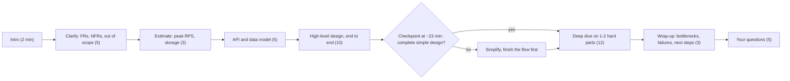
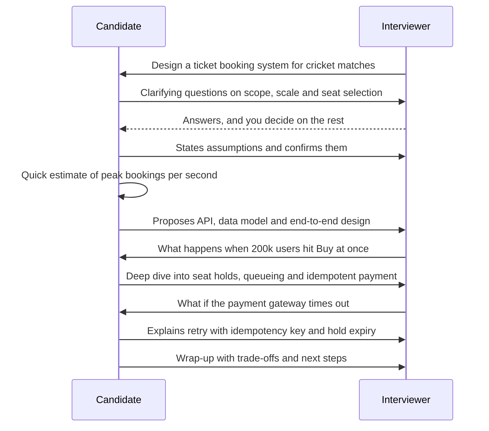

A system design interview is not an exam with one right answer. It is a 45- or 60-minute simulation of a design meeting, in which you play the engineer who leads it. The interviewer watches *how* you think: what you ask, what you assume, how you break a problem down, how you weigh options, and how you react when they push back. Strong engineers fail these rounds all the time, not because they lack knowledge, but because they don't know the format. This lesson fixes that.

## Learning objectives

By the end of this lesson you will be able to:

1. Describe the common formats: HLD (system design), LLD (object-oriented design or machine coding), architecture deep-dive and take-home.
2. Plan a 45-minute and a 60-minute round, phase by phase, with checkpoints.
3. List the dimensions interviewers typically score, and what "strong" evidence looks like for each.
4. Adapt your approach to an LLD round versus an HLD round.
5. Recognise the ten most common failure patterns and what to do instead.
6. Use a simple C# tool to time your practice sessions and score them against a rubric.

## Prerequisites

- [HLD versus LLD](#/lesson/m02-hld-vs-lld): the two round types map directly onto these two levels of design.
- [What is system design?](#/lesson/m02-what-is-system-design): the vocabulary of components, data flow and trade-offs.
- [The HLD framework](#/lesson/m11-hld-framework): the step-by-step method you'll run inside the time plan here.

If you haven't done the HLD framework lesson yet, this one still works on its own. Treat it as the "rules of the game" before you learn the plays.

## Explain it like I'm a beginner

Think of a driving test. The examiner doesn't just check whether you reach the destination. They watch whether you check your mirrors, signal before turning, keep a safe distance, and stay calm when a bus cuts in. Two people can both arrive safely, and one fails because they never checked a mirror.

A system design interview works the same way. The interviewer says something like "Design a system for booking cricket match tickets." There's no single correct design. They're watching for the "mirror checks":

- Did you **ask** what's needed before building? (How many users? Seat selection or general admission? What happens at the moment sales open?)
- Did you **estimate** the size of the problem with numbers?
- Did you **sketch** a sensible overall design first, then go deeper on the hard part?
- Did you **explain trade-offs** ("I chose this because… it costs us…")?
- Did you **talk** them through it so they could follow?

There are two common kinds of round:

- **HLD (high-level design)**: boxes and arrows. Servers, databases, caches, queues. "Design a ticket-booking platform for 5 million users."
- **LLD (low-level design)**: classes and methods. "Design the classes for a parking lot," sometimes with working code.

The biggest beginner mistake is treating it like a quiz and trying to blurt out a perfect answer. Instead, treat it like leading a meeting with a senior colleague. Ask, propose, check in, adjust.

## First-principles explanation

### Why companies run these interviews

Coding interviews test whether you can write a correct function. They don't show whether you can design something that many people will build on for years. A design round tries to sample that skill in under an hour. Interviewers know the sample is small and artificial, so they look for **signals** that tend to predict real-world design ability:

- Structured thinking under ambiguity.
- Knowledge of building blocks and their limits.
- Judgement: choosing simple things when simple is enough.
- Communication and collaboration.

So your goal is not the most impressive architecture. It is to **give the interviewer clear evidence** for each signal, inside the time.

### The formats you will meet

| Format | Length | What you produce | What it tests most |
|---|---|---|---|
| **HLD / system design** | 45–60 min | Architecture diagram, APIs, data model, scaling story | Breadth, trade-offs, estimation, communication |
| **LLD / object-oriented design** | 45–60 min | Class diagram, key method signatures, maybe pseudocode | Modelling, abstraction, patterns, extensibility |
| **Machine coding** | 60–120 min | Working code for a small system (often in-memory) | LLD plus code quality, tests and time management |
| **Architecture deep-dive** | 45–60 min | Discussion of a system *you* built | Ownership, depth, honesty about trade-offs and mistakes |
| **Take-home design** | Days | Written design doc, sometimes a prototype | Written communication, thoroughness |

Formats vary by company and level. Junior roles (0–3 years) often get LLD or machine coding, sometimes a lighter HLD. Senior roles usually get at least one full HLD round. Staff-level roles may get two HLD rounds plus a deep-dive. Treat these as tendencies, not rules. Ask your recruiter which format to expect. That is a normal, welcome question.

Most interviews are remote, on a shared whiteboard tool such as Excalidraw or Miro. Practise drawing quickly in one, because fumbling with the tool costs minutes.

### The time plan: 45 minutes

A 45-minute slot rarely gives you 45 minutes of design. Introductions and your questions at the end take about 5–8 minutes. Plan for roughly **38 minutes of design**:

| Phase | Minutes | Running clock | What you produce |
|---|---|---|---|
| Clarify requirements | 5 | 0–5 | Functional list, non-functional targets, out of scope |
| Estimate | 3 | 5–8 | Peak RPS, storage, bandwidth (only what affects the design) |
| API and data model | 5 | 8–13 | 3–5 endpoints, core tables or entities |
| High-level design | 10 | 13–23 | End-to-end diagram that satisfies every functional requirement |
| Deep dive | 12 | 23–35 | One or two hard parts in depth (chosen with the interviewer) |
| Wrap-up | 3 | 35–38 | Bottlenecks, failure modes, what you'd do next |

**Checkpoint rule**: at minute 23 you must have a complete, simple, end-to-end design on the board. If you're still clarifying at minute 15, you're in trouble. Say so ("I'll lock these assumptions and move on") and move.

### The time plan: 60 minutes

A 60-minute slot gives about **50 minutes of design**. The extra time should go mostly to **depth**, not to more clarification:

| Phase | Minutes | Running clock |
|---|---|---|
| Clarify requirements | 6 | 0–6 |
| Estimate | 4 | 6–10 |
| API and data model | 7 | 10–17 |
| High-level design | 12 | 17–29 |
| Deep dive 1 | 10 | 29–39 |
| Deep dive 2 or scaling and failure | 8 | 39–47 |
| Wrap-up | 3 | 47–50 |

These numbers are a sensible starting plan, not a law. Some interviewers want to drive the deep dive early. Follow them. The plan's job is to make you *notice* when you're drifting.

### What interviewers score

Most companies use a written rubric with 4–6 dimensions, each scored on a scale (often 1–4), with **evidence notes** for each score. Exact wording differs, but the dimensions are remarkably consistent:

| Dimension | Weak evidence | Strong evidence |
|---|---|---|
| **Requirements and scoping** | Starts drawing immediately, or asks 20 unfocused questions | 4–8 targeted questions; states assumptions; writes down FRs, NFRs and out-of-scope |
| **Estimation** | Skips it, or computes numbers it never uses | Quick arithmetic that *drives* a decision ("7,000 RPS peak, so one PostgreSQL primary is fine for writes") |
| **High-level design** | Missing components, or boxes with no data flow | Every requirement is served end to end; each arrow can be explained |
| **Technical depth** | Buzzwords ("we'll use Kafka for scale") | Explains *how*: partition key, consistency level, index choice, failure behaviour |
| **Trade-offs and judgement** | One option presented as obviously right | Names alternatives and costs; picks the simplest design that meets the targets |
| **Communication and collaboration** | Long silences, ignores hints, defensive | Thinks aloud, checks in, adapts to hints, handles pushback calmly |

**Levelling.** The same rubric is applied with different expectations by level. A mid-level engineer is expected to produce a working design with some depth. A senior engineer is expected to drive the whole session, find the hard parts themselves, and discuss failure modes and operations unprompted. A staff engineer is also expected to raise organisational and evolution concerns: migration paths, team ownership, cost. Knowing this tells you what to volunteer.

**Evidence over impressions.** Interviewers are trained to write down what you *said and did*, not how they felt. "Candidate proposed sharding by user_id, explained hot-key risk for celebrity users, suggested a separate path for them" is evidence. Make it easy for them: say your reasoning out loud in clear sentences they can write down.

### LLD versus HLD rounds

| | LLD round | HLD round |
|---|---|---|
| Typical prompt | "Design a parking lot / elevator / splitwise / library system" | "Design a URL shortener / chat / ride-hailing / ticketing system" |
| Unit of design | Classes, interfaces, methods, states | Services, stores, caches, queues, regions |
| Requirements focus | Entities, operations, rules, edge cases ("can a car park in two slots?") | Scale, latency, availability, consistency |
| Key artefacts | Class diagram, state diagram, method signatures, sometimes code | Architecture diagram, API, data model, capacity numbers |
| Depth means | Correct abstractions, patterns used where they fit, extensibility, concurrency | Partitioning, replication, caching, failure handling |
| Common trap | Pattern-stuffing (Factory + Strategy + Observer everywhere) | Box-stuffing (Kafka + Redis + Kubernetes + microservices for a small problem) |
| Estimation | Rarely needed | Usually expected |

**LLD time plan (45 min):** clarify entities and rules (5), identify classes and responsibilities (8), class diagram and relationships (10), key flows with method signatures or code (15), extensions and edge cases (5). In a machine-coding round, aim for a working core path by the halfway mark, then add features and tests.

A useful bridge: in both rounds, **start with the simplest thing that satisfies the requirements, then improve it where the requirements demand**. In LLD that might be a plain class before a Strategy. In HLD, a single database before sharding.

### Common failure patterns

These come up again and again in interviewer feedback. Each has a fix.

1. **Jumping straight to the solution.** "So we'll have a load balancer, Kafka…" in minute one. *Fix:* spend the first 5 minutes on requirements, and say why: "Before I draw anything, I want to pin down scale and the read/write mix."
2. **Interrogating.** Twenty questions, none of which change the design. *Fix:* ask questions whose answers you'll use. Group them: users and features, scale, quality targets.
3. **Numbers that go nowhere.** A page of arithmetic that never affects a decision. *Fix:* estimate only what decides something, and state the decision out loud.
4. **Buzzword architecture.** Every popular technology appears, none justified. *Fix:* for each box, say what requirement it serves. If you can't, remove it. See [Recognising overengineering in interviews](#/lesson/m19-overengineering).
5. **Never finishing the high-level design.** 30 minutes on the perfect database schema, no end-to-end flow. *Fix:* breadth first. A complete simple design by the checkpoint, then depth.
6. **Silent drawing.** Two minutes of drawing with no talking. The interviewer can't score what they can't hear. *Fix:* narrate. "I'm adding a queue here, because sending SMS is slow and shouldn't block the booking response."
7. **Ignoring hints.** The interviewer asks "What happens if this cache goes down?" and you say "It won't" and carry on. Hints are the interviewer steering you towards points they need to score. *Fix:* treat every question as an invitation to go deeper.
8. **Defensiveness.** Arguing when challenged. *Fix:* "Good point. The trade-off is X. Given that, I'd change Y." Changing your mind for a good reason is a *positive* signal.
9. **No failure thinking.** Everything works perfectly in your design. *Fix:* for each major component, ask yourself out loud "what if this dies, or slows down?"
10. **Skipping the wrap-up.** The session ends mid-sentence. *Fix:* at 3 minutes left, stop and summarise: what you built, the main trade-offs, the bottleneck, and what you'd do next.

## Visual explanation

### The shape of a 45-minute HLD round



Read it left to right as a clock. Each box is a phase with its time budget. The diamond is the most important part: around minute 23, ask yourself whether there is a complete, end-to-end design on the board. If not, cut detail and finish the flow before going deep. That rule alone prevents failure pattern 5. The final box is your time to ask the interviewer questions, which also counts. Thoughtful questions about how their team makes design decisions show interest and maturity.

### How the conversation flows



This is the rhythm of a good session. The candidate drives, but checks in at each step. The interviewer's questions in the middle ("what happens when…") are not attacks. They are the interviewer choosing the deep dive and probing for depth they need to score. The candidate answers by going deeper, not by defending. Notice that the candidate states assumptions out loud and gets agreement before estimating, so the numbers rest on shared ground.

## Step-by-step example

Let's walk through the first 15 minutes of a 45-minute round: "Design a system that sends alerts to site engineers when concrete test results fail."

### Minute 0–5: clarify

Questions, grouped:

- **Users and features**: Who gets alerts: site engineers only, or also project managers? Channels: SMS, email, in-app push? Do they need to acknowledge an alert?
- **Scale**: How many projects and engineers? How many test results a day?
- **Quality**: How fast must an alert arrive? Can we ever drop one? Do we need an audit trail for disputes with the contractor?

Assumed answers (stated out loud, confirmed): 400 active projects, 6,000 engineers, about 20,000 test results a day, about 3 % fail. Alerts via push and SMS within 2 minutes. Must not be lost. Acknowledgement and an audit trail required. Lab system integration is out of scope: results arrive through an existing API.

Write them down:

- **FR**: receive results, detect failure, notify the right engineers, record acknowledgement.
- **NFR**: alert within 2 min at p99, no lost alerts, 7-year audit trail.
- **Out of scope**: lab integration, escalation policies (mention as an extension).

### Minute 5–8: estimate

- Results: 20,000 a day ÷ 86,400 s ≈ 0.25 per second on average. Even ×10 for a working-hours peak, it's about 2.5 per second.
- Failures: 3 % of 20,000 = 600 a day. Each notifies about 3 people over 2 channels, so about 3,600 messages a day.
- Storage: 20,000 results × about 2 KB ≈ 40 MB a day, about 15 GB a year. Trivial for PostgreSQL.

**Say the conclusion:** "This is a low-throughput system. Scale isn't the challenge. Reliability is: never losing an alert, and proving delivery for disputes. I'll keep it simple: one service, PostgreSQL, a queue for delivery retries."

That sentence is worth more than the arithmetic. It shows the numbers drove a decision.

### Minute 8–13: API and data model

- `POST /test-results` (from the lab API), `POST /alerts/{id}/ack`, `GET /alerts?engineer=…`
- Tables: `test_results`, `alerts` (one per result × recipient), `deliveries` (one per alert × channel, with status and attempt count).

### Minute 13–23: high-level design

API → PostgreSQL (result and alert rows written in one transaction, plus an outbox row) → outbox relay → queue → notification workers → SMS and push providers. The ack endpoint updates `alerts`. A scheduler re-sends unacknowledged alerts after 15 minutes.

At minute 23, the design is complete and simple. Now ask: "Which part would you like me to go deeper on: delivery guarantees, or the audit trail?"

## Production-style C# implementation

Practising with a clock and a rubric is far more effective than reading. Here is a small ASP.NET Core service for running timed mock interviews: it holds a time plan per format, tracks which phase you're in, warns when you overrun, and scores a session against a weighted rubric with evidence notes.

```text
MockInterviews/
  Program.cs
  Interviews/InterviewPlan.cs      phases and budgets for 45 and 60 minute rounds
  Interviews/PhaseClock.cs         which phase are we in, are we over budget
  Interviews/Rubric.cs             dimensions, weights, scoring rules
  Interviews/SessionStore.cs       in-memory sessions
```

```csharp file=Interviews/InterviewPlan.cs
namespace MockInterviews.Interviews;

public enum RoundType { Hld, Lld }

public sealed record Phase(string Name, int Minutes, string Goal);

public sealed record InterviewPlan(RoundType Round, int SlotMinutes, IReadOnlyList<Phase> Phases)
{
    public int DesignMinutes => Phases.Sum(p => p.Minutes);

    public static InterviewPlan For(RoundType round, int slotMinutes) => (round, slotMinutes) switch
    {
        (RoundType.Hld, 45) => new(round, 45,
        [
            new("Clarify", 5, "FRs, NFRs with numbers, out of scope"),
            new("Estimate", 3, "Peak RPS and storage that drive a decision"),
            new("API and data", 5, "3-5 endpoints, core entities"),
            new("High-level design", 10, "Complete end-to-end flow"),
            new("Deep dive", 12, "One or two hard parts in depth"),
            new("Wrap-up", 3, "Bottlenecks, failures, next steps"),
        ]),
        (RoundType.Hld, 60) => new(round, 60,
        [
            new("Clarify", 6, "FRs, NFRs with numbers, out of scope"),
            new("Estimate", 4, "Peak RPS and storage that drive a decision"),
            new("API and data", 7, "Endpoints, entities, access patterns"),
            new("High-level design", 12, "Complete end-to-end flow"),
            new("Deep dive 1", 10, "Hardest part"),
            new("Deep dive 2", 8, "Scaling and failure handling"),
            new("Wrap-up", 3, "Bottlenecks, failures, next steps"),
        ]),
        (RoundType.Lld, 45) => new(round, 45,
        [
            new("Clarify", 5, "Entities, operations, rules, edge cases"),
            new("Classes", 8, "Responsibilities per class"),
            new("Class diagram", 10, "Relationships, interfaces, patterns where they fit"),
            new("Key flows", 15, "Method signatures or code for core use cases"),
            new("Extensions", 5, "Edge cases, concurrency, new requirements"),
        ]),
        _ => throw new ArgumentOutOfRangeException(nameof(slotMinutes), $"No plan for {round} in {slotMinutes} minutes."),
    };
}
```

```csharp file=Interviews/PhaseClock.cs
namespace MockInterviews.Interviews;

public sealed record PhaseStatus(string Phase, TimeSpan ElapsedInPhase, TimeSpan Budget, bool OverBudget,
                                 TimeSpan ElapsedTotal, TimeSpan RemainingDesignTime, string Advice);

/// <summary>Tracks the current phase of a mock interview. Uses TimeProvider so tests can control time.</summary>
public sealed class PhaseClock(InterviewPlan plan, TimeProvider time)
{
    private readonly object _gate = new();
    private DateTimeOffset? _sessionStart;
    private int _index = -1;
    private DateTimeOffset _phaseStart;

    public void Start()
    {
        lock (_gate) { _sessionStart = time.GetUtcNow(); _index = 0; _phaseStart = _sessionStart.Value; }
    }

    public void Next()
    {
        lock (_gate)
        {
            if (_sessionStart is null) throw new InvalidOperationException("Session not started.");
            if (_index >= plan.Phases.Count - 1) throw new InvalidOperationException("Already in the last phase.");
            _index++;
            _phaseStart = time.GetUtcNow();
        }
    }

    public PhaseStatus Status()
    {
        lock (_gate)
        {
            if (_sessionStart is null) throw new InvalidOperationException("Session not started.");
            var now = time.GetUtcNow();
            var phase = plan.Phases[_index];
            var inPhase = now - _phaseStart;
            var budget = TimeSpan.FromMinutes(phase.Minutes);
            var total = now - _sessionStart.Value;
            var remaining = TimeSpan.FromMinutes(plan.DesignMinutes) - total;
            var over = inPhase > budget;

            var advice = (over, phase.Name) switch
            {
                (true, "Clarify") => "State your remaining assumptions and move to estimation.",
                (true, "Estimate") => "Say what the numbers mean for the design, then move on.",
                (true, "High-level design") => "Simplify. Finish the end-to-end flow before adding detail.",
                (true, _) => "You are over budget. Summarise this part and move on.",
                (false, _) when remaining <= TimeSpan.FromMinutes(3) => "Start the wrap-up now.",
                _ => phase.Goal,
            };
            return new PhaseStatus(phase.Name, inPhase, budget, over, total, remaining < TimeSpan.Zero ? TimeSpan.Zero : remaining, advice);
        }
    }
}
```

The rubric scorer encodes three habits real interview panels use: every dimension must be scored, every score needs written evidence, and some dimensions are **must-haves**, so a weak score there caps the overall result whatever the average.

```csharp file=Interviews/Rubric.cs
namespace MockInterviews.Interviews;

public enum Dimension { Requirements, Estimation, HighLevelDesign, TechnicalDepth, TradeOffs, Communication }

public enum Recommendation { StrongNoHire, NoHire, LeanHire, Hire, StrongHire }

/// <summary>Score is 1 (weak) to 4 (strong). Evidence is what the candidate said or did.</summary>
public sealed record DimensionScore(Dimension Dimension, int Score, string Evidence);

public sealed record RubricDefinition(IReadOnlyDictionary<Dimension, double> Weights, IReadOnlySet<Dimension> MustHave, int MustHaveMinimum = 2)
{
    /// <summary>Example weights for a senior HLD round. Teams calibrate their own.</summary>
    public static RubricDefinition SeniorHld { get; } = new(
        new Dictionary<Dimension, double>
        {
            [Dimension.Requirements] = 0.15,
            [Dimension.Estimation] = 0.10,
            [Dimension.HighLevelDesign] = 0.20,
            [Dimension.TechnicalDepth] = 0.20,
            [Dimension.TradeOffs] = 0.20,
            [Dimension.Communication] = 0.15,
        },
        new HashSet<Dimension> { Dimension.HighLevelDesign, Dimension.TradeOffs, Dimension.Communication });
}

public sealed record ScoreCard(double WeightedScore, Recommendation Recommendation, IReadOnlyList<string> Notes);

public sealed class RubricScorer
{
    public ScoreCard Score(RubricDefinition rubric, IReadOnlyList<DimensionScore> scores)
    {
        var notes = new List<string>();
        var byDim = new Dictionary<Dimension, DimensionScore>();
        foreach (var s in scores)
        {
            if (s.Score is < 1 or > 4) throw new ArgumentOutOfRangeException(nameof(scores), $"{s.Dimension}: score must be 1-4.");
            if (string.IsNullOrWhiteSpace(s.Evidence)) throw new ArgumentException($"{s.Dimension}: evidence is required.", nameof(scores));
            if (!byDim.TryAdd(s.Dimension, s)) throw new ArgumentException($"{s.Dimension} scored twice.", nameof(scores));
        }
        var missing = rubric.Weights.Keys.Where(d => !byDim.ContainsKey(d)).ToList();
        if (missing.Count > 0) throw new ArgumentException($"Missing scores: {string.Join(", ", missing)}.", nameof(scores));

        var totalWeight = rubric.Weights.Values.Sum();
        var weighted = rubric.Weights.Sum(kv => kv.Value * byDim[kv.Key].Score) / totalWeight;
        weighted = Math.Round(weighted, 2);

        var rec = weighted switch
        {
            < 1.75 => Recommendation.StrongNoHire,
            < 2.5 => Recommendation.NoHire,
            < 3.0 => Recommendation.LeanHire,
            < 3.5 => Recommendation.Hire,
            _ => Recommendation.StrongHire,
        };

        foreach (var d in rubric.MustHave.Where(d => byDim[d].Score < rubric.MustHaveMinimum))
        {
            notes.Add($"Must-have {d} scored {byDim[d].Score}: recommendation capped at NoHire.");
            if (rec > Recommendation.NoHire) rec = Recommendation.NoHire;
        }
        return new ScoreCard(weighted, rec, notes);
    }
}
```

```csharp file=Interviews/SessionStore.cs
using System.Collections.Concurrent;

namespace MockInterviews.Interviews;

public sealed class MockSession(Guid id, string prompt, InterviewPlan plan, PhaseClock clock)
{
    public Guid Id { get; } = id;
    public string Prompt { get; } = prompt;
    public InterviewPlan Plan { get; } = plan;
    public PhaseClock Clock { get; } = clock;
    public ScoreCard? Result { get; set; }
}

public sealed class SessionStore(TimeProvider time)
{
    private readonly ConcurrentDictionary<Guid, MockSession> _sessions = new();

    public MockSession Create(string prompt, RoundType round, int slotMinutes)
    {
        var plan = InterviewPlan.For(round, slotMinutes);
        var session = new MockSession(Guid.NewGuid(), prompt, plan, new PhaseClock(plan, time));
        _sessions[session.Id] = session;
        session.Clock.Start();
        return session;
    }

    public MockSession? Find(Guid id) => _sessions.TryGetValue(id, out var s) ? s : null;
}
```

```csharp file=Program.cs
using MockInterviews.Interviews;

var builder = WebApplication.CreateBuilder(args);
builder.Services.AddSingleton(TimeProvider.System);
builder.Services.AddSingleton<SessionStore>();
builder.Services.AddSingleton<RubricScorer>();

var app = builder.Build();
var sessions = app.MapGroup("/mock-sessions");

sessions.MapPost("/", (CreateSession req, SessionStore store) =>
{
    try
    {
        var s = store.Create(req.Prompt, req.Round, req.SlotMinutes);
        return Results.Created($"/mock-sessions/{s.Id}", new { s.Id, s.Plan });
    }
    catch (ArgumentOutOfRangeException ex) { return Results.Problem(ex.Message, statusCode: 400); }
});

sessions.MapGet("/{id:guid}/status", (Guid id, SessionStore store) =>
    store.Find(id) is { } s ? Results.Ok(s.Clock.Status()) : Results.NotFound());

sessions.MapPost("/{id:guid}/next", (Guid id, SessionStore store) =>
{
    if (store.Find(id) is not { } s) return Results.NotFound();
    try { s.Clock.Next(); return Results.Ok(s.Clock.Status()); }
    catch (InvalidOperationException ex) { return Results.Problem(ex.Message, statusCode: 409); }
});

sessions.MapPost("/{id:guid}/scorecard", (Guid id, List<DimensionScore> scores, SessionStore store, RubricScorer scorer) =>
{
    if (store.Find(id) is not { } s) return Results.NotFound();
    try { s.Result = scorer.Score(RubricDefinition.SeniorHld, scores); return Results.Ok(s.Result); }
    catch (ArgumentException ex) { return Results.Problem(ex.Message, statusCode: 400); }
});

app.Run();

public sealed record CreateSession(string Prompt, RoundType Round, int SlotMinutes);
```

How to use it in practice: start a session with a prompt, keep the status endpoint open on a second screen, and press "next" as you move between phases. When the advice says "Simplify", that's your cue. Afterwards, a practice partner fills the scorecard *with evidence*. Writing evidence is what turns vague feedback ("communication could be better") into something actionable ("silent for about 3 minutes while drawing the data model").

## Bad design vs good design

Here, "design" means the way you run the session.

**Bad session (summarised from a typical mock):**

- Minute 0: "OK, so we'll need microservices. Let me draw an API gateway, a user service, a booking service, Kafka, Redis, Cassandra…"
- Minute 12: interviewer asks how many users. Candidate: "Let's say a billion." No calculation follows.
- Minute 20–35: detailed Cassandra schema with partition keys for six tables.
- Minute 36: interviewer: "What happens if two users book the same seat?" Candidate: "Cassandra handles that." (It doesn't by default. Lightweight transactions exist, but they need explicit use and have a cost.)
- Minute 40: time's up. No payment flow, no failure handling, no summary.

What went wrong: patterns 1 (jumping in), 3 (numbers with no use), 4 (buzzword architecture), 5 (no complete design), 7 (dismissed the hint) and 10 (no wrap-up). The candidate may know a lot. The rubric has almost no positive evidence to record.

**Good session (same prompt):** grouped questions and written assumptions by minute 5. A one-line estimate that names the real problem ("throughput is manageable, contention on popular seats is the hard part") by minute 8. A simple end-to-end design with seat holds, idempotent payment and a waiting room by minute 23. A deep dive into hold locking and payment timeouts. A three-sentence summary naming the main risk and the next step.

:::callout type=tip title="Say the decision, not just the fact"
"Peak is 330 bookings per second" is a fact. "Peak is 330 bookings per second, so a single PostgreSQL primary handles writes comfortably and I won't shard" is a decision. Interviewers score decisions.
:::

:::callout type=mistake title="Treating 'you decide' as a trick"
When the interviewer says "you decide", they want to see you make a reasonable assumption and move on. Pick a sensible number, say it out loud with a one-line reason, and keep going. Spending three minutes worrying about it costs you more than a slightly wrong assumption.
:::

## Practical playground

The playground prints a time plan for any slot length by scaling the standard 45-minute HLD plan, then flags the checkpoint minute. Try 30, 45, 60 and 90 minutes, and notice which phases grow. Then change the weights to model an LLD round.

:::playground type=csharp title="Build your interview time plan"
```csharp file=Program.cs
using System;
using System.Collections.Generic;
using System.Linq;

public static class Program
{
    public static void Main()
    {
        int slot = 60;                       // try 30, 45, 60, 90
        int overhead = slot <= 45 ? 7 : 10;  // intros and your questions at the end
        int design = slot - overhead;

        var phases = new List<(string Name, double Weight)>
        {
            ("Clarify", 5), ("Estimate", 3), ("API and data", 5),
            ("High-level design", 10), ("Deep dive", 12), ("Wrap-up", 3),
        };
        var total = phases.Sum(p => p.Weight);

        var clock = 0;
        Console.WriteLine($"Slot {slot} min, design time {design} min");
        foreach (var (name, weight) in phases)
        {
            var minutes = (int)Math.Round(design * weight / total);
            Console.WriteLine($"{clock,3}-{clock + minutes,-3} {name} ({minutes} min)");
            clock += minutes;
            if (name == "High-level design") Console.WriteLine($"    CHECKPOINT at minute {clock}: complete simple design on the board?");
        }
        if (clock != design) Console.WriteLine($"Note: rounding gives {clock} min instead of {design}. Fix it with largest-remainder rounding.");
    }
}
```
:::

## Exercises

:::exercise id=m19-interview-structure-ex1 difficulty=beginner kind=written title="Plan a 45-minute round for a URL shortener"
You have a 45-minute HLD round: "Design a URL shortener like a link service used in SMS campaigns." Write your time plan with phase names, minutes, running clock, and **one concrete output per phase** (what will be on the board at the end of it). Then write the exact sentence you would say at the checkpoint.
::acceptance
- Phases add up to about 38 minutes of design time, with intro and closing questions accounted for.
- Each phase has a concrete artefact (for example "3 endpoints: POST /links, GET /{code}, GET /links/{code}/stats").
- Estimation phase states which decision the numbers will drive.
- Checkpoint sentence offers the interviewer a choice of deep dive.
::hint
Start from the 45-minute table in this lesson and make each row specific to a URL shortener.
::hint
What is special about a URL shortener's traffic? Think about the read/write ratio.
::hint
Good deep-dive candidates: generating short codes without collisions, and serving redirects fast with a cache.
::hint
Checkpoint sentence shape: "The end-to-end flow is in place. I can go deeper on A or B. Which is more useful to you?"
::solution
| Phase | Min | Clock | Output on the board |
|---|---|---|---|
| Intro | 2 | -2–0 | (before design time) |
| Clarify | 5 | 0–5 | FR: create short link, redirect, basic click stats, optional expiry. NFR: redirect p99 under 50 ms server-side, 99.9 % availability for redirects, links never collide. Out of scope: custom domains, user accounts beyond API keys |
| Estimate | 3 | 5–8 | Assume 10 M new links a month, 100:1 read/write. Writes ≈ 10 M ÷ 2.6 M s ≈ 4/s average. Reads ≈ 400/s average, ×5 for campaign spikes ≈ 2,000/s. Storage ≈ 10 M × 500 B × 12 ≈ 60 GB/year. **Decision:** reads dominate, so cache redirects. Writes are tiny, so one PostgreSQL primary is enough |
| API and data | 5 | 8–13 | `POST /links`, `GET /{code}` (301/302), `GET /links/{code}/stats`. Table `links(code PK, long_url, created_at, expires_at)`, clicks counted asynchronously |
| High-level design | 10 | 13–23 | Client → LB → stateless API → cache (code to URL) → PostgreSQL. Click events to a queue → worker → stats table |
| Deep dive | 12 | 23–35 | (1) Code generation: base62 of a sequence with an offset, versus random plus a collision check. (2) Redirect path: cache hit ratio, 301 versus 302 trade-off for analytics, hot-link handling |
| Wrap-up | 3 | 35–38 | Bottleneck: cache misses after a deploy (warm-up). Failure: DB down means new links fail but cached redirects still work. Next: abuse and spam detection |
| Your questions | 5 | 38–43 | |

**Checkpoint sentence:** "The full flow is in place: create, redirect and stats. The two most interesting parts are how we generate collision-free codes and how we keep redirects fast during a campaign spike. Which would you like me to go deeper on?"
::mistakes
- Spending 10 minutes on estimation for a system whose numbers are small.
- No artefact per phase, just phase names.
- Choosing the deep dive yourself without offering the interviewer a say.
:::

:::exercise id=m19-interview-structure-ex2 difficulty=beginner kind=code title="Split a time budget fairly"
Implement `TimeBudget.Allocate`, which splits a whole number of minutes across weighted phases so that the parts are whole minutes and **add up exactly** to the total.
::requirements
- Use largest-remainder rounding: give each phase the floor of its exact share, then hand out the leftover minutes one at a time to the phases with the largest fractional remainders.
- Break ties by the earlier phase in the list.
- Throw `ArgumentException` when the total is not positive, there are no phases, or any weight is not positive.
- Return the phases in their original order.
::acceptance
- 45 minutes over weights 5, 3, 5, 10, 12, 3 (sum 38) gives a sum of exactly 45.
- 60 minutes over weights 1, 1, 2, 2, 1 gives 9, 9, 17, 17, 8.
- Exact divisions need no adjustment.
- Invalid input throws.
::hint
Exact share = total × weight ÷ sum of weights. Use `double` or `decimal` for that.
::hint
Floors always add up to *at most* the total. The leftover is a small whole number, less than the number of phases.
::hint
Sort indexes by remainder descending, then by index ascending. Add 1 to the first `leftover` of them.
::hint
```csharp
var order = Enumerable.Range(0, n).OrderByDescending(i => remainder[i]).ThenBy(i => i).Take(leftover);
```
::starter
```csharp file=TimeBudget.cs
using System;
using System.Collections.Generic;
using System.Linq;

public sealed record WeightedPhase(string Name, int Weight);
public sealed record PhaseMinutes(string Name, int Minutes);

public static class TimeBudget
{
    public static IReadOnlyList<PhaseMinutes> Allocate(int totalMinutes, IReadOnlyList<WeightedPhase> phases) =>
        throw new NotImplementedException();
}
```
::tests
```csharp file=TimeBudgetTests.cs
using System;
using System.Linq;
using Xunit;

public class TimeBudgetTests
{
    private static WeightedPhase P(string n, int w) => new(n, w);

    [Fact]
    public void Sums_exactly_to_total()
    {
        var phases = new[] { P("Clarify", 5), P("Estimate", 3), P("API", 5), P("HLD", 10), P("Deep", 12), P("Wrap", 3) };
        Assert.Equal(45, TimeBudget.Allocate(45, phases).Sum(p => p.Minutes));
    }

    [Fact]
    public void Largest_remainder_with_ties_by_order()
    {
        var r = TimeBudget.Allocate(60, new[] { P("A", 1), P("B", 1), P("C", 2), P("D", 2), P("E", 1) });
        Assert.Equal(new[] { 9, 9, 17, 17, 8 }, r.Select(p => p.Minutes).ToArray());
        Assert.Equal(new[] { "A", "B", "C", "D", "E" }, r.Select(p => p.Name).ToArray());
    }

    [Fact]
    public void Exact_division() =>
        Assert.Equal(new[] { 10, 20, 30 }, TimeBudget.Allocate(60, new[] { P("x", 1), P("y", 2), P("z", 3) }).Select(p => p.Minutes).ToArray());

    [Fact]
    public void Invalid_inputs_throw()
    {
        Assert.Throws<ArgumentException>(() => TimeBudget.Allocate(0, new[] { P("a", 1) }));
        Assert.Throws<ArgumentException>(() => TimeBudget.Allocate(45, Array.Empty<WeightedPhase>()));
        Assert.Throws<ArgumentException>(() => TimeBudget.Allocate(45, new[] { P("a", 0) }));
    }
}
```
::solution
```csharp file=TimeBudget.cs
using System;
using System.Collections.Generic;
using System.Linq;

public sealed record WeightedPhase(string Name, int Weight);
public sealed record PhaseMinutes(string Name, int Minutes);

public static class TimeBudget
{
    public static IReadOnlyList<PhaseMinutes> Allocate(int totalMinutes, IReadOnlyList<WeightedPhase> phases)
    {
        if (totalMinutes <= 0) throw new ArgumentException("Total must be positive.", nameof(totalMinutes));
        if (phases.Count == 0) throw new ArgumentException("At least one phase is required.", nameof(phases));
        if (phases.Any(p => p.Weight <= 0)) throw new ArgumentException("Weights must be positive.", nameof(phases));

        var sum = (decimal)phases.Sum(p => p.Weight);
        var exact = phases.Select(p => totalMinutes * p.Weight / sum).ToArray();
        var minutes = exact.Select(e => (int)Math.Floor(e)).ToArray();
        var leftover = totalMinutes - minutes.Sum();

        foreach (var i in Enumerable.Range(0, phases.Count)
                                    .OrderByDescending(i => exact[i] - minutes[i])
                                    .ThenBy(i => i)
                                    .Take(leftover))
            minutes[i]++;

        return phases.Select((p, i) => new PhaseMinutes(p.Name, minutes[i])).ToList();
    }
}
```
Using `decimal` avoids floating-point surprises such as a remainder of 0.5714285714285714 versus 0.5714285714285713, which could flip a tie.
::mistakes
- Rounding each share with `Math.Round`. The parts may add up to 59 or 61.
- Giving all leftover minutes to the last phase, which distorts small plans.
- Using `double` and getting inconsistent tie-breaks.
::extensions
Add a minimum per phase (for example, wrap-up is never below 2 minutes) and allocate the rest by weight.
:::

:::exercise id=m19-interview-structure-ex3 difficulty=intermediate kind=written title="Diagnose a failed round"
Here are an interviewer's notes from a 45-minute HLD round, "Design a food-delivery order tracking system":

> 0–2: intro. 2–4: candidate asked "how many users?" (told 2 M DAU) and "mobile or web?" (both). 4–6: drew API gateway, 7 microservices, Kafka, Redis, MongoDB, Elasticsearch. 6–25: detailed design of order service internals, including a state machine with 11 states. 25: I asked how the customer sees the rider's live location. Candidate: "the rider app sends location to Kafka and the customer polls the order service." 27: I asked how often and how many requests that is. Candidate said "every second, it's fine, we have Redis." 28–40: candidate continued on payment retries. No estimate was done. 40–43: I asked about failure of the location pipeline. Candidate: "Kafka is highly available." Ran out of time.

1. Identify each failure pattern, with the minute it happened.
2. Estimate the polling load the candidate dismissed (state your assumptions).
3. Rewrite minutes 2–25 as a stronger plan.
::acceptance
- At least five distinct failure patterns, each tied to a moment in the notes.
- The polling estimate uses explicit assumptions and shows the arithmetic.
- The rewrite has a time plan, at least four targeted questions, and an end-to-end design by about minute 23.
::hint
Compare the notes with the ten failure patterns. Some moments contain more than one.
::hint
For the estimate: what fraction of 2 M daily users are watching a live order at the busiest moment?
::hint
The interviewer's question at minute 25 was a hint about what they wanted to explore. What was the real hard problem?
::hint
A strong design for live location usually pushes updates (WebSocket or server-sent events) rather than polling, and keeps the latest location in a fast store with a short TTL.
::solution
**1. Failure patterns**

- **Min 2–4, shallow clarification**: two questions, no quality targets (location freshness, latency), no out-of-scope list.
- **Min 4–6, buzzword architecture**: 7 microservices and 5 storage technologies, none justified by a requirement.
- **Min 6–25, never finished the high-level design**: 19 minutes on one service's internals. The core feature, live tracking, was missing at minute 25.
- **No estimation at all**, so nothing grounded the choices.
- **Min 27, ignored a hint**: "how often and how many requests" was an invitation to estimate. "We have Redis" dismissed it.
- **Min 28–40, deep dive on the wrong thing**: payment retries, when the interviewer had signalled interest in live location.
- **Min 40–43, no failure thinking**: "Kafka is highly available" doesn't explain what the customer sees when location updates stop.
- **No wrap-up.**

**2. Polling estimate (assumptions labelled)**

- Assume 2 M DAU and 1.5 orders per user per week ≈ 430,000 orders a day.
- Assume 30 % of the day's orders fall in a 2-hour dinner peak: about 130,000 orders over 7,200 s.
- Assume each order is tracked for about 30 minutes. Concurrent tracked orders ≈ 130,000 × (1,800 ÷ 7,200) ≈ 32,000.
- Polling every second: about **32,000 requests per second** for location alone, most returning "no change" because riders typically send GPS every 3–5 seconds.

That's an order of magnitude more than the rest of the system's traffic combined, so dismissing it was the key mistake.

**3. Stronger minutes 2–25**

- **2–7 Clarify**: Who tracks (customer, restaurant, support)? How fresh must the location be (assume within 5 s)? Order states customers see? Do we keep location history (assume 30 days for disputes)? Out of scope: rider assignment, payments.
- **7–10 Estimate**: about 32,000 concurrent tracked orders at peak (as above). Riders sending GPS every 4 s ≈ 8,000 location writes per second. **Decision:** location is the hot path. Push to customers instead of polling, and keep the latest location in memory with a short TTL.
- **10–14 API and data**: `POST /riders/{id}/location`, WebSocket or SSE `GET /orders/{id}/track`, `orders` table, `rider_locations_latest` in a cache, history to cheap storage.
- **14–23 High-level design**: rider app → ingestion API → latest-location cache plus a stream for history → fan-out to connected customer sessions by order id. Order service with a simple state machine (placed, accepted, picked up, delivered, cancelled).
- **23**: "The flow is complete. Shall I go deeper on location fan-out, or on what the customer sees if the rider's phone goes offline?"
::mistakes
- Listing patterns without tying them to a minute in the notes.
- Estimating polling without stating how many orders are live at once.
- Rewriting with an even bigger architecture instead of a more focused one.
:::

:::exercise id=m19-interview-structure-ex4 difficulty=intermediate kind=code title="Score a session against a rubric"
Implement `PanelScorer.Score`. It turns per-dimension scores into a weighted score and a recommendation, enforcing evidence and must-have rules.
::requirements
- Each dimension in the rubric's weights must be scored exactly once, with a score from 1 to 4 and non-empty evidence. Otherwise throw `ArgumentException`.
- Scores for dimensions not in the rubric are ignored.
- Weighted score = Σ(weight × score) ÷ Σ(weights), rounded to 2 decimals.
- Recommendation: below 1.75 StrongNoHire, below 2.5 NoHire, below 3.0 LeanHire, below 3.5 Hire, otherwise StrongHire.
- If any must-have dimension scores below the must-have minimum, cap the recommendation at NoHire and add a note naming the dimension.
::acceptance
- All 3s gives 3.0 and Hire.
- Strong average with a must-have at 1 is capped at NoHire, with a note.
- Missing evidence or a missing dimension throws.
- Weights don't need to add up to 1.
::hint
Validate first, compute second. Build a dictionary from dimension to score so you can detect duplicates and missing ones.
::hint
Divide by the sum of weights so that weights like 3, 2, 2 work as well as 0.3, 0.2, 0.2.
::hint
A `switch` expression with relational patterns (`< 1.75 =>`) maps the score to a recommendation neatly.
::hint
Capping: `if (rec > Verdict.NoHire) rec = Verdict.NoHire;` works because enum values are ordered.
::starter
```csharp file=PanelScorer.cs
using System;
using System.Collections.Generic;
using System.Linq;

public enum Skill { Requirements, Estimation, Design, Depth, TradeOffs, Communication }
public enum Verdict { StrongNoHire, NoHire, LeanHire, Hire, StrongHire }

public sealed record SkillScore(Skill Skill, int Score, string Evidence);
public sealed record PanelRubric(IReadOnlyDictionary<Skill, double> Weights, IReadOnlyCollection<Skill> MustHave, int MustHaveMinimum = 2);
public sealed record PanelResult(double Weighted, Verdict Verdict, IReadOnlyList<string> Notes);

public static class PanelScorer
{
    public static PanelResult Score(PanelRubric rubric, IReadOnlyList<SkillScore> scores) => throw new NotImplementedException();
}
```
::tests
```csharp file=PanelScorerTests.cs
using System;
using System.Collections.Generic;
using System.Linq;
using Xunit;

public class PanelScorerTests
{
    private static readonly PanelRubric Rubric = new(
        new Dictionary<Skill, double> { [Skill.Requirements] = 2, [Skill.Design] = 3, [Skill.TradeOffs] = 3, [Skill.Communication] = 2 },
        new[] { Skill.Design, Skill.Communication });

    private static SkillScore S(Skill k, int v, string ev = "said something specific") => new(k, v, ev);

    [Fact]
    public void All_threes_is_hire()
    {
        var r = PanelScorer.Score(Rubric, new[] { S(Skill.Requirements, 3), S(Skill.Design, 3), S(Skill.TradeOffs, 3), S(Skill.Communication, 3) });
        Assert.Equal(3.0, r.Weighted);
        Assert.Equal(Verdict.Hire, r.Verdict);
        Assert.Empty(r.Notes);
    }

    [Fact]
    public void Weighted_average_and_thresholds()
    {
        // (2*4 + 3*4 + 3*4 + 2*3) / 10 = 3.8
        var r = PanelScorer.Score(Rubric, new[] { S(Skill.Requirements, 4), S(Skill.Design, 4), S(Skill.TradeOffs, 4), S(Skill.Communication, 3) });
        Assert.Equal(3.8, r.Weighted);
        Assert.Equal(Verdict.StrongHire, r.Verdict);
    }

    [Fact]
    public void Must_have_caps_recommendation()
    {
        var r = PanelScorer.Score(Rubric, new[] { S(Skill.Requirements, 4), S(Skill.Design, 4), S(Skill.TradeOffs, 4), S(Skill.Communication, 1) });
        Assert.Equal(Verdict.NoHire, r.Verdict);
        Assert.Contains(r.Notes, n => n.Contains("Communication"));
    }

    [Fact]
    public void Evidence_and_completeness_are_required()
    {
        Assert.Throws<ArgumentException>(() => PanelScorer.Score(Rubric, new[] { S(Skill.Requirements, 3), S(Skill.Design, 3), S(Skill.TradeOffs, 3) }));
        Assert.Throws<ArgumentException>(() => PanelScorer.Score(Rubric, new[] { S(Skill.Requirements, 3), S(Skill.Design, 3, " "), S(Skill.TradeOffs, 3), S(Skill.Communication, 3) }));
        Assert.Throws<ArgumentException>(() => PanelScorer.Score(Rubric, new[] { S(Skill.Requirements, 5), S(Skill.Design, 3), S(Skill.TradeOffs, 3), S(Skill.Communication, 3) }));
    }

    [Fact]
    public void Extra_dimensions_are_ignored()
    {
        var r = PanelScorer.Score(Rubric, new[] { S(Skill.Requirements, 2), S(Skill.Design, 2), S(Skill.TradeOffs, 2), S(Skill.Communication, 2), S(Skill.Estimation, 4) });
        Assert.Equal(2.0, r.Weighted);
        Assert.Equal(Verdict.NoHire, r.Verdict);
    }
}
```
::solution
```csharp file=PanelScorer.cs
using System;
using System.Collections.Generic;
using System.Linq;

public enum Skill { Requirements, Estimation, Design, Depth, TradeOffs, Communication }
public enum Verdict { StrongNoHire, NoHire, LeanHire, Hire, StrongHire }

public sealed record SkillScore(Skill Skill, int Score, string Evidence);
public sealed record PanelRubric(IReadOnlyDictionary<Skill, double> Weights, IReadOnlyCollection<Skill> MustHave, int MustHaveMinimum = 2);
public sealed record PanelResult(double Weighted, Verdict Verdict, IReadOnlyList<string> Notes);

public static class PanelScorer
{
    public static PanelResult Score(PanelRubric rubric, IReadOnlyList<SkillScore> scores)
    {
        var relevant = scores.Where(s => rubric.Weights.ContainsKey(s.Skill)).ToList();
        var bySkill = new Dictionary<Skill, SkillScore>();
        foreach (var s in relevant)
        {
            if (s.Score is < 1 or > 4) throw new ArgumentException($"{s.Skill}: score must be between 1 and 4.");
            if (string.IsNullOrWhiteSpace(s.Evidence)) throw new ArgumentException($"{s.Skill}: evidence is required.");
            if (!bySkill.TryAdd(s.Skill, s)) throw new ArgumentException($"{s.Skill} was scored twice.");
        }
        var missing = rubric.Weights.Keys.Where(k => !bySkill.ContainsKey(k)).ToList();
        if (missing.Count > 0) throw new ArgumentException($"Missing: {string.Join(", ", missing)}.");

        var weighted = Math.Round(rubric.Weights.Sum(kv => kv.Value * bySkill[kv.Key].Score) / rubric.Weights.Values.Sum(), 2);
        var verdict = weighted switch
        {
            < 1.75 => Verdict.StrongNoHire,
            < 2.5 => Verdict.NoHire,
            < 3.0 => Verdict.LeanHire,
            < 3.5 => Verdict.Hire,
            _ => Verdict.StrongHire,
        };

        var notes = new List<string>();
        foreach (var k in rubric.MustHave.Where(k => bySkill.TryGetValue(k, out var s) && s.Score < rubric.MustHaveMinimum))
        {
            notes.Add($"{k} is a must-have and scored {bySkill[k].Score}.");
            if (verdict > Verdict.NoHire) verdict = Verdict.NoHire;
        }
        return new PanelResult(weighted, verdict, notes);
    }
}
```

Why the must-have cap matters: a candidate who is brilliant on depth but can't communicate a design to anyone will struggle in a real team. An average would hide that. The cap makes the panel's priorities explicit.
::mistakes
- Dividing by the number of dimensions instead of the sum of weights.
- Accepting a score without evidence, which is exactly the habit rubrics exist to prevent.
- Capping only StrongHire and Hire, but forgetting LeanHire.
:::

:::exercise id=m19-interview-structure-ex5 difficulty=advanced kind=hld title="Run a timed round: inspection photo uploads"
Run this as a real timed 45-minute round, alone or with a partner. Prompt: **"Design a system where site engineers upload inspection photos from their phones, often on weak 3G or 4G networks, and project managers review them on a web dashboard."**

Use the time plan from this lesson. At the end, your board should contain the starter graph evolved into your design. In your notes, record: the assumptions you stated, your estimate, the checkpoint minute when your design was complete, your chosen deep dive, and one failure mode you discussed.
::acceptance
- Assumptions with numbers (engineers, photos per day, photo size, freshness target).
- An estimate that drives at least one decision, for example direct-to-storage uploads.
- An end-to-end design by about minute 23 covering upload, storage, metadata, review and thumbnails.
- Uploads designed for weak networks (resumable or chunked, retried safely).
- A deep dive and at least one failure mode with its mitigation.
::hint
Photos are big, and networks are weak. Should photo bytes go through your API servers at all?
::hint
Estimate: engineers × photos per day × MB per photo. Then think about upload time on a slow link.
::hint
Presigned URLs let the phone upload straight to object storage. The API only handles metadata.
::hint
Thumbnails are slow work. Generate them asynchronously after the upload completes, triggered by an event.
::hint
Shape: phone → API (request upload URL) → object storage (direct upload) → storage event → queue → thumbnail worker → metadata DB. Dashboard → API → DB, images via CDN.
::starter
```json
{
  "nodes": [
    { "id": "phone", "type": "client", "label": "Engineer phone app", "props": { "rps": 20 } },
    { "id": "web", "type": "client", "label": "PM web dashboard" },
    { "id": "api", "type": "app-server", "label": "API", "props": { "instances": 2 } },
    { "id": "db", "type": "database", "label": "PostgreSQL" }
  ],
  "edges": [
    { "from": "phone", "to": "api", "kind": "sync", "label": "upload photo" },
    { "from": "web", "to": "api", "kind": "sync" },
    { "from": "api", "to": "db", "kind": "sync" }
  ]
}
```
::solution
**Assumptions (stated at minute 3):** 3,000 engineers, 40 photos each per working day, 3 MB per photo after in-app compression, 8 working hours, photos visible to PMs within 5 minutes, kept 7 years for contract disputes.

**Estimate (minutes 5–8):**

- Photos/day = 3,000 × 40 = 120,000. Over 8 h (28,800 s) ≈ 4 per second average, assume ×3 at peaks ≈ 12 per second.
- Bytes/day = 120,000 × 3 MB = 360 GB/day, about 90 TB/year (assuming about 250 working days). 7-year retention means hundreds of terabytes, so object storage with lifecycle tiering, not a database.
- Upload time on a 1 Mbit/s link: 3 MB = 24 Mbit, about 24 s per photo. Interruptions are normal.
- **Decision:** photo bytes go straight from phone to object storage with presigned URLs and resumable (multipart) uploads. The API handles only metadata.

**Reference design:**

```json
{
  "nodes": [
    { "id": "phone", "type": "client", "label": "Engineer app (offline queue, resumable upload)", "props": { "rps": 12 } },
    { "id": "web", "type": "client", "label": "PM web dashboard" },
    { "id": "lb", "type": "load-balancer", "label": "Load balancer" },
    { "id": "api", "type": "app-server", "label": "Inspection API (metadata, presigned URLs)", "props": { "instances": 2 } },
    { "id": "db", "type": "database", "label": "PostgreSQL (inspections, photo metadata)", "props": { "replicas": 1, "multiAz": true } },
    { "id": "obj", "type": "object-storage", "label": "Object storage (originals, lifecycle to cold tier)" },
    { "id": "q", "type": "queue", "label": "Upload-completed events" },
    { "id": "thumb", "type": "worker", "label": "Thumbnail and EXIF worker", "props": { "instances": 2 } },
    { "id": "cdn", "type": "cdn", "label": "CDN for thumbnails (signed URLs)" },
    { "id": "mon", "type": "monitoring", "label": "Metrics: upload failures, queue age" }
  ],
  "edges": [
    { "from": "phone", "to": "lb", "kind": "sync", "label": "request upload URL, then confirm" },
    { "from": "web", "to": "lb", "kind": "sync" },
    { "from": "lb", "to": "api", "kind": "sync" },
    { "from": "api", "to": "db", "kind": "sync", "label": "photo row: pending, then uploaded" },
    { "from": "phone", "to": "obj", "kind": "sync", "label": "multipart PUT with presigned URL" },
    { "from": "obj", "to": "q", "kind": "async", "label": "object created event" },
    { "from": "q", "to": "thumb", "kind": "async" },
    { "from": "thumb", "to": "obj", "kind": "sync", "label": "read original, write thumbnail" },
    { "from": "thumb", "to": "db", "kind": "sync", "label": "mark ready, EXIF time and GPS" },
    { "from": "web", "to": "cdn", "kind": "sync", "label": "thumbnails" },
    { "from": "cdn", "to": "obj", "kind": "sync", "label": "cache miss" },
    { "from": "q", "to": "mon", "kind": "async" }
  ]
}
```

**Checkpoint (about minute 22):** "Upload, storage, processing and review are all in place. I can go deeper on resumable uploads over weak networks, or on retention and cost for 90 TB a year. Which do you prefer?"

**Deep dive (resumable uploads):** the app writes each photo to a local queue first (works offline). It requests a photo id and a multipart upload from the API, uploads parts of about 1 MB each, and retries failed parts. Completion is confirmed both by the storage event and by the app's confirm call. Either one can mark the row uploaded, so the step is idempotent on photo id. Duplicate taps reuse the same client-generated photo id.

**Failure mode:** the thumbnail worker falls behind, for example after a 3-hour network outage on a big site when 5,000 photos arrive at once. The queue absorbs the burst. The dashboard shows "processing" placeholders. An alert fires when the oldest queue message is more than 10 minutes old. Workers scale on queue depth.

**Why not simpler?** Sending photos through the API would tie up API instances for about 24 s per photo on slow links, and every API deploy would break uploads in progress. Why not more complex? About 12 uploads per second doesn't need microservices or a stream platform. One API, one worker type and managed storage are enough.
::mistakes
- Routing photo bytes through the API servers.
- No plan for interrupted uploads on weak networks.
- Generating thumbnails synchronously inside the upload request.
- Storing photos as database blobs, which makes backups and costs grow fast.
- Spending the deep dive on the dashboard UI instead of the risky part.
::extensions
Run the same prompt again as a 60-minute round and use the second deep dive for security: who may see which project's photos, signed URL expiry, and tamper evidence for contract disputes.
:::

## Automated testing

If you build practice tools like the one above, test the parts that encode rules:

- **Plans**: every built-in plan's phases add up to the intended design time, and every phase has a goal.
- **Clock**: use a fake `TimeProvider` to move time forward and assert the advice changes when a phase overruns or when 3 minutes remain.
- **Rubric**: table-driven tests over threshold boundaries (1.74, 1.75, 2.49, 2.5, …) and the must-have cap.

```csharp
public class PhaseClockTests
{
    private sealed class ManualTime(DateTimeOffset start) : TimeProvider
    {
        public DateTimeOffset Now = start;
        public override DateTimeOffset GetUtcNow() => Now;
    }

    [Fact]
    public void Overrunning_clarify_advises_moving_on()
    {
        var time = new ManualTime(DateTimeOffset.Parse("2026-10-20T10:00:00Z"));
        var clock = new PhaseClock(InterviewPlan.For(RoundType.Hld, 45), time);
        clock.Start();
        time.Now = time.Now.AddMinutes(7);           // Clarify budget is 5
        var s = clock.Status();
        Assert.True(s.OverBudget);
        Assert.Contains("assumptions", s.Advice);
    }

    [Fact]
    public void All_plans_add_up() =>
        Assert.Equal(38, InterviewPlan.For(RoundType.Hld, 45).DesignMinutes);
}
```

The most valuable "test", though, is a recording. With a partner's permission, record a mock session and replay it against the rubric. Most people are surprised by how long their silences are.

## Real-world application

- **Your next interview**: ask the recruiter which formats to expect and how long each round is, and whether an online whiteboard is used. Then rehearse with that exact setup.
- **Design reviews at work** follow the same shape: clarify the problem, estimate, propose, go deep on risks, summarise. The skills transfer directly. See [Reviewing another engineer's design](#/lesson/m19-design-review).
- **Practice plan**: one timed mock per week, alternating HLD and LLD, scored with evidence. Track your weakest dimension and focus the next session on it. [Mock interviews with rubrics](#/lesson/m19-mock-interviews) builds this into a programme.

## Interview questions

:::interview
::q beginner
How would you structure the first five minutes of a system design interview?
::a
I'd restate the problem in one sentence, then ask a few grouped questions: core features and users, scale (daily users, read/write mix, data size), and quality targets (latency, availability, consistency). Where the interviewer says "you decide", I'd state a reasonable assumption with a number. Then I'd write down the functional requirements, non-functional targets and what's out of scope, and confirm them before estimating. Five minutes, not fifteen.
::q beginner
What's the difference between an LLD round and an HLD round?
::a
An HLD round designs a system at the level of services, databases, caches and queues, with attention to scale, availability and consistency. It usually involves estimation and an architecture diagram. An LLD round designs the classes, interfaces, relationships and key methods for a smaller problem, such as a parking lot, with attention to good abstractions, patterns where they fit, edge cases and extensibility. It sometimes includes working code. Both reward clarifying first and starting simple.
::q intermediate
The interviewer interrupts your high-level design to ask "what happens if this database goes down?" How do you respond?
::a
I treat it as a steer towards something they want to score, not as an interruption. I'd answer briefly and concretely: what the user sees, how we detect it, and how we recover. For example: "Writes would fail. With a synchronous standby in another availability zone and automatic failover, we'd be back in under a minute, losing no committed data. Reads could continue from a replica." Then I'd ask whether they want me to go deeper there now, or finish the end-to-end flow first and come back.
::q intermediate
How do you decide what to deep-dive on?
::a
I pick the part that's hardest or riskiest given the requirements: usually where the estimates show pressure (a hot path or a big data volume), where correctness is subtle (double-booking, payments, ordering), or where a failure would hurt most. I name one or two candidates and offer the interviewer the choice, because they may have a specific area to score. I avoid deep-diving on parts that are standard and low-risk, like a simple CRUD service.
::q advanced
You're 25 minutes into a 45-minute round and realise your design has a fundamental flaw. What do you do?
::a
Say so plainly and fix it. "I've just realised that partitioning by restaurant creates hot partitions for popular restaurants at lunch. Let me change the key to order id and handle restaurant queries with a secondary index." Spotting and correcting your own mistake is strong evidence of judgement. Interviewers often score it higher than a design that was never challenged. I'd keep the fix proportionate: change what's necessary, explain the trade-off of the new choice, and protect the remaining time for a deep dive and a wrap-up.
::q advanced
What separates a senior-level performance from a mid-level one in an HLD round?
::a
A mid-level candidate produces a correct, reasonably complete design with some depth when prompted. A senior candidate drives the session without prompts: they set the agenda, choose numbers that matter, find the hard parts themselves, and raise failure modes, operations (monitoring, deployment, migrations) and cost unprompted. They also simplify: they say clearly when a component isn't needed. At staff level, add evolution and organisation: how the design changes as scale grows tenfold, how teams would own the pieces, and how to migrate from the current system.
:::

## Summary and revision

**Key takeaways**

- A design interview is a short simulation of leading a design meeting. You're scored on evidence of how you think, not on one right answer.
- Formats: HLD, LLD, machine coding, architecture deep-dive, take-home. Ask which ones to expect.
- 45-minute plan: about 38 minutes of design. Clarify 5, estimate 3, API and data 5, high-level 10, deep dive 12, wrap-up 3. **Complete simple design by about minute 23.**
- 60-minute plan: the extra time goes to depth, not to more questions.
- Typical dimensions: requirements, estimation, high-level design, depth, trade-offs, communication. Some are must-haves.
- Avoid the ten failure patterns, especially jumping in, buzzwords, never finishing the flow, ignoring hints and skipping the wrap-up.

**Terminology**: HLD round, LLD round, machine coding, rubric, evidence, must-have dimension, checkpoint, deep dive, levelling.

:::flashcards
Q: How much real design time is in a 45-minute slot?
A: About 38 minutes. Intros and closing questions take the rest.
Q: What must be true at about minute 23 of a 45-minute HLD round?
A: A complete, simple, end-to-end design that serves every functional requirement is on the board.
Q: Name the six common rubric dimensions.
A: Requirements, estimation, high-level design, technical depth, trade-offs, communication.
Q: What should a 60-minute round spend its extra time on?
A: Depth: a second deep dive or scaling and failure handling, not longer clarification.
Q: What's the difference between a fact and a decision in estimation?
A: "Peak is 330 RPS" is a fact. "So one PostgreSQL primary handles writes, no sharding" is a decision. Interviewers score decisions.
Q: How should you treat the interviewer's "what if…" questions?
A: As steers towards what they want to score. Go deeper, don't defend.
Q: Main trap in LLD rounds?
A: Pattern-stuffing: using many patterns where a plain class would do.
Q: Main trap in HLD rounds?
A: Buzzword or box-stuffing: adding technologies no requirement needs.
:::

## Knowledge check

:::quiz pass=70
::q single
It's minute 18 of a 45-minute HLD round and you're still refining the database schema. Nothing else is drawn. What should you do?
- [ ] Finish the schema perfectly, since data models matter most.
- [x] Say you'll come back to the schema, and sketch the end-to-end flow now.
- [ ] Ask the interviewer for more time.
- [ ] Start the deep dive on the schema.
> Breadth first. Without a complete flow by the checkpoint, the high-level design dimension has little evidence.
::q single
You estimate peak traffic at 120 requests per second. What's the best next sentence?
- [ ] "That's a lot of traffic."
- [ ] "Now let me calculate bandwidth, storage, and memory too."
- [x] "That's modest, so a couple of stateless API instances and a single PostgreSQL primary will do. Scale isn't the hard part here."
- [ ] "We'll need Kafka to handle that."
> Numbers should drive a decision. Here they show the system is small, which steers you away from overengineering.
::q multi
Which are common failure patterns? (Select all that apply.)
- [x] Drawing for several minutes without speaking.
- [x] Answering "what if the cache fails?" with "it won't".
- [ ] Stating an assumption when the interviewer says "you decide".
- [x] Running out of time without a summary.
> Stating assumptions is a positive behaviour. The other three remove evidence the interviewer needs.
::q single
In an LLD round for "design a parking lot", which first step is best?
- [ ] Draw a load balancer and database.
- [ ] Start writing code for the Strategy pattern.
- [x] Clarify entities and rules: vehicle and spot types, multiple floors, payment, what happens when full.
- [ ] Estimate requests per second.
> LLD clarification is about entities, operations and rules. Scale estimation is rarely needed.
::q single
Your rubric score averages 3.4, but communication (a must-have) scored 1. What does a must-have cap do?
- [ ] Nothing, the average is what counts.
- [x] Caps the recommendation at No Hire, whatever the average.
- [ ] Removes communication from the average.
- [ ] Raises the average to compensate.
> Must-haves stop a strong average from hiding a critical weakness.
::q single
Twenty minutes in, you realise your partition key creates hot spots. Best response?
- [ ] Hope the interviewer doesn't notice.
- [x] Say so, propose a better key, and explain the trade-off of the new choice.
- [ ] Start over from scratch.
- [ ] Argue that hot spots aren't a real problem.
> Finding and fixing your own mistake is strong evidence of judgement.
::q single
What best describes the purpose of a deep dive?
- [ ] Showing you know every technology.
- [x] Going into depth on the hardest or riskiest part, ideally chosen with the interviewer.
- [ ] Designing every service in full detail.
- [ ] Repeating the high-level design more slowly.
> Depth is scored on the parts that matter: hot paths, subtle correctness and failure handling.
:::

## Completion criteria

You have finished this lesson when you can:

- [ ] Score at least 70 % on the knowledge check.
- [ ] Write a 45-minute and a 60-minute plan from memory, with the checkpoint minute.
- [ ] Complete exercises 2 and 4, with `dotnet test` passing.
- [ ] Run exercise 5 as a timed session and record your checkpoint minute honestly.
- [ ] Name five failure patterns and the fix for each without notes.
