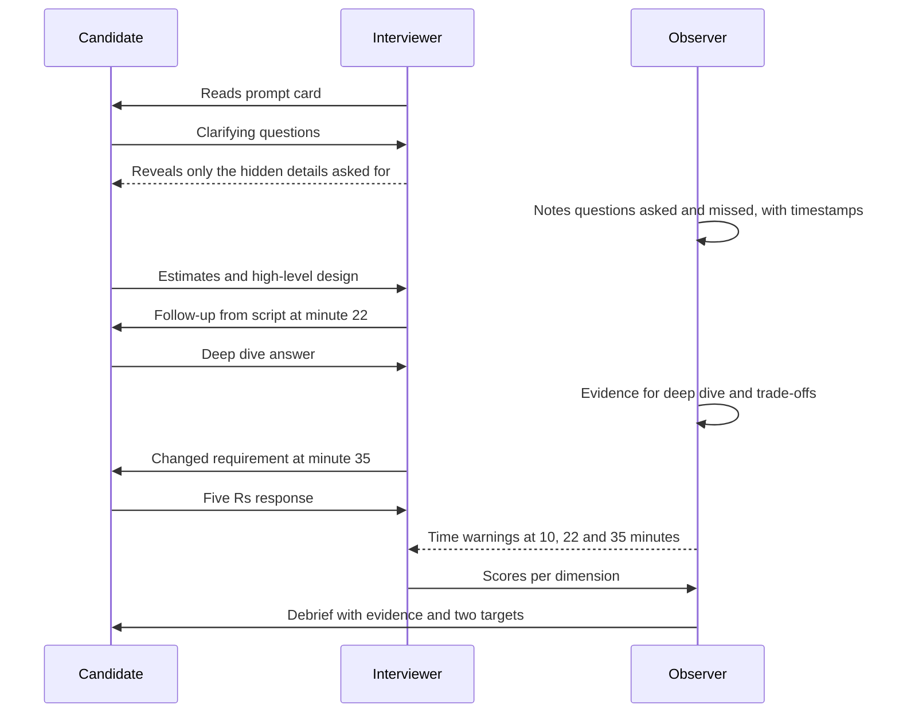

Reading about system design interviews is like reading about swimming. At some point you have to get in the water, with a clock running and someone asking awkward questions. This lesson is the pool: four complete mock sessions you can run with a friend (or alone, with a timer and a recording), each scripted from the interviewer's side, plus a small C# tool for scorecards and interviewer calibration.

## Learning objectives

By the end of this lesson you will be able to:

1. Run a 45-minute mock session as candidate, interviewer or observer, with a fixed time plan.
2. Score a session on seven dimensions with a 1-4 scale, writing evidence for every score.
3. Use hidden requirements and follow-up scripts to test clarifying questions, estimation, deep dives and adaptability.
4. Compare your answer with a model outline and find the two biggest gaps to practise next.
5. Calibrate scores between interviewers and run a short debrief.
6. Implement and test in C# a weighted scorecard, a time-budget analyser and an interviewer calibration check.

## Prerequisites

- [How system design interviews work](#/lesson/m19-interview-structure): formats and what interviewers look for.
- [Estimation drills](#/lesson/m19-estimation-practice), [defending choices](#/lesson/m19-defending-choices) and [changing requirements](#/lesson/m19-changing-requirements): each mock exercises all three.

## Explain it like I'm a beginner

Before the real board exams, most schools in India hold "pre-boards": a full-length paper, the same time limit, the same rules, marked strictly by teachers who did not teach you. Students who skip pre-boards often know the material but run out of time, misread a question, or panic at a type of question they have never seen in exam conditions.

A mock interview is a pre-board for system design. Three things make it work:

1. **Real conditions**: a fixed time (45 minutes), a whiteboard or drawing tool, and someone who asks follow-ups instead of nodding along.
2. **A marking scheme** (a rubric): scores on separate dimensions, such as "requirements" and "trade-offs", with clear descriptions of what a 1, 2, 3 or 4 looks like. This turns "you did fine" into "your estimation was a 2 because you forgot the peak factor".
3. **Feedback straight after**, while you still remember what you were thinking.

The goal is not to memorise the four model answers. The goal is to make the process automatic, so that in the real interview your attention goes to the problem, not to "what do I do next?"

## First-principles explanation

### The three roles

- **Candidate**: thinks out loud, drives the session, manages time.
- **Interviewer**: reads the prompt card, reveals hidden details **only when asked**, uses the follow-up script, and stays neutral. Answers questions about requirements honestly; does not hint at the design.
- **Observer** (optional but valuable): keeps time, writes down evidence for the rubric (quotes and timestamps), and leads the debrief. With two people, the interviewer also observes.

Rotate roles. Playing the interviewer teaches you what interviewers notice, which changes how you behave as a candidate.

### The standard 45-minute plan

| Minutes | Phase | Candidate goal |
|---|---|---|
| 0-5 | Requirements | Functional scope, non-functional numbers, out-of-scope list, assumptions written down |
| 5-10 | Estimation | Peak load, storage, bandwidth, and one design consequence |
| 10-22 | High-level design | Components, main flows, APIs and the core data model |
| 22-35 | Deep dives | Two hard problems the interviewer picks or the candidate proposes |
| 35-42 | Failure, scale, change | What breaks, how it recovers, a changed requirement, an evolution path |
| 42-45 | Wrap-up | Summary of trade-offs, open risks, questions |

The phases bend to the prompt. A payments question spends longer on correctness; a leaderboard question spends longer on the hot path. But a candidate still drawing boxes at minute 30 is in trouble regardless of the prompt.

### The seven rubric dimensions

Each dimension is scored 1-4. The scale is even on purpose: there is no "neutral" middle score, so the scorer must lean one way.

| Dimension | 1 (strong concern) | 2 (concern) | 3 (meets the bar) | 4 (exceeds the bar) |
|---|---|---|---|---|
| **Requirements and scope** | Starts designing immediately; misses core requirements | Asks some questions but misses key non-functional ones, or does not write them down | Covers functional and non-functional requirements with numbers, states assumptions | Prioritises requirements, finds the one that drives the design, and confirms scope explicitly |
| **Estimation** | No numbers, or wrong by orders of magnitude | Numbers without peak factors or units, or not used | Correct arithmetic with units and peaks, used for at least one decision | Fast, narrated, sensitivity-aware, and drives several decisions |
| **High-level design** | Missing major components or flows | Components present but flows unclear, or overbuilt | Clear components and flows that meet the requirements | Right-sized, with a clear evolution path and justification for each box |
| **Data model and APIs** | No data model, or one that cannot support the main queries | Tables or entities listed without keys, access patterns or consistency | Entities, keys and indexes that support the main queries; APIs with idempotency where needed | Models concurrency and evolution explicitly; APIs are clean and versionable |
| **Deep dive and trade-offs** | Cannot go deeper than the boxes | Goes deeper with heavy prompting; trade-offs one-sided | Solves the hard part correctly and names the trade-offs | Compares two or more approaches with numbers, picks one, and states when it would change |
| **Reliability, security and operations** | Ignores failure and security | Mentions failure generically ("add retries") | Handles failure of key dependencies, idempotency, auth, monitoring | Designs for failure from the start, with SLOs, degradation modes and abuse cases |
| **Communication and collaboration** | Silent or disorganised; ignores hints | Talks but jumps around; defensive under challenge | Structured, checks in, uses hints, manages time | Drives the session like a design review lead; adapts calmly to changes |

**Recommendation rule** used by the tool later in the lesson (a reasonable convention, not any specific company's): compute the weighted average. 3.5 or more is "strong hire", 3.0 or more is "hire", 2.5 or more is "lean no hire", below 2.5 is "no hire". Any dimension scored 1 caps the result at "lean no hire". For senior roles, weight deep dive, reliability and communication more heavily.

### Evidence, not impressions

Every score needs evidence: a quote, an action, a timestamp. "Estimation 2: at 07:30 computed 60 bookings per second but used the daily average for the search tier; no peak factor." Evidence makes feedback actionable and makes calibration between interviewers possible.

### Running the debrief

Ten minutes, straight after the session:

1. Candidate first: "What went well, what would you change?" (People often already know their biggest gap.)
2. Observer reads the evidence per dimension and the scores.
3. Agree on **two** things to practise next. Not seven.
4. Compare with the model outline, looking only for missed **ideas**, not for matching boxes.

### Solo practice

No partner? Record yourself (audio is enough), read the prompt card, set a 45-minute timer, and answer the hidden details yourself only when you would have asked for them. Then score your recording the next day using the rubric. The delay matters: you will hear your own hesitations clearly.

## Visual explanation

### A mock session from start to debrief

```mermaid
flowchart LR
    P["Prompt card read aloud"] --> R["0-5 min: requirements, hidden details revealed only on request"]
    R --> E["5-10: estimation"]
    E --> H["10-22: high-level design and data model"]
    H --> D["22-35: two deep dives from the follow-up script"]
    D --> F["35-42: failure, changed requirement, evolution"]
    F --> W["42-45: wrap-up"]
    W --> S["Scoring: 1-4 per dimension with evidence"]
    S --> B["10-minute debrief, two practice targets"]
```



The session is a pipeline with time boxes. Hidden details are given only when the candidate asks, which is how the session measures requirements gathering. The deep dives and the changed requirement come from the follow-up script, so every candidate faces the hard parts. Scoring happens straight away, from written evidence, and the debrief ends with exactly two practice targets.

### Who does what during a session



The interviewer stays in the conversation; the observer writes evidence and sends time warnings at the phase boundaries. That split is why three-person mocks give better feedback: an interviewer who is also taking notes misses half of what the candidate says. With only two people, record the session and fill in the evidence afterwards.

## Step-by-step example

The four mock sessions below are complete. For each: the **prompt card** (read aloud), **hidden details** (reveal only when asked), the **time plan with follow-ups**, a **model answer outline**, and a **rubric** with 1-4 anchors for this prompt. Candidates should not read beyond the prompt card before running the session.

---

### Mock 1 — State transport bus ticket booking (intermediate, 45 minutes)

**Prompt card.** "Design the online booking system for a state road transport corporation. It runs 3,500 buses on 2,000 routes. Passengers book up to 30 days ahead on the website and app, choose seats, and pay by UPI or card. Conductors check tickets on handheld devices."

**Hidden details (reveal only if asked).**
- Normal load: 120,000 bookings a day, average 2.2 seats each.
- Festival periods (for example Diwali and Chhath): about 6x the normal daily bookings, and bookings for a travel date open at 8:00 a.m. exactly 30 days before; about 30 % of that day's festival bookings happen in the first hour.
- Routes have intermediate stops; a seat can be sold for Delhi-Agra and again for Agra-Lucknow on the same trip.
- Seat hold during payment: 10 minutes.
- Many rural routes have no mobile data on the road.
- Cancellation with refund up to 2 hours before departure.
- Availability target: 99.9 % during booking windows.

**Time plan and interviewer follow-ups.**

| Minute | Phase | Interviewer prompt or follow-up |
|---|---|---|
| 0 | Prompt | Read the card. Then wait. |
| 5 | If no numbers asked | "What load should we design for?" (reveal normal and festival figures) |
| 10 | If no estimate | "Roughly how many bookings per second at the festival peak?" |
| 18 | Data model | "Show me the tables for trips and seats." |
| 22 | Deep dive 1 | "Two passengers tap seat 14 on the same bus at the same moment. What happens?" |
| 27 | Deep dive 2 | "The bus goes Delhi, Agra, Kanpur, Lucknow. How do you know seat 14 is free from Agra to Lucknow?" |
| 32 | Failure | "Payment succeeds at minute 11, after the hold expired. Now what?" |
| 35 | Change | "Conductors' devices are offline for most of the route. How do they validate tickets?" |
| 40 | Scale | "8:00 a.m. on festival day: 300,000 people open the app at once. What protects the system?" |
| 43 | Wrap-up | "Summarise your main trade-offs." |

**Model answer outline.**

*Requirements.* Search trips by origin, destination, date; view seat map; hold seats; pay; issue a ticket with a QR code; cancel and refund; conductor validation offline. Non-functional: 99.9 % in booking windows, no double-booking, seat map freshness within a few seconds.

*Estimates.* Festival day: 6 × 120,000 = 720,000 bookings. First hour: 30 % = 216,000 in 3,600 s = 60 bookings per second. Seats: × 2.2 = about 130 seat holds per second. Searches: assume 20 per booking = 1,200 per second, plus people who search and never book (say 3x): about 3,600 searches per second at 8 a.m. Storage is small: 720,000 bookings × ~1 KB ≈ 0.7 GB a day. *Consequence:* the write path is modest; the search and seat-map read path and the 8 a.m. spike are the challenge.

*Architecture.* CDN for static app assets; API instances behind a load balancer; a waiting room (virtual queue) in front of booking at 8 a.m.; search served from a cache of trip schedules and approximate availability counts refreshed every few seconds; seat inventory in PostgreSQL (primary with standby, read replicas for seat maps); payment gateway integration with webhooks; a worker that expires holds; a notification queue for SMS tickets; conductor devices sync trip manifests.

*Data model.* `trips(id, route_id, departure_at, bus_id)`, `trip_stops(trip_id, seq, stop_id)`, `seat_inventory(trip_id, seat_no, booked_mask bigint, version)`, `holds(id, trip_id, seat_no, segment_mask, expires_at, booking_id)`, `bookings(id, user_id, trip_id, from_seq, to_seq, status, amount, idempotency_key unique)`.

*Deep dive 1 (same seat).* Holding is a conditional update inside one transaction: insert the hold only if no active hold or booking overlaps the requested segments, guarded by a row lock on `seat_inventory (trip_id, seat_no)` (`SELECT ... FOR UPDATE`) or a conditional `UPDATE ... WHERE (booked_mask & @mask) = 0`. One request wins; the other gets "seat just taken" and the seat map refreshes.

*Deep dive 2 (segments).* Number the segments between consecutive stops (Delhi-Agra is segment 0, Agra-Kanpur 1, Kanpur-Lucknow 2). A journey covers a contiguous range, encoded as a bitmask (Agra-Lucknow = 0b110). A seat is free for a journey if `(booked_mask | active_hold_masks) & journey_mask = 0`. Booking ORs the mask in. A `bigint` supports up to 63 segments, more than any route needs.

*Failure (late payment).* The payment webhook arrives for an expired hold. If the seat is still free, re-acquire it and confirm; otherwise mark the booking "failed after payment" and trigger an automatic refund. Webhooks are idempotent by payment id.

*Change (offline conductors).* Tickets carry a signed QR code (booking id, trip, seat, segment, signature with the corporation's private key). Devices hold the public key and download the trip manifest at the depot; they validate signatures offline, flag duplicates locally, and upload validations when connectivity returns. Cancellations after the manifest download are handled by a short "last sync" window and by reconciliation.

*Scale (8 a.m.).* Waiting room issues signed tokens admitting users at a controlled rate (for example 500 per second into booking); search is cached; seat maps read from replicas with seconds of staleness, but the hold itself always checks the primary.

**Rubric for mock 1.**

| Dimension | 1 | 2 | 3 | 4 |
|---|---|---|---|---|
| Requirements | Never asks about load, festivals or multi-stop routes | Asks about load but misses festival spike or segments | Finds festival spike, hold time and multi-stop routes | Also finds offline conductors and refunds, and names the 8 a.m. spike as the design driver |
| Estimation | No numbers | Daily average only (~1.4 per second) | Computes ~60 bookings per second and searches in the thousands at 8 a.m. | Separates booking, seat-map and search rates and uses them to size caching and the waiting room |
| High-level design | Missing payment or inventory components | Components present, spike unaddressed | Waiting room or equivalent, cached search, transactional inventory | Right-sized, with explicit evolution path (for example partitioning inventory by route later) |
| Data model and APIs | No seat-level model | Seat table without concurrency control | Seat inventory with conditional update, idempotent booking API | Segment bitmask or equivalent, holds with expiry, versioned API |
| Deep dive and trade-offs | Cannot handle concurrent seat taps | Uses an application lock or "check then insert" | Correct row lock or conditional update; explains loser experience | Compares pessimistic and optimistic approaches with contention numbers; solves segments cleanly |
| Reliability, security, ops | Ignores payment failure | Mentions retries only | Handles late webhooks, refunds, idempotency, monitoring | Offline signed tickets, abuse limits on holds (bots holding seats), SLO for booking window |
| Communication | Disorganised; ignores the time plan | Linear but slow; no check-ins | Structured, uses hints, manages time | Leads the session, summarises trade-offs crisply, adapts calmly to the offline change |

**Sample scorecard (for calibration practice).** Requirements 3 (found festival spike and holds at 03:40, missed offline devices); Estimation 3 (60 per second at 08:10, used for waiting room); HLD 3; Data model 2 (seat table without segments, needed hint at 27:00); Deep dive 3 (conditional update, clear explanation); Reliability 2 (late payment case handled only after prompting, no abuse limits); Communication 3. Weighted average with equal weights ≈ 2.71: lean no hire for a senior role, close to hire for a mid-level role. The two practice targets: multi-stop inventory modelling, and leading with failure cases.

---

### Mock 2 — Live leaderboard for a fantasy cricket app (advanced, 45 minutes)

**Prompt card.** "During a live T20 match, millions of users have fantasy teams entered into contests. After every ball, players' fantasy points change. Users want to see their team's points and their rank in each contest, updated quickly. Design the leaderboard system."

**Hidden details (reveal only if asked).**
- 5 million teams for a big match, entered into 200,000 contests; one team can be in several contests (15 million contest entries in total).
- Contest sizes range from 2 to 2 million entries.
- Ranks should update within 5 seconds of each ball. A ball happens roughly every 30-40 seconds.
- Each team has 11 players, with captain (2x) and vice-captain (1.5x) multipliers.
- The ball-by-ball feed comes from a data provider and sometimes corrects earlier events (for example a review overturns a wicket).
- Final ranks after the match decide prize money and must be exact.
- Peak read load: most users keep the app open and refresh after each ball.

**Time plan and interviewer follow-ups.**

| Minute | Phase | Interviewer prompt or follow-up |
|---|---|---|
| 5 | If no scale asked | "How many teams and contests?" |
| 10 | Estimate | "How much work is there after each ball?" |
| 22 | Deep dive 1 | "Walk me through what happens between the ball being bowled and a user seeing a new rank." |
| 27 | Deep dive 2 | "One contest has 2 million entries. How do you give each user their exact rank every 35 seconds?" |
| 32 | Failure | "The feed corrects a wicket from three balls ago. What changes?" |
| 36 | Change | "Product wants live ranks for 50 million teams next season." |
| 40 | Ops | "The pipeline is 20 seconds behind. What do users see?" |

**Model answer outline.**

*Key insight.* A team's score is a pure function of its 11 players' points and multipliers. Don't push per-ball updates to every team row; recompute scores from player points.

*Estimates.* Per ball: 5 M teams × 11 player lookups = 55 M additions. A modern core does on the order of 10^8 simple operations per second (an estimate), so about 0.5 s on one core, well under 0.1 s across a dozen cores. Ranking: sort 15 M contest entries per ball, partitioned by contest; the 2 M contest alone is a 2 M-element sort, a fraction of a second in memory. Reads: 5 M users refreshing every ~35 s ≈ 140,000 rank reads per second at peak.

*Architecture.* Feed ingester (validates, orders by ball number, handles corrections) → player-points service publishes the 22 players' current points (tiny, versioned by ball) → leaderboard workers, each owning a set of contests in memory (partitioned by contest id; the 2 M contest gets its own worker), recompute team scores and sorted ranks per ball and write a versioned snapshot → read API serves "my rank in contest X" from the owning worker's memory or a replicated snapshot store; top-100 lists cached at the CDN for a few seconds. A durable store (PostgreSQL) holds teams, entries and final results; the per-ball state is rebuildable from the feed.

*Deep dive 2 (2 M contest).* After sorting, store a rank array and an index from team id to rank, so a read is O(1). Alternative for very large contests: a score histogram (fantasy points come in half-point steps up to a few hundred, so a few thousand buckets); a team's rank is the count of teams with a higher score plus one, computed from the cumulative histogram. The histogram is small enough to replicate to every read node, so reads need no coordination. Exact final ranks still come from a full sort after the match.

*Redis sorted sets* are a valid alternative for small and medium contests (`ZADD` and `ZREVRANK`), but writing 15 M score updates every 35 s is about 430,000 writes per second, so either shard heavily or use the in-memory recompute approach. A strong candidate compares both with these numbers.

*Corrections.* Because scores are recomputed from player points, a correction is a new version of player points; the next recompute produces correct ranks. Show a "points updated after review" note. Final settlement waits for the provider's final scorecard.

*Lag.* Every snapshot carries a ball number; the app shows "ranks as of over 14.3". If lag exceeds a threshold, keep serving the last snapshot and show the delay rather than errors.

*Change to 50 M teams.* 10x the recompute work: still parallelisable by contest; add workers, and move more contests to histogram ranking. Reads 10x: lean harder on replicated snapshots and CDN for top lists.

**Rubric for mock 2.**

| Dimension | 1 | 2 | 3 | 4 |
|---|---|---|---|---|
| Requirements | Misses multiple contests per team or the 5-second target | Gets scale but not corrections or exact final ranks | Gets scale, freshness target, corrections and final exactness | Distinguishes live (approximate allowed) from final (exact, money) explicitly |
| Estimation | None | Counts users only, not per-ball work | Computes per-ball recompute work and read rate | Uses numbers to choose recompute over per-team updates and to compare with sorted-set write rates |
| High-level design | Updates every team row in a database per ball | Streaming design with no partitioning plan | Partitioned in-memory recompute with snapshots | Clear separation of live pipeline and durable settlement, versioned snapshots |
| Data model and APIs | No model of teams and contests | Tables only, no access pattern | Entries partitioned by contest, read API by contest and team | Versioned snapshots by ball number, idempotent feed processing |
| Deep dive and trade-offs | Cannot rank 2 M entries | Says "Redis sorted set" without the write-rate cost | Exact rank via sort and index, or a costed sorted-set design | Offers histogram ranking for huge contests, with exactness trade-off and final-settlement fix |
| Reliability, security, ops | Ignores feed errors | Mentions retries | Handles corrections and lag gracefully | Defines lag SLO, degradation (stale snapshot with label), replay from feed, fraud checks on late team edits |
| Communication | Lost in details | Needs heavy steering | Structured, checks the key insight with the interviewer | Spots the key insight early and frames the session around it |

---

### Mock 3 — Crop-insurance photo and drone imagery platform (advanced, 45 minutes)

**Prompt card.** "A crop-insurance company covers farms across hundreds of districts. Field agents photograph insured fields on their phones; drone teams fly sample areas weekly. Design a platform to upload, process, tag and browse this imagery, so claims officers can assess crop damage, settle claims and resolve disputes with farmers."

**Hidden details (reveal only if asked).**
- 400 districts, 6,000 field agents; each uploads about 40 photos per working day (6 days a week) at about 4 MB.
- 50 drone flights a week, about 30 GB of raw images per flight; processed into orthomosaic maps.
- AI tagging (crop type, growth stage, damage level) should be available within 1 hour of upload.
- Many villages have weak mobile networks; uploads often happen in the evening on the block office's Wi-Fi.
- Regulation requires 7-year retention; some photos become evidence in claim disputes and must not be altered or deleted.
- Users browse by district, farm location on a map, date and tags.

**Time plan and interviewer follow-ups.**

| Minute | Phase | Interviewer prompt or follow-up |
|---|---|---|
| 5 | If no numbers | "How much data are we talking about?" |
| 10 | Estimate | "What does 7 years cost you, roughly?" |
| 22 | Deep dive 1 | "An agent uploads 120 photos over a 2G connection and the connection drops at photo 63. What happens?" |
| 27 | Deep dive 2 | "Walk me through what happens from 'photo stored' to 'tags searchable'." |
| 32 | Failure | "The upload retried, and now the same photo exists twice. Does it matter?" |
| 35 | Change | "A farmer takes a rejected claim to consumer court; legal says the photos for that claim must be preserved unaltered." |
| 40 | Cost | "Finance says storage is too expensive. What do you change?" |

**Model answer outline.**

*Estimates.* Photos: 6,000 × 40 = 240,000 a day × 4 MB ≈ 0.96 TB a day; × 6 days ≈ 5.8 TB a week. Drones: 50 × 30 GB = 1.5 TB a week. Total ≈ 7.3 TB a week ≈ 380 TB a year ≈ 2.6 PB over 7 years before compression or tiering. Upload rate: 240,000 photos in a 10-hour day ≈ 6.7 per second (≈ 27 MB/s), with an evening peak of perhaps 3x. AI tagging: if one GPU tags around 20 images per second (an estimate to verify), 240,000 photos need about 12,000 GPU-seconds, roughly 3.3 GPU-hours a day. *Consequences:* storage and its lifecycle dominate cost; compute for tagging is small and can be batched; uploads must be resumable.

*Architecture.* Mobile app with a local upload queue → API issues pre-signed multipart upload URLs → object storage (originals, immutable), with an "object created" event → queue → workers: EXIF and GPS extraction, thumbnails, deduplication by content hash, AI tagging on an autoscaled GPU pool in batches → PostgreSQL with spatial indexing (for example PostGIS) for metadata, tags and locations → search API (by district, bounding box, date, tag) → web dashboard with map. Drone pipeline: raw images to object storage, batch processing into orthomosaic tiles, tiles served via CDN.

*Deep dive 1 (2G upload).* Client-side compression (configurable; a 4 MB photo often shrinks considerably with little visible loss, worth measuring), a persistent upload queue on the device, multipart or chunked uploads with resumable parts, retries with back-off and jitter, upload only on Wi-Fi option, and an idempotency key per photo (client-generated id) so retries never create duplicates.

*Deep dive 2 (pipeline).* Event-driven, at-least-once processing with idempotent workers keyed by photo id; status per photo (uploaded, processed, tagged); a dead-letter queue for failures; tagging results versioned by model version so re-tagging with a better model is a backfill, not a migration.

*Duplicates.* Client-generated photo id prevents most; a content hash catches the rest; duplicates in object storage are a cost issue, duplicates in metadata are a correctness issue for progress counts.

*Change (legal hold).* Object-lock or write-once (WORM) retention on originals, a legal-hold flag per claim or photo that blocks deletion in the application and in storage policy, audit log of every access, and a hash recorded at upload so integrity can be shown later.

*Cost.* Lifecycle rules: originals to infrequent-access after 90 days and to archive after 1 year; keep thumbnails and web-sized versions hot; drone raw images deleted after orthomosaics are produced and verified (if the regulator allows), keeping the processed outputs.

**Rubric for mock 3.**

| Dimension | 1 | 2 | 3 | 4 |
|---|---|---|---|---|
| Requirements | Misses retention or weak networks | Finds retention but not disputes or the 1-hour tagging target | Finds volume, retention, weak networks and tagging latency | Identifies claim-dispute evidence (immutability, integrity) as a first-class requirement |
| Estimation | None | Per-day photo volume only | Weekly and 7-year storage, upload rate | Adds tagging compute and shows storage dominates cost, driving lifecycle design |
| High-level design | Images stored in the database | Object storage but synchronous processing in upload request | Pre-signed uploads, event-driven pipeline, spatial metadata | Separate drone batch pipeline, model-versioned tags, CDN tiles |
| Data model and APIs | No metadata model | Photos table without location or tag indexing | Spatial and tag indexes; upload API with client id | Idempotent upload protocol, status lifecycle, versioned tag results |
| Deep dive and trade-offs | No answer for dropped uploads | Retries without idempotency | Resumable chunked uploads, idempotent ids, device queue | Compression trade-offs quantified, Wi-Fi-only option, dedupe by hash |
| Reliability, security, ops | Ignores failures | Generic retries | DLQ, idempotent workers, access control per district | Legal hold, object lock, integrity hashes, audit of access |
| Communication | Rambles | Needs prompting to move on | Structured with time checks | Frames the session around cost and evidence integrity early |

---

### Mock 4 — Marketplace payouts and reconciliation (staff level, 45 minutes)

**Prompt card.** "A B2B marketplace sells supplies (vegetables, packaging, kitchen equipment) to restaurants. Buyers pay the platform; the platform pays suppliers after delivery is confirmed, minus commission and statutory withholdings. Design the payouts system, including reconciliation with the bank."

**Hidden details (reveal only if asked).**
- 50,000 orders a day, average value about ₹40,000; 8,000 active suppliers.
- Payout two working days after delivery confirmation, aggregated per supplier per day.
- Commission per category; tax withholdings (for example TDS and GST-related deductions) at rates configured per supplier category, which change with regulation.
- The bank offers a payout API (rate limit 20 requests per second, sometimes times out) and a daily statement file with a unique transaction reference (UTR) per transfer.
- Disputes can put an order's payout on hold.
- Finance requires an audit trail and maker-checker approval for manual adjustments.
- Must never pay a supplier twice; a missed payout is bad but recoverable.

**Time plan and interviewer follow-ups.**

| Minute | Phase | Interviewer prompt or follow-up |
|---|---|---|
| 5 | If no numbers | "What volumes?" |
| 10 | Estimate | "Is scale the hard part here?" |
| 18 | Data model | "How do you represent money moving through the platform?" |
| 22 | Deep dive 1 | "The bank API times out on a ₹12 lakh payout. Did it pay? What do you do?" |
| 28 | Deep dive 2 | "Walk me through the daily reconciliation." |
| 33 | Edge case | "A supplier changes their bank account the evening before payout." |
| 37 | Change | "Regulation changes the withholding rate from next month for one category." |
| 41 | Scale | "We expect 10x orders in two years." |

**Model answer outline.**

*Estimates.* 50,000 × ₹40,000 = ₹2 × 10^9 a day (₹200 crore). Payouts: at most 8,000 a day (aggregated); at 20 requests per second that is 400 seconds of API calls. Ledger entries: perhaps 6 per order, 300,000 a day. *Consequence:* scale is not the hard part; correctness, idempotency, auditability and reconciliation are. A single PostgreSQL primary with a standby is ample for years. Saying this explicitly is a strong signal.

*Data model.* Double-entry ledger: `accounts(id, owner, type)` (buyer receivable, platform cash, supplier payable, commission revenue, tax payable), `journal_entries(id, created_at, reason, reference)`, `postings(entry_id, account_id, amount_paise)` with the invariant that each entry's postings sum to zero (enforced by a constraint trigger or in a single transactional function), append-only. `payouts(id, supplier_id, payout_date, amount_paise, status, idempotency_key unique, bank_reference, attempts)`. Amounts in integer paise; rounding rules explicit per deduction.

*Flow.* Delivery confirmed → journal entry moves amount to supplier payable minus commission and withholdings (rates from a versioned rates table effective by date) → daily job at T+2 aggregates payable per supplier into one payout row (Scheduled), skipping orders on hold → payout worker submits to the bank with the payout id as the idempotency key (or the client reference the bank deduplicates on), rate-limited to 20 per second → status Submitted → bank confirmation or statement marks Confirmed with UTR, posting the cash movement.

*Deep dive 1 (timeout).* A timeout means unknown, not failed. Mark the payout "Unknown", never resubmit blindly; query the bank's status API by our reference; if the bank has no record after its stated window, resubmit with the **same** reference; if the bank does not deduplicate by reference, resubmission requires reconciliation first. Unknowns older than a threshold go to a human queue.

*Deep dive 2 (reconciliation).* Daily: parse the bank statement, match each debit to a payout by reference and amount; outcomes: matched (Confirmed), payout without bank line (investigate, possibly failed), bank line without payout (critical alert, potential fraud or duplicate), amount mismatch (critical). Reconciliation results are themselves stored and reported; the job is idempotent by statement file id.

*Edge case (bank account change).* A cooling-off period (for example 48 hours) during which payouts go to the old verified account or are held; account verification (a small test credit with name match); notification to the supplier's registered contacts; maker-checker for changes requested through support.

*Change (rates).* Rates are data with effective dates; the deduction calculation reads the rate effective on the relevant date, so the change is a new row approved via maker-checker, with a test that recomputes a sample of payouts.

*10x.* 500,000 orders a day is still about 6 per second; 80,000 payouts a day needs more API throughput (batch file payouts or a higher bank limit). Ledger partitioning by month for retention. No change to the architecture shape.

**Rubric for mock 4.**

| Dimension | 1 | 2 | 3 | 4 |
|---|---|---|---|---|
| Requirements | Misses never-pay-twice or reconciliation | Finds them but not holds, rates or maker-checker | Finds holds, configurable rates, audit and the bank's limits | Prioritises correctness over speed explicitly and confirms tolerance for delay vs duplication |
| Estimation | None | Computes volumes but builds for huge scale anyway | Shows scale is modest and keeps the design simple | Uses rupee volume to argue for controls (alerts, limits) and API time to plan batching |
| High-level design | Pays directly from the order service on delivery | Async worker but no ledger | Ledger, scheduler, rate-limited payout worker, reconciliation job | Clear state machines, human exception queue, evolution to batch files |
| Data model and APIs | Balances as mutable columns only | Ledger without balancing invariant | Double-entry with integer paise, unique idempotency keys | Append-only with effective-dated rates and explicit rounding policy |
| Deep dive and trade-offs | Retries timeouts blindly | Knows timeouts are ambiguous but no procedure | Unknown state, status query, same-reference resubmission | Discusses bank deduplication guarantees, human thresholds and the asymmetry of risks |
| Reliability, security, ops | Ignores fraud and audit | Mentions audit only | Account-change cooling-off, maker-checker, alerts on mismatches | Defense in depth: limits per supplier per day, anomaly alerts, segregation of duties |
| Communication | Defensive about simplicity | Over-explains basics | Clear, paced, invites challenge | Drives a review-quality discussion and summarises residual risks |

**Sample scorecard (two interviewers, for the calibration exercise).** Interviewer A: requirements 3, estimation 4, HLD 3, data 3, deep dive 2, reliability 3, communication 3. Interviewer B: requirements 3, estimation 3, HLD 3, data 3, deep dive 4, reliability 2, communication 3. The deep-dive spread of 2 needs a debrief: A noted "resubmitted after timeout at 24:10 before querying status"; B noted "corrected himself at 25:00 and described the unknown state well". Both pieces of evidence are true; the debrief decides whether self-correction earns a 3.

### More prompt cards

Once the four mocks feel familiar, run new prompts in the same format. The interviewer writes the hidden details; the case studies make good model outlines afterwards.

| Prompt card | Hidden detail that drives the design | Model outline |
|---|---|---|
| "Sell 10,000 phones at noon to 2 million waiting users." | Overselling is never allowed; most buyers arrive in the first 5 seconds | [Flash sale](#/lesson/m17-flash-sale) |
| "Show restaurants within 3 km of the user, sorted by distance." | Restaurants rarely move, but delivery partners move every few seconds | [Proximity service](#/lesson/m17-proximity-service) |
| "Run 50 million scheduled jobs a day, such as EMI reminders and report generation." | A job may run late but must not run twice with side effects | [Job scheduler](#/lesson/m17-job-scheduler) |
| "Crawl 1 billion pages a month for a search start-up." | Each site allows only a few requests per second | [Web crawler](#/lesson/m17-web-crawler) |
| "Generate order ids for 40 data centres, roughly sortable by time." | Clocks drift and nodes restart | [Unique ID generator](#/lesson/m17-unique-id-generator) |
| "Take this app from 100 users to 10 million." | The interviewer changes the scale every 10 minutes | [Scaling journey](#/lesson/m17-scaling-journey) |
| LLD: "Design an expense-splitting app" or "an LRU cache" | Rounding of paise; thread safety and O(1) operations | [Splitwise](#/lesson/m18-splitwise), [LRU cache](#/lesson/m18-lru-cache) |

## Production-style C# implementation

The scorecard service holds a rubric with weighted dimensions, validates scorecards (one score per dimension, 1-4, with evidence), computes the weighted average and recommendation with the "any 1 caps at lean no hire" rule, analyses time budgets for a session, and flags dimensions where interviewers disagree by two or more points.

```text
Mocks.Api/
  Program.cs
  Mocks/RubricModels.cs
  Mocks/StandardRubrics.cs
  Mocks/ScoreCalculator.cs
  Mocks/Calibration.cs
  Mocks/SessionTimeline.cs
```

```csharp file=Mocks/RubricModels.cs
namespace Sdlp.Mocks;

public sealed record Dimension(string Id, string Name, double Weight, IReadOnlyList<string> Anchors);

public sealed record Rubric(string Name, IReadOnlyList<Dimension> Dimensions);

public sealed record DimensionScore(string DimensionId, int Score, string Evidence);

public sealed record Scorecard(string Interviewer, string Candidate, string MockId, IReadOnlyList<DimensionScore> Scores);

public enum Recommendation { NoHire, LeanNoHire, Hire, StrongHire }

public sealed record ScoreResult(double WeightedAverage, Recommendation Recommendation, IReadOnlyList<string> Warnings);

public sealed record DebriefItem(string DimensionId, int Min, int Max, double Median, string Reason);
```

```csharp file=Mocks/StandardRubrics.cs
namespace Sdlp.Mocks;

public static class StandardRubrics
{
    private static Dimension D(string id, string name, double weight, string a1, string a2, string a3, string a4) =>
        new(id, name, weight, new[] { a1, a2, a3, a4 });

    /// <summary>Weights for a senior role: deep dives, reliability and communication count more.</summary>
    public static Rubric Senior { get; } = new("System design (senior)", new[]
    {
        D("req", "Requirements and scope", 1.0, "Starts designing immediately", "Misses key non-functional requirements", "Functional and non-functional with numbers", "Finds the requirement that drives the design"),
        D("est", "Estimation", 0.75, "No numbers or wrong by orders of magnitude", "Numbers without peaks or not used", "Correct, with units and peaks, used once", "Fast, narrated, drives several decisions"),
        D("hld", "High-level design", 1.0, "Missing major components", "Unclear flows or overbuilt", "Clear components and flows meeting requirements", "Right-sized with evolution path"),
        D("data", "Data model and APIs", 1.0, "Cannot support main queries", "Entities without keys or concurrency", "Keys, indexes, idempotent APIs", "Concurrency and evolution modelled"),
        D("deep", "Deep dive and trade-offs", 1.5, "Cannot go deeper", "Needs heavy prompting", "Solves the hard part, names trade-offs", "Compares options with numbers"),
        D("rel", "Reliability, security and operations", 1.25, "Ignores failure and security", "Generic retries", "Key failures, idempotency, auth, monitoring", "Designed for failure with SLOs and abuse cases"),
        D("comm", "Communication and collaboration", 1.25, "Silent or disorganised", "Jumps around or defensive", "Structured, uses hints, manages time", "Leads like a review lead, adapts calmly"),
    });
}
```

```csharp file=Mocks/ScoreCalculator.cs
namespace Sdlp.Mocks;

public static class ScoreCalculator
{
    public const int MinEvidenceLength = 15;

    public static ScoreResult Evaluate(Rubric rubric, Scorecard card)
    {
        ArgumentNullException.ThrowIfNull(rubric);
        ArgumentNullException.ThrowIfNull(card);

        var byId = card.Scores.GroupBy(s => s.DimensionId, StringComparer.Ordinal).ToList();
        var duplicate = byId.FirstOrDefault(g => g.Count() > 1);
        if (duplicate is not null) throw new ArgumentException($"Dimension '{duplicate.Key}' scored more than once.", nameof(card));

        var scores = byId.ToDictionary(g => g.Key, g => g.Single(), StringComparer.Ordinal);
        var unknown = scores.Keys.Except(rubric.Dimensions.Select(d => d.Id), StringComparer.Ordinal).FirstOrDefault();
        if (unknown is not null) throw new ArgumentException($"Unknown dimension '{unknown}'.", nameof(card));

        var warnings = new List<string>();
        double weighted = 0, totalWeight = 0;
        var anyOne = false;

        foreach (var d in rubric.Dimensions)
        {
            if (!scores.TryGetValue(d.Id, out var s))
                throw new ArgumentException($"Missing score for '{d.Id}'.", nameof(card));
            if (s.Score is < 1 or > 4)
                throw new ArgumentException($"Score for '{d.Id}' must be 1 to 4.", nameof(card));
            if (string.IsNullOrWhiteSpace(s.Evidence) || s.Evidence.Trim().Length < MinEvidenceLength)
                warnings.Add($"'{d.Id}' has little or no evidence; scores without evidence cannot be calibrated.");

            weighted += d.Weight * s.Score;
            totalWeight += d.Weight;
            anyOne |= s.Score == 1;
        }

        var average = Math.Round(weighted / totalWeight, 2);
        var recommendation = average >= 3.5 ? Recommendation.StrongHire
                           : average >= 3.0 ? Recommendation.Hire
                           : average >= 2.5 ? Recommendation.LeanNoHire
                           : Recommendation.NoHire;
        if (anyOne && recommendation > Recommendation.LeanNoHire)
        {
            recommendation = Recommendation.LeanNoHire;
            warnings.Add("A dimension scored 1 caps the recommendation at lean no hire.");
        }

        return new ScoreResult(average, recommendation, warnings);
    }
}
```

```csharp file=Mocks/Calibration.cs
namespace Sdlp.Mocks;

/// <summary>Finds where interviewers who saw the same session disagree enough to discuss.</summary>
public static class Calibration
{
    public static IReadOnlyList<DebriefItem> Compare(Rubric rubric, IReadOnlyList<Scorecard> cards, int spreadThreshold = 2)
    {
        if (cards.Count < 2) throw new ArgumentException("Calibration needs at least two scorecards.", nameof(cards));
        if (cards.Select(c => c.MockId).Distinct(StringComparer.Ordinal).Count() > 1)
            throw new ArgumentException("All scorecards must be for the same session.", nameof(cards));

        var items = new List<DebriefItem>();
        foreach (var d in rubric.Dimensions)
        {
            var entries = cards.Select(c => c.Scores.FirstOrDefault(s => s.DimensionId == d.Id))
                               .Where(s => s is not null).Select(s => s!).ToList();
            if (entries.Count < 2) continue;

            var values = entries.Select(s => s.Score).OrderBy(v => v).ToList();
            var median = values.Count % 2 == 1
                ? values[values.Count / 2]
                : (values[values.Count / 2 - 1] + values[values.Count / 2]) / 2.0;
            var (min, max) = (values[0], values[^1]);

            if (max - min >= spreadThreshold)
                items.Add(new DebriefItem(d.Id, min, max, median, $"Scores range {min}-{max}: compare the evidence."));
            else if (entries.Any(s => string.IsNullOrWhiteSpace(s.Evidence)))
                items.Add(new DebriefItem(d.Id, min, max, median, "At least one score has no evidence."));
        }
        return items;
    }
}
```

```csharp file=Mocks/SessionTimeline.cs
namespace Sdlp.Mocks;

public sealed record PlannedPhase(string Name, int Minutes);

public sealed record PhaseActual(string Name, TimeSpan Planned, TimeSpan Actual)
{
    public TimeSpan Overrun => Actual - Planned;
}

/// <summary>Records when each phase actually started, using an injected clock, and compares with the plan.</summary>
public sealed class SessionTimeline(IReadOnlyList<PlannedPhase> plan, TimeProvider clock)
{
    private readonly List<DateTimeOffset> _starts = new();
    private DateTimeOffset? _end;

    public static IReadOnlyList<PlannedPhase> Standard45 { get; } = new[]
    {
        new PlannedPhase("Requirements", 5), new PlannedPhase("Estimation", 5), new PlannedPhase("High-level design", 12),
        new PlannedPhase("Deep dives", 13), new PlannedPhase("Failure, scale, change", 7), new PlannedPhase("Wrap-up", 3),
    };

    public string? CurrentPhase => _end is null && _starts.Count > 0 ? plan[_starts.Count - 1].Name : null;

    public void StartNextPhase()
    {
        if (_end is not null || _starts.Count >= plan.Count) throw new InvalidOperationException("All phases have started.");
        _starts.Add(clock.GetUtcNow());
    }

    public void End()
    {
        if (_starts.Count == 0) throw new InvalidOperationException("Session has not started.");
        _end ??= clock.GetUtcNow();
    }

    public IReadOnlyList<PhaseActual> Report()
    {
        var until = _end ?? clock.GetUtcNow();
        var result = new List<PhaseActual>();
        for (var i = 0; i < _starts.Count; i++)
        {
            var stop = i + 1 < _starts.Count ? _starts[i + 1] : until;
            result.Add(new PhaseActual(plan[i].Name, TimeSpan.FromMinutes(plan[i].Minutes), stop - _starts[i]));
        }
        return result;
    }
}
```

```csharp file=Program.cs
using Sdlp.Mocks;

var builder = WebApplication.CreateBuilder(args);
builder.Services.AddSingleton(TimeProvider.System);
builder.Services.AddSingleton(StandardRubrics.Senior);

var app = builder.Build();

app.MapGet("/mocks/rubric", (Rubric rubric) => Results.Ok(rubric));

app.MapPost("/mocks/score", (Scorecard card, Rubric rubric) =>
{
    try { return Results.Ok(ScoreCalculator.Evaluate(rubric, card)); }
    catch (ArgumentException ex) { return Results.Problem(ex.Message, statusCode: StatusCodes.Status400BadRequest); }
});

app.MapPost("/mocks/calibrate", (Scorecard[] cards, Rubric rubric) =>
{
    try { return Results.Ok(Calibration.Compare(rubric, cards)); }
    catch (ArgumentException ex) { return Results.Problem(ex.Message, statusCode: StatusCodes.Status400BadRequest); }
});

app.Run();
```

Design notes:

- **The rubric is data.** Weights and anchors live in one object, so a "mid-level" rubric is a second instance, not new code. In a team, store rubrics in a database and version them; a score is only comparable with scores from the same rubric version.
- **Validation is strict, warnings are soft.** A missing or out-of-range score is an error; thin evidence is a warning, because forcing long text produces padding.
- **The cap rule is explicit and reported.** When "a 1 caps the result" changes the recommendation, the warning says so, which helps the debrief.
- **Time comes from `TimeProvider`**, so tests can simulate a 45-minute session in microseconds.

## Bad design vs good design

Here the "design" is how a mock is run.

**Bad mock:**

> The friend playing interviewer reads the prompt, then says "looks good" every few minutes, gives the numbers before being asked, never asks a follow-up, and at the end says "nice, you'd pass".

Problems: with no hidden details, requirements gathering is never tested; with no follow-ups, the hard parts never come up; with no rubric or evidence, the candidate can't tell what to practise. It feels pleasant and teaches almost nothing.

**Good mock:** the interviewer reveals details only when asked, uses the scripted follow-ups at the scripted minutes even if the candidate is "doing well", the observer writes timestamped evidence, scores are given per dimension, and the debrief ends with two specific targets: "estimate peak before average" and "lead with failure cases in the deep dive".

:::callout type=mistake title="Practising only the model answers"
The model outlines are a check, not a script to memorise. Interviewers vary prompts precisely to defeat memorisation. Practise the process on new prompts; use the outlines to find missed ideas.
:::

## Practical playground

The starter is a deliberately thin first sketch for mock 1 (bus ticket booking). Run the mock first with a timer, then use the canvas to improve the sketch into your final answer: add what handles the 8 a.m. spike, where seat inventory lives and how holds expire, the payment webhook path, and how conductors validate offline. Compare with the model outline afterwards.

:::playground type=hld title="Mock 1: bus ticket booking, from first sketch to final answer"
```json
{
  "nodes": [
    { "id": "pax", "type": "client", "label": "Passengers (web and app)", "props": { "rps": 3600 } },
    { "id": "cond", "type": "client", "label": "Conductor handhelds (often offline)" },
    { "id": "lb", "type": "load-balancer", "label": "Load balancer" },
    { "id": "api", "type": "app-server", "label": "Booking API", "props": { "instances": 4 } },
    { "id": "db", "type": "database", "label": "PostgreSQL: trips, seats, bookings" },
    { "id": "pg", "type": "external", "label": "Payment gateway (UPI, cards)" }
  ],
  "edges": [
    { "from": "pax", "to": "lb", "kind": "sync" },
    { "from": "lb", "to": "api", "kind": "sync" },
    { "from": "api", "to": "db", "kind": "sync" },
    { "from": "api", "to": "pg", "kind": "sync" }
  ]
}
```
:::

## Exercises

:::exercise id=m19-mock-interviews-ex1 difficulty=beginner kind=written title="Score a transcript excerpt"
Score the first 12 minutes of this mock 1 transcript on the dimensions it covers (requirements, estimation, communication), with evidence for each score.

> **00:20 Candidate:** OK, a bus booking system. I'll start with the components: an API, a database, payments...
> **01:50 Interviewer:** Before that, anything you want to know?
> **02:00 Candidate:** Oh, right. How many users?
> **02:10 Interviewer:** About 120,000 bookings a day normally.
> **02:20 Candidate:** So 120,000 divided by 86,400 is about 1.4 per second. That's small, so one server and one database is fine.
> **03:30 Candidate:** Seats... users pick a seat and pay. We'll lock the seat while they pay.
> **05:00 Interviewer:** Are there busy periods?
> **05:10 Candidate:** Maybe weekends? I'll assume 2x.
> **06:00 Candidate:** *(draws API, PostgreSQL, payment gateway)* Bookings table with seat number and trip id.
> **11:40 Candidate:** I think that covers it. Should I go deeper on payments?
::acceptance
- Each score uses the 1-4 scale and quotes or timestamps evidence.
- Estimation score reflects both the correct arithmetic and the missed peak.
- At least one "what a 3 would have looked like" note per dimension.
::hint
Requirements: who asked the first question, and when? Which hidden details were never found?
::hint
Estimation: the arithmetic is right. What about the peak and the consequence drawn?
::hint
Communication: did the candidate check in? Did they manage time well (what was achieved by 11:40)?
::solution
**Requirements and scope: 1-2 (I'd give 2 only if later minutes recover).** Evidence: started with components at 00:20 and asked a question only when prompted at 01:50; asked one question (users) and accepted "weekends 2x" as an assumption at 05:10 without asking about festivals, booking windows, multi-stop routes, hold time or offline conductors. A 3 would have asked about peaks, seat-hold rules and route structure before drawing anything.

**Estimation: 2.** Evidence: correct per-second arithmetic at 02:20 (1.4 per second), but the conclusion ("one server is fine") was drawn from the daily average, and the peak was a self-assumed 2x. A 3 would have asked about busy periods, found the 8 a.m. festival window and computed ~60 bookings per second and thousands of searches per second.

**Communication: 2.** Evidence: linear and calm, and checked in at 11:40, which is good; but needed prompting to clarify requirements, and at 11:40 had only three boxes and one table, behind the time plan. A 3 would have narrated a plan at the start ("requirements, then numbers, then design") and checked in after requirements.

Two practice targets: always ask about peaks and special events before estimating; never draw components before minute 5.
::mistakes
- Giving estimation a 3 because the arithmetic was correct; the rubric also asks whether numbers were used for good decisions.
- Scoring without evidence ("felt a bit weak").
:::

:::exercise id=m19-mock-interviews-ex2 difficulty=beginner kind=code title="Weighted score and recommendation"
Implement `ScoreMath.Recommend`. Given scores (1-4) and weights per dimension, compute the weighted average rounded to two decimals and the recommendation: 3.5 or more "StrongHire", 3.0 or more "Hire", 2.5 or more "LeanNoHire", otherwise "NoHire". Any score of 1 caps the result at "LeanNoHire".
::requirements
- Every weighted dimension must have a score, and no extra scores are allowed: otherwise `ArgumentException`.
- Scores outside 1-4 or weights of 0 or less throw `ArgumentException`.
- Return a tuple `(double Average, string Recommendation)`.
::acceptance
- Mock 1 sample scorecard with equal weights (3, 3, 3, 2, 3, 2, 3) gives 2.71 and "LeanNoHire".
- All 4s with one 1 gives "LeanNoHire" despite an average above 3.5.
- Weighted case with four dimensions: deep dive weight 2 with score 4, the other three weight 1 with score 3, gives 3.4 → "Hire" (the equal-weight average would be 3.25).
- Missing or extra dimension throws.
::hint
Validate first: same set of keys in both dictionaries.
::hint
Sum weight × score, divide by the sum of weights, `Math.Round(x, 2)`.
::hint
Decide the band from the average, then apply the cap if any score is 1.
::hint
```csharp
var rec = avg >= 3.5 ? "StrongHire" : avg >= 3.0 ? "Hire" : avg >= 2.5 ? "LeanNoHire" : "NoHire";
if (scores.Values.Contains(1) && (rec == "StrongHire" || rec == "Hire")) rec = "LeanNoHire";
```
::starter
```csharp file=ScoreMath.cs
using System;
using System.Collections.Generic;
using System.Linq;

public static class ScoreMath
{
    public static (double Average, string Recommendation) Recommend(
        IReadOnlyDictionary<string, int> scores, IReadOnlyDictionary<string, double> weights) =>
        throw new NotImplementedException();
}
```
::tests
```csharp file=ScoreMathTests.cs
using System;
using System.Collections.Generic;
using System.Linq;
using Xunit;

public class ScoreMathTests
{
    private static readonly string[] Dims = { "req", "est", "hld", "data", "deep", "rel", "comm" };
    private static Dictionary<string, double> Equal() => Dims.ToDictionary(d => d, _ => 1.0);
    private static Dictionary<string, int> S(params int[] v) => Dims.Select((d, i) => (d, v[i])).ToDictionary(x => x.d, x => x.Item2);

    [Fact]
    public void Mock1_sample_is_lean_no_hire()
    {
        var (avg, rec) = ScoreMath.Recommend(S(3, 3, 3, 2, 3, 2, 3), Equal());
        Assert.Equal(2.71, avg, 2);
        Assert.Equal("LeanNoHire", rec);
    }

    [Fact]
    public void A_one_caps_the_result()
    {
        var (avg, rec) = ScoreMath.Recommend(S(4, 4, 4, 4, 4, 4, 1), Equal());
        Assert.True(avg >= 3.5);
        Assert.Equal("LeanNoHire", rec);
    }

    [Fact]
    public void Weights_matter()
    {
        var w = new Dictionary<string, double> { ["a"] = 1, ["b"] = 1, ["c"] = 1, ["deep"] = 2 };
        var s = new Dictionary<string, int> { ["a"] = 3, ["b"] = 3, ["c"] = 3, ["deep"] = 4 };
        var (avg, rec) = ScoreMath.Recommend(s, w);
        Assert.Equal(3.4, avg, 2);
        Assert.Equal("Hire", rec);
    }

    [Fact]
    public void All_fours_strong_hire() => Assert.Equal("StrongHire", ScoreMath.Recommend(S(4, 4, 4, 4, 4, 4, 4), Equal()).Recommendation);

    [Fact]
    public void Low_scores_no_hire() => Assert.Equal("NoHire", ScoreMath.Recommend(S(2, 2, 2, 2, 2, 3, 2), Equal()).Recommendation);

    [Fact]
    public void Missing_dimension_throws()
    {
        var s = S(3, 3, 3, 3, 3, 3, 3);
        s.Remove("comm");
        Assert.Throws<ArgumentException>(() => ScoreMath.Recommend(s, Equal()));
    }

    [Fact]
    public void Extra_dimension_throws()
    {
        var s = S(3, 3, 3, 3, 3, 3, 3);
        s["vibes"] = 4;
        Assert.Throws<ArgumentException>(() => ScoreMath.Recommend(s, Equal()));
    }

    [Theory]
    [InlineData(0)]
    [InlineData(5)]
    public void Out_of_range_throws(int bad) => Assert.Throws<ArgumentException>(() => ScoreMath.Recommend(S(bad, 3, 3, 3, 3, 3, 3), Equal()));
}
```
::solution
```csharp file=ScoreMath.cs
using System;
using System.Collections.Generic;
using System.Linq;

public static class ScoreMath
{
    public static (double Average, string Recommendation) Recommend(
        IReadOnlyDictionary<string, int> scores, IReadOnlyDictionary<string, double> weights)
    {
        if (weights.Count == 0) throw new ArgumentException("At least one dimension is required.", nameof(weights));
        var missing = weights.Keys.Where(k => !scores.ContainsKey(k)).ToList();
        var extra = scores.Keys.Where(k => !weights.ContainsKey(k)).ToList();
        if (missing.Count > 0) throw new ArgumentException($"Missing scores: {string.Join(", ", missing)}.", nameof(scores));
        if (extra.Count > 0) throw new ArgumentException($"Unknown dimensions: {string.Join(", ", extra)}.", nameof(scores));

        double sum = 0, total = 0;
        foreach (var (dim, weight) in weights)
        {
            if (weight <= 0) throw new ArgumentException($"Weight for '{dim}' must be positive.", nameof(weights));
            var score = scores[dim];
            if (score is < 1 or > 4) throw new ArgumentException($"Score for '{dim}' must be 1 to 4.", nameof(scores));
            sum += weight * score;
            total += weight;
        }

        var avg = Math.Round(sum / total, 2);
        var rec = avg >= 3.5 ? "StrongHire" : avg >= 3.0 ? "Hire" : avg >= 2.5 ? "LeanNoHire" : "NoHire";
        if (scores.Values.Contains(1) && (rec is "StrongHire" or "Hire")) rec = "LeanNoHire";
        return (avg, rec);
    }
}
```

Check the weighted test by hand: (3 + 3 + 3 + 2 × 4) ÷ 5 = 17 ÷ 5 = 3.4, which is "Hire". With equal weights it would be 13 ÷ 4 = 3.25; weighting the deep dive raises it.

::mistakes
- Averaging without weights, which ignores that the rubric values deep dives more for senior roles.
- Applying the cap before computing the band, which can raise a "NoHire" to "LeanNoHire".
- Treating a missing dimension as zero.
:::

:::exercise id=m19-mock-interviews-ex3 difficulty=intermediate kind=hld title="Run mock 1 and draw your final architecture"
Run mock 1 with a timer (alone or with a partner using the script). Then draw your final architecture in the canvas, starting from the thin first sketch. Score yourself with the mock 1 rubric before looking at the reference.
::acceptance
- Handles the 8 a.m. festival spike (waiting room, caching, or equivalent with numbers).
- Seat holds with expiry, enforced in the primary database with a conditional update or row lock.
- Payment through a gateway with an idempotent webhook path and a late-payment case.
- Offline conductor validation via signed tickets and synced manifests.
- Read replicas or caches for search and seat maps, with stated staleness.
::hint
Which requests at 8 a.m. are reads (search, seat maps) and which are writes (holds, bookings)? Treat them differently.
::hint
Where does a hold expire? A worker sweeping expired holds, or a check of `expires_at` at read time (or both).
::hint
How does a device with no network know a QR code is genuine? Think signatures.
::hint
Shape: CDN → waiting room → LB → API; API → cache (search) and replica (seat maps); API → primary (holds, bookings); gateway → webhook → API; worker (expiry, SMS); depot sync → handhelds.
::starter
```json
{
  "nodes": [
    { "id": "pax", "type": "client", "label": "Passengers (web and app)", "props": { "rps": 3600 } },
    { "id": "cond", "type": "client", "label": "Conductor handhelds (often offline)" },
    { "id": "lb", "type": "load-balancer", "label": "Load balancer" },
    { "id": "api", "type": "app-server", "label": "Booking API", "props": { "instances": 4 } },
    { "id": "db", "type": "database", "label": "PostgreSQL: trips, seats, bookings" },
    { "id": "pg", "type": "external", "label": "Payment gateway (UPI, cards)" }
  ],
  "edges": [
    { "from": "pax", "to": "lb", "kind": "sync" },
    { "from": "lb", "to": "api", "kind": "sync" },
    { "from": "api", "to": "db", "kind": "sync" },
    { "from": "api", "to": "pg", "kind": "sync" }
  ]
}
```
::solution
```json
{
  "nodes": [
    { "id": "pax", "type": "client", "label": "Passengers: ~3,600 searches/s and ~60 bookings/s at 8 a.m. festival peak", "props": { "rps": 3600 } },
    { "id": "cdn", "type": "cdn", "label": "CDN: app assets, route and schedule pages" },
    { "id": "wr", "type": "rate-limiter", "label": "Waiting room: admits ~500 users/s into booking, signed tokens" },
    { "id": "lb", "type": "load-balancer", "label": "Load balancer" },
    { "id": "api", "type": "app-server", "label": "Booking API (stateless)", "props": { "instances": 8 } },
    { "id": "cache", "type": "cache", "label": "Search cache: trips and availability counts, refreshed every 5 s", "props": { "ttlSeconds": 5 } },
    { "id": "rr", "type": "read-replica", "label": "Seat maps (seconds of lag acceptable)" },
    { "id": "db", "type": "database", "label": "Primary: seat_inventory segment masks, holds with expiry, bookings (unique idempotency key)", "props": { "multiAz": true } },
    { "id": "pg", "type": "external", "label": "Payment gateway (UPI, cards)" },
    { "id": "w", "type": "worker", "label": "Workers: expire holds, refunds for late payments, SMS tickets" },
    { "id": "q", "type": "queue", "label": "Jobs queue (SMS, refunds)" },
    { "id": "sync", "type": "app-server", "label": "Depot sync API: trip manifests, public key, validation uploads" },
    { "id": "cond", "type": "client", "label": "Conductor handhelds: verify signed QR offline" },
    { "id": "mon", "type": "monitoring", "label": "SLO 99.9% booking window, hold contention, webhook lag" }
  ],
  "edges": [
    { "from": "pax", "to": "cdn", "kind": "sync" },
    { "from": "pax", "to": "wr", "kind": "sync", "label": "booking flow" },
    { "from": "wr", "to": "lb", "kind": "sync" },
    { "from": "lb", "to": "api", "kind": "sync" },
    { "from": "api", "to": "cache", "kind": "sync", "label": "search" },
    { "from": "api", "to": "rr", "kind": "sync", "label": "seat map" },
    { "from": "api", "to": "db", "kind": "sync", "label": "conditional hold, confirm booking" },
    { "from": "api", "to": "pg", "kind": "sync", "label": "create payment" },
    { "from": "pg", "to": "api", "kind": "async", "label": "webhook, idempotent by payment id" },
    { "from": "api", "to": "q", "kind": "async" },
    { "from": "q", "to": "w", "kind": "async" },
    { "from": "w", "to": "db", "kind": "sync", "label": "expire holds" },
    { "from": "db", "to": "rr", "kind": "async", "label": "replication" },
    { "from": "cond", "to": "sync", "kind": "sync", "label": "at depot or when online" },
    { "from": "sync", "to": "rr", "kind": "sync", "label": "manifest" },
    { "from": "mon", "to": "api", "kind": "async" },
    { "from": "mon", "to": "db", "kind": "async" }
  ]
}
```

Reasoning (the model outline for mock 1 has the detail): the 8 a.m. spike is mostly reads, absorbed by the CDN and search cache, while the waiting room limits who reaches booking. Holds are the contended writes and always hit the primary with a conditional update on the segment mask; seat maps can lag because the hold re-checks the truth. Eight API instances is an estimate for ~3,600 requests per second at a few hundred per instance, to be confirmed by a load test.
::mistakes
- Sending all 3,600 searches per second to the primary.
- Implementing holds with "read seat status, then insert hold" without a lock or condition.
- Assuming conductors can call the API to validate each ticket on rural routes with no signal.
:::

:::exercise id=m19-mock-interviews-ex4 difficulty=intermediate kind=code title="Where did the time go?"
Implement `TimeBudget.Analyse`. Given the planned phases (name and minutes), the actual start minute of each phase as recorded by the observer, and the session's end minute, compute each phase's actual duration and overrun, and return the phases in plan order. Also implement `TimeBudget.WorstOverrun`, returning the phase name with the largest positive overrun, or null if no phase overran.
::requirements
- A phase's actual duration is the next phase's start minus its own start; the last phase runs until `endMinute`.
- The number of starts must equal the number of planned phases.
- Starts must be non-decreasing and not exceed `endMinute`; otherwise `ArgumentException`.
- Overrun = actual - planned (can be negative).
::acceptance
- With the standard 45-minute plan and starts 0, 2, 4, 25, 38, 44 with end 46: high-level design overran by 9 minutes (21 actual vs 12 planned), and it is the worst overrun.
- Requirements in that session took 2 minutes, an overrun of -3.
- Mismatched counts or decreasing starts throw.
- A session that kept to the plan exactly has no worst overrun.
::hint
Pair each start with the next one; the last pairs with the end minute.
::hint
`Enumerable.Zip` or a simple index loop both work.
::hint
For `WorstOverrun`, filter overruns greater than zero, then take the maximum.
::hint
```csharp
for (var i = 0; i < plan.Count; i++)
{
    var stop = i + 1 < starts.Count ? starts[i + 1] : endMinute;
    result.Add(new PhaseResult(plan[i].Name, plan[i].Minutes, stop - starts[i]));
}
```
::starter
```csharp file=TimeBudget.cs
using System;
using System.Collections.Generic;
using System.Linq;

public sealed record Planned(string Name, double Minutes);

public sealed record PhaseResult(string Name, double Planned, double Actual)
{
    public double Overrun => Actual - Planned;
}

public static class TimeBudget
{
    public static IReadOnlyList<PhaseResult> Analyse(IReadOnlyList<Planned> plan, IReadOnlyList<double> starts, double endMinute) =>
        throw new NotImplementedException();

    public static string? WorstOverrun(IReadOnlyList<PhaseResult> results) => throw new NotImplementedException();
}
```
::tests
```csharp file=TimeBudgetTests.cs
using System;
using System.Linq;
using Xunit;

public class TimeBudgetTests
{
    private static readonly Planned[] Standard =
    {
        new("Requirements", 5), new("Estimation", 5), new("High-level design", 12),
        new("Deep dives", 13), new("Failure, scale, change", 7), new("Wrap-up", 3),
    };

    [Fact]
    public void Finds_the_long_design_phase()
    {
        var r = TimeBudget.Analyse(Standard, new double[] { 0, 2, 4, 25, 38, 44 }, 46);
        var hld = r.Single(p => p.Name == "High-level design");
        Assert.Equal(21, hld.Actual, 6);
        Assert.Equal(9, hld.Overrun, 6);
        Assert.Equal("High-level design", TimeBudget.WorstOverrun(r));
    }

    [Fact]
    public void Short_requirements_phase_is_negative_overrun()
    {
        var r = TimeBudget.Analyse(Standard, new double[] { 0, 2, 4, 25, 38, 44 }, 46);
        Assert.Equal(-3, r[0].Overrun, 6);
    }

    [Fact]
    public void Last_phase_runs_to_end()
    {
        var r = TimeBudget.Analyse(Standard, new double[] { 0, 5, 10, 22, 35, 42 }, 47);
        Assert.Equal(5, r[^1].Actual, 6);
    }

    [Fact]
    public void On_plan_has_no_worst()
    {
        var r = TimeBudget.Analyse(Standard, new double[] { 0, 5, 10, 22, 35, 42 }, 45);
        Assert.Null(TimeBudget.WorstOverrun(r));
    }

    [Fact]
    public void Count_mismatch_throws() =>
        Assert.Throws<ArgumentException>(() => TimeBudget.Analyse(Standard, new double[] { 0, 5 }, 45));

    [Fact]
    public void Decreasing_starts_throw() =>
        Assert.Throws<ArgumentException>(() => TimeBudget.Analyse(Standard, new double[] { 0, 5, 4, 22, 35, 42 }, 45));

    [Fact]
    public void Start_after_end_throws() =>
        Assert.Throws<ArgumentException>(() => TimeBudget.Analyse(Standard, new double[] { 0, 5, 10, 22, 35, 50 }, 45));
}
```
::solution
```csharp file=TimeBudget.cs
using System;
using System.Collections.Generic;
using System.Linq;

public sealed record Planned(string Name, double Minutes);

public sealed record PhaseResult(string Name, double Planned, double Actual)
{
    public double Overrun => Actual - Planned;
}

public static class TimeBudget
{
    public static IReadOnlyList<PhaseResult> Analyse(IReadOnlyList<Planned> plan, IReadOnlyList<double> starts, double endMinute)
    {
        if (plan.Count == 0) throw new ArgumentException("Plan is empty.", nameof(plan));
        if (starts.Count != plan.Count) throw new ArgumentException($"Expected {plan.Count} start times, got {starts.Count}.", nameof(starts));
        for (var i = 0; i < starts.Count; i++)
        {
            if (i > 0 && starts[i] < starts[i - 1]) throw new ArgumentException($"Start {i} is earlier than start {i - 1}.", nameof(starts));
            if (starts[i] > endMinute) throw new ArgumentException($"Start {i} is after the end of the session.", nameof(starts));
        }

        var result = new List<PhaseResult>(plan.Count);
        for (var i = 0; i < plan.Count; i++)
        {
            var stop = i + 1 < starts.Count ? starts[i + 1] : endMinute;
            result.Add(new PhaseResult(plan[i].Name, plan[i].Minutes, stop - starts[i]));
        }
        return result;
    }

    public static string? WorstOverrun(IReadOnlyList<PhaseResult> results) =>
        results.Where(r => r.Overrun > 0).OrderByDescending(r => r.Overrun).ThenBy(r => r.Name, StringComparer.Ordinal)
               .Select(r => r.Name).FirstOrDefault();
}
```

The example is the most common pattern in practice: requirements rushed (2 minutes instead of 5), so the candidate keeps discovering requirements while drawing, the design phase drags (21 instead of 12) and the deep dives are squeezed.
::mistakes
- Computing durations from planned starts instead of actual starts.
- Forgetting the last phase, which has no "next start".
:::

:::exercise id=m19-mock-interviews-ex5 difficulty=advanced kind=written title="Write your own mock session"
Write a complete mock session for this prompt, in the same format as the four in the lesson: "Design the appointment and queue system for a network of 120 government hospitals' outpatient departments (OPD)." Include the prompt card, at least six hidden details, a time plan with at least seven scripted follow-ups, a model answer outline with estimates, and a rubric with 1-4 anchors for all seven dimensions.
::acceptance
- The prompt card is under 60 words and does not reveal the hidden details.
- Hidden details include a load figure, a peak pattern, at least one offline or low-connectivity constraint, and at least one fairness or abuse concern.
- Follow-ups include a concurrency deep dive, a failure, and a changed requirement.
- The model outline's estimate is consistent with the hidden details.
- Rubric anchors are specific to this prompt, not generic.
::hint
What makes OPDs hard: a morning rush, walk-ins mixed with booked slots, patients without smartphones, doctors' availability changing on the day.
::hint
Abuse: touts booking slots in bulk and reselling them. What limits would you design?
::hint
A changed requirement could be "token numbers must be displayed on TVs in waiting halls and announced in the local language".
::hint
Concurrency deep dive: two patients booking the last slot, or a slot cancelled and re-offered.
::solution
**Prompt card.** "Design the appointment and queue system for 120 government hospitals' outpatient departments. Patients book slots online or at a counter, receive a token, and wait to be called by a doctor."

**Hidden details.** (1) About 6,000 OPD patients per hospital per day, 720,000 across the network. (2) 70 % arrive between 8 and 11 a.m.; online booking for the next day opens at 6 p.m. (3) 40 % of patients book at the counter; counters must keep working during network outages (a local server or offline mode). (4) Each patient may hold at most one booking per department per day, identified by a mobile number with OTP or a government health id. (5) Touts have been seen bulk-booking slots. (6) Doctors' rosters change on the morning itself (leave, emergencies). (7) Patients are called by token number on hall displays.

**Time plan and follow-ups.** 5: "What volumes?" 10: "Peak per second for online booking at 6 p.m.?" 18: "Show me the slot and token tables." 22: "Two patients take the last 9:30 slot at the same time." 27: "A doctor goes on leave at 8:15 with 60 patients booked." 32: "The hospital's internet link drops at 9 a.m. What happens at the counters?" 35: "Bulk booking by touts: what do you do?" 39: "Change: tokens must also be announced in Hindi and the state language and shown on TVs." 43: "Summarise trade-offs."

**Model outline (estimates).** Online share 60 % of 720,000 = 432,000 bookings a day; if half are made in the first hour after 6 p.m., 216,000 in 3,600 s = 60 per second, with perhaps 10x more availability views (600 per second). Counter bookings: 288,000 a day mostly 8-11 a.m. across 120 hospitals = about 0.2 per second per hospital. Architecture: central booking service with per-hospital slot inventory (conditional decrement on a slot's remaining capacity), per-hospital edge server for counters and displays that keeps a local copy of today's slots and queue and syncs when online (counters book from a reserved local quota during outages), token assignment per department per day, notification via SMS, display boards fed by the edge server, roster changes triggering re-allocation to other doctors or SMS rescheduling. Abuse: one booking per id per department per day, OTP, rate limits per device and per id, CAPTCHA at 6 p.m., and anomaly reports for counters.

**Rubric anchors (abridged).** Requirements: 1 = ignores counters; 2 = finds online and counter but not outages; 3 = finds peaks, counters, outage mode, identity rule; 4 = also fairness and touts as design drivers. Estimation: 1 none; 2 daily only; 3 computes 6 p.m. booking peak and counter rates; 4 uses them to justify a central service plus thin edge servers. HLD: 1 central only, no offline path; 2 offline mentioned vaguely; 3 edge server per hospital with sync; 4 reserved local quotas with reconciliation. Data/APIs: 1 no slot model; 2 slots without capacity control; 3 conditional decrement and unique booking per id; 4 tokens and slots modelled separately with re-allocation. Deep dive: 1 cannot resolve last-slot race; 2 app-level check; 3 conditional update; 4 compares capacity counters versus per-seat rows with contention numbers. Reliability/security: 1 ignores outages; 2 generic retries; 3 offline counters, OTP, rate limits; 4 tout detection, audit, roster-change handling. Communication: 1 disorganised; 2 needs steering; 3 structured; 4 leads, adapts to the language change calmly (text-to-speech per language at the edge, templates).
::mistakes
- Revealing peaks and outages in the prompt card, which removes the requirements test.
- Generic rubric anchors copied from the lesson's standard table.
- An estimate that ignores the 6 p.m. opening spike.
:::

:::exercise id=m19-mock-interviews-ex6 difficulty=advanced kind=code title="Calibrate two or more interviewers"
Implement `Calibrate.Debrief`. Given several scorecards for the same session, return one item per dimension that needs discussion: either the spread (max - min) is at least 2, or at least one interviewer left the evidence blank. Each item reports min, max, median and the reason. Dimensions are returned in the order they first appear in the first scorecard.
::requirements
- At least two scorecards; all must have the same session id, otherwise `ArgumentException`.
- Median of an even number of scores is the mean of the two middle values.
- Spread takes priority as the reason when both conditions apply.
- Dimensions missing from some scorecards are compared across the cards that have them (at least two).
::acceptance
- Mock 4 sample (A and B): "deep" is flagged with min 2, max 4, median 3, reason containing "spread".
- A dimension where both scored 3 but one has blank evidence is flagged with reason containing "evidence".
- Three cards scoring 2, 3, 3 give median 3 and are not flagged for spread.
- Mixed session ids throw.
::hint
Collect, per dimension id, the list of (score, evidence) across cards.
::hint
Sort the scores to get min, max and median.
::hint
Use the first card's dimension order, then append dimensions that appear only in later cards.
::hint
```csharp
var median = n % 2 == 1 ? sorted[n / 2] : (sorted[n / 2 - 1] + sorted[n / 2]) / 2.0;
```
::starter
```csharp file=Calibrate.cs
using System;
using System.Collections.Generic;
using System.Linq;

public sealed record Mark(string Dimension, int Score, string Evidence);
public sealed record Card(string Interviewer, string SessionId, IReadOnlyList<Mark> Marks);
public sealed record Item(string Dimension, int Min, int Max, double Median, string Reason);

public static class Calibrate
{
    public static IReadOnlyList<Item> Debrief(IReadOnlyList<Card> cards) => throw new NotImplementedException();
}
```
::tests
```csharp file=CalibrateTests.cs
using System;
using System.Linq;
using Xunit;

public class CalibrateTests
{
    private static Card C(string who, string session, params (string D, int S, string E)[] marks) =>
        new(who, session, marks.Select(m => new Mark(m.D, m.S, m.E)).ToList());

    [Fact]
    public void Mock4_deep_dive_spread_is_flagged()
    {
        var a = C("A", "mock4-s1", ("req", 3, "Asked about holds at 04:00"), ("deep", 2, "Resubmitted after timeout at 24:10"), ("rel", 3, "Cooling-off period at 33:00"));
        var b = C("B", "mock4-s1", ("req", 3, "Asked about holds early"), ("deep", 4, "Self-corrected at 25:00, unknown state"), ("rel", 2, "Fraud limits missing"));
        var items = Calibrate.Debrief(new[] { a, b });
        var deep = Assert.Single(items);
        Assert.Equal("deep", deep.Dimension);
        Assert.Equal(2, deep.Min);
        Assert.Equal(4, deep.Max);
        Assert.Equal(3.0, deep.Median, 6);
        Assert.Contains("spread", deep.Reason);
    }

    [Fact]
    public void Blank_evidence_is_flagged()
    {
        var a = C("A", "s", ("hld", 3, "Clear components at 15:00"));
        var b = C("B", "s", ("hld", 3, " "));
        var item = Assert.Single(Calibrate.Debrief(new[] { a, b }));
        Assert.Contains("evidence", item.Reason);
    }

    [Fact]
    public void Three_cards_median_and_no_spread()
    {
        var cards = new[]
        {
            C("A", "s", ("est", 2, "Daily average only")),
            C("B", "s", ("est", 3, "Peak computed at 08:00")),
            C("C", "s", ("est", 3, "Peak computed, used for cache")),
        };
        Assert.Empty(Calibrate.Debrief(cards));
    }

    [Fact]
    public void Order_follows_first_card()
    {
        var a = C("A", "s", ("comm", 1, "Silent for 10 minutes"), ("req", 1, "No questions"));
        var b = C("B", "s", ("req", 4, "Excellent questions"), ("comm", 4, "Led the session"));
        Assert.Equal(new[] { "comm", "req" }, Calibrate.Debrief(new[] { a, b }).Select(i => i.Dimension).ToArray());
    }

    [Fact]
    public void Mixed_sessions_throw() =>
        Assert.Throws<ArgumentException>(() => Calibrate.Debrief(new[] { C("A", "s1", ("req", 3, "x")), C("B", "s2", ("req", 3, "y")) }));

    [Fact]
    public void Single_card_throws() =>
        Assert.Throws<ArgumentException>(() => Calibrate.Debrief(new[] { C("A", "s1", ("req", 3, "x")) }));
}
```
::solution
```csharp file=Calibrate.cs
using System;
using System.Collections.Generic;
using System.Linq;

public sealed record Mark(string Dimension, int Score, string Evidence);
public sealed record Card(string Interviewer, string SessionId, IReadOnlyList<Mark> Marks);
public sealed record Item(string Dimension, int Min, int Max, double Median, string Reason);

public static class Calibrate
{
    public static IReadOnlyList<Item> Debrief(IReadOnlyList<Card> cards)
    {
        if (cards.Count < 2) throw new ArgumentException("Need at least two scorecards.", nameof(cards));
        if (cards.Select(c => c.SessionId).Distinct(StringComparer.Ordinal).Count() != 1)
            throw new ArgumentException("All scorecards must be for the same session.", nameof(cards));

        var order = new List<string>();
        var marks = new Dictionary<string, List<Mark>>(StringComparer.Ordinal);
        foreach (var card in cards)
            foreach (var m in card.Marks)
            {
                if (!marks.TryGetValue(m.Dimension, out var list))
                {
                    marks[m.Dimension] = list = new List<Mark>();
                    order.Add(m.Dimension);
                }
                list.Add(m);
            }

        var items = new List<Item>();
        foreach (var dim in order)
        {
            var list = marks[dim];
            if (list.Count < 2) continue;
            var sorted = list.Select(m => m.Score).OrderBy(s => s).ToList();
            var n = sorted.Count;
            var median = n % 2 == 1 ? sorted[n / 2] : (sorted[n / 2 - 1] + sorted[n / 2]) / 2.0;
            var (min, max) = (sorted[0], sorted[^1]);

            if (max - min >= 2)
                items.Add(new Item(dim, min, max, median, $"Score spread of {max - min}: compare the evidence."));
            else if (list.Any(m => string.IsNullOrWhiteSpace(m.Evidence)))
                items.Add(new Item(dim, min, max, median, "Missing evidence: a score without evidence cannot be calibrated."));
        }
        return items;
    }
}
```

A spread of 2 on a 4-point scale usually means the interviewers saw different moments, as in the mock 4 sample (the mistake at 24:10, the self-correction at 25:00), not that the scale is broken.
::mistakes
- Averaging scores and moving on, which hides real disagreement.
- Comparing dimensions only from the first card, which drops dimensions others scored.
- Integer division for the median of an even count.
:::

## Automated testing

The scoring tool decides recommendations, so its rules deserve explicit tests, especially the boundaries (exactly 3.0, exactly 3.5) and the cap rule.

```csharp
public class ScoreCalculatorTests
{
    private static Scorecard Card(params int[] s)
    {
        var dims = StandardRubrics.Senior.Dimensions;
        return new Scorecard("A", "cand-1", "mock1",
            dims.Select((d, i) => new DimensionScore(d.Id, s[i], $"Evidence for {d.Id} at minute {i * 5}")).ToList());
    }

    [Fact]
    public void All_threes_is_hire_on_the_boundary()
    {
        var r = ScoreCalculator.Evaluate(StandardRubrics.Senior, Card(3, 3, 3, 3, 3, 3, 3));
        Assert.Equal(3.0, r.WeightedAverage, 2);
        Assert.Equal(Recommendation.Hire, r.Recommendation);
        Assert.Empty(r.Warnings);
    }

    [Fact]
    public void A_one_caps_and_warns()
    {
        var r = ScoreCalculator.Evaluate(StandardRubrics.Senior, Card(4, 4, 4, 4, 4, 4, 1));
        Assert.Equal(Recommendation.LeanNoHire, r.Recommendation);
        Assert.Contains(r.Warnings, w => w.Contains("caps"));
    }

    [Fact]
    public void Deep_dive_weight_moves_the_average()
    {
        // other weights sum to 6.25; deep (1.5) at 4: (3 * 6.25 + 4 * 1.5) / 7.75 = 24.75 / 7.75 = 3.19
        var r = ScoreCalculator.Evaluate(StandardRubrics.Senior, Card(3, 3, 3, 3, 4, 3, 3));
        Assert.Equal(3.19, r.WeightedAverage, 2);
    }

    [Fact]
    public void Session_timeline_reports_overrun()
    {
        var clock = new ManualClock();
        var t = new SessionTimeline(SessionTimeline.Standard45, clock);
        t.StartNextPhase();                       // requirements at 0
        clock.Now += TimeSpan.FromMinutes(2);
        t.StartNextPhase();                       // estimation at 2
        clock.Now += TimeSpan.FromMinutes(3);
        t.End();
        Assert.Equal(TimeSpan.FromMinutes(-3), t.Report()[0].Overrun);
    }

    private sealed class ManualClock : TimeProvider
    {
        public DateTimeOffset Now { get; set; } = DateTimeOffset.UnixEpoch;
        public override DateTimeOffset GetUtcNow() => Now;
    }
}
```


## Real-world application

- **Interview loops.** Teams that interview regularly use written rubrics and evidence-based scorecards to reduce bias and make debriefs productive; the structure here mirrors common practice without claiming any particular company's internal rubric.
- **Interviewer training.** New interviewers shadow, then reverse-shadow, using the same scripts, and calibrate against experienced interviewers on recorded mocks.
- **Design reviews.** The same dimensions (requirements, trade-offs, reliability, communication) are what design reviews judge, so mock practice improves day-to-day work too.
- **Team learning sessions.** A monthly "mock and debrief" with rotating roles is a cheap, effective way for a team to share architectural knowledge, especially with prompts drawn from the team's own domain (for example, ticketing for a transport team or claims imagery for an insurer).
- **Self-assessment.** Recording yourself on a new prompt each week and scoring it the next day is the most reliable way to see progress across the seven dimensions.

## Interview questions

:::interview
::q beginner
How should you split 45 minutes in a system design interview?
::a
Requirements 5, estimation 5, high-level design and data model 12, two deep dives 13, failure, scale and change 7, wrap-up 3. The split bends to the prompt, but drawing boxes past minute 25 squeezes the deep dives, where most of the signal is.
::q beginner
What is the point of a rubric in a mock interview?
::a
It turns an impression ("you did fine") into specific, comparable scores per dimension, each with evidence, so you know exactly what to practise. It also makes different interviewers' scores comparable, and stops one strong area from hiding a weak one.
::q intermediate
In a mock, the candidate is doing very well. Should the interviewer still use the scripted follow-ups?
::a
Yes. The follow-ups cover the hard parts (concurrency, failure, changed requirements) that the session exists to test. A candidate who never faces them has not shown those skills, and good candidates often show their best signal in exactly those moments. The interviewer can adapt the wording but should not skip them.
::q intermediate
Two interviewers scored the same deep dive 2 and 4. What do you do?
::a
Put the evidence side by side in a short debrief. Usually each saw a different moment: one recorded a mistake, the other the self-correction a minute later. Agree how the rubric treats that pattern (for example, self-correction without prompting earns a 3) and record the decision so future scoring is consistent. Don't average the scores to 3 without the discussion; that hides a calibration problem.
::q advanced
How would you design a mock prompt that tests requirements gathering well?
::a
Keep the prompt card short and neutral, and put the design-driving facts in hidden details revealed only on request: the peak pattern, a hard constraint (offline devices, a regulation), a correctness rule (never pay twice), and an abuse case. Then write rubric anchors that reward finding those facts. If the card already states them, the session can't distinguish a candidate who asks good questions from one who doesn't.
::q advanced
What separates a "4" from a "3" on deep dives for a senior candidate?
::a
A 3 solves the hard part correctly and names the trade-offs. A 4 compares at least two approaches with numbers (for example a sorted-set leaderboard versus in-memory recompute versus histograms, with write rates), chooses one for stated reasons, says when the choice would change, and connects it back to the requirements, including the failure and correctness implications. It's the difference between knowing an answer and knowing the space of answers.
:::

## Summary and revision

**Key takeaways**

- Mock interviews need real conditions: a timer, hidden details revealed only on request, scripted follow-ups, and a rubric.
- Use a fixed 45-minute plan and watch for the most common failure: rushed requirements leading to an overlong design phase and squeezed deep dives.
- Score seven dimensions 1-4 with evidence; let the rubric, weights and cap rule produce the recommendation.
- Run the follow-ups even when the candidate is doing well.
- Debrief in ten minutes and leave with two practice targets.
- Calibrate interviewers by comparing evidence where scores differ by two or more.
- Use the model outlines to find missed ideas, not to memorise boxes; then move on to new prompt cards.

**Terminology**: mock interview, prompt card, hidden details, follow-up script, rubric, anchor, evidence, weighted average, recommendation cap, calibration, debrief.

:::flashcards
Q: The standard 45-minute plan?
A: Requirements 5, estimation 5, high-level design 12, deep dives 13, failure/scale/change 7, wrap-up 3.
Q: The seven rubric dimensions?
A: Requirements, estimation, high-level design, data model and APIs, deep dive and trade-offs, reliability/security/operations, communication.
Q: Why a 1-4 scale instead of 1-5?
A: No neutral middle; the scorer must lean towards concern or meeting the bar.
Q: What caps a recommendation in this lesson's rule?
A: Any dimension scored 1 caps the result at lean no hire.
Q: When are hidden details revealed?
A: Only when the candidate asks, which is how requirements gathering is tested.
Q: When does a dimension need calibration discussion?
A: When interviewers' scores differ by 2 or more, or a score has no evidence.
Q: What should a debrief end with?
A: Two specific practice targets, not a long list.
Q: Mock 4's key estimation insight?
A: Scale is small (about 8,000 payouts a day); correctness, idempotency and reconciliation are the hard parts.
:::

## Knowledge check

:::quiz pass=70
::q single
At minute 28 of a 45-minute mock, the candidate is still adding components and has not done a deep dive. What is the most likely root cause, as the time report would show?
- [ ] The prompt was too easy.
- [x] Requirements were rushed, so the candidate keeps discovering requirements while drawing.
- [ ] The candidate spent too long on the wrap-up.
- [ ] Estimation took too little time.
> The common pattern is a short requirements phase followed by an overlong design phase. Fixing requirements gathering fixes the timing.
::q single
A candidate computes 1.4 bookings per second from the daily total for the bus booking mock and concludes "one server is enough". What estimation score fits best?
- [ ] 4, because the arithmetic is right.
- [ ] 3, because they used a number for a decision.
- [x] 2, because the peak (the 8 a.m. festival window) was missed and the decision follows from the wrong number.
- [ ] 1, because there were no numbers at all.
> Correct arithmetic on the wrong quantity, with a decision drawn from it, is a 2. A 1 would be no numbers at all.
::q single
Scores are all 4 except communication at 1. What does the lesson's rule recommend?
- [ ] Strong hire, because the average is above 3.5.
- [x] Lean no hire, because a 1 caps the recommendation.
- [ ] No hire.
- [ ] It cannot be computed.
> The cap rule exists so that one severe concern is not averaged away.
::q multi
Which make a mock session more useful? (Select all that apply.)
- [x] Revealing hidden details only when asked.
- [x] Using the scripted follow-ups even if the candidate is strong.
- [ ] Giving the candidate the model answer outline beforehand.
- [x] Writing timestamped evidence for each score.
> Reading the model outline first turns the mock into recall practice and defeats its purpose.
::q single
In the fantasy-cricket mock, why is recomputing team scores from player points better than updating each team on every ball?
- [ ] It avoids using memory.
- [x] A team's score is a function of 11 players' points, so one small update (player points) plus a parallel recompute replaces millions of per-team writes, and corrections are handled automatically.
- [ ] Databases cannot store 5 million rows.
- [ ] It makes final ranks approximate.
> The key insight is that player points are the source of truth; team scores and ranks are derived and rebuildable.
::q single
In the payouts mock, the bank API times out. What should the system do first?
- [ ] Resubmit immediately with a new reference.
- [ ] Mark the payout failed and move on.
- [x] Mark it unknown and query the bank's status by our reference before any resubmission.
- [ ] Pay the supplier manually.
> A timeout is ambiguous. Blind resubmission risks paying twice, which the requirements rank as the worst outcome.
::q single
Two interviewers score "deep dive" 2 and 4 for the same session. Best next step?
- [ ] Record 3, the average.
- [ ] Use the higher score to be kind.
- [x] Compare their evidence in a debrief and agree how the rubric treats what each saw.
- [ ] Discard both scores.
> Large spreads usually mean different observed moments. Discussing evidence calibrates the interviewers, not just this score.
:::

## Completion criteria

You have finished this lesson when you can:

- [ ] Score at least 70 % on the knowledge check.
- [ ] Run all four mock sessions, at least two as the candidate and one as the interviewer, each with a written scorecard and evidence.
- [ ] Complete exercises 2, 4 and 6 with `dotnet test` passing.
- [ ] Write your own mock session (exercise 5) and run it with a partner.
- [ ] Show improvement in your two weakest dimensions across three recorded sessions.
