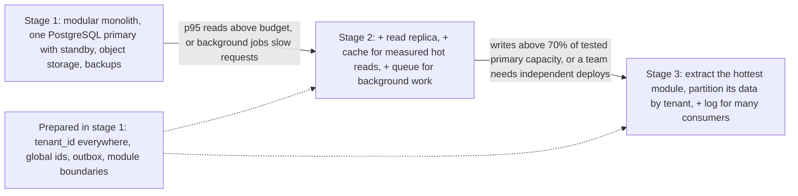
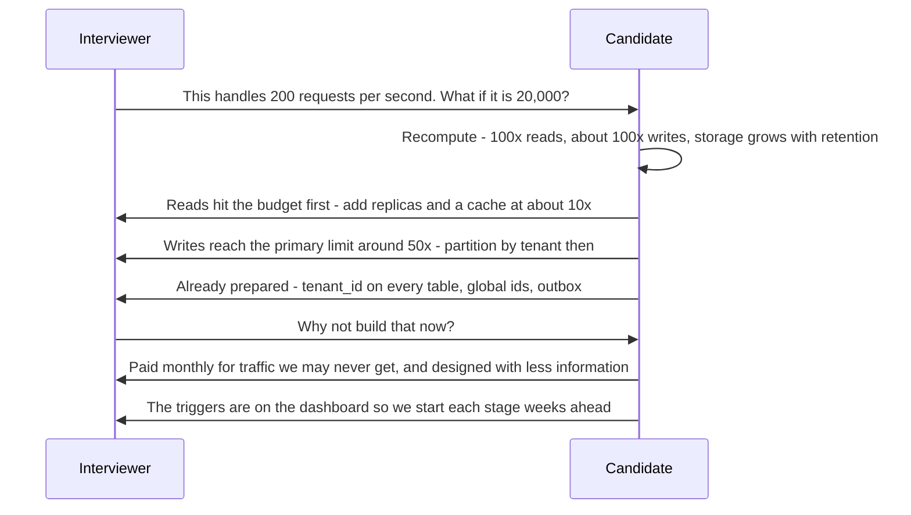

The most common way strong engineers lose marks in a system design interview is not by missing something. It is by adding things. Kafka for 40 messages a second, a sharded database for 200 GB, twelve microservices for a team of four, multi-region active-active for an internal tool. Each box looks impressive on its own, and each one tells the interviewer the same thing: this candidate does not know what their design costs. This lesson teaches you to right-size: to match each component to a requirement and a number, to notice when you are designing for a scale that was never asked for, and to show growth as a path with triggers rather than as a day-one diagram. It also covers the opposite failure, because a design that ignores a stated spike or a payment's correctness is underengineered, and that loses marks too.

## Learning objectives

By the end of this lesson you will be able to:

1. Explain why each component has a running cost (operations, failure modes, latency, money, and the team's attention) and why that cost must be paid for by a requirement.
2. Recognise the ten most common overengineering moves in interview answers, and the six most common underengineering ones.
3. Apply YAGNI ("you aren't gonna need it") at system level without confusing it with "never plan ahead".
4. Separate one-way-door decisions (cheap now, expensive later) from two-way-door decisions (cheap to change later), and spend effort only on the first kind.
5. Answer "what if it grows 100x?" with a staged evolution path and measurable triggers.
6. Implement a small rule-based right-sizing analyser in C# that flags over- and under-designed components against stated requirements.

## Prerequisites

- [DRY, KISS and YAGNI](#/lesson/m04-dry-kiss-yagni): the code-level version of this lesson.
- [Over- and under-engineering](#/lesson/m04-over-under-engineering): speculative generality and the cost of change.
- [Estimation drills](#/lesson/m19-estimation-practice): you right-size against numbers, so you need the numbers first.

## Explain it like I'm a beginner

Picture a road engineer asked to connect a village of 300 people to the district highway. One engineer proposes a six-lane expressway with flyovers, toll plazas and a service road "in case the village grows". Another proposes a dirt track that turns to mud every monsoon. Both are bad engineers.

The first one has **overengineered**: the expressway costs fifty times more, takes three years, and needs a maintenance crew the panchayat cannot afford. The village needed a two-lane paved road.

The second one has **underengineered**: the stated requirement was "usable all year", and a dirt track does not meet it.

The good engineer builds a two-lane paved road with proper drainage, and does two cheap things for the future: buys a strip of land wide enough for four lanes (because buying land later is very expensive), and puts culverts where future widening would need them. They do **not** build the extra lanes now.

That is right-sizing (fitting the design to the requirement). In system design:

- the expressway is Kafka, sharding, microservices and multi-region for a small system,
- the dirt track is a single server with no backups for a payment system,
- the extra land is a cheap decision now that keeps an expensive option open later, like putting `tenant_id` on every table from day one.

## First-principles explanation

### Every component has a running cost

A box in your diagram is not free once it is built. Each one adds:

1. **Operations:** upgrades, patching, backups, capacity planning, monitoring dashboards and alerts.
2. **Failure modes:** a new thing that can be slow, full, partitioned or misconfigured, and a new interaction with everything it connects to.
3. **Latency:** every network hop adds time and a chance of timeout.
4. **Money:** compute, storage, licences, managed-service fees, and cross-zone traffic.
5. **Attention:** the team must understand it at 3 a.m. A team of five that runs eight different technologies understands none of them deeply.

So the question for every component is: **which requirement pays for it?** If you cannot name one, with a number, the component is speculative.

### The ten common overengineering moves

| Move | Usually unjustified when | What to say instead |
|---|---|---|
| Microservices from day one | Team under ~15 engineers, one product, unclear domain boundaries | "A modular monolith with clear module boundaries; extract a service when a module needs independent scaling or a separate team owns it." |
| Kafka or another log | Under a few thousand events per second, no replay, one or two consumers | "A queue, or an outbox table with a relay." |
| Sharding | Data under a terabyte or two, writes within one primary's measured capacity | "One primary, partitioning by time for retention, read replicas; shard key chosen now, sharding later." |
| Multi-region active-active | No requirement for regional failover or residency, RTO measured in hours is acceptable | "Single region, multiple availability zones, backups restorable in another region." |
| CQRS plus event sourcing | CRUD-shaped domain without audit-replay or temporal query needs | "A normal relational model with an audit table." |
| Kubernetes for one or two services | Small team, simple deployment | "A managed app platform or VMs with a load balancer." |
| Distributed cache cluster | Read load a single database or one cache node handles | "No cache, or a single cache node for a measured hot spot." |
| Custom consensus, locks, or schedulers | A managed service or the database already offers it | "Use the database's row locks or advisory locks, or a managed scheduler." |
| A search cluster | Simple filters on indexed columns | "PostgreSQL indexes, maybe full-text search with a GIN index." |
| A service mesh, API gateway, and BFF all at once | One client, one back end | "A load balancer and an API with authentication middleware." |

The pattern is the same each time: a tool built for a scale or a team structure that the problem does not have.

### The six common underengineering moves

Right-sizing cuts both ways. These lose marks just as surely:

1. **Ignoring a stated spike.** The prompt says "results are released at 10 a.m. to 2 million students" and the design has no queue, cache, CDN or waiting room.
2. **No idempotency where money or side effects are involved.** Payment webhooks, transfers, and order creation retried by clients will double-charge.
3. **Single points of failure against an availability target.** A 99.9 % target (about 8.8 hours of downtime a year) with a single database instance and no tested restore.
4. **Synchronous calls to slow or unreliable third parties** in the request path, such as sending SMS inline while the user waits.
5. **No backpressure or rate limiting on a public API.**
6. **Media or large blobs in the database at scale**, where object storage is the obvious fit.

An answer that avoids every overengineering move by drawing one box and saying "keep it simple" is not right-sized either. The skill is matching.

### YAGNI at system level

YAGNI says: do not build a capability until a real requirement needs it. At code level that means no speculative abstractions. At system level it means no speculative infrastructure. The reasoning:

- Most predicted scale never arrives in the shape predicted. Growth often comes from a new feature or a new customer type, not from more of the same traffic.
- Infrastructure built early is paid for every month until the scale arrives, if it ever does.
- Infrastructure built early is designed with less information than infrastructure built when it is needed.

YAGNI is **not** "never plan ahead". It is "don't **build** ahead; do make sure you **can** build later at reasonable cost."

### One-way doors and two-way doors

Some decisions are cheap to reverse (two-way doors), and some are very expensive to reverse (one-way doors). Spend design effort on the second kind, even if the need is in the future, because they are the land you buy before the road.

**Cheap now, expensive later (do them now):**

- Identifiers that will survive sharding or merging (UUIDs or another globally unique id, rather than ids that only make sense inside one database).
- A `tenant_id` column on every tenant-owned table in a multi-tenant system.
- Idempotency keys on any operation that moves money or triggers side effects.
- Timestamps stored in UTC with time zones recorded where the user's local time matters.
- Clear module boundaries inside the monolith, with no cross-module table access.
- An outbox for events, so a broker can be added or swapped later.
- An API versioning scheme.

**Cheap later (defer them):**

- The choice of broker product.
- Adding a cache or a read replica.
- Extracting a module into a service.
- Moving from one region to two (as long as backups and infrastructure as code exist).
- Sharding, if the shard key is already present in the data.

In an interview, saying "I'm not sharding now, but every row carries `tenant_id` and ids are globally unique, so sharding later is mechanical" is worth more than drawing the shards.

### The evolution path: how to answer "what if it grows 100x?"

Interviewers ask this to see whether you can grow a design, not whether you can draw the biggest one. A strong answer has three parts:

1. **Stage the design**: stage 1 (today's requirement), stage 2 (10x), stage 3 (100x).
2. **Name the trigger** for each stage, as a measurement: "sustained write rate above 70 % of the load-tested primary capacity", "p95 dashboard latency above 400 ms", "a second team needs to deploy independently".
3. **Say what you prepared in stage 1** to make the later stages cheap (the one-way doors).

This shows you understand both the future and the cost of getting there early.

### How interviewers probe for overengineering

Listen for these:

- "Do we really need that?" This is rarely a neutral question. Answer with the requirement and number that justify the box, or remove it.
- "What's the simplest thing that would work?" Say it. Then say what would make you add the next piece.
- "How many people would it take to run this?" Count honestly.
- "What does this cost per month?" A rough figure with stated assumptions is fine.

## Visual explanation

### The complexity ladder with triggers



Each stage is a complete, working system, not a half-built version of stage 3. The arrows are labelled with **measurable triggers**, which is what turns "we can scale later" from a hope into a plan. The dotted arrows show why moving up the ladder is cheap: the one-way-door decisions (tenant ids, global ids, an outbox, clean module boundaries) were made in stage 1, so stage 2 and stage 3 add components without rewriting data. In an interview, drawing stage 1 and describing this ladder in words is usually stronger than drawing stage 3.

### Answering the 100x probe



The candidate first redoes the arithmetic (a short pause to think is fine), then answers with what breaks first and at roughly which multiple, not with a new diagram. They point to the preparations already in the design. When challenged "why not now?", they give the two reasons that make YAGNI sound: cost paid every month, and better decisions made later with real data. The last line matters: triggers that are monitored mean the team starts each stage before the limit, not during an outage.

## Step-by-step example

We take four prompts and, for each, show an over-designed answer, an under-designed answer, and a right-sized one.

### Example A — Leave management for 2,000 employees

*Requirements:* 2,000 employees of an engineering consultancy across 12 offices apply for leave, managers approve, HR exports monthly. Peak: Monday mornings, perhaps 5 requests per second. 99.5 % availability in office hours is fine.

**Over-designed:** an API gateway, five microservices (employee, leave, approval, notification, reporting), Kafka between them, Cassandra for leave history "for scale", Redis cluster, Kubernetes across two regions.

Why it fails: 5 requests per second is a load a single small instance handles with room to spare. Five services and Kafka mean distributed transactions for "approve and deduct balance", which a single database transaction does for free. The team that maintains an HR tool is usually two or three people.

**Under-designed:** a single VM running the app and PostgreSQL on the same disk, no backups, emails sent inline from the approval request.

Why it fails: a disk failure loses every leave record, which matters for payroll and labour-law compliance. Inline emails make approval slow or fail when the mail server is slow.

**Right-sized:** one ASP.NET Core app (two instances behind a load balancer for deploys without downtime), managed PostgreSQL with automated backups and point-in-time recovery, a jobs table for emails processed by a background service, SSO with the company identity provider. Prepared for later: module boundaries (leave, approvals, reporting), an audit table. Cost: a few small instances and one managed database.

### Example B — URL shortener at 100 million new links a month

*Requirements:* from the estimation drills: about 40 writes per second, 4,000 reads per second average, 12,000 at peak, 3 TB over five years.

**Over-designed:** a custom distributed id generator with consensus, Cassandra across three regions, Kafka for click events, a stream processor, a Redis cluster with 12 shards.

Why it fails: 40 writes per second does not need a distributed id generator; a database sequence encoded in base 62, or random ids with a uniqueness check, is enough. Twelve cache shards for about 10 GB of hot data is paying for memory you don't use.

**Under-designed:** a single database with no cache, every redirect a database read.

Why it fails: 12,000 reads per second at peak against one primary with no caching leaves no headroom and couples redirect latency to database health.

**Right-sized:** stateless API instances, PostgreSQL primary with a standby, a single cache node (with a replica) holding the hot links, CDN or edge caching of redirects with a short TTL, click counts batched through a queue into an analytics table. Prepared for later: random, non-sequential ids so the key space can be split.

### Example C — Receiving payment webhooks for a SaaS billing system

*Requirements:* the payment provider calls your webhook on payment success or failure, about 20,000 per day, and retries on any non-2xx response, sometimes delivering the same event more than once. Each event must update the invoice exactly once and trigger a receipt email.

**Over-designed:** an event-sourced billing domain with CQRS read models, a Kafka cluster, a saga orchestrator, and a separate microservice for each event type.

**Under-designed:** the webhook handler updates the invoice and sends the email inline, with no deduplication.

Why it fails: duplicate deliveries mark an invoice paid twice or send two receipts, and a slow email server makes the handler time out, which makes the provider retry, which makes more duplicates. This is the more dangerous failure of the two.

**Right-sized:** verify the webhook signature, insert the event id into a `processed_events` table with a unique constraint in the same transaction that updates the invoice and writes an outbox row for the email, return 200 quickly. A background worker sends emails from the outbox. About 20,000 events a day (a fraction of one per second on average) needs no broker at all. This is the case where the right-sized answer has **more** components than the naive one, because the requirement (exactly-once effect) demands them.

### Example D — Sensor platform for bridge monitoring

*Requirements:* 150 bridges, 40 sensors each (strain, vibration, temperature), one reading per sensor per second, alerts within 30 seconds when thresholds are crossed, 2 years of history for engineers.

Numbers: 150 × 40 = 6,000 readings per second, about 5 × 10^8 per day. At 50 bytes each: about 26 GB per day, about 19 TB over two years before compression.

**Over-designed:** a custom time-series database, a stream-processing cluster with exactly-once semantics, a data lake with three processing layers, all on day one.

**Under-designed:** each reading inserted as a row in a general PostgreSQL table with three indexes, alerts computed by a nightly SQL job.

Why it fails: nightly alerts miss the 30-second requirement completely, and 19 TB in a single heavily indexed table will be slow and expensive.

**Right-sized:** gateways at each bridge batch readings every few seconds into a managed ingestion endpoint or queue; a consumer evaluates thresholds in memory and raises alerts within seconds; readings are stored in a time-series-friendly layout (PostgreSQL with time partitioning, a time-series extension, or a managed time-series service) with older data downsampled to per-minute aggregates and raw data archived to object storage. The stream processor is justified here by the alert latency requirement at 6,000 readings per second, but it can be a simple consumer, not a cluster.

### A two-question self-check

Before you finish any interview design, ask:

1. **For each box: which requirement and number pays for it?** Remove boxes with no answer.
2. **For each requirement: which box serves it?** Add what is missing.

The first question catches overengineering, the second catches underengineering. The C# analyser below automates a rough version of both.

## Production-style C# implementation

This service takes a design (a list of components) and the requirements (as numbers), and runs a set of right-sizing rules against them. Each rule is a strategy registered in DI; thresholds are configuration, because "how early is too early to shard" depends on your hardware and is a rule of thumb, not a law.

```text
RightSizing.Api/
  Program.cs
  RightSizing/DesignModels.cs
  RightSizing/RightSizingThresholds.cs
  RightSizing/Rules.cs
  RightSizing/RightSizingAnalyzer.cs
```

```csharp file=RightSizing/DesignModels.cs
namespace Sdlp.RightSizing;

public enum ComponentKind
{
    AppService, Database, ShardedDatabase, ReadReplica, Cache, Queue, Stream, SearchIndex, Cdn, Orchestrator
}

/// <param name="Regions">How many regions the component is deployed in.</param>
/// <param name="HighlyAvailable">True when the component has automatic failover (for example a standby replica).</param>
public sealed record Component(string Name, ComponentKind Kind, int Instances = 1, int Regions = 1, bool HighlyAvailable = false);

/// <param name="AvailabilityTarget">For example 0.999 for "three nines".</param>
/// <param name="SpikeFactor">Short-term peak divided by normal peak, for example 20 for a results release.</param>
public sealed record Requirements(
    double PeakRequestsPerSecond,
    double PeakWritesPerSecond,
    double DataSizeGb,
    int TeamSize,
    double AvailabilityTarget,
    double SpikeFactor = 1,
    bool NeedsReplay = false,
    bool NeedsMultiRegion = false);

public sealed record DesignProposal(string Title, Requirements Requirements, IReadOnlyList<Component> Components);

public enum Direction { Over, Under }

public sealed record Finding(string Rule, Direction Direction, string Component, string Message);

public sealed record RightSizingReport(string Title, string Verdict, IReadOnlyList<Finding> Findings);
```

```csharp file=RightSizing/RightSizingThresholds.cs
namespace Sdlp.RightSizing;

/// <summary>Rules of thumb, not laws. Tune them to your hardware and load tests.</summary>
public sealed class RightSizingThresholds
{
    public double StreamMinEventsPerSecond { get; set; } = 5_000;
    public double ShardingMinDataGb { get; set; } = 2_000;
    public double ShardingMinWritesPerSecond { get; set; } = 5_000;
    public double CacheMinReadsPerSecond { get; set; } = 500;
    public double HighAvailabilityFrom { get; set; } = 0.999;
    public double MultiRegionFrom { get; set; } = 0.9995;
    public double SpikeNeedsBufferFrom { get; set; } = 10;
}
```

```csharp file=RightSizing/Rules.cs
namespace Sdlp.RightSizing;

public interface IRightSizingRule
{
    string Name { get; }
    IEnumerable<Finding> Check(DesignProposal design, RightSizingThresholds t);
}

public sealed class StreamWithoutNeedRule : IRightSizingRule
{
    public string Name => "stream-without-need";
    public IEnumerable<Finding> Check(DesignProposal d, RightSizingThresholds t) =>
        d.Components.Where(c => c.Kind == ComponentKind.Stream
                                && !d.Requirements.NeedsReplay
                                && d.Requirements.PeakWritesPerSecond < t.StreamMinEventsPerSecond)
            .Select(c => new Finding(Name, Direction.Over, c.Name,
                $"A log is justified by replay or very high throughput; peak is {d.Requirements.PeakWritesPerSecond:0}/s with no replay requirement. Consider a queue or an outbox relay."));
}

public sealed class EarlyShardingRule : IRightSizingRule
{
    public string Name => "early-sharding";
    public IEnumerable<Finding> Check(DesignProposal d, RightSizingThresholds t) =>
        d.Components.Where(c => c.Kind == ComponentKind.ShardedDatabase
                                && d.Requirements.DataSizeGb < t.ShardingMinDataGb
                                && d.Requirements.PeakWritesPerSecond < t.ShardingMinWritesPerSecond)
            .Select(c => new Finding(Name, Direction.Over, c.Name,
                $"{d.Requirements.DataSizeGb:0} GB and {d.Requirements.PeakWritesPerSecond:0} writes/s fit one primary. Keep the shard key in the data and shard later."));
}

public sealed class ServicesVersusTeamRule : IRightSizingRule
{
    public string Name => "services-versus-team";
    public IEnumerable<Finding> Check(DesignProposal d, RightSizingThresholds t)
    {
        var services = d.Components.Count(c => c.Kind == ComponentKind.AppService);
        if (services > d.Requirements.TeamSize)
            yield return new Finding(Name, Direction.Over, "(design)",
                $"{services} deployable services for a team of {d.Requirements.TeamSize}. Prefer a modular monolith and extract services when a module needs independent scaling or ownership.");
    }
}

public sealed class MultiRegionWithoutNeedRule : IRightSizingRule
{
    public string Name => "multi-region-without-need";
    public IEnumerable<Finding> Check(DesignProposal d, RightSizingThresholds t) =>
        d.Components.Where(c => c.Regions > 1
                                && !d.Requirements.NeedsMultiRegion
                                && d.Requirements.AvailabilityTarget < t.MultiRegionFrom)
            .Select(c => new Finding(Name, Direction.Over, c.Name,
                $"Deployed in {c.Regions} regions for a {d.Requirements.AvailabilityTarget:P2} target. Multiple zones in one region plus cross-region backups usually suffice."));
}

public sealed class SinglePointOfFailureRule : IRightSizingRule
{
    public string Name => "single-point-of-failure";
    public IEnumerable<Finding> Check(DesignProposal d, RightSizingThresholds t)
    {
        if (d.Requirements.AvailabilityTarget < t.HighAvailabilityFrom) yield break;
        foreach (var c in d.Components)
        {
            var isDb = c.Kind is ComponentKind.Database or ComponentKind.ShardedDatabase;
            if (isDb && !c.HighlyAvailable)
                yield return new Finding(Name, Direction.Under, c.Name,
                    $"A {d.Requirements.AvailabilityTarget:P1} target needs automatic failover for the database (a standby replica).");
            if (c.Kind == ComponentKind.AppService && c.Instances < 2)
                yield return new Finding(Name, Direction.Under, c.Name,
                    "One instance means every deploy or crash is an outage. Run at least two.");
        }
    }
}

public sealed class SpikeWithoutBufferRule : IRightSizingRule
{
    public string Name => "spike-without-buffer";
    public IEnumerable<Finding> Check(DesignProposal d, RightSizingThresholds t)
    {
        if (d.Requirements.SpikeFactor < t.SpikeNeedsBufferFrom) yield break;
        var hasBuffer = d.Components.Any(c => c.Kind is ComponentKind.Queue or ComponentKind.Stream or ComponentKind.Cdn or ComponentKind.Cache);
        if (!hasBuffer)
            yield return new Finding(Name, Direction.Under, "(design)",
                $"A {d.Requirements.SpikeFactor:0}x spike with no queue, cache or CDN in the path. Absorb or deflect the spike.");
    }
}

public sealed class CacheWithoutHotspotRule : IRightSizingRule
{
    public string Name => "cache-without-hotspot";
    public IEnumerable<Finding> Check(DesignProposal d, RightSizingThresholds t)
    {
        var reads = d.Requirements.PeakRequestsPerSecond - d.Requirements.PeakWritesPerSecond;
        return d.Components.Where(c => c.Kind == ComponentKind.Cache && reads < t.CacheMinReadsPerSecond && d.Requirements.SpikeFactor < t.SpikeNeedsBufferFrom)
            .Select(c => new Finding(Name, Direction.Over, c.Name,
                $"About {reads:0} reads/s at peak. A database with the right indexes handles this; add a cache for a measured hot spot."));
    }
}
```

```csharp file=RightSizing/RightSizingAnalyzer.cs
using Microsoft.Extensions.Options;

namespace Sdlp.RightSizing;

public sealed class RightSizingAnalyzer(IEnumerable<IRightSizingRule> rules, IOptions<RightSizingThresholds> options)
{
    private readonly IReadOnlyList<IRightSizingRule> _rules = rules.ToList();
    private readonly RightSizingThresholds _t = options.Value;

    public RightSizingReport Analyze(DesignProposal design)
    {
        ArgumentNullException.ThrowIfNull(design);
        if (design.Components.Count == 0) throw new ArgumentException("A design needs at least one component.", nameof(design));

        var findings = _rules.SelectMany(r => r.Check(design, _t))
                             .OrderBy(f => f.Direction)
                             .ThenBy(f => f.Rule, StringComparer.Ordinal)
                             .ThenBy(f => f.Component, StringComparer.Ordinal)
                             .ToList();

        var over = findings.Any(f => f.Direction == Direction.Over);
        var under = findings.Any(f => f.Direction == Direction.Under);
        var verdict = (over, under) switch
        {
            (false, false) => "Right-sized against the stated requirements",
            (true, false) => "Over-engineered",
            (false, true) => "Under-engineered",
            _ => "Both: some parts over-built, some missing",
        };
        return new RightSizingReport(design.Title, verdict, findings);
    }
}
```

```csharp file=Program.cs
using Sdlp.RightSizing;

var builder = WebApplication.CreateBuilder(args);

builder.Services.Configure<RightSizingThresholds>(builder.Configuration.GetSection("RightSizing"));
builder.Services.AddSingleton<IRightSizingRule, StreamWithoutNeedRule>();
builder.Services.AddSingleton<IRightSizingRule, EarlyShardingRule>();
builder.Services.AddSingleton<IRightSizingRule, ServicesVersusTeamRule>();
builder.Services.AddSingleton<IRightSizingRule, MultiRegionWithoutNeedRule>();
builder.Services.AddSingleton<IRightSizingRule, SinglePointOfFailureRule>();
builder.Services.AddSingleton<IRightSizingRule, SpikeWithoutBufferRule>();
builder.Services.AddSingleton<IRightSizingRule, CacheWithoutHotspotRule>();
builder.Services.AddSingleton<RightSizingAnalyzer>();

var app = builder.Build();

app.MapPost("/designs/right-size", (DesignProposal design, RightSizingAnalyzer analyzer) =>
{
    try { return Results.Ok(analyzer.Analyze(design)); }
    catch (ArgumentException ex) { return Results.Problem(ex.Message, statusCode: StatusCodes.Status400BadRequest); }
});

app.Run();
```

Run Example A's over-designed answer through it (5 services, team of 3, Kafka at 5 writes per second, a 2-region deployment for a 99.5 % target, Cassandra modelled as a sharded database at 20 GB) and four different rules report "Over" findings (stream, early sharding, services versus team, and multi-region, which fires once per two-region component). Run the under-designed one (one instance, a database without failover) with a 99.9 % target and it reports two "Under" findings. The right-sized answer passes clean.

Two honest limitations: the rules see only what you model, and the thresholds are rules of thumb. The tool is a checklist that argues back, not an oracle. Its main value in a team is that it makes "why is this box here?" a routine question in design reviews.

## Bad design vs good design

**Bad (spoken):**

> "For the leave system I'll use microservices so each team can scale independently, Kafka for event-driven architecture, Cassandra so we never have to worry about scale, and Kubernetes multi-region for high availability. That way we're future-proof."

Problems: "future-proof" is the tell. Every component is justified by a future nobody described. There are no numbers. The design makes the one thing that matters (approve leave and deduct the balance atomically) harder, because it now spans services. It would take more engineers to operate than to build features.

**Good (spoken):**

> "At about 5 requests per second and 2,000 users, one ASP.NET Core application with two instances and a managed PostgreSQL database is enough. Approval and balance deduction are one transaction. Emails go through a jobs table. I'm keeping module boundaries clean and putting an outbox in, so if HR wants to integrate payroll events later, we add a broker without touching the leave logic. If this became a multi-company SaaS, the first change would be `tenant_id` everywhere, which I'd add now if that's on the roadmap. Is it?"

It sizes to the numbers, names what is prepared, and ends by asking the question that would change the design.

:::callout type=tradeoff title="Simplicity is not the same as minimalism"
The right-sized payment webhook design (example C) has more pieces than the naive one: a deduplication table, an outbox and a worker. Simplicity means no component without a requirement, not the fewest components possible.
:::

:::callout type=mistake title="Saying 'we can always scale later' without a plan"
"Later" needs triggers and preparations. Without them it is a hope, and interviewers hear it as hand-waving. Name the trigger metric and the one-way-door decision you've already made.
:::

## Practical playground

The starter is the over-designed leave-management answer from example A. Right-size it in the canvas: delete components that no requirement pays for, merge services into a modular monolith, and keep what the numbers justify. Then add the one or two things the over-designed version still lacked (backups and an asynchronous path for email). Finally, label each remaining node with the requirement it serves.

:::playground type=hld title="Right-size the leave-management system"
```json
{
  "nodes": [
    { "id": "u", "type": "client", "label": "2,000 employees", "props": { "rps": 5 } },
    { "id": "gw", "type": "api-gateway", "label": "API gateway" },
    { "id": "emp", "type": "app-server", "label": "Employee service", "props": { "instances": 3, "region": "two regions" } },
    { "id": "leave", "type": "app-server", "label": "Leave service", "props": { "instances": 3, "region": "two regions" } },
    { "id": "appr", "type": "app-server", "label": "Approval service", "props": { "instances": 3, "region": "two regions" } },
    { "id": "notif", "type": "app-server", "label": "Notification service", "props": { "instances": 3 } },
    { "id": "rep", "type": "app-server", "label": "Reporting service", "props": { "instances": 3 } },
    { "id": "k", "type": "stream", "label": "Kafka cluster" },
    { "id": "cas", "type": "database", "label": "Cassandra (leave history)", "props": { "replicas": 3 } },
    { "id": "redis", "type": "cache", "label": "Redis cluster" }
  ],
  "edges": [
    { "from": "u", "to": "gw", "kind": "sync" },
    { "from": "gw", "to": "emp", "kind": "sync" },
    { "from": "gw", "to": "leave", "kind": "sync" },
    { "from": "gw", "to": "appr", "kind": "sync" },
    { "from": "leave", "to": "k", "kind": "async" },
    { "from": "appr", "to": "k", "kind": "async" },
    { "from": "k", "to": "notif", "kind": "async" },
    { "from": "k", "to": "rep", "kind": "async" },
    { "from": "leave", "to": "cas", "kind": "sync" },
    { "from": "appr", "to": "redis", "kind": "sync" }
  ]
}
```
:::

## Exercises

:::exercise id=m19-overengineering-ex1 difficulty=beginner kind=written title="Over, under or right-sized?"
Classify each statement as over-engineered, under-engineered or right-sized for its context, and give a one-sentence reason with a number.

1. Canteen menu app for one office of 800 people: "We'll put a CDN in front of the menu images."
2. National scholarship portal, 4 million applications in the last 3 days before the deadline: "One app server and one database; we'll see how it goes."
3. Internal asset register for 30,000 laptops: "PostgreSQL, two app instances, nightly backups."
4. B2B invoicing for 400 customers: "Event sourcing so we can rebuild any invoice's history."
5. Wallet top-ups via a payment gateway: "We call the gateway and, if it times out, we retry the same request."
6. Chat app with 10 million DAU: "Messages stored in a single PostgreSQL table, sharded later if needed, with conversation id as the planned shard key."
7. Drone survey platform storing 2 TB of imagery a month: "Images in object storage, metadata in PostgreSQL."
8. Startup MVP with 3 engineers: "Kubernetes, a service mesh, and GitOps from day one."
::acceptance
- All eight classified, each with a reason that cites a number or a stated requirement.
- At least two marked under-engineered and at least three over-engineered.
- For each under-engineered item, the missing piece is named.
::hint
For each item, ask first "which requirement pays for this?" and then "which requirement is unserved?"
::hint
Item 5 looks reasonable until you ask what happens when the first request actually succeeded but the response was lost.
::hint
Item 6: compute 10 million × 40 messages per day ÷ 86,400. Can one primary take that?
::hint
Item 4: "rebuild history" may be served by an append-only audit table. Does the context demand temporal queries or replay?
::solution
1. **Over-engineered** (mildly): 800 people viewing a few images a day is negligible traffic; the app server can serve them. A CDN costs little, so this is a small issue, but it is not justified.
2. **Under-engineered**: 4 million applications in 3 days is ~15 per second on average, but deadline-day traffic concentrates in the evening at perhaps 10–20x average, and each application involves several page loads and uploads. Missing: horizontal app instances, a database with failover, object storage for documents, rate limiting and a queue for document processing.
3. **Right-sized**: 30,000 records and a handful of users per minute; two instances for zero-downtime deploys, and backups for an important register.
4. **Over-engineered**: 400 customers' invoices are a CRUD workload; an append-only audit table or row versioning gives history without event sourcing's versioning and projection costs.
5. **Under-engineered**: retrying without an idempotency key can double-charge when the first request succeeded but its response timed out. Missing: an idempotency key per top-up, and a status check before retrying.
6. **Under-engineered** as stated: 10^7 × 40 ÷ 86,400 ≈ 4,600 messages per second average, ~14,000 at peak, plus reads. A single table on one primary will not keep up for long. Choosing the shard key is good preparation, but this scale needs partitioning from the start.
7. **Right-sized**: 2 TB a month of imagery belongs in object storage; metadata and queries belong in PostgreSQL.
8. **Over-engineered**: three engineers cannot operate a service mesh and Kubernetes while building a product. A managed app platform and a CI pipeline are enough.
::mistakes
- Calling item 6 right-sized because "shard later" sounds like YAGNI; the numbers say "later" is now.
- Marking item 1 as a serious problem; it is a minor cost, and saying so shows proportion.
:::

:::exercise id=m19-overengineering-ex2 difficulty=beginner kind=code title="Unjustified components and unserved requirements"
Implement the two-question self-check. `SelfCheck.Unjustified` returns components whose justification is missing or points to an unknown requirement. `SelfCheck.Unserved` returns requirement ids that no component claims to serve.
::requirements
- A component may serve several requirements (`Serves` is a list of ids).
- Ids are compared case-insensitively.
- Both methods preserve input order.
- A blank or whitespace id counts as missing.
::acceptance
- A component with no ids, or only unknown ids, is unjustified.
- A component with one known id and one unknown id is justified (but you may extend it to warn).
- A requirement nobody serves is returned by `Unserved`.
- `R1` and `r1` match.
::hint
Build a case-insensitive `HashSet<string>` of requirement ids first.
::hint
A component is justified if **any** of its ids is known.
::hint
For `Unserved`, collect every id served by any component into another set, then filter requirements.
::hint
```csharp
var known = new HashSet<string>(requirements.Select(r => r.Id), StringComparer.OrdinalIgnoreCase);
return components.Where(c => !c.Serves.Any(id => !string.IsNullOrWhiteSpace(id) && known.Contains(id))).ToList();
```
::starter
```csharp file=SelfCheck.cs
using System;
using System.Collections.Generic;
using System.Linq;

public sealed record Requirement(string Id, string Text);
public sealed record DesignComponent(string Name, IReadOnlyList<string> Serves);

public static class SelfCheck
{
    public static IReadOnlyList<DesignComponent> Unjustified(
        IReadOnlyList<DesignComponent> components, IReadOnlyList<Requirement> requirements) =>
        throw new NotImplementedException();

    public static IReadOnlyList<Requirement> Unserved(
        IReadOnlyList<DesignComponent> components, IReadOnlyList<Requirement> requirements) =>
        throw new NotImplementedException();
}
```
::tests
```csharp file=SelfCheckTests.cs
using System;
using System.Collections.Generic;
using System.Linq;
using Xunit;

public class SelfCheckTests
{
    private static readonly Requirement[] Reqs =
    {
        new("R1", "Approve leave and deduct balance atomically"),
        new("R2", "Email the manager within 5 minutes"),
        new("R3", "Restore data after a disk failure"),
    };

    private static DesignComponent C(string name, params string[] serves) => new(name, serves);

    [Fact]
    public void Finds_unjustified_components_in_order()
    {
        var comps = new[] { C("Kafka"), C("PostgreSQL", "R1"), C("Redis cluster", "R9"), C("Jobs table", "r2") };
        Assert.Equal(new[] { "Kafka", "Redis cluster" }, SelfCheck.Unjustified(comps, Reqs).Select(c => c.Name).ToArray());
    }

    [Fact]
    public void One_known_id_is_enough() =>
        Assert.Empty(SelfCheck.Unjustified(new[] { C("Worker", "R9", "R2") }, Reqs));

    [Fact]
    public void Blank_ids_do_not_justify() =>
        Assert.Single(SelfCheck.Unjustified(new[] { C("Mystery", " ", "") }, Reqs));

    [Fact]
    public void Finds_unserved_requirements()
    {
        var comps = new[] { C("PostgreSQL", "R1"), C("Jobs table", "r2") };
        var unserved = SelfCheck.Unserved(comps, Reqs);
        Assert.Equal("R3", Assert.Single(unserved).Id);
    }

    [Fact]
    public void Everything_served_returns_empty() =>
        Assert.Empty(SelfCheck.Unserved(new[] { C("All", "R1", "R2", "R3") }, Reqs));
}
```
::solution
```csharp file=SelfCheck.cs
using System;
using System.Collections.Generic;
using System.Linq;

public sealed record Requirement(string Id, string Text);
public sealed record DesignComponent(string Name, IReadOnlyList<string> Serves);

public static class SelfCheck
{
    public static IReadOnlyList<DesignComponent> Unjustified(
        IReadOnlyList<DesignComponent> components, IReadOnlyList<Requirement> requirements)
    {
        var known = new HashSet<string>(requirements.Select(r => r.Id.Trim()), StringComparer.OrdinalIgnoreCase);
        return components
            .Where(c => !c.Serves.Any(id => !string.IsNullOrWhiteSpace(id) && known.Contains(id.Trim())))
            .ToList();
    }

    public static IReadOnlyList<Requirement> Unserved(
        IReadOnlyList<DesignComponent> components, IReadOnlyList<Requirement> requirements)
    {
        var served = new HashSet<string>(
            components.SelectMany(c => c.Serves).Where(id => !string.IsNullOrWhiteSpace(id)).Select(id => id.Trim()),
            StringComparer.OrdinalIgnoreCase);
        return requirements.Where(r => !served.Contains(r.Id.Trim())).ToList();
    }
}
```

This is deliberately tiny: the value is in the habit, not the algorithm. In the interview, you run it in your head while pointing at the diagram.
::mistakes
- Requiring every id to be known, which flags a component that serves one real requirement and mentions one typo.
- Case-sensitive comparison, which makes "r2" unserved.
::extensions
Return a third list: components that serve only requirements already served by another component (possible duplication).
:::

:::exercise id=m19-overengineering-ex3 difficulty=intermediate kind=hld title="Right-size a district grievance portal"
A district administration wants a citizen grievance portal: 1.5 million residents, about 3,000 grievances a day, each with up to 3 photos, routed to one of 40 departments; officers update status; citizens get SMS updates; monthly reports for the collector. Availability target 99.5 %. The starter is a candidate's over-designed answer. Produce the right-sized design and label each node with the requirement it serves.
::acceptance
- One deployable application (modular monolith), at least two instances.
- PostgreSQL with backups and a standby; photos in object storage.
- SMS sent asynchronously with retries; no broker cluster unless justified by a number.
- No sharding, no multi-region, no stream platform.
- Every node's label names a requirement or number.
::hint
3,000 grievances a day is about one every 30 seconds. What does that rule out?
::hint
Which requirement needs asynchronous processing? Which needs object storage?
::hint
A jobs table or a small managed queue both fit SMS. Pick one and say why.
::hint
Reports for 3,000 rows a day over a month (about 90,000 rows) can run on a read replica or even the primary at night.
::starter
```json
{
  "nodes": [
    { "id": "cit", "type": "client", "label": "Citizens (web + app)", "props": { "rps": 20 } },
    { "id": "off", "type": "client", "label": "Department officers", "props": { "rps": 5 } },
    { "id": "gw", "type": "api-gateway", "label": "API gateway + service mesh" },
    { "id": "g", "type": "app-server", "label": "Grievance service", "props": { "instances": 4, "region": "two regions" } },
    { "id": "r", "type": "app-server", "label": "Routing service", "props": { "instances": 4 } },
    { "id": "n", "type": "app-server", "label": "Notification service", "props": { "instances": 4 } },
    { "id": "k", "type": "stream", "label": "Kafka (6 brokers)" },
    { "id": "db", "type": "database", "label": "Sharded PostgreSQL (8 shards)" },
    { "id": "es", "type": "search", "label": "Search cluster" },
    { "id": "sms", "type": "external", "label": "SMS gateway" }
  ],
  "edges": [
    { "from": "cit", "to": "gw", "kind": "sync" },
    { "from": "off", "to": "gw", "kind": "sync" },
    { "from": "gw", "to": "g", "kind": "sync" },
    { "from": "g", "to": "k", "kind": "async" },
    { "from": "k", "to": "r", "kind": "async" },
    { "from": "k", "to": "n", "kind": "async" },
    { "from": "g", "to": "db", "kind": "sync" },
    { "from": "g", "to": "es", "kind": "sync" },
    { "from": "n", "to": "sms", "kind": "sync" }
  ]
}
```
::solution
```json
{
  "nodes": [
    { "id": "cit", "type": "client", "label": "Citizens: ~3,000 grievances/day", "props": { "rps": 20 } },
    { "id": "off", "type": "client", "label": "Officers in 40 departments", "props": { "rps": 5 } },
    { "id": "lb", "type": "load-balancer", "label": "Load balancer + WAF (public portal)" },
    { "id": "app", "type": "app-server", "label": "Grievance app: modules intake, routing, status, reports (99.5%: 2 instances for deploys)", "props": { "instances": 2 } },
    { "id": "db", "type": "database", "label": "PostgreSQL + standby + PITR backups (~1M rows/year)", "props": { "multiAz": true } },
    { "id": "obj", "type": "object-storage", "label": "Grievance photos (~9,000/day)" },
    { "id": "jobs", "type": "worker", "label": "Background worker: SMS from jobs table, retries with back-off" },
    { "id": "sms", "type": "external", "label": "SMS gateway (rate-limited by contract)" },
    { "id": "mon", "type": "monitoring", "label": "Uptime, error rate, SMS failure alerts" }
  ],
  "edges": [
    { "from": "cit", "to": "lb", "kind": "sync" },
    { "from": "off", "to": "lb", "kind": "sync" },
    { "from": "lb", "to": "app", "kind": "sync" },
    { "from": "app", "to": "db", "kind": "sync", "label": "grievance + SMS job in one transaction" },
    { "from": "cit", "to": "obj", "kind": "sync", "label": "pre-signed photo upload" },
    { "from": "jobs", "to": "db", "kind": "sync", "label": "poll jobs with SKIP LOCKED" },
    { "from": "jobs", "to": "sms", "kind": "sync" },
    { "from": "mon", "to": "app", "kind": "async" },
    { "from": "mon", "to": "jobs", "kind": "async" }
  ]
}
```

Why: 3,000 grievances a day is roughly 0.035 per second on average; even a 20x morning peak is under one per second. A year is about 1.1 million grievances, a few gigabytes of rows. That rules out sharding, Kafka, a search cluster (PostgreSQL full-text search over 1 million rows is fine) and multi-region (99.5 % allows about 44 hours of downtime a year). The things that do matter: photos in object storage, SMS out of the request path with retries, backups and a standby for public records, and a WAF because the portal is public. Routing to 40 departments is a rules table inside the app, not a service. Cost drops from several clusters to two small instances, one managed database and a bucket.
::mistakes
- Keeping a "notification service" as a separate deployable for a single SMS integration.
- Removing everything, including backups and the asynchronous SMS path.
- Adding a search cluster for officer filters that indexed columns handle.
:::

:::exercise id=m19-overengineering-ex4 difficulty=intermediate kind=code title="Two right-sizing rules"
Implement two rules in the simplified analyser: `EarlySharding` flags a sharded database when data size and peak writes are both below thresholds (over-engineering), and `SinglePointOfFailure` flags, when the availability target is at least the HA threshold, any database without failover and any app with fewer than two instances (under-engineering).
::requirements
- Thresholds come from a `Thresholds` record; do not hard-code numbers in the rules.
- Each finding names the rule, the direction and the component.
- Below the HA threshold, `SinglePointOfFailure` returns nothing.
- Findings are returned in component order.
::acceptance
- A sharded database at 200 GB and 300 writes/s is flagged as Over.
- A sharded database at 5,000 GB is not flagged (data alone justifies considering it).
- At a 99.9 % target, a database without failover and a single-instance app are both flagged as Under.
- At 99.5 %, nothing is flagged by `SinglePointOfFailure`.
::hint
`EarlySharding` needs both conditions: small data **and** low writes. Either one alone can justify sharding.
::hint
Use `yield return` to emit findings as you walk components.
::hint
Pattern matching keeps the database check short: `c.Kind is Kind.Database or Kind.ShardedDatabase`.
::hint
```csharp
if (r.AvailabilityTarget < t.HighAvailabilityFrom) yield break;
```
::starter
```csharp file=Rules.cs
using System;
using System.Collections.Generic;
using System.Linq;

public enum Kind { App, Database, ShardedDatabase, Cache, Queue }
public enum Direction { Over, Under }
public sealed record Comp(string Name, Kind Kind, int Instances = 1, bool HighlyAvailable = false);
public sealed record Reqs(double DataSizeGb, double PeakWritesPerSecond, double AvailabilityTarget);
public sealed record Thresholds(double ShardingMinDataGb = 2_000, double ShardingMinWritesPerSecond = 5_000, double HighAvailabilityFrom = 0.999);
public sealed record Finding(string Rule, Direction Direction, string Component);

public static class Rules
{
    public static IEnumerable<Finding> EarlySharding(IReadOnlyList<Comp> comps, Reqs r, Thresholds t) =>
        throw new NotImplementedException();

    public static IEnumerable<Finding> SinglePointOfFailure(IReadOnlyList<Comp> comps, Reqs r, Thresholds t) =>
        throw new NotImplementedException();
}
```
::tests
```csharp file=RulesTests.cs
using System;
using System.Collections.Generic;
using System.Linq;
using Xunit;

public class RulesTests
{
    private static readonly Thresholds T = new();

    [Fact]
    public void Small_sharded_db_is_over()
    {
        var f = Rules.EarlySharding(new[] { new Comp("Orders DB", Kind.ShardedDatabase) }, new Reqs(200, 300, 0.995), T).ToList();
        var single = Assert.Single(f);
        Assert.Equal(Direction.Over, single.Direction);
        Assert.Equal("Orders DB", single.Component);
    }

    [Fact]
    public void Large_data_justifies_sharding() =>
        Assert.Empty(Rules.EarlySharding(new[] { new Comp("Events DB", Kind.ShardedDatabase) }, new Reqs(5_000, 300, 0.995), T));

    [Fact]
    public void High_writes_justify_sharding() =>
        Assert.Empty(Rules.EarlySharding(new[] { new Comp("Events DB", Kind.ShardedDatabase) }, new Reqs(100, 20_000, 0.995), T));

    [Fact]
    public void Plain_database_is_not_early_sharding() =>
        Assert.Empty(Rules.EarlySharding(new[] { new Comp("DB", Kind.Database) }, new Reqs(10, 10, 0.995), T));

    [Fact]
    public void Three_nines_flags_db_and_single_app_in_order()
    {
        var comps = new[]
        {
            new Comp("API", Kind.App, Instances: 1),
            new Comp("DB", Kind.Database, HighlyAvailable: false),
            new Comp("Cache", Kind.Cache),
            new Comp("Worker", Kind.App, Instances: 2),
        };
        var f = Rules.SinglePointOfFailure(comps, new Reqs(50, 100, 0.999), T).ToList();
        Assert.Equal(new[] { "API", "DB" }, f.Select(x => x.Component).ToArray());
        Assert.All(f, x => Assert.Equal(Direction.Under, x.Direction));
    }

    [Fact]
    public void Lower_target_flags_nothing()
    {
        var comps = new[] { new Comp("API", Kind.App), new Comp("DB", Kind.Database) };
        Assert.Empty(Rules.SinglePointOfFailure(comps, new Reqs(50, 100, 0.995), T));
    }

    [Fact]
    public void Highly_available_db_passes() =>
        Assert.Empty(Rules.SinglePointOfFailure(new[] { new Comp("DB", Kind.Database, HighlyAvailable: true) }, new Reqs(50, 100, 0.9999), T));
}
```
::solution
```csharp file=Rules.cs
using System;
using System.Collections.Generic;
using System.Linq;

public enum Kind { App, Database, ShardedDatabase, Cache, Queue }
public enum Direction { Over, Under }
public sealed record Comp(string Name, Kind Kind, int Instances = 1, bool HighlyAvailable = false);
public sealed record Reqs(double DataSizeGb, double PeakWritesPerSecond, double AvailabilityTarget);
public sealed record Thresholds(double ShardingMinDataGb = 2_000, double ShardingMinWritesPerSecond = 5_000, double HighAvailabilityFrom = 0.999);
public sealed record Finding(string Rule, Direction Direction, string Component);

public static class Rules
{
    public static IEnumerable<Finding> EarlySharding(IReadOnlyList<Comp> comps, Reqs r, Thresholds t)
    {
        var smallEnough = r.DataSizeGb < t.ShardingMinDataGb && r.PeakWritesPerSecond < t.ShardingMinWritesPerSecond;
        if (!smallEnough) yield break;
        foreach (var c in comps)
            if (c.Kind == Kind.ShardedDatabase)
                yield return new Finding("early-sharding", Direction.Over, c.Name);
    }

    public static IEnumerable<Finding> SinglePointOfFailure(IReadOnlyList<Comp> comps, Reqs r, Thresholds t)
    {
        if (r.AvailabilityTarget < t.HighAvailabilityFrom) yield break;
        foreach (var c in comps)
        {
            if (c.Kind is Kind.Database or Kind.ShardedDatabase && !c.HighlyAvailable)
                yield return new Finding("single-point-of-failure", Direction.Under, c.Name);
            else if (c.Kind == Kind.App && c.Instances < 2)
                yield return new Finding("single-point-of-failure", Direction.Under, c.Name);
        }
    }
}
```

Note the precedence in `c.Kind is Kind.Database or Kind.ShardedDatabase && !c.HighlyAvailable`: the pattern `Kind.Database or Kind.ShardedDatabase` binds first, then `&&`. If you are unsure, add parentheses; reviewers will thank you.
::mistakes
- Using `||` in `EarlySharding`, which flags a 5 TB database as "too early".
- Comparing `0.999 > 0.999` instead of `>=`, which excludes exactly three nines.
- Hard-coding 2,000 GB, which makes the rule impossible to tune per environment.
:::

:::exercise id=m19-overengineering-ex5 difficulty=advanced kind=written title="An evolution path for 100x"
For example D (bridge monitoring: 150 bridges, 6,000 readings per second, alerts within 30 seconds, 2 years of history), the interviewer asks: "The ministry wants this for 15,000 bridges in three years. What changes, and when?" Write a staged evolution path with three stages. For each stage, give the design change, the measurable trigger, the preparation already made in the earlier stage, and a rough cost driver. Finish with two things you would deliberately **not** do yet, and why.
::acceptance
- Stages are complete working systems, each with a measurable trigger.
- The arithmetic for 100x is shown (readings per second, storage per day).
- At least three one-way-door preparations are named and placed in stage 1.
- Two explicit "not yet" items, each with the trigger that would bring them in.
::hint
100x of 6,000 readings per second is 600,000 per second. What happens to storage per day?
::hint
What breaks first: ingestion, alert evaluation, or storage cost?
::hint
Preparations: a bridge id on every reading and alert (natural partition key), gateway batching with a versioned message format, raw data archived to object storage by time.
::hint
Not-yet candidates: multi-region active-active, a custom time-series engine, per-sensor machine-learning models.
::solution
*Arithmetic.* 15,000 bridges × 40 sensors = 600,000 readings per second, about 5 × 10^10 per day. At 50 bytes: about 2.6 TB per day raw, about 1.9 PB over two years before compression and downsampling.

**Stage 1 (today, 150 bridges).** Gateways batch readings every 5 s into a managed ingestion queue; one consumer group evaluates thresholds in memory; readings stored in time-partitioned PostgreSQL (or a time-series extension), per-minute aggregates kept for 2 years, raw data archived to object storage after 30 days. *Preparations (one-way doors):* `bridge_id` on every reading, alert and aggregate; a versioned binary batch format from gateways; raw archive layout partitioned by date and bridge so it can be queried by a lake engine later; alert rules stored as data, not code. *Cost driver:* storage of raw readings.

**Stage 2 (trigger: ingestion consumer lag above 10 s for 15 minutes, or about 1,000 bridges, ~40,000 readings per second).** Replace the queue with a partitioned log keyed by `bridge_id`, so alert evaluation scales by adding consumers per partition; move time-series storage to a managed time-series service or a horizontally scaling store; downsample to per-minute aggregates in the stream, not after the fact. *Prepared by:* `bridge_id` as the partition key, the versioned batch format. *Cost driver:* stream throughput units and time-series storage.

**Stage 3 (trigger: about 5,000 bridges, or storage cost per bridge per month above the agreed budget).** Split by geography: regional ingestion clusters (for example north, south, east, west), each with its own log and storage, feeding a national aggregate store for dashboards; raw archive queried with a lake engine for engineering analysis. *Prepared by:* the archive layout and `bridge_id` everywhere. *Cost driver:* raw archive, mitigated by compression and lifecycle tiers.

**Not yet.** (1) Multi-region active-active for the whole platform: the requirement is alerts within 30 s, and regional ingestion in stage 3 already limits blast radius; revisit if the ministry sets an RTO under 15 minutes for a regional outage. (2) Per-sensor machine-learning anomaly detection: thresholds meet today's requirement; revisit when engineers have labelled a year of anomalies to train on.
::mistakes
- Jumping straight to the stage-3 design for 150 bridges.
- Triggers like "when we grow" instead of a metric with a threshold.
- No preparations, so each stage is a rewrite.
:::

:::exercise id=m19-overengineering-ex6 difficulty=advanced kind=hld title="Fix an under-designed payment webhook receiver"
The starter is the naive webhook receiver from example C: the provider calls the API, the API updates the invoice and sends an email inline. The provider retries on any non-2xx response and may deliver duplicates; 20,000 events a day; a receipt must be sent exactly once per payment; a lost event costs real money. Add what the requirements demand and nothing they don't.
::acceptance
- Signature verification and a quick 2xx response.
- Deduplication by provider event id with a unique constraint, in the same transaction as the invoice update.
- The receipt email is sent asynchronously from an outbox, with retries and a dead-letter path or alert.
- A reconciliation job compares the provider's records with yours daily.
- No broker cluster, saga orchestrator or event sourcing.
::hint
What happens if the handler crashes after updating the invoice but before responding 200?
::hint
Where does the "already processed?" check live so that two concurrent deliveries cannot both pass it?
::hint
20,000 events a day is about one every 4 seconds. Does the outbox need a broker behind it?
::hint
Shape: provider → LB → API (verify, then one transaction: insert processed_event, update invoice, insert outbox row) → 200. Worker polls outbox → email provider. Scheduler → reconciliation against provider API.
::starter
```json
{
  "nodes": [
    { "id": "psp", "type": "external", "label": "Payment provider (webhooks, retries)" },
    { "id": "api", "type": "app-server", "label": "Billing API", "props": { "instances": 1 } },
    { "id": "db", "type": "database", "label": "PostgreSQL invoices" },
    { "id": "mail", "type": "external", "label": "Email provider" }
  ],
  "edges": [
    { "from": "psp", "to": "api", "kind": "sync", "label": "POST /webhooks/payments" },
    { "from": "api", "to": "db", "kind": "sync", "label": "UPDATE invoice" },
    { "from": "api", "to": "mail", "kind": "sync", "label": "send receipt inline" }
  ]
}
```
::solution
```json
{
  "nodes": [
    { "id": "psp", "type": "external", "label": "Payment provider (at-least-once webhooks)" },
    { "id": "lb", "type": "load-balancer", "label": "Load balancer (TLS)" },
    { "id": "api", "type": "app-server", "label": "Billing API: verify signature, one transaction, 200 fast", "props": { "instances": 2 } },
    { "id": "db", "type": "database", "label": "PostgreSQL: invoices, processed_events (unique event_id), outbox", "props": { "multiAz": true } },
    { "id": "w", "type": "worker", "label": "Outbox worker: send receipt, retry with back-off, alert after 5 failures" },
    { "id": "mail", "type": "external", "label": "Email provider" },
    { "id": "rec", "type": "scheduler", "label": "Daily reconciliation vs provider API" },
    { "id": "mon", "type": "monitoring", "label": "Alerts: signature failures, outbox age, reconciliation diffs" }
  ],
  "edges": [
    { "from": "psp", "to": "lb", "kind": "sync", "label": "POST /webhooks/payments" },
    { "from": "lb", "to": "api", "kind": "sync" },
    { "from": "api", "to": "db", "kind": "sync", "label": "INSERT processed_event, UPDATE invoice, INSERT outbox" },
    { "from": "w", "to": "db", "kind": "sync", "label": "poll outbox SKIP LOCKED" },
    { "from": "w", "to": "mail", "kind": "sync" },
    { "from": "rec", "to": "psp", "kind": "sync", "label": "list payments for yesterday" },
    { "from": "rec", "to": "db", "kind": "sync", "label": "compare and flag" },
    { "from": "mon", "to": "w", "kind": "async" },
    { "from": "mon", "to": "rec", "kind": "async" }
  ]
}
```

Reasoning: the unique constraint on `event_id` turns duplicate deliveries into a harmless conflict: the second insert fails, the handler returns 200 without side effects. Because the insert, the invoice update and the outbox row are one transaction, a crash anywhere leaves either all three or none, and the provider's retry finishes the job. Email leaves the request path, so a slow email provider no longer causes timeouts and the retry storm they trigger. Reconciliation catches events the provider never delivered. Two API instances meet a reasonable availability need for money flows. At about one event every 4 seconds, a broker would add a component without adding a guarantee; the outbox table is the queue.
::mistakes
- Checking "already processed?" with a SELECT before the UPDATE, without a unique constraint, which lets two concurrent deliveries both pass.
- Returning 200 before committing, which loses events on a crash.
- Adding Kafka "for reliability"; the reliability here comes from the transaction and the unique constraint.
:::

## Automated testing

Each rule is a pure function of the design and thresholds, so test them one at a time, with the smallest design that triggers or avoids the rule. Then add a handful of whole-design tests that pin the verdicts for the worked examples, so a threshold change that silently flips a verdict is caught.

```csharp
public class RightSizingAnalyzerTests
{
    private static RightSizingAnalyzer Analyzer() => new(
        new IRightSizingRule[]
        {
            new StreamWithoutNeedRule(), new EarlyShardingRule(), new ServicesVersusTeamRule(),
            new MultiRegionWithoutNeedRule(), new SinglePointOfFailureRule(), new SpikeWithoutBufferRule(),
            new CacheWithoutHotspotRule()
        },
        Options.Create(new RightSizingThresholds()));

    [Fact]
    public void Leave_system_over_design_is_flagged()
    {
        var req = new Requirements(PeakRequestsPerSecond: 5, PeakWritesPerSecond: 2, DataSizeGb: 20, TeamSize: 3, AvailabilityTarget: 0.995);
        var design = new DesignProposal("Leave v0", req, new[]
        {
            new Component("employee", ComponentKind.AppService, 3, Regions: 2),
            new Component("leave", ComponentKind.AppService, 3, Regions: 2),
            new Component("approval", ComponentKind.AppService, 3),
            new Component("notification", ComponentKind.AppService, 3),
            new Component("reporting", ComponentKind.AppService, 3),
            new Component("kafka", ComponentKind.Stream),
            new Component("cassandra", ComponentKind.ShardedDatabase, HighlyAvailable: true),
        });

        var report = Analyzer().Analyze(design);

        Assert.Equal("Over-engineered", report.Verdict);
        Assert.Contains(report.Findings, f => f.Rule == "stream-without-need");
        Assert.Contains(report.Findings, f => f.Rule == "early-sharding");
        Assert.Contains(report.Findings, f => f.Rule == "services-versus-team");
    }

    [Fact]
    public void Right_sized_leave_system_passes()
    {
        var req = new Requirements(5, 2, 20, 3, 0.999);
        var design = new DesignProposal("Leave v1", req, new[]
        {
            new Component("leave-app", ComponentKind.AppService, Instances: 2),
            new Component("postgres", ComponentKind.Database, HighlyAvailable: true),
        });
        Assert.Empty(Analyzer().Analyze(design).Findings);
    }
}
```

Also test the boundaries of every threshold (exactly 0.999, exactly 2,000 GB) because that is where `<` versus `<=` mistakes live, and test that configuration binding overrides the defaults.

## Real-world application

- **Design reviews.** "Which requirement pays for this box?" is the single most useful review question, and it applies to production designs exactly as it does in interviews ([see design reviews](#/lesson/m19-design-review)).
- **Cloud cost reviews.** Many cloud bills are dominated by components added "for scale" that run at low utilisation: idle clusters, unused replicas, cross-region replication nobody needs. Right-sizing reviews often find large savings without any loss of capability.
- **Government and infrastructure projects.** Tender specifications sometimes demand impressive architectures (microservices, Kubernetes, "big data") for modest workloads. A consultant who can show, with numbers, that a simpler design meets every stated requirement at lower cost and risk adds real value, and can still show the evolution path if scale arrives.
- **Startups.** The famous early architectures of many successful products were simple monoliths on one database. They were replaced when growth demanded it, with real data about where the load was.
- **Incidents.** A surprising share of outages involve components added for resilience (a misconfigured failover, a cache stampede, a broker partition). Each component you do not need is one you never have to debug.

## Interview questions

:::interview
::q beginner
What does YAGNI mean at the system level?
::a
Don't build infrastructure for a requirement you don't have yet: no Kafka without replay or very high throughput, no sharding without data or write volume that needs it, no multi-region without an availability or residency requirement. It doesn't mean "never plan": make cheap preparations (global ids, a tenant id, an outbox, clean module boundaries) so that adding those things later is mechanical.
::q beginner
Give two signs that an interview design is underengineered.
::a
A stated spike with nothing to absorb it (no queue, cache, CDN or waiting room), and side-effecting operations with no idempotency (payments or orders that a client retry can duplicate). Others: a single database instance against a 99.9 % target, synchronous calls to slow third parties in the request path, and large media in database rows.
::q intermediate
The interviewer asks, "Do we really need Kafka here?" How should you respond?
::a
Treat it as a hint and check honestly. Name the requirement that would justify Kafka (replay for several consumers, or thousands of events per second) and compare with the numbers. If they aren't there, say "No, a queue, or an outbox table with a relay, meets the requirement at this volume," and name the trigger for adding a log later. If they are there, defend it with the five-part sentence. Don't cling to a box because you already drew it.
::q intermediate
What are one-way-door decisions, and why spend time on them early?
::a
Decisions that are expensive to reverse once data and clients depend on them: id format, tenant scoping, API contracts, event schemas, time handling, module boundaries. They're cheap to get right at the start and very expensive to retrofit (a migration of every table and every client). Two-way-door decisions, like which broker product or whether to add a cache, are cheap to change later, so deferring them is low risk.
::q advanced
How do you answer "what if it grows 100x?" without redrawing the whole system?
::a
Redo the arithmetic, say what breaks first and at roughly which multiple, and lay out a staged path: stage 2 at about 10x (replicas, cache, queue), stage 3 at about 50–100x (partitioning by a key already in the data, extracting the hottest module, a log for many consumers). Give each stage a measurable trigger and point to the preparations already in the stage-1 design. Then explain why not building it now is a feature: no monthly cost for unused capacity, and better decisions made with real load data.
::q advanced
A client's tender requires "microservices on Kubernetes" for a system with 50 users. What do you do?
::a
First, understand why: it may be a standardisation policy, a hosting platform the client already runs, or a misunderstanding. If the platform exists and is operated by someone else, deploying a modular monolith as one or two containers on it meets the letter and the spirit at low cost. If the requirement is "microservices" as an architecture, show with numbers what it costs in delivery time, operations and risk for 50 users, propose a modular monolith with module boundaries that could be extracted, and document the decision and the trigger for extraction. Comply where it's cheap, push back with evidence where it's expensive, and never quietly ignore a contractual requirement.
:::

## Summary and revision

**Key takeaways**

- Every component has a running cost in operations, failure modes, latency, money and attention. A requirement with a number must pay for it.
- The common overengineering moves are tools built for scales or team structures the problem doesn't have: microservices, logs, sharding, multi-region, CQRS with event sourcing, Kubernetes, cache clusters.
- Underengineering is equally costly: ignored spikes, missing idempotency, single points of failure against a target, slow third parties in the request path.
- YAGNI at system level means don't build ahead, but do make one-way-door preparations now.
- Answer growth questions with a staged path, measurable triggers and named preparations.
- Run the two-question self-check: which requirement pays for each box, and which box serves each requirement?

**Terminology**: right-sizing, YAGNI, speculative generality, one-way door, two-way door, evolution path, trigger, modular monolith, idempotency, single point of failure.

:::flashcards
Q: The two-question self-check?
A: For each box, which requirement pays for it? For each requirement, which box serves it?
Q: Five running costs of a component?
A: Operations, failure modes, latency, money, and the team's attention.
Q: Name three one-way-door decisions to make early.
A: Global ids, tenant_id on tenant tables, idempotency keys (also: UTC time, module boundaries, outbox, API versioning).
Q: When is a log (Kafka) usually justified?
A: Replay for several independent consumers, or sustained throughput in the thousands of events per second and up.
Q: What makes "we can scale later" credible?
A: Measurable triggers for each stage plus preparations already in the current design.
Q: An underengineering sign in payment flows?
A: No idempotency: retries or duplicate webhooks cause double charges or double effects.
Q: Is a right-sized design always the one with fewest components?
A: No. It is the one where every component serves a requirement and every requirement is served; sometimes that means adding pieces.
:::

## Knowledge check

:::quiz pass=70
::q single
An internal tool has 300 users and about 3 requests per second. A candidate proposes six microservices and Kafka. What is the main problem?
- [ ] Kafka can't handle 3 requests per second.
- [x] The components cost operations, failure modes and money that no requirement pays for, and they turn simple transactions into distributed ones.
- [ ] Microservices are always wrong.
- [ ] They should use RabbitMQ instead of Kafka.
> The issue is mismatch, not the tools themselves. Swapping one broker for another misses the point.
::q single
Which is a one-way-door decision worth making early in a multi-tenant SaaS?
- [ ] Which message broker product to use.
- [x] Putting `tenant_id` on every tenant-owned table.
- [ ] Whether to add a Redis cache.
- [ ] The number of API instances.
> Retrofitting tenant scoping into every table and query is expensive. The others are cheap to change later.
::q single
The prompt says exam results go live at 10 a.m. for 2 million students. The design has two app instances and one database, nothing else. How would you classify it?
- [ ] Right-sized: keep it simple.
- [ ] Over-engineered.
- [x] Under-engineered: a stated spike has nothing to absorb or deflect it.
- [ ] Impossible to say without a load test.
> A known spike requires a CDN or static results, caching, and possibly a waiting room. Simplicity that ignores a stated requirement is underengineering.
::q multi
Which make "we can scale later" a credible statement? (Select all that apply.)
- [x] A measurable trigger for each next stage.
- [x] Preparations already in the design, such as a partition key in every row.
- [ ] A promise that the team will work harder when it happens.
- [x] Monitoring that alerts before the trigger is reached.
> Triggers, preparations and monitoring make the path concrete. Effort is not a plan.
::q single
A payment webhook design adds a deduplication table, an outbox and a worker to a naive inline handler. Is this overengineering?
- [ ] Yes, it adds three components.
- [x] No, each piece serves a stated requirement: duplicates must not double-apply, and emails must not block or repeat.
- [ ] Yes, a broker would be simpler.
- [ ] No, but it should also use event sourcing.
> Right-sizing is about matching requirements, not minimising boxes.
::q single
The interviewer asks, "Do we really need this cache?" Read load is 150 requests per second on indexed queries. Best response?
- [x] "Not at this load; the database handles it. I'd add a cache if p95 latency or database CPU showed a hot spot."
- [ ] "Caches are always good for performance."
- [ ] "Yes, for future scale."
- [ ] "Let's make it a cluster to be safe."
> 150 indexed reads per second is light for a relational database. Remove the box and name the trigger.
::q single
Which answer to "what if it grows 100x?" is strongest?
- [ ] Redraw the system with every scalable component you know.
- [ ] "It'll be fine, we'll scale horizontally."
- [x] Redo the numbers, name what breaks first and at what multiple, give staged changes with triggers, and point to preparations already made.
- [ ] "We'd rewrite it."
> It shows foresight without paying for the future today.
:::

## Completion criteria

You have finished this lesson when you can:

- [ ] Score at least 70 % on the knowledge check.
- [ ] List from memory five overengineering moves and three underengineering moves, each with the number that would justify it.
- [ ] Complete exercises 2 and 4 with `dotnet test` passing.
- [ ] Complete exercise 3 or 6 and compare with the reference design.
- [ ] Give a three-stage evolution path with triggers for a system you know, in under three minutes.
