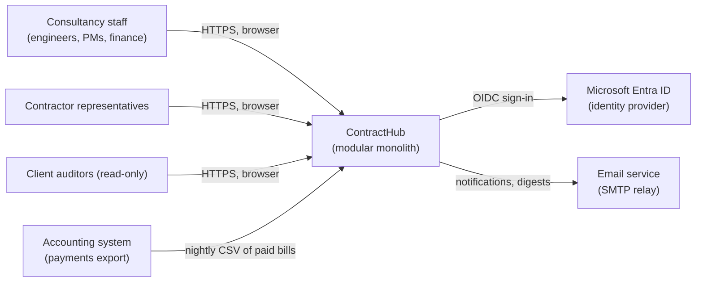
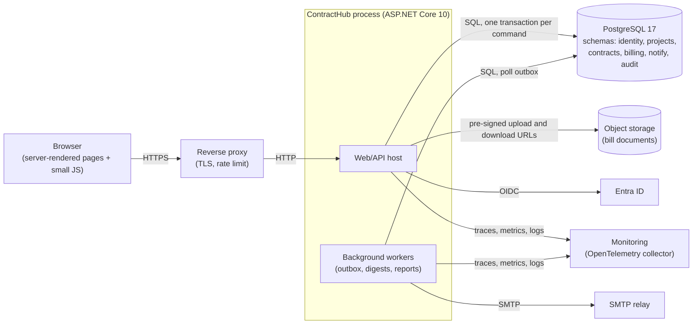
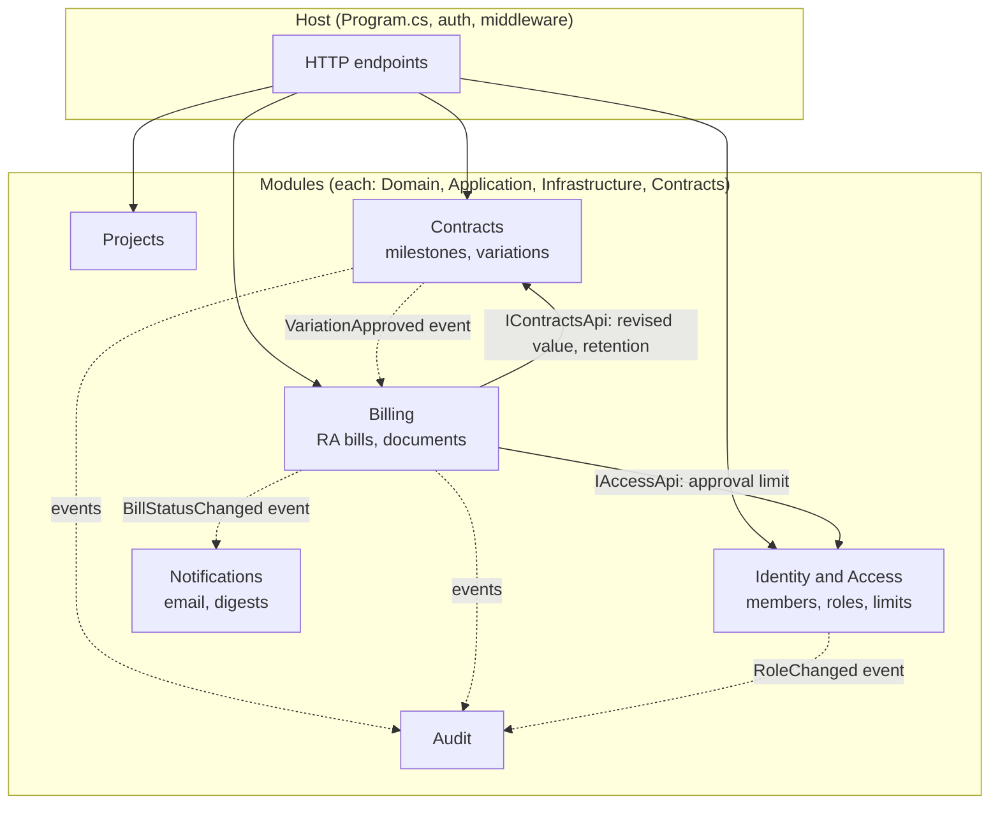
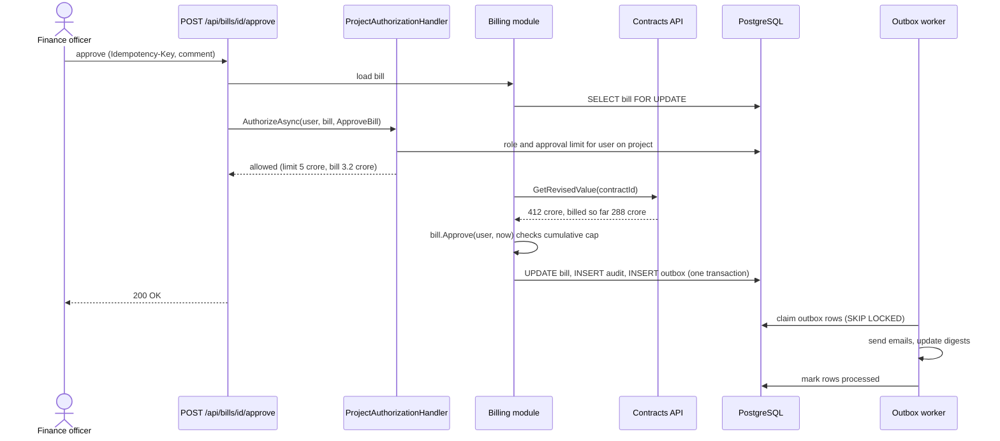
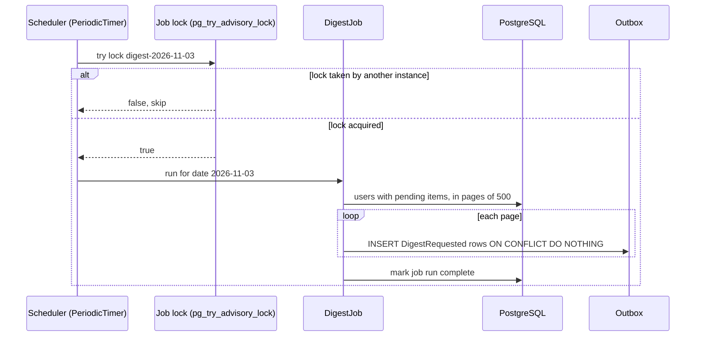
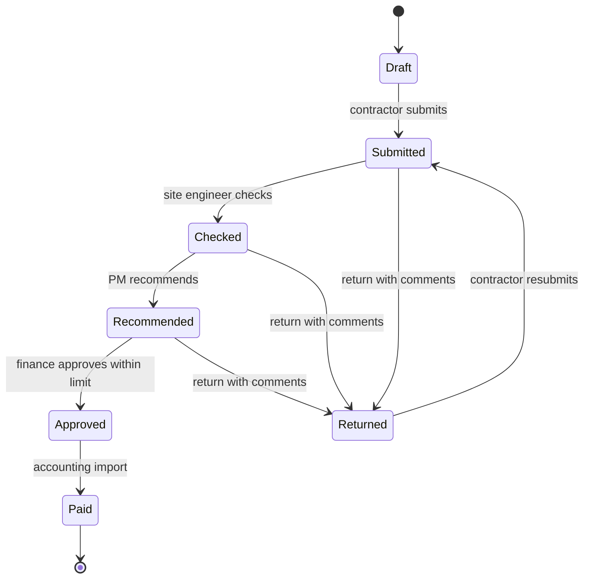

This is the first of three graduation projects. It is deliberately **not** distributed. Most business software in the world (ERPs, project portals, HR systems, government workflow systems) runs as one deployable application on one relational database, and the teams that do this well are not doing something "less advanced" than microservices. They are choosing a simpler shape and putting the effort into clean module boundaries, solid authorization, honest tests and good operations. That is what this capstone asks you to prove.

You will build **ContractHub**: a system for an infrastructure consultancy that supervises road, bridge and water projects for government clients. Engineers record progress, contractors submit running bills, project managers and finance approve them, and everyone needs to know which milestones are late. You will produce the full set of artefacts a real team would: requirements, HLD, LLD, diagrams, API spec, schema and migrations, code, tests, security review, performance tests, failure analysis, deployment instructions, runbook, cost analysis, ADRs and a final review.

## Learning objectives

By the end of this capstone you will be able to:

1. Turn a business brief into written functional and non-functional requirements with numbers.
2. Split one application into **modules** with explicit public contracts, separate database schemas and rules that the build enforces.
3. Implement **authentication** with an external identity provider and **resource-based authorization** ("can *this* user approve *this* bill on *this* project?").
4. Validate input at the edge and enforce business **invariants** inside the domain, and tell the two apart.
5. Run reliable **background processing** (reminders, notifications, report generation) with a transactional outbox and hosted services.
6. Design a PostgreSQL schema with constraints and versioned **migrations** that are safe to deploy.
7. Write a **test pyramid**: domain unit tests, module integration tests against a real database, and API tests through `WebApplicationFactory`.
8. Write the operational documents (deployment guide, runbook, cost and scaling analysis) that let someone else run your system at 2 a.m.
9. Record and defend decisions in **ADRs**, and say what would make you revisit them.

## Prerequisites

- [Domain-driven modular monoliths](#/lesson/m08-ddd-modular-monolith) and [modular monolith basics](#/lesson/m02-modular-monolith): the architectural shape.
- [Authentication and authorization in ASP.NET Core](#/lesson/m03-authn-authz) and [RBAC and PBAC](#/lesson/m14-rbac-pbac): who can do what.
- [Background services](#/lesson/m03-background-services) and [the outbox](#/lesson/m12-outbox): reliable side effects.
- [Migrations and schema evolution](#/lesson/m09-migrations-evolution): changing the database without downtime.
- [Architecture decision records](#/lesson/m02-adr): how to write down the "why".

Strongly recommended: [Project: Order management domain](#/lesson/m08-order-management-project), which practises the aggregate and transaction skills at a smaller scale.

## Project brief

### The organisation

Picture a consultancy with offices in Gurugram, Patna and Pune. It supervises about **120 active projects** (highways, bridges, water supply schemes) for state agencies. Each project has one or more **contracts** with construction companies, about **900 contracts** in total, typically worth ₹20 crore to ₹1,500 crore each. A contract has a schedule of **milestones** (for example "Earthwork km 0–12 complete", 8 % of contract value), and the contractor is paid through monthly **running account (RA) bills**. A bill is submitted by the contractor's representative, checked by the site engineer, recommended by the project manager and approved by finance. Changes to scope are handled through **variation orders** that change the contract value once approved.

Today this runs on spreadsheets and email. Bills get lost, approval limits are ignored, nobody can say which milestones are late across all projects, and auditors from the client ask for evidence that takes days to compile.

### Users and numbers

| Measure | Value | Source |
|---|---|---|
| Named users | ~2,000 (staff 700, contractor representatives 1,300) | Brief |
| Peak concurrent users | ~400 (month-end billing week) | Estimate: 20 % of named users |
| Requests per second at peak | 400 users × 1 request per 10 s ≈ **40 RPS**, ×3 for bursts ≈ **120 RPS** | Estimate |
| RA bills per month | 900 contracts × ~1 = ~900, half of them in the last 5 days | Brief |
| Documents | ~25 per bill (measurement sheets, photos, test reports) ≈ 22,500 files per month, avg 2 MB ≈ **45 GB/month**, ≈ 2.7 TB over 5 years | Estimate |
| Database rows (5 years) | milestones ~50,000, bills ~54,000, bill line items ~5 million, audit events ~30 million | Estimate |

These numbers matter because they tell you what *not* to build. 120 RPS is a small load for one ASP.NET Core instance (a well-written API on a 4-vCPU VM commonly serves several hundred to a few thousand simple requests per second, but measure your own). 30 million audit rows over five years is comfortably within one PostgreSQL instance with sensible indexes and partitioning by month. There is no throughput reason to distribute this system.

### Functional requirements

1. **Identity and access**: staff sign in with the company's identity provider (Microsoft Entra ID via OpenID Connect); contractor users are invited by email and sign in through the same provider as guests. Every user has **project-scoped roles**: Viewer, Contractor Representative, Site Engineer, Project Manager, Finance Officer. One person can be a PM on one project and a Viewer on another.
2. **Projects**: create projects, assign members and roles, record locations (district, state, chainage range).
3. **Contracts**: a contract belongs to one project and has an original value, start and end dates, retention percentage (money withheld until completion, 0–10 %), and a milestone schedule whose weights add up to exactly 100 %.
4. **Variation orders**: proposed by the PM, approved by Finance; an approved variation changes the revised contract value. Variations above 10 % of the original value need two Finance approvals.
5. **RA bills**: submitted by a contractor representative with line items and documents; workflow Draft → Submitted → Checked (site engineer) → Recommended (PM) → Approved (Finance) → Paid, with Returned (back to the contractor with comments) possible from Submitted, Checked or Recommended. Cumulative billed amount may never exceed the revised contract value.
6. **Approval limits**: a PM may recommend any bill, but Finance Officers have personal approval limits (for example ₹5 crore); bills above a limit need a Finance Head.
7. **Milestones**: engineers record progress percentage with evidence; a milestone is late when its due date has passed and progress is below 100 %.
8. **Notifications and reminders**: email and in-app notifications on every workflow step; a daily 08:00 IST digest of items waiting for each user; a weekly late-milestone report per project.
9. **Reports**: contract financial summary (original, variations, revised, billed, retention held, balance), late milestones across projects, export to Excel.
10. **Audit**: every state change and every permission change is recorded with who, when, from what, to what, and is visible to auditors.

### Non-functional requirements

| Quality | Target |
|---|---|
| Availability | 99.5 % in business hours (allows ~3.6 h downtime per month), planned maintenance outside 08:00–20:00 IST |
| Latency | p95 < 300 ms for reads, < 800 ms for workflow actions, excluding file upload time |
| Durability | RPO 15 minutes (lose at most 15 minutes of data), RTO 4 hours |
| Security | OWASP Top 10 addressed, all access logged, data encrypted in transit and at rest, documents served only through authorised links |
| Auditability | Audit records are append-only and retained for 10 years |
| Maintainability | A new developer can run the system locally in under 30 minutes with one command |
| Data residency | All data stored in Indian regions |

### Out of scope

Payment execution (Finance pays from its accounting system; ContractHub records "Paid" from an import), GIS mapping, mobile offline mode, and multi-tenant SaaS. Name them in the requirements document so nobody assumes them.

## Deliverables

Produce every deliverable below. Each row says what "good" looks like so you can review your own work before a reviewer does.

| # | Deliverable | What good looks like |
|---|---|---|
| 1 | **Requirements document** | Functional requirements numbered (FR-1…), each testable; NFRs with numbers (not "fast", but "p95 < 300 ms at 120 RPS"); explicit out-of-scope list; open questions with owners. 4–6 pages. |
| 2 | **HLD document** | C4 context and container views, module list with responsibilities, data ownership per module, sync vs async interactions, capacity estimate with arithmetic, and the top five risks. Explains why a monolith, and what would make you split. |
| 3 | **LLD document** | Per module: aggregates, invariants, state machines (bill, variation), public contract (interfaces and integration events), key class and sequence diagrams. Every invariant names its enforcing class. |
| 4 | **Architecture diagrams** | Context, container, component (module) and deployment diagrams, plus sequences for bill approval and the reminder job. Consistent names with the code; every arrow labelled with protocol or purpose. |
| 5 | **API specification** | OpenAPI 3.1 generated from the code (`Microsoft.AspNetCore.OpenApi`) and checked in; consistent resource naming, problem details (RFC 9457) for errors, pagination, idempotency keys on workflow POSTs, versioning policy. |
| 6 | **DB schema and migrations** | One PostgreSQL schema per module, no cross-schema foreign keys except to shared reference data, `CHECK`/`UNIQUE` constraints for key invariants, indexes justified by queries, migrations that are backward compatible (expand, migrate, contract). |
| 7 | **Implementation** | Builds with zero warnings in `Release`; modules reference each other only through `*.Contracts` projects; an architecture test fails the build on a forbidden reference; configuration via options with validation at startup. |
| 8 | **Unit and integration tests** | Domain tests for every invariant and transition; integration tests against real PostgreSQL (Testcontainers or a CI service container); API tests with `WebApplicationFactory` including authorization denials; coverage of the domain above 85 % (lines), with no coverage target theatre elsewhere. |
| 9 | **Security review** | Threat model (STRIDE per container), authorization matrix (role × action × condition), OWASP Top 10 checklist with evidence, secrets handling, file upload controls (size, type, malware scan), dependency scan results. |
| 10 | **Performance tests** | k6 or NBomber scripts for month-end load (120 RPS mixed, 30-minute soak), results with p50/p95/p99 and error rate, the bottleneck you found and what you changed. Numbers labelled with the hardware they ran on. |
| 11 | **Failure scenarios** | A table of at least 10 failures (DB down, IdP down, SMTP down, disk full, duplicate submit, worker crash mid-batch, migration fails half-way…) with detection, user impact, automatic mitigation and manual recovery. At least three tested deliberately. |
| 12 | **Deployment instructions** | From an empty environment to running: prerequisites, infrastructure (IaC preferred), secrets, database creation and migration, app deploy, smoke test, rollback. Someone else follows them and succeeds without asking you. |
| 13 | **Runbook** | For each alert: what it means, how to confirm, step-by-step mitigation, escalation. Plus routine tasks: restore a backup, rotate a secret, re-run a failed report, replay dead outbox messages. |
| 14 | **Cost and scaling analysis** | Monthly cost estimate per environment with the pricing assumptions dated; what grows with users, bills and documents; the first three things that break as load grows 10× and what you would do about each. |
| 15 | **ADRs** | At least six ADRs (context, decision, alternatives, consequences, status). Expected topics: modular monolith, schema per module, authorization model, outbox vs direct send, document storage, test strategy. |
| 16 | **Final review** | A 2-page retrospective: what you would do differently, known limitations, technical debt register with severity, and a 20-minute demo script. |

:::callout type=tip title="Write documents as you build, not after"
Requirements and HLD come before code; the LLD for a module comes before that module; ADRs are written on the day of the decision. A document written at the end describes what you built, not why, and reviewers can tell.
:::

## Milestones

The plan assumes about 6 weeks at 10–12 hours per week. Each milestone ends with a demo and a review against the exit criteria.

| Week | Milestone | Scope | Exit criteria |
|---|---|---|---|
| 1 | **M1 — Requirements and HLD** | Deliverables 1, 2, first context and container diagrams, ADR-001 (monolith), ADR-002 (schema per module) | A reviewer can explain the system's purpose, users, modules and load numbers from your documents alone |
| 2 | **M2 — Skeleton and identity** | Solution structure, module registration, OIDC sign-in, project membership, authorization handler, architecture tests, CI pipeline, local `docker compose up` | A signed-in user sees only their projects; a forbidden module reference fails CI |
| 3 | **M3 — Contracts and variations** | LLD for Contracts, aggregates, migrations, validation, API, unit and integration tests | Milestone weights and variation approvals enforced; exercise 1 and 2 done |
| 4 | **M4 — RA bill workflow** | Bill aggregate and state machine, approval limits, documents to object storage, audit log | Full bill workflow demo; authorization denials tested; exercise 3 done |
| 5 | **M5 — Background processing and reports** | Outbox, dispatcher, email, daily digest, late-milestone job, financial summary report | Killing the worker mid-batch loses and duplicates nothing visible to users; exercise 4 done |
| 6 | **M6 — Hardening and handover** | Performance tests, security review, failure drills, deployment guide, runbook, cost analysis, final review | Deliverables 9–16 complete; a peer deploys from your guide |

Two rules keep the plan honest. First, **every milestone ships something runnable**; there is no "integration week" at the end. Second, if you are behind, cut scope (Excel export, weekly report) rather than tests or documents. A smaller system that is tested and operable scores higher than a bigger one that is not.

## Reference architecture

This is one good answer, not the only one. Compare it with yours after you have drafted your own HLD.

### C4 level 1: system context



At the context level ContractHub is one box. Three kinds of people use it through a browser. It depends on three external systems: the identity provider proves who users are (ContractHub never stores passwords), an email relay delivers notifications, and the accounting system sends back a nightly file saying which approved bills were actually paid. The arrow from accounting points *into* ContractHub because the accounting team pushes the file; ContractHub does not reach into their database. Every external dependency is a failure you must plan for, which is why each appears again in the failure scenarios table.

### C4 level 2: containers



The important choice here is that the **web host and the workers are the same codebase and the same deployable**, started with a different role setting (`ROLE=web` or `ROLE=worker`, or both in a single process for small environments). That keeps one build, one version and one set of migrations, while letting you scale or restart workers independently. All modules share one PostgreSQL instance but each owns a **schema**; that gives you clear data ownership without the cost of separate databases. Documents go to object storage (Azure Blob or S3-compatible), not the database: the browser uploads and downloads through short-lived pre-signed URLs, so 2 MB files never pass through the API process. Telemetry goes to an OpenTelemetry collector, which forwards to whichever backend you choose.

### C4 level 3: modules inside the process



Solid arrows are **synchronous in-process calls** through a module's public contract interface (for example Billing asks Contracts for the revised contract value before accepting a bill). Dotted arrows are **integration events** written to the outbox and delivered by the worker. The rule: a module may call another module's `Contracts` interface for a *query it needs right now*, and must use an event for *anything that is a side effect*. Billing never reads the `contracts` schema directly and never references the Contracts module's `Domain` project; an architecture test (NetArchTest or a reflection-based test) enforces it.

### Key sequence: approving an RA bill



Walk through it. The bill row is locked first so two finance officers clicking "approve" at the same time cannot both succeed. Authorization is **resource-based**: the handler needs the bill itself (its project and amount) to decide, so it runs after loading, not as an attribute on the endpoint. The Billing module asks Contracts for the revised value through its public API rather than joining tables. The domain method `Approve` checks the invariant "cumulative billed ≤ revised value". The state change, the audit row and the outbox row commit together, so either all three happen or none. Email is sent later by the worker; if SMTP is down, the approval still succeeds and the email goes out when SMTP recovers. The idempotency key means a double-click or a browser retry returns the first response instead of approving twice.

### Key sequence: the 08:00 digest



With two worker instances, both timers fire at 08:00. A PostgreSQL **advisory lock** makes only one run the job. The job does not send emails itself; it writes one outbox row per user with a unique key (`digest:{userId}:{date}`), so re-running the job after a crash cannot email anyone twice. Sending stays the outbox worker's job, which already has retries and dead-lettering.

### Bill lifecycle



`Returned` loops back to `Submitted`, not to `Draft`, so the history of comments stays attached to one bill. `Approved → Paid` is triggered only by the accounting import, never by a user, which is an authorization rule as much as a workflow rule.

### Solution structure and code skeleton

```text
src/
  ContractHub.Host/                 Program.cs, auth, middleware, module registration
  Modules/
    Contracts/
      ContractHub.Contracts.Domain/         aggregates, no framework references
      ContractHub.Contracts.Application/    command and query handlers
      ContractHub.Contracts.Infrastructure/ EF Core DbContext (schema "contracts"), migrations
      ContractHub.Contracts.Api/            public interfaces + integration events (what others may use)
    Billing/ ...  Projects/ ...  Access/ ...  Notifications/ ...  Audit/ ...
  Shared/
    ContractHub.Shared.Kernel/      Money, Result, clock, outbox abstractions
tests/
  ContractHub.ArchitectureTests/
  Modules/*/UnitTests, Modules/*/IntegrationTests
  ContractHub.Api.Tests/            WebApplicationFactory
```

The compiled skeleton below shows the three ideas a reviewer will look for first: module registration through one interface, resource-based authorization with project-scoped roles, and an outbox dispatcher as a hosted service. It uses in-memory stores so it compiles on its own; your real modules use EF Core with Npgsql.

```csharp file=Shared/Modules.cs
namespace ContractHub.Shared;

/// <summary>Each module registers its own services and endpoints. The host knows nothing else about it.</summary>
public interface IModule
{
    string Name { get; }
    void Register(IServiceCollection services, IConfiguration configuration);
    void MapEndpoints(IEndpointRouteBuilder endpoints);
}

/// <summary>Anything that belongs to a project and may carry money, so authorization can reason about it.</summary>
public interface IProjectResource
{
    Guid ProjectId { get; }
    decimal? MonetaryValue { get; }
}

public enum ProjectRole { Viewer, ContractorRep, SiteEngineer, ProjectManager, FinanceOfficer, FinanceHead }

public sealed record Membership(ProjectRole Role, decimal ApprovalLimit);

public interface IProjectMembership
{
    Task<Membership?> GetAsync(string userId, Guid projectId, CancellationToken ct);
}
```

```csharp file=Shared/Authorization.cs
using System.Security.Claims;
using Microsoft.AspNetCore.Authorization;
using Microsoft.AspNetCore.Authorization.Infrastructure;

namespace ContractHub.Shared;

public static class Operations
{
    public static readonly OperationAuthorizationRequirement View = new() { Name = nameof(View) };
    public static readonly OperationAuthorizationRequirement SubmitBill = new() { Name = nameof(SubmitBill) };
    public static readonly OperationAuthorizationRequirement RecommendBill = new() { Name = nameof(RecommendBill) };
    public static readonly OperationAuthorizationRequirement ApproveBill = new() { Name = nameof(ApproveBill) };
}

/// <summary>The authorization matrix as code. Pure function: easy to unit test exhaustively.</summary>
public static class Permissions
{
    public static bool Allows(Membership m, string operation, IProjectResource resource) => operation switch
    {
        nameof(Operations.View) => true,   // any member of the project
        nameof(Operations.SubmitBill) => m.Role == ProjectRole.ContractorRep,
        nameof(Operations.RecommendBill) => m.Role == ProjectRole.ProjectManager,
        nameof(Operations.ApproveBill) =>
            m.Role == ProjectRole.FinanceHead ||
            (m.Role == ProjectRole.FinanceOfficer && (resource.MonetaryValue ?? 0m) <= m.ApprovalLimit),
        _ => false,                         // deny by default
    };
}

public sealed class ProjectAuthorizationHandler(IProjectMembership memberships)
    : AuthorizationHandler<OperationAuthorizationRequirement, IProjectResource>
{
    protected override async Task HandleRequirementAsync(AuthorizationHandlerContext context,
        OperationAuthorizationRequirement requirement, IProjectResource resource)
    {
        var userId = context.User.FindFirstValue(ClaimTypes.NameIdentifier) ?? context.User.FindFirstValue("sub");
        if (userId is null) return;
        var membership = await memberships.GetAsync(userId, resource.ProjectId, CancellationToken.None);
        if (membership is not null && Permissions.Allows(membership, requirement.Name, resource))
            context.Succeed(requirement);
    }
}
```

```csharp file=Shared/Outbox.cs
using Microsoft.Extensions.Hosting;
using Microsoft.Extensions.Logging;

namespace ContractHub.Shared;

public sealed record OutboxMessage(Guid Id, string Type, string Payload, int Attempts);

public interface IOutboxStore
{
    /// <summary>In PostgreSQL: SELECT ... FOR UPDATE SKIP LOCKED LIMIT n, so several workers never take the same row.</summary>
    Task<IReadOnlyList<OutboxMessage>> ClaimBatchAsync(int max, CancellationToken ct);
    Task MarkProcessedAsync(Guid id, CancellationToken ct);
    Task MarkFailedAsync(Guid id, string error, bool deadLetter, CancellationToken ct);
}

public interface IIntegrationEventHandler
{
    bool CanHandle(string type);
    Task HandleAsync(OutboxMessage message, CancellationToken ct);
}

public sealed class OutboxDispatcher(IOutboxStore store, IEnumerable<IIntegrationEventHandler> handlers,
    ILogger<OutboxDispatcher> logger) : BackgroundService
{
    public const int MaxAttempts = 8;
    private readonly IReadOnlyList<IIntegrationEventHandler> _handlers = handlers.ToList();

    protected override async Task ExecuteAsync(CancellationToken stoppingToken)
    {
        using var timer = new PeriodicTimer(TimeSpan.FromSeconds(2));
        while (await timer.WaitForNextTickAsync(stoppingToken))
        {
            try { await DispatchOnceAsync(stoppingToken); }
            catch (Exception ex) when (ex is not OperationCanceledException)
            {
                logger.LogError(ex, "Outbox dispatch loop failed; will retry on next tick");
            }
        }
    }

    public async Task<int> DispatchOnceAsync(CancellationToken ct)
    {
        var batch = await store.ClaimBatchAsync(50, ct);
        foreach (var msg in batch)
        {
            try
            {
                foreach (var h in _handlers.Where(h => h.CanHandle(msg.Type))) await h.HandleAsync(msg, ct);
                await store.MarkProcessedAsync(msg.Id, ct);
            }
            catch (Exception ex) when (ex is not OperationCanceledException)
            {
                var dead = msg.Attempts + 1 >= MaxAttempts;
                logger.LogWarning(ex, "Outbox message {Id} ({Type}) failed, attempt {Attempt}, dead-letter {Dead}",
                    msg.Id, msg.Type, msg.Attempts + 1, dead);
                await store.MarkFailedAsync(msg.Id, ex.Message, dead, ct);
            }
        }
        return batch.Count;
    }
}
```

```csharp file=Modules/Billing/BillingModule.cs
using ContractHub.Shared;
using Microsoft.AspNetCore.Authorization;

namespace ContractHub.Modules.Billing;

public sealed record RaBill(Guid Id, Guid ProjectId, Guid ContractId, decimal Amount, string Status) : IProjectResource
{
    public decimal? MonetaryValue => Amount;
}

public interface IBillStore
{
    Task<RaBill?> GetForUpdateAsync(Guid id, CancellationToken ct);
    Task SaveAsync(RaBill bill, CancellationToken ct);
}

internal sealed class InMemoryBillStore : IBillStore
{
    private readonly Dictionary<Guid, RaBill> _bills = [];
    public Task<RaBill?> GetForUpdateAsync(Guid id, CancellationToken ct) => Task.FromResult(_bills.GetValueOrDefault(id));
    public Task SaveAsync(RaBill bill, CancellationToken ct) { _bills[bill.Id] = bill; return Task.CompletedTask; }
}

public sealed record ApproveBillRequest(string? Comment);

public sealed class BillingModule : IModule
{
    public string Name => "Billing";

    public void Register(IServiceCollection services, IConfiguration configuration) =>
        services.AddSingleton<IBillStore, InMemoryBillStore>();

    public void MapEndpoints(IEndpointRouteBuilder endpoints)
    {
        var bills = endpoints.MapGroup("/api/bills").RequireAuthorization().WithTags(Name);

        bills.MapPost("/{id:guid}/approve", async (Guid id, ApproveBillRequest body, IBillStore store,
            IAuthorizationService authz, HttpContext http, CancellationToken ct) =>
        {
            var bill = await store.GetForUpdateAsync(id, ct);
            if (bill is null) return Results.NotFound();
            var auth = await authz.AuthorizeAsync(http.User, bill, Operations.ApproveBill);
            if (!auth.Succeeded) return Results.Forbid();
            if (bill.Status != "Recommended")
                return Results.Problem($"Bill is {bill.Status}; only Recommended bills can be approved.", statusCode: 409);
            await store.SaveAsync(bill with { Status = "Approved" }, ct);   // + audit + outbox in the real module
            return Results.Ok(new { bill.Id, Status = "Approved" });
        });
    }
}
```

```csharp file=Program.cs
using ContractHub.Modules.Billing;
using ContractHub.Shared;
using Microsoft.AspNetCore.Authorization;

var builder = WebApplication.CreateBuilder(args);

IModule[] modules = [new BillingModule()];

// Real system: .AddJwtBearer() or .AddOpenIdConnect() against Entra ID (separate NuGet packages).
builder.Services.AddAuthentication();
builder.Services.AddAuthorization(o => o.FallbackPolicy = o.DefaultPolicy);   // deny anonymous by default
builder.Services.AddSingleton<IAuthorizationHandler, ProjectAuthorizationHandler>();
builder.Services.AddSingleton<IProjectMembership, NoMembership>();
builder.Services.AddProblemDetails();
foreach (var m in modules) m.Register(builder.Services, builder.Configuration);

var role = builder.Configuration["Role"] ?? "all";
if (role is "worker" or "all")
{
    // builder.Services.AddHostedService<OutboxDispatcher>();  registered once the PostgreSQL IOutboxStore exists
}

var app = builder.Build();
app.UseExceptionHandler();
app.UseAuthentication();
app.UseAuthorization();
if (role is "web" or "all")
    foreach (var m in modules) m.MapEndpoints(app);
app.MapGet("/health/live", () => Results.Ok()).AllowAnonymous();
app.Run();

internal sealed class NoMembership : IProjectMembership
{
    public Task<Membership?> GetAsync(string userId, Guid projectId, CancellationToken ct) => Task.FromResult<Membership?>(null);
}
```

Three details worth defending in review. `FallbackPolicy = DefaultPolicy` makes every endpoint require an authenticated user unless it explicitly says `AllowAnonymous`, so a forgotten attribute fails closed. `Permissions.Allows` is a pure function, so you can test the whole role × operation × amount matrix in a table-driven unit test without HTTP. The dispatcher catches failures **per message** and counts attempts, so one poison message cannot block the queue, and after eight attempts it moves to a dead-letter state that the runbook tells operators how to inspect and replay.

### Data model sketch

```sql
CREATE SCHEMA contracts;
CREATE TABLE contracts.contract (
  id              uuid PRIMARY KEY,
  project_id      uuid NOT NULL,                 -- id only: projects schema is another module
  code            text NOT NULL UNIQUE,
  original_value  numeric(16,2) NOT NULL CHECK (original_value > 0),
  retention_pct   numeric(4,2)  NOT NULL CHECK (retention_pct BETWEEN 0 AND 10),
  starts_on       date NOT NULL,
  ends_on         date NOT NULL CHECK (ends_on > starts_on),
  version         int  NOT NULL DEFAULT 0
);
CREATE TABLE contracts.milestone (
  contract_id  uuid NOT NULL REFERENCES contracts.contract(id),
  code         text NOT NULL,
  weight_pct   numeric(5,2) NOT NULL CHECK (weight_pct > 0 AND weight_pct <= 100),
  due_on       date NOT NULL,
  progress_pct numeric(5,2) NOT NULL DEFAULT 0 CHECK (progress_pct BETWEEN 0 AND 100),
  PRIMARY KEY (contract_id, code)
);
CREATE INDEX ix_milestone_late ON contracts.milestone (due_on) WHERE progress_pct < 100;

CREATE SCHEMA billing;
CREATE TABLE billing.ra_bill (
  id           uuid PRIMARY KEY,
  contract_id  uuid NOT NULL,                    -- id only
  project_id   uuid NOT NULL,
  number       int  NOT NULL,
  amount       numeric(16,2) NOT NULL CHECK (amount > 0),
  status       text NOT NULL,
  version      int  NOT NULL DEFAULT 0,
  UNIQUE (contract_id, number)
);
CREATE TABLE billing.outbox (
  id            uuid PRIMARY KEY,
  type          text NOT NULL,
  payload       jsonb NOT NULL,
  dedupe_key    text UNIQUE,
  created_at    timestamptz NOT NULL DEFAULT now(),
  attempts      int NOT NULL DEFAULT 0,
  processed_at  timestamptz,
  dead_at       timestamptz,
  last_error    text
);
CREATE INDEX ix_outbox_pending ON billing.outbox (created_at) WHERE processed_at IS NULL AND dead_at IS NULL;
```

"Weights add up to 100 %" is a rule across rows, which a `CHECK` cannot express; the `Contract` aggregate enforces it and a nightly consistency query reports any contract that violates it. The partial index `ix_milestone_late` serves the late-milestone report and stays small because completed milestones drop out of it.

### When this design should change

Write these into your HLD as explicit triggers. Split a module into its own service when a different team must deploy it on a different schedule, when its load profile differs by an order of magnitude (for example document processing), or when it needs a different data store. Add a read replica when reporting queries measurably slow down workflow actions. Add a cache only after measuring a hot read; at 120 RPS PostgreSQL with good indexes is usually enough.

### Practice on the canvas

Use the canvas to try your own deployment before exercise 5. Start from one instance and add only what a requirement forces: a second instance for zero-downtime deploys, a worker role for the outbox, object storage for documents. Watch which component saturates when you raise client traffic to 10x.

:::playground type=hld title="ContractHub deployment sandbox"
```json
{
  "nodes": [
    { "id": "u", "type": "client", "label": "Staff and contractors", "props": { "rps": 120 } },
    { "id": "lb", "type": "load-balancer", "label": "Reverse proxy" },
    { "id": "app", "type": "app-server", "label": "ContractHub (web + worker)", "props": { "instances": 1 } },
    { "id": "db", "type": "database", "label": "PostgreSQL 17" },
    { "id": "idp", "type": "external", "label": "Entra ID" }
  ],
  "edges": [
    { "from": "u", "to": "lb", "kind": "sync" },
    { "from": "lb", "to": "app", "kind": "sync" },
    { "from": "app", "to": "db", "kind": "sync", "label": "SQL" },
    { "from": "app", "to": "idp", "kind": "sync", "label": "OIDC" }
  ]
}
```
:::

## Evaluation rubric

Reviewers score each criterion 0–4. The pass mark is 60 of 88 (about 68 %), with no criterion below 2 in the **must** rows (marked ★).

| # | Criterion | 1 — weak | 2 — acceptable | 3 — strong | 4 — exemplary |
|---|---|---|---|---|---|
| 1 ★ | Requirements | Vague, no numbers | Numbered FRs, NFRs with some numbers | Every NFR measurable, out-of-scope listed | Plus open questions resolved with stakeholders and traced to tests |
| 2 ★ | HLD and diagrams | Boxes without labels | Context and container diagrams, modules named | All four views consistent with code, every arrow labelled | Plus risks ranked and split triggers stated |
| 3 | LLD | Class lists only | Aggregates and invariants per module | State machines and sequences per key flow | Every invariant traced to class and test |
| 4 ★ | Module boundaries | Modules share tables freely | Separate folders and schemas | Public contract projects only; events for side effects | Architecture tests fail CI on violations |
| 5 ★ | Authentication | Home-made login | OIDC with an external IdP | Plus secure cookies or token handling, sign-out, session lifetime | Plus guest users and access reviews documented |
| 6 ★ | Authorization | Role checks in UI only | Role attributes on endpoints | Resource-based, project-scoped, deny by default | Plus exhaustive matrix tests and audit of permission changes |
| 7 | Validation and invariants | Validation in controllers only | Edge validation plus some domain rules | Clear split: shape at edge, rules in domain | Plus DB constraints back the critical rules |
| 8 ★ | Data and migrations | Hand-edited database | Migrations exist | Constraints, indexes justified, expand-contract | Plus a migration rehearsed against production-sized data |
| 9 ★ | Background processing | Fire-and-forget `Task.Run` | Hosted service sends directly | Transactional outbox, retries, dead-letter, single-run jobs | Plus replay tooling and metrics on lag |
| 10 ★ | Tests | Few or none | Unit tests for domain | Plus integration tests on real PostgreSQL and API auth tests | Plus failure-injection tests and a fast CI (< 10 min) |
| 11 | API spec | None | Generated OpenAPI | Problem details, pagination, idempotency, versioning | Plus contract tests guard breaking changes |
| 12 | Security review | Missing | OWASP checklist | STRIDE threat model with mitigations | Plus evidence: scans, pen-test notes, upload controls tested |
| 13 | Performance | Not tested | One load test | Month-end scenario with p95/p99, bottleneck fixed | Plus soak test and capacity headroom stated |
| 14 | Failure scenarios | Not considered | List of failures | Table with detection and recovery | Three drills performed and written up |
| 15 | Observability | Console logs | Structured logs | Traces, metrics, correlation ids, dashboards | SLOs with alerts tied to runbook entries |
| 16 ★ | Deployment | "Run it in Visual Studio" | Written steps | Repeatable script or IaC, rollback tested | A peer deploys from the guide unaided |
| 17 | Runbook | Missing | A few notes | Entry per alert plus routine tasks | Tested by someone other than the author |
| 18 | Cost and scaling | Missing | Monthly cost guess | Per-environment estimate with dated assumptions | Plus 10× analysis with first three bottlenecks |
| 19 | ADRs | None | 2–3 short ADRs | Six ADRs with alternatives and consequences | Plus superseded ADRs kept, showing evolution |
| 20 | Code quality | Inconsistent | Readable, some duplication | Consistent conventions, zero warnings | Reviewer finds nothing structural to change |
| 21 | Final review | Missing | Summary of features | Honest limitations and debt register | Plus a crisp demo that shows failure handling live |
| 22 | Simplicity | Over- or under-engineered | Mostly appropriate | Every component justified by a requirement | Plus explicit "things we chose not to build" |

A score of 0 in any row (deliverable missing) is an automatic fail for that review cycle. The rubric rewards **evidence**: a claim such as "handles SMTP outages" scores 2 at most unless the failure drill is written up.

## Exercises

:::exercise id=m20-capstone-a-ex1 difficulty=beginner kind=code title="M3: validate a contract's milestone schedule"
Write `ContractValidator.Validate`, which returns every rule violation for a proposed contract (not just the first), as stable error codes the UI can translate.
::requirements
- `RETENTION_RANGE`: retention must be between 0 and 10 percent inclusive.
- `DATES_ORDER`: end date must be after start date.
- `NO_MILESTONES`: at least one milestone.
- `WEIGHT_SUM`: milestone weights must add up to exactly 100.
- `WEIGHT_POSITIVE`: every weight must be greater than 0.
- `DUPLICATE_CODE`: milestone codes must be unique (case-insensitive).
- `DUE_OUTSIDE_PERIOD`: every due date must be within start and end date inclusive.
- Each code appears at most once in the result; return them in the order listed above.
::acceptance
- A valid contract returns an empty list.
- Weights 40 + 40 + 15 return `WEIGHT_SUM`.
- Codes "M1" and "m1" return `DUPLICATE_CODE`.
- A contract with three different problems returns all three codes in the documented order.
::hint
Collect errors in a list instead of throwing on the first one. Users fix forms faster when they see every problem at once.
::hint
Check each rule in the documented order and add its code once. A `HashSet` is not needed if each rule is checked once over all milestones.
::hint
Use `decimal` for weights, so 33.33 + 33.33 + 33.34 is exactly 100.
::hint
For duplicates: `milestones.GroupBy(m => m.Code, StringComparer.OrdinalIgnoreCase).Any(g => g.Count() > 1)`.
::starter
```csharp file=ContractValidator.cs
using System;
using System.Collections.Generic;

public sealed record MilestoneInput(string Code, decimal WeightPercent, DateOnly DueOn);
public sealed record ContractInput(decimal RetentionPercent, DateOnly StartsOn, DateOnly EndsOn, IReadOnlyList<MilestoneInput> Milestones);

public static class ContractValidator
{
    public static IReadOnlyList<string> Validate(ContractInput contract) => throw new NotImplementedException();
}
```
::tests
```csharp file=ContractValidatorTests.cs
using System;
using Xunit;

public class ContractValidatorTests
{
    private static readonly DateOnly Start = new(2026, 4, 1), End = new(2028, 3, 31);
    private static MilestoneInput M(string code, decimal w, int month = 6) => new(code, w, new DateOnly(2026, month, 30));

    [Fact]
    public void Valid_contract_has_no_errors() =>
        Assert.Empty(ContractValidator.Validate(new ContractInput(5m, Start, End, new[] { M("M1", 33.33m), M("M2", 33.33m), M("M3", 33.34m) })));

    [Fact]
    public void Weights_must_sum_to_100() =>
        Assert.Equal(new[] { "WEIGHT_SUM" }, ContractValidator.Validate(new ContractInput(5m, Start, End, new[] { M("M1", 40m), M("M2", 40m), M("M3", 15m) })));

    [Fact]
    public void Duplicate_codes_are_case_insensitive() =>
        Assert.Equal(new[] { "DUPLICATE_CODE" }, ContractValidator.Validate(new ContractInput(5m, Start, End, new[] { M("M1", 50m), M("m1", 50m) })));

    [Fact]
    public void No_milestones() =>
        Assert.Contains("NO_MILESTONES", ContractValidator.Validate(new ContractInput(5m, Start, End, Array.Empty<MilestoneInput>())));

    [Fact]
    public void Reports_every_problem_in_order()
    {
        var errors = ContractValidator.Validate(new ContractInput(12m, End, Start, new[] { M("M1", 0m), M("M2", 100m) }));
        Assert.Equal(new[] { "RETENTION_RANGE", "DATES_ORDER", "WEIGHT_POSITIVE", "DUE_OUTSIDE_PERIOD" }, errors);
    }

    [Fact]
    public void Due_date_outside_period()
    {
        var late = new MilestoneInput("M9", 100m, new DateOnly(2028, 4, 1));
        Assert.Equal(new[] { "DUE_OUTSIDE_PERIOD" }, ContractValidator.Validate(new ContractInput(0m, Start, End, new[] { late })));
    }
}
```
::solution
```csharp file=ContractValidator.cs
using System;
using System.Collections.Generic;
using System.Linq;

public sealed record MilestoneInput(string Code, decimal WeightPercent, DateOnly DueOn);
public sealed record ContractInput(decimal RetentionPercent, DateOnly StartsOn, DateOnly EndsOn, IReadOnlyList<MilestoneInput> Milestones);

public static class ContractValidator
{
    public static IReadOnlyList<string> Validate(ContractInput c)
    {
        var errors = new List<string>();
        var ms = c.Milestones;
        if (c.RetentionPercent < 0m || c.RetentionPercent > 10m) errors.Add("RETENTION_RANGE");
        if (c.EndsOn <= c.StartsOn) errors.Add("DATES_ORDER");
        if (ms.Count == 0) { errors.Add("NO_MILESTONES"); return errors; }
        if (ms.Sum(m => m.WeightPercent) != 100m) errors.Add("WEIGHT_SUM");
        if (ms.Any(m => m.WeightPercent <= 0m)) errors.Add("WEIGHT_POSITIVE");
        if (ms.GroupBy(m => m.Code, StringComparer.OrdinalIgnoreCase).Any(g => g.Count() > 1)) errors.Add("DUPLICATE_CODE");
        if (ms.Any(m => m.DueOn < c.StartsOn || m.DueOn > c.EndsOn)) errors.Add("DUE_OUTSIDE_PERIOD");
        return errors;
    }
}
```

In the "every problem" test the weights are 0 + 100 = 100, so `WEIGHT_SUM` correctly does not appear, while `WEIGHT_POSITIVE` does. With swapped dates, every due date falls outside the (empty) period. Where does this validator live? It checks **business rules**, so it belongs to the Contracts domain and runs inside `Contract.Create`. The API layer separately checks *shape* (required fields, string lengths) and maps the codes to RFC 9457 problem details with an `errors` dictionary.
::mistakes
- Throwing on the first error, so the user fixes one field at a time.
- Using `double` for weights, so 33.33 + 33.33 + 33.34 is not exactly 100.
- Validating only in the API layer, so an import job or a test can create an invalid contract.
::extensions
Add `VARIATION_LIMIT`: an approved variation total above 10 % of the original value requires two distinct Finance approvers.
:::

:::exercise id=m20-capstone-a-ex2 difficulty=beginner kind=sql ordered=true title="M3: contract financial summary without double counting"
Write the financial summary report. For each contract return `code`, `original_value`, `approved_variations` (sum of variations with status `Approved`), `revised_value` (original + approved variations), `billed` (sum of bills with status `Approved` or `Paid`) and `balance` (revised − billed). Include contracts with no variations or bills. Order by `code`.
::setup
```sql
CREATE TABLE contract (
  id             int PRIMARY KEY,
  code           text NOT NULL UNIQUE,
  original_value numeric(16,2) NOT NULL
);
CREATE TABLE variation (
  id          int PRIMARY KEY,
  contract_id int NOT NULL REFERENCES contract(id),
  amount      numeric(16,2) NOT NULL,
  status      text NOT NULL
);
CREATE TABLE ra_bill (
  id          int PRIMARY KEY,
  contract_id int NOT NULL REFERENCES contract(id),
  amount      numeric(16,2) NOT NULL,
  status      text NOT NULL
);
INSERT INTO contract VALUES
  (1, 'BR-PAT-014', 4120000000.00),
  (2, 'NH-GGN-007', 850000000.00),
  (3, 'WS-PUN-221', 230000000.00);
INSERT INTO variation VALUES
  (10, 1, 120000000.00, 'Approved'),
  (11, 1,  45000000.00, 'Approved'),
  (12, 1,  90000000.00, 'Proposed'),
  (13, 2, -20000000.00, 'Approved');
INSERT INTO ra_bill VALUES
  (100, 1, 500000000.00, 'Paid'),
  (101, 1, 320000000.00, 'Approved'),
  (102, 1, 150000000.00, 'Submitted'),
  (103, 2, 100000000.00, 'Paid'),
  (104, 2,  60000000.00, 'Returned');
```
::check
```sql
WITH v AS (
  SELECT contract_id, SUM(amount) AS approved_variations
  FROM variation WHERE status = 'Approved' GROUP BY contract_id
), b AS (
  SELECT contract_id, SUM(amount) AS billed
  FROM ra_bill WHERE status IN ('Approved', 'Paid') GROUP BY contract_id
)
SELECT c.code,
       c.original_value,
       COALESCE(v.approved_variations, 0) AS approved_variations,
       c.original_value + COALESCE(v.approved_variations, 0) AS revised_value,
       COALESCE(b.billed, 0) AS billed,
       c.original_value + COALESCE(v.approved_variations, 0) - COALESCE(b.billed, 0) AS balance
FROM contract c
LEFT JOIN v ON v.contract_id = c.id
LEFT JOIN b ON b.contract_id = c.id
ORDER BY c.code;
```
::acceptance
- BR-PAT-014: variations 165,000,000.00, revised 4,285,000,000.00, billed 820,000,000.00, balance 3,465,000,000.00.
- NH-GGN-007: a negative (scope-reducing) variation gives revised 830,000,000.00; billed 100,000,000.00.
- WS-PUN-221 appears with zeros for variations and billed.
- No amount is counted twice.
::hint
Try the naive version first: `contract LEFT JOIN variation LEFT JOIN ra_bill` with two `SUM`s. Look at BR-PAT-014's numbers. Why are they wrong?
::hint
Joining two independent one-to-many tables multiplies rows: 2 approved variations × 2 counted bills = 4 rows, so each sum is doubled.
::hint
Aggregate each child table to one row per contract first (in a CTE or subquery), then join those.
::hint
Remember `COALESCE(..., 0)` for contracts with no matching rows, and filter statuses inside the aggregates.
::solution
```sql
WITH v AS (
  SELECT contract_id, SUM(amount) AS approved_variations
  FROM variation WHERE status = 'Approved' GROUP BY contract_id
), b AS (
  SELECT contract_id, SUM(amount) AS billed
  FROM ra_bill WHERE status IN ('Approved', 'Paid') GROUP BY contract_id
)
SELECT c.code,
       c.original_value,
       COALESCE(v.approved_variations, 0) AS approved_variations,
       c.original_value + COALESCE(v.approved_variations, 0) AS revised_value,
       COALESCE(b.billed, 0) AS billed,
       c.original_value + COALESCE(v.approved_variations, 0) - COALESCE(b.billed, 0) AS balance
FROM contract c
LEFT JOIN v ON v.contract_id = c.id
LEFT JOIN b ON b.contract_id = c.id
ORDER BY c.code;
```

This "fan-out" bug is one of the most common causes of wrong financial reports, and it is silent: the query runs, the numbers look plausible. In the modular monolith the variation data belongs to Contracts and bills to Billing, so in production this report would be built by a **reporting read model** that both modules feed through events, or by a view in a separate `reporting` schema that is allowed to read both. Record which in an ADR.
::mistakes
- Joining both child tables and summing, which doubles BR-PAT-014's figures.
- Filtering `status` in `WHERE` after a `LEFT JOIN`, which drops WS-PUN-221.
- Counting `Submitted` or `Returned` bills as billed.
:::

:::exercise id=m20-capstone-a-ex3 difficulty=intermediate kind=code title="M4: the project authorization matrix with approval limits"
Implement `BillAuthorizer.Decide`, the pure policy behind resource-based authorization for RA bills. It returns an `AuthzDecision` with `Allowed` and a `Reason` code (useful for audit and for the 403 response).
::requirements
- No membership on the bill's project: deny, reason `NOT_MEMBER`.
- `View`: any member.
- `Submit`: only `ContractorRep`, and only for a bill whose `ContractorId` equals the user's `OrganisationId`; otherwise `WRONG_ORGANISATION`.
- `Check`: only `SiteEngineer`. `Recommend`: only `ProjectManager`.
- `Approve`: `FinanceHead` always; `FinanceOfficer` only if the bill amount is at most their approval limit, otherwise `OVER_LIMIT`.
- Separation of duties: nobody may approve a bill they recommended (`SAME_PERSON`), checked before the limit.
- Any other role for an action: `ROLE_NOT_PERMITTED`. Allowed decisions use reason `OK`.
::acceptance
- A Finance Officer with a ₹5 crore limit can approve ₹3.2 crore and cannot approve ₹6 crore (`OVER_LIMIT`).
- A Finance Head who recommended the bill is denied with `SAME_PERSON`.
- A contractor rep from another company cannot submit (`WRONG_ORGANISATION`).
- A user with no membership gets `NOT_MEMBER` for every action.
::hint
Order matters: membership first, then action-specific rules. Write the order down before coding.
::hint
A `switch` on the action with small helper methods keeps each rule readable.
::hint
Separation of duties is checked on the *person*, not the role: compare user id with `bill.RecommendedBy`.
::hint
```csharp
Action.Approve when user.UserId == bill.RecommendedBy => Deny("SAME_PERSON"),
Action.Approve when m.Role == Role.FinanceHead => Allow(),
```
::starter
```csharp file=BillAuthorizer.cs
using System;
using System.Collections.Generic;

public enum Role { Viewer, ContractorRep, SiteEngineer, ProjectManager, FinanceOfficer, FinanceHead }
public enum BillAction { View, Submit, Check, Recommend, Approve }

public sealed record UserContext(string UserId, Guid OrganisationId, IReadOnlyDictionary<Guid, (Role Role, decimal ApprovalLimit)> Memberships);
public sealed record BillInfo(Guid ProjectId, Guid ContractorId, decimal Amount, string? RecommendedBy);
public sealed record AuthzDecision(bool Allowed, string Reason);

public static class BillAuthorizer
{
    public static AuthzDecision Decide(UserContext user, BillInfo bill, BillAction action) => throw new NotImplementedException();
}
```
::tests
```csharp file=BillAuthorizerTests.cs
using System;
using System.Collections.Generic;
using Xunit;

public class BillAuthorizerTests
{
    private static readonly Guid P = Guid.NewGuid(), Contractor = Guid.NewGuid(), Consultancy = Guid.NewGuid();
    private const decimal Crore = 10_000_000m;

    private static UserContext U(string id, Role role, decimal limit = 0m, Guid? org = null) =>
        new(id, org ?? Consultancy, new Dictionary<Guid, (Role, decimal)> { [P] = (role, limit) });

    private static BillInfo Bill(decimal amount, string? recommendedBy = "pm-1") => new(P, Contractor, amount, recommendedBy);

    [Fact]
    public void Officer_within_limit_can_approve() =>
        Assert.Equal(new AuthzDecision(true, "OK"), BillAuthorizer.Decide(U("fo-1", Role.FinanceOfficer, 5 * Crore), Bill(3.2m * Crore), BillAction.Approve));

    [Fact]
    public void Officer_over_limit_is_denied() =>
        Assert.Equal("OVER_LIMIT", BillAuthorizer.Decide(U("fo-1", Role.FinanceOfficer, 5 * Crore), Bill(6 * Crore), BillAction.Approve).Reason);

    [Fact]
    public void Head_cannot_approve_own_recommendation() =>
        Assert.Equal("SAME_PERSON", BillAuthorizer.Decide(U("pm-1", Role.FinanceHead), Bill(1 * Crore, "pm-1"), BillAction.Approve).Reason);

    [Fact]
    public void Head_can_approve_any_amount() =>
        Assert.True(BillAuthorizer.Decide(U("fh-1", Role.FinanceHead), Bill(900 * Crore), BillAction.Approve).Allowed);

    [Fact]
    public void Contractor_from_other_company_cannot_submit() =>
        Assert.Equal("WRONG_ORGANISATION", BillAuthorizer.Decide(U("c-9", Role.ContractorRep, org: Guid.NewGuid()), Bill(1 * Crore), BillAction.Submit).Reason);

    [Fact]
    public void Own_contractor_can_submit() =>
        Assert.True(BillAuthorizer.Decide(U("c-1", Role.ContractorRep, org: Contractor), Bill(1 * Crore), BillAction.Submit).Allowed);

    [Fact]
    public void Non_member_is_denied_everything()
    {
        var stranger = new UserContext("x", Consultancy, new Dictionary<Guid, (Role, decimal)>());
        foreach (var a in Enum.GetValues<BillAction>())
            Assert.Equal("NOT_MEMBER", BillAuthorizer.Decide(stranger, Bill(1), a).Reason);
    }

    [Fact]
    public void Viewer_cannot_recommend() =>
        Assert.Equal("ROLE_NOT_PERMITTED", BillAuthorizer.Decide(U("v-1", Role.Viewer), Bill(1), BillAction.Recommend).Reason);
}
```
::solution
```csharp file=BillAuthorizer.cs
using System;
using System.Collections.Generic;

public enum Role { Viewer, ContractorRep, SiteEngineer, ProjectManager, FinanceOfficer, FinanceHead }
public enum BillAction { View, Submit, Check, Recommend, Approve }

public sealed record UserContext(string UserId, Guid OrganisationId, IReadOnlyDictionary<Guid, (Role Role, decimal ApprovalLimit)> Memberships);
public sealed record BillInfo(Guid ProjectId, Guid ContractorId, decimal Amount, string? RecommendedBy);
public sealed record AuthzDecision(bool Allowed, string Reason);

public static class BillAuthorizer
{
    private static AuthzDecision Allow() => new(true, "OK");
    private static AuthzDecision Deny(string reason) => new(false, reason);

    public static AuthzDecision Decide(UserContext user, BillInfo bill, BillAction action)
    {
        if (!user.Memberships.TryGetValue(bill.ProjectId, out var m)) return Deny("NOT_MEMBER");

        return action switch
        {
            BillAction.View => Allow(),
            BillAction.Submit when m.Role != Role.ContractorRep => Deny("ROLE_NOT_PERMITTED"),
            BillAction.Submit => user.OrganisationId == bill.ContractorId ? Allow() : Deny("WRONG_ORGANISATION"),
            BillAction.Check => m.Role == Role.SiteEngineer ? Allow() : Deny("ROLE_NOT_PERMITTED"),
            BillAction.Recommend => m.Role == Role.ProjectManager ? Allow() : Deny("ROLE_NOT_PERMITTED"),
            BillAction.Approve when m.Role is not (Role.FinanceOfficer or Role.FinanceHead) => Deny("ROLE_NOT_PERMITTED"),
            BillAction.Approve when user.UserId == bill.RecommendedBy => Deny("SAME_PERSON"),
            BillAction.Approve when m.Role == Role.FinanceHead => Allow(),
            BillAction.Approve => bill.Amount <= m.ApprovalLimit ? Allow() : Deny("OVER_LIMIT"),
            _ => Deny("ROLE_NOT_PERMITTED"),
        };
    }
}
```

Wire it into ASP.NET Core with an `AuthorizationHandler<OperationAuthorizationRequirement, RaBill>` that loads the user's memberships (cached per request) and calls `Decide`. Log every denial with its reason code, and include the reason in the problem details for 403 responses only for internal users; for contractors return a generic message so you do not reveal which bills exist.
::alternatives
A policy engine (OPA, Cedar, or a rules table) is worth it when policies change without deployments or are shared across systems. For one application with a stable matrix, code plus exhaustive tests is easier to review and debug.
::mistakes
- Checking the role in the UI and trusting the client.
- Reading the approval limit from a JWT claim, so a limit change takes effect only after the token expires (up to an hour later).
- Forgetting separation of duties, which auditors check first.
::extensions
Add delegation: a Finance Head can delegate their approval rights to a named officer for a date range, with every delegated approval audited as such.
:::

:::exercise id=m20-capstone-a-ex4 difficulty=intermediate kind=code title="M5: an outbox batch processor with retries and dead-lettering"
Implement `OutboxBatchProcessor.ProcessAsync`, the core of the outbox worker, against the given store and sender interfaces.
::requirements
- Claim up to `batchSize` pending messages from the store.
- For each message, call the sender. On success mark it processed.
- On failure increment its attempt count. If attempts reach `maxAttempts`, mark it dead with the error; otherwise schedule the next attempt at `now + backoff`, where backoff = `baseDelay × 2^(attempts − 1)`, capped at `maxDelay`.
- One message failing must not stop the rest of the batch.
- Return a `BatchResult` with counts of processed, retried and dead messages.
::acceptance
- 3 good messages: all processed.
- A message failing for the first time is retried after `baseDelay` (2 s with the defaults in the test).
- A message on its last attempt is marked dead.
- Backoff is capped: attempt 10 with base 2 s and cap 60 s waits 60 s.
::hint
Put the try/catch inside the loop, around one message, not around the loop.
::hint
After a failure, `var attempts = msg.Attempts + 1;` then decide dead or retry.
::hint
`TimeSpan.FromTicks(Math.Min(maxDelay.Ticks, baseDelay.Ticks * (1L << (attempts - 1))))`. Watch for overflow when attempts gets large: cap the shift.
::hint
Take `now` from an injected `TimeProvider`, so the test can check the exact retry time.
::starter
```csharp file=OutboxBatchProcessor.cs
using System;
using System.Collections.Generic;
using System.Threading;
using System.Threading.Tasks;

public sealed record PendingMessage(Guid Id, string Type, string Payload, int Attempts);
public sealed record BatchResult(int Processed, int Retried, int Dead);

public interface IOutboxRepository
{
    Task<IReadOnlyList<PendingMessage>> ClaimAsync(int max, CancellationToken ct);
    Task MarkProcessedAsync(Guid id, CancellationToken ct);
    Task ScheduleRetryAsync(Guid id, int attempts, DateTimeOffset nextAttemptAt, string error, CancellationToken ct);
    Task MarkDeadAsync(Guid id, int attempts, string error, CancellationToken ct);
}

public interface IMessageSender
{
    Task SendAsync(PendingMessage message, CancellationToken ct);
}

public sealed class OutboxBatchProcessor(IOutboxRepository repo, IMessageSender sender, TimeProvider clock,
    int batchSize = 50, int maxAttempts = 8, TimeSpan? baseDelay = null, TimeSpan? maxDelay = null)
{
    public TimeSpan BaseDelay { get; } = baseDelay ?? TimeSpan.FromSeconds(2);
    public TimeSpan MaxDelay { get; } = maxDelay ?? TimeSpan.FromMinutes(1);

    public static TimeSpan Backoff(int attempts, TimeSpan baseDelay, TimeSpan maxDelay) => throw new NotImplementedException();

    public Task<BatchResult> ProcessAsync(CancellationToken ct) => throw new NotImplementedException();
}
```
::tests
```csharp file=OutboxBatchProcessorTests.cs
using System;
using System.Collections.Generic;
using System.Linq;
using System.Threading;
using System.Threading.Tasks;
using Xunit;

public class OutboxBatchProcessorTests
{
    private sealed class FixedClock(DateTimeOffset now) : TimeProvider { public override DateTimeOffset GetUtcNow() => now; }

    private sealed class FakeRepo(params PendingMessage[] pending) : IOutboxRepository
    {
        public List<Guid> Processed { get; } = new();
        public List<(Guid Id, int Attempts, DateTimeOffset At)> Retries { get; } = new();
        public List<(Guid Id, int Attempts)> Dead { get; } = new();
        public Task<IReadOnlyList<PendingMessage>> ClaimAsync(int max, CancellationToken ct) => Task.FromResult<IReadOnlyList<PendingMessage>>(pending.Take(max).ToList());
        public Task MarkProcessedAsync(Guid id, CancellationToken ct) { Processed.Add(id); return Task.CompletedTask; }
        public Task ScheduleRetryAsync(Guid id, int attempts, DateTimeOffset at, string error, CancellationToken ct) { Retries.Add((id, attempts, at)); return Task.CompletedTask; }
        public Task MarkDeadAsync(Guid id, int attempts, string error, CancellationToken ct) { Dead.Add((id, attempts)); return Task.CompletedTask; }
    }

    private sealed class Sender(params string[] failingTypes) : IMessageSender
    {
        public Task SendAsync(PendingMessage m, CancellationToken ct) =>
            failingTypes.Contains(m.Type) ? throw new InvalidOperationException("SMTP 421") : Task.CompletedTask;
    }

    private static readonly DateTimeOffset Now = new(2026, 11, 3, 2, 30, 0, TimeSpan.Zero);
    private static PendingMessage Msg(string type, int attempts = 0) => new(Guid.NewGuid(), type, "{}", attempts);

    [Fact]
    public async Task All_good_messages_are_processed()
    {
        var repo = new FakeRepo(Msg("A"), Msg("A"), Msg("A"));
        var r = await new OutboxBatchProcessor(repo, new Sender(), new FixedClock(Now)).ProcessAsync(CancellationToken.None);
        Assert.Equal(new BatchResult(3, 0, 0), r);
        Assert.Equal(3, repo.Processed.Count);
    }

    [Fact]
    public async Task First_failure_is_retried_after_base_delay_and_does_not_block_others()
    {
        var bad = Msg("EMAIL");
        var repo = new FakeRepo(bad, Msg("A"));
        var r = await new OutboxBatchProcessor(repo, new Sender("EMAIL"), new FixedClock(Now)).ProcessAsync(CancellationToken.None);
        Assert.Equal(new BatchResult(1, 1, 0), r);
        var retry = Assert.Single(repo.Retries);
        Assert.Equal(1, retry.Attempts);
        Assert.Equal(Now.AddSeconds(2), retry.At);
    }

    [Fact]
    public async Task Last_attempt_goes_to_dead_letter()
    {
        var repo = new FakeRepo(Msg("EMAIL", attempts: 7));
        var r = await new OutboxBatchProcessor(repo, new Sender("EMAIL"), new FixedClock(Now), maxAttempts: 8).ProcessAsync(CancellationToken.None);
        Assert.Equal(new BatchResult(0, 0, 1), r);
        Assert.Equal(8, Assert.Single(repo.Dead).Attempts);
    }

    [Fact]
    public void Backoff_doubles_and_caps()
    {
        var b = TimeSpan.FromSeconds(2); var cap = TimeSpan.FromSeconds(60);
        Assert.Equal(TimeSpan.FromSeconds(2), OutboxBatchProcessor.Backoff(1, b, cap));
        Assert.Equal(TimeSpan.FromSeconds(16), OutboxBatchProcessor.Backoff(4, b, cap));
        Assert.Equal(cap, OutboxBatchProcessor.Backoff(10, b, cap));
        Assert.Equal(cap, OutboxBatchProcessor.Backoff(200, b, cap));
    }
}
```
::solution
```csharp file=OutboxBatchProcessor.cs
using System;
using System.Collections.Generic;
using System.Threading;
using System.Threading.Tasks;

public sealed record PendingMessage(Guid Id, string Type, string Payload, int Attempts);
public sealed record BatchResult(int Processed, int Retried, int Dead);

public interface IOutboxRepository
{
    Task<IReadOnlyList<PendingMessage>> ClaimAsync(int max, CancellationToken ct);
    Task MarkProcessedAsync(Guid id, CancellationToken ct);
    Task ScheduleRetryAsync(Guid id, int attempts, DateTimeOffset nextAttemptAt, string error, CancellationToken ct);
    Task MarkDeadAsync(Guid id, int attempts, string error, CancellationToken ct);
}

public interface IMessageSender
{
    Task SendAsync(PendingMessage message, CancellationToken ct);
}

public sealed class OutboxBatchProcessor(IOutboxRepository repo, IMessageSender sender, TimeProvider clock,
    int batchSize = 50, int maxAttempts = 8, TimeSpan? baseDelay = null, TimeSpan? maxDelay = null)
{
    public TimeSpan BaseDelay { get; } = baseDelay ?? TimeSpan.FromSeconds(2);
    public TimeSpan MaxDelay { get; } = maxDelay ?? TimeSpan.FromMinutes(1);

    public static TimeSpan Backoff(int attempts, TimeSpan baseDelay, TimeSpan maxDelay)
    {
        var shift = Math.Clamp(attempts - 1, 0, 30);              // 2^30 x base is far beyond any sane cap
        var ticks = baseDelay.Ticks * (1L << shift);
        return ticks <= 0 || ticks > maxDelay.Ticks ? maxDelay : TimeSpan.FromTicks(ticks);
    }

    public async Task<BatchResult> ProcessAsync(CancellationToken ct)
    {
        int processed = 0, retried = 0, dead = 0;
        foreach (var msg in await repo.ClaimAsync(batchSize, ct))
        {
            try
            {
                await sender.SendAsync(msg, ct);
                await repo.MarkProcessedAsync(msg.Id, ct);
                processed++;
            }
            catch (Exception ex) when (ex is not OperationCanceledException)
            {
                var attempts = msg.Attempts + 1;
                if (attempts >= maxAttempts)
                {
                    await repo.MarkDeadAsync(msg.Id, attempts, ex.Message, ct);
                    dead++;
                }
                else
                {
                    await repo.ScheduleRetryAsync(msg.Id, attempts, clock.GetUtcNow() + Backoff(attempts, BaseDelay, MaxDelay), ex.Message, ct);
                    retried++;
                }
            }
        }
        return new BatchResult(processed, retried, dead);
    }
}
```

In PostgreSQL, `ClaimAsync` is `SELECT … WHERE processed_at IS NULL AND dead_at IS NULL AND next_attempt_at <= now() ORDER BY created_at LIMIT $1 FOR UPDATE SKIP LOCKED`, run inside a short transaction per message or with a lease column, so two worker instances never send the same message at once. Delivery is still **at least once**: if the process dies after `SendAsync` and before `MarkProcessedAsync`, the message is sent again. Handlers on the receiving side (or the email provider's idempotency key) must tolerate that. Add jitter (a random 0–20 % on top of the backoff) once you have many workers retrying against the same SMTP relay.
::mistakes
- One try/catch around the whole loop, so a poison message blocks everything behind it forever.
- Retrying immediately in a tight loop and hammering a struggling SMTP server.
- Catching `OperationCanceledException` and counting a shutdown as a failed attempt.
- `1 << attempts` with `int`, which overflows at 31 and produces a negative delay.
::extensions
Add a `replay` admin endpoint that moves dead messages back to pending (with attempts reset), protected by a `FinanceHead`-level operations role and audited.
:::

:::exercise id=m20-capstone-a-ex5 difficulty=advanced kind=hld title="M1/M6: production deployment architecture for ContractHub"
Design the production deployment for the numbers in the brief: ~2,000 named users, 120 RPS bursts at month-end, 45 GB of documents per month, RPO 15 minutes, RTO 4 hours, 99.5 % business-hours availability, data in India. Start from the starter graph and produce a graph plus notes covering: how many app instances and why, how workers run, where documents live, how backups meet the RPO, what you monitor, and what you deliberately left out.
::acceptance
- Two or more web instances behind a load balancer (one instance cannot meet 99.5 % through deployments and VM patching).
- Workers separate from web instances or clearly justified if combined.
- Managed PostgreSQL with point-in-time recovery meeting RPO 15 minutes; documents in object storage, not the database.
- Monitoring of traces, metrics and logs with alerts on outbox lag and error rate.
- Notes explain why there is no cache, message broker or Kubernetes, or justify adding them.
::hint
What does RPO 15 minutes require from the database backup strategy? Is a nightly dump enough?
::hint
Where do 2 MB documents travel? Through your API, or directly between browser and storage?
::hint
Count the things that can be removed. Every component is a cost and a failure mode.
::hint
A read replica is optional at 120 RPS. When would you add it, and which queries would use it?
::starter
```json
{
  "nodes": [
    { "id": "u", "type": "client", "label": "Staff and contractors", "props": { "rps": 120 } },
    { "id": "app", "type": "app-server", "label": "ContractHub", "props": { "instances": 1 } },
    { "id": "db", "type": "database", "label": "PostgreSQL" }
  ],
  "edges": [
    { "from": "u", "to": "app", "kind": "sync" },
    { "from": "app", "to": "db", "kind": "sync" }
  ]
}
```
::solution
Reference architecture:

```json
{
  "nodes": [
    { "id": "u", "type": "client", "label": "Staff, contractors, auditors", "props": { "rps": 120 } },
    { "id": "dns", "type": "dns", "label": "DNS" },
    { "id": "lb", "type": "load-balancer", "label": "L7 load balancer + WAF (TLS)", "props": { "region": "Central India" } },
    { "id": "web", "type": "app-server", "label": "ContractHub web role", "props": { "instances": 2, "multiAz": true } },
    { "id": "wrk", "type": "worker", "label": "ContractHub worker role (outbox, jobs)", "props": { "instances": 2 } },
    { "id": "db", "type": "database", "label": "Managed PostgreSQL 17 (zone-redundant HA, PITR)", "props": { "replicas": 1, "multiAz": true } },
    { "id": "blob", "type": "object-storage", "label": "Object storage (documents, versioned, GRS within India)" },
    { "id": "idp", "type": "external", "label": "Microsoft Entra ID" },
    { "id": "smtp", "type": "external", "label": "Email relay" },
    { "id": "acct", "type": "external", "label": "Accounting system (nightly CSV)" },
    { "id": "mon", "type": "monitoring", "label": "OpenTelemetry collector + dashboards + alerts" }
  ],
  "edges": [
    { "from": "u", "to": "dns", "kind": "sync" },
    { "from": "u", "to": "lb", "kind": "sync", "label": "HTTPS" },
    { "from": "lb", "to": "web", "kind": "sync" },
    { "from": "web", "to": "db", "kind": "sync", "label": "SQL" },
    { "from": "wrk", "to": "db", "kind": "sync", "label": "outbox poll, jobs" },
    { "from": "u", "to": "blob", "kind": "sync", "label": "pre-signed upload/download" },
    { "from": "web", "to": "blob", "kind": "sync", "label": "issue pre-signed URLs" },
    { "from": "web", "to": "idp", "kind": "sync", "label": "OIDC" },
    { "from": "wrk", "to": "smtp", "kind": "async", "label": "notifications" },
    { "from": "acct", "to": "wrk", "kind": "async", "label": "paid-bills import" },
    { "from": "web", "to": "mon", "kind": "async" },
    { "from": "wrk", "to": "mon", "kind": "async" }
  ]
}
```

**Instances.** At 120 RPS one instance would cope with the load (estimate), but two web instances across availability zones let you deploy and patch without downtime, which the 99.5 % target needs. Workers run the same image with `Role=worker`; two instances with `SKIP LOCKED` claiming and advisory locks for scheduled jobs means one can die without stopping notifications.

**Data.** Managed PostgreSQL with zone-redundant high availability (a synchronous standby that takes over automatically) and point-in-time recovery from continuous WAL archiving gives an RPO of seconds to minutes, well inside 15 minutes; a nightly dump alone would give an RPO of up to 24 hours. Test a restore monthly; the runbook records how long it took, which is your real RTO. Documents go to object storage with versioning and soft delete, uploaded directly from the browser with pre-signed URLs; about 45 GB per month would otherwise bloat the database and its backups.

**Monitoring.** Alerts on: 5xx rate above 2 % for 5 minutes, p95 latency above 800 ms, outbox oldest-pending age above 5 minutes, dead-letter count above 0, DB CPU above 80 % for 15 minutes, storage at 80 %, certificate expiry under 14 days. Each alert links to a runbook entry.

**Deliberately left out.** No Redis: nothing measured needs it at 120 RPS, and the session lives in an encrypted cookie. No message broker: the outbox table plus workers covers in-process modules; add a broker only when a second deployable needs the events. No Kubernetes: two app roles on a managed app platform (Azure App Service or Container Apps) is less to operate. No read replica yet: add one when month-end reporting measurably affects workflow latency, and route only report queries to it, accepting a few seconds of lag.
::alternatives
On-premises in a state data centre: two IIS or Linux VMs behind the data centre's load balancer, PostgreSQL with streaming replication to a standby and WAL archiving (pgBackRest) to a separate storage target, and MinIO or a NAS-backed S3-compatible store for documents. Same logical design, more operations work, often required by government clients.
::mistakes
- Storing documents as `bytea` in PostgreSQL.
- One instance "because the load is small", ignoring deployment and patching downtime.
- Adding Redis, a broker and Kubernetes without a requirement that needs them.
- Claiming an RPO without point-in-time recovery or a tested restore.
:::

:::exercise id=m20-capstone-a-ex6 difficulty=advanced kind=written title="M1: write ADR-002 — one schema per module"
Write ADR-002 for ContractHub: "Each module owns a PostgreSQL schema in a shared database". Use the standard sections (Title, Status, Context, Decision, Alternatives considered, Consequences) and keep it under one page.
::acceptance
- Context names the forces: module independence, one team, one database budget, reporting needs, transactions across modules.
- At least three alternatives with honest pros and cons: single shared schema, schema per module, database per module.
- Consequences include the rules that make the decision real (no cross-schema joins in module code, separate migration history per module, a database role per module) and the costs (reporting needs a read model, cross-module transactions are discouraged).
- States what would trigger revisiting the decision.
::hint
An ADR records a decision under constraints at a point in time. Start with the constraints, not the solution.
::hint
How will you *enforce* "no cross-schema access"? A convention is not enforcement. Think database roles and grants.
::hint
What happens to the contract financial report (exercise 2), which needs data from Contracts and Billing?
::hint
List the triggers: a module needs independent scaling, a different team, a different data store, or regulatory isolation.
::solution
**ADR-002: Each module owns a PostgreSQL schema in a shared database**

**Status**: Accepted, 2026-11-04.

**Context.** ContractHub is one deployable built by one team of four. Modules (Access, Projects, Contracts, Billing, Notifications, Audit) must stay independently changeable so that one can later be extracted. We have one managed PostgreSQL budget. Some workflows (approve bill and write audit) want atomic commits across modules. Reports need data from several modules.

**Decision.** One PostgreSQL database; one schema per module; each module has its own EF Core `DbContext` with `HasDefaultSchema`, its own migrations history table, and connects with its own database role that has privileges only on its schema (plus `USAGE` on a shared `reference` schema). Cross-module reads go through the owning module's public API in process; cross-module side effects go through outbox events. A `reporting` schema holds read models fed by events and is the only place allowed to combine data from several modules.

**Alternatives considered.**
1. *Single shared schema*: simplest, free joins, but boundaries erode within months and extraction becomes a rewrite.
2. *Database per module*: strongest isolation, but six databases to back up and pay for, and no atomic commit even when it would be cheap.
3. *Schema per module* (chosen): ownership enforced by grants, one backup, the option of a local transaction across modules when explicitly justified.

**Consequences.** Positive: ownership is visible and enforced; extracting a module later means moving one schema. Negative: reports need the reporting read model (eventual consistency of a few seconds); developers cannot "just join" across modules; six migration histories must be applied in order at deploy time. Exceptions (a cross-module transaction) require their own ADR.

**Revisit when** a module needs independent scaling or a different data store, a separate team owns a module, or a client requires physical isolation of financial data.
::mistakes
- Writing the ADR as a description of the code instead of a decision with alternatives.
- No enforcement mechanism, so the decision decays.
- No revisit triggers, so nobody knows when the decision has expired.
:::

## Summary and revision

**What this capstone proves**

- You can choose the simplest architecture that meets real numbers, and say what would change your mind.
- Module boundaries are a matter of **contracts, schemas, grants and tests**, not folders.
- Authorization in business systems is **resource-based**: the decision needs the user, the action and the specific record. Keep the policy a pure function and test it exhaustively.
- Side effects leave the transaction through an **outbox**, are delivered at least once, retried with backoff and parked in a dead-letter state you can replay.
- Operational documents (deployment guide, runbook, failure drills, cost analysis) are part of the system, not paperwork after it.

**Checklist before your final review**

1. Every NFR has a number and a test or measurement that shows it is met.
2. Every arrow in every diagram is labelled and matches the code.
3. The architecture test fails if you add a forbidden reference (try it).
4. You have performed and written up at least three failure drills.
5. Someone else has deployed from your guide.

**Terminology**: modular monolith, module contract, schema per module, resource-based authorization, separation of duties, deny by default, transactional outbox, at-least-once delivery, dead-letter, advisory lock, `SKIP LOCKED`, expand-migrate-contract, RPO, RTO, ADR.

:::flashcards
Q: Why build ContractHub as a modular monolith rather than microservices?
A: One team, about 120 RPS at peak and strong cross-module consistency needs; a monolith with enforced module boundaries meets the requirements with far less operational cost, and modules can be extracted later.
Q: What makes module boundaries real rather than cosmetic?
A: Public contract projects, one schema per module with database grants per module role, events for side effects, and architecture tests that fail the build on forbidden references.
Q: Why is bill approval authorized with resource-based authorization?
A: The decision depends on the specific bill (its project and amount) and the user's role and limit on that project, which an endpoint attribute cannot know.
Q: How do two worker instances avoid sending the same outbox message?
A: They claim rows with SELECT ... FOR UPDATE SKIP LOCKED (or a lease column), so a locked row is skipped by the other worker.
Q: How do you stop a scheduled 08:00 job running twice on two instances?
A: Take a PostgreSQL advisory lock for the job and date; the instance that fails to get it skips. Make the job's outputs idempotent with unique keys as well.
Q: What delivery guarantee does an outbox give, and what does it require of consumers?
A: At least once; consumers must be idempotent because a crash between send and mark-processed resends the message.
Q: What RPO does a nightly pg_dump give you?
A: Up to 24 hours. A 15-minute RPO needs continuous WAL archiving with point-in-time recovery (or a managed service that provides it).
Q: Why must every NFR have a number?
A: Because "fast" or "highly available" cannot be tested or traded off; "p95 < 300 ms at 120 RPS" can.
:::

## Knowledge check

:::quiz pass=70
::q single
Month-end peak is about 120 RPS. A teammate proposes splitting ContractHub into six microservices "for scalability". What is the strongest response?
- [ ] Agree, because microservices are always more scalable.
- [x] Disagree for now: the load fits comfortably in one deployable; enforce module boundaries so a module can be extracted if a real trigger (team, load profile, data store) appears.
- [ ] Agree, but put all six on one database table.
- [ ] Disagree, and remove the module boundaries too.
> Scalability is not the problem at 120 RPS. Boundaries keep the option open without paying for distribution now.
::q single
The Billing module needs a contract's revised value before accepting a bill. Which approach respects module boundaries?
- [ ] Join `billing.ra_bill` to `contracts.contract` in the Billing repository.
- [x] Call the Contracts module's public interface (`IContractsApi.GetRevisedValue`) in process.
- [ ] Copy the Contracts domain classes into Billing.
- [ ] Ask the user to type the revised value.
> Synchronous queries go through the owning module's public contract; the schema stays private to its module.
::q multi
Which belong in the same database transaction as approving a bill? (Select all that apply.)
- [x] The bill's status change.
- [x] The audit record of the approval.
- [x] The outbox row for the `BillApproved` event.
- [ ] Sending the approval email.
> The state change, its audit evidence and the intent to notify must commit together. The email is external I/O and is sent from the outbox afterwards.
::q single
A Finance Officer's approval limit is lowered from ₹5 crore to ₹1 crore at 10:00. Their access token was issued at 09:45 and contains a `limit` claim. What is the risk?
- [ ] None, tokens are always up to date.
- [x] Until the token expires they can still approve bills up to ₹5 crore, because the limit is read from the token rather than the database.
- [ ] They will be signed out immediately.
- [ ] The bill amounts will change.
> Volatile, security-relevant attributes should be looked up per request (with a short cache), not baked into long-lived tokens.
::q single
The SMTP relay is down for 40 minutes at month-end. With the reference design, what do users experience?
- [ ] Bill approvals fail with 500 errors.
- [x] Approvals succeed; notification emails are delayed and sent when SMTP recovers, and an outbox-lag alert fires.
- [ ] Emails are lost permanently.
- [ ] The database locks up.
> The outbox decouples the workflow from email delivery. Retries with backoff resend later; lag is monitored.
::q single
A migration renames `ra_bill.amount` to `gross_amount` in one step during a rolling deployment. What goes wrong?
- [ ] Nothing, PostgreSQL renames are instant.
- [x] Old instances still running during the rollout query `amount` and fail until they are replaced.
- [ ] The data is deleted.
- [ ] Indexes stop working.
> Use expand-migrate-contract: add the new column, write both, backfill, switch reads, and drop the old column in a later release.
::q single
Which test best proves that a contractor cannot approve their own bill?
- [ ] A unit test of the `Bill` entity's `Approve` method.
- [x] An API test through `WebApplicationFactory` that signs in as a contractor and asserts 403 on the approve endpoint, plus table-driven tests of the policy.
- [ ] A manual check in the UI.
- [ ] A load test.
> Authorization is wiring plus policy. Test the policy exhaustively as a pure function, and test the wiring end to end at least once per protected action.
::q single
Your outbox worker crashes after sending an email but before marking the row processed. What happens and is it acceptable?
- [ ] The email is lost; unacceptable.
- [x] The email is sent again after restart (at-least-once); acceptable if duplicates are harmless or suppressed with an idempotency key.
- [ ] The database rolls back the email.
- [ ] The row is deleted automatically.
> Exactly-once delivery across a database and an SMTP server is not achievable without cooperation from the receiver; design for at-least-once.
:::

### Interview questions

:::interview
::q beginner
What is a modular monolith, and how is it different from a "big ball of mud" monolith?
::a
Both are one deployable application. A modular monolith is split into modules with explicit public contracts, private data (here, a schema each), and rules that are enforced (project references, database grants, architecture tests). A big ball of mud has no enforced boundaries, so any code can call or query anything, and change becomes risky everywhere.
::q beginner
What is the difference between authentication and authorization in ContractHub?
::a
Authentication proves who the user is; ContractHub delegates it to Entra ID through OpenID Connect and receives a signed identity. Authorization decides what that user may do; ContractHub does it itself, per project and per record, for example "this Finance Officer may approve this ₹3.2 crore bill because their limit is ₹5 crore and they did not recommend it".
::q intermediate
How do you run a scheduled job exactly once when you have two worker instances?
::a
Make it run *at most once* per schedule with a distributed lock (a PostgreSQL advisory lock keyed by job and date, or a `job_run` table with a unique key inserted at start), and make its effects idempotent (unique keys on what it produces, such as `digest:{user}:{date}`) so that a crash and re-run cannot double up. Together they give effectively-once results.
::q intermediate
Where does validation belong in a layered ASP.NET Core application?
::a
Shape validation (required fields, formats, lengths) at the edge, so bad requests get a 400 with problem details before touching the domain. Business rules (milestone weights sum to 100, cumulative billing within revised value) inside the domain aggregate, so every entry point (API, import job, tests) obeys them. The most critical rules are backed by database constraints as a last line of defence.
::q advanced
Six months after launch, the Documents feature (virus scanning, thumbnailing, OCR) needs 10× more CPU than the rest of the system and is slowing approvals. What do you do?
::a
First confirm with measurements (CPU per endpoint, worker queue lag). Then extract along the existing boundary: move document processing to its own worker deployable (same codebase, separate role, or a separate service) consuming `DocumentUploaded` events, with its own scaling rule. The web role keeps issuing pre-signed URLs and reading results. Because the Documents module already owns its schema and communicates through events, extraction is mostly deployment work. Record it in a new ADR that supersedes the relevant part of ADR-001.
::q advanced
How would you prove to a client's auditor that bill approvals in ContractHub cannot be tampered with?
::a
Show that every state change writes an append-only audit row in the same transaction (so no change without evidence), that the application's database role has `INSERT` but not `UPDATE`/`DELETE` on the audit table, that audit rows carry a hash chain (each row includes a hash of the previous one) checked by a nightly job, that separation of duties is enforced in code with tests, that admin access is via named accounts with MFA and is itself audited, and that backups are immutable for the retention period. Then demonstrate a failed tamper attempt.
:::

## Completion criteria

You have completed Capstone A when:

- [ ] All 16 deliverables exist and each meets its "what good looks like" description.
- [ ] Exercises 1, 3 and 4 pass `dotnet test`; exercise 2 returns the right rows; exercises 5 and 6 are reviewed against the reference.
- [ ] A peer has deployed the system from your instructions and run the smoke test.
- [ ] Three failure drills are written up with timings.
- [ ] You score at least 60/88 on the rubric with no starred criterion below 2.
- [ ] You score at least 70 % on the knowledge check.
