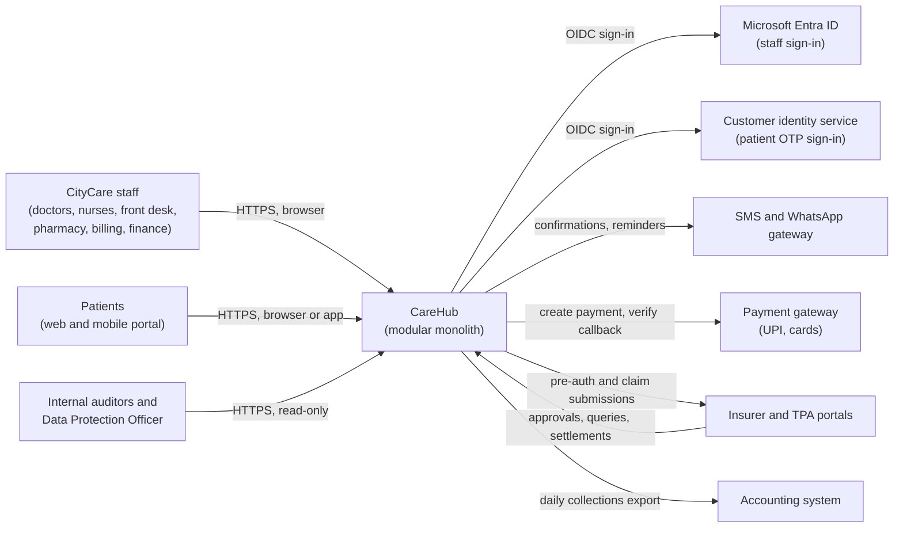
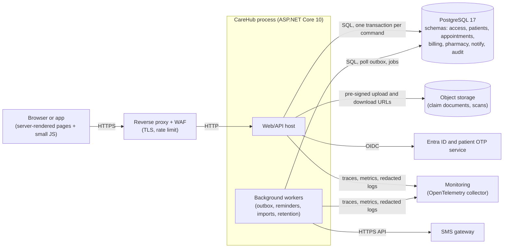
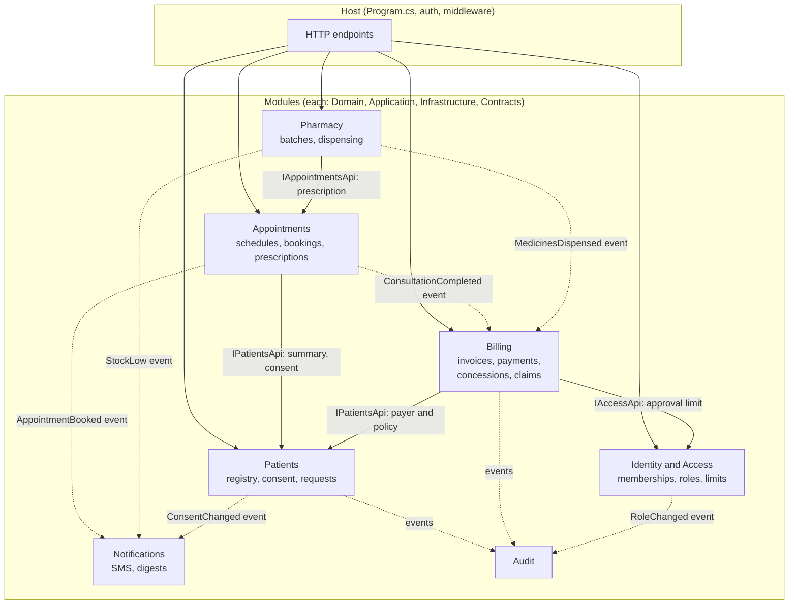
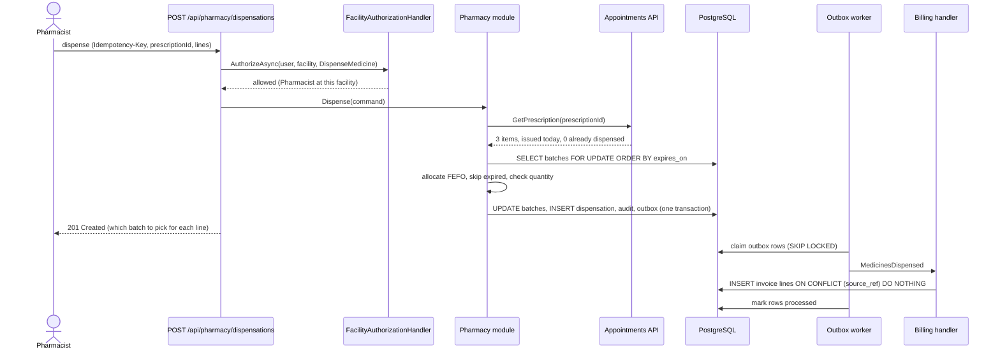
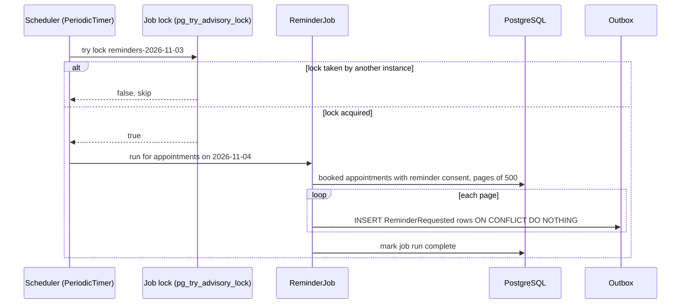
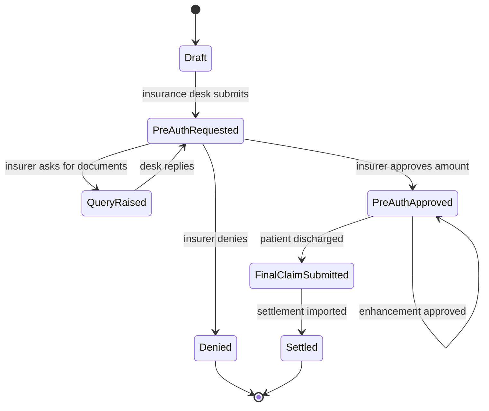

This is the first of three graduation projects. It is deliberately **not** distributed. Most business software in the world (hospital systems, ERPs, HR systems, school and government workflow systems) runs as one deployable application on one relational database, and the teams that do this well are not doing something "less advanced" than microservices. They are choosing a simpler shape and putting the effort into clean module boundaries, solid authorization, honest tests and good operations. That is what this capstone asks you to prove.

You will build **CareHub**: the operational system for **CityCare**, a fictional chain of hospitals and clinics. Patients book appointments with doctors, the front desk checks them in, doctors write prescriptions, the pharmacy dispenses medicines from stock, the billing desk raises invoices and insurance claims, and finance approves discounts. Everything touches health data, so privacy and audit are first-class requirements, not an afterthought. You will produce the full set of artefacts a real team would: requirements, HLD, LLD, diagrams, API spec, schema and migrations, code, tests, security and privacy review, performance tests, failure analysis, deployment instructions, runbook, cost analysis, ADRs and a final review.

If you have worked through [Scaling a real system from 100 to 10 million users](#/lesson/m17-scaling-journey), you saw a consumer app grow until it *had* to split. CareHub is the other common story: a business system with demanding rules and modest traffic, where the right answer is to stay one deployable and get the boundaries right.

## Learning objectives

By the end of this capstone you will be able to:

1. Turn a business brief into written functional and non-functional requirements with numbers.
2. Split one application into **modules** (patients, appointments, billing, pharmacy and supporting modules) with explicit public contracts, separate database schemas and rules that the build enforces.
3. Implement **authentication** with an external identity provider and **resource-based authorization** ("can *this* user approve *this* discount at *this* hospital?").
4. Design for **health-data privacy** under India's Digital Personal Data Protection (DPDP) Act: consent, minimum-necessary access, access audit, retention and data-principal requests.
5. Validate input at the edge and enforce business **invariants** inside the domain and the database (no double-booked doctor, no negative stock), and tell the two apart.
6. Run reliable **background processing** (appointment reminders, stock alerts, claim follow-ups) with a transactional outbox and hosted services.
7. Design a PostgreSQL schema per module with constraints and versioned **migrations** that are safe to deploy.
8. Write a **test pyramid**: domain unit tests, module integration tests against a real database, and API tests through `WebApplicationFactory`.
9. Write the operational documents (deployment guide, runbook, downtime procedure, cost and scaling analysis) that let someone else run your system at 2 a.m., and record decisions in **ADRs**.

## Prerequisites

- [Domain-driven modular monoliths](#/lesson/m08-ddd-modular-monolith) and [modular monolith basics](#/lesson/m02-modular-monolith): the architectural shape.
- [Authentication and authorization in ASP.NET Core](#/lesson/m03-authn-authz) and [RBAC and PBAC](#/lesson/m14-rbac-pbac): who can do what.
- [Background services](#/lesson/m03-background-services) and [the outbox](#/lesson/m12-outbox): reliable side effects.
- [Migrations and schema evolution](#/lesson/m09-migrations-evolution): changing the database without downtime.
- [Architecture decision records](#/lesson/m02-adr): how to write down the "why".

Strongly recommended: [Project: Order management domain](#/lesson/m08-order-management-project), which practises the aggregate and transaction skills at a smaller scale, and [Distributed job scheduler](#/lesson/m17-job-scheduler), whose leases and "run once" ideas you will use for reminders and nightly jobs.

## Project brief

### The organisation

CityCare runs **6 hospitals** (about 1,500 beds in total) and **40 neighbourhood clinics** in Bengaluru, Hyderabad and Pune. Each facility has an outpatient department (OPD) where patients see doctors by appointment or as walk-ins, and its own **pharmacy**. Hospitals also admit in-patients (IPD), most of whom have health insurance.

A typical day: a patient books a 10:30 slot with a cardiologist from her phone. She checks in at the front desk, sees the doctor, and leaves with a prescription. The pharmacy hands over three medicines, picking the batch that expires first. The billing desk adds the consultation fee and the medicines to her invoice and she pays by UPI. Across town, a knee-surgery patient is admitted on a **cashless insurance** policy: the insurance desk sends a **pre-authorisation** request to the insurer (usually through a third-party administrator, or TPA), the insurer approves ₹1,20,000, and at discharge the hospital submits the final claim. The patient pays only the part insurance does not cover. Occasionally finance approves a **concession** (a discount or write-off), for example for a staff family member or a hardship case.

Today this runs on a twenty-year-old desktop system per hospital, spreadsheets and phone calls. Doctors get double-booked, pharmacies run out of common medicines while expired stock sits on shelves, claims are delayed because documents go missing, concessions are approved by whoever is available, and nobody can answer the question a patient is now legally entitled to ask: "who has looked at my records?"

### Users and numbers

| Measure | Value | Source |
|---|---|---|
| Facilities | 6 hospitals (~1,500 beds) and 40 clinics, each with a pharmacy | Brief |
| Named staff users | ~6,000 (900 doctors, 2,500 nurses, the rest front desk, pharmacy, billing, finance) | Brief |
| Registered patients | ~1.5 million, growing ~20 % a year; ~150,000 portal sign-ins per month | Brief |
| OPD visits | 6 hospitals × 1,200 + 40 clinics × 120 = **12,000 per day**, 60 % booked in advance | Estimate |
| Admissions | 1,500 beds × 80 % occupancy ÷ 4-day average stay ≈ **300 per day**; ~55 % cashless ≈ 165 claims/day ≈ **5,000 claims/month** | Estimate |
| Peak concurrent staff | ~1,500 during morning OPD (09:00–12:00 IST) | Estimate: 25 % of named staff |
| Requests per second at peak | Staff 1,500 × 1 request per 10 s = 150 RPS, patient portal ≈ 20 RPS, total ≈ **170 RPS**, ×2 for bursts ≈ **350 RPS** | Estimate |
| Pharmacy | ~25,000 dispensed lines per day across 46 pharmacies | Estimate |
| Documents | ~8,000 per day (claim papers, scanned reports, ID and policy cards) × 1 MB ≈ 8 GB/day ≈ **240 GB/month**, ≈ 14 TB over 5 years | Estimate |
| Database rows (5 years) | appointments ~22 million (12,000 × 365 × 5), invoice lines ~110 million (60,000/day), dispensing lines ~46 million, **audit events ~550 million** (300,000/day, about 110 GB at ~200 bytes/row) | Estimate |

These numbers matter because they tell you what *not* to build. 350 RPS is a modest load for two ASP.NET Core instances (a well-written API on a 4-vCPU VM commonly serves several hundred to a few thousand simple requests per second, but measure your own). The biggest table is the **audit log**, because every view of a patient record is recorded; 550 million rows is comfortable for one PostgreSQL instance if the table is partitioned by month and old partitions are moved to cheaper storage. There is no throughput reason to distribute this system. There *are* strong correctness and privacy reasons to keep its data in one well-guarded place.

### Functional requirements

1. **Identity and access**: staff sign in with the company identity provider (Microsoft Entra ID via OpenID Connect); patients sign in to the portal with their mobile number and a one-time password through a customer identity service. Every staff user has **facility-scoped roles**: Viewer (internal auditor), Front Desk, Nurse, Doctor, Pharmacist, Billing Executive, Insurance Desk, Finance Officer, Finance Head. One doctor can consult at two clinics and be a Viewer at a third.
2. **Patients**: register a patient once for the whole chain with a medical record number (MRN); demographics, contact, emergency contact, and a guardian for minors; record **consent** with the version of the privacy notice shown and the purposes agreed (treatment, appointment reminders, and a separate opt-in for health camps and offers); flag likely duplicates (same phone and date of birth, similar name).
3. **Doctor schedules**: each doctor has weekly sessions per facility (for example Monday 09:00–13:00 at Koramangala clinic) and a slot length of 5–60 minutes; leave and holidays block slots.
4. **Appointments**: book, reschedule and cancel from the portal or the front desk; walk-in tokens; workflow Booked → CheckedIn → InConsultation → Completed, with Cancelled and NoShow; a doctor can **never** be double-booked, even when two people book the last slot at the same second. A completed consultation records a prescription (medicine, dose, quantity).
5. **Billing**: one invoice per OPD visit or admission; charge lines arrive from consultations and the pharmacy; payments by cash, card and UPI (through a payment gateway), deposits and refunds; GST rate taken from the item master, because over-the-counter medicine sales are taxed while most clinical services are exempt (confirm the rules with the finance team, do not hard-code them).
6. **Concessions**: a Billing Executive raises a concession on an invoice, the treating doctor endorses it, and finance approves it. Finance Officers have personal approval limits (for example ₹25,000); above that a Finance Head must approve; nobody may approve a concession they raised.
7. **Insurance claims (cashless)**: pre-authorisation with documents, insurer queries and replies, approval amount and enhancements, final claim at discharge, settlement import; patient share = invoice total − amount the insurer covers.
8. **Pharmacy stock**: medicine master, goods receipts by **batch** with expiry date, dispensing against a prescription using **first-expiry-first-out (FEFO)**, never dispense an expired batch, stock never negative, returns, reorder levels, and the separate register that Indian rules require for Schedule H1 drugs (patient, prescriber, quantity).
9. **Notifications and reminders**: SMS or WhatsApp confirmation on booking; a reminder at 18:00 IST the day before each appointment (only for patients who opted in); a 07:00 daily digest to each pharmacist of low-stock and soon-to-expire batches (90 days); in-app tasks for insurer queries.
10. **Reports**: daily collections per facility, outstanding patient balances, claims ageing (pending more than 7 days), expiry report; export to Excel.
11. **Privacy and audit**: every read or change of patient data is recorded with who, when, which patient, which facility and **purpose**; emergency "break-the-glass" access with a mandatory reason, reviewed daily; patient requests (summary of data held, correction, erasure where the law allows, grievance) tracked to completion; withdrawing consent for reminders takes effect within one hour.

### Non-functional requirements

| Quality | Target |
|---|---|
| Availability | 99.9 % monthly, 24×7 (allows ~43 minutes of downtime per month); a written **paper downtime procedure** for OPD, pharmacy and billing, because hospitals cannot stop when software does |
| Latency | p95 < 300 ms for reads, < 800 ms for workflow actions (book, dispense, pay), excluding file upload time |
| Durability | RPO 5 minutes (lose at most 5 minutes of data), RTO 1 hour |
| Security | OWASP Top 10 addressed, data encrypted in transit and at rest, documents served only through short-lived authorised links, MFA for all staff, no patient data in application logs |
| Privacy | DPDP Act obligations designed in (see below); minimum-necessary access per role; every access to a patient record audited |
| Auditability | Audit records are append-only, tamper-evident and kept for the retention period set by the records policy (assume 10 years) |
| Maintainability | A new developer can run the system locally in under 30 minutes with one command |
| Data residency | All data stored in Indian cloud regions (CityCare policy and insurer contracts; check current transfer rules rather than assuming the Act forbids all transfers) |

### Health-data privacy: what the DPDP Act means for your design

India's **Digital Personal Data Protection Act, 2023** (DPDP Act) applies to digital personal data, and a hospital chain processes a lot of it. In the Act's language, CityCare is a **Data Fiduciary** (it decides why and how data is processed) and each patient is a **Data Principal**. The DPDP Rules notified in November 2025 phase in most obligations through 2027. You are not expected to be a lawyer; you are expected to turn the obligations into engineering requirements and to ask the legal team the right questions. The main ones:

- **Notice and consent, with purposes.** Data is processed on the basis of consent given after a clear notice, or one of the "legitimate uses" the Act lists, which include responding to a medical emergency. Engineering: store *which* notice version each patient accepted, for *which* purposes, and make every processing job check the purpose (the reminder job reads `reminders_opt_in`; the marketing export does not exist unless that opt-in is true).
- **Children.** Processing a child's data (under 18) normally needs verifiable consent from a parent or guardian; the Rules carve out some processing by clinical establishments for the child's health. Engineering: a `guardian_id` on minors and a rule in the Patients domain; confirm the exact exemption with counsel.
- **Purpose limitation and minimum necessary.** Billing staff need charge lines, not consultation notes; the pharmacist needs the prescription, not the full history. Engineering: roles and the authorization matrix encode this, and reports for management use pseudonymised data (patient id, no name or phone).
- **Reasonable security safeguards.** Encryption, access control, access logs and backups are explicitly expected; failing to take reasonable safeguards can attract penalties of up to ₹250 crore. Engineering: everything in the security NFRs, plus the audit log.
- **Breach notification.** A personal-data breach must be reported to the Data Protection Board of India and to each affected patient (the 2025 Rules ask for a detailed report to the Board within 72 hours). Engineering: a breach runbook, the ability to answer "whose records were accessed between 02:00 and 04:00?" in minutes from the audit log, and a way to contact affected patients.
- **Data-principal rights.** Patients can ask for a summary of their data and who it was shared with, correction, erasure, and grievance redressal. Engineering: a request workflow with deadlines, and erasure that blanks personal fields while keeping records that other laws (medical-records, tax, insurance) require you to retain.
- **Retention.** Erase personal data when its purpose is served, unless another law requires keeping it. Engineering: a retention schedule per data category and a nightly job that applies it, with its own audit trail.

Large processors may be notified as **Significant Data Fiduciaries**, which adds a Data Protection Officer, impact assessments and periodic audits. Design as if CityCare will be one; it costs little if you plan for it now.

### Out of scope

The full clinical record (vitals, nursing notes, discharge summaries), lab and radiology systems (integrate later through HL7 FHIR), ABDM / ABHA health-ID linking and the National Health Claims Exchange (name them as future integrations behind an insurer adapter), payroll, telemedicine video, mobile offline mode, and payment execution (the payment gateway takes the money; CareHub records the result). Name them in the requirements document so nobody assumes them.

## Deliverables

Produce every deliverable below. Each row says what "good" looks like so you can review your own work before a reviewer does.

| # | Deliverable | What good looks like |
|---|---|---|
| 1 | **Requirements document** | Functional requirements numbered (FR-1…), each testable; NFRs with numbers (not "fast", but "p95 < 300 ms at 350 RPS"); explicit out-of-scope list; open questions with owners (for example "retention period for OPD invoices: Finance, by week 2"). 4–6 pages. |
| 2 | **HLD document** | C4 context and container views, module list with responsibilities, data ownership per module, sync vs async interactions, capacity estimate with arithmetic, and the top five risks. Explains why a monolith, and what would make you split. |
| 3 | **LLD document** | Per module: aggregates, invariants, state machines (appointment, claim, concession), public contract (interfaces and integration events), key class and sequence diagrams. Every invariant names its enforcing class or constraint. |
| 4 | **Architecture diagrams** | Context, container, component (module) and deployment diagrams, plus sequences for dispensing and the reminder job. Consistent names with the code; every arrow labelled with protocol or purpose. |
| 5 | **API specification** | OpenAPI 3.1 generated from the code (`Microsoft.AspNetCore.OpenApi`) and checked in; consistent resource naming, problem details (RFC 9457) for errors, pagination, idempotency keys on booking, dispensing and payment POSTs, versioning policy. |
| 6 | **DB schema and migrations** | One PostgreSQL schema per module, no cross-schema foreign keys except to shared reference data, `CHECK`/`UNIQUE`/exclusion constraints for key invariants, indexes justified by queries, audit table partitioned by month, migrations that are backward compatible (expand, migrate, contract). |
| 7 | **Implementation** | Builds with zero warnings in `Release`; modules reference each other only through `*.Contracts` projects; an architecture test fails the build on a forbidden reference; configuration via options with validation at startup. |
| 8 | **Unit and integration tests** | Domain tests for every invariant and transition; integration tests against real PostgreSQL (Testcontainers or a CI service container), including a concurrent double-booking test; API tests with `WebApplicationFactory` including authorization denials; domain line coverage above 85 %, with no coverage theatre elsewhere. |
| 9 | **Security and privacy review** | Threat model (STRIDE per container), authorization matrix (role × action × condition), OWASP Top 10 checklist with evidence, a **personal-data inventory** (field, module, purpose, retention, who can see it), consent and data-principal-request flows, breach runbook, file upload controls (size, type, malware scan), dependency scan results. |
| 10 | **Performance tests** | k6 or NBomber scripts for the morning OPD peak (350 RPS mixed, 30-minute soak), results with p50/p95/p99 and error rate, the bottleneck you found and what you changed. Numbers labelled with the hardware they ran on. |
| 11 | **Failure scenarios** | A table of at least 10 failures (DB failover, IdP down, SMS gateway down, insurer portal down, disk full, duplicate payment callback, worker crash mid-batch, migration fails half-way…) with detection, user impact, automatic mitigation and manual recovery. At least three tested deliberately. |
| 12 | **Deployment instructions** | From an empty environment to running: prerequisites, infrastructure (IaC preferred), secrets, database creation and migration, app deploy, smoke test, rollback. Someone else follows them and succeeds without asking you. |
| 13 | **Runbook and downtime procedure** | For each alert: what it means, how to confirm, step-by-step mitigation, escalation. Routine tasks: restore a backup, rotate a secret, replay dead outbox messages, answer a "who viewed my record" request. Plus the paper downtime procedure and how data is back-entered afterwards. |
| 14 | **Cost and scaling analysis** | Monthly cost estimate per environment with the pricing assumptions dated; what grows with patients, visits and documents; the first three things that break as load grows 10× (for example when CityCare buys another chain) and what you would do about each. |
| 15 | **ADRs** | At least six ADRs (context, decision, alternatives, consequences, status). Expected topics: modular monolith, schema per module, authorization model, outbox vs direct send, document storage, audit log design and retention. |
| 16 | **Final review** | A 2-page retrospective: what you would do differently, known limitations, technical debt register with severity, and a 20-minute demo script. |

:::callout type=tip title="Write documents as you build, not after"
Requirements and HLD come before code; the LLD for a module comes before that module; ADRs are written on the day of the decision. A document written at the end describes what you built, not why, and reviewers can tell.
:::

## Milestones

The plan assumes about 6 weeks at 10–12 hours per week. Each milestone ends with a demo and a review against the exit criteria.

| Week | Milestone | Scope | Exit criteria |
|---|---|---|---|
| 1 | **M1 — Requirements and HLD** | Deliverables 1, 2, personal-data inventory (first draft of 9), context and container diagrams, ADR-001 (monolith), ADR-002 (schema per module) | A reviewer can explain the system's purpose, users, modules, load numbers and privacy obligations from your documents alone |
| 2 | **M2 — Skeleton and identity** | Solution structure, module registration, OIDC sign-in, facility membership, authorization handler, audit of record access, architecture tests, CI pipeline, local `docker compose up` | A signed-in user sees only their facilities; every patient-record read writes an audit row; a forbidden module reference fails CI |
| 3 | **M3 — Patients and appointments** | LLD for Patients and Appointments, consent capture, doctor schedules, booking with the exclusion constraint, migrations, API, unit and integration tests | A concurrent test of 20 bookings for one slot produces exactly one booking; exercise 1 done |
| 4 | **M4 — Billing, concessions and pharmacy** | Invoices, payments, concession workflow with limits, claim state machine, pharmacy batches and FEFO dispensing, documents to object storage | Full OPD visit demo from booking to paid invoice; authorization denials tested; exercises 2 and 3 done |
| 5 | **M5 — Background processing and reports** | Outbox, dispatcher, SMS, 18:00 reminders, 07:00 pharmacy digest, claims ageing, retention job, reports | Killing the worker mid-batch loses and duplicates nothing visible to patients; exercise 4 done |
| 6 | **M6 — Hardening and handover** | Performance tests, security and privacy review, failure drills, deployment guide, runbook, downtime procedure, cost analysis, final review | Deliverables 9–16 complete; a peer deploys from your guide |

Two rules keep the plan honest. First, **every milestone ships something runnable**; there is no "integration week" at the end. Second, if you are behind, cut scope (Excel export, insurer query loop, walk-in tokens, patient portal UI) rather than tests, audit or documents. A smaller system that is tested, private and operable scores higher than a bigger one that is not. Week 4 is the heaviest; if you have only 10 hours, implement claims as a state machine with manual status updates and leave the insurer import for later.

## Reference architecture

This is one good answer, not the only one. Compare it with yours after you have drafted your own HLD.

### C4 level 1: system context



At the context level CareHub is one box. Three kinds of people use it. It depends on six external systems, and each arrow says who starts the conversation. CareHub never stores passwords: staff prove who they are to Entra ID, patients to a customer identity service that sends one-time passwords. The payment gateway takes the money; CareHub creates the payment and then **verifies** the gateway's callback (signature and amount) before marking an invoice paid, because a callback can be forged or arrive twice. Insurers and TPAs talk both ways: CareHub submits pre-authorisations and claims, and receives approvals, queries and settlements (by API where the insurer offers one, by file import otherwise). Every external dependency is a failure you must plan for, which is why each appears again in the failure scenarios table.

### C4 level 2: containers



The important choice here is that the **web host and the workers are the same codebase and the same deployable**, started with a different role setting (`Role=web` or `Role=worker`, or both in a single process for small environments). That keeps one build, one version and one set of migrations, while letting you scale or restart workers independently. All modules share one PostgreSQL instance but each owns a **schema**, which gives clear data ownership without the cost of separate databases. Documents go to object storage (Azure Blob or S3-compatible), not the database: the browser uploads and downloads through short-lived pre-signed URLs, so files never pass through the API process, and each download URL is issued only after an authorization check and an audit row. Telemetry goes to an OpenTelemetry collector; note the word **redacted**: logs and traces must never carry names, phone numbers or diagnoses (use the `Microsoft.Extensions.Compliance.Redaction` package or log only ids), because a log store is a much weaker vault than your database.

### C4 level 3: modules inside the process



Solid arrows are **synchronous in-process calls** through a module's public contract interface. For example, Pharmacy asks Appointments for the prescription before dispensing, because it needs the answer right now. Dotted arrows are **integration events** written to the outbox and delivered by the worker. The rule: a module may call another module's `Contracts` interface for a *query it needs right now*, and must use an event for *anything that is a side effect*. When the pharmacy dispenses, it does not call Billing to add a charge; it publishes `MedicinesDispensed`, and Billing adds the lines when it receives the event. That way a slow or broken Billing module never stops a patient getting medicine. Billing never reads the `pharmacy` schema directly and never references the Pharmacy module's `Domain` project; an architecture test (NetArchTest or a reflection-based test) enforces it.

Two contracts deserve care. `IPatientsApi` returns a **purpose-shaped** view, not the whole patient: Appointments gets name, age and contact preference; Billing gets payer and policy number. That is "minimum necessary" expressed as a module boundary. And `ConsentChanged` is an event, not a query, so Notifications keeps its own copy of "may we message this patient?" and the 18:00 reminder job never needs to call Patients 5,000 times.

### Key sequence: dispensing a prescription



Walk through it. Authorization is checked against the **facility** of the dispensation: a pharmacist at the Pune clinic cannot dispense against the Hyderabad clinic's stock. Pharmacy asks Appointments for the prescription through its public API rather than joining tables, and the answer includes how much has already been dispensed, so a prescription cannot be filled twice. The batch rows for those medicines are locked in expiry order, so two counters dispensing the last strip of a medicine at the same moment cannot both succeed; the second sees the reduced quantity. The domain allocates FEFO and refuses an expired batch. The stock change, the dispensation, the audit row and the outbox row commit together, so either all happen or none. Billing adds the charge lines later; it uses the dispensation line id as `source_ref` with a unique constraint, so a redelivered event cannot charge the patient twice. The idempotency key means a double-click or a flaky Wi-Fi retry at the counter returns the first response instead of dispensing twice.

### Key sequence: the 18:00 appointment reminders



With two worker instances, both timers fire at 18:00. A PostgreSQL **advisory lock** makes only one run the job (the [Distributed job scheduler](#/lesson/m17-job-scheduler) lesson shows the general version with leases). The job does not send SMS itself; it writes one outbox row per appointment with a unique key (`reminder:{appointmentId}`), so re-running the job after a crash cannot message anyone twice. It also filters on the consent flag *at run time*, so a patient who opted out at 17:30 gets nothing. About 7,200 appointments are booked in advance each day, so the job writes roughly 15 pages; sending stays the outbox worker's job, which already has retries and dead-lettering. Two details a reviewer will check: the job runs on **IST** (store `timestamptz`, compute "tomorrow" in `Asia/Kolkata`), and SMS gateways in India require registered templates and sender ids, so a template change is a deployment-time dependency, not a code change you can make at 17:55.

### Insurance claim lifecycle



`QueryRaised` loops back to `PreAuthRequested`, not to `Draft`, so the history of questions and replies stays attached to one claim. An **enhancement** (the stay is longer than planned, the insurer approves more money) keeps the claim in `PreAuthApproved` but raises the approved amount, and every change is audited. `Settled` is reached only through the settlement import, never by a user clicking a button, which is an authorization rule as much as a workflow rule. When a claim is `Denied` or settles below the bill, Billing recalculates the patient share and the patient is told before discharge, not by a surprise SMS a week later.

### Solution structure and code skeleton

```text
src/
  CareHub.Host/                      Program.cs, auth, middleware, module registration
  Modules/
    Pharmacy/
      CareHub.Pharmacy.Domain/         aggregates, no framework references
      CareHub.Pharmacy.Application/    command and query handlers
      CareHub.Pharmacy.Infrastructure/ EF Core DbContext (schema "pharmacy"), migrations
      CareHub.Pharmacy.Contracts/      public interfaces + integration events (what others may use)
    Patients/ ...  Appointments/ ...  Billing/ ...  Access/ ...  Notifications/ ...  Audit/ ...
  Shared/
    CareHub.Shared.Kernel/           Money, Result, clock, outbox abstractions
tests/
  CareHub.ArchitectureTests/
  Modules/*/UnitTests, Modules/*/IntegrationTests
  CareHub.Api.Tests/                 WebApplicationFactory
```

The compiled skeleton below shows the three ideas a reviewer will look for first: module registration through one interface, resource-based authorization with facility-scoped roles (including a clinical-record permission that billing roles do not get), and an outbox dispatcher as a hosted service. It uses in-memory stores so it compiles on its own; your real modules use EF Core with Npgsql.

```csharp file=Shared/Modules.cs
namespace CareHub.Shared;

/// <summary>Each module registers its own services and endpoints. The host knows nothing else about it.</summary>
public interface IModule
{
    string Name { get; }
    void Register(IServiceCollection services, IConfiguration configuration);
    void MapEndpoints(IEndpointRouteBuilder endpoints);
}

/// <summary>Anything that belongs to a facility and may carry money, so authorization can reason about it.</summary>
public interface IFacilityResource
{
    Guid FacilityId { get; }
    decimal? MonetaryValue { get; }
}

public enum FacilityRole
{
    Viewer, FrontDesk, Nurse, Doctor, Pharmacist, BillingExecutive, InsuranceDesk, FinanceOfficer, FinanceHead
}

public sealed record Membership(FacilityRole Role, decimal ApprovalLimit);

public interface IFacilityMembership
{
    Task<Membership?> GetAsync(string userId, Guid facilityId, CancellationToken ct);
}
```

```csharp file=Shared/Authorization.cs
using System.Security.Claims;
using Microsoft.AspNetCore.Authorization;
using Microsoft.AspNetCore.Authorization.Infrastructure;

namespace CareHub.Shared;

public static class Operations
{
    public static readonly OperationAuthorizationRequirement View = new() { Name = nameof(View) };
    public static readonly OperationAuthorizationRequirement ViewClinicalRecord = new() { Name = nameof(ViewClinicalRecord) };
    public static readonly OperationAuthorizationRequirement BookAppointment = new() { Name = nameof(BookAppointment) };
    public static readonly OperationAuthorizationRequirement DispenseMedicine = new() { Name = nameof(DispenseMedicine) };
    public static readonly OperationAuthorizationRequirement ApproveConcession = new() { Name = nameof(ApproveConcession) };
}

/// <summary>The authorization matrix as code. Pure function: easy to unit test exhaustively.</summary>
public static class Permissions
{
    public static bool Allows(Membership m, string operation, IFacilityResource resource) => operation switch
    {
        nameof(Operations.View) => true,   // any member: schedules, stock levels, invoice totals
        nameof(Operations.ViewClinicalRecord) =>
            m.Role is FacilityRole.Doctor or FacilityRole.Nurse or FacilityRole.Pharmacist,   // minimum necessary
        nameof(Operations.BookAppointment) =>
            m.Role is FacilityRole.FrontDesk or FacilityRole.Nurse or FacilityRole.Doctor,
        nameof(Operations.DispenseMedicine) => m.Role == FacilityRole.Pharmacist,
        nameof(Operations.ApproveConcession) =>
            m.Role == FacilityRole.FinanceHead ||
            (m.Role == FacilityRole.FinanceOfficer && (resource.MonetaryValue ?? 0m) <= m.ApprovalLimit),
        _ => false,                         // deny by default
    };
}

public sealed class FacilityAuthorizationHandler(IFacilityMembership memberships)
    : AuthorizationHandler<OperationAuthorizationRequirement, IFacilityResource>
{
    protected override async Task HandleRequirementAsync(AuthorizationHandlerContext context,
        OperationAuthorizationRequirement requirement, IFacilityResource resource)
    {
        var userId = context.User.FindFirstValue(ClaimTypes.NameIdentifier) ?? context.User.FindFirstValue("sub");
        if (userId is null) return;
        var membership = await memberships.GetAsync(userId, resource.FacilityId, CancellationToken.None);
        if (membership is not null && Permissions.Allows(membership, requirement.Name, resource))
            context.Succeed(requirement);
    }
}
```

```csharp file=Shared/Outbox.cs
using Microsoft.Extensions.Hosting;
using Microsoft.Extensions.Logging;

namespace CareHub.Shared;

public sealed record OutboxMessage(Guid Id, string Type, string Payload, int Attempts);

public interface IOutboxStore
{
    /// <summary>In PostgreSQL: SELECT ... FOR UPDATE SKIP LOCKED LIMIT n, so several workers never take the same row.</summary>
    Task<IReadOnlyList<OutboxMessage>> ClaimBatchAsync(int max, CancellationToken ct);
    Task MarkProcessedAsync(Guid id, CancellationToken ct);
    Task MarkFailedAsync(Guid id, string error, bool deadLetter, CancellationToken ct);
}

public interface IIntegrationEventHandler
{
    bool CanHandle(string type);
    Task HandleAsync(OutboxMessage message, CancellationToken ct);
}

public sealed class OutboxDispatcher(IOutboxStore store, IEnumerable<IIntegrationEventHandler> handlers,
    ILogger<OutboxDispatcher> logger) : BackgroundService
{
    public const int MaxAttempts = 8;
    private readonly IReadOnlyList<IIntegrationEventHandler> _handlers = handlers.ToList();

    protected override async Task ExecuteAsync(CancellationToken stoppingToken)
    {
        using var timer = new PeriodicTimer(TimeSpan.FromSeconds(2));
        while (await timer.WaitForNextTickAsync(stoppingToken))
        {
            try { await DispatchOnceAsync(stoppingToken); }
            catch (Exception ex) when (ex is not OperationCanceledException)
            {
                logger.LogError(ex, "Outbox dispatch loop failed; will retry on next tick");
            }
        }
    }

    public async Task<int> DispatchOnceAsync(CancellationToken ct)
    {
        var batch = await store.ClaimBatchAsync(50, ct);
        foreach (var msg in batch)
        {
            try
            {
                foreach (var h in _handlers.Where(h => h.CanHandle(msg.Type))) await h.HandleAsync(msg, ct);
                await store.MarkProcessedAsync(msg.Id, ct);
            }
            catch (Exception ex) when (ex is not OperationCanceledException)
            {
                var dead = msg.Attempts + 1 >= MaxAttempts;
                // Log ids and types only: payloads can contain patient data.
                logger.LogWarning(ex, "Outbox message {Id} ({Type}) failed, attempt {Attempt}, dead-letter {Dead}",
                    msg.Id, msg.Type, msg.Attempts + 1, dead);
                await store.MarkFailedAsync(msg.Id, ex.Message, dead, ct);
            }
        }
        return batch.Count;
    }
}
```

```csharp file=Modules/Billing/BillingModule.cs
using CareHub.Shared;
using Microsoft.AspNetCore.Authorization;

namespace CareHub.Modules.Billing;

public sealed record Concession(Guid Id, Guid FacilityId, Guid InvoiceId, decimal Amount, string Status, string RequestedBy)
    : IFacilityResource
{
    public decimal? MonetaryValue => Amount;
}

public interface IConcessionStore
{
    Task<Concession?> GetForUpdateAsync(Guid id, CancellationToken ct);
    Task SaveAsync(Concession concession, CancellationToken ct);
}

internal sealed class InMemoryConcessionStore : IConcessionStore
{
    private readonly Dictionary<Guid, Concession> _items = [];
    public Task<Concession?> GetForUpdateAsync(Guid id, CancellationToken ct) => Task.FromResult(_items.GetValueOrDefault(id));
    public Task SaveAsync(Concession concession, CancellationToken ct) { _items[concession.Id] = concession; return Task.CompletedTask; }
}

public sealed record ApproveConcessionRequest(string? Comment);

public sealed class BillingModule : IModule
{
    public string Name => "Billing";

    public void Register(IServiceCollection services, IConfiguration configuration) =>
        services.AddSingleton<IConcessionStore, InMemoryConcessionStore>();

    public void MapEndpoints(IEndpointRouteBuilder endpoints)
    {
        var concessions = endpoints.MapGroup("/api/concessions").RequireAuthorization().WithTags(Name);

        concessions.MapPost("/{id:guid}/approve", async (Guid id, ApproveConcessionRequest body, IConcessionStore store,
            IAuthorizationService authz, HttpContext http, CancellationToken ct) =>
        {
            var concession = await store.GetForUpdateAsync(id, ct);
            if (concession is null) return Results.NotFound();
            var auth = await authz.AuthorizeAsync(http.User, concession, Operations.ApproveConcession);
            if (!auth.Succeeded) return Results.Forbid();
            if (concession.Status != "Endorsed")
                return Results.Problem($"Concession is {concession.Status}; only Endorsed concessions can be approved.", statusCode: 409);
            // Separation of duties and the full matrix live in the policy (exercise 3).
            await store.SaveAsync(concession with { Status = "Approved" }, ct);   // + audit + outbox in the real module
            return Results.Ok(new { concession.Id, Status = "Approved" });
        });
    }
}
```

```csharp file=Program.cs
using CareHub.Modules.Billing;
using CareHub.Shared;
using Microsoft.AspNetCore.Authorization;

var builder = WebApplication.CreateBuilder(args);

IModule[] modules = [new BillingModule()];

// Real system: .AddOpenIdConnect() for staff (Entra ID) and a second scheme for the patient portal (separate NuGet packages).
builder.Services.AddAuthentication();
builder.Services.AddAuthorization(o => o.FallbackPolicy = o.DefaultPolicy);   // deny anonymous by default
builder.Services.AddSingleton<IAuthorizationHandler, FacilityAuthorizationHandler>();
builder.Services.AddSingleton<IFacilityMembership, NoMembership>();
builder.Services.AddProblemDetails();
foreach (var m in modules) m.Register(builder.Services, builder.Configuration);

var role = builder.Configuration["Role"] ?? "all";
if (role is "worker" or "all")
{
    // builder.Services.AddHostedService<OutboxDispatcher>();  registered once the PostgreSQL IOutboxStore exists
}

var app = builder.Build();
app.UseExceptionHandler();
app.UseAuthentication();
app.UseAuthorization();
if (role is "web" or "all")
    foreach (var m in modules) m.MapEndpoints(app);
app.MapGet("/health/live", () => Results.Ok()).AllowAnonymous();
app.Run();

internal sealed class NoMembership : IFacilityMembership
{
    public Task<Membership?> GetAsync(string userId, Guid facilityId, CancellationToken ct) => Task.FromResult<Membership?>(null);
}
```

Three details worth defending in review. `FallbackPolicy = DefaultPolicy` makes every endpoint require an authenticated user unless it explicitly says `AllowAnonymous`, so a forgotten attribute fails closed. `Permissions.Allows` is a pure function, so you can test the whole role × operation × amount matrix in a table-driven unit test without HTTP; notice that `BillingExecutive` and `FinanceOfficer` do **not** get `ViewClinicalRecord`, which is the DPDP "minimum necessary" idea in one line. The dispatcher catches failures **per message** and counts attempts, so one poison message cannot block the queue, and after eight attempts it moves to a dead-letter state that the runbook tells operators how to inspect and replay.

The real clinical-record policy is stricter than the skeleton: a doctor may open a patient's record when there is a **care relationship** (an appointment or admission with that doctor at that facility in the last 90 days, say). Without one, the UI offers **break-the-glass**: the doctor types a reason, access is granted for a short window, the audit row is flagged, and the Data Protection Officer's daily report lists every such access. Emergencies are never blocked; they are just made visible.

### Data model sketch

```sql
CREATE EXTENSION IF NOT EXISTS btree_gist;   -- lets a GiST exclusion constraint compare uuid with =

CREATE SCHEMA patients;
CREATE TABLE patients.patient (
  id               uuid PRIMARY KEY,
  mrn              text NOT NULL UNIQUE,                   -- medical record number, chain-wide
  full_name        text NOT NULL,
  date_of_birth    date NOT NULL,
  phone_e164       text NOT NULL,
  guardian_id      uuid REFERENCES patients.patient(id),   -- required for minors (rule in the domain)
  consent_version  text NOT NULL,                          -- which privacy notice the patient accepted
  consent_at       timestamptz NOT NULL,
  reminders_opt_in boolean NOT NULL DEFAULT false,
  erased_at        timestamptz                             -- personal fields blanked after an approved erasure
);

CREATE SCHEMA appointments;
CREATE TABLE appointments.appointment (
  id          uuid PRIMARY KEY,
  facility_id uuid NOT NULL,
  doctor_id   uuid NOT NULL,
  patient_id  uuid NOT NULL,                               -- id only: patients schema is another module
  starts_at   timestamptz NOT NULL,
  ends_at     timestamptz NOT NULL CHECK (ends_at > starts_at),
  status      text NOT NULL CHECK (status IN ('Booked','CheckedIn','InConsultation','Completed','Cancelled','NoShow')),
  version     int  NOT NULL DEFAULT 0,
  CONSTRAINT no_double_booking EXCLUDE USING gist
    (doctor_id WITH =, tstzrange(starts_at, ends_at) WITH &&) WHERE (status <> 'Cancelled')
);

CREATE SCHEMA pharmacy;
CREATE TABLE pharmacy.batch (
  id          uuid PRIMARY KEY,
  facility_id uuid NOT NULL,
  medicine_id uuid NOT NULL,
  batch_no    text NOT NULL,
  expires_on  date NOT NULL,
  qty_on_hand int  NOT NULL CHECK (qty_on_hand >= 0),
  UNIQUE (facility_id, medicine_id, batch_no)
);
CREATE INDEX ix_batch_fefo ON pharmacy.batch (facility_id, medicine_id, expires_on) WHERE qty_on_hand > 0;

CREATE SCHEMA billing;
CREATE TABLE billing.invoice (
  id           uuid PRIMARY KEY,
  facility_id  uuid NOT NULL,
  patient_id   uuid NOT NULL,
  number       text NOT NULL UNIQUE,
  status       text NOT NULL,
  version      int  NOT NULL DEFAULT 0
);
CREATE TABLE billing.invoice_line (
  id          uuid PRIMARY KEY,
  invoice_id  uuid NOT NULL REFERENCES billing.invoice(id),
  source_ref  text NOT NULL UNIQUE,                        -- e.g. 'disp-line:{id}': makes event handling idempotent
  description text NOT NULL,
  amount      numeric(12,2) NOT NULL,
  gst_rate    numeric(4,2)  NOT NULL CHECK (gst_rate >= 0)
);
CREATE TABLE billing.outbox (
  id               uuid PRIMARY KEY,
  type             text NOT NULL,
  payload          jsonb NOT NULL,
  dedupe_key       text UNIQUE,
  created_at       timestamptz NOT NULL DEFAULT now(),
  attempts         int NOT NULL DEFAULT 0,
  next_attempt_at  timestamptz NOT NULL DEFAULT now(),
  processed_at     timestamptz,
  dead_at          timestamptz,
  last_error       text
);
CREATE INDEX ix_outbox_due ON billing.outbox (next_attempt_at) WHERE processed_at IS NULL AND dead_at IS NULL;

CREATE SCHEMA audit;
CREATE TABLE audit.event (
  id          uuid NOT NULL,
  occurred_at timestamptz NOT NULL,
  actor_id    text NOT NULL,
  facility_id uuid,
  patient_id  uuid,                                        -- set for every read or change of patient data
  action      text NOT NULL,                               -- 'patient.view', 'concession.approve', ...
  purpose     text NOT NULL,                               -- 'treatment', 'billing', 'break-glass: <reason>'
  prev_hash   bytea,                                       -- hash chain, checked nightly
  PRIMARY KEY (id, occurred_at)                            -- a partitioned table's key must include the partition key
) PARTITION BY RANGE (occurred_at);
CREATE TABLE audit.event_2026_11 PARTITION OF audit.event
  FOR VALUES FROM ('2026-11-01 00:00+05:30') TO ('2026-12-01 00:00+05:30');
CREATE INDEX ix_audit_patient ON audit.event (patient_id, occurred_at);
```

Read the constraints as the last line of defence for the rules that matter most. The **exclusion constraint** `no_double_booking` says "no two non-cancelled appointments for the same doctor may overlap in time". Two front-desk staff booking the last 10:30 slot at the same instant both pass the application check, but PostgreSQL rejects the second insert with a constraint violation, which the API turns into a 409 "slot just taken". A unique index on `(doctor_id, starts_at)` would catch identical start times only, not a 15-minute booking that overlaps a 30-minute one. `qty_on_hand >= 0` makes negative stock impossible even if a bug skips the domain check. `source_ref UNIQUE` makes the Billing event handler idempotent. The partial index `ix_batch_fefo` serves FEFO picking and stays small because empty batches drop out of it.

Some rules span rows in ways constraints cannot express well, such as "a doctor's weekly sessions must not overlap" (they are templates, not bookings) or "a minor must have a guardian". The aggregate enforces those, and a nightly consistency query reports any violation. Note too that `patient_id` columns outside the `patients` schema are **ids only**, with no foreign key: the module owns its data, and erasure blanks the personal fields in one place instead of chasing copies.

The **audit** table is designed for volume and for privacy questions. Monthly partitions keep each one around 9 million rows; old partitions can be detached and moved to cheaper storage without a slow `DELETE`. The index on `(patient_id, occurred_at)` answers "who viewed my record?" in milliseconds. The application's database role gets `INSERT` and `SELECT` on `audit.event` but not `UPDATE` or `DELETE`, and each row stores a hash of the previous one, so tampering is both forbidden and detectable.

### When this design should change

Write these into your HLD as explicit triggers. Split a module into its own service when a different team must deploy it on a different schedule, when its load profile differs by an order of magnitude (for example document OCR for claims), or when it needs a different data store. Add a read replica when month-end reporting measurably slows down the morning OPD. Add a cache only after measuring a hot read; doctor schedules and the medicine master are the likely first candidates, and at 350 RPS PostgreSQL with good indexes is usually enough. If CityCare later lets patients book across 5,000 partner clinics with flash promotions for health check-ups, the booking path starts to look like the [Flash sale](#/lesson/m17-flash-sale) case study, and *that* is when queues in front of hot slots are worth their cost.

### Practice on the canvas

Use the canvas to try your own deployment before exercise 5. Start from one instance and add only what a requirement forces: a second instance for zero-downtime deploys and the 99.9 % target, a worker role for the outbox and reminders, object storage for documents, a standby database for the RPO. Watch which component saturates when you raise client traffic to 10x.

:::playground type=hld title="CareHub deployment sandbox"
```json
{
  "nodes": [
    { "id": "u", "type": "client", "label": "Staff and patients", "props": { "rps": 350 } },
    { "id": "lb", "type": "load-balancer", "label": "Reverse proxy" },
    { "id": "app", "type": "app-server", "label": "CareHub (web + worker)", "props": { "instances": 1 } },
    { "id": "db", "type": "database", "label": "PostgreSQL 17" },
    { "id": "idp", "type": "external", "label": "Entra ID" }
  ],
  "edges": [
    { "from": "u", "to": "lb", "kind": "sync" },
    { "from": "lb", "to": "app", "kind": "sync" },
    { "from": "app", "to": "db", "kind": "sync", "label": "SQL" },
    { "from": "app", "to": "idp", "kind": "sync", "label": "OIDC" }
  ]
}
```
:::

## Evaluation rubric

Reviewers score each criterion 0–4. The pass mark is 60 of 88 (about 68 %), with no criterion below 2 in the **must** rows (marked ★).

| # | Criterion | 1 — weak | 2 — acceptable | 3 — strong | 4 — exemplary |
|---|---|---|---|---|---|
| 1 ★ | Requirements | Vague, no numbers | Numbered FRs, NFRs with some numbers | Every NFR measurable, out-of-scope listed | Plus open questions resolved with stakeholders and traced to tests |
| 2 ★ | HLD and diagrams | Boxes without labels | Context and container diagrams, modules named | All four views consistent with code, every arrow labelled | Plus risks ranked and split triggers stated |
| 3 | LLD | Class lists only | Aggregates and invariants per module | State machines and sequences per key flow | Every invariant traced to class, constraint and test |
| 4 ★ | Module boundaries | Modules share tables freely | Separate folders and schemas | Public contract projects only; events for side effects | Architecture tests fail CI on violations |
| 5 ★ | Authentication | Home-made login | OIDC with an external IdP for staff | Plus MFA, secure cookie or token handling, sign-out, session lifetime; patient OTP sign-in | Plus access reviews and leaver process documented |
| 6 ★ | Authorization | Role checks in UI only | Role attributes on endpoints | Resource-based, facility-scoped, deny by default, minimum necessary | Plus exhaustive matrix tests, care-relationship check and break-the-glass |
| 7 | Validation and invariants | Validation in controllers only | Edge validation plus some domain rules | Clear split: shape at edge, rules in domain | Plus DB constraints back the critical rules (double booking, negative stock) |
| 8 ★ | Data and migrations | Hand-edited database | Migrations exist | Constraints, indexes justified, expand-contract, audit partitioned | Plus a migration rehearsed against production-sized data |
| 9 ★ | Background processing | Fire-and-forget `Task.Run` | Hosted service sends directly | Transactional outbox, retries, dead-letter, single-run jobs | Plus replay tooling and metrics on lag |
| 10 ★ | Tests | Few or none | Unit tests for domain | Plus integration tests on real PostgreSQL (including concurrent booking) and API auth tests | Plus failure-injection tests and a fast CI (< 10 min) |
| 11 | API spec | None | Generated OpenAPI | Problem details, pagination, idempotency, versioning | Plus contract tests guard breaking changes |
| 12 ★ | Security and privacy review | Missing | OWASP checklist | STRIDE threat model, personal-data inventory, consent and retention design | Plus evidence: access-audit demo, breach runbook rehearsed, upload controls tested |
| 13 | Performance | Not tested | One load test | Morning-peak scenario with p95/p99, bottleneck fixed | Plus soak test and capacity headroom stated |
| 14 | Failure scenarios | Not considered | List of failures | Table with detection and recovery | Three drills performed and written up |
| 15 | Observability | Console logs | Structured logs | Traces, metrics, correlation ids, dashboards, no patient data in logs | SLOs with alerts tied to runbook entries |
| 16 ★ | Deployment | "Run it in Visual Studio" | Written steps | Repeatable script or IaC, rollback tested | A peer deploys from the guide unaided |
| 17 | Runbook and downtime procedure | Missing | A few notes | Entry per alert plus routine tasks and a paper downtime procedure | Tested by someone other than the author |
| 18 | Cost and scaling | Missing | Monthly cost guess | Per-environment estimate with dated assumptions | Plus 10× analysis with first three bottlenecks |
| 19 | ADRs | None | 2–3 short ADRs | Six ADRs with alternatives and consequences | Plus superseded ADRs kept, showing evolution |
| 20 | Code quality | Inconsistent | Readable, some duplication | Consistent conventions, zero warnings | Reviewer finds nothing structural to change |
| 21 | Final review | Missing | Summary of features | Honest limitations and debt register | Plus a crisp demo that shows failure handling live |
| 22 | Simplicity | Over- or under-engineered | Mostly appropriate | Every component justified by a requirement | Plus explicit "things we chose not to build" |

A score of 0 in any row (deliverable missing) is an automatic fail for that review cycle. The rubric rewards **evidence**: a claim such as "handles SMS gateway outages" or "every record access is audited" scores 2 at most unless the drill or demo is written up.

## Exercises

:::exercise id=m20-capstone-a-ex1 difficulty=beginner kind=code title="M3: validate a doctor's weekly schedule"
Write `ScheduleValidator.Validate`, which returns every rule violation for a proposed weekly schedule (not just the first), as stable error codes the UI can translate. A schedule has a slot length, a validity period and a list of sessions such as "MON-AM: Monday 09:00–13:00".
::requirements
- `SLOT_LENGTH`: slot length must be between 5 and 60 minutes inclusive.
- `DATES_ORDER`: `ValidUntil` must be after `ValidFrom`.
- `NO_SESSIONS`: at least one session (if there are none, return immediately).
- `SESSION_TIMES`: every session must end after it starts (no sessions across midnight in this version).
- `SLOT_FIT`: every session's length must be a whole number of slots. Check only sessions with valid times, and only when the slot length itself is valid.
- `DUPLICATE_CODE`: session codes must be unique (case-insensitive).
- `OVERLAP`: two sessions on the same day must not overlap. A session ending at 13:00 and one starting at 13:00 do not overlap. Check only sessions with valid times.
- Each code appears at most once in the result; return them in the order listed above.
::acceptance
- A valid schedule returns an empty list.
- A 20-minute slot with a 09:00–13:30 session (270 minutes, 13.5 slots) returns `SLOT_FIT`.
- Codes "MON-AM" and "mon-am" return `DUPLICATE_CODE`.
- Monday 09:00–13:00 and Monday 12:00–15:00 return `OVERLAP`; the same times on different days do not.
- A schedule with four different problems returns all four codes in the documented order.
::hint
Collect errors in a list instead of throwing on the first one. Front-desk staff fix a form faster when they see every problem at once.
::hint
Check each rule in the documented order and add its code once. Decide up front which sessions are "valid" (end after start); `SLOT_FIT` and `OVERLAP` look only at those.
::hint
Careful with `TimeOnly` subtraction: `new TimeOnly(10, 0) - new TimeOnly(12, 0)` is **22 hours**, because it wraps around midnight. Compare `End > Start` before you subtract.
::hint
For overlap, group valid sessions by `Day`, sort each group by `Start`, and compare each session with the previous one: `next.Start < previous.End` means overlap. If any two sessions overlap, some *adjacent* pair in the sorted list does too.
::hint
For duplicates: `sessions.GroupBy(s => s.Code, StringComparer.OrdinalIgnoreCase).Any(g => g.Count() > 1)`.
::starter
```csharp file=ScheduleValidator.cs
using System;
using System.Collections.Generic;

public sealed record SessionInput(string Code, DayOfWeek Day, TimeOnly Start, TimeOnly End);
public sealed record ScheduleInput(int SlotMinutes, DateOnly ValidFrom, DateOnly ValidUntil, IReadOnlyList<SessionInput> Sessions);

public static class ScheduleValidator
{
    public static IReadOnlyList<string> Validate(ScheduleInput schedule) => throw new NotImplementedException();
}
```
::tests
```csharp file=ScheduleValidatorTests.cs
using System;
using Xunit;

public class ScheduleValidatorTests
{
    private static readonly DateOnly From = new(2026, 11, 1), Until = new(2027, 3, 31);
    private static SessionInput S(string code, DayOfWeek day, int startHour, int startMin, int endHour, int endMin) =>
        new(code, day, new TimeOnly(startHour, startMin), new TimeOnly(endHour, endMin));

    [Fact]
    public void Valid_schedule_has_no_errors() =>
        Assert.Empty(ScheduleValidator.Validate(new ScheduleInput(15, From, Until, new[]
        {
            S("MON-AM", DayOfWeek.Monday, 9, 0, 13, 0),
            S("MON-PM", DayOfWeek.Monday, 13, 0, 17, 0),
            S("THU-AM", DayOfWeek.Thursday, 9, 0, 12, 0),
        })));

    [Fact]
    public void Session_must_be_whole_slots() =>
        Assert.Equal(new[] { "SLOT_FIT" }, ScheduleValidator.Validate(new ScheduleInput(20, From, Until, new[]
        {
            S("MON-AM", DayOfWeek.Monday, 9, 0, 13, 30),
        })));

    [Fact]
    public void Duplicate_codes_are_case_insensitive() =>
        Assert.Equal(new[] { "DUPLICATE_CODE" }, ScheduleValidator.Validate(new ScheduleInput(15, From, Until, new[]
        {
            S("MON-AM", DayOfWeek.Monday, 9, 0, 12, 0),
            S("mon-am", DayOfWeek.Tuesday, 9, 0, 12, 0),
        })));

    [Fact]
    public void Overlapping_sessions_on_same_day() =>
        Assert.Equal(new[] { "OVERLAP" }, ScheduleValidator.Validate(new ScheduleInput(15, From, Until, new[]
        {
            S("A", DayOfWeek.Monday, 9, 0, 13, 0),
            S("B", DayOfWeek.Monday, 12, 0, 15, 0),
        })));

    [Fact]
    public void Same_times_on_different_days_do_not_overlap() =>
        Assert.Empty(ScheduleValidator.Validate(new ScheduleInput(15, From, Until, new[]
        {
            S("A", DayOfWeek.Monday, 9, 0, 13, 0),
            S("B", DayOfWeek.Wednesday, 9, 0, 13, 0),
        })));

    [Fact]
    public void No_sessions() =>
        Assert.Contains("NO_SESSIONS", ScheduleValidator.Validate(new ScheduleInput(15, From, Until, Array.Empty<SessionInput>())));

    [Fact]
    public void Reports_every_problem_in_order()
    {
        var errors = ScheduleValidator.Validate(new ScheduleInput(90, Until, From, new[]
        {
            S("X", DayOfWeek.Monday, 12, 0, 10, 0),
            S("Y", DayOfWeek.Monday, 9, 0, 11, 0),
            S("Z", DayOfWeek.Monday, 10, 0, 11, 0),
        }));
        Assert.Equal(new[] { "SLOT_LENGTH", "DATES_ORDER", "SESSION_TIMES", "OVERLAP" }, errors);
    }
}
```
::solution
```csharp file=ScheduleValidator.cs
using System;
using System.Collections.Generic;
using System.Linq;

public sealed record SessionInput(string Code, DayOfWeek Day, TimeOnly Start, TimeOnly End);
public sealed record ScheduleInput(int SlotMinutes, DateOnly ValidFrom, DateOnly ValidUntil, IReadOnlyList<SessionInput> Sessions);

public static class ScheduleValidator
{
    public static IReadOnlyList<string> Validate(ScheduleInput s)
    {
        var errors = new List<string>();
        var slotOk = s.SlotMinutes is >= 5 and <= 60;
        if (!slotOk) errors.Add("SLOT_LENGTH");
        if (s.ValidUntil <= s.ValidFrom) errors.Add("DATES_ORDER");
        if (s.Sessions.Count == 0) { errors.Add("NO_SESSIONS"); return errors; }

        var valid = s.Sessions.Where(x => x.End > x.Start).ToList();
        if (valid.Count != s.Sessions.Count) errors.Add("SESSION_TIMES");

        if (slotOk && valid.Any(x => (int)(x.End - x.Start).TotalMinutes % s.SlotMinutes != 0))
            errors.Add("SLOT_FIT");

        if (s.Sessions.GroupBy(x => x.Code, StringComparer.OrdinalIgnoreCase).Any(g => g.Count() > 1))
            errors.Add("DUPLICATE_CODE");

        var overlaps = valid.GroupBy(x => x.Day).Any(day =>
        {
            var sorted = day.OrderBy(x => x.Start).ToList();
            for (var i = 1; i < sorted.Count; i++)
                if (sorted[i].Start < sorted[i - 1].End) return true;
            return false;
        });
        if (overlaps) errors.Add("OVERLAP");

        return errors;
    }
}
```

In the "every problem" test, session X ends before it starts, so it gets `SESSION_TIMES` and is ignored by the later checks; Y (09:00–11:00) and Z (10:00–11:00) overlap; `SLOT_FIT` is skipped because a 90-minute slot is itself invalid, so reporting "sessions don't fit" would only confuse. Where does this validator live? It checks **business rules**, so it belongs to the Appointments domain and runs inside `DoctorSchedule.Create`. The API layer separately checks *shape* (required fields, code length) and maps the codes to RFC 9457 problem details with an `errors` dictionary. Validating the template does not prevent double booking of actual appointments; that is the exclusion constraint's job.
::mistakes
- Throwing on the first error, so the user fixes one field at a time.
- Subtracting `TimeOnly` values without checking order first, so a reversed session looks 22 hours long.
- Comparing only identical start times for overlap, missing 09:00–13:00 against 12:00–15:00.
- Validating only in the API layer, so an import from the old system can create an invalid schedule.
::extensions
Support casualty night sessions that cross midnight (22:00–02:00) by storing a start time and a duration instead of an end time, and update `OVERLAP` to compare against the next day's sessions.
:::

:::exercise id=m20-capstone-a-ex2 difficulty=beginner kind=sql ordered=true title="M4: patient invoice summary without double counting"
Write the outstanding-balance report. For each invoice return `number`, `gross_amount`, `insurer_covered` (sum of claim amounts with status `Approved` or `Settled`), `patient_share` (gross − insurer covered), `paid` (sum of payments with status `Captured`; refunds are captured negative amounts) and `balance` (patient share − paid). Include invoices with no claims or payments. Order by `number`.
::setup
```sql
CREATE TABLE invoice (
  id           int PRIMARY KEY,
  number       text NOT NULL UNIQUE,
  gross_amount numeric(12,2) NOT NULL
);
CREATE TABLE claim (
  id         int PRIMARY KEY,
  invoice_id int NOT NULL REFERENCES invoice(id),
  amount     numeric(12,2) NOT NULL,
  status     text NOT NULL
);
CREATE TABLE payment (
  id         int PRIMARY KEY,
  invoice_id int NOT NULL REFERENCES invoice(id),
  amount     numeric(12,2) NOT NULL,
  status     text NOT NULL
);
INSERT INTO invoice VALUES
  (1, 'INV-BLR-0142', 185000.00),
  (2, 'INV-HYD-0077',  42000.00),
  (3, 'INV-PUN-0310',   1800.00);
INSERT INTO claim VALUES
  (10, 1, 120000.00, 'Approved'),
  (11, 1,  15000.00, 'Approved'),
  (12, 1,  20000.00, 'Pending'),
  (13, 2,  25000.00, 'Settled');
INSERT INTO payment VALUES
  (100, 1, 30000.00, 'Captured'),
  (101, 1, 15000.00, 'Captured'),
  (102, 1,  5000.00, 'Failed'),
  (103, 2, 20000.00, 'Captured'),
  (104, 2, -3000.00, 'Captured');
```
::check
```sql
WITH c AS (
  SELECT invoice_id, SUM(amount) AS insurer_covered
  FROM claim WHERE status IN ('Approved', 'Settled') GROUP BY invoice_id
), p AS (
  SELECT invoice_id, SUM(amount) AS paid
  FROM payment WHERE status = 'Captured' GROUP BY invoice_id
)
SELECT i.number,
       i.gross_amount,
       COALESCE(c.insurer_covered, 0) AS insurer_covered,
       i.gross_amount - COALESCE(c.insurer_covered, 0) AS patient_share,
       COALESCE(p.paid, 0) AS paid,
       i.gross_amount - COALESCE(c.insurer_covered, 0) - COALESCE(p.paid, 0) AS balance
FROM invoice i
LEFT JOIN c ON c.invoice_id = i.id
LEFT JOIN p ON p.invoice_id = i.id
ORDER BY i.number;
```
::acceptance
- INV-BLR-0142 (knee surgery): insurer covered 135,000.00 (pre-auth plus enhancement), patient share 50,000.00, paid 45,000.00, balance 5,000.00.
- INV-HYD-0077: the ₹3,000 refund of an excess deposit gives paid 17,000.00 and balance 0.00.
- INV-PUN-0310 (an OPD visit) appears with zero insurer cover and zero paid, balance 1,800.00.
- No amount is counted twice; pending claims and failed payments are ignored.
::hint
Try the naive version first: `invoice LEFT JOIN claim LEFT JOIN payment` with two `SUM`s. Look at INV-BLR-0142's numbers. Why are they wrong?
::hint
Joining two independent one-to-many tables multiplies rows: 2 counted claims × 2 captured payments = 4 rows for INV-BLR-0142, so each claim is counted twice and each payment twice.
::hint
Aggregate each child table to one row per invoice first (in a CTE or subquery), then join those.
::hint
Remember `COALESCE(..., 0)` for invoices with no matching rows, and filter statuses inside the aggregates, not in an outer `WHERE`.
::solution
```sql
WITH c AS (
  SELECT invoice_id, SUM(amount) AS insurer_covered
  FROM claim WHERE status IN ('Approved', 'Settled') GROUP BY invoice_id
), p AS (
  SELECT invoice_id, SUM(amount) AS paid
  FROM payment WHERE status = 'Captured' GROUP BY invoice_id
)
SELECT i.number,
       i.gross_amount,
       COALESCE(c.insurer_covered, 0) AS insurer_covered,
       i.gross_amount - COALESCE(c.insurer_covered, 0) AS patient_share,
       COALESCE(p.paid, 0) AS paid,
       i.gross_amount - COALESCE(c.insurer_covered, 0) - COALESCE(p.paid, 0) AS balance
FROM invoice i
LEFT JOIN c ON c.invoice_id = i.id
LEFT JOIN p ON p.invoice_id = i.id
ORDER BY i.number;
```

This "fan-out" bug is one of the most common causes of wrong financial reports, and it is silent: the query runs and the numbers look plausible. Here the naive version would tell the knee-surgery patient that insurance covered ₹2,70,000 of a ₹1,85,000 bill. In CareHub claims and payments both belong to Billing, so this query can run inside the module. A report that also needs pharmacy or appointment data would be built from a **reporting read model** fed by events, or a view in a separate `reporting` schema that is allowed to read several modules. Record which in an ADR. Real claims also carry a *settled* amount that can be lower than the approved one; the report should use the settled amount once it exists.
::mistakes
- Joining both child tables and summing, which doubles INV-BLR-0142's figures.
- Filtering `status` in `WHERE` after a `LEFT JOIN`, which drops INV-PUN-0310.
- Counting `Pending` claims as covered, which hides money the patient may still owe.
- Excluding negative payments, which makes a refunded deposit look like an overpayment.
:::

:::exercise id=m20-capstone-a-ex3 difficulty=intermediate kind=code title="M4: the facility authorization matrix with approval limits"
Implement `ConcessionAuthorizer.Decide`, the pure policy behind resource-based authorization for invoice concessions (discounts and write-offs). It returns an `AuthzDecision` with `Allowed` and a `Reason` code (useful for audit and for the 403 response).
::requirements
- No membership at the concession's facility: deny, reason `NOT_MEMBER`.
- `View`: any member.
- `Request`: only `BillingExecutive`.
- `Endorse`: only `Doctor`, and only the patient's treating doctor (`TreatingDoctorId`); another doctor gets `NOT_TREATING_DOCTOR`.
- `Approve`: `FinanceHead` always; `FinanceOfficer` only if the concession amount is at most their approval limit, otherwise `OVER_LIMIT`.
- Separation of duties: nobody may approve a concession they requested (`SAME_PERSON`), checked before the limit.
- Any other role for an action: `ROLE_NOT_PERMITTED`. Allowed decisions use reason `OK`.
::acceptance
- A Finance Officer with a ₹25,000 limit can approve ₹12,000 and cannot approve ₹40,000 (`OVER_LIMIT`).
- A Finance Head who raised the concession (while covering the billing desk) is denied with `SAME_PERSON`.
- A doctor who is not the treating doctor cannot endorse (`NOT_TREATING_DOCTOR`).
- A user with no membership gets `NOT_MEMBER` for every action.
::hint
Order matters: membership first, then action-specific rules. Write the order down before coding.
::hint
A `switch` expression on the action with `when` guards keeps each rule on one line.
::hint
Separation of duties is checked on the *person*, not the role: compare the user id with `concession.RequestedBy`.
::hint
```csharp
ConcessionAction.Approve when user.UserId == c.RequestedBy => Deny("SAME_PERSON"),
ConcessionAction.Approve when m.Role == Role.FinanceHead => Allow(),
```
::starter
```csharp file=ConcessionAuthorizer.cs
using System;
using System.Collections.Generic;

public enum Role { Viewer, FrontDesk, Doctor, BillingExecutive, FinanceOfficer, FinanceHead }
public enum ConcessionAction { View, Request, Endorse, Approve }

public sealed record UserContext(string UserId, IReadOnlyDictionary<Guid, (Role Role, decimal ApprovalLimit)> Memberships);
public sealed record ConcessionInfo(Guid FacilityId, string TreatingDoctorId, decimal Amount, string? RequestedBy);
public sealed record AuthzDecision(bool Allowed, string Reason);

public static class ConcessionAuthorizer
{
    public static AuthzDecision Decide(UserContext user, ConcessionInfo concession, ConcessionAction action) =>
        throw new NotImplementedException();
}
```
::tests
```csharp file=ConcessionAuthorizerTests.cs
using System;
using System.Collections.Generic;
using Xunit;

public class ConcessionAuthorizerTests
{
    private static readonly Guid Hospital = Guid.NewGuid();

    private static UserContext U(string id, Role role, decimal limit = 0m) =>
        new(id, new Dictionary<Guid, (Role, decimal)> { [Hospital] = (role, limit) });

    private static ConcessionInfo C(decimal amount, string? requestedBy = "be-1") => new(Hospital, "dr-1", amount, requestedBy);

    [Fact]
    public void Officer_within_limit_can_approve() =>
        Assert.Equal(new AuthzDecision(true, "OK"),
            ConcessionAuthorizer.Decide(U("fo-1", Role.FinanceOfficer, 25_000m), C(12_000m), ConcessionAction.Approve));

    [Fact]
    public void Officer_over_limit_is_denied() =>
        Assert.Equal("OVER_LIMIT",
            ConcessionAuthorizer.Decide(U("fo-1", Role.FinanceOfficer, 25_000m), C(40_000m), ConcessionAction.Approve).Reason);

    [Fact]
    public void Head_cannot_approve_own_request() =>
        Assert.Equal("SAME_PERSON",
            ConcessionAuthorizer.Decide(U("fh-1", Role.FinanceHead), C(8_000m, "fh-1"), ConcessionAction.Approve).Reason);

    [Fact]
    public void Head_can_approve_any_amount() =>
        Assert.True(ConcessionAuthorizer.Decide(U("fh-1", Role.FinanceHead), C(300_000m), ConcessionAction.Approve).Allowed);

    [Fact]
    public void Other_doctor_cannot_endorse() =>
        Assert.Equal("NOT_TREATING_DOCTOR",
            ConcessionAuthorizer.Decide(U("dr-9", Role.Doctor), C(5_000m), ConcessionAction.Endorse).Reason);

    [Fact]
    public void Treating_doctor_can_endorse() =>
        Assert.True(ConcessionAuthorizer.Decide(U("dr-1", Role.Doctor), C(5_000m), ConcessionAction.Endorse).Allowed);

    [Fact]
    public void Billing_executive_can_request() =>
        Assert.True(ConcessionAuthorizer.Decide(U("be-1", Role.BillingExecutive), C(5_000m), ConcessionAction.Request).Allowed);

    [Fact]
    public void Non_member_is_denied_everything()
    {
        var stranger = new UserContext("x", new Dictionary<Guid, (Role, decimal)>());
        foreach (var a in Enum.GetValues<ConcessionAction>())
            Assert.Equal("NOT_MEMBER", ConcessionAuthorizer.Decide(stranger, C(1m), a).Reason);
    }

    [Fact]
    public void Viewer_cannot_endorse() =>
        Assert.Equal("ROLE_NOT_PERMITTED",
            ConcessionAuthorizer.Decide(U("v-1", Role.Viewer), C(1m), ConcessionAction.Endorse).Reason);
}
```
::solution
```csharp file=ConcessionAuthorizer.cs
using System;
using System.Collections.Generic;

public enum Role { Viewer, FrontDesk, Doctor, BillingExecutive, FinanceOfficer, FinanceHead }
public enum ConcessionAction { View, Request, Endorse, Approve }

public sealed record UserContext(string UserId, IReadOnlyDictionary<Guid, (Role Role, decimal ApprovalLimit)> Memberships);
public sealed record ConcessionInfo(Guid FacilityId, string TreatingDoctorId, decimal Amount, string? RequestedBy);
public sealed record AuthzDecision(bool Allowed, string Reason);

public static class ConcessionAuthorizer
{
    private static AuthzDecision Allow() => new(true, "OK");
    private static AuthzDecision Deny(string reason) => new(false, reason);

    public static AuthzDecision Decide(UserContext user, ConcessionInfo c, ConcessionAction action)
    {
        if (!user.Memberships.TryGetValue(c.FacilityId, out var m)) return Deny("NOT_MEMBER");

        return action switch
        {
            ConcessionAction.View => Allow(),
            ConcessionAction.Request => m.Role == Role.BillingExecutive ? Allow() : Deny("ROLE_NOT_PERMITTED"),
            ConcessionAction.Endorse when m.Role != Role.Doctor => Deny("ROLE_NOT_PERMITTED"),
            ConcessionAction.Endorse => user.UserId == c.TreatingDoctorId ? Allow() : Deny("NOT_TREATING_DOCTOR"),
            ConcessionAction.Approve when m.Role is not (Role.FinanceOfficer or Role.FinanceHead) => Deny("ROLE_NOT_PERMITTED"),
            ConcessionAction.Approve when user.UserId == c.RequestedBy => Deny("SAME_PERSON"),
            ConcessionAction.Approve when m.Role == Role.FinanceHead => Allow(),
            ConcessionAction.Approve => c.Amount <= m.ApprovalLimit ? Allow() : Deny("OVER_LIMIT"),
            _ => Deny("ROLE_NOT_PERMITTED"),
        };
    }
}
```

Wire it into ASP.NET Core with an `AuthorizationHandler<OperationAuthorizationRequirement, Concession>` that loads the user's memberships (cached per request) and calls `Decide`. Log every denial with its reason code and write it to the audit log. Return the reason in the 403 problem details to staff, because "over your limit, send to Finance Head" is a useful message; never return it to patient-portal users, where a detailed denial can reveal that a record exists.
::alternatives
A policy engine (OPA, Cedar, or a rules table) is worth it when policies change without deployments or are shared across systems, for example if insurers' portals and CareHub must apply the same rules. For one application with a stable matrix, code plus exhaustive tests is easier to review and debug.
::mistakes
- Checking the role in the UI and trusting the client.
- Reading the approval limit from a token claim, so a lowered limit takes effect only after the token expires (up to an hour later).
- Forgetting separation of duties, which internal auditors check first.
- Letting any doctor endorse, which turns "clinical justification" into a formality.
::extensions
Add delegation: a Finance Head on leave can delegate approval rights to a named officer for a date range, with every delegated approval audited as such.
:::

:::exercise id=m20-capstone-a-ex4 difficulty=intermediate kind=code title="M5: an outbox batch processor with retries and dead-lettering"
Implement `OutboxBatchProcessor.ProcessAsync`, the core of the worker that sends appointment SMS and other side effects, against the given store and sender interfaces.
::requirements
- Claim up to `batchSize` pending messages from the store.
- For each message, call the sender. On success mark it processed.
- On failure increment its attempt count. If attempts reach `maxAttempts`, mark it dead with the error; otherwise schedule the next attempt at `now + backoff`, where backoff = `baseDelay × 2^(attempts − 1)`, capped at `maxDelay`.
- One message failing must not stop the rest of the batch.
- Return a `BatchResult` with counts of processed, retried and dead messages.
::acceptance
- 3 good messages: all processed.
- A message failing for the first time is retried after `baseDelay` (2 s with the defaults in the test).
- A message on its last attempt is marked dead.
- Backoff is capped: attempt 10 with base 2 s and cap 60 s waits 60 s.
::hint
Put the try/catch inside the loop, around one message, not around the loop.
::hint
After a failure, `var attempts = msg.Attempts + 1;` then decide dead or retry.
::hint
`TimeSpan.FromTicks(Math.Min(maxDelay.Ticks, baseDelay.Ticks * (1L << (attempts - 1))))`. Watch for overflow when attempts gets large: cap the shift.
::hint
Take `now` from an injected `TimeProvider`, so the test can check the exact retry time.
::starter
```csharp file=OutboxBatchProcessor.cs
using System;
using System.Collections.Generic;
using System.Threading;
using System.Threading.Tasks;

public sealed record PendingMessage(Guid Id, string Type, string Payload, int Attempts);
public sealed record BatchResult(int Processed, int Retried, int Dead);

public interface IOutboxRepository
{
    Task<IReadOnlyList<PendingMessage>> ClaimAsync(int max, CancellationToken ct);
    Task MarkProcessedAsync(Guid id, CancellationToken ct);
    Task ScheduleRetryAsync(Guid id, int attempts, DateTimeOffset nextAttemptAt, string error, CancellationToken ct);
    Task MarkDeadAsync(Guid id, int attempts, string error, CancellationToken ct);
}

public interface IMessageSender
{
    Task SendAsync(PendingMessage message, CancellationToken ct);
}

public sealed class OutboxBatchProcessor(IOutboxRepository repo, IMessageSender sender, TimeProvider clock,
    int batchSize = 50, int maxAttempts = 8, TimeSpan? baseDelay = null, TimeSpan? maxDelay = null)
{
    public TimeSpan BaseDelay { get; } = baseDelay ?? TimeSpan.FromSeconds(2);
    public TimeSpan MaxDelay { get; } = maxDelay ?? TimeSpan.FromMinutes(1);

    public static TimeSpan Backoff(int attempts, TimeSpan baseDelay, TimeSpan maxDelay) => throw new NotImplementedException();

    public Task<BatchResult> ProcessAsync(CancellationToken ct) => throw new NotImplementedException();
}
```
::tests
```csharp file=OutboxBatchProcessorTests.cs
using System;
using System.Collections.Generic;
using System.Linq;
using System.Threading;
using System.Threading.Tasks;
using Xunit;

public class OutboxBatchProcessorTests
{
    private sealed class FixedClock(DateTimeOffset now) : TimeProvider { public override DateTimeOffset GetUtcNow() => now; }

    private sealed class FakeRepo(params PendingMessage[] pending) : IOutboxRepository
    {
        public List<Guid> Processed { get; } = new();
        public List<(Guid Id, int Attempts, DateTimeOffset At)> Retries { get; } = new();
        public List<(Guid Id, int Attempts)> Dead { get; } = new();
        public Task<IReadOnlyList<PendingMessage>> ClaimAsync(int max, CancellationToken ct) => Task.FromResult<IReadOnlyList<PendingMessage>>(pending.Take(max).ToList());
        public Task MarkProcessedAsync(Guid id, CancellationToken ct) { Processed.Add(id); return Task.CompletedTask; }
        public Task ScheduleRetryAsync(Guid id, int attempts, DateTimeOffset at, string error, CancellationToken ct) { Retries.Add((id, attempts, at)); return Task.CompletedTask; }
        public Task MarkDeadAsync(Guid id, int attempts, string error, CancellationToken ct) { Dead.Add((id, attempts)); return Task.CompletedTask; }
    }

    private sealed class Sender(params string[] failingTypes) : IMessageSender
    {
        public Task SendAsync(PendingMessage m, CancellationToken ct) =>
            failingTypes.Contains(m.Type) ? throw new InvalidOperationException("SMS gateway 503") : Task.CompletedTask;
    }

    private static readonly DateTimeOffset Now = new(2026, 11, 3, 12, 30, 0, TimeSpan.Zero);
    private static PendingMessage Msg(string type, int attempts = 0) => new(Guid.NewGuid(), type, "{}", attempts);

    [Fact]
    public async Task All_good_messages_are_processed()
    {
        var repo = new FakeRepo(Msg("AUDIT"), Msg("AUDIT"), Msg("AUDIT"));
        var r = await new OutboxBatchProcessor(repo, new Sender(), new FixedClock(Now)).ProcessAsync(CancellationToken.None);
        Assert.Equal(new BatchResult(3, 0, 0), r);
        Assert.Equal(3, repo.Processed.Count);
    }

    [Fact]
    public async Task First_failure_is_retried_after_base_delay_and_does_not_block_others()
    {
        var bad = Msg("SMS");
        var repo = new FakeRepo(bad, Msg("AUDIT"));
        var r = await new OutboxBatchProcessor(repo, new Sender("SMS"), new FixedClock(Now)).ProcessAsync(CancellationToken.None);
        Assert.Equal(new BatchResult(1, 1, 0), r);
        var retry = Assert.Single(repo.Retries);
        Assert.Equal(1, retry.Attempts);
        Assert.Equal(Now.AddSeconds(2), retry.At);
    }

    [Fact]
    public async Task Last_attempt_goes_to_dead_letter()
    {
        var repo = new FakeRepo(Msg("SMS", attempts: 7));
        var r = await new OutboxBatchProcessor(repo, new Sender("SMS"), new FixedClock(Now), maxAttempts: 8).ProcessAsync(CancellationToken.None);
        Assert.Equal(new BatchResult(0, 0, 1), r);
        Assert.Equal(8, Assert.Single(repo.Dead).Attempts);
    }

    [Fact]
    public void Backoff_doubles_and_caps()
    {
        var b = TimeSpan.FromSeconds(2); var cap = TimeSpan.FromSeconds(60);
        Assert.Equal(TimeSpan.FromSeconds(2), OutboxBatchProcessor.Backoff(1, b, cap));
        Assert.Equal(TimeSpan.FromSeconds(16), OutboxBatchProcessor.Backoff(4, b, cap));
        Assert.Equal(cap, OutboxBatchProcessor.Backoff(10, b, cap));
        Assert.Equal(cap, OutboxBatchProcessor.Backoff(200, b, cap));
    }
}
```
::solution
```csharp file=OutboxBatchProcessor.cs
using System;
using System.Collections.Generic;
using System.Threading;
using System.Threading.Tasks;

public sealed record PendingMessage(Guid Id, string Type, string Payload, int Attempts);
public sealed record BatchResult(int Processed, int Retried, int Dead);

public interface IOutboxRepository
{
    Task<IReadOnlyList<PendingMessage>> ClaimAsync(int max, CancellationToken ct);
    Task MarkProcessedAsync(Guid id, CancellationToken ct);
    Task ScheduleRetryAsync(Guid id, int attempts, DateTimeOffset nextAttemptAt, string error, CancellationToken ct);
    Task MarkDeadAsync(Guid id, int attempts, string error, CancellationToken ct);
}

public interface IMessageSender
{
    Task SendAsync(PendingMessage message, CancellationToken ct);
}

public sealed class OutboxBatchProcessor(IOutboxRepository repo, IMessageSender sender, TimeProvider clock,
    int batchSize = 50, int maxAttempts = 8, TimeSpan? baseDelay = null, TimeSpan? maxDelay = null)
{
    public TimeSpan BaseDelay { get; } = baseDelay ?? TimeSpan.FromSeconds(2);
    public TimeSpan MaxDelay { get; } = maxDelay ?? TimeSpan.FromMinutes(1);

    public static TimeSpan Backoff(int attempts, TimeSpan baseDelay, TimeSpan maxDelay)
    {
        var shift = Math.Clamp(attempts - 1, 0, 30);              // 2^30 x base is far beyond any sane cap
        var ticks = baseDelay.Ticks * (1L << shift);
        return ticks <= 0 || ticks > maxDelay.Ticks ? maxDelay : TimeSpan.FromTicks(ticks);
    }

    public async Task<BatchResult> ProcessAsync(CancellationToken ct)
    {
        int processed = 0, retried = 0, dead = 0;
        foreach (var msg in await repo.ClaimAsync(batchSize, ct))
        {
            try
            {
                await sender.SendAsync(msg, ct);
                await repo.MarkProcessedAsync(msg.Id, ct);
                processed++;
            }
            catch (Exception ex) when (ex is not OperationCanceledException)
            {
                var attempts = msg.Attempts + 1;
                if (attempts >= maxAttempts)
                {
                    await repo.MarkDeadAsync(msg.Id, attempts, ex.Message, ct);
                    dead++;
                }
                else
                {
                    await repo.ScheduleRetryAsync(msg.Id, attempts, clock.GetUtcNow() + Backoff(attempts, BaseDelay, MaxDelay), ex.Message, ct);
                    retried++;
                }
            }
        }
        return new BatchResult(processed, retried, dead);
    }
}
```

In PostgreSQL, `ClaimAsync` is `SELECT … WHERE processed_at IS NULL AND dead_at IS NULL AND next_attempt_at <= now() ORDER BY created_at LIMIT $1 FOR UPDATE SKIP LOCKED`, run inside a short transaction per message or with a lease column, so two worker instances never send the same message at once. Delivery is still **at least once**: if the process dies after `SendAsync` and before `MarkProcessedAsync`, the patient may get the same reminder twice. That is acceptable for a reminder; for anything that must not repeat, pass the message id to the receiver as an idempotency key. Add jitter (a random 0–20 % on top of the backoff) once many workers retry against the same SMS gateway. And keep the payload small: an SMS outbox row should hold the appointment id and template id, with the text rendered at send time, so the outbox does not become a second copy of patient data.
::mistakes
- One try/catch around the whole loop, so a poison message blocks everything behind it forever.
- Retrying immediately in a tight loop and hammering a struggling SMS gateway.
- Catching `OperationCanceledException` and counting a shutdown as a failed attempt.
- `1 << attempts` with `int`, which overflows at 31 and produces a negative delay.
- Logging the message payload on failure, which copies phone numbers into the log store.
::extensions
Add a `replay` admin endpoint that moves dead messages back to pending (with attempts reset), protected by an operations-admin role and audited.
:::

:::exercise id=m20-capstone-a-ex5 difficulty=advanced kind=hld title="M1/M6: production deployment architecture for CareHub"
Design the production deployment for the numbers in the brief: ~6,000 staff and 1.5 million registered patients, 350 RPS bursts during morning OPD, about 240 GB of documents per month, RPO 5 minutes, RTO 1 hour, 99.9 % availability 24×7, data in India. Start from the starter graph and produce a graph plus notes covering: how many app instances and why, how workers run, where documents live, how backups and failover meet the RPO and RTO, what you monitor, what happens when CareHub is down, and what you deliberately left out.
::acceptance
- Two or more web instances across availability zones behind a load balancer (one instance cannot meet 99.9 % through deployments and patching).
- Workers separate from web instances or clearly justified if combined.
- Managed PostgreSQL with a zone-redundant standby and point-in-time recovery meeting RPO 5 minutes; documents in object storage, not the database.
- Monitoring of traces, metrics and redacted logs, with alerts on outbox lag, error rate and break-the-glass volume.
- A paper downtime procedure is mentioned, with how records are back-entered.
- Notes explain why there is no cache, message broker or Kubernetes, or justify adding them.
::hint
What does RPO 5 minutes require from the database? Is a nightly dump enough? What does a zone failure do to an RTO of 1 hour?
::hint
Where do 1 MB claim documents travel? Through your API, or directly between browser and storage?
::hint
Count the things that can be removed. Every component is a cost and a failure mode.
::hint
A read replica is optional at 350 RPS. When would you add it, and which queries would use it?
::starter
```json
{
  "nodes": [
    { "id": "u", "type": "client", "label": "Staff and patients", "props": { "rps": 350 } },
    { "id": "app", "type": "app-server", "label": "CareHub", "props": { "instances": 1 } },
    { "id": "db", "type": "database", "label": "PostgreSQL" }
  ],
  "edges": [
    { "from": "u", "to": "app", "kind": "sync" },
    { "from": "app", "to": "db", "kind": "sync" }
  ]
}
```
::solution
Reference architecture:

```json
{
  "nodes": [
    { "id": "u", "type": "client", "label": "Staff, patients, auditors", "props": { "rps": 350 } },
    { "id": "dns", "type": "dns", "label": "DNS" },
    { "id": "lb", "type": "load-balancer", "label": "L7 load balancer + WAF (TLS)", "props": { "region": "Central India" } },
    { "id": "web", "type": "app-server", "label": "CareHub web role", "props": { "instances": 3, "multiAz": true } },
    { "id": "wrk", "type": "worker", "label": "CareHub worker role (outbox, jobs, imports)", "props": { "instances": 2, "multiAz": true } },
    { "id": "db", "type": "database", "label": "Managed PostgreSQL 17 (zone-redundant HA, PITR)", "props": { "replicas": 1, "multiAz": true } },
    { "id": "blob", "type": "object-storage", "label": "Object storage (documents, versioned, replicated within India)" },
    { "id": "idp", "type": "external", "label": "Entra ID and patient OTP service" },
    { "id": "sms", "type": "external", "label": "SMS and WhatsApp gateway" },
    { "id": "pay", "type": "external", "label": "Payment gateway" },
    { "id": "tpa", "type": "external", "label": "Insurer and TPA portals" },
    { "id": "mon", "type": "monitoring", "label": "OpenTelemetry collector + dashboards + alerts" }
  ],
  "edges": [
    { "from": "u", "to": "dns", "kind": "sync" },
    { "from": "u", "to": "lb", "kind": "sync", "label": "HTTPS" },
    { "from": "lb", "to": "web", "kind": "sync" },
    { "from": "web", "to": "db", "kind": "sync", "label": "SQL" },
    { "from": "wrk", "to": "db", "kind": "sync", "label": "outbox poll, jobs" },
    { "from": "u", "to": "blob", "kind": "sync", "label": "pre-signed upload/download" },
    { "from": "web", "to": "blob", "kind": "sync", "label": "issue pre-signed URLs" },
    { "from": "web", "to": "idp", "kind": "sync", "label": "OIDC" },
    { "from": "web", "to": "pay", "kind": "sync", "label": "create payment" },
    { "from": "pay", "to": "web", "kind": "async", "label": "signed callback" },
    { "from": "wrk", "to": "sms", "kind": "async", "label": "reminders" },
    { "from": "wrk", "to": "tpa", "kind": "async", "label": "claims out, decisions in" },
    { "from": "web", "to": "mon", "kind": "async" },
    { "from": "wrk", "to": "mon", "kind": "async" }
  ]
}
```

**Instances.** At 350 RPS two instances would carry the load (estimate), but three web instances across availability zones mean that losing one zone during a deployment still leaves capacity for the morning peak, which the 99.9 % target needs. Workers run the same image with `Role=worker`; two instances with `SKIP LOCKED` claiming and advisory locks for scheduled jobs means one can die without stopping reminders or the insurer import.

**Data.** Managed PostgreSQL with zone-redundant high availability (a synchronous standby in another zone that takes over automatically, usually in one to two minutes) protects against a zone failure with near-zero data loss. Point-in-time recovery from continuous WAL archiving protects against the other kind of disaster, a bad migration or an accidental `DELETE`, with an RPO of minutes. A nightly dump alone would give an RPO of up to 24 hours. Test a restore monthly; the runbook records how long it took, which is your real RTO. Documents go to object storage with versioning and soft delete, uploaded directly from the browser with pre-signed URLs; 240 GB per month would otherwise bloat the database and every backup.

**Monitoring.** Alerts on: 5xx rate above 1 % for 5 minutes, p95 latency above 800 ms, outbox oldest-pending age above 5 minutes, dead-letter count above 0, DB CPU above 80 % for 15 minutes, storage at 80 %, failed sign-ins spiking, break-the-glass accesses above the daily norm, certificate expiry under 14 days. Each alert links to a runbook entry. Logs are redacted at the source.

**When CareHub is down.** Hospitals keep working. Each facility has a printed downtime kit: today's appointment list (exported to the facility's PC every hour), paper prescription and receipt pads, and a back-entry procedure with an "entered after downtime" flag so the audit trail stays honest.

**Deliberately left out.** No Redis: nothing measured needs it at 350 RPS, and the staff session lives in an encrypted cookie. No message broker: the outbox table plus workers covers in-process modules; add a broker only when a second deployable needs the events. No Kubernetes: two app roles on a managed app platform (Azure App Service or Container Apps, or the equivalent elsewhere) is less to operate. No read replica yet: add one when month-end reporting measurably affects the morning OPD, and route only report queries to it, accepting a few seconds of lag.
::alternatives
On-premises in CityCare's own data centre (some hospital groups prefer it): two Linux VMs or a small container cluster behind the data centre's load balancer, PostgreSQL with streaming replication to a standby and WAL archiving (pgBackRest) to separate storage, and an S3-compatible store such as MinIO for documents. Same logical design, more operations work, and the 99.9 % target becomes much harder without a second site.
::mistakes
- Storing documents as `bytea` in PostgreSQL.
- One instance "because the load is small", ignoring deployment and patching downtime.
- Adding Redis, a broker and Kubernetes without a requirement that needs them.
- Claiming an RPO without point-in-time recovery or a tested restore.
- No plan for clinical work during an outage.
:::

:::exercise id=m20-capstone-a-ex6 difficulty=advanced kind=written title="M1: write ADR-002 — one schema per module"
Write ADR-002 for CareHub: "Each module owns a PostgreSQL schema in a shared database". Use the standard sections (Title, Status, Context, Decision, Alternatives considered, Consequences) and keep it under one page.
::acceptance
- Context names the forces: module independence, one team, one database budget, reporting needs, transactions across modules, and health-data privacy.
- At least three alternatives with honest pros and cons: single shared schema, schema per module, database per module.
- Consequences include the rules that make the decision real (no cross-schema joins in module code, separate migration history per module, a database role per module) and the costs (reporting needs a read model, cross-module transactions are discouraged).
- States what would trigger revisiting the decision.
::hint
An ADR records a decision under constraints at a point in time. Start with the constraints, not the solution.
::hint
How will you *enforce* "no cross-schema access"? A convention is not enforcement. Think database roles and grants, and what they mean for who can read the `patients` schema.
::hint
What happens to a management report that needs data from Appointments, Billing and Pharmacy? Should it contain patient names?
::hint
List the triggers: a module needs independent scaling, a different team, a different data store, or regulatory isolation of patient data.
::solution
**ADR-002: Each module owns a PostgreSQL schema in a shared database**

**Status**: Accepted, 2026-11-04.

**Context.** CareHub is one deployable built by one team of five. Modules (Access, Patients, Appointments, Billing, Pharmacy, Notifications, Audit) must stay independently changeable so that one can later be extracted. We have one managed PostgreSQL budget. Some workflows (dispense medicine and write audit) want atomic commits across modules. Reports need data from several modules. Patient personal data must be visible only to the code and people who need it (DPDP purpose limitation), and erasure must happen in one place.

**Decision.** One PostgreSQL database; one schema per module; each module has its own EF Core `DbContext` with `HasDefaultSchema`, its own migrations history table, and connects with its own database role that has privileges only on its schema (plus `USAGE` on a shared `reference` schema for facilities and the medicine master). Personal fields (name, phone, date of birth) live only in `patients`; other schemas hold `patient_id`. Cross-module reads go through the owning module's public API in process; cross-module side effects go through outbox events. A `reporting` schema holds read models fed by events, pseudonymised by default, and is the only place allowed to combine data from several modules.

**Alternatives considered.**
1. *Single shared schema*: simplest, free joins, but boundaries erode within months, every query can reach patient names, and extraction becomes a rewrite.
2. *Database per module*: strongest isolation, but seven databases to back up, patch and pay for, and no atomic commit even when it would be cheap.
3. *Schema per module* (chosen): ownership and privacy enforced by grants, one backup and one failover to test, the option of a local transaction across modules when explicitly justified.

**Consequences.** Positive: ownership is visible and enforced; a leaked Billing credential cannot read patient contact details; extracting a module later means moving one schema. Negative: reports need the reporting read model (eventual consistency of a few seconds); developers cannot "just join" across modules; seven migration histories must be applied in order at deploy time. Exceptions (a cross-module transaction) require their own ADR.

**Revisit when** a module needs independent scaling or a different data store, a separate team owns a module, or a regulator or insurer requires physical isolation of patient data.
::mistakes
- Writing the ADR as a description of the code instead of a decision with alternatives.
- No enforcement mechanism, so the decision decays.
- Copying patient names into every schema "for convenience", which multiplies the erasure and breach surface.
- No revisit triggers, so nobody knows when the decision has expired.
:::

## Summary and revision

**What this capstone proves**

- You can choose the simplest architecture that meets real numbers, and say what would change your mind.
- Module boundaries are a matter of **contracts, schemas, grants and tests**, not folders, and in a health system they double as **privacy boundaries**.
- Authorization in business systems is **resource-based**: the decision needs the user, the action and the specific record (which facility, how much money, which treating doctor). Keep the policy a pure function and test it exhaustively.
- Critical invariants (no double booking, no negative stock, no double charge) are enforced in the domain **and** backed by database constraints.
- Side effects leave the transaction through an **outbox**, are delivered at least once, retried with backoff and parked in a dead-letter state you can replay.
- Privacy law turns into concrete engineering: consent with purposes, minimum-necessary roles, access audit, retention jobs, a breach runbook.
- Operational documents (deployment guide, runbook, downtime procedure, failure drills, cost analysis) are part of the system, not paperwork after it.

**Checklist before your final review**

1. Every NFR has a number and a test or measurement that shows it is met.
2. Every arrow in every diagram is labelled and matches the code.
3. The architecture test fails if you add a forbidden reference (try it).
4. You can show, live, who viewed a given patient's record last week.
5. You have performed and written up at least three failure drills.
6. Someone else has deployed from your guide.

**Terminology**: modular monolith, module contract, schema per module, resource-based authorization, separation of duties, deny by default, minimum necessary, break-the-glass, Data Fiduciary, Data Principal, exclusion constraint, FEFO, transactional outbox, at-least-once delivery, dead-letter, advisory lock, `SKIP LOCKED`, expand-migrate-contract, RPO, RTO, ADR.

:::flashcards
Q: Why build CareHub as a modular monolith rather than microservices?
A: One team, about 350 RPS at peak and strong consistency needs (stock, bookings, money); a monolith with enforced module boundaries meets the requirements with far less operational cost, and modules can be extracted later.
Q: What makes module boundaries real rather than cosmetic?
A: Public contract projects, one schema per module with database grants per module role, events for side effects, and architecture tests that fail the build on forbidden references.
Q: How does PostgreSQL stop a doctor being double-booked when two clerks book at the same instant?
A: An exclusion constraint with btree_gist on (doctor_id WITH =, tstzrange(starts_at, ends_at) WITH &&) for non-cancelled appointments; the second overlapping insert fails and the API returns 409.
Q: Why is concession approval authorized with resource-based authorization?
A: The decision depends on the specific concession (its facility, amount and requester) and the user's role and limit at that facility, which an endpoint attribute cannot know.
Q: What does "minimum necessary" look like in code?
A: Roles that do not need clinical data (billing, finance) do not get the ViewClinicalRecord permission, module contracts return purpose-shaped views, and reports are pseudonymised.
Q: What is break-the-glass access?
A: Emergency access to a record without a care relationship: the clinician gives a reason, access is time-limited, the audit row is flagged and reviewed daily by the Data Protection Officer.
Q: How do you stop the 18:00 reminder job running twice on two instances?
A: Take a PostgreSQL advisory lock for the job and date; the instance that fails to get it skips. Also make outputs idempotent with a unique key per appointment.
Q: What RPO does a nightly pg_dump give you?
A: Up to 24 hours. A 5-minute RPO needs continuous WAL archiving with point-in-time recovery, plus a standby for zone failures.
:::

## Knowledge check

:::quiz pass=70
::q single
Morning peak is about 350 RPS. A teammate proposes splitting CareHub into seven microservices "for scalability". What is the strongest response?
- [ ] Agree, because microservices are always more scalable.
- [x] Disagree for now: the load fits comfortably in one deployable; enforce module boundaries so a module can be extracted if a real trigger (team, load profile, data store, regulatory isolation) appears.
- [ ] Agree, but keep all seven on one shared table.
- [ ] Disagree, and remove the module boundaries too.
> Scalability is not the problem at 350 RPS. Boundaries keep the option open without paying for distribution now.
::q single
The Pharmacy module needs the prescription before dispensing. Which approach respects module boundaries?
- [ ] Join `pharmacy.batch` to `appointments.prescription` in the Pharmacy repository.
- [x] Call the Appointments module's public interface (`IAppointmentsApi.GetPrescription`) in process.
- [ ] Copy the Appointments domain classes into Pharmacy.
- [ ] Ask the pharmacist to type the prescription in again.
> Synchronous queries go through the owning module's public contract; the schema stays private to its module.
::q multi
Which belong in the same database transaction as dispensing a prescription? (Select all that apply.)
- [x] Reducing the batch quantities.
- [x] The audit record of the dispensation.
- [x] The outbox row for the `MedicinesDispensed` event.
- [ ] Adding the charge lines to the patient's invoice in the Billing module.
> The stock change, its audit evidence and the intent to bill must commit together. Billing is another module and reacts to the event, so a Billing problem never stops a patient getting medicine.
::q single
Two front-desk staff book Dr Rao's 10:30 slot at the same second. The application checks "is the slot free?" before inserting. What actually prevents the double booking?
- [ ] The application check, because it runs first.
- [x] The exclusion constraint on (doctor, time range); the second insert fails and the API returns 409.
- [ ] A unique index on the patient id.
- [ ] Nothing; double bookings are unavoidable.
> Both requests pass the check before either inserts (a race). Only the database sees both writes, so the invariant must be backed there.
::q single
A billing executive asks to see a patient's consultation notes "to explain the bill". What should the system do?
- [ ] Show them, because the user is a staff member.
- [x] Deny: billing roles see charge lines, not clinical notes; the bill explanation comes from the line items or the treating doctor.
- [ ] Show them and delete the audit row.
- [ ] Email the notes to the billing executive.
> Minimum-necessary access is a DPDP-driven design rule. The role matrix should make the right answer automatic.
::q single
The SMS gateway is down for 40 minutes at 18:00. With the reference design, what do patients experience?
- [ ] Appointment booking fails with 500 errors.
- [x] Bookings still work; reminders are delayed and sent when the gateway recovers, and an outbox-lag alert fires.
- [ ] Reminders are lost permanently.
- [ ] The database locks up.
> The outbox decouples the workflow from message delivery. Retries with backoff resend later; lag is monitored.
::q single
A migration renames `invoice_line.amount` to `net_amount` in one step during a rolling deployment. What goes wrong?
- [ ] Nothing, PostgreSQL renames are instant.
- [x] Old instances still running during the rollout query `amount` and fail until they are replaced.
- [ ] The data is deleted.
- [ ] Indexes stop working.
> Use expand-migrate-contract: add the new column, write both, backfill, switch reads, and drop the old column in a later release.
::q single
A patient asks "who looked at my records in the last month?". What makes this answerable in seconds?
- [ ] Searching the application logs for her name.
- [x] An append-only audit table with patient id, actor, purpose and time on every read, indexed by (patient_id, occurred_at).
- [ ] Asking each department by email.
- [ ] Database slow-query logs.
> Access audit must be designed in. Application logs should not contain patient names at all.
:::

### Interview questions

:::interview
::q beginner
What is a modular monolith, and how is it different from a "big ball of mud" monolith?
::a
Both are one deployable application. A modular monolith is split into modules with explicit public contracts, private data (here, a schema each), and rules that are enforced (project references, database grants, architecture tests). A big ball of mud has no enforced boundaries, so any code can call or query anything, and change becomes risky everywhere. In CareHub the boundary also limits who can read patient personal data.
::q beginner
What is the difference between authentication and authorization in CareHub?
::a
Authentication proves who the user is; CareHub delegates it to Entra ID (staff) and an OTP service (patients) through OpenID Connect and receives a signed identity. Authorization decides what that user may do; CareHub does it itself, per facility and per record, for example "this Finance Officer may approve this ₹12,000 concession because their limit is ₹25,000 and they did not raise it".
::q intermediate
How do you run a scheduled job exactly once when you have two worker instances?
::a
Make it run *at most once* per schedule with a distributed lock (a PostgreSQL advisory lock keyed by job and date, or a `job_run` table with a unique key inserted at start), and make its effects idempotent (unique keys on what it produces, such as `reminder:{appointmentId}`) so that a crash and re-run cannot double up. Together they give effectively-once results.
::q intermediate
Where does validation belong, and how do you stop two pharmacists selling the last strip of a medicine?
::a
Shape validation (required fields, formats, lengths) at the edge, so bad requests get a 400 with problem details before touching the domain. Business rules (FEFO, no expired batch, no more than prescribed) inside the domain aggregate, so every entry point obeys them. For the race, lock the batch rows (`SELECT … FOR UPDATE`) in a consistent order inside the dispensing transaction, and back it with `CHECK (qty_on_hand >= 0)` so even a bug cannot drive stock negative.
::q advanced
Two years after launch, OCR and fraud checks on claim documents need 10× more CPU than the rest of the system and are slowing the morning OPD. What do you do?
::a
First confirm with measurements (CPU per endpoint, worker queue lag). Then extract along the existing boundary: move document processing to its own worker deployable (same codebase, separate role, or a separate service) consuming `DocumentUploaded` events, with its own scaling rule. The web role keeps issuing pre-signed URLs and reading results. Because Billing already owns its schema and communicates through events, extraction is mostly deployment work. Record it in a new ADR that supersedes the relevant part of ADR-001.
::q advanced
How would you show an auditor or the Data Protection Board that patient records in CareHub are protected and access is traceable?
::a
Show the personal-data inventory and that personal fields live only in the `patients` schema behind a dedicated database role; that every read and change writes an append-only audit row in the same transaction, with purpose; that the application role has `INSERT` but not `UPDATE`/`DELETE` on the audit table and rows carry a hash chain checked nightly; that the role matrix is minimum-necessary and tested exhaustively; that break-the-glass access is reviewed daily; that logs are redacted; that admin access uses named accounts with MFA and is itself audited; and that backups are encrypted and restores are tested. Then demonstrate answering "who viewed this record" and a failed tamper attempt live.
:::

## Completion criteria

You have completed Capstone A when:

- [ ] All 16 deliverables exist and each meets its "what good looks like" description.
- [ ] Exercises 1, 3 and 4 pass `dotnet test`; exercise 2 returns the right rows; exercises 5 and 6 are reviewed against the reference.
- [ ] A concurrent booking test proves a doctor cannot be double-booked.
- [ ] You can show, live, the access history of a test patient's record.
- [ ] A peer has deployed the system from your instructions and run the smoke test.
- [ ] Three failure drills are written up with timings.
- [ ] You score at least 60/88 on the rubric with no starred criterion below 2.
- [ ] You score at least 70 % on the knowledge check.
