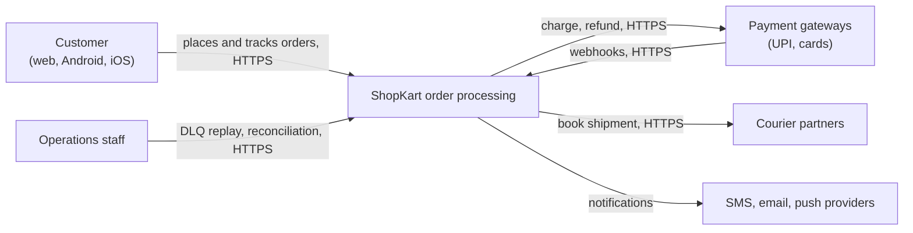
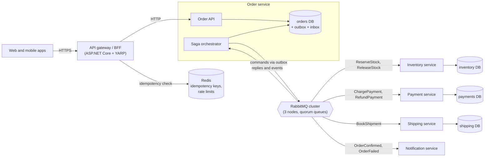
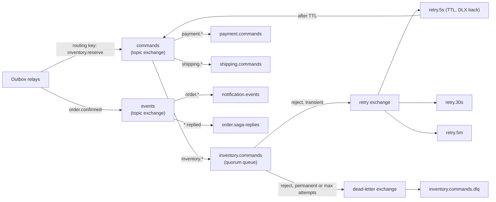
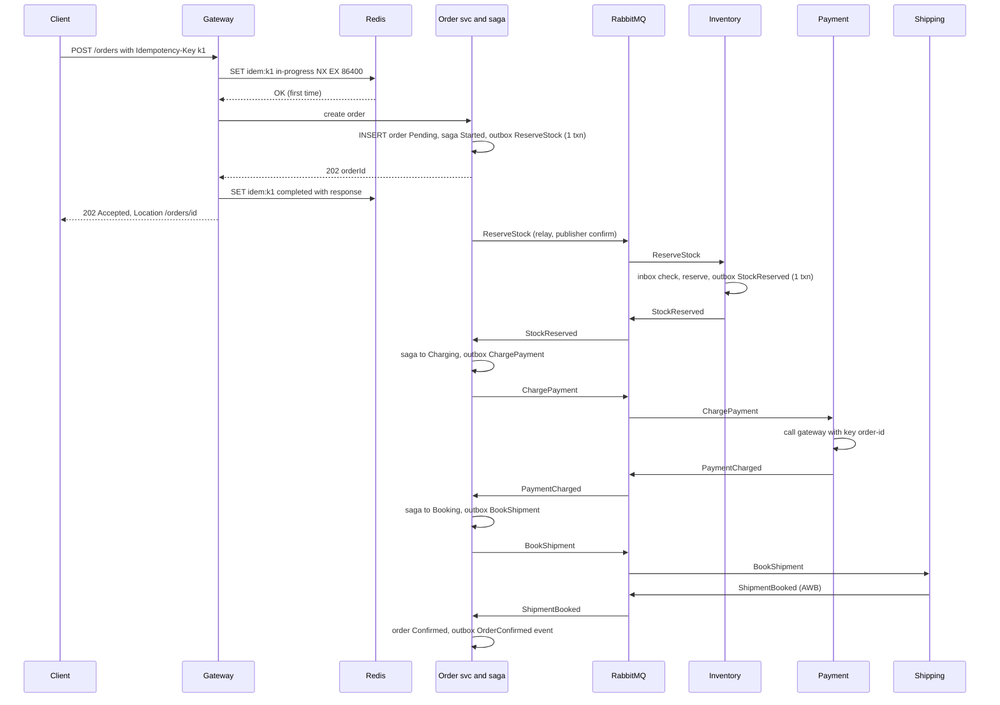
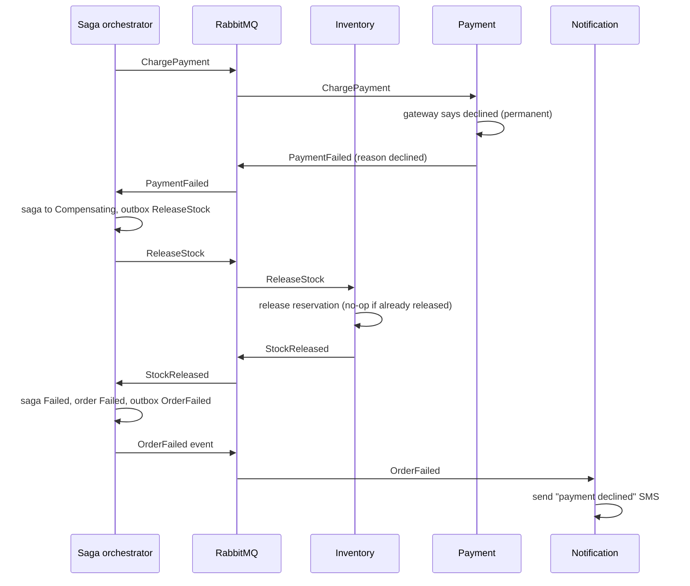
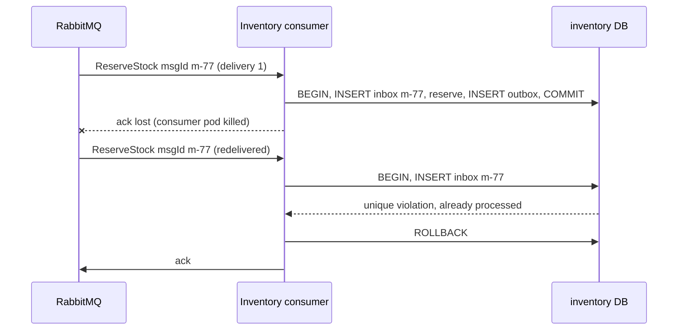
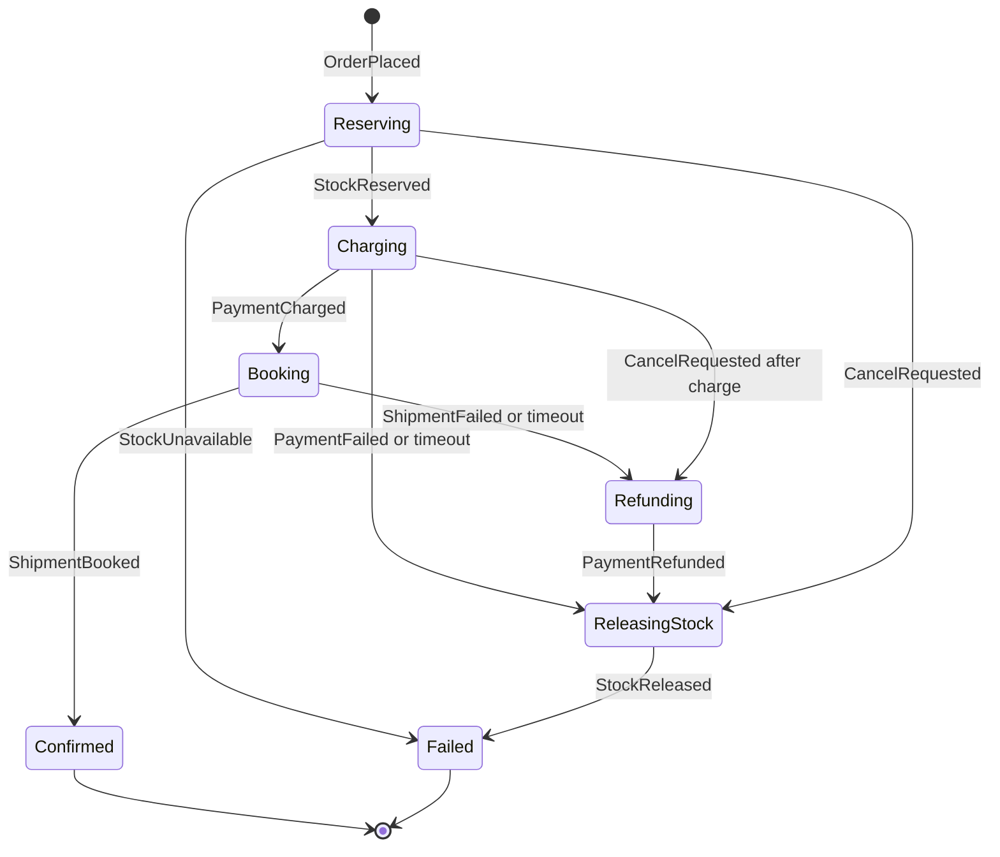

[Capstone A](#/lesson/m20-capstone-a) argued, with numbers, for keeping a system in one process. This capstone is the opposite exercise: you are *given* a system that has to be distributed, and your job is to make it correct anyway. Once an order touches four services with four databases, you lose the one tool that made the [order management project](#/lesson/m08-order-management-project) easy: a single database transaction. Every guarantee you used to get for free (all-or-nothing, no duplicates, no lost updates) you now have to build out of messages, retries, idempotency and compensation.

Plain-English version: imagine four shops in different towns cooperating on one delivery by sending letters. Letters can be lost, delivered twice, delivered late, or delivered to a shop that is closed for lunch. Nobody can "undo" a letter once it is posted. The only way to stay consistent is for every shop to (1) keep a copy of every letter it sends until it knows it arrived, (2) ignore letters it has already acted on, and (3) know how to undo its own part if a later step fails. Those three habits are the outbox, the idempotent consumer and the saga.

## Learning objectives

By the end of this capstone you will be able to:

1. Decompose order processing into services with clear data ownership, and justify each boundary.
2. Design a RabbitMQ topology (exchanges, queues, routing keys, retry and dead-letter queues) and explain what each part guarantees.
3. Publish reliably with a **transactional outbox** and publisher confirms; consume reliably with manual acknowledgements and an **inbox** table.
4. Make an HTTP API **idempotent** with client-supplied keys stored in Redis, including the "request still in progress" case.
5. Implement an **orchestrated saga** with explicit states, timeouts and **compensating actions**.
6. Classify failures as transient or permanent, retry transient ones with **exponential backoff and jitter**, and route the rest to a **dead-letter queue** with tooling to inspect and replay.
7. Write a failure-scenario analysis and prove it with deliberate fault injection.
8. Estimate capacity and cost for brokers, caches and databases, and explain what breaks first.

## Prerequisites

- Messaging: [RabbitMQ](#/lesson/m12-rabbitmq), [delivery guarantees](#/lesson/m12-delivery-guarantees), [idempotent consumers](#/lesson/m12-idempotent-consumers), [retries and DLQ](#/lesson/m12-retries-dlq), [outbox](#/lesson/m12-outbox).
- Workflows: [sagas](#/lesson/m12-sagas) and [orchestration vs choreography](#/lesson/m16-saga-orchestration-choreography).
- [Redis](#/lesson/m12-redis) and [API idempotency](#/lesson/m10-idempotency).

Recommended: [Project: Order management domain](#/lesson/m08-order-management-project), because this capstone splits that domain across services, and [retry storms](#/lesson/m13-retry-storms). The [scaling journey](#/lesson/m17-scaling-journey) case study ends at the stage where a checkout monolith is split into services; this capstone picks up from that point and makes the split correct.

## Project brief

### The business

**ShopKart** (a fictional retailer) sells phones, appliances and accessories online across India. It runs large sales around Diwali and the festival-season sale weekends that Indian e-commerce is known for, when a phone launch can sell out in minutes. Fulfilment comes from six warehouses (Bhiwandi, Gurugram, Bengaluru, Kolkata, Hyderabad, Chennai). Payments go through two gateways (UPI, cards, net-banking, EMI). Shipping is booked with three courier partners through their APIs.

The current monolith falls over during sales: a slow courier API holds database connections, checkout times out, customers retry, and some get charged twice. Leadership has decided to split order processing into services owned by separate teams. You are the lead engineer responsible for making the split **correct under failure**.

### Services and ownership

| Service | Owns (its own PostgreSQL database) | Team |
|---|---|---|
| Order | orders, order lines, saga state | Checkout |
| Inventory | stock per SKU per warehouse, reservations | Supply chain |
| Payment | payment attempts, gateway references, refunds | Payments |
| Shipping | shipments, courier bookings, tracking | Logistics |
| Notification | templates, delivery log (SMS, email, push) | Platform |

A thin **API gateway / BFF** (backend for frontend) sits in front for the web and mobile apps.

### Load numbers

| Measure | Value | Arithmetic or source |
|---|---|---|
| Normal day | 60,000 orders | Brief |
| Average rate | 60,000 ÷ 86,400 ≈ **0.7 orders/s** | |
| Sale peak | 2,400 orders/min for ~20 minutes ≈ **40 orders/s** | Brief: first 20 minutes of a sale |
| Messages per order | ~12 (commands + replies + events across 5 services) | Count from the saga design below |
| Peak messages | 40 × 12 ≈ **480 msg/s**; ×2 safety ≈ **1,000 msg/s** | Estimate |
| Checkout API calls at peak | ~10 per order (cart, address, quote, place, status polls) ≈ **400 RPS**, plus browsing traffic served elsewhere | Estimate |
| Idempotency keys in Redis | 40/s × 86,400 s × 1 day TTL worst case ≈ 3.5 M keys × ~1 KB ≈ **3.5 GB** at sustained peak; realistic daily ≈ 100–200 MB | Estimate |

1,000 messages per second is modest for RabbitMQ (a single well-provisioned node is commonly reported to handle tens of thousands of small persistent messages per second; measure your own setup). The hard part is not throughput, it is **correctness when a service is slow, down, or receives the same message twice**.

### Functional requirements

1. **Place order**: `POST /orders` with an `Idempotency-Key` header. Returns `202 Accepted` with an order id and a status URL immediately; processing continues asynchronously.
2. **Reserve stock** in the warehouse nearest to the delivery pincode that has all items; if none has all, fail (split shipments are out of scope).
3. **Charge** the customer through the payment service (authorise and capture in one step for this project).
4. **Book shipment** with a courier; get an AWB (airway bill) number.
5. **Confirm**: order status becomes `Confirmed`; customer is notified.
6. **Compensate** on failure: payment fails → release stock → order `Failed`; shipment booking fails permanently → refund payment → release stock → order `Failed`.
7. **Cancel** by the customer before shipment booking completes, with the same compensations.
8. **Status**: the customer can poll `GET /orders/{id}` and receives push notifications.
9. **Operations**: an admin can list dead-lettered messages, inspect them, and replay or discard them with an audit record.

### Non-functional requirements

| Quality | Target |
|---|---|
| Correctness | Zero double charges; zero oversold units; every charged order is either confirmed or refunded within 30 minutes |
| Latency | `POST /orders` p99 < 500 ms (it only records and enqueues); order confirmed p95 < 10 s end to end in normal conditions |
| Availability | Checkout accepts orders even if Shipping or Notification is down (they catch up later) |
| Durability | No accepted order is lost if any single node (app, broker, database) crashes |
| Recoverability | Any message that fails permanently is visible in a DLQ within 5 minutes and can be replayed |
| Observability | One trace id follows an order through every service and message |

### Out of scope

Real gateway and courier integrations (use stubs with configurable latency and failure rates), cart and catalogue, search, returns, split shipments, multi-region deployment.

## Deliverables

| # | Deliverable | What good looks like |
|---|---|---|
| 1 | **Requirements document** | FRs numbered and testable; NFRs with numbers including the correctness targets ("zero double charges" stated as an invariant with how it is verified); explicit list of failure types the system must tolerate. |
| 2 | **HLD document** | Service map with data ownership, sync vs async interactions with reasons, broker topology, capacity arithmetic, consistency model per flow ("order status is eventually consistent, within 10 s p95"), top risks. Explains why orchestration rather than choreography. |
| 3 | **LLD document** | Saga state machine with every state, event, command, timeout and compensation; message contracts (schema, version, idempotency key); inbox and outbox table designs; per-service aggregates. |
| 4 | **Architecture diagrams** | C4 context and container; RabbitMQ topology diagram (exchanges, queues, bindings, DLX); sequences for happy path, payment failure, shipment failure after payment, duplicate delivery, and cancel race. |
| 5 | **API specification** | OpenAPI for the public API, plus an **AsyncAPI** document (or equivalent table) for every message: name, producer, consumers, routing key, schema, version policy. Idempotency-Key semantics documented including 409 for key reuse with a different body. |
| 6 | **DB schema and migrations** | Per-service schemas with outbox and inbox tables, saga instance table with a version column, unique constraints that make duplicates impossible (gateway reference, reservation per order and SKU). Migrations run per service in CI. |
| 7 | **Implementation** | Five services plus gateway, each with health checks, graceful shutdown (finish in-flight message, then stop), configuration validation, and a shared messaging library (envelope, outbox relay, inbox consumer). Runs locally with `docker compose up`. |
| 8 | **Unit and integration tests** | Saga transitions tested as a pure state machine; inbox and outbox tested against real PostgreSQL; consumer tests against a real RabbitMQ container; one end-to-end test placing an order through all services. |
| 9 | **Security review** | Service-to-service authentication (mTLS or signed tokens), broker credentials per service with least-privilege permissions per vhost, PII in messages minimised (ids not addresses where possible), webhook signature verification, secrets in a vault. |
| 10 | **Performance tests** | Sale-peak scenario: 40 orders/s for 20 minutes then 5 minutes at 2× to find the knee; report end-to-end confirmation latency, queue depths and consumer utilisation; identify the first bottleneck. |
| 11 | **Failure scenarios** | Table of at least 15 failures (see the reference list below), each with expected behaviour, how it is detected, and the result of an actual fault-injection run. |
| 12 | **Deployment instructions** | Compose for local; for production, container platform manifests or IaC; broker topology declared as code; ordered rollout (schemas, consumers before producers for new message versions); rollback plan. |
| 13 | **Runbook** | Entries for: queue depth growing, DLQ non-empty, saga stuck in a state, gateway outage, broker node loss, Redis loss, replaying messages safely, reconciling payments against orders. |
| 14 | **Cost and scaling analysis** | Monthly cost per component at normal and sale load; which components scale horizontally (consumers), which need vertical scaling or clustering (broker, databases); 10× analysis. |
| 15 | **ADRs** | At least six: service boundaries, RabbitMQ vs Kafka, orchestration vs choreography, outbox and inbox, Redis for idempotency keys (and what happens when Redis is lost), retry and DLQ policy. |
| 16 | **Final review** | Retrospective with honest limitations (for example "no exactly-once, duplicates handled by inbox"), debt register, and a demo script that kills a service mid-order and shows recovery. |

## Milestones

About 7 weeks at 10–12 hours per week.

| Week | Milestone | Scope | Exit criteria |
|---|---|---|---|
| 1 | **M1 — Requirements, HLD, contracts** | Deliverables 1, 2; message catalogue; ADRs for boundaries, broker and saga style | Every message has a producer, consumer, schema and idempotency key on paper |
| 2 | **M2 — Messaging backbone** | Shared library: envelope, outbox relay with publisher confirms, inbox consumer with manual ack, retry and DLQ topology as code | A test publishes 10,000 messages while killing the relay twice; consumer sees each exactly once in its effects; exercise 3 passes |
| 3 | **M3 — Order API and idempotency** | Gateway, Order service, Redis idempotency keys, 202 + status endpoint | Exercise 6 passes; double-submit and parallel-submit tests pass |
| 4 | **M4 — Saga happy path** | Orchestrator in Order service, Inventory, Payment, Shipping stubs | Order goes Pending → Confirmed through all services; exercise 4 passes |
| 5 | **M5 — Compensation and timeouts** | Payment failure, shipment failure, cancel race, saga timeouts, stuck-saga and reconciliation jobs | Every compensation path tested end to end; no stuck sagas after 1,000 random-failure runs; exercise 2 runs as a scheduled check |
| 6 | **M6 — Retries, DLQ, operations** | Retry classifier, delay queues, DLQ admin endpoints, dashboards, alerts | Exercise 1 passes; poison message lands in DLQ and is replayed successfully |
| 7 | **M7 — Hardening and handover** | Performance tests, failure drills, security review, runbook, cost analysis, final review | Deliverables 9–16 complete; demo kills Payment mid-sale and recovers without data loss |

:::callout type=warning title="Build the backbone before the business logic"
Teams that start with the happy path through five services spend week 6 discovering that their messages are not durable and their consumers are not idempotent, and rewrite everything. Milestone 2 exists so that every service is built on a backbone that already survives crashes.
:::

**Keeping the scope realistic.** Five services, a gateway and sixteen deliverables is a lot for one person in seven weeks. The services are deliberately thin: Inventory, Payment and Shipping each have one or two tables and talk to **stubs** with configurable latency and failure rates, not real providers. If you fall behind, merge Notification into the Order service as a plain event consumer and drop the push channel, but never cut the outbox, the inbox, the compensations or the fault-injection runs; they are what this capstone grades.

### Where each piece is taught

| Piece | Lessons to revisit |
|---|---|
| Message ids, order ids and time-ordered keys | [Distributed unique ID generator](#/lesson/m17-unique-id-generator) |
| Broker topology, acks, confirms, quorum queues | [RabbitMQ](#/lesson/m12-rabbitmq), [delivery guarantees](#/lesson/m12-delivery-guarantees) |
| Outbox relay and inbox consumer | [Outbox](#/lesson/m12-outbox), [idempotent consumers](#/lesson/m12-idempotent-consumers) |
| `Idempotency-Key` at the API | [API idempotency](#/lesson/m10-idempotency), [Redis](#/lesson/m12-redis) |
| Saga, compensation, cancel race | [Sagas](#/lesson/m12-sagas), [orchestration vs choreography](#/lesson/m16-saga-orchestration-choreography), [LLD: order processing](#/lesson/m18-order-processing) |
| Stock reservation without overselling at sale peak | [Inventory reservation](#/lesson/m18-inventory-reservation), [Flash sale system](#/lesson/m17-flash-sale) |
| Retries, backoff, jitter, DLQ | [Retries and DLQ](#/lesson/m12-retries-dlq), [timeouts and retries](#/lesson/m10-timeouts-retries), [retry storms](#/lesson/m13-retry-storms) |
| Saga timeouts, stuck-saga and reconciliation jobs | [Distributed job scheduler](#/lesson/m17-job-scheduler) |
| Charges, refunds, reconciliation against the gateway | [Payment processing system](#/lesson/m17-payment-system) |

## Reference architecture

### C4 level 1: system context



The system talks to three kinds of external parties, and all three are unreliable in different ways. Gateways respond in hundreds of milliseconds but sometimes time out *after* charging, which is why the payment service needs idempotency keys toward the gateway as well as from its own callers. Couriers have rate limits and maintenance windows. Notification providers are best-effort. The arrow from gateways back into the system (webhooks) is a second, independent path for payment results: the design must handle a webhook arriving before, after, or instead of the synchronous response.

### C4 level 2: containers



Read it from the left. The gateway checks the idempotency key in Redis, then forwards to the Order API, which writes the order and a `StartSaga` outbox row in **one local transaction** and returns 202. The saga orchestrator lives in the Order service because the order is the thing whose lifecycle it drives; it sends **commands** (`ReserveStock`, `ChargePayment`, `BookShipment`, and their compensations) and receives **replies**. Each service owns its database and is reachable *only* through messages, never through another service's tables. RabbitMQ runs as a three-node cluster with **quorum queues** (replicated with the Raft consensus protocol), so the loss of one broker node loses no acknowledged message. Notification consumes only events and never blocks the order.

### RabbitMQ topology



Two topic exchanges separate **commands** (one intended consumer, "do this") from **events** (any number of consumers, "this happened"). Each service has its own durable quorum queue bound with routing-key patterns. Retries do not happen by re-queueing at the head of the same queue, which would spin a poison message in a tight loop; instead the consumer republishes the failed message to a **retry exchange** with a header carrying the attempt count, into one of three delay queues. These have a message TTL and a dead-letter exchange pointing back at the main exchange, so after 5 s, 30 s or 5 minutes the message reappears for another try. When the error is permanent or attempts are exhausted, the consumer rejects it to the **dead-letter exchange**, which routes to a per-queue DLQ that the admin tool reads. (RabbitMQ 4.x also offers delayed retry options and a delivery limit on quorum queues; the TTL-queue approach shown works on any recent version and is easy to observe.)

### Key sequence: the happy path



Every arrow into a service follows the same pattern: **inbox check, do the work, write the reply to the outbox, commit, then acknowledge** the broker message. Every arrow out of a service comes from an outbox relay that publishes with **publisher confirms** and marks the outbox row sent only after the broker confirms. The client is not kept waiting for any of this: it got 202 after the first local transaction and polls the status URL (or receives a push). The payment service passes the order id as the idempotency key to the gateway, so a retried `ChargePayment` cannot charge twice even if the first gateway call timed out after succeeding. (That works because this design allows one charge attempt per order. If you later let customers "retry with another card", key on a payment-attempt id instead, or the gateway will replay the first decline.)

### Key sequence: payment fails, stock is released



A declined card is a **business outcome**, not an error, so it travels as a normal reply (`PaymentFailed`), not through retries or the DLQ. The orchestrator moves to `Compensating` and issues the compensation for every step that already succeeded, in reverse order. Here that is only `ReleaseStock`. Compensations must be idempotent too: releasing a reservation that is already released is a no-op that still replies `StockReleased`, otherwise a duplicated compensation could leave the saga stuck.

### Key sequence: a duplicate delivery



RabbitMQ guarantees **at-least-once** delivery to a consumer that acknowledges manually: if the acknowledgement does not arrive (the pod died, the connection dropped), the message is redelivered. The inbox makes the second delivery harmless. Because the inbox insert, the business change and the outbox insert commit in **one transaction**, there is no moment at which the work is done but not recorded as done. The reply `StockReserved` was already written to the outbox in the first delivery, so the saga still receives exactly one reply.

### Saga state machine



Each state names what the saga is *waiting for*. Each state also has a **timeout**: if no reply arrives (30 s for stock, 2 minutes for payment, 10 minutes for shipment, all configurable), the orchestrator either re-sends the command (safe, because consumers are idempotent) or, after a limit, starts compensation. The cancel transition from `Charging` is the trickiest: a cancel can arrive while the charge command is in flight. The orchestrator records the cancel, waits for the payment reply, and then refunds if the charge succeeded. It never assumes the in-flight command did nothing.

### Shared messaging code

This compiled skeleton shows the envelope every message carries and the inbox pattern as a reusable decorator. The real library adds the RabbitMQ.Client and Npgsql implementations behind these interfaces.

```csharp file=Messaging/Envelope.cs
namespace ShopKart.Messaging;

/// <summary>Every message on the bus. MessageId is the idempotency key for consumers.</summary>
public sealed record Envelope(
    Guid MessageId,           // Guid.CreateVersion7(): unique and roughly time-ordered, so inbox indexes stay compact
    string Type,              // e.g. "inventory.reserve.v1"
    Guid CorrelationId,       // the order id: ties every message in one saga together
    Guid? CausationId,        // the message that caused this one
    string TraceParent,       // W3C trace context, so one trace spans every service
    DateTimeOffset CreatedAt,
    int Attempt,
    string Payload);

public enum ConsumeResult { Ack, RetryLater, DeadLetter }

public interface IMessageHandler
{
    string Type { get; }
    Task HandleAsync(Envelope message, CancellationToken ct);
}

/// <summary>Thrown for errors that will never succeed on retry (bad schema, unknown SKU).</summary>
public sealed class PermanentFailureException(string message) : Exception(message);
```

```csharp file=Messaging/Inbox.cs
namespace ShopKart.Messaging;

/// <summary>Within one database transaction: record the message id, run the handler, write outbox rows.</summary>
public interface IInboxTransaction : IAsyncDisposable
{
    /// <summary>Returns false if this message id was already processed (unique violation in PostgreSQL).</summary>
    Task<bool> TryRecordAsync(Guid messageId, string consumer, CancellationToken ct);
    Task CommitAsync(CancellationToken ct);
}

public interface IInboxTransactionFactory
{
    Task<IInboxTransaction> BeginAsync(CancellationToken ct);
}

public sealed class IdempotentConsumer(IInboxTransactionFactory transactions, IEnumerable<IMessageHandler> handlers,
    string consumerName, int maxAttempts = 6)
{
    private readonly Dictionary<string, IMessageHandler> _handlers = handlers.ToDictionary(h => h.Type);

    public async Task<ConsumeResult> ConsumeAsync(Envelope message, CancellationToken ct)
    {
        if (!_handlers.TryGetValue(message.Type, out var handler)) return ConsumeResult.DeadLetter;
        try
        {
            await using var tx = await transactions.BeginAsync(ct);
            if (!await tx.TryRecordAsync(message.MessageId, consumerName, ct)) return ConsumeResult.Ack;   // duplicate
            await handler.HandleAsync(message, ct);
            await tx.CommitAsync(ct);
            return ConsumeResult.Ack;
        }
        catch (PermanentFailureException) { return ConsumeResult.DeadLetter; }
        catch (Exception ex) when (ex is not OperationCanceledException)
        {
            return message.Attempt + 1 >= maxAttempts ? ConsumeResult.DeadLetter : ConsumeResult.RetryLater;
        }
    }
}
```

```csharp file=Messaging/InMemoryInbox.cs
namespace ShopKart.Messaging;

/// <summary>For tests: a set of processed ids, committed only on CommitAsync.</summary>
public sealed class InMemoryInbox : IInboxTransactionFactory
{
    private readonly HashSet<(Guid, string)> _processed = [];
    private readonly Lock _gate = new();

    public Task<IInboxTransaction> BeginAsync(CancellationToken ct) => Task.FromResult<IInboxTransaction>(new Tx(this));

    private sealed class Tx(InMemoryInbox owner) : IInboxTransaction
    {
        private (Guid, string)? _pending;

        public Task<bool> TryRecordAsync(Guid messageId, string consumer, CancellationToken ct)
        {
            lock (owner._gate)
            {
                if (owner._processed.Contains((messageId, consumer))) return Task.FromResult(false);
                _pending = (messageId, consumer);
                return Task.FromResult(true);
            }
        }

        public Task CommitAsync(CancellationToken ct)
        {
            lock (owner._gate) { if (_pending is { } p) owner._processed.Add(p); }
            return Task.CompletedTask;
        }

        public ValueTask DisposeAsync() => ValueTask.CompletedTask;
    }
}
```

The in-memory version has a weakness that the PostgreSQL version does not: two concurrent deliveries of the same id can both pass `TryRecordAsync` before either commits. In PostgreSQL, the second `INSERT INTO inbox` blocks on the first transaction's uncommitted row and then fails with a unique violation, which is exactly the behaviour you want. Exercise 3 asks you to close that gap in memory too.

The RabbitMQ wiring is not compiled here (the client library is not available offline), but its shape is short:

```csharp
// Consumer setup (RabbitMQ.Client 7.x, async API). Not compiled in this lesson.
// Prefetch limits unacked messages; it does not by itself make handlers run in parallel. Set
// ConsumerDispatchConcurrency (on the ConnectionFactory or per channel) to the number of handlers you want running at once.
await channel.BasicQosAsync(prefetchSize: 0, prefetchCount: 20, global: false);   // at most 20 unacked per consumer
var consumer = new AsyncEventingBasicConsumer(channel);
consumer.ReceivedAsync += async (_, ea) =>
{
    var envelope = Deserialize(ea.Body, ea.BasicProperties);
    switch (await idempotentConsumer.ConsumeAsync(envelope, stoppingToken))
    {
        case ConsumeResult.Ack: await channel.BasicAckAsync(ea.DeliveryTag, multiple: false); break;
        case ConsumeResult.RetryLater: await RepublishToRetryAsync(envelope with { Attempt = envelope.Attempt + 1 });
                                       await channel.BasicAckAsync(ea.DeliveryTag, false); break;
        case ConsumeResult.DeadLetter: await channel.BasicRejectAsync(ea.DeliveryTag, requeue: false); break;  // goes to DLX
    }
};
await channel.BasicConsumeAsync("inventory.commands", autoAck: false, consumer);
```

And the Redis idempotency check at the gateway, in outline:

```csharp
// StackExchange.Redis, not compiled here. SET key value NX EX 86400 is atomic: only the first caller wins.
bool first = await db.StringSetAsync($"idem:{key}", JsonSerializer.Serialize(new { state = "in-progress", fp }),
                                     TimeSpan.FromDays(1), When.NotExists);
```

### Reference failure scenarios

| # | Failure | Expected behaviour | Detection |
|---|---|---|---|
| 1 | Consumer crashes after commit, before ack | Redelivery; inbox makes it a no-op | Redelivered count metric |
| 2 | Outbox relay crashes after publish, before marking sent | Message published twice; consumers deduplicate | Inbox duplicate counter |
| 3 | Broker node lost | Quorum queues fail over to a replica within seconds; publishers retry on unconfirmed | Cluster alarm |
| 4 | Payment service down 10 minutes | `ChargePayment` waits in queue; saga timeout re-sends; no data loss | Queue depth, saga age |
| 5 | Gateway times out but charged | Retry with same gateway idempotency key returns the original charge | Reconciliation report |
| 6 | Gateway webhook arrives before sync reply | Payment state machine accepts first result, ignores the second | Duplicate result counter |
| 7 | Courier API down for an hour | Shipment retried with backoff; saga waits up to its timeout, then refunds | Retry rate, saga age |
| 8 | Poison message (bad schema) | Dead-lettered on first attempt, no retries | DLQ depth alert |
| 9 | Redis lost | Gateway falls back to the database unique constraint on (customer, idempotency key); slower but correct | Redis health, fallback counter |
| 10 | Order DB failover | Order API returns 503 for ~30 s; clients retry with the same key | 5xx rate |
| 11 | Customer cancels during charge | Saga waits for charge result, then refunds and releases | Cancel-after-charge counter |
| 12 | Retry storm after an outage | Jittered backoff and prefetch limits spread the load | Consumer CPU, broker memory alarm |
| 13 | Saga stuck (reply lost and timeout bug) | Stuck-saga job lists sagas older than threshold; alert | Exercise 2 query |
| 14 | Message published with a new schema version before consumers upgraded | Consumers ignore unknown fields (tolerant reader); version bump only with dual support | Contract tests |
| 15 | Clock skew between services | Timeouts use the orchestrator's clock only; no cross-service time comparison | — |

### Practice on the canvas

Sketch the service split on the canvas before exercise 5. The starting graph has a broker and one consumer; add the remaining services, their databases and the Redis idempotency store, then raise traffic to the sale peak and see where queues build up.

:::playground type=hld title="ShopKart pipeline sandbox"
```json
{
  "nodes": [
    { "id": "c", "type": "client", "label": "Shoppers", "props": { "rps": 400 } },
    { "id": "gw", "type": "api-gateway", "label": "API gateway", "props": { "instances": 2 } },
    { "id": "ord", "type": "app-server", "label": "Order service + saga", "props": { "instances": 2 } },
    { "id": "odb", "type": "database", "label": "orders DB" },
    { "id": "mq", "type": "queue", "label": "RabbitMQ" },
    { "id": "inv", "type": "worker", "label": "Inventory service", "props": { "instances": 1 } }
  ],
  "edges": [
    { "from": "c", "to": "gw", "kind": "sync" },
    { "from": "gw", "to": "ord", "kind": "sync" },
    { "from": "ord", "to": "odb", "kind": "sync" },
    { "from": "ord", "to": "mq", "kind": "async", "label": "outbox relay" },
    { "from": "mq", "to": "inv", "kind": "async" }
  ]
}
```
:::

## Evaluation rubric

Score each criterion 0–4. The pass mark is 64 of 96, with no starred (★) criterion below 2.

| # | Criterion | 1 — weak | 2 — acceptable | 3 — strong | 4 — exemplary |
|---|---|---|---|---|---|
| 1 ★ | Service boundaries | Services share a database | Separate databases, some chatty sync calls | Clear ownership, async by default, sync only where justified | Plus written split rationale per service and what would merge them |
| 2 ★ | Reliable publishing | Publish after commit, no outbox | Outbox without confirms | Outbox + publisher confirms + relay restart safety | Plus relay lag metrics and ordered publishing where needed |
| 3 ★ | Idempotent consumers | None | Check-then-act without transaction | Inbox insert in the same transaction as the work | Plus concurrent-duplicate test and inbox retention policy |
| 4 ★ | API idempotency | None | Key stored, no fingerprint | Key + fingerprint + in-progress state + TTL | Plus Redis-loss fallback tested |
| 5 ★ | Saga | Ad-hoc chain of events | Happy path orchestrated | All compensations and timeouts implemented and tested | Plus cancel race and stuck-saga detection |
| 6 ★ | Retries and DLQ | Immediate requeue loops | Fixed delay retries | Classified errors, exponential backoff with jitter, DLQ | Plus replay tooling with audit and DLQ alerting |
| 7 | Broker topology | Default exchange only | Named exchanges and queues | Commands vs events, quorum queues, prefetch tuned | Topology as code, reviewed, with per-service permissions |
| 8 | Data model | No constraints | Basic tables | Unique constraints make duplicates impossible | Plus reconciliation queries and retention jobs |
| 9 ★ | Tests | Unit only | Integration with real DB | Plus real broker container and saga property tests | Plus fault-injection suite in CI |
| 10 | Observability | Logs per service | Correlation id in logs | Distributed traces across messages, queue and saga dashboards | SLOs with alerts tied to runbook |
| 11 | Performance | None | One load run | Sale-peak profile with end-to-end latency and queue depth | Plus knee point found and first bottleneck fixed |
| 12 ★ | Failure analysis | None | Listed | 15 scenarios with detection and recovery | At least 8 injected and written up |
| 13 | Security | Shared admin credentials | Per-service DB users | Per-service broker users and vhost permissions, signed webhooks | Plus mTLS or workload identity, PII minimised in messages |
| 14 | API and async specs | None | OpenAPI only | OpenAPI + message catalogue with versions | Plus contract tests in CI |
| 15 | Deployment | Manual | Compose only | Production manifests or IaC, ordered rollout | Plus tested rollback of a message schema change |
| 16 | Runbook | None | Notes | Entry per alert and per routine task | Executed by a peer during a drill |
| 17 | Cost and scaling | None | Rough guess | Per-component estimate at normal and sale load | Plus 10× analysis naming first three bottlenecks |
| 18 | ADRs | None | 2–3 | Six with alternatives | Plus one superseded ADR showing a changed decision |
| 19 | Code quality | Inconsistent | Readable | Shared messaging library, no copy-paste across services | Library has its own tests and docs |
| 20 | Final review | None | Feature summary | Limitations and debt register | Live demo of a failure and recovery |
| 21 | Consistency reasoning | Not discussed | "Eventually consistent" stated | Per-flow consistency and staleness bounds | Plus reconciliation proves invariants nightly |
| 22 | Simplicity | Over-built | Some unjustified parts | Each component traced to a requirement | Plus "considered and rejected" list |
| 23 | Backpressure | None | Prefetch set | Prefetch, consumer concurrency and queue length limits tuned | Plus load shedding at the gateway during sales |
| 24 | Data privacy | PII everywhere | Some masking in logs | PII minimised in messages and logs | Plus retention and deletion for personal data |

## Exercises

:::exercise id=m20-capstone-b-ex1 difficulty=beginner kind=code title="M6: retry decisions with backoff and full jitter"
Implement `RetryPolicy.Decide`, which tells a consumer what to do with a failed message.
::requirements
- Exceptions of type `TimeoutException`, `HttpRequestException` and `IOException` are **transient**. `FormatException`, `ArgumentException` and anything else are **permanent**.
- Permanent: `DeadLetter` immediately, zero delay.
- Transient: if `attempt` (1-based, the attempt that just failed) is at least `MaxAttempts`, `DeadLetter`. Otherwise `Retry` with delay computed by **full jitter**: `random × min(MaxDelay, BaseDelay × 2^(attempt − 1))`, where `random` in [0, 1) comes from the injected function.
- The exponential part must not overflow for large attempts.
::acceptance
- `TimeoutException` on attempt 1 with base 1 s and random 0.5 waits 500 ms.
- Attempt 4 with random 0.999 waits just under 8 s.
- Attempt 20 with cap 60 s and random 0.5 waits 30 s.
- `FormatException` dead-letters on attempt 1.
- Attempt equal to `MaxAttempts` dead-letters even for a transient error.
::hint
Split the problem: (1) classify the exception, (2) check attempts, (3) compute the delay.
::hint
Classification is a `switch` on the exception type: `ex is TimeoutException or HttpRequestException or IOException`.
::hint
Full jitter means the whole delay is random between 0 and the exponential cap. It spreads retries of many consumers evenly over time.
::hint
Avoid `Math.Pow` with huge exponents producing infinity: clamp the exponent (for example at 30) before shifting, then take the min with the cap.
::starter
```csharp file=RetryPolicy.cs
using System;
using System.IO;
using System.Net.Http;

public enum RetryAction { Retry, DeadLetter }
public sealed record RetryDecision(RetryAction Action, TimeSpan Delay);

public sealed class RetryPolicy(TimeSpan baseDelay, TimeSpan maxDelay, int maxAttempts, Func<double> random)
{
    public TimeSpan BaseDelay { get; } = baseDelay;
    public TimeSpan MaxDelay { get; } = maxDelay;
    public int MaxAttempts { get; } = maxAttempts;

    public static bool IsTransient(Exception ex) => throw new NotImplementedException();
    public RetryDecision Decide(Exception ex, int attempt) => throw new NotImplementedException();
}
```
::tests
```csharp file=RetryPolicyTests.cs
using System;
using System.IO;
using System.Net.Http;
using Xunit;

public class RetryPolicyTests
{
    private static RetryPolicy P(double r, int max = 8) => new(TimeSpan.FromSeconds(1), TimeSpan.FromSeconds(60), max, () => r);

    [Fact]
    public void First_transient_failure_uses_jittered_base()
    {
        var d = P(0.5).Decide(new TimeoutException(), 1);
        Assert.Equal(RetryAction.Retry, d.Action);
        Assert.Equal(TimeSpan.FromMilliseconds(500), d.Delay);
    }

    [Fact]
    public void Exponential_growth()
    {
        var d = P(0.999).Decide(new HttpRequestException("503"), 4);
        Assert.True(d.Delay < TimeSpan.FromSeconds(8));
        Assert.True(d.Delay > TimeSpan.FromSeconds(7.9));
    }

    [Fact]
    public void Capped_and_no_overflow() =>
        Assert.Equal(TimeSpan.FromSeconds(30), P(0.5, max: 100).Decide(new IOException(), 20).Delay);

    [Fact]
    public void Huge_attempt_does_not_overflow() =>
        Assert.Equal(TimeSpan.FromSeconds(30), P(0.5, max: 1000).Decide(new IOException(), 500).Delay);

    [Fact]
    public void Permanent_errors_dead_letter_immediately()
    {
        var d = P(0.5).Decide(new FormatException("bad json"), 1);
        Assert.Equal(new RetryDecision(RetryAction.DeadLetter, TimeSpan.Zero), d);
    }

    [Fact]
    public void Max_attempts_dead_letters() =>
        Assert.Equal(RetryAction.DeadLetter, P(0.5, max: 5).Decide(new TimeoutException(), 5).Action);

    [Fact]
    public void Classification()
    {
        Assert.True(RetryPolicy.IsTransient(new TimeoutException()));
        Assert.False(RetryPolicy.IsTransient(new ArgumentException()));
        Assert.False(RetryPolicy.IsTransient(new InvalidOperationException()));
    }
}
```
::solution
```csharp file=RetryPolicy.cs
using System;
using System.IO;
using System.Net.Http;

public enum RetryAction { Retry, DeadLetter }
public sealed record RetryDecision(RetryAction Action, TimeSpan Delay);

public sealed class RetryPolicy(TimeSpan baseDelay, TimeSpan maxDelay, int maxAttempts, Func<double> random)
{
    public TimeSpan BaseDelay { get; } = baseDelay;
    public TimeSpan MaxDelay { get; } = maxDelay;
    public int MaxAttempts { get; } = maxAttempts;

    public static bool IsTransient(Exception ex) => ex is TimeoutException or HttpRequestException or IOException;

    public RetryDecision Decide(Exception ex, int attempt)
    {
        if (!IsTransient(ex) || attempt >= MaxAttempts) return new(RetryAction.DeadLetter, TimeSpan.Zero);
        var shift = Math.Clamp(attempt - 1, 0, 30);
        var expTicks = BaseDelay.Ticks * (1L << shift);
        var capTicks = expTicks <= 0 || expTicks > MaxDelay.Ticks ? MaxDelay.Ticks : expTicks;
        return new(RetryAction.Retry, TimeSpan.FromTicks((long)(random() * capTicks)));
    }
}
```

Why full jitter? If 2,000 messages fail at the same instant because Payment restarted, plain exponential backoff retries all of them at exactly +1 s, +2 s, +4 s: synchronised waves that can knock the service over again (a retry storm). Spreading each wave randomly over the whole interval flattens the load. In production, round the delay to the nearest retry queue (5 s, 30 s, 5 min) or use a broker feature that supports per-message delay.
::mistakes
- Retrying permanent errors such as a bad JSON payload eight times before dead-lettering.
- `Math.Pow(2, attempt)` with large attempts giving `Infinity` and an exception in `TimeSpan.FromMilliseconds`.
- Using `new Random()` inside the method, which makes tests non-deterministic.
::extensions
Respect a `Retry-After` hint: if the exception carries one (for example from an HTTP 429 or 503), use the larger of it and the computed delay.
:::

:::exercise id=m20-capstone-b-ex2 difficulty=beginner kind=sql ordered=true title="M5: find stuck sagas"
Operations needs a list of stuck sagas. A saga is **stuck** when its state is not terminal (`Confirmed` or `Failed`) and it has not been updated for more than 10 minutes as of `2026-11-08 20:30:00+05:30`. Return `order_id`, `state`, `minutes_stuck` (whole minutes, rounded down) and `attempts`, oldest first.
::setup
```sql
CREATE TABLE saga_instance (
  order_id    int PRIMARY KEY,
  state       text NOT NULL,
  attempts    int  NOT NULL DEFAULT 0,
  updated_at  timestamptz NOT NULL
);
INSERT INTO saga_instance VALUES
  (5001, 'Confirmed',      0, '2026-11-08 19:00:00+05:30'),
  (5002, 'Charging',       2, '2026-11-08 20:05:00+05:30'),
  (5003, 'Booking',        1, '2026-11-08 20:25:00+05:30'),
  (5004, 'Refunding',      4, '2026-11-08 19:58:30+05:30'),
  (5005, 'Failed',         0, '2026-11-08 18:00:00+05:30'),
  (5006, 'Reserving',      0, '2026-11-08 20:19:59+05:30'),
  (5007, 'ReleasingStock', 3, '2026-11-08 20:20:00+05:30');
```
::check
```sql
SELECT order_id,
       state,
       FLOOR(EXTRACT(EPOCH FROM (TIMESTAMPTZ '2026-11-08 20:30:00+05:30' - updated_at)) / 60)::int AS minutes_stuck,
       attempts
FROM saga_instance
WHERE state NOT IN ('Confirmed', 'Failed')
  AND updated_at < TIMESTAMPTZ '2026-11-08 20:30:00+05:30' - INTERVAL '10 minutes'
ORDER BY updated_at;
```
::acceptance
- Returns 5004 (31 minutes), 5002 (25 minutes) and 5006 (10 minutes), in that order.
- 5007, updated exactly 10 minutes ago, is not returned ("more than 10 minutes").
- Terminal sagas 5001 and 5005 are excluded however old they are.
::hint
Two filters: state not terminal, and `updated_at` older than now minus 10 minutes.
::hint
"More than 10 minutes" means `updated_at < now - interval '10 minutes'`, strictly less.
::hint
Subtracting two `timestamptz` values gives an `interval`. `EXTRACT(EPOCH FROM interval)` gives seconds.
::hint
Divide seconds by 60 and `FLOOR` before casting to `int`, so 31.5 minutes shows as 31.
::solution
```sql
SELECT order_id,
       state,
       FLOOR(EXTRACT(EPOCH FROM (TIMESTAMPTZ '2026-11-08 20:30:00+05:30' - updated_at)) / 60)::int AS minutes_stuck,
       attempts
FROM saga_instance
WHERE state NOT IN ('Confirmed', 'Failed')
  AND updated_at < TIMESTAMPTZ '2026-11-08 20:30:00+05:30' - INTERVAL '10 minutes'
ORDER BY updated_at;
```

In production, replace the literal with `now()`, add a partial index `CREATE INDEX ON saga_instance (updated_at) WHERE state NOT IN ('Confirmed','Failed')` so the query stays fast with millions of finished sagas, and export the count as a metric. Alert when it is above zero for 5 minutes. A non-zero value means either a timeout path has a bug or a dependency has been down longer than every timeout, and both need a human.
::mistakes
- Using `<=`, which reports 5007 at exactly 10 minutes.
- Forgetting to exclude terminal states, flooding the report with finished orders.
- Casting to `int` before flooring: PostgreSQL's cast rounds, so 31.5 minutes becomes 32.
:::

:::exercise id=m20-capstone-b-ex3 difficulty=intermediate kind=code title="M2: an inbox that is safe under concurrent duplicates"
Implement `InboxProcessor.ProcessAsync(messageId, handler)`, which runs the handler at most once per message id, even when duplicates arrive **at the same time** on different threads.
::requirements
- First delivery of an id: run the handler. If it succeeds, record the id as processed and return `Processed`.
- If the handler throws, do **not** record the id (so a retry can run it again), and rethrow.
- A later duplicate of a processed id returns `Duplicate` without running the handler.
- A duplicate that arrives while the first delivery is still running must not run the handler; it returns `InProgress` (the broker will redeliver it later).
- Thread-safe.
::acceptance
- Two sequential calls with the same id run the handler once.
- 50 parallel calls with the same id run the handler exactly once; the others return `Duplicate` or `InProgress`.
- A failed handler can be retried and succeed.
::hint
There are three states per id: unknown, in progress, processed. A single dictionary from id to state captures them.
::hint
`ConcurrentDictionary.TryAdd(id, InProgress)` is atomic: exactly one caller wins the right to run the handler.
::hint
On success, set the state to `Processed`. On failure, `TryRemove` the id so a later retry can claim it again.
::hint
For the loser of `TryAdd`, read the current state: `Processed` → `Duplicate`, `InProgress` → `InProgress`.
::starter
```csharp file=InboxProcessor.cs
using System;
using System.Threading.Tasks;

public enum InboxOutcome { Processed, Duplicate, InProgress }

public sealed class InboxProcessor
{
    public Task<InboxOutcome> ProcessAsync(Guid messageId, Func<Task> handler) => throw new NotImplementedException();
    public bool IsProcessed(Guid messageId) => throw new NotImplementedException();
}
```
::tests
```csharp file=InboxProcessorTests.cs
using System;
using System.Linq;
using System.Threading;
using System.Threading.Tasks;
using Xunit;

public class InboxProcessorTests
{
    [Fact]
    public async Task Sequential_duplicate_runs_once()
    {
        var inbox = new InboxProcessor(); var id = Guid.NewGuid(); var runs = 0;
        Assert.Equal(InboxOutcome.Processed, await inbox.ProcessAsync(id, () => { runs++; return Task.CompletedTask; }));
        Assert.Equal(InboxOutcome.Duplicate, await inbox.ProcessAsync(id, () => { runs++; return Task.CompletedTask; }));
        Assert.Equal(1, runs);
    }

    [Fact]
    public async Task Parallel_duplicates_run_once()
    {
        var inbox = new InboxProcessor(); var id = Guid.NewGuid(); var runs = 0;
        var tasks = Enumerable.Range(0, 50).Select(_ => Task.Run(() => inbox.ProcessAsync(id, async () =>
        {
            Interlocked.Increment(ref runs);
            await Task.Delay(20);
        }))).ToArray();
        var outcomes = await Task.WhenAll(tasks);
        Assert.Equal(1, runs);
        Assert.Equal(1, outcomes.Count(o => o == InboxOutcome.Processed));
        Assert.True(inbox.IsProcessed(id));
    }

    [Fact]
    public async Task Failed_handler_can_be_retried()
    {
        var inbox = new InboxProcessor(); var id = Guid.NewGuid();
        await Assert.ThrowsAsync<TimeoutException>(() => inbox.ProcessAsync(id, () => throw new TimeoutException()));
        Assert.False(inbox.IsProcessed(id));
        Assert.Equal(InboxOutcome.Processed, await inbox.ProcessAsync(id, () => Task.CompletedTask));
    }

    [Fact]
    public async Task In_progress_duplicate_is_reported()
    {
        var inbox = new InboxProcessor(); var id = Guid.NewGuid();
        var gate = new TaskCompletionSource();
        var first = inbox.ProcessAsync(id, () => gate.Task);
        Assert.Equal(InboxOutcome.InProgress, await inbox.ProcessAsync(id, () => Task.CompletedTask));
        gate.SetResult();
        Assert.Equal(InboxOutcome.Processed, await first);
    }
}
```
::solution
```csharp file=InboxProcessor.cs
using System;
using System.Collections.Concurrent;
using System.Threading.Tasks;

public enum InboxOutcome { Processed, Duplicate, InProgress }

public sealed class InboxProcessor
{
    private enum State { InProgress, Processed }
    private readonly ConcurrentDictionary<Guid, State> _states = new();

    public async Task<InboxOutcome> ProcessAsync(Guid messageId, Func<Task> handler)
    {
        if (!_states.TryAdd(messageId, State.InProgress))
            return _states.TryGetValue(messageId, out var s) && s == State.Processed ? InboxOutcome.Duplicate : InboxOutcome.InProgress;

        try
        {
            await handler();
            _states[messageId] = State.Processed;
            return InboxOutcome.Processed;
        }
        catch
        {
            _states.TryRemove(messageId, out _);
            throw;
        }
    }

    public bool IsProcessed(Guid messageId) => _states.TryGetValue(messageId, out var s) && s == State.Processed;
}
```

The race between "loser reads the state" and "winner removes it after failure" is acceptable: the loser reports `InProgress`, the broker redelivers, and the redelivery claims the id normally. The PostgreSQL inbox gets the same behaviour from row locking: the second `INSERT` waits for the first transaction, then either fails (first committed, so duplicate) or succeeds (first rolled back, so this one does the work). Keep inbox rows for longer than the longest possible redelivery window (for example 7 days) and delete older ones with a scheduled job, or the table grows forever.
::mistakes
- `if (!processed.Contains(id)) { await handler(); processed.Add(id); }`: two threads both pass the check.
- Recording the id *before* the handler succeeds, so a failure makes the message silently disappear.
- Holding a `lock` across `await` (not allowed in C#) or using a global `SemaphoreSlim` that serialises every message, not just duplicates.
::extensions
Make the in-progress claim expire after 5 minutes (inject `TimeProvider`) so a consumer that died mid-handler does not block its message forever.
:::

:::exercise id=m20-capstone-b-ex4 difficulty=intermediate kind=code title="M4/M5: the order saga as a pure state machine"
Implement `OrderSaga.Handle(event)`. It updates the saga's state and returns the commands to send. It never calls services directly, which makes it trivially testable.
::requirements
- Start in `Reserving`; `Start()` returns `[ReserveStock]`.
- `StockReserved` → `Charging`, send `ChargePayment`. `StockUnavailable` → `Failed`, send `NotifyFailed`.
- `PaymentCharged` → `Booking`, send `BookShipment`. `PaymentFailed` → `ReleasingStock`, send `ReleaseStock`.
- `ShipmentBooked` → `Confirmed`, send `NotifyConfirmed`. `ShipmentFailed` → `Refunding`, send `RefundPayment`.
- `PaymentRefunded` → `ReleasingStock`, send `ReleaseStock`. `StockReleased` → `Failed`, send `NotifyFailed`.
- `CancelRequested`: in `Reserving` → `ReleasingStock` + `ReleaseStock`; in `Charging` → remember the cancel and stay (the charge is in flight); in `Booking` → `Refunding` + `RefundPayment`; otherwise ignore.
- If a cancel was remembered in `Charging`: `PaymentCharged` → `Refunding` + `RefundPayment` (not booking); `PaymentFailed` → as normal.
- An event that is not expected in the current state (for example a duplicate `StockReserved` while `Booking`) returns no commands and does not change state.
::acceptance
- Happy path: Start, StockReserved, PaymentCharged, ShipmentBooked ends `Confirmed` with the expected commands.
- Shipment failure ends `Failed` after `RefundPayment` then `ReleaseStock`.
- Cancel during charging, then `PaymentCharged`, leads to `RefundPayment`.
- Duplicates are ignored.
::hint
Think of it as a table: (current state, event) → (next state, commands). A `switch` on a tuple expresses that directly.
::hint
`(SagaState.Charging, SagaEvent.PaymentCharged) when _cancelRequested => ...` handles the cancel race.
::hint
The default arm `_ => no change, no commands` is what makes duplicates and late replies harmless.
::hint
```csharp
(next, commands) = (State, e) switch
{
    (SagaState.Reserving, SagaEvent.StockReserved) => (SagaState.Charging, new[] { Command.ChargePayment }),
    // ...
    _ => (State, Array.Empty<Command>()),
};
```
::starter
```csharp file=OrderSaga.cs
using System;
using System.Collections.Generic;

public enum SagaState { Reserving, Charging, Booking, Refunding, ReleasingStock, Confirmed, Failed }
public enum SagaEvent { StockReserved, StockUnavailable, PaymentCharged, PaymentFailed, ShipmentBooked, ShipmentFailed, PaymentRefunded, StockReleased, CancelRequested }
public enum Command { ReserveStock, ReleaseStock, ChargePayment, RefundPayment, BookShipment, NotifyConfirmed, NotifyFailed }

public sealed class OrderSaga
{
    public SagaState State { get; private set; } = SagaState.Reserving;
    public bool CancelRequested { get; private set; }

    public IReadOnlyList<Command> Start() => throw new NotImplementedException();
    public IReadOnlyList<Command> Handle(SagaEvent e) => throw new NotImplementedException();
}
```
::tests
```csharp file=OrderSagaTests.cs
using System.Collections.Generic;
using System.Linq;
using Xunit;

public class OrderSagaTests
{
    private static List<Command> Run(OrderSaga s, params SagaEvent[] events)
    {
        var sent = s.Start().ToList();
        foreach (var e in events) sent.AddRange(s.Handle(e));
        return sent;
    }

    [Fact]
    public void Happy_path()
    {
        var s = new OrderSaga();
        var sent = Run(s, SagaEvent.StockReserved, SagaEvent.PaymentCharged, SagaEvent.ShipmentBooked);
        Assert.Equal(SagaState.Confirmed, s.State);
        Assert.Equal(new[] { Command.ReserveStock, Command.ChargePayment, Command.BookShipment, Command.NotifyConfirmed }, sent.ToArray());
    }

    [Fact]
    public void Payment_failure_releases_stock()
    {
        var s = new OrderSaga();
        var sent = Run(s, SagaEvent.StockReserved, SagaEvent.PaymentFailed, SagaEvent.StockReleased);
        Assert.Equal(SagaState.Failed, s.State);
        Assert.Equal(new[] { Command.ReserveStock, Command.ChargePayment, Command.ReleaseStock, Command.NotifyFailed }, sent.ToArray());
    }

    [Fact]
    public void Shipment_failure_refunds_then_releases()
    {
        var s = new OrderSaga();
        var sent = Run(s, SagaEvent.StockReserved, SagaEvent.PaymentCharged, SagaEvent.ShipmentFailed, SagaEvent.PaymentRefunded, SagaEvent.StockReleased);
        Assert.Equal(SagaState.Failed, s.State);
        Assert.Equal(new[] { Command.RefundPayment, Command.ReleaseStock, Command.NotifyFailed }, sent.Skip(3).ToArray());
    }

    [Fact]
    public void Cancel_while_charging_refunds_after_charge()
    {
        var s = new OrderSaga();
        Run(s, SagaEvent.StockReserved);
        Assert.Empty(s.Handle(SagaEvent.CancelRequested));
        Assert.Equal(SagaState.Charging, s.State);
        Assert.Equal(new[] { Command.RefundPayment }, s.Handle(SagaEvent.PaymentCharged).ToArray());
        Assert.Equal(SagaState.Refunding, s.State);
    }

    [Fact]
    public void Cancel_while_reserving_releases()
    {
        var s = new OrderSaga();
        s.Start();
        Assert.Equal(new[] { Command.ReleaseStock }, s.Handle(SagaEvent.CancelRequested).ToArray());
        Assert.Equal(SagaState.ReleasingStock, s.State);
    }

    [Fact]
    public void Duplicates_and_late_replies_are_ignored()
    {
        var s = new OrderSaga();
        Run(s, SagaEvent.StockReserved, SagaEvent.PaymentCharged);
        Assert.Empty(s.Handle(SagaEvent.StockReserved));
        Assert.Empty(s.Handle(SagaEvent.PaymentCharged));
        Assert.Equal(SagaState.Booking, s.State);
    }

    [Fact]
    public void Terminal_states_ignore_cancel()
    {
        var s = new OrderSaga();
        Run(s, SagaEvent.StockReserved, SagaEvent.PaymentCharged, SagaEvent.ShipmentBooked);
        Assert.Empty(s.Handle(SagaEvent.CancelRequested));
        Assert.Equal(SagaState.Confirmed, s.State);
    }
}
```
::solution
```csharp file=OrderSaga.cs
using System;
using System.Collections.Generic;

public enum SagaState { Reserving, Charging, Booking, Refunding, ReleasingStock, Confirmed, Failed }
public enum SagaEvent { StockReserved, StockUnavailable, PaymentCharged, PaymentFailed, ShipmentBooked, ShipmentFailed, PaymentRefunded, StockReleased, CancelRequested }
public enum Command { ReserveStock, ReleaseStock, ChargePayment, RefundPayment, BookShipment, NotifyConfirmed, NotifyFailed }

public sealed class OrderSaga
{
    private static readonly Command[] None = Array.Empty<Command>();

    public SagaState State { get; private set; } = SagaState.Reserving;
    public bool CancelRequested { get; private set; }

    public IReadOnlyList<Command> Start() => new[] { Command.ReserveStock };

    public IReadOnlyList<Command> Handle(SagaEvent e)
    {
        if (e == SagaEvent.CancelRequested && State == SagaState.Charging)
        {
            CancelRequested = true;              // charge is in flight: wait for its result
            return None;
        }

        var (next, commands) = (State, e) switch
        {
            (SagaState.Reserving, SagaEvent.StockReserved) => (SagaState.Charging, new[] { Command.ChargePayment }),
            (SagaState.Reserving, SagaEvent.StockUnavailable) => (SagaState.Failed, new[] { Command.NotifyFailed }),
            (SagaState.Reserving, SagaEvent.CancelRequested) => (SagaState.ReleasingStock, new[] { Command.ReleaseStock }),
            (SagaState.Charging, SagaEvent.PaymentCharged) when CancelRequested => (SagaState.Refunding, new[] { Command.RefundPayment }),
            (SagaState.Charging, SagaEvent.PaymentCharged) => (SagaState.Booking, new[] { Command.BookShipment }),
            (SagaState.Charging, SagaEvent.PaymentFailed) => (SagaState.ReleasingStock, new[] { Command.ReleaseStock }),
            (SagaState.Booking, SagaEvent.ShipmentBooked) => (SagaState.Confirmed, new[] { Command.NotifyConfirmed }),
            (SagaState.Booking, SagaEvent.ShipmentFailed) => (SagaState.Refunding, new[] { Command.RefundPayment }),
            (SagaState.Booking, SagaEvent.CancelRequested) => (SagaState.Refunding, new[] { Command.RefundPayment }),
            (SagaState.Refunding, SagaEvent.PaymentRefunded) => (SagaState.ReleasingStock, new[] { Command.ReleaseStock }),
            (SagaState.ReleasingStock, SagaEvent.StockReleased) => (SagaState.Failed, new[] { Command.NotifyFailed }),
            _ => (State, None),
        };
        State = next;
        return commands;
    }
}
```

In the Order service, the saga row (state, cancel flag, version) is loaded, `Handle` is called, and the new state plus one outbox row per returned command are saved in **one transaction** with an optimistic version check. Two replies for the same saga processed concurrently by two consumer threads then conflict on the version, and the loser retries with fresh state. Because `Handle` is pure, you can also run property-based tests: generate thousands of random event sequences (with duplicates and reordering) and assert invariants such as "a `RefundPayment` is only ever sent after a `PaymentCharged` was received".
::alternatives
**Choreography**: each service reacts to the previous service's event, with no central coordinator. It suits two or three steps owned by different teams that should not depend on one another. With four steps, three compensations and a cancel race, the logic would be spread across services and hard to see; orchestration keeps it in one testable place. A **workflow engine** (Temporal, Azure Durable Functions, MassTransit state machines) gives you timers, persistence and retries out of the box; worth it when you have many long-running workflows.
::mistakes
- Treating cancel during `Charging` as "release stock now", which leaves a captured payment with no order.
- Throwing on unexpected events, which turns every duplicate delivery into a retry and eventually a DLQ entry.
- Calling services from inside the state machine, so it cannot be tested without them.
::extensions
Add timeouts as events (`ChargeTimedOut`) with a retry count: re-send `ChargePayment` up to twice, then move to `ReleasingStock`. Which state must also query the payment service before giving up, and why?
:::

:::exercise id=m20-capstone-b-ex5 difficulty=advanced kind=hld title="M1: design the distributed order pipeline for a sale"
Design ShopKart's order processing for the sale peak: 40 orders/s for 20 minutes (about 1,000 broker messages/s with safety margin), 400 checkout API RPS, the correctness targets in the brief, and the failure list. Start from the starter graph (a monolith). Produce a graph and notes covering service boundaries, the broker and its durability, where idempotency is enforced (gateway, consumers, payment gateway calls), where the saga runs, how DLQs are handled, and what you would scale first during a sale.
::acceptance
- Separate services with separate databases; communication through a replicated broker.
- Idempotency at three layers: API keys (Redis with DB fallback), consumer inbox, gateway idempotency key.
- Outbox relays for every service that publishes.
- Saga orchestrator placed in the Order service with persisted state.
- DLQ, admin replay path and monitoring of queue depth, saga age and DLQ count.
- Notes explain what scales horizontally (consumers, API) and what does not (broker cluster, primary databases).
::hint
Which component, if lost, would lose accepted orders? Make sure it is replicated.
::hint
What does Redis hold, and what happens to correctness if it is wiped?
::hint
During a sale, which queue grows first if the payment gateway slows from 300 ms to 3 s? What do you scale, and what must you not scale?
::hint
Draw the order of dependencies on the payment path: any synchronous call chain there multiplies latency and failure probability.
::starter
```json
{
  "nodes": [
    { "id": "c", "type": "client", "label": "Shoppers", "props": { "rps": 400 } },
    { "id": "lb", "type": "load-balancer", "label": "Load balancer" },
    { "id": "mono", "type": "app-server", "label": "Order monolith", "props": { "instances": 4 } },
    { "id": "db", "type": "database", "label": "PostgreSQL" },
    { "id": "pg", "type": "external", "label": "Payment gateway" },
    { "id": "cr", "type": "external", "label": "Courier API" }
  ],
  "edges": [
    { "from": "c", "to": "lb", "kind": "sync" },
    { "from": "lb", "to": "mono", "kind": "sync" },
    { "from": "mono", "to": "db", "kind": "sync" },
    { "from": "mono", "to": "pg", "kind": "sync" },
    { "from": "mono", "to": "cr", "kind": "sync" }
  ]
}
```
::solution
Reference architecture:

```json
{
  "nodes": [
    { "id": "c", "type": "client", "label": "Web and mobile shoppers", "props": { "rps": 400 } },
    { "id": "lb", "type": "load-balancer", "label": "L7 load balancer + WAF" },
    { "id": "gw", "type": "api-gateway", "label": "BFF / API gateway (idempotency, rate limits)", "props": { "instances": 3 } },
    { "id": "rl", "type": "rate-limiter", "label": "Per-user and global rate limits" },
    { "id": "redis", "type": "cache", "label": "Redis (idempotency keys, rate limit counters)", "props": { "replicas": 1, "ttlSeconds": 86400 } },
    { "id": "ord", "type": "app-server", "label": "Order API + saga orchestrator", "props": { "instances": 3 } },
    { "id": "odb", "type": "database", "label": "orders DB (outbox, inbox, saga)", "props": { "replicas": 1, "multiAz": true } },
    { "id": "mq", "type": "queue", "label": "RabbitMQ 3-node cluster, quorum queues, retry + DLQ", "props": { "replicas": 3 } },
    { "id": "inv", "type": "worker", "label": "Inventory service", "props": { "instances": 3 } },
    { "id": "idb", "type": "database", "label": "inventory DB", "props": { "replicas": 1, "multiAz": true } },
    { "id": "pay", "type": "worker", "label": "Payment service", "props": { "instances": 4 } },
    { "id": "pdb", "type": "database", "label": "payments DB", "props": { "replicas": 1, "multiAz": true } },
    { "id": "shp", "type": "worker", "label": "Shipping service", "props": { "instances": 2 } },
    { "id": "sdb", "type": "database", "label": "shipping DB", "props": { "replicas": 1 } },
    { "id": "ntf", "type": "worker", "label": "Notification service", "props": { "instances": 2 } },
    { "id": "pg", "type": "external", "label": "Payment gateways (idempotency key = order id)" },
    { "id": "cr", "type": "external", "label": "Courier APIs" },
    { "id": "sms", "type": "external", "label": "SMS, email, push providers" },
    { "id": "ops", "type": "app-server", "label": "Ops console (DLQ inspect, replay, reconcile)", "props": { "instances": 1 } },
    { "id": "mon", "type": "monitoring", "label": "Traces, metrics (queue depth, saga age, DLQ), logs" }
  ],
  "edges": [
    { "from": "c", "to": "lb", "kind": "sync" },
    { "from": "lb", "to": "gw", "kind": "sync" },
    { "from": "gw", "to": "rl", "kind": "sync" },
    { "from": "gw", "to": "redis", "kind": "sync", "label": "SET NX idempotency" },
    { "from": "gw", "to": "ord", "kind": "sync", "label": "POST /orders, 202" },
    { "from": "ord", "to": "odb", "kind": "sync", "label": "order + saga + outbox in 1 txn" },
    { "from": "ord", "to": "mq", "kind": "async", "label": "commands (outbox relay, confirms)" },
    { "from": "mq", "to": "ord", "kind": "async", "label": "replies" },
    { "from": "mq", "to": "inv", "kind": "async" },
    { "from": "inv", "to": "idb", "kind": "sync" },
    { "from": "mq", "to": "pay", "kind": "async" },
    { "from": "pay", "to": "pdb", "kind": "sync" },
    { "from": "pay", "to": "pg", "kind": "sync", "label": "charge/refund with key" },
    { "from": "pg", "to": "pay", "kind": "async", "label": "webhooks" },
    { "from": "mq", "to": "shp", "kind": "async" },
    { "from": "shp", "to": "sdb", "kind": "sync" },
    { "from": "shp", "to": "cr", "kind": "sync" },
    { "from": "mq", "to": "ntf", "kind": "async", "label": "events" },
    { "from": "ntf", "to": "sms", "kind": "async" },
    { "from": "ops", "to": "mq", "kind": "sync", "label": "read DLQ, replay" },
    { "from": "ord", "to": "mon", "kind": "async" },
    { "from": "mq", "to": "mon", "kind": "async" }
  ]
}
```

**Durability.** An accepted order is durable once the Order DB transaction commits (synchronous standby in another zone). From there, every hop is "outbox → broker with confirms → quorum queue (replicated to a majority of 3 nodes) → consumer with manual ack + inbox". No single node loss loses a message.

**Idempotency at three layers.** (1) The gateway stores `Idempotency-Key` with a request fingerprint in Redis using `SET NX`; if Redis is lost, the Order DB's `UNIQUE (customer_id, idempotency_key)` still rejects duplicates, just more slowly. (2) Every consumer uses an inbox keyed by message id. (3) The Payment service sends the order id as the gateway's idempotency key, so a timed-out-but-successful charge is never repeated.

**Scaling during a sale.** If the gateway slows from 300 ms to 3 s, `payment.commands` grows first. With a prefetch and dispatch concurrency of 20 on each of 4 instances, throughput is about 80 in-flight charges ÷ 3 s ≈ 27/s, below the 40/s arrival rate, so the queue grows by ~13/s (estimate). Scale Payment consumers (stateless) up to the gateway's contracted rate limit, and *not* beyond it, or you convert a slowdown into 429 errors and retries. The broker and primary databases do not scale by adding instances during the sale; size them beforehand from the load test (Little's law: in-flight = rate × latency).

**DLQ.** Per-queue DLQs, an alert when any is non-empty, and an ops console that shows the message, its error and attempt history, and offers replay (republish to the original exchange with a new message id that keeps the original id in a header, so the inbox does not swallow it) or discard, both audited.

**Simpler alternative.** If the four teams did not exist, a modular monolith with the outbox and a single database (as in Capstone A) would meet these numbers with far less operational risk. Distribution here is driven by team autonomy and isolating slow external calls, and the HLD should say so.
::alternatives
**Kafka** instead of RabbitMQ: better for event streaming, replay and very high throughput, with per-partition ordering by order id. For command/reply workflows with per-message retry and DLQ, RabbitMQ is the more natural fit, and 1,000 msg/s does not need Kafka's throughput. Choose Kafka if analytics and other teams also need to replay the order event history.
::mistakes
- A single RabbitMQ node or classic non-replicated queues for order commands.
- Calling Payment synchronously from Order "to keep it simple", re-coupling checkout latency to the gateway.
- Scaling payment consumers past the gateway's rate limit.
- Redis as the only idempotency guard with no database fallback.
:::

:::exercise id=m20-capstone-b-ex6 difficulty=advanced kind=code title="M3: an API idempotency store with in-progress and fingerprint checks"
Implement `IdempotencyStore`, the logic behind the gateway's `Idempotency-Key` handling (in production backed by Redis `SET NX EX`; here in memory with an injected clock).
::requirements
- `Begin(key, fingerprint)` returns:
  - `Started` if the key is new (or its record has expired); the key is now in progress.
  - `InProgress` if the key is in progress with the same fingerprint (client retried before the first finished: respond 409 with `Retry-After`).
  - `Replay` with the stored response if the key is completed with the same fingerprint.
  - `Mismatch` if the key exists with a different fingerprint (respond 422).
- `Complete(key, response)` stores the response for replay. Completing an unknown key throws `InvalidOperationException`.
- `Abandon(key)` removes an in-progress key (the request failed before doing anything durable), so the client may retry.
- Records expire `ttl` after they were begun.
- Thread-safe: of many parallel `Begin` calls with a new key, exactly one gets `Started`.
::acceptance
- First call `Started`; same key and fingerprint while running `InProgress`; after `Complete`, `Replay` with the stored response.
- Same key, different fingerprint: `Mismatch`.
- After the TTL passes, the key can be started again.
- 100 parallel `Begin` calls produce exactly one `Started`.
::hint
Store a small record per key: fingerprint, state, response, created time.
::hint
A single lock around a dictionary is the simplest correct implementation, and mirrors Redis's single-threaded command execution.
::hint
Check expiry first: a record older than `ttl` is treated as if it did not exist.
::hint
Order of checks for an existing, unexpired record: fingerprint mismatch first, then in progress, then completed.
::starter
```csharp file=IdempotencyStore.cs
using System;

public enum BeginOutcome { Started, InProgress, Replay, Mismatch }
public sealed record StoredResponse(int StatusCode, string Body);
public sealed record BeginResult(BeginOutcome Outcome, StoredResponse? Response = null);

public sealed class IdempotencyStore(TimeProvider clock, TimeSpan ttl)
{
    public BeginResult Begin(string key, string fingerprint) => throw new NotImplementedException();
    public void Complete(string key, StoredResponse response) => throw new NotImplementedException();
    public void Abandon(string key) => throw new NotImplementedException();
}
```
::tests
```csharp file=IdempotencyStoreTests.cs
using System;
using System.Linq;
using System.Threading.Tasks;
using Xunit;

public class IdempotencyStoreTests
{
    private sealed class ManualClock : TimeProvider
    {
        public DateTimeOffset Now { get; set; } = new(2026, 11, 8, 14, 30, 0, TimeSpan.Zero);
        public override DateTimeOffset GetUtcNow() => Now;
    }

    private static readonly StoredResponse Accepted = new(202, "{\"orderId\":\"o-1\"}");

    [Fact]
    public void Lifecycle_started_inprogress_replay()
    {
        var s = new IdempotencyStore(new ManualClock(), TimeSpan.FromHours(24));
        Assert.Equal(BeginOutcome.Started, s.Begin("k1", "fp-a").Outcome);
        Assert.Equal(BeginOutcome.InProgress, s.Begin("k1", "fp-a").Outcome);
        s.Complete("k1", Accepted);
        var replay = s.Begin("k1", "fp-a");
        Assert.Equal(BeginOutcome.Replay, replay.Outcome);
        Assert.Equal(Accepted, replay.Response);
    }

    [Fact]
    public void Different_fingerprint_is_mismatch()
    {
        var s = new IdempotencyStore(new ManualClock(), TimeSpan.FromHours(24));
        s.Begin("k1", "fp-a");
        Assert.Equal(BeginOutcome.Mismatch, s.Begin("k1", "fp-b").Outcome);
    }

    [Fact]
    public void Expired_key_can_start_again()
    {
        var clock = new ManualClock();
        var s = new IdempotencyStore(clock, TimeSpan.FromHours(24));
        s.Begin("k1", "fp-a"); s.Complete("k1", Accepted);
        clock.Now = clock.Now.AddHours(24).AddSeconds(1);
        Assert.Equal(BeginOutcome.Started, s.Begin("k1", "fp-b").Outcome);
    }

    [Fact]
    public void Abandon_allows_retry()
    {
        var s = new IdempotencyStore(new ManualClock(), TimeSpan.FromHours(24));
        s.Begin("k1", "fp-a");
        s.Abandon("k1");
        Assert.Equal(BeginOutcome.Started, s.Begin("k1", "fp-a").Outcome);
    }

    [Fact]
    public void Complete_unknown_key_throws() =>
        Assert.Throws<InvalidOperationException>(() => new IdempotencyStore(new ManualClock(), TimeSpan.FromHours(1)).Complete("nope", Accepted));

    [Fact]
    public void Parallel_begin_starts_once()
    {
        var s = new IdempotencyStore(new ManualClock(), TimeSpan.FromHours(24));
        var outcomes = new BeginOutcome[100];
        Parallel.For(0, 100, i => outcomes[i] = s.Begin("hot", "fp").Outcome);
        Assert.Equal(1, outcomes.Count(o => o == BeginOutcome.Started));
        Assert.Equal(99, outcomes.Count(o => o == BeginOutcome.InProgress));
    }
}
```
::solution
```csharp file=IdempotencyStore.cs
using System;
using System.Collections.Generic;

public enum BeginOutcome { Started, InProgress, Replay, Mismatch }
public sealed record StoredResponse(int StatusCode, string Body);
public sealed record BeginResult(BeginOutcome Outcome, StoredResponse? Response = null);

public sealed class IdempotencyStore(TimeProvider clock, TimeSpan ttl)
{
    private sealed class Entry
    {
        public required string Fingerprint { get; init; }
        public required DateTimeOffset CreatedAt { get; init; }
        public StoredResponse? Response { get; set; }
    }

    private readonly object _gate = new();
    private readonly Dictionary<string, Entry> _entries = new();

    public BeginResult Begin(string key, string fingerprint)
    {
        lock (_gate)
        {
            var now = clock.GetUtcNow();
            if (_entries.TryGetValue(key, out var e) && now - e.CreatedAt <= ttl)
            {
                if (e.Fingerprint != fingerprint) return new(BeginOutcome.Mismatch);
                return e.Response is null ? new(BeginOutcome.InProgress) : new(BeginOutcome.Replay, e.Response);
            }
            _entries[key] = new Entry { Fingerprint = fingerprint, CreatedAt = now };
            return new(BeginOutcome.Started);
        }
    }

    public void Complete(string key, StoredResponse response)
    {
        lock (_gate)
        {
            if (!_entries.TryGetValue(key, out var e)) throw new InvalidOperationException($"Unknown idempotency key {key}.");
            e.Response = response;
        }
    }

    public void Abandon(string key)
    {
        lock (_gate) _entries.Remove(key);
    }
}
```

The Redis version: `Begin` is `SET idem:{key} {fp, state:in-progress} NX EX 86400`; on failure, `GET` and compare. `Complete` is `SET idem:{key} {fp, state:done, response} XX KEEPTTL`. The check-and-compare after a failed `SET NX` is two commands, which is fine because the stored fingerprint never changes for a live key; if you need it atomic, use a short Lua script. An in-progress record must also expire faster than 24 h (for example 60 s) or a crashed request blocks its key for a day: store a separate `lockedUntil` or use two keys. Only *completed* responses are worth replaying for 24 h.

What to store as the response: the status code and body of 2xx and 4xx results. Do not store 5xx results: a server error means the client should be allowed to retry for real (after `Abandon`).
::mistakes
- Checking and then setting in two separate locked sections (or two Redis commands without `NX`), so two parallel requests both start.
- Ignoring the fingerprint, so a client bug that reuses keys silently gets someone else's response.
- Replaying 500 responses for 24 hours.
- No expiry for in-progress keys, so a crash blocks a customer's retry.
::extensions
Scope keys per customer (`idem:{customerId}:{key}`) so one customer cannot probe or collide with another's keys, and add a metric for `Mismatch` outcomes, which usually point at a client bug.
:::

## Summary and revision

**What this capstone proves**

- You can split a workflow across services and keep it correct without distributed transactions.
- **Reliable publish** = outbox + publisher confirms. **Reliable consume** = manual ack + inbox in the same transaction as the work. Together they give at-least-once delivery with effectively-once effects.
- **Idempotency is layered**: API keys at the edge, inboxes in consumers, provider keys toward external systems.
- A **saga** replaces a transaction with a sequence of local transactions plus compensations. An orchestrated saga is a pure state machine you can test exhaustively, plus timeouts.
- **Retries** are for transient errors only, with exponential backoff and jitter; permanent errors go straight to a **DLQ** that humans can inspect and replay.
- Distribution has a cost. Say in your HLD what drove it (teams, isolation of slow dependencies) and what the simpler alternative was.

**Terminology**: orchestration, choreography, compensating action, outbox relay, publisher confirm, manual acknowledgement, prefetch, quorum queue, dead-letter exchange, retry queue, poison message, inbox, idempotency key, fingerprint, full jitter, retry storm, reconciliation, Little's law.

:::flashcards
Q: What two mechanisms together make publishing reliable?
A: A transactional outbox (the message is saved in the same DB transaction as the state change) and publisher confirms (the relay marks it sent only after the broker confirms).
Q: Why must the inbox insert be in the same transaction as the consumer's work?
A: So there is no moment when the work is done but not recorded; a redelivery then finds the id and does nothing.
Q: Business decline vs technical failure: how does each travel?
A: A decline is a normal reply event (PaymentFailed) that drives compensation; a technical failure is retried with backoff and dead-lettered if it persists.
Q: Why do retries go through delay queues instead of requeueing?
A: Requeueing puts the message straight back, so a poison or failing message spins in a tight loop; delay queues add backoff and keep the main queue moving.
Q: What does full jitter do?
A: Picks a random delay between 0 and the exponential backoff cap, spreading many clients' retries so they do not hit a recovering service in synchronised waves.
Q: What happens to API idempotency if Redis is wiped?
A: The database unique constraint on (customer, idempotency key) still rejects duplicates; Redis was the fast path, not the only guard.
Q: Cancel arrives while a charge is in flight. What does the saga do?
A: Records the cancel and waits for the charge result; if charged, it refunds and releases stock; if failed, it releases stock.
Q: Why use quorum queues for order commands?
A: They replicate each message to a majority of broker nodes with Raft, so losing one node loses no confirmed message.
:::

## Knowledge check

:::quiz pass=70
::q single
The Inventory consumer reserves stock, commits, and then its pod is killed before it acknowledges the message. What happens next with the reference design?
- [ ] The message is lost and stock stays reserved without a reply.
- [x] RabbitMQ redelivers it; the inbox finds the message id and the consumer acknowledges without reserving again; the reply was already in the outbox.
- [ ] The stock is reserved twice.
- [ ] The saga is cancelled automatically.
> Unacknowledged messages are redelivered. The inbox, committed with the work and the outbox reply, makes the redelivery harmless.
::q single
The payment gateway times out after 10 s on a charge. What should the Payment service do?
- [ ] Report PaymentFailed immediately.
- [ ] Charge again with a new idempotency key.
- [x] Retry (or query status) with the same gateway idempotency key, so a charge that actually succeeded is returned rather than repeated.
- [ ] Dead-letter the command.
> A timeout means "unknown outcome", not "failed". Only an idempotent retry or a status query resolves it safely.
::q multi
Which errors should be retried with backoff? (Select all that apply.)
- [x] Broker connection dropped while publishing.
- [x] Courier API returns 503.
- [ ] Message body fails JSON schema validation.
- [ ] Card declined for insufficient funds.
> Transient infrastructure errors are retried. A malformed message will never succeed (DLQ), and a decline is a business outcome (reply event).
::q single
During a sale, `payment.commands` depth grows steadily while other queues are empty. The gateway's latency rose from 300 ms to 3 s. What is the best first action?
- [ ] Scale every service to 20 instances.
- [x] Scale Payment consumers up to (not beyond) the gateway's rate limit, and check the gateway's status.
- [ ] Purge the queue.
- [ ] Switch to synchronous calls.
> Throughput ≈ in-flight ÷ latency. More concurrent consumers restore throughput until you hit the provider's limit; beyond that you create 429s and retry storms.
::q single
A client sends the same `Idempotency-Key` twice within 200 ms because of a double tap, and the first request is still running. What should the second receive?
- [ ] A second 202 with a new order.
- [x] A 409 (or similar) saying the request is in progress, with `Retry-After`, and later the replayed original response.
- [ ] 500.
- [ ] The first request is cancelled.
> The in-progress state prevents parallel duplicates; replay comes once the first completes.
::q single
Why is the saga orchestrator modelled as a pure function from (state, event) to (state, commands)?
- [ ] It runs faster.
- [x] It can be unit-tested exhaustively (including duplicates and reordering) without brokers or databases, and persisted atomically with its outbox commands.
- [ ] RabbitMQ requires it.
- [ ] It removes the need for compensation.
> Separating decisions from I/O is what makes complex workflows testable.
::q single
Which statement about exactly-once delivery is correct for this design?
- [ ] RabbitMQ guarantees exactly-once delivery to consumers.
- [x] Delivery is at-least-once; effects are made effectively-once by idempotent consumers and idempotency keys.
- [ ] Publisher confirms make delivery exactly-once.
- [ ] Quorum queues remove duplicates.
> Confirms and quorum queues prevent loss, not duplicates. Duplicates are handled at the consumer.
::q single
A replayed DLQ message keeps its original message id. What problem might occur?
- [ ] None.
- [x] If the original was recorded in the consumer's inbox (for example it succeeded on a later retry), the replay is silently skipped; replay tools must decide deliberately whether to keep or change the id.
- [ ] RabbitMQ rejects duplicate ids.
- [ ] The saga restarts from the beginning.
> Replays need a policy: keep the id when you want dedup protection, issue a new one (keeping the original in a header) when you intend the work to run again.
:::

### Interview questions

:::interview
::q beginner
What is a dead-letter queue and why do you need one?
::a
A queue where messages go when they cannot be processed: a permanent error (bad data), or too many failed retries. Without it, a bad message either blocks the queue or is retried forever, wasting resources and hiding the problem. With it, the main flow continues, operators get an alert, and the message can be inspected, fixed and replayed.
::q beginner
What does "idempotent" mean for a message consumer?
::a
Processing the same message twice has the same effect as processing it once. Because brokers deliver at least once, a consumer must expect duplicates; the usual technique is an inbox table of processed message ids, written in the same transaction as the work.
::q intermediate
Orchestration or choreography for an order saga with four steps? Justify.
::a
Orchestration: one component holds the state machine, so the order of steps, compensations, timeouts and the cancel race are visible and testable in one place. Choreography spreads that logic across services as reactions to events, which is fine for two or three loosely coupled steps but becomes hard to reason about and to change with four steps and several compensations. The cost of orchestration is a central component that knows every step; keep it thin (decisions only) and owned by the team that owns the order lifecycle.
::q intermediate
How do you publish a message reliably after updating a database?
::a
Write the message to an outbox table in the same transaction as the update. A relay reads unsent rows, publishes with publisher confirms, and marks rows sent only after the broker confirms. If the relay crashes between publish and mark, the message is published again, so consumers must be idempotent. Alternatives: change data capture from the database log (Debezium) instead of polling.
::q advanced
A customer was charged but the order shows Failed. Walk through how this could happen in your design and how you would detect and fix it systematically.
::a
Possible causes: the charge succeeded at the gateway but the response timed out, and after retries the saga gave up and released stock without querying payment status; a webhook for a successful charge arrived after the saga had already compensated; or a refund command was dead-lettered. Detection: a nightly (and hourly during sales) **reconciliation** that compares gateway settlement reports with payment and order states, alerting on charged-but-not-confirmed-or-refunded older than 30 minutes. Fixes: before compensating a charge timeout, query payment status with the gateway idempotency key; treat late successful charges as triggering a refund; alert on any DLQ entry in the refund path. The invariant "every charge is confirmed or refunded within 30 minutes" becomes a monitored SLO.
::q advanced
How would you roll out a breaking change to the `ChargePayment` message schema without downtime?
::a
Use expand and contract on the contract. Add `v2` alongside `v1`: deploy consumers that understand both first (tolerant reader), then switch producers to `v2`, wait until no `v1` messages remain in any queue, retry queue or DLQ (check depths, including delayed retries), then remove `v1` handling. Version the routing key or a header, never change the meaning of an existing field, and keep contract tests in CI that run every producer's sample messages against every consumer.
:::

## Completion criteria

You have completed Capstone B when:

- [ ] All 16 deliverables exist and each meets its "what good looks like" description.
- [ ] Exercises 1, 3, 4 and 6 pass `dotnet test`; exercise 2 returns the right rows; exercise 5 is reviewed against the reference.
- [ ] Your system survives the demo: kill Payment during a load test, restart it, and show zero lost or double-charged orders through the reconciliation report.
- [ ] At least 8 of the 15 failure scenarios have been injected and written up.
- [ ] You score at least 64/96 on the rubric with no starred criterion below 2, and at least 70 % on the knowledge check.
