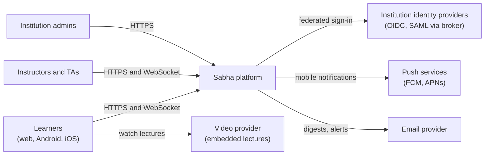
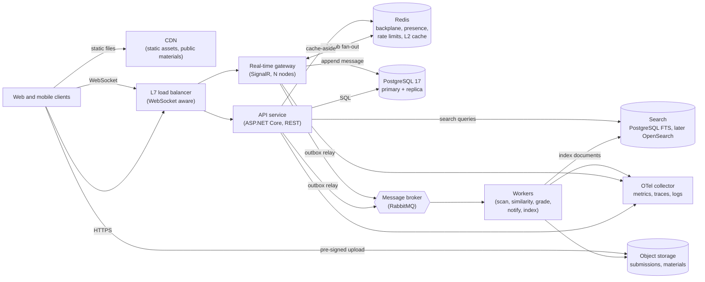
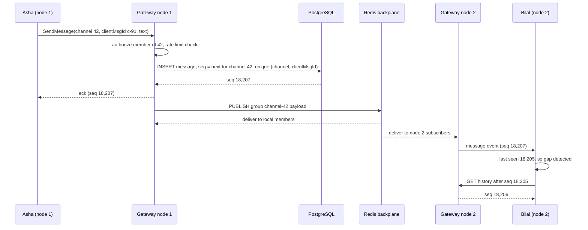
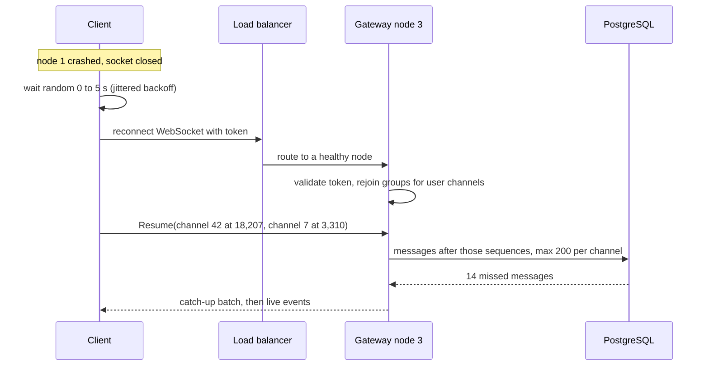
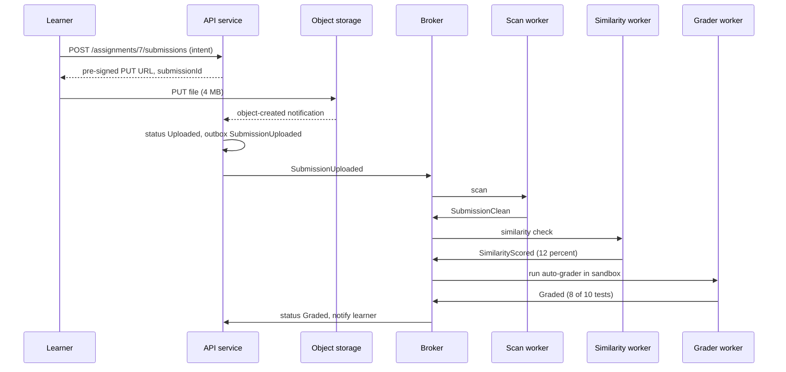

The first two capstones were about correctness: clean boundaries in [Capstone A](#/lesson/m20-capstone-a), surviving duplicates and partial failure in [Capstone B](#/lesson/m20-capstone-b). This one adds the dimension that separates "it works on my machine" from "it works for 30,000 students at 10 a.m. on exam day": **operating** a system. You will build a platform with long-lived real-time connections, background workflows, search and caching, and then prove with dashboards, alerts, load tests and runbooks that you understand how it behaves in production.

The plain-English picture: a large school building. Classrooms (course channels) have live conversations. A notice board (announcements) is read by everyone. Homework goes into a tray (a queue) and teaching assistants (workers) check it in the background. There is a library catalogue (search). Frequently asked questions are pinned at the door so nobody walks to the office for them (caching). And there is a control room with screens showing which corridors are crowded and which lights are off (observability). Your job is to design all of it, and to staff the control room.

## Learning objectives

By the end of this capstone you will be able to:

1. Design a real-time messaging layer with WebSockets (SignalR) that scales across several servers with a backplane, and handles reconnects, ordering and slow clients.
2. Move slow or unreliable work (file scanning, plagiarism checks, auto-grading, notification fan-out, search indexing) to **asynchronous workflows** with queues and workers.
3. Choose and implement **search**: PostgreSQL full-text search first, a dedicated engine when the numbers justify it, and keep the index in sync.
4. Apply **multi-level caching** (in-process plus Redis) with stampede protection and an invalidation strategy you can explain.
5. Instrument the system with **OpenTelemetry** traces, metrics and logs; define **SLIs and SLOs**; alert with burn rates rather than raw thresholds.
6. Package every component as a **Docker** image, run the whole platform locally with Compose, and write deployment documentation someone else can follow.
7. Run load tests that include WebSocket connections, find the first bottleneck, and write the capacity and cost analysis.

## Prerequisites

- [Real-time communication](#/lesson/m10-realtime) and the [chat system case study](#/lesson/m17-chat).
- The [LMS case study](#/lesson/m17-lms) and [search architecture](#/lesson/m16-search-architecture).
- [Cache patterns](#/lesson/m12-cache-patterns), [observability](#/lesson/m14-observability) and [SLIs, SLOs and SLAs](#/lesson/m14-sli-slo-sla).
- [Docker](#/lesson/m15-docker) and [CI/CD](#/lesson/m15-ci-cd).

Recommended: [backpressure](#/lesson/m13-backpressure), [alerting and incidents](#/lesson/m14-alerting-incidents), [deployment strategies](#/lesson/m15-deployment-strategies).

## Project brief

### The product

**Sabha** (a fictional product; the word means "assembly") is a learning and communication platform sold to engineering colleges and to companies that run internal training academies. Each institution has courses; each course has:

- **Channels**: a general chat, topic threads, and a live-class channel used during lectures (questions, polls, reactions).
- **Announcements** from instructors, which every enrolled learner must see.
- **Assignments**: learners upload files (PDF, code archives, notebooks); the platform scans them for malware, checks similarity against earlier submissions, runs auto-graders for code, and notifies the learner.
- **Materials**: lecture notes and slides, searchable together with announcements and channel messages.

### Numbers

| Measure | Value | Arithmetic or source |
|---|---|---|
| Institutions | 300 | Brief |
| Registered learners | 400,000 | Brief |
| Daily active users (DAU) | 60,000 | Brief (15 %) |
| Peak concurrent WebSocket connections | **25,000** | Brief: 10:00 IST lecture peak on weekdays; many users have 2 tabs or devices |
| Messages sent per day | 60,000 DAU × 30 = **1.8 M** | Estimate |
| Average message write rate | 1.8 M ÷ 86,400 ≈ **21/s** | |
| Peak write rate | ×10 during live classes ≈ **210/s** | Estimate |
| Fan-out | average online channel membership at peak ~60 → 210 × 60 ≈ **12,600 deliveries/s** | Estimate |
| Assignment submissions | ~15,000/day, but **8,000 in the last hour** before common deadlines (23:59) ≈ 2.2/s | Brief |
| Average submission size | 4 MB → 8,000 × 4 MB ≈ **32 GB** in the deadline hour | Estimate |
| Search queries | 60,000 DAU × 5 = 300,000/day; peak ~**30 QPS** | Estimate |
| Searchable documents | ~1.8 M messages/day + materials ≈ **650 M** documents per year if every message is indexed | Estimate |

Two of these numbers drive most of the design. **25,000 concurrent connections** means several real-time servers (each connection holds memory and a socket; a reasonably sized ASP.NET Core instance commonly holds thousands to tens of thousands of idle WebSocket connections, but the limit depends on message rate and memory, so you must measure it) and a way for them to share messages. **650 M searchable documents per year** means PostgreSQL full-text search over *all* messages will eventually need help; announcements and materials alone (a few million rows) are comfortably within PostgreSQL's reach.

### Functional requirements

1. **Sign-in** through the institution's identity provider (OIDC, or SAML through a broker); roles per course: learner, teaching assistant (TA), instructor, institution admin.
2. **Real-time chat**: send, edit (15 minutes), delete; reactions; typing indicators; presence ("42 online"); per-channel unread counts; history with infinite scroll.
3. **Delivery semantics**: messages in a channel appear in the same order for everyone; a client that reconnects receives what it missed without duplicates.
4. **Live class**: questions with upvotes, quick polls with live results, slow mode (one message per 30 s per learner) set by the instructor.
5. **Announcements**: posted by instructors, pushed in real time, by email digest, and as mobile push; "read by 73 %" for the instructor.
6. **Assignments**: upload via pre-signed URL; asynchronous pipeline: malware scan → similarity check → auto-grade (for code) → notify; status visible to the learner; resubmission until the deadline.
7. **Search**: across materials, announcements and messages of the courses the user belongs to, with highlights, filters (course, type, date) and results in under a second.
8. **Notifications**: in-app, email, push; per-user preferences; quiet hours.
9. **Moderation**: report message, instructor hides it, audit trail.

### Non-functional requirements

| Quality | SLO (measured monthly) |
|---|---|
| API availability | 99.9 % of HTTP requests succeed (non-5xx) |
| API latency | 99 % of reads < 400 ms, 99 % of writes < 800 ms |
| Real-time delivery | 99 % of messages delivered to online recipients within 1 s of the sender's acknowledgement |
| Connection success | 99.5 % of WebSocket connection attempts succeed |
| Submission pipeline | 99 % of submissions reach a final status within 10 minutes, even in the deadline hour |
| Search | 99 % of queries < 1 s; new content searchable within 60 s |
| Durability | No acknowledged message or submission is lost; RPO 5 minutes, RTO 1 hour |
| Privacy | Learners can see only content of their own courses; data in India; DPDP Act 2023 obligations (consent, deletion requests) documented |

### Out of scope

Video streaming of lectures (use an external provider and embed it), proctoring, payments, offline mobile sync.

## Deliverables

| # | Deliverable | What good looks like |
|---|---|---|
| 1 | **Requirements document** | FRs numbered; NFRs written as SLOs with SLI definitions (what is counted, where it is measured); capacity table with arithmetic; privacy requirements; explicit out-of-scope list. |
| 2 | **HLD document** | Context and container views; real-time design (connection handling, backplane, ordering, reconnect); async workflows; search choice with a migration path; caching layers with TTLs and invalidation; consistency per feature; top risks. |
| 3 | **LLD document** | Message model with per-channel sequence numbers; client message ids for idempotent sends; submission state machine; cache key design; search document schema; hub method contracts. |
| 4 | **Architecture diagrams** | Context, container, deployment; sequences for send message across two nodes, reconnect and catch-up, submission pipeline, search indexing. Each arrow labelled with protocol. |
| 5 | **API specification** | OpenAPI for REST; a hub contract document (methods, events, payloads, error codes) for SignalR; pagination using cursors; rate limits documented per endpoint. |
| 6 | **DB schema and migrations** | Messages table designed for keyset pagination per channel (primary key or index on `(channel_id, seq)`), partitioning plan by month, read-state table, submission tables, outbox; migrations in CI; retention policy implemented. |
| 7 | **Implementation** | API, real-time gateway and workers as separate deployables from one repository; graceful shutdown that drains connections; configuration validated at start; feature flags for slow mode and search engine switch. |
| 8 | **Unit and integration tests** | Domain and pure-logic tests (sequencing, unread counts, rate limits, SLO maths); integration tests with PostgreSQL, Redis and the broker in containers; a SignalR test that connects two clients to two server instances and checks delivery and order. |
| 9 | **Security review** | Threat model per container; authorization on every hub method (not only on connect); upload controls (type sniffing, size limits, malware scan before anyone can download); rate limits; XSS protection for rendered messages; PII inventory and DPDP notes. |
| 10 | **Performance tests** | k6 (or NBomber) with WebSocket scenarios: ramp to 25,000 connections, 210 messages/s, measure delivery latency percentiles; deadline-hour submission burst; search at 30 QPS. Results with hardware and the first bottleneck found. |
| 11 | **Failure scenarios** | At least 12: Redis backplane loss, one real-time node killed, database failover, broker outage, scanner backlog, search cluster red, CDN or object storage errors, IdP outage, thundering herd on reconnect, bad deploy. Detection and mitigation for each; four drills performed. |
| 12 | **Deployment instructions** | Multi-stage Dockerfiles, Compose for local, production manifests (Kubernetes or Azure Container Apps) or IaC; sticky sessions or WebSockets-only configuration for SignalR; rolling deploy with connection draining; rollback; database migration order. |
| 13 | **Runbook** | Entry per alert (burn-rate pages, connection failures, queue age, search lag, cache hit-rate drop); routine tasks (rebuild search index, purge a user's data, scale for exam week, rotate secrets). |
| 14 | **Cost and scaling analysis** | Monthly cost per component at normal and exam-week load, with dated pricing assumptions; cost per 1,000 DAU; what grows linearly (storage, connections) and what grows faster; 10× analysis. |
| 15 | **ADRs** | At least seven: SignalR vs raw WebSockets vs managed service, backplane choice, PostgreSQL FTS vs OpenSearch, queue technology, caching layers, observability stack, container platform. |
| 16 | **Final review** | Retrospective, SLO report for the load-test period, limitations, debt register, and a demo that kills a real-time node during a live class and shows clients reconnecting and catching up. |

## Milestones

About 8 weeks at 10–12 hours per week.

| Week | Milestone | Scope | Exit criteria |
|---|---|---|---|
| 1 | **M1 — Requirements, SLOs, HLD** | Deliverables 1–2, SLI definitions, capacity table, first ADRs | Every SLO has an SLI with a data source |
| 2 | **M2 — Containers and observability first** | Repository layout, Dockerfiles, Compose with PostgreSQL, Redis, broker, OTel collector, Grafana; health checks; CI building images | `docker compose up` gives a running skeleton with a trace visible from API to DB |
| 3 | **M3 — Channels and history** | Message model with sequences, REST history with keyset pagination, read state | Exercises 1 and 2 pass; 10 M seeded messages page in < 50 ms per page (measured) |
| 4 | **M4 — Real-time** | SignalR hub, authorization per method, Redis backplane, presence, reconnect with catch-up, slow consumers | Two-node test passes; killing one node reconnects clients with no gaps; exercise 6 passes |
| 5 | **M5 — Async workflows** | Submission pipeline with queue and workers, notification fan-out, outbox | 8,000 submissions in an hour complete within SLO in a load test |
| 6 | **M6 — Search and caching** | PostgreSQL FTS for materials and announcements, indexing via events, two-level cache with single-flight | Exercise 3 passes; search p99 < 1 s at 30 QPS; cache hit ratio reported |
| 7 | **M7 — SLOs, alerts, load tests** | Burn-rate alerts, dashboards, k6 scenarios, first bottleneck fixed | Exercise 4 passes; alerts fire in a drill and link to runbook entries |
| 8 | **M8 — Deployment and handover** | Production manifests, deployment guide, runbook, security review, cost analysis, final review | A peer deploys from your guide; demo of node failure during live class |

:::callout type=tip title="Observability in week 2, not week 8"
If tracing and metrics exist from the start, every later milestone can be measured as it is built. Teams that add observability at the end discover their worst performance problems the week they hand over.
:::

**Keeping the scope realistic.** This is the largest capstone, and eight weeks of evenings is tight. The external parts are stubs: the malware scanner can be ClamAV in a container, the similarity check a simple shingle-hash comparison, the auto-grader one language with a fixed test runner. If you fall behind, cut polls, reactions, typing indicators, email digests and mobile push, in that order. Do not cut sequence numbers and catch-up, per-method authorization, the two-node test, burn-rate alerts or the load test: those are what this capstone grades.

### Where each piece is taught

| Piece | Lessons to revisit |
|---|---|
| WebSockets, SignalR, presence, chat delivery | [Real-time communication](#/lesson/m10-realtime), [Chat application](#/lesson/m17-chat) |
| Message and submission ids that sort by time | [Distributed unique ID generator](#/lesson/m17-unique-id-generator) |
| Announcement fan-out, push, email, preferences | [Notification platform](#/lesson/m17-notification-platform) |
| Submission pipeline, queues, competing consumers | [Background processing](#/lesson/m11-background-processing), [message queues](#/lesson/m12-message-queues), [backpressure](#/lesson/m13-backpressure) |
| Retention, digests, scheduled announcements, nightly index rebuilds | [Distributed job scheduler](#/lesson/m17-job-scheduler) |
| Search with ranking and authorization | [Search architecture](#/lesson/m16-search-architecture), [Search autocomplete](#/lesson/m17-autocomplete) |
| L1 + L2 caching, stampede protection, bounded in-process cache | [Cache patterns](#/lesson/m12-cache-patterns), [multi-level caching](#/lesson/m16-multi-level-caching), [LRU cache](#/lesson/m18-lru-cache) |
| Slow mode, per-user limits | [Rate limiting](#/lesson/m10-rate-limiting), [Distributed rate limiter](#/lesson/m17-rate-limiter) |
| SLIs, SLOs, burn-rate alerts, dashboards | [Observability](#/lesson/m14-observability), [SLIs, SLOs and SLAs](#/lesson/m14-sli-slo-sla), [alerting and incidents](#/lesson/m14-alerting-incidents) |
| Images, pipelines, drain-aware rollouts | [Docker](#/lesson/m15-docker), [CI/CD](#/lesson/m15-ci-cd), [deployment strategies](#/lesson/m15-deployment-strategies) |

## Reference architecture

### C4 level 1: system context



Users reach Sabha over two protocols: ordinary HTTPS for pages and REST calls, and a long-lived WebSocket for real-time events. Each institution brings its own identity provider, so sign-in is federated through a broker that normalises OIDC and SAML. Notifications leave through push services and an email provider, both best-effort and rate-limited. Lecture video is deliberately someone else's problem: learners stream it directly from the video provider, which keeps the heaviest bandwidth off Sabha's servers and bill.

### C4 level 2: containers



There are three deployables built from one repository: the **API service** (REST: courses, history, search, uploads), the **real-time gateway** (SignalR hubs holding WebSocket connections), and **workers** (queue consumers). They are separate because they scale on different signals: API on request rate and latency, the gateway on connection count and memory, workers on queue age. All three share PostgreSQL and Redis. Redis plays four roles here, which is a risk to call out in the HLD: SignalR backplane (pub/sub between gateway nodes), presence, rate-limit counters and the second-level cache. A production setup separates at least the backplane from the cache so that a cache eviction storm cannot disturb message delivery. Uploads go straight from the client to object storage with pre-signed URLs; the API never handles the 32 GB deadline-hour burst itself.

### Key sequence: sending a message across two gateway nodes



The message is **persisted before it is acknowledged or broadcast**. The database assigns a per-channel sequence number, which gives everyone the same order. The unique constraint on `(channel_id, client_msg_id)` makes the send idempotent: if Asha's phone resends after a flaky connection, she gets the same sequence back instead of a duplicate. The SignalR Redis backplane publishes the event so that node 2's members receive it too. Bilal's client notices that 18,206 never arrived (it was sent while his connection was briefly reconnecting) and fetches it through history. This **gap detection by sequence number** is what turns best-effort push into reliable delivery: the push is fast, the history is the source of truth.

### Key sequence: reconnect after a node dies



When a gateway node dies, roughly 1/N of all connections (for example 25,000 ÷ 5 nodes = 5,000) drop at once. If every client reconnects immediately, the remaining nodes and the identity provider face a burst of thousands of handshakes in the same second, a **thundering herd**. Clients therefore wait a random delay before reconnecting (SignalR's `withAutomaticReconnect` accepts a custom retry policy; add jitter to it). After reconnecting, the client sends its last seen sequence per open channel, and the server returns what was missed, capped per channel; beyond the cap the client shows "load earlier messages" and pages through history.

### Key sequence: assignment submission pipeline



Each stage is a separate consumer group, so in the deadline hour you scale the slowest stage, not all of them. The file is **not downloadable by anyone** (not even the instructor) until the scan stage marks it clean. The grader runs untrusted learner code, so it executes in a sandboxed container with no network, CPU and memory limits and a timeout. Every stage is idempotent on `submissionId` and stage name, because the broker delivers at least once. The submission's status is a small state machine (`Uploaded → Clean → Scored → Graded`, or `Rejected` on malware) that the learner can watch in real time through the gateway.

### Data model highlights

```sql
CREATE TABLE message (
  channel_id     bigint      NOT NULL,
  seq            bigint      NOT NULL,
  id             uuid        NOT NULL DEFAULT gen_random_uuid(),
  author_id      bigint      NOT NULL,
  client_msg_id  text        NOT NULL,
  body           text        NOT NULL CHECK (length(body) <= 4000),
  created_at     timestamptz NOT NULL DEFAULT now(),
  edited_at      timestamptz,
  deleted_at     timestamptz,
  PRIMARY KEY (channel_id, seq),
  UNIQUE (channel_id, client_msg_id)
);

CREATE TABLE channel_counter (           -- one row per channel: the next sequence number
  channel_id bigint PRIMARY KEY,
  last_seq   bigint NOT NULL DEFAULT 0
);
-- In the same transaction as the INSERT:
-- UPDATE channel_counter SET last_seq = last_seq + 1 WHERE channel_id = $1 RETURNING last_seq;

CREATE TABLE read_state (
  user_id     bigint NOT NULL,
  channel_id  bigint NOT NULL,
  last_read   bigint NOT NULL DEFAULT 0,
  PRIMARY KEY (user_id, channel_id)
);

CREATE TABLE material (
  id         bigint PRIMARY KEY,
  course_id  bigint NOT NULL,
  title      text NOT NULL,
  body       text NOT NULL,
  search     tsvector GENERATED ALWAYS AS (
               setweight(to_tsvector('english', title), 'A') || setweight(to_tsvector('english', body), 'B')) STORED
);
CREATE INDEX ix_material_search ON material USING gin (search);
```

The per-channel counter row serialises writers **within one channel** but not across channels, which matches the requirement: order matters inside a channel, not globally. At 210 messages/s spread over thousands of channels, the counter row is not a hotspot; a single 2,000-learner live class sending 50 messages/s into one channel is the case to load-test. Messages are partitioned by month (`PARTITION BY RANGE (created_at)`), which keeps indexes small and makes retention a cheap `DETACH` and `DROP` of an old partition. One catch a reviewer will spot: in PostgreSQL every primary key and unique constraint on a partitioned table must include the partition key, so `(channel_id, seq)` becomes `(channel_id, seq, created_at)` and the idempotency guarantee on `client_msg_id` holds only *within* a month's partition. That is acceptable because client resends arrive within seconds, but write it down; hash partitioning by `channel_id` keeps both constraints exact, at the price of losing cheap time-based retention. Materials use a **generated `tsvector` column** with a GIN index: title words weigh more than body words, and the column can never fall out of sync with the text.

### Search: start with PostgreSQL, plan the move

For materials and announcements (a few million rows), PostgreSQL full-text search with `websearch_to_tsquery`, `ts_rank` and `ts_headline` meets the 1 s SLO and needs no extra system. Indexing *all* chat messages (650 M a year, estimate) in the primary database would make the GIN index, vacuum and backups the dominant cost. The ADR therefore says: phase 1, FTS on materials and announcements, plus message search limited to the last 90 days per course; phase 2, when message search usage or volume crosses an agreed threshold, an OpenSearch cluster fed by the `MessagePosted` events through an indexing worker, with the 60 s freshness SLO measured as "event time to searchable". Authorization in search is enforced by filtering on `course_id IN (user's courses)` inside the query, never by post-filtering results.

### Caching layers

| Data | Layer | TTL | Invalidation |
|---|---|---|---|
| Course and channel metadata | In-process L1 (30 s) + Redis L2 (10 min) | short L1 keeps nodes nearly consistent | Event `ChannelUpdated` removes L2 key; L1 expires |
| User's course memberships (used for every authorization) | L1 10 s + L2 5 min | short, because removal must take effect quickly | `MembershipChanged` event; hub also re-checks on sensitive actions |
| Unread counts | Computed from `read_state` and channel `last_seq`, cached per user 15 s | | Recomputed on read |
| Search results | Not cached (personalised, filters vary) | | |
| Static assets, public materials | CDN, long TTL with content-hashed URLs | 1 year | New hash on change |

The in-process L1 must be **bounded** (a size limit with least-recently-used eviction, as built in the [LRU cache](#/lesson/m18-lru-cache) lesson); an unbounded `Dictionary` used as a cache is a memory leak with a delay. All cache reads go through a **single-flight** wrapper: when 2,000 learners join the same live class and the channel metadata has just expired, one request loads it and the other 1,999 wait for that result instead of hitting PostgreSQL 2,000 times (a cache stampede). .NET's `HybridCache` provides L1 + L2 with stampede protection built in; exercise 3 builds the core idea by hand so you understand what it does.

### Observability: what to measure

| Signal | Examples | Used for |
|---|---|---|
| Traces | API request → DB; hub `SendMessage` → DB → backplane; submission through every worker (trace context in message headers) | Finding where latency goes |
| RED metrics (rate, errors, duration) | `http.server.request.duration` histograms per route; hub method duration | SLOs, dashboards |
| Saturation | connections per node, Redis CPU, DB connections in use, queue age per stage | Scaling decisions, early warning |
| Business metrics | messages/s, delivery latency (server ack → recipient receive, sampled by clients), submissions per status | SLOs that users feel |
| Logs | Structured, with trace id; no message bodies or PII | Debugging specific requests |

Alerts are based on **error-budget burn rate**, not on raw thresholds. With a 99.9 % SLO, the monthly error budget is 0.1 % of requests. A burn rate of 1 uses the budget in exactly 30 days. Page a human when both the last hour and the last 5 minutes burn at more than 14.4× (2 % of the monthly budget in one hour); open a ticket when the last 6 hours and the last 30 minutes burn at more than 6×. The two windows together catch fast outages quickly and ignore short blips. Exercise 4 implements this.

### Code skeleton: hub, telemetry and wiring

The compiled skeleton below shows the real-time gateway's core: a hub that authorizes every method call, persists before broadcasting, and records metrics with the BCL `Meter` and `ActivitySource` types that OpenTelemetry exports.

```csharp file=Realtime/Telemetry.cs
using System.Diagnostics;
using System.Diagnostics.Metrics;

namespace Sabha.Realtime;

public static class Telemetry
{
    public const string Name = "Sabha.Realtime";
    public static readonly ActivitySource Source = new(Name);
    private static readonly Meter Meter = new(Name);

    public static readonly Counter<long> MessagesSent = Meter.CreateCounter<long>("sabha.messages.sent");
    public static readonly Counter<long> MessagesRejected = Meter.CreateCounter<long>("sabha.messages.rejected");
    public static readonly Histogram<double> PersistMs = Meter.CreateHistogram<double>("sabha.messages.persist.duration", unit: "ms");
    public static readonly UpDownCounter<long> Connections = Meter.CreateUpDownCounter<long>("sabha.connections.active");
}
```

```csharp file=Realtime/Stores.cs
using System.Collections.Concurrent;

namespace Sabha.Realtime;

public sealed record ChatMessage(long ChannelId, long Seq, string AuthorId, string ClientMsgId, string Body, DateTimeOffset CreatedAt);

public interface IChannelMembership
{
    Task<bool> IsMemberAsync(string userId, long channelId, CancellationToken ct);
}

public interface IMessageStore
{
    /// <summary>Idempotent on (channelId, clientMsgId): a resend returns the original message.</summary>
    Task<ChatMessage> AppendAsync(long channelId, string authorId, string clientMsgId, string body, CancellationToken ct);
    Task<IReadOnlyList<ChatMessage>> AfterAsync(long channelId, long afterSeq, int limit, CancellationToken ct);
}

public sealed class InMemoryMessageStore(TimeProvider clock) : IMessageStore
{
    private readonly ConcurrentDictionary<long, List<ChatMessage>> _channels = new();

    public Task<ChatMessage> AppendAsync(long channelId, string authorId, string clientMsgId, string body, CancellationToken ct)
    {
        var list = _channels.GetOrAdd(channelId, _ => []);
        lock (list)
        {
            var existing = list.FirstOrDefault(m => m.ClientMsgId == clientMsgId);
            if (existing is not null) return Task.FromResult(existing);
            var msg = new ChatMessage(channelId, list.Count + 1, authorId, clientMsgId, body, clock.GetUtcNow());
            list.Add(msg);
            return Task.FromResult(msg);
        }
    }

    public Task<IReadOnlyList<ChatMessage>> AfterAsync(long channelId, long afterSeq, int limit, CancellationToken ct)
    {
        if (!_channels.TryGetValue(channelId, out var list)) return Task.FromResult<IReadOnlyList<ChatMessage>>([]);
        lock (list) return Task.FromResult<IReadOnlyList<ChatMessage>>(list.Where(m => m.Seq > afterSeq).Take(limit).ToList());
    }
}

public sealed class AllowAllMembership : IChannelMembership
{
    public Task<bool> IsMemberAsync(string userId, long channelId, CancellationToken ct) => Task.FromResult(true);
}
```

```csharp file=Realtime/ChatHub.cs
using System.Diagnostics;
using Microsoft.AspNetCore.Authorization;
using Microsoft.AspNetCore.SignalR;

namespace Sabha.Realtime;

public sealed record SendResult(bool Ok, long Seq, string? Error);

[Authorize]
public sealed class ChatHub(IChannelMembership membership, IMessageStore store, ILogger<ChatHub> logger) : Hub
{
    public const int MaxBody = 4000;
    private static string Group(long channelId) => $"channel-{channelId}";

    public override Task OnConnectedAsync() { Telemetry.Connections.Add(1); return base.OnConnectedAsync(); }
    public override Task OnDisconnectedAsync(Exception? exception) { Telemetry.Connections.Add(-1); return base.OnDisconnectedAsync(exception); }

    public async Task<bool> JoinChannel(long channelId)
    {
        if (!await IsMember(channelId)) return false;
        await Groups.AddToGroupAsync(Context.ConnectionId, Group(channelId), Context.ConnectionAborted);
        return true;
    }

    public async Task<SendResult> SendMessage(long channelId, string clientMsgId, string body)
    {
        using var activity = Telemetry.Source.StartActivity("chat.send");
        activity?.SetTag("sabha.channel_id", channelId);

        // Authorize EVERY call: membership can be revoked while the socket stays open.
        if (!await IsMember(channelId)) return Reject("NOT_MEMBER");
        if (string.IsNullOrWhiteSpace(body) || body.Length > MaxBody) return Reject("INVALID_BODY");
        if (string.IsNullOrWhiteSpace(clientMsgId) || clientMsgId.Length > 64) return Reject("INVALID_CLIENT_ID");

        var started = Stopwatch.GetTimestamp();
        var msg = await store.AppendAsync(channelId, Context.UserIdentifier!, clientMsgId, body, Context.ConnectionAborted);
        Telemetry.PersistMs.Record(Stopwatch.GetElapsedTime(started).TotalMilliseconds);

        // Persisted first, then broadcast. A lost broadcast is repaired by sequence-gap catch-up.
        await Clients.Group(Group(channelId)).SendAsync("message", msg, Context.ConnectionAborted);
        Telemetry.MessagesSent.Add(1);
        return new SendResult(true, msg.Seq, null);
    }

    public Task<IReadOnlyList<ChatMessage>> Resume(long channelId, long lastSeenSeq) =>
        store.AfterAsync(channelId, lastSeenSeq, limit: 200, Context.ConnectionAborted);

    private Task<bool> IsMember(long channelId) =>
        Context.UserIdentifier is { } user
            ? membership.IsMemberAsync(user, channelId, Context.ConnectionAborted)
            : Task.FromResult(false);

    private SendResult Reject(string code)
    {
        Telemetry.MessagesRejected.Add(1, new KeyValuePair<string, object?>("reason", code));
        logger.LogInformation("Rejected message from {User}: {Reason}", Context.UserIdentifier, code);
        return new SendResult(false, 0, code);
    }
}
```

```csharp file=Program.cs
using Sabha.Realtime;

var builder = WebApplication.CreateBuilder(args);

builder.Services.AddAuthentication();   // real gateway: JWT bearer from the identity broker (access_token query for WebSockets)
builder.Services.AddAuthorization();
builder.Services.AddSignalR(o =>
{
    o.MaximumReceiveMessageSize = 16 * 1024;      // a 4,000-char message fits; a 10 MB paste does not
    o.KeepAliveInterval = TimeSpan.FromSeconds(15);
    o.ClientTimeoutInterval = TimeSpan.FromSeconds(30);
});
// Scale-out: .AddStackExchangeRedis(redisConnectionString) from Microsoft.AspNetCore.SignalR.StackExchangeRedis.
builder.Services.AddSingleton(TimeProvider.System);
builder.Services.AddSingleton<IMessageStore, InMemoryMessageStore>();
builder.Services.AddSingleton<IChannelMembership, AllowAllMembership>();
builder.Services.AddHealthChecks();

var app = builder.Build();
app.UseAuthentication();
app.UseAuthorization();
app.MapHub<ChatHub>("/hubs/chat");
app.MapHealthChecks("/health/live");
app.MapHealthChecks("/health/ready");   // real: checks DB and Redis, and turns unready during shutdown drain
app.Run();
```

Three choices to defend. `SendMessage` returns a result instead of throwing for expected rejections, because a thrown hub exception becomes a generic error on the client and costs more to handle. Membership is checked on **every** call, not just on connect; a learner removed from a course must lose access within seconds, not when their socket happens to drop. `MaximumReceiveMessageSize` is small on purpose: the default is 32 KB, and a hub that accepts large frames is an easy memory-exhaustion target.

### Docker and local environment

```dockerfile
# Multi-stage build: SDK image to compile, small runtime image to run.
FROM mcr.microsoft.com/dotnet/sdk:10.0 AS build
WORKDIR /src
COPY . .
RUN dotnet publish src/Sabha.Realtime/Sabha.Realtime.csproj -c Release -o /app

FROM mcr.microsoft.com/dotnet/aspnet:10.0 AS final
WORKDIR /app
COPY --from=build /app .
# Run as the non-root user provided by the .NET images (Dockerfile has no end-of-line comments).
USER $APP_UID
ENV ASPNETCORE_HTTP_PORTS=8080
EXPOSE 8080
ENTRYPOINT ["dotnet", "Sabha.Realtime.dll"]
```

```yaml
# docker-compose.yml (excerpt): the whole platform on a laptop.
services:
  postgres: { image: postgres:17, environment: { POSTGRES_PASSWORD: dev }, ports: ["5432:5432"] }
  redis:    { image: redis:7, ports: ["6379:6379"] }
  rabbitmq: { image: rabbitmq:4-management, ports: ["5672:5672", "15672:15672"] }
  otel:     { image: otel/opentelemetry-collector-contrib, volumes: ["./otel.yaml:/etc/otelcol-contrib/config.yaml"] }
  api:      { build: { context: ., dockerfile: src/Sabha.Api/Dockerfile }, depends_on: [postgres, redis, rabbitmq] }
  realtime: { build: { context: ., dockerfile: src/Sabha.Realtime/Dockerfile }, deploy: { replicas: 2 }, depends_on: [redis, postgres] }
  workers:  { build: { context: ., dockerfile: src/Sabha.Workers/Dockerfile }, depends_on: [rabbitmq, postgres] }
```

Running **two** real-time replicas locally is deliberate: it makes the backplane path the normal path during development, so cross-node bugs show up on day one rather than in production. Pin image tags (for example a specific `postgres:17.x`) in your real Compose and manifests; floating tags are shown here only for brevity.

### Deployment notes for real-time traffic

- If clients can fall back to long polling or Server-Sent Events, SignalR needs **sticky sessions** at the load balancer. If you configure clients for WebSockets only with `SkipNegotiation`, stickiness is not needed. Write down which you chose.
- Raise idle timeouts on load balancers and proxies above the keep-alive interval (for example 120 s), or connections will be cut every minute.
- During a rolling deploy, mark a node **unready** first, stop accepting new connections, then close existing ones gradually over 1–2 minutes so that thousands of clients do not reconnect in the same second.
- Scale the gateway on connections per node and memory, not on CPU alone; WebSocket servers are often memory-bound.

### Practice on the canvas

Try the real-time tier on the canvas before exercise 5. The starting graph has one gateway node and no backplane; add nodes, a dedicated backplane, the worker stages and search, then push client traffic to exam-week levels and note what saturates first.

:::playground type=hld title="Sabha real-time sandbox"
```json
{
  "nodes": [
    { "id": "c", "type": "client", "label": "Learners (WebSockets)", "props": { "rps": 1500 } },
    { "id": "lb", "type": "load-balancer", "label": "L7 load balancer" },
    { "id": "api", "type": "app-server", "label": "API service", "props": { "instances": 2 } },
    { "id": "ws", "type": "websocket-gateway", "label": "Real-time gateway", "props": { "instances": 1 } },
    { "id": "pg", "type": "database", "label": "PostgreSQL" }
  ],
  "edges": [
    { "from": "c", "to": "lb", "kind": "sync" },
    { "from": "lb", "to": "api", "kind": "sync" },
    { "from": "lb", "to": "ws", "kind": "sync" },
    { "from": "api", "to": "pg", "kind": "sync" },
    { "from": "ws", "to": "pg", "kind": "sync" }
  ]
}
```
:::

## Evaluation rubric

Score each criterion 0–4. The pass mark is 64 of 96, with no starred (★) criterion below 2.

| # | Criterion | 1 — weak | 2 — acceptable | 3 — strong | 4 — exemplary |
|---|---|---|---|---|---|
| 1 ★ | Requirements and SLOs | Adjectives, no numbers | NFRs with numbers | SLOs with precise SLIs and data sources | Plus error budgets agreed and used in decisions |
| 2 ★ | Real-time design | Single server, no scale-out | Backplane added | Ordering by sequence, idempotent send, gap catch-up | Plus slow-consumer handling and herd-safe reconnect, both tested |
| 3 ★ | Authorization | On connect only | Per hub method | Per method, per resource, revocation within seconds | Plus search and file access filtered at the source, tested |
| 4 ★ | Async workflows | Inline processing | Queue with one worker | Stages per consumer group, idempotent, scalable per stage | Plus deadline-hour test meeting the SLO |
| 5 | Search | `LIKE '%term%'` | FTS without ranking | FTS with ranking, highlights, filters, authorization | Plus measured migration trigger and indexing freshness SLI |
| 6 | Caching | None or everywhere | Cache-aside on hot reads | Two levels, single-flight, invalidation table | Plus hit-ratio metrics and stampede test |
| 7 ★ | Data model | No pagination plan | Offset pagination | Keyset pagination, per-channel sequence, constraints | Plus partitioning and retention implemented |
| 8 ★ | Observability | Logs only | Metrics and logs | Traces across hub, DB and queue; dashboards | Burn-rate alerts linked to runbook entries |
| 9 ★ | Tests | Unit only | Plus integration with containers | Plus two-node real-time test | Plus failure-injection tests in CI |
| 10 | Performance | None | HTTP load test only | WebSocket ramp to target with delivery percentiles | Plus first bottleneck found, fixed, re-measured |
| 11 ★ | Containers | None | Dockerfiles | Multi-stage, non-root, pinned, small images; Compose for all | Plus image scanning and SBOM in CI |
| 12 ★ | Deployment docs | None | Steps for one environment | Repeatable deploy, drain-aware rollout, rollback | A peer deploys unaided |
| 13 | Failure scenarios | None | List | 12 with detection and mitigation | Four drills written up with timings |
| 14 | Runbook | None | Notes | Entry per alert and routine task | Used successfully in a drill by someone else |
| 15 | Security | Not reviewed | OWASP checklist | Threat model, upload controls, rate limits, XSS-safe rendering | Plus sandboxed grader verified and PII inventory |
| 16 | Privacy | Not considered | Deletion possible manually | Data inventory, retention, deletion workflow | Plus DPDP obligations mapped to features |
| 17 | Cost and scaling | None | Rough monthly figure | Per-component, normal vs exam week, dated assumptions | Plus cost per 1,000 DAU and 10× analysis |
| 18 | ADRs | None | 2–3 | Seven with alternatives | Plus a superseded ADR |
| 19 | API and hub contracts | None | OpenAPI only | Plus hub contract document and error codes | Plus contract tests for hub events |
| 20 | Backpressure | None | Rate limits | Slow mode, bounded send queues, queue-length limits | Plus load shedding with graceful degradation shown |
| 21 | Code quality | Inconsistent | Readable | Consistent, zero warnings, shared libraries tested | Nothing structural to change |
| 22 | Final review and demo | None | Feature demo | Honest limitations and debt | Live node-failure demo with SLO report |
| 23 | Simplicity | Over-built | Some unjustified parts | Every component traced to a requirement | Plus phased plan (FTS before OpenSearch) |
| 24 | Operability | Manual everything | Some scripts | Health checks, graceful shutdown, config validation | Plus feature flags and safe toggles documented |

## Exercises

:::exercise id=m20-capstone-c-ex1 difficulty=beginner kind=code title="M3: unread counts with read watermarks"
Implement `ReadState`, which tracks the latest message sequence per channel and each user's last-read sequence, and computes unread counts.
::requirements
- `OnMessage(channelId, seq)` records that a message with that sequence exists; the channel's latest sequence only moves forward (an older sequence arriving late does not lower it).
- `MarkRead(userId, channelId, seq)` moves the user's watermark forward only; marking an older sequence is ignored. A watermark never goes above the channel's latest sequence.
- `Unread(userId, channelId)` = latest − watermark, never negative; a channel the user has never read counts all messages as unread.
- `TotalUnread(userId, channelIds)` sums over the given channels.
::acceptance
- Latest 18,207, watermark 18,200 → 7 unread.
- `MarkRead` with an older sequence (from a second device that was behind) does not increase unread.
- A late `OnMessage` with an old sequence does not change the latest.
- Marking read beyond the latest clamps to the latest.
::hint
Two dictionaries: latest per channel, and watermark per (user, channel).
::hint
"Only moves forward" is `Math.Max(current, incoming)`.
::hint
Clamp the watermark with `Math.Min(seq, latest)` before taking the max with the current watermark.
::hint
Unread is `Math.Max(0, latest - watermark)`, with both defaulting to 0 when missing.
::starter
```csharp file=ReadState.cs
using System;
using System.Collections.Generic;

public sealed class ReadState
{
    public void OnMessage(long channelId, long seq) => throw new NotImplementedException();
    public void MarkRead(string userId, long channelId, long seq) => throw new NotImplementedException();
    public long Unread(string userId, long channelId) => throw new NotImplementedException();
    public long TotalUnread(string userId, IEnumerable<long> channelIds) => throw new NotImplementedException();
}
```
::tests
```csharp file=ReadStateTests.cs
using Xunit;

public class ReadStateTests
{
    [Fact]
    public void Unread_is_latest_minus_watermark()
    {
        var s = new ReadState();
        s.OnMessage(42, 18207);
        s.MarkRead("asha", 42, 18200);
        Assert.Equal(7, s.Unread("asha", 42));
    }

    [Fact]
    public void Never_read_channel_counts_everything()
    {
        var s = new ReadState();
        s.OnMessage(7, 12);
        Assert.Equal(12, s.Unread("bilal", 7));
    }

    [Fact]
    public void Older_mark_read_is_ignored()
    {
        var s = new ReadState();
        s.OnMessage(42, 100);
        s.MarkRead("asha", 42, 95);
        s.MarkRead("asha", 42, 60);   // second device that was behind
        Assert.Equal(5, s.Unread("asha", 42));
    }

    [Fact]
    public void Late_old_message_does_not_lower_latest()
    {
        var s = new ReadState();
        s.OnMessage(42, 100);
        s.OnMessage(42, 98);
        s.MarkRead("asha", 42, 90);
        Assert.Equal(10, s.Unread("asha", 42));
    }

    [Fact]
    public void Mark_read_beyond_latest_clamps()
    {
        var s = new ReadState();
        s.OnMessage(42, 50);
        s.MarkRead("asha", 42, 500);
        s.OnMessage(42, 53);
        Assert.Equal(3, s.Unread("asha", 42));
    }

    [Fact]
    public void Total_over_channels()
    {
        var s = new ReadState();
        s.OnMessage(1, 10); s.OnMessage(2, 5); s.OnMessage(3, 0);
        s.MarkRead("u", 1, 8);
        Assert.Equal(7, s.TotalUnread("u", new long[] { 1, 2, 3 }));
    }
}
```
::solution
```csharp file=ReadState.cs
using System;
using System.Collections.Generic;
using System.Linq;

public sealed class ReadState
{
    private readonly Dictionary<long, long> _latest = new();
    private readonly Dictionary<(string User, long Channel), long> _watermark = new();

    public void OnMessage(long channelId, long seq) =>
        _latest[channelId] = Math.Max(_latest.GetValueOrDefault(channelId), seq);

    public void MarkRead(string userId, long channelId, long seq)
    {
        var clamped = Math.Min(seq, _latest.GetValueOrDefault(channelId));
        var key = (userId, channelId);
        _watermark[key] = Math.Max(_watermark.GetValueOrDefault(key), clamped);
    }

    public long Unread(string userId, long channelId) =>
        Math.Max(0, _latest.GetValueOrDefault(channelId) - _watermark.GetValueOrDefault((userId, channelId)));

    public long TotalUnread(string userId, IEnumerable<long> channelIds) => channelIds.Sum(c => Unread(userId, c));
}
```

This works only because sequences are **dense and per channel**: `latest − watermark` is the count of messages in between. Deleted messages make the count slightly high (a known, accepted approximation for most chat products); if exactness matters, count rows with `seq > watermark AND deleted_at IS NULL` for the few channels a user opens. In SQL, the forward-only rule becomes `INSERT … ON CONFLICT (user_id, channel_id) DO UPDATE SET last_read = GREATEST(read_state.last_read, EXCLUDED.last_read)`, which is safe when two devices update at once.
::mistakes
- Storing an unread *counter* and incrementing it per message: it drifts with every lost event and is expensive to fan out to 2,000 members.
- Letting a lagging second device move the watermark backwards.
- Allowing a watermark beyond the latest, which hides the next few real messages.
::extensions
Add `@mentions`: a separate count of unread messages that mention the user, which the UI shows as a red badge even in muted channels.
:::

:::exercise id=m20-capstone-c-ex2 difficulty=beginner kind=sql ordered=true title="M3: keyset pagination for channel history"
The client is showing channel 42 and the oldest message on screen has `seq = 18200`. Fetch the **previous 5 messages** that are not deleted, newest first, returning `seq`, `author` and `body`. Use keyset pagination (no `OFFSET`).
::setup
```sql
CREATE TABLE message (
  channel_id  bigint NOT NULL,
  seq         bigint NOT NULL,
  author      text   NOT NULL,
  body        text   NOT NULL,
  deleted_at  timestamptz,
  PRIMARY KEY (channel_id, seq)
);
INSERT INTO message (channel_id, seq, author, body, deleted_at) VALUES
  (42, 18192, 'asha',   'Can we get the slides?', NULL),
  (42, 18193, 'ravi',   'Uploaded to materials', NULL),
  (42, 18194, 'meera',  'Thanks!', NULL),
  (42, 18195, 'bilal',  'spam link', '2026-11-10 10:05:00+05:30'),
  (42, 18196, 'asha',   'Is the quiz open-book?', NULL),
  (42, 18197, 'prof_k', 'Yes, notes allowed', NULL),
  (42, 18198, 'ravi',   'Deadline is Friday 23:59', NULL),
  (42, 18199, 'meera',  'Which chapters?', NULL),
  (42, 18200, 'prof_k', 'Chapters 3 to 5', NULL),
  (42, 18201, 'asha',   'Got it', NULL),
  (7,  18199, 'zoe',    'Other channel', NULL),
  (7,  18198, 'zoe',    'Other channel again', NULL);
```
::check
```sql
SELECT seq, author, body
FROM message
WHERE channel_id = 42
  AND seq < 18200
  AND deleted_at IS NULL
ORDER BY seq DESC
LIMIT 5;
```
::acceptance
- Returns sequences 18199, 18198, 18197, 18196, 18194, in that order.
- The deleted message 18195 is skipped, so the page reaches back to 18194.
- Channel 7 rows never appear.
- The query does not use `OFFSET`.
::hint
The cursor is the sequence of the oldest message the client already has. "Previous" means smaller sequences.
::hint
`WHERE channel_id = 42 AND seq < 18200`, then order so that the closest older messages come first.
::hint
`ORDER BY seq DESC LIMIT 5`. The primary key `(channel_id, seq)` lets PostgreSQL walk the index backwards from the cursor.
::hint
Filter out deleted rows in the same `WHERE`; the client can then render the page directly.
::solution
```sql
SELECT seq, author, body
FROM message
WHERE channel_id = 42
  AND seq < 18200
  AND deleted_at IS NULL
ORDER BY seq DESC
LIMIT 5;
```

Why not `OFFSET`? `OFFSET 50000 LIMIT 50` makes PostgreSQL read and discard 50,000 rows, so deep pages get slower and slower; worse, if new messages arrive between page loads, offsets shift and the user sees duplicates or gaps. A keyset cursor (`seq < 18200`) jumps straight to the right place in the `(channel_id, seq)` index and is stable while new messages arrive. The API returns the next cursor (`18194` here) to the client, ideally as an opaque string so you can change its contents later.

Many products show deleted messages as "This message was deleted" instead of skipping them; then you would return the row with an empty body and a `deleted` flag, and the page would be exactly 5 consecutive sequences.
::mistakes
- `ORDER BY seq ASC` with `seq < 18200`, which returns the oldest messages in the channel instead of the ones just above the screen.
- Forgetting `channel_id`, which mixes channels because sequences are only unique per channel.
- Using `OFFSET`, which is slow for long channels and unstable during live classes.
:::

:::exercise id=m20-capstone-c-ex3 difficulty=intermediate kind=code title="M6: a cache with single-flight stampede protection"
Implement `SingleFlightCache<T>.GetOrCreateAsync(key, factory)`.
::requirements
- A cached value younger than `ttl` is returned without calling the factory.
- On a miss, **only one** factory call runs per key at a time; concurrent callers for the same key await the same result.
- A factory failure is propagated to every waiting caller and is **not** cached; the next call tries again.
- Different keys do not block each other.
- `Invalidate(key)` removes the cached value.
- Time comes from an injected `TimeProvider`.
::acceptance
- 1,000 concurrent calls for one cold key call the factory once.
- After the TTL passes, the next call reloads.
- A failing factory throws to all waiters; a later call succeeds with a new factory call.
- Invalidate forces a reload.
::hint
Keep two maps: completed values with their expiry, and in-flight loads as shared tasks.
::hint
`ConcurrentDictionary<string, Lazy<Task<T>>>` with `GetOrAdd` ensures that only one `Lazy` wins, and `Lazy` ensures its factory runs once.
::hint
When the in-flight task finishes, remove it from the in-flight map. On success store the value with `now + ttl`; on failure store nothing.
::hint
```csharp
var lazy = _inFlight.GetOrAdd(key, k => new Lazy<Task<T>>(() => LoadAsync(k, factory)));
return await lazy.Value;
```
::starter
```csharp file=SingleFlightCache.cs
using System;
using System.Threading.Tasks;

public sealed class SingleFlightCache<T>(TimeProvider clock, TimeSpan ttl)
{
    public Task<T> GetOrCreateAsync(string key, Func<Task<T>> factory) => throw new NotImplementedException();
    public void Invalidate(string key) => throw new NotImplementedException();
}
```
::tests
```csharp file=SingleFlightCacheTests.cs
using System;
using System.Linq;
using System.Threading;
using System.Threading.Tasks;
using Xunit;

public class SingleFlightCacheTests
{
    private sealed class ManualClock : TimeProvider
    {
        public DateTimeOffset Now { get; set; } = new(2026, 11, 10, 4, 30, 0, TimeSpan.Zero);
        public override DateTimeOffset GetUtcNow() => Now;
    }

    [Fact]
    public async Task Concurrent_cold_calls_load_once()
    {
        var cache = new SingleFlightCache<string>(new ManualClock(), TimeSpan.FromMinutes(5));
        var calls = 0;
        async Task<string> Load() { Interlocked.Increment(ref calls); await Task.Delay(50); return "channel-42-meta"; }
        var results = await Task.WhenAll(Enumerable.Range(0, 1000).Select(_ => Task.Run(() => cache.GetOrCreateAsync("ch:42", Load))));
        Assert.Equal(1, calls);
        Assert.True(results.All(r => r == "channel-42-meta"));
    }

    [Fact]
    public async Task Expired_value_reloads()
    {
        var clock = new ManualClock();
        var cache = new SingleFlightCache<int>(clock, TimeSpan.FromMinutes(5));
        var calls = 0;
        await cache.GetOrCreateAsync("k", () => Task.FromResult(++calls));
        await cache.GetOrCreateAsync("k", () => Task.FromResult(++calls));
        Assert.Equal(1, calls);
        clock.Now = clock.Now.AddMinutes(5).AddSeconds(1);
        Assert.Equal(2, await cache.GetOrCreateAsync("k", () => Task.FromResult(++calls)));
    }

    [Fact]
    public async Task Failures_are_not_cached()
    {
        var cache = new SingleFlightCache<int>(new ManualClock(), TimeSpan.FromMinutes(5));
        await Assert.ThrowsAsync<TimeoutException>(() => cache.GetOrCreateAsync("k", () => Task.FromException<int>(new TimeoutException())));
        Assert.Equal(7, await cache.GetOrCreateAsync("k", () => Task.FromResult(7)));
    }

    [Fact]
    public async Task Invalidate_forces_reload()
    {
        var cache = new SingleFlightCache<int>(new ManualClock(), TimeSpan.FromMinutes(5));
        await cache.GetOrCreateAsync("k", () => Task.FromResult(1));
        cache.Invalidate("k");
        Assert.Equal(2, await cache.GetOrCreateAsync("k", () => Task.FromResult(2)));
    }

    [Fact]
    public async Task Different_keys_do_not_block_each_other()
    {
        var cache = new SingleFlightCache<int>(new ManualClock(), TimeSpan.FromMinutes(5));
        var gate = new TaskCompletionSource<int>();
        var slow = cache.GetOrCreateAsync("slow", () => gate.Task);
        Assert.Equal(3, await cache.GetOrCreateAsync("fast", () => Task.FromResult(3)));
        gate.SetResult(1);
        Assert.Equal(1, await slow);
    }
}
```
::solution
```csharp file=SingleFlightCache.cs
using System;
using System.Collections.Concurrent;
using System.Threading.Tasks;

public sealed class SingleFlightCache<T>(TimeProvider clock, TimeSpan ttl)
{
    private readonly ConcurrentDictionary<string, (T Value, DateTimeOffset ExpiresAt)> _values = new();
    private readonly ConcurrentDictionary<string, Lazy<Task<T>>> _inFlight = new();

    public async Task<T> GetOrCreateAsync(string key, Func<Task<T>> factory)
    {
        if (_values.TryGetValue(key, out var hit) && clock.GetUtcNow() < hit.ExpiresAt) return hit.Value;
        var lazy = _inFlight.GetOrAdd(key, k => new Lazy<Task<T>>(() => LoadAsync(k, factory)));
        return await lazy.Value;
    }

    public void Invalidate(string key) => _values.TryRemove(key, out _);

    private async Task<T> LoadAsync(string key, Func<Task<T>> factory)
    {
        try
        {
            // Re-check: a caller that missed just before the previous load finished must not load again.
            if (_values.TryGetValue(key, out var hit) && clock.GetUtcNow() < hit.ExpiresAt) return hit.Value;
            var value = await factory();
            _values[key] = (value, clock.GetUtcNow() + ttl);
            return value;
        }
        finally
        {
            _inFlight.TryRemove(key, out _);   // success or failure: the next miss starts a fresh load
        }
    }
}
```

`Lazy<Task<T>>` is the key trick. `GetOrAdd` may call the value factory more than once under a race, but only one `Lazy` instance ends up in the dictionary, and only that instance's `.Value` is awaited, so the expensive factory runs once. This is the same idea that .NET's `HybridCache` implements for you, together with an L2 (Redis) layer and serialisation. Two refinements for production: add a small random jitter to TTLs so that thousands of keys created at the same moment do not all expire in the same second, and consider **stale-while-revalidate** (serve the expired value to callers while one background refresh runs) for metadata that may be a little stale.
::mistakes
- Caching the faulted task, so a single timeout poisons the key until the TTL expires.
- A global `SemaphoreSlim(1)` around all loads, which makes every key wait for the slowest one.
- Checking `ContainsKey` and then calling the factory: two callers both miss and both load.
::extensions
Add stale-while-revalidate: within a grace period after expiry, return the old value immediately and trigger at most one background refresh.
:::

:::exercise id=m20-capstone-c-ex4 difficulty=intermediate kind=code title="M7: multiwindow burn-rate alerting"
Implement `BurnRateEvaluator.Evaluate`, which decides whether an SLO needs a page, a ticket, or nothing.
::requirements
- Input: the SLO target (for example 0.999) and four windows (5 minutes, 30 minutes, 1 hour, 6 hours), each with total and failed request counts.
- Error rate of a window = failed ÷ total (0 when total is 0). Error budget = 1 − target. Burn rate = error rate ÷ error budget.
- `Page` when the 1-hour **and** 5-minute burn rates are both at least 14.4.
- Otherwise `Ticket` when the 6-hour **and** 30-minute burn rates are both at least 6.
- Otherwise `None`.
- A window with fewer than `minRequests` (default 100) requests counts as burn rate 0, so a handful of failures at 3 a.m. does not page anyone.
- Target must be strictly between 0 and 1, otherwise `ArgumentOutOfRangeException`.
::acceptance
- 99.9 % SLO, 1 h: 2 % errors, 5 m: 3 % errors → `Page` (burn rates 20 and 30).
- 1 h burning 20 but 5 m only 2 (the outage already ended) → not a page.
- 6 h: 0.8 % errors and 30 m: 0.9 % → `Ticket`.
- A 5-minute window with 10 requests, all failed, does not page.
::hint
Write a small helper `Burn(window)` first. Everything else is two `if` statements.
::hint
With a 99.9 % target the budget is 0.001; an error rate of 0.02 is a burn rate of 20.
::hint
Why two windows? The long window proves the problem is significant; the short window proves it is still happening.
::hint
Watch for floating-point: compute with `double` and compare with `>=`. The thresholds are not exact boundaries that tests depend on.
::starter
```csharp file=BurnRateEvaluator.cs
using System;

public sealed record WindowCounts(long Total, long Failed);
public sealed record SloWindows(WindowCounts FiveMinutes, WindowCounts ThirtyMinutes, WindowCounts OneHour, WindowCounts SixHours);
public enum AlertLevel { None, Ticket, Page }

public static class BurnRateEvaluator
{
    public static double BurnRate(WindowCounts w, double target, long minRequests = 100) => throw new NotImplementedException();
    public static AlertLevel Evaluate(SloWindows windows, double target, long minRequests = 100) => throw new NotImplementedException();
}
```
::tests
```csharp file=BurnRateEvaluatorTests.cs
using System;
using Xunit;

public class BurnRateEvaluatorTests
{
    private static WindowCounts W(long total, long failed) => new(total, failed);
    private static readonly WindowCounts Healthy = W(100_000, 10);

    [Fact]
    public void Burn_rate_maths() =>
        Assert.Equal(20.0, BurnRateEvaluator.BurnRate(W(10_000, 200), 0.999), 6);

    [Fact]
    public void Fast_burn_pages()
    {
        var w = new SloWindows(W(5_000, 150), Healthy, W(60_000, 1_200), Healthy);
        Assert.Equal(AlertLevel.Page, BurnRateEvaluator.Evaluate(w, 0.999));
    }

    [Fact]
    public void Recovered_outage_does_not_page()
    {
        var w = new SloWindows(W(5_000, 10), Healthy, W(60_000, 1_200), Healthy);
        Assert.NotEqual(AlertLevel.Page, BurnRateEvaluator.Evaluate(w, 0.999));
    }

    [Fact]
    public void Slow_burn_opens_ticket()
    {
        var w = new SloWindows(Healthy, W(30_000, 270), Healthy, W(360_000, 2_880));
        Assert.Equal(AlertLevel.Ticket, BurnRateEvaluator.Evaluate(w, 0.999));
    }

    [Fact]
    public void Low_traffic_is_ignored()
    {
        var w = new SloWindows(W(10, 10), W(40, 40), W(90, 90), W(99, 99));
        Assert.Equal(AlertLevel.None, BurnRateEvaluator.Evaluate(w, 0.999));
    }

    [Fact]
    public void Healthy_is_none() =>
        Assert.Equal(AlertLevel.None, BurnRateEvaluator.Evaluate(new SloWindows(Healthy, Healthy, Healthy, Healthy), 0.999));

    [Fact]
    public void Bad_target_throws() =>
        Assert.Throws<ArgumentOutOfRangeException>(() => BurnRateEvaluator.Evaluate(new SloWindows(Healthy, Healthy, Healthy, Healthy), 1.0));
}
```
::solution
```csharp file=BurnRateEvaluator.cs
using System;

public sealed record WindowCounts(long Total, long Failed);
public sealed record SloWindows(WindowCounts FiveMinutes, WindowCounts ThirtyMinutes, WindowCounts OneHour, WindowCounts SixHours);
public enum AlertLevel { None, Ticket, Page }

public static class BurnRateEvaluator
{
    public const double PageBurn = 14.4;
    public const double TicketBurn = 6.0;

    public static double BurnRate(WindowCounts w, double target, long minRequests = 100)
    {
        if (target is <= 0 or >= 1) throw new ArgumentOutOfRangeException(nameof(target));
        if (w.Total < minRequests || w.Total == 0) return 0;
        var errorRate = (double)w.Failed / w.Total;
        return errorRate / (1 - target);
    }

    public static AlertLevel Evaluate(SloWindows windows, double target, long minRequests = 100)
    {
        double B(WindowCounts w) => BurnRate(w, target, minRequests);
        if (B(windows.OneHour) >= PageBurn && B(windows.FiveMinutes) >= PageBurn) return AlertLevel.Page;
        if (B(windows.SixHours) >= TicketBurn && B(windows.ThirtyMinutes) >= TicketBurn) return AlertLevel.Ticket;
        return AlertLevel.None;
    }
}
```

Where do 14.4 and 6 come from? Over a 30-day month, burning 2 % of the budget in 1 hour means a burn rate of 0.02 × 720 hours = 14.4; burning 5 % in 6 hours means 0.05 × 120 = 6. These are the values recommended in the Google SRE Workbook's chapter on alerting on SLOs; tune them to your own budget policy. In production you do not compute this in C#: you write it as recording rules and alert rules in Prometheus (or your monitoring tool) over the `http.server.request.duration` histogram counts, and the C# version is how you unit-test and explain the logic. For Sabha's real-time SLO, the "requests" are messages and "failed" means "delivered later than 1 s", measured from client-reported receipt times sampled at 1 %.
::mistakes
- Alerting on "error rate above 1 %" with one window, which pages for 30-second blips and misses slow, budget-eating degradations.
- Using only the long window, so the page keeps firing for an hour after the outage ended.
- Ignoring low traffic, so one failed request out of three at night is a "33 % error rate" page.
::extensions
Add an availability report: given 30 days of daily counts, compute the remaining error budget and the date it will be exhausted at the current 7-day burn rate.
:::

:::exercise id=m20-capstone-c-ex5 difficulty=advanced kind=hld title="M1/M8: design Sabha for exam week"
Design the production architecture for the numbers in the brief: 25,000 concurrent WebSocket connections, 210 messages/s with ~12,600 deliveries/s, 8,000 submissions (32 GB) in the deadline hour, 30 search QPS, the SLOs listed, and data in India. Start from the starter graph and produce a graph with notes on: real-time scale-out, async pipeline stages, search phase 1 and the trigger for phase 2, cache layers, what you monitor, and the first three things that break at 10× load.
::acceptance
- Real-time gateway as its own scalable tier with a backplane, sized from connection count with stated assumptions.
- Uploads direct to object storage; the submission pipeline as separate scalable stages with a sandboxed grader.
- PostgreSQL with a replica; search in phase 1 on PostgreSQL FTS with a stated trigger for OpenSearch.
- Redis roles separated (at least backplane apart from cache) or the shared risk explicitly accepted.
- Monitoring with SLO burn-rate alerts; notes list the first three 10× bottlenecks.
::hint
How many connections per gateway node will you plan for, and what is the per-node limit you will measure in the load test?
::hint
What happens to message delivery if the Redis used for caching starts evicting keys under memory pressure, and it is the same Redis as the backplane?
::hint
In the deadline hour, which pipeline stage is slowest per item? Scale that one.
::hint
At 10×: 250,000 connections, 2,100 messages/s, 126,000 deliveries/s. Which single component sees all of that traffic?
::starter
```json
{
  "nodes": [
    { "id": "c", "type": "client", "label": "Learners and instructors", "props": { "rps": 1500 } },
    { "id": "lb", "type": "load-balancer", "label": "Load balancer" },
    { "id": "app", "type": "app-server", "label": "Sabha app", "props": { "instances": 2 } },
    { "id": "db", "type": "database", "label": "PostgreSQL" },
    { "id": "files", "type": "object-storage", "label": "Files" }
  ],
  "edges": [
    { "from": "c", "to": "lb", "kind": "sync" },
    { "from": "lb", "to": "app", "kind": "sync" },
    { "from": "app", "to": "db", "kind": "sync" },
    { "from": "app", "to": "files", "kind": "sync" }
  ]
}
```
::solution
Reference architecture:

```json
{
  "nodes": [
    { "id": "c", "type": "client", "label": "Web and mobile clients (25k WebSockets)", "props": { "rps": 1500 } },
    { "id": "dns", "type": "dns", "label": "DNS" },
    { "id": "cdn", "type": "cdn", "label": "CDN (static, public materials)" },
    { "id": "lb", "type": "load-balancer", "label": "L7 LB, WebSocket aware, idle timeout 120 s", "props": { "region": "Central India" } },
    { "id": "api", "type": "app-server", "label": "API service (REST)", "props": { "instances": 4, "multiAz": true } },
    { "id": "ws", "type": "websocket-gateway", "label": "Real-time gateway (SignalR)", "props": { "instances": 6, "multiAz": true } },
    { "id": "bp", "type": "cache", "label": "Redis backplane + presence (dedicated)", "props": { "replicas": 1 } },
    { "id": "cache", "type": "cache", "label": "Redis cache L2 + rate limits", "props": { "replicas": 1, "ttlSeconds": 600 } },
    { "id": "pg", "type": "database", "label": "PostgreSQL 17 primary (HA, PITR)", "props": { "replicas": 1, "multiAz": true } },
    { "id": "rr", "type": "read-replica", "label": "Read replica (history, reports, FTS)", "props": { "replicas": 1 } },
    { "id": "mq", "type": "queue", "label": "RabbitMQ cluster (quorum queues)", "props": { "replicas": 3 } },
    { "id": "scan", "type": "worker", "label": "Scan workers", "props": { "instances": 4 } },
    { "id": "sim", "type": "worker", "label": "Similarity workers", "props": { "instances": 3 } },
    { "id": "grade", "type": "worker", "label": "Sandboxed grader workers", "props": { "instances": 8 } },
    { "id": "ntf", "type": "worker", "label": "Notification + index workers", "props": { "instances": 3 } },
    { "id": "obj", "type": "object-storage", "label": "Object storage (submissions, materials)" },
    { "id": "push", "type": "external", "label": "FCM, APNs, email" },
    { "id": "idp", "type": "external", "label": "Identity broker (OIDC, SAML)" },
    { "id": "mon", "type": "monitoring", "label": "OTel collector, metrics, traces, logs, burn-rate alerts" }
  ],
  "edges": [
    { "from": "c", "to": "dns", "kind": "sync" },
    { "from": "c", "to": "cdn", "kind": "sync" },
    { "from": "c", "to": "lb", "kind": "sync", "label": "HTTPS + WSS" },
    { "from": "lb", "to": "api", "kind": "sync" },
    { "from": "lb", "to": "ws", "kind": "sync" },
    { "from": "ws", "to": "bp", "kind": "async", "label": "pub/sub fan-out" },
    { "from": "ws", "to": "pg", "kind": "sync", "label": "append message" },
    { "from": "api", "to": "rr", "kind": "sync", "label": "history, search" },
    { "from": "api", "to": "pg", "kind": "sync", "label": "writes" },
    { "from": "api", "to": "cache", "kind": "sync", "label": "cache-aside" },
    { "from": "api", "to": "idp", "kind": "sync" },
    { "from": "c", "to": "obj", "kind": "sync", "label": "pre-signed upload" },
    { "from": "api", "to": "mq", "kind": "async", "label": "outbox" },
    { "from": "ws", "to": "mq", "kind": "async", "label": "outbox" },
    { "from": "mq", "to": "scan", "kind": "async" },
    { "from": "mq", "to": "sim", "kind": "async" },
    { "from": "mq", "to": "grade", "kind": "async" },
    { "from": "mq", "to": "ntf", "kind": "async" },
    { "from": "scan", "to": "obj", "kind": "sync" },
    { "from": "grade", "to": "obj", "kind": "sync" },
    { "from": "ntf", "to": "push", "kind": "async" },
    { "from": "ntf", "to": "pg", "kind": "sync", "label": "index updates" },
    { "from": "api", "to": "mon", "kind": "async" },
    { "from": "ws", "to": "mon", "kind": "async" },
    { "from": "mq", "to": "mon", "kind": "async" }
  ]
}
```

**Real-time sizing (estimate, to be confirmed by load test).** Plan for 5,000 connections per gateway node: 25,000 ÷ 5,000 = 5 nodes, plus one for headroom and for losing a zone mid-lecture = 6. Fan-out: each node receives every message for groups it has members in through the backplane; at 210 messages/s that is small, and each node delivers roughly 12,600 ÷ 6 ≈ 2,100 frames/s to its sockets. The backplane Redis is **dedicated**, so cache evictions or a heavy `KEYS`-style mistake on the cache cannot delay delivery.

**Pipeline.** 8,000 submissions/hour ≈ 2.2/s. If grading a code submission takes about 20 s in a sandbox (estimate), you need 2.2 × 20 ≈ 44 concurrent sandboxes at steady state (Little's law), for example 8 workers × 6 sandboxes each, with queue age as the autoscaling signal. Scanning (~2 s each) needs about 5 concurrent scans. Each stage scales independently; the deadline-hour SLO (99 % final within 10 minutes) gives a queueing allowance that you verify in the load test.

**Search.** Phase 1: PostgreSQL FTS on the read replica for materials, announcements and the last 90 days of messages, with `course_id` filters inside the query. Trigger for phase 2 (OpenSearch fed by the index worker): message search p99 above 1 s for a week, or replica CPU above 60 % at peak attributable to search, or a product decision to search all history.

**Monitoring.** Burn-rate alerts for each SLO (API availability, real-time delivery, connection success, pipeline completion, search latency); saturation dashboards for connections per node, backplane Redis CPU and memory, DB connections, queue age per stage.

**First three bottlenecks at 10×** (250,000 connections, 2,100 messages/s): (1) the **backplane** — a single Redis pub/sub sees every message for every node; move to a sharded backplane or Azure SignalR Service, or partition gateway nodes by course so most groups live on one node; (2) the **primary database write path** for messages — 2,100 inserts/s plus counter updates is achievable, but WAL volume, vacuum and index size grow; partition by month and consider a separate message store; (3) **identity and reconnect storms** — a gateway node loss now drops ~40,000 connections at once; jittered reconnect becomes essential and token validation must be local (cached signing keys), not a call to the IdP per connection.
::alternatives
**Azure SignalR Service** (managed) removes the gateway tier and the backplane: the service holds the connections and your app servers only send. It costs per unit of connections and messages, and is often cheaper than operating your own at this scale once engineer time is counted. Keep the self-hosted design if data-residency or on-premises requirements rule it out.
::mistakes
- Putting WebSockets on the same instances as REST and autoscaling on CPU, so connection-heavy nodes run out of memory first.
- One Redis for everything with an eviction policy, so the backplane loses messages during a cache spike.
- Uploads through the API, turning the deadline hour into a 32 GB bandwidth spike on the app tier.
- Running learner code in the same container as other workers.
:::

:::exercise id=m20-capstone-c-ex6 difficulty=advanced kind=code title="M4: fan-out with bounded per-connection queues"
A real-time node must not let one slow client (a learner on a weak 3G connection) make it buffer unbounded memory. Implement `FanOutHub`: each connection has a **bounded** outbound queue; when a broadcast finds a connection's queue full, that connection is disconnected (it will reconnect and catch up from history) instead of blocking others.
::requirements
- `Connect(connectionId, capacity)` creates a bounded queue for the connection. Duplicate ids throw `InvalidOperationException`.
- `Subscribe(connectionId, channel)` adds the connection to a channel.
- `Broadcast(channel, message)` tries to enqueue to every subscriber without waiting. It returns a `BroadcastResult` with the number of connections that accepted the message and the ids of connections that were dropped because their queue was full.
- A dropped connection is removed from all channels and from the hub, and its queue is completed so the sender loop stops.
- `TryRead(connectionId, out message)` reads the next queued message for a connection (stands in for the socket send loop).
- Thread-safe for concurrent broadcasts.
::acceptance
- A fast client that keeps reading receives every message.
- A slow client with capacity 3 that never reads is dropped on the 4th broadcast; others are unaffected.
- After being dropped, the slow client is no longer counted as delivered and is not a subscriber.
::hint
`System.Threading.Channels.Channel.CreateBounded<string>` gives you a bounded queue; `TryWrite` returns false when it is full, without blocking.
::hint
Keep a dictionary of connection id to channel writer, and a dictionary of channel name to a set of connection ids.
::hint
Collect the ids to drop during the broadcast, then remove them after the loop. Removing while iterating a set throws.
::hint
Completing the writer (`writer.TryComplete()`) tells the reading side that no more messages will come, so the socket loop can close the connection.
::starter
```csharp file=FanOutHub.cs
using System;
using System.Collections.Generic;

public sealed record BroadcastResult(int Delivered, IReadOnlyList<string> Dropped);

public sealed class FanOutHub
{
    public void Connect(string connectionId, int capacity) => throw new NotImplementedException();
    public void Subscribe(string connectionId, string channel) => throw new NotImplementedException();
    public BroadcastResult Broadcast(string channel, string message) => throw new NotImplementedException();
    public bool TryRead(string connectionId, out string? message) => throw new NotImplementedException();
    public bool IsConnected(string connectionId) => throw new NotImplementedException();
    public int SubscriberCount(string channel) => throw new NotImplementedException();
}
```
::tests
```csharp file=FanOutHubTests.cs
using System;
using System.Collections.Generic;
using Xunit;

public class FanOutHubTests
{
    [Fact]
    public void Fast_client_receives_everything()
    {
        var hub = new FanOutHub();
        hub.Connect("fast", 3);
        hub.Subscribe("fast", "ch-42");
        var received = new List<string>();
        for (var i = 1; i <= 10; i++)
        {
            Assert.Equal(1, hub.Broadcast("ch-42", "m" + i).Delivered);
            while (hub.TryRead("fast", out var m)) received.Add(m!);
        }
        Assert.Equal(10, received.Count);
        Assert.Equal("m10", received[9]);
    }

    [Fact]
    public void Slow_client_is_dropped_others_unaffected()
    {
        var hub = new FanOutHub();
        hub.Connect("fast", 3);
        hub.Connect("slow", 3);
        hub.Subscribe("fast", "ch-42");
        hub.Subscribe("slow", "ch-42");
        BroadcastResult last = new(0, Array.Empty<string>());
        for (var i = 1; i <= 4; i++)
        {
            last = hub.Broadcast("ch-42", "m" + i);
            while (hub.TryRead("fast", out _)) { }
        }
        Assert.Equal(new[] { "slow" }, last.Dropped);
        Assert.Equal(1, last.Delivered);
        Assert.False(hub.IsConnected("slow"));
        Assert.True(hub.IsConnected("fast"));
        Assert.Equal(1, hub.SubscriberCount("ch-42"));
    }

    [Fact]
    public void Dropped_client_drains_then_ends()
    {
        var hub = new FanOutHub();
        hub.Connect("slow", 1);
        hub.Subscribe("slow", "c");
        hub.Broadcast("c", "first");
        hub.Broadcast("c", "second");   // full: dropped
        Assert.True(hub.TryRead("slow", out var m));
        Assert.Equal("first", m);
        Assert.False(hub.TryRead("slow", out _));
    }

    [Fact]
    public void Duplicate_connection_throws()
    {
        var hub = new FanOutHub();
        hub.Connect("a", 2);
        Assert.Throws<InvalidOperationException>(() => hub.Connect("a", 2));
    }
}
```
::solution
```csharp file=FanOutHub.cs
using System;
using System.Collections.Generic;
using System.Threading.Channels;

public sealed record BroadcastResult(int Delivered, IReadOnlyList<string> Dropped);

public sealed class FanOutHub
{
    private readonly object _gate = new();
    private readonly Dictionary<string, Channel<string>> _connections = new();
    private readonly Dictionary<string, HashSet<string>> _channels = new();
    private readonly Dictionary<string, Channel<string>> _ended = new();   // dropped, still drainable

    public void Connect(string connectionId, int capacity)
    {
        lock (_gate)
        {
            if (_connections.ContainsKey(connectionId)) throw new InvalidOperationException($"{connectionId} already connected.");
            _connections[connectionId] = Channel.CreateBounded<string>(new BoundedChannelOptions(capacity)
            {
                FullMode = BoundedChannelFullMode.Wait,   // TryWrite returns false when full
                SingleReader = true,
            });
        }
    }

    public void Subscribe(string connectionId, string channel)
    {
        lock (_gate)
        {
            if (!_connections.ContainsKey(connectionId)) throw new InvalidOperationException($"{connectionId} is not connected.");
            if (!_channels.TryGetValue(channel, out var set)) _channels[channel] = set = new HashSet<string>();
            set.Add(connectionId);
        }
    }

    public BroadcastResult Broadcast(string channel, string message)
    {
        lock (_gate)
        {
            if (!_channels.TryGetValue(channel, out var subscribers)) return new BroadcastResult(0, Array.Empty<string>());
            var delivered = 0;
            var dropped = new List<string>();
            foreach (var id in subscribers)
            {
                if (_connections[id].Writer.TryWrite(message)) delivered++;
                else dropped.Add(id);
            }
            foreach (var id in dropped) Drop(id);
            return new BroadcastResult(delivered, dropped);
        }
    }

    public bool TryRead(string connectionId, out string? message)
    {
        Channel<string>? ch;
        lock (_gate)
        {
            if (!_connections.TryGetValue(connectionId, out ch) && !_ended.TryGetValue(connectionId, out ch))
            {
                message = null;
                return false;
            }
        }
        return ch.Reader.TryRead(out message);
    }

    public bool IsConnected(string connectionId) { lock (_gate) return _connections.ContainsKey(connectionId); }

    public int SubscriberCount(string channel) { lock (_gate) return _channels.TryGetValue(channel, out var s) ? s.Count : 0; }

    private void Drop(string id)
    {
        var ch = _connections[id];
        _connections.Remove(id);
        foreach (var set in _channels.Values) set.Remove(id);
        ch.Writer.TryComplete();          // send loop drains what is queued, then closes the socket
        _ended[id] = ch;
    }
}
```

Why disconnect instead of dropping single messages? Because a client that silently misses message 18,206 shows a wrong conversation until it notices the gap. Disconnecting is an explicit signal: the client reconnects (with jitter) and resumes from its last sequence through history, which is the reliable path. SignalR itself has similar protection: each connection's outgoing data goes through a pipe with a limit (`TransportMaxBufferSize`, default 64 KB in recent versions), and when a client cannot keep up, sends wait on that connection rather than buffering without bound. The exercise makes that policy explicit and observable: export a `sabha.connections.dropped_slow` counter and alert if it rises sharply, which usually means a regional mobile-network problem rather than a server bug.
::alternatives
**Drop oldest** (`BoundedChannelFullMode.DropOldest`) suits telemetry-like streams (typing indicators, presence, live poll counts) where only the latest value matters. Use it for those event types and disconnect-on-full for chat messages; many real systems use two queues per connection, one per class of event.
::mistakes
- Using `WriteAsync` and awaiting it inside the broadcast loop, so one slow client stalls delivery to everyone after it.
- Unbounded per-connection queues, so 200 slow clients slowly consume gigabytes of memory during a lecture.
- Removing the dropped connection from the set while iterating over it.
::extensions
Add a second, `DropOldest` queue per connection for ephemeral events (typing, presence), and give chat messages priority in the send loop.
:::

## Summary and revision

**What this capstone proves**

- Real-time delivery is **persist, acknowledge, broadcast, and repair**: sequence numbers per channel, idempotent sends with client ids, a backplane for scale-out, and gap-based catch-up from history.
- Slow or unreliable work belongs in **asynchronous stages** that scale independently, with idempotent consumers and untrusted code sandboxed.
- **Search** starts in PostgreSQL and moves to a dedicated engine on a measured trigger, with authorization inside the query.
- **Caching** is a table of data, layer, TTL and invalidation, protected from stampedes by single-flight.
- **Observability** is designed in week 2: traces through hubs and queues, RED and saturation metrics, SLOs, and multiwindow burn-rate alerts tied to runbook entries.
- **Docker and deployment documentation** are deliverables: multi-stage non-root images, Compose with two real-time replicas, drain-aware rollouts.

**Terminology**: WebSocket, SignalR hub, group, backplane, sticky session, keep-alive, thundering herd, keyset pagination, watermark, single-flight, stale-while-revalidate, generated `tsvector`, GIN index, SLI, SLO, error budget, burn rate, RED metrics, saturation, Little's law, connection draining.

:::flashcards
Q: Why persist a chat message before broadcasting it?
A: So that what clients see is always backed by the source of truth; a lost broadcast can be repaired from history, but a broadcast of an unsaved message cannot be.
Q: How does a client detect a missed real-time message?
A: Per-channel sequence numbers: if it receives seq 18,207 after 18,205, it fetches 18,206 from history.
Q: What does the SignalR Redis backplane do?
A: Publishes hub messages through Redis pub/sub so that every gateway node can deliver to its own connected members of a group.
Q: Why use keyset pagination for chat history?
A: It jumps directly to the cursor in the index (fast at any depth) and stays stable while new messages arrive, unlike OFFSET.
Q: What is a cache stampede and how does single-flight prevent it?
A: Many requests miss the same expired key at once and all hit the database; single-flight lets one load run while the others await its result.
Q: Burn rate 14.4 for a 30-day SLO means what?
A: 2 % of the monthly error budget is being spent per hour; at that rate the whole budget is gone in about two days.
Q: Why alert on two windows (1 h and 5 min)?
A: The long window shows the problem is significant; the short window shows it is still happening, so the page stops soon after recovery.
Q: Why give each connection a bounded outbound queue?
A: So one slow client cannot make the server buffer unbounded memory or delay others; when full, disconnect it and let it catch up from history.
:::

## Knowledge check

:::quiz pass=70
::q single
Users connected to gateway node 2 do not see messages sent by users on node 1, but users on the same node see each other. What is the most likely cause?
- [ ] The database is down.
- [x] The backplane is not configured or not reachable, so hub messages are only delivered locally.
- [ ] Sticky sessions are enabled.
- [ ] The CDN is caching messages.
> Without a backplane, each SignalR server only knows its own connections and groups.
::q single
A learner's phone resends a message after a 3G hiccup. How does the design avoid a duplicate in the channel?
- [ ] The backplane removes duplicates.
- [x] The send carries a client message id with a unique constraint on (channel, client id), so the resend returns the original sequence.
- [ ] The client waits 10 s before resending.
- [ ] Duplicates are deleted by a nightly job.
> Idempotency at the write is the only place that can guarantee no duplicates.
::q multi
A real-time node is killed during a 2,000-learner lecture. Which measures limit the impact? (Select all that apply.)
- [x] Clients reconnect after a random, jittered delay.
- [x] Clients resume from their last seen sequence per channel.
- [x] Token validation uses cached signing keys instead of calling the IdP per connection.
- [ ] All clients reconnect immediately to the same node.
> Jitter avoids a thundering herd, resume avoids gaps, and local token validation keeps the IdP out of the reconnect path.
::q single
The 08:00 announcement causes 30,000 clients to request the same course metadata, which had just expired. Database CPU spikes to 100 %. What fixes this most directly?
- [ ] A longer TTL only.
- [x] Single-flight loading (and optionally jittered TTLs or stale-while-revalidate), so one request reloads while others wait for it.
- [ ] More database replicas only.
- [ ] Disabling the cache.
> The problem is many simultaneous misses on one key, which single-flight addresses directly.
::q single
Which SLI best represents the real-time delivery SLO?
- [ ] CPU of the gateway nodes.
- [ ] Number of WebSocket connections.
- [x] Fraction of messages received by online recipients within 1 s of the server acknowledgement, from sampled client receipts.
- [ ] HTTP 5xx rate of the REST API.
> An SLI should measure what users experience. CPU and connection counts are saturation signals, not user outcomes.
::q single
An alert fires whenever the 5-minute error rate exceeds 0.5 %. It pages twice a night for 1-minute blips and missed a 6-hour 0.4 % degradation. What is the better approach?
- [ ] Raise the threshold to 5 %.
- [x] Multiwindow burn-rate alerts: page on fast burns (1 h and 5 m), ticket on slow burns (6 h and 30 m), with a minimum request count.
- [ ] Remove alerting and check dashboards daily.
- [ ] Alert on CPU instead.
> Burn-rate alerts relate alerts to the error budget, catching both fast and slow budget consumption while ignoring short blips.
::q single
Search over all chat history is planned for phase 2. What is the strongest reason not to index every message in PostgreSQL from day one?
- [ ] PostgreSQL has no full-text search.
- [x] At hundreds of millions of messages per year, the GIN index, vacuum and backup cost would be borne by the primary transactional database for a feature with uncertain usage.
- [ ] GIN indexes cannot be used with `tsvector`.
- [ ] Learners never search chat.
> PostgreSQL FTS is good; the concern is the volume on the primary. Phase 1 limits scope; phase 2 moves search to a dedicated engine on a measured trigger.
::q single
Why does the Compose file run two real-time replicas on a developer laptop?
- [ ] To use more CPU.
- [x] So cross-node delivery through the backplane is exercised in everyday development, exposing scale-out bugs early.
- [ ] Docker requires at least two replicas.
- [ ] To test the CDN.
> A single local instance hides every bug that only appears when sender and receiver are on different nodes.
:::

### Interview questions

:::interview
::q beginner
What is the difference between polling, Server-Sent Events and WebSockets for real-time features?
::a
**Polling**: the client asks repeatedly ("anything new?"); simple, but wasteful and adds latency equal to the poll interval. **Server-Sent Events**: one long HTTP response over which the server pushes events, one direction only, works well through proxies. **WebSockets**: a full-duplex connection after an HTTP upgrade, both sides send at any time; best for chat and live classes. SignalR picks WebSockets when available and can fall back to the others.
::q beginner
Why should file uploads go directly from the browser to object storage?
::a
The application servers never carry the bytes, so a deadline-hour burst of 32 GB does not consume their bandwidth, memory or threads. The API only issues a short-lived pre-signed URL with size and content-type limits, and reacts to an "object created" notification. Security checks (malware scan) run before the file becomes downloadable.
::q intermediate
How do you keep chat messages in the same order for everyone, and what does it cost?
::a
Assign a per-channel sequence number when the message is persisted (a counter row updated in the same transaction, or a sequence per channel). Clients order by it and detect gaps. The cost is that writes to one channel are serialised on its counter row; that is fine for typical channels and must be load-tested for the largest live class. Global ordering across channels is not required and would be far more expensive.
::q intermediate
What would you put on the first dashboard for this platform?
::a
For each SLO: the SLI over time and remaining error budget. Then RED metrics per surface (API routes, hub methods, workers): rate, errors, duration percentiles. Then saturation: connections per gateway node and memory, backplane Redis CPU and pub/sub throughput, DB connections in use and replication lag, queue age per pipeline stage, cache hit ratio. Every alert links back to one of these panels and to a runbook entry.
::q advanced
Exam week is in three weeks and expected load is 3× the brief. Walk through your preparation.
::a
(1) Re-run the load tests at 3× with production-like data (connections, message rate, deadline-hour submissions, search) and find the knee for each tier. (2) Pre-scale: gateway nodes for 3× connections with headroom for a zone loss, grader sandboxes from Little's law, database instance size and connection pool limits, broker resources. Autoscaling alone is too slow for a 10:00 spike. (3) Freeze risky deploys during exam windows; keep feature flags to disable expensive features (typing indicators, message search over full history, link previews) under load. (4) Rehearse failure drills (node loss mid-lecture, Redis failover) and confirm runbook timings. (5) Agree an incident rota and communication plan with the institutions. (6) Afterwards, compare the SLO report with the error budget and feed findings into the capacity plan.
::q advanced
When would you replace the self-hosted SignalR gateway with a managed service, and what would you check first?
::a
When connection counts or operational effort grow faster than the team (for example beyond a few hundred thousand connections, or when backplane tuning and reconnect storms dominate on-call), or when global presence is needed. Check data-residency guarantees (region availability in India), pricing at expected connection and message volumes, limits (messages per second, message size, groups), authentication integration, how server-side code sends messages (the app becomes a publisher, not a connection holder), and how to keep sequence-based catch-up working, since the managed service still offers best-effort push and history must remain in your database.
:::

## Completion criteria

You have completed Capstone C when:

- [ ] All 16 deliverables exist and each meets its "what good looks like" description.
- [ ] Exercises 1, 3, 4 and 6 pass `dotnet test`; exercise 2 returns the right rows; exercise 5 is reviewed against the reference.
- [ ] `docker compose up` starts the whole platform, including two real-time replicas, and a trace is visible from a hub call through the database.
- [ ] Your load test reaches the target connection count and message rate with delivery percentiles reported, and the SLO report shows the remaining error budget.
- [ ] A peer deploys from your guide, and your demo kills a real-time node during a simulated lecture with clients reconnecting and catching up without gaps.
- [ ] You score at least 64/96 on the rubric with no starred criterion below 2, and at least 70 % on the knowledge check.
