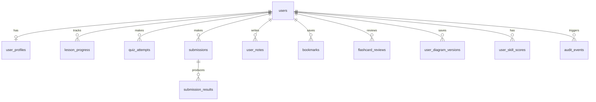

# Data design

## 1. Current (static app): browser storage
All keys live in `localStorage` under the prefix `sdlp:`. `src/lib/storage.ts` guards every call and falls back to
memory when storage is blocked.

| Key | Owner | Contents |
|---|---|---|
| `progress` | lib/progress.ts | `ProgressState` v1: visits, quiz attempts, exercise records (done, hints used, solution viewed), SRS cards, notes, exercise notes, bookmarks, activity log, completed lessons, project records, exams, interviews |
| `settings`, `theme` | lib/settings.ts | theme, font scale |
| `code:<exerciseId>` | C# editor | learner's edited files |
| `hld:*`, `lld:*` | playgrounds | saved designs (graph JSON) |
| `sql:*` | SQL playground | query history |
| `api:contract`, `api:baseline` | API designer | contracts |
| `backup:meta` | lib/backup.ts | last export/import times, persistent-storage result |

Backup file (`format: 2`): `{ app, format, exportedAt, keys: { <key>: <value> } }`. Restore supports
**replace** (clear then load) and **merge** (overwrite only keys in the file). Format-1 progress-only files are accepted.

## 2. Future backend: PostgreSQL schema (planned)
When a backend is added, transactional records move to PostgreSQL; lesson content stays in Git.

Core rules: UUID primary keys; `lesson_id`/`exercise_id` are text ids from the manifest (content is not in the DB);
`(user_id, lesson_id)` unique on `lesson_progress`; `submissions` indexed on `(user_id, exercise_id, created_at desc)`;
`user_diagram_versions` append-only with `(user_id, diagram_key, version)` unique; hidden tests and reference
solutions stored server-side only and never returned by public endpoints; ON DELETE CASCADE from `users` for
learner-owned rows; `audit_events` never cascades (retained for compliance).
