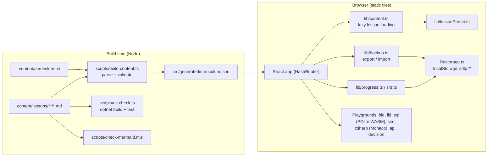

# System architecture

## Shape
A single-page React 19 + TypeScript app built with Vite and Tailwind CSS v4. It is a **modular monolith in the
browser**: one deployable, organised by feature folders, no backend.



**How to read it.** At build time, Markdown lessons are parsed by the same parser the app uses, validated, and turned
into a manifest. In the browser, the manifest drives navigation; each lesson's Markdown is loaded only when opened.
All learner state flows through `progress.ts` into `storage.ts`, which wraps `localStorage` with try/catch and an
in-memory fallback. `backup.ts` exports and restores every key under the `sdlp:` prefix.

## Folders
```
content/            curriculum.txt + lessons/<module>/<lesson>.md
scripts/            build-content, cs-check(+all), check-mermaid, csharp-shim (offline xUnit stand-in), e2e-smoke
src/lib/            parser, content, progress, srs, storage, backup, search, patterns, apiLint, decision, projectZip
src/components/     layout, ui kit, lesson blocks (quiz, exercise, flashcards, mermaid, code)
src/pages/          one file per route
src/playgrounds/    hld, lld, sql, sim — self-contained, each with tests
```

## Key decisions (ADR summary)
| # | Decision | Why | Revisit when |
|---|---|---|---|
| 1 | Static app, browser storage | Owner's choice; zero hosting cost; works on GitHub Pages/IIS | Need cross-device sync without files, or team features |
| 2 | Vite instead of Next.js | Pure static output, simpler hash routing on any host | Need SSR/SEO per lesson |
| 3 | Content as Markdown + custom `:::` directives | Version-controlled, diffable, validated at build | Non-developers need a CMS |
| 4 | PGlite for SQL | Real PostgreSQL semantics with zero server and full isolation per learner | — |
| 5 | C# runs on learner's machine via generated project | Browsers can't compile C# without a very heavy WASM toolchain; we never fake execution | A sandboxed execution service is added (see IMPLEMENTATION_PLAN) |
| 6 | Rule-based HLD/LLD feedback | Transparent and deterministic; errors separated from trade-offs | — |
